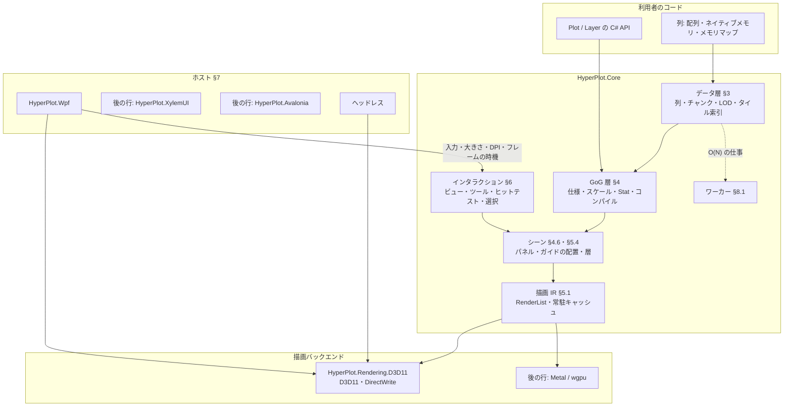

# HyperPlot 設計 v1

現行の設計だけを記す。何を満たすかは [requirements.ja.md](./requirements.ja.md)（要件の正本）、捨てた案は [design-decisions.md](./design-decisions.md)、実測を理由にした判断は [adr/](./adr/)、順序と状態は [roadmap.md](./roadmap.md) にある。要件の ID（D-1、R-2 など）は要件定義書のものを指す。

## 0. 目標・制約・外部依存の基準

C# / .NET 10 のプロットライブラリで、NativeAOT・10 億点の対話的な描画・Grammar of Graphics の構成・高度なインタラクションを両立させる（要件 §1）。

設計を貫く制約は次の 3 つである。

1. **フレームの仕事は画面の大きさで決まる**: 1 フレームの CPU 時間・GPU への転送・描画の量は、データの点数ではなく画素数と系列数で抑える。データの点数に比例する仕事（O(N)）は、フレームの外のワーカーで一度だけ行い、結果の索引をフレームで使う（不変条件 2）
2. **正しさを間引きで失わない**: 間引きは見た目を変えない方法（M4、§5.5.1）を既定とし、近似を使うときは誤差の上限を設計に書く
3. **ライブラリ本体は NativeAOT のまま**: リフレクション・実行時のコード生成を使わない。型に応じた表が要るときは手で書くか Source Generator で生成する

**外部依存の基準**: 依存を避けること自体は目的ではない。避けたいのは (1) 性能の最適化を手元に置けなくなること、(2) Windows で追加のネイティブ DLL を配布すること、(3) NativeAOT の障壁、の 3 つである。次をすべて満たすものは使ってよく、実測で理由が出たら自作に置き換える。

1. trim / AOT の警告ゼロで NativeAOT にリンクできる
2. Windows で追加の DLL を配布しない（OS の部品は使ってよい）
3. フレームの経路に入るなら、時間とアロケーションを自分たちで測れ、型が公開 API に出ない
4. MIT と両立するライセンスで、保守されている

### Dependency Decision Matrix

| 領域 | 自作 | 依存 | 理由 |
| --- | :---: | --- | --- |
| D3D11 / DXGI / D3D9Ex / DirectWrite の宣言 | | ○ TerraFX.Interop.Windows | 抽象層のない生成済みの宣言だけ。COM の vtable を直接呼ぶ。XylemUI と同じ |
| GPU の抽象（§5.2） | ○ | | 決まった数のパイプラインだけを持つ薄い層。汎用の GPU 抽象（Silk.NET・Vortice）は使わない |
| シェーダのコンパイル | ○（生成器） | Windows SDK の `fxc.exe`（ビルド時のみ） | 実行時の `d3dcompiler_47.dll` を持たない。生成物のバイトコードはリポジトリに入れる（§5.7） |
| テキストの整形とラスタライズ（Windows） | | ○ DirectWrite（OS） | 日本語のフォールバックと整形を OS に任せる。グリフのアトラスは自作（§5.6） |
| テキスト（macOS / Linux） | | 後の行で決める | XylemUI.Text（HarfBuzz）を使う案が第一候補 |
| PNG の書き出し | ○ | `System.IO.Compression`（BCL） | 書き出しだけなら小さい。zlib は BCL のもの |
| SIMD・数値 | | BCL（`System.Runtime.Intrinsics`、`System.Numerics`） | |
| メモリマップ | | BCL（`MemoryMappedFile`） | |
| WPF のホスト | | WPF（.NET の一部） | `HyperPlot.Wpf` だけが参照する |
| テスト・計測 | | xUnit v3、BenchmarkDotNet、`Microsoft.Extensions.TimeProvider.Testing` | テストとベンチマークのプロジェクトだけが参照する |
| Linux の GPU | | 後の行: wgpu-native | ドライバの組み合わせへの対応を小さなチームで続けられないため（XylemUI と同じ判断） |
| macOS の GPU | ○（後の行） | | Metal を Obj-C ランタイム経由で直接呼ぶ |

### 0.1 NativeAOT とランタイム

- 対象は .NET 10、C# 14。リリースは NativeAOT、開発は JIT（デバッガ・Hot Reload）で、両者の挙動は同じにする
- `src/` のプロジェクトは `IsAotCompatible`。ただし `HyperPlot.Wpf` だけは例外である。WPF 自体が NativeAOT と trim に対応しないので `IsAotCompatible=false` にする。それでも自身のコードではリフレクションを使わない
- 文化に依存する API を使わない（`InvariantGlobalization` で動く）。数値の書式は不変のカルチャを既定にし、利用者が書式の関数を渡せる
- 時刻は `TimeProvider` からだけ取る（§8.3）
- `unsafe` のコードを置いてよいのは、GPU のバックエンド、ホストのアダプタ、Core のデータ層のストレージ（ネイティブメモリとメモリマップのチャンク、§3.2）だけである（`.cursor/rules/interop.mdc`）

## 1. アーキテクチャ



1 枚の図（複数のプロット・ファセットを含む）は 1 つの `PlotEngine` が受け持つ。ホストは `PlotEngine` に描画先・入力・大きさ・DPI を渡し、`PlotEngine` が「次のフレームが要る」と言ったときにだけフレームを描かせる（§8.2）。何も変わらなければフレームを描かない。

## 2. プロジェクト構成

### 2.1 プロジェクト一覧

プロジェクトはそれを必要とする Issue の PR で作る（`docs/conventions.md`）。以下は予定の全体である。

| プロジェクト | TFM | 責務 |
| --- | --- | --- |
| `src/HyperPlot.Core` | `net10.0` | データ層・GoG 層・シーン・インタラクション・描画 IR・テキストの契約・ワーカー。GPU にも UI にも依存しない |
| `src/HyperPlot.Rendering.D3D11` | `net10.0-windows10.0.17763.0` | D3D11 のバックエンド（§5.3）とそのオフスクリーンの描画先、DirectWrite のテキスト（§5.6） |
| `src/HyperPlot.Wpf` | `net10.0-windows10.0.17763.0`（WPF） | `HyperPlotView`。D3DImage との共有（§7.2）。AOT の対象外 |
| `src/HyperPlot.Testing` | `net10.0` | 画像の比較（`GoldenImage`、§10.1、行 S3）。偽の時刻と入力の列の再生は、それを使う行で足す。テストと利用者のテストが使う |
| `src/HyperPlot.XylemUI` | 後の行 | XylemUI のホスト |
| `src/HyperPlot.Avalonia` | 後の行 | Avalonia のホスト |
| `src/HyperPlot.Rendering.Wgpu` / `.Metal` | 後の行 | Linux / macOS のバックエンド |
| `tests/*.Tests` | | 各 src プロジェクトのテスト |
| `samples/` | | `HelloPlot`（メモリの 1e6 点の線をヘッドレスで PNG に書く。NativeAOT の検査と要件 P-10 に使う、行 S1）、`BillionSeries`（1e9 点のメモリマップのファイルを複数の系列で、全体と拡大の PNG に書く、行 S1）、`WpfGallery` など |
| `benchmarks/HyperPlot.Benchmarks` | | BenchmarkDotNet によるカーネルの計測 |
| `benchmarks/HyperPlot.DataPath` | | GPU を使わないデータの経路の計測（NativeAOT）と、計測のデータの生成器（§9） |
| `benchmarks/HyperPlot.E2E` | | ヘッドレス描画のフレーム時間、GPU 時間、メモリ（NativeAOT）。行 S2 で作る |
| `tools/ShaderGen` | | HLSL を `fxc` でコンパイルし、バイトコードを C# のファイルに書き出す（§5.7） |

データ層を別のアセンブリ（`HyperPlot.Data`）に分けることは、利用者からの要求が出るまでしない。利用者が使う型の名前空間は `HyperPlot` 1 つにし（`using HyperPlot;` だけで書ける）、層はフォルダで分ける。バックエンドが実装する契約だけは `HyperPlot.Rendering` に置く（§5.2）。

### 2.2 依存方向

```text
HyperPlot.Core  ←  HyperPlot.Rendering.D3D11  ←  HyperPlot.Wpf
       ↑                                    ↖
HyperPlot.Testing                          （ヘッドレスは Rendering.D3D11 だけで動く）
```

- `HyperPlot.Core` は描画のバックエンドもホストも参照しない（不変条件 1）
- バックエンドは Core の描画 IR（§5.1）と GPU の抽象（§5.2）を実装する
- ホストはバックエンドとコアをつなぐ。UI フレームワークの型はホストのプロジェクトの外に出ない

## 3. データ層

### 3.1 列

列は 1 つの型の値の並びで、長さは `long` である。

```csharp
public abstract class Column                           // Column<T> と UniformColumn の基底
{
    public long Length { get; }
    public int ChunkCount { get; }
    public long Version { get; }                       // 追記・変更で増える
}

public sealed class Column<T> : Column, IDisposable where T : unmanaged, INumber<T>
{
    public ReadOnlySpan<T> GetChunk(int chunkIndex);   // 1 チャンク分の連続領域
    public ChunkStats<T> GetStats(int chunkIndex);     // §3.2
    public void Invalidate(long start, long length);   // 包んだ領域を利用者が書き換えたとき
}
```

- `INumber<T>` の制約は、統計のカーネル（§3.2）と統計の結合が `T` の比較と NaN の判定を要るためである。値の型の一覧に入らない数値の型は、作るときに `NotSupportedException` になる

- 値の型: `float`・`double`・`int`・`long`・`byte`。日時は `long`（ティック）の列にスケールで意味を与える。カテゴリは `int` の符号の列と辞書の組（`CategoricalColumn`）
- 要素ごとの仮想呼び出しを避けるため、読み出しの単位はチャンク（`ReadOnlySpan<T>`）である。ストレージの違い（§3.2）はチャンクを取り出すところで一度だけ分岐する
- **暗黙の列**: 等間隔の X（`UniformColumn`: 開始値と刻み、要件 D-5）は値を持たない。i 番目の値は `start + i * step` を倍精度で計算する。時系列で最も多い形で、索引も二分探索も要らない
- **欠損**: `float` / `double` は NaN を欠損とする。整数の列は任意の有効ビット列（1 ビット/要素）を持つ
- **表**（行 G1）: `DataTable` は長さの等しい名前付きの列の集合である。API は型付きの参照 `ColumnRef<T>`（表と列の位置）で列を指す。文字列の列名は `table.Col<float>("y")` で参照に解決し、その時点で型を確かめる

```csharp
public sealed class DataTable
{
    public static DataTableBuilder Create();
    public long Length { get; }                         // すべての列の長さ。列がなければ 0
    public int ColumnCount { get; }
    public string GetName(int index);
    public Column GetColumn(int index);
    public ColumnRef<T> Col<T>(string name) where T : unmanaged, INumber<T>;
}

public sealed class DataTableBuilder
{
    public DataTableBuilder Add(string name, Column column);
    public DataTable Build();
}

public readonly struct ColumnRef : IEquatable<ColumnRef>          // 型を忘れた参照（仕様の型が持つ）
{
    public DataTable Table { get; }
    public int Index { get; }
    public Column Column { get; }                                 // Table.GetColumn(Index)
    // Equals・GetHashCode・== と != を持つ
}

public readonly struct ColumnRef<T> : IEquatable<ColumnRef<T>> where T : unmanaged, INumber<T>
{
    public DataTable Table { get; }
    public int Index { get; }
    public Column Column { get; }
    public static implicit operator ColumnRef(ColumnRef<T> reference);
    public ColumnRef ToColumnRef();                               // 暗黙の変換の名前つきの代わり（CA2225）
    // Equals・GetHashCode・== と != を持つ
}
```

  - `Col<T>` は、列が `Column<T>` なら、または列が `UniformColumn` で `T` が `double` なら参照を返す（`UniformColumn` の値は倍精度、§3.1 の暗黙の列）。名前がなければ、型が合わなければ、どちらも名前と実際の型を書いた `ArgumentException`。名前は大文字と小文字を区別する（序数の比較）
  - `Add` は、名前が null なら `ArgumentNullException`、空か、すでにある名前なら `ArgumentException`。`column` が null なら `ArgumentNullException`。`Build` は、列の長さがそろっていなければ、名前と長さを書いた `ArgumentException`。`Build` の後のビルダは使えない（`InvalidOperationException`）
  - 表は列を持つだけで、列の持ち主ではない。`DataTable` は `IDisposable` ではなく、列の寿命は利用者が持つ
  - `ColumnRef` と `ColumnRef<T>` の等しさは、表の同一性（参照）と位置の組である。`default` の参照は表を持たず、仕様に渡すと `ArgumentException`
- **ゼロコピー**: 利用者の `T[]`・`Memory<T>`・ポインタ（`Column.Wrap<T>(T* pointer, long length)`）を写さずに包める（要件 D-3）。ポインタは `Memory<T>` の `int` の上限を超える長さを包め、メモリの寿命は利用者が持つ。包んだ領域を利用者が書き換えたら `column.Invalidate(start, length)` を呼ぶ契約とする。写す API は名前に `Copy` を含める

### 3.2 チャンクとストレージ

- **チャンク**: 2^20 要素（1,048,576）。2 の冪なので、要素の位置からチャンクと内側の位置をシフトとマスクで求められる。`float` で 4 MiB、`double` で 8 MiB になり、ワーカーの仕事の単位にもなる
- **ストレージ**は 3 種類である（要件 D-2）。

| 種類 | 実体 | 用途 |
| --- | --- | --- |
| マネージド | `T[]` または `Memory<T>` | 小〜中規模、利用者の配列を包む |
| ネイティブ | `NativeMemory.AlignedAlloc`（64 バイト境界）をチャンクごとに列が持つ。または利用者が持つメモリをポインタと `long` の長さで包む（写さない。境界は利用者のメモリのまま） | 追記・リングバッファ・大規模なメモリ上のデータ、計測機器のバッファ |
| メモリマップ | `MemoryMappedFile` のビュー。列の範囲を 1 つのビューで写像し、チャンクはその中の位置で切り出す | RAM に載らない 10 億点のファイル |

- メモリマップの列は、生のリトルエンディアンの配列のファイル（先頭のオフセット・型・長さを指定）を読む。ファイル形式の網羅はしない（要件 D-8）
- **チャンクの統計**: チャンクごとに SIMD で `min`・`max`・最初と最後の値・和（`double`、NaN を除く）・値の数・NaN の数・単調非減少かどうかを計算し、`ChunkStats<T>` に持つ。統計は初めて読まれたときに計算して持ち、`Invalidate` でそのチャンクの分を捨てる（チャンクごとの世代で、古い世代の結果を返さない）。ワーカー（§8.1）は、ピラミッド（§3.3）を作るときに、統計がまだないチャンクの統計を水準 1 と同じ走査で計算して持つ。ピラミッドを作らない列（M4 の X など）は、`PlotWorkerPool.PrecomputeStats` で先に計算させる。追記（§3.5）では、チャンクを足したときに計算させる。スケールの domain（§4.2）、Y の自動範囲（§6.2）、X の二分探索の絞り込みは、まずこの統計を読む。統計の総数はチャンクの数（10 億点で 954 個）なので、全体の範囲が O(チャンク数) で分かる

### 3.3 LOD ピラミッド（時系列）

X が単調増加の列（時系列、要件 D-4）では、Y の列ごとに min / max のピラミッドを作る。

- **水準**: 水準 ℓ（ℓ = 1, 2, …）のバケットは 64 · 8^(ℓ−1) 要素（64、512、4096、32768、262144）で、各バケットに Y の min と max を持つ。1 チャンク（2^20 要素）の中に 5 水準が収まり、それより上はチャンクの統計（§3.2）がピラミッドの頂点を兼ねる
- **大きさ**: 2/64 + 2/512 + … ≈ 3.6%（要素と同じ型で min と max を持つ場合）に、バケットごとの NaN でない値の数（`float` で約 0.5%、下の「メモリ」）を足して約 4.1%。要件 P-8（10% 以下）に収まる
- **作り方**: チャンクごとに独立なので並列に作れる。水準 1 は生データを 1 回読む SIMD の min / max、それより上は下の水準から作る。メモリの帯域で律速する
- **欠損**: NaN は min / max から除き、バケットごとに NaN でない値の数を持つ（折れ線を切る場所を見つけるため、要件 D-7。下の「NaN でない値の数」）
- **単調変換との関係**: スケールの変換（log、sqrt など、§4.2）が単調増加なら、変換後の min / max は min / max の変換と等しい。単調減少なら入れ替わる。したがってピラミッドは生の値で 1 つ作れば、どの単調なスケールにも使える
- **X が等間隔でない場合**: 画素の境界に当たる要素の位置を X の二分探索で求める。チャンクの統計で探す範囲をチャンク 1 つに絞ってから探す

**区間の min / max の問い合わせ**: 要素の区間 [a, b) の min / max は、区間に完全に含まれる最も粗い水準のバケットを組み合わせて求め、両端だけ細かい水準に降りる。生データを大きさ 1 の水準 0 と数え、両端は水準 0 まで降りる。結果に誤差はない。

- 両端で読む生データは、それぞれ最大 63 要素（次の 64 要素の境界まで）である。その先は、区間に完全に含まれる最も粗い水準のバケットにつなぐ
- M4（§5.5.1）も同じ問い合わせを使う。両端で読む生データは、first / last のために読む境界の要素から 63 要素以内（`float` で 252 バイト）なので、メモリマップのデータでも新しく触るページはほとんどない
- min / max の要素の位置は、その値を持つバケットを水準 0 まで降りて求める。同じ値が複数あるときは、区間の中で最初に現れる位置をとる
- 両端を粗い水準で止め、バケットを中心で含める誤差つきの問い合わせは採らない（`design-decisions.md` の「M4 の入出力」）

**型と持ち主**（ロードマップ C2）。ピラミッドは列とは別のオブジェクトで、ワーカー（§8.1）が作る。列（§3.1）はワーカーを知らない。同じ列に複数のピラミッドを持ってもよい。

```csharp
public sealed class PlotWorkerPool : IDisposable
{
    public PlotWorkerPool(int threadCount);
    public static PlotWorkerPool Shared { get; }       // ProcessorCount − 1 本（最小 1 本）
    public int ThreadCount { get; }
    public MinMaxPyramid<T> BuildPyramid<T>(Column<T> column) where T : unmanaged, INumber<T>;
    public Task PrecomputeStats<T>(Column<T> column) where T : unmanaged, INumber<T>;  // X の列のチャンクの統計（§5.5.1）
    public void Dispose();
}

public sealed class MinMaxPyramid<T> : IDisposable where T : unmanaged, INumber<T>
{
    public Column<T> Column { get; }
    public long Version { get; }                       // チャンクが 1 つできるたびに増える
    public bool IsComplete { get; }                    // すべてのチャンクが列の今の世代でできている
    public Task Completion { get; }                    // 最初の構築がすべて終わったとき
    public Exception? Fault { get; }                   // チャンクを読む中で起きた例外
    internal Task WhenComplete();                      // 行 G1: 世代の古いチャンクを要求し、IsComplete が真になったら終わる（§4.8 のヘッドレスの待ち方）
    public MinMax<T> GetMinMax(long start, long length);
    public void Dispose();
}

public readonly struct MinMax<T> where T : unmanaged, INumber<T>
{
    public T Min { get; }
    public T Max { get; }
    public long Count { get; }                         // NaN でない値の数。0 なら Min と Max は default
    public bool HasNaN { get; }                        // 区間に NaN がある（すべてが NaN でも真）
    public bool IsProvisional { get; }                 // できていないチャンクを計算済みの統計で代えた（統計もなければ何も足さない）
}
```

- `BuildPyramid` はすぐに返り、チャンクごとの仕事をワーカーに積む。長さ 0 の列のピラミッドは、作った時点でできている
- **破棄の順**: ピラミッドは列より先に破棄する。構築中のピラミッドは列のチャンクを読むので、列を先に破棄すると、ネイティブとメモリマップのストレージでは列の契約（§3.1、`Dispose` と読み出しを並行させない）を破る
- **メモリ**: チャンクごとに、5 水準を `NativeMemory.AlignedAlloc`（64 バイト境界）の 1 ブロックに置く。列のストレージ（メモリマップを含む）によらない。長さ n のチャンクのバケットの数は Σ_{ℓ=1..5} ⌈n / (64 · 8^(ℓ−1))⌉ で、各バケットは min と max（2 · sizeof(T) バイト）と NaN でない値の数を持つ。min と max は、1e9 点の `float` で 1e9 × 8 B × (1/64 + 1/512 + 1/4096 + 1/32768 + 1/262144) ≈ 143 MB、`double` で約 286 MB になる。数は、バケットの大きさが入る最小の幅で持つ（水準 1 の 64 は 1 バイト、水準 2〜4 の 512・4096・32768 は 2 バイト、水準 5 の 262144 は 4 バイト）。1e9 点で 15,625,000 × 1 B + 1,953,125 × 2 B + 244,141 × 2 B + 30,518 × 2 B + 3,815 × 4 B ≈ 20.1 MB（`float` の元データの 0.50%）である。これに端数のバケット（チャンクあたり最大 5 個）が加わる
- **NaN でない値の数**: バケットごとに NaN でない値の数を持つ。数がバケットの大きさと同じなら「NaN なし」、0 なら「すべて NaN」、その間なら「一部が NaN」で、すべて NaN のバケットの min / max は使わない。`GetMinMax` の `Count` は、区間を覆うバケットの数を足すだけで求まり、区間の長さによらない（生データを数えるのは両端の最大 63 要素ずつ）。M4 は、この数で NaN の切れ目を見つけ、すべて NaN のバケットを飛ばして NaN でない要素を探す（§5.5.1）
- **構築**: 1 チャンクが 1 つの仕事である。ワーカーは、統計（§3.2）がまだないチャンクでは、統計と水準 1 を生データの 1 回の SIMD の走査で作り、統計を列に持たせる。統計がすでにあるチャンク（`PrecomputeStats` や `GetStats` の後）では、水準 1 だけを走査する。水準 2〜5 は下の水準から作る。1 回の走査は、統計と水準 1 を別々に走査するときの 0.53〜0.72 倍の時間で、水準 1 だけの走査は 1 回の走査より速い（行 B1 の計測、参照機、L3 に収まらない 64 チャンク、`docs/benchmarks/b1-data-layer.md`）。1 回の走査の結果は、統計のカーネルと水準 1 のカーネルを別々に回した結果と同じ値である。`Sum` は足す順が同じなのでビットまで同じで、min / max は 0 の符号だけが違いうる（x64 の `minps` は両方が 0 のとき 2 つ目の引数を返すので、−0 と +0 を積む順で符号が変わる）
- **順番**: 要求のあったチャンクを先に、残りを位置の順に作る。問い合わせや M4 が、まだできていないチャンクに当たると、そのチャンクを要求する。要求はチャンクごとのフラグを立ててワーカーを起こすだけで、確保も待ちもしない（不変条件 3・7）
- **暫定**: まだできていないチャンク（世代が古いものを含む）は、問い合わせの中で、すでに計算されたチャンクの統計（§3.2）で代え、結果に `IsProvisional` を立てる（不変条件 4）。暫定の経路は統計を計算しない。計算すると、ワーカーがまだ触っていないチャンクを呼び出し側のスレッドで走査し、構築の直後の全体表示でフレームの経路が O(N) になる（不変条件 2、要件 P-2）。統計もまだないチャンクは、結果に何も足さずに暫定にする。区間のチャンクがすべて統計もないとき、`GetMinMax` は `Count` 0、`Min` と `Max` は `default`、`HasNaN` は偽で、`IsProvisional` が真になる。「すべて NaN」の結果（`HasNaN` が真）とも `Count` 0 が同じなので、まだ答えのないことは `IsProvisional` で見分ける。区間がチャンクを丸ごと含み、統計があるなら、統計がそのまま正しいので暫定にしない。チャンクの一部だけを含むなら、min / max・`Count`・`HasNaN` はチャンク全体の値になり、範囲が広がる。利用者が値を書き換えてまだ `Invalidate` を呼んでいないときなど、ブロックが生データと食い違う（ブロックの min / max の値が生データに見つからない）チャンクも、暫定で答える。描く側は `Version` の変化で描き直す。見えているチャンクを先に作るので、暫定の表示は見えている範囲から先に正しい表示に替わる（替わるまでの時間は行 B1 で測る。§9）
- **チャンクの状態**: ピラミッドはチャンクごとに次の状態を 1 つ持ち、状態の書き換えは比較交換（CAS）で行う。ブロックは `BuildPyramid` で全チャンク分を確保する（1e9 点で 954 回の `AlignedAlloc`）ので、読む側がブロックのないチャンクに当たることはない

| 状態 | 意味 |
| --- | --- |
| 未構築 | まだ作っていない。積まれているが、要求はない |
| 要求あり | 問い合わせか M4 が要求した。先に作る |
| 処理中 | 1 つのワーカーが書いている |
| できた | ブロックが、記録した列の世代で正しい |
| 失敗 | 作る中で例外が起きた |

  - 規則 1: 1 つのチャンクに書くワーカーは同時に 1 つである。ワーカーは状態を「未構築」か「要求あり」から「処理中」へ CAS で替えられたときだけ書く。seqlock は書き手が 1 つであることを前提にする
  - 規則 2: 書き終えたワーカーは、列のチャンクの世代を読み直す。書き始めのときと同じなら「できた」にする。違えば（処理中に `Invalidate` が来た）「未構築」に戻して自分で積み直す
  - 規則 3: 「失敗」のチャンクは、要求されても積まない。そのチャンクの世代が進んだとき（`Invalidate`）に限り、次に読まれたときに「要求あり」に戻る。新しい `BuildPyramid` は新しいピラミッドを作るので、失敗を持ち越さない
  - 許す遷移: 未構築 → 要求あり（要求）、未構築・要求あり → 処理中（ワーカー）、処理中 → できた・未構築（規則 2）・失敗、できた → 要求あり（読んだときに世代が古い）、失敗 → 要求あり（世代が進んだ後に読まれた）。これ以外（たとえば 2 つ目のワーカーが処理中のチャンクを取る、世代の変わらない失敗を要求で積む）は起きない
- **世代と公開**: 各チャンクのブロックは、作ったときの列のチャンクの世代（§3.2）を持つ。`Invalidate` で世代が進んだチャンクは、次に読まれたときに「要求あり」になる（規則 3 の失敗を除く）。ワーカーはブロックをその場で書き換える。書く前と後にブロックの版を奇数・偶数に進め（seqlock）、読む側は読む前と後に版を読む。違うか奇数なら、そのチャンクを暫定として扱う。ブロックは `Dispose` まで解放しないので、読む側が解放済みのメモリを読むことはない。`Dispose` と読み出しの並行は、列と同じく契約で禁じる
- **失敗**: チャンクを読む中の例外は、そのチャンクを「失敗」にする（規則 3。失敗し続ける仕事を毎フレーム積まない）。`Fault` は最初の例外を持ち、`Completion` はその例外で終わる。失敗したチャンクは、問い合わせでは暫定（チャンクの統計）で答える
- **`WhenComplete()`**（internal、行 G1）: ヘッドレスの描画が、`Invalidate` の後の作り直しまで待つための口である（§4.8）。`IsComplete` が真なら終わった `Task` を返す。偽なら、世代の古いチャンクと未構築のチャンクをすべて「要求あり」にしてワーカーを起こし、チャンクが「できた」になるたびに `IsComplete` を確かめ、真になったときに終わる `Task` を返す。呼ぶ前にすでに `Fault` があれば、その例外で終わった `Task` を返す（失敗したチャンクは規則 3 で要求しても積まれないので、待てば終わらない）。待っている間に `Fault` が立つか、待つチャンクが「失敗」になったら、その例外で終わる。`Dispose` されたら `ObjectDisposedException` で終わる。同時に何回呼んでもよく、待っている呼び出しは同じ `Task` を受ける。終わっていないときだけ `TaskCompletionSource` を 1 つ確保する（ヘッドレスの経路で、フレームの経路ではない）
- **`GetMinMax(start, length)`**: 区間の誤差のない min / max と `Count`。両端は生データまで降りる。`length` が 0 なら `Count` が 0 の結果を返す。区間の値がすべて NaN なら、`Count` は 0、`Min` と `Max` は `default`、`HasNaN` は真（`ChunkStats<T>` と同じ）。区間が列の外なら `ArgumentOutOfRangeException`。M4 も同じ誤差のない問い合わせを使い、min / max の要素の位置も求める

### 3.4 空間タイル索引（散布）

X が単調でない列（散布図）では、点を空間の順に並べ直した写しと、四分木の索引を作る。

並べ直し（量子化・Morton 符号・数え上げソート・セル＝連続範囲の木）は、次元の数を引数に取る共通の部品にする。2 次元では 16 ビット × 2 の 32 ビットの符号と四分木になり、3 次元（v1.x の点群、§13.3）では 21 ビット × 3 の 63 ビットの符号と八分木になる。以下は 2 次元の場合を書く。

1. **量子化**: チャンクの統計から全体の範囲を求め、x と y をそれぞれ 16 ビットの格子に量子化する。2 つを交互に並べた 32 ビットの Morton 符号（Z 順）を点の位置の鍵とする
2. **並べ直し**: 符号の上位 16 ビット（256 × 256 の最上位のタイル）で数え上げソートを行う。1 回目の走査でタイルごとの点の数を数え、2 回目で各点を写しの決まった位置に書く。写しは同じ長さの列（x、y、エンコードに使う列、元の位置 `long`）である。データが RAM に載らないときは、写しを一時ファイルのメモリマップに書く。タイルの中は RAM で残りのビットを基数ソートする
3. **四分木**: Morton 順に並べたので、四分木のどのセルも写しの連続した範囲になる。点の数が `LeafCapacity`（既定 4096）以下になるまでセルを分け、各セルの範囲と点の数を表に持つ。10 億点で表は数十万〜百万行程度になる
4. **密度タイル**: 四分木の上の方のセル（点の数が `DensitySplit` を超えるセル）は、それぞれ 256 × 256 の 2D ヒストグラム（`uint`）を持つ。子の密度から親を 2 × 2 の和で作る（画像のミップマップと同じ）。どのセルまで密度を持つかは、§5.5.2 の切り替えの閾値から決める
5. **元の位置**: 選択（§6.4）とツールチップは元の行を指す。写しの `long` の列で元の位置へ戻す

タイルの大きさ（256 × 256）、`LeafCapacity`、`DensitySplit` は仮の値で、索引の行（ロードマップ C3）の計測で決める。

### 3.5 ストリーミング

- **追記**: ネイティブのストレージの最後のチャンクに書き足す。チャンクの統計と LOD の最後のバケットは追記のたびに更新し、埋まったバケットから上の水準へ伝える。埋まっていないバケットは「末尾の要約」として持ち、問い合わせでは生データと同じに扱う
- **リングバッファ**: 固定の数のチャンクを使い回す。論理的な位置（0 から増え続ける `long`）と物理的なチャンクの対応を持ち、古いチャンクを捨てるときは統計と LOD もまとめて捨てる
- **版**: 追記は列の `Version` を増やす。フレームは始まりの時点の版を読み、描く間に追記されたぶんは次のフレームで描く（要件 P-7 の 2 フレーム以内）
- **散布のストリーミング**は、v1 では生の点で描ける規模（1e7 点）までとする。空間タイル索引の追記は後の行で扱う

### 3.6 座標の精度

日時のティック（`long`）や遠い原点を持つ倍精度の値を float32 で GPU に送ると、深くズームしたときに点の位置が画素の単位で揃ってしまう（POC で起きた問題、要件 R-6）。

- スケールの空間（§4.2）の値は CPU では常に `double` で扱う
- GPU には「原点からの差」を float32 で送る。原点はチャンク（またはタイル）ごとに CPU が持ち、フレームごとに「チャンクの原点 − ビューの原点」を倍精度で計算し、定数として渡す
- M4 の経路（§5.5.1）では、CPU が倍精度から画素の座標まで計算してから頂点を作るので、この問題は起きない

## 4. GoG 層

### 4.1 仕様モデル

プロットは不変の値（`record`）の木で宣言する。

| 要素 | 内容 |
| --- | --- |
| `PlotSpec` | データ、レイヤーの並び、スケール、座標系、ファセット、ガイド、テーマ、インタラクション |
| `LayerSpec` | Geom、Stat、Position、エンコーディング（チャネル → 列の参照・定数・スケールの指定）、レイヤー固有のデータと変換 |
| `ScaleSpec` | 種類、domain、range、nice、zero、reverse、clamp、ガイドの書式 |
| `CoordSpec` | cartesian（flip を含む）、polar |
| `FacetSpec` | wrap / grid、行と列の列参照、軸の共有 |
| `FigureSpec` | 複数のプロットの並べ方（concat、grid）とリンク（§6.4） |

- 仕様の各ノードは同一性（`SpecId`）を持つ。仕様を差し替えたら、新旧を比べて何が変わったか（データ・Stat・スケール・配置・見た目）を求め、変わった段だけを計算し直す（要件 G-13）
- Geom・Stat・スケールは公開のインターフェース（`IGeom`・`IStat`・`IScale`）で足せる（要件 N-6）。プロットの種類は随時足していく（要件 G-14）。新しい種類はまず既存の Geom・Stat・Position・座標系の組み合わせで表せるかを確かめ（例: 箱ひげ図は summary の Stat と rect・rule・point の Geom）、表せないときだけ新しい Geom・Stat・座標系を作る。組み込みのものは `sealed` のクラスにする。インターフェースの呼び出しはレイヤーごと・フレームごとに起き、点ごとには起きない

**行 G1 の仕様の型**: G1 は、上の表のうち、データ・線のレイヤー・x と y の位置のスケール（linear）だけを持つ（Issue #76）。ほかのメンバー（座標系・ファセット・ガイド・テーマ・インタラクション、ほかの Geom とスケール）は、それを作る行で足す（`.cursor/rules/scope.mdc`）。後から足しても既存の利用者のコードが壊れないよう、仕様の型は位置引数の record にせず、init のプロパティにする。

```csharp
public readonly record struct SpecId(long Value);       // プロセスで一意。0 は使わない

public abstract record SpecNode                          // 仕様のノードの基底。持つのは Id だけ
{
    public SpecId Id { get; }                           // 作るとき、と `with` で写すたびに新しく振る
    private protected SpecNode();
    protected SpecNode(SpecNode original);              // 写しのコンストラクタ: 中身は派生の record が写し、Id は新しく振る
    // sealed でない record の写しのコンストラクタは protected 以上が要る（CS8878）ので、利用者はこれを通して派生できる。
    // G1 のコンパイルは組み込みの型だけを受け、知らない種類は拒む（§4.8 の検査）
}

public sealed record PlotSpec : SpecNode
{
    public required DataTable Data { get; init; }
    public required IReadOnlyList<LayerSpec> Layers { get; init; }
    public ScaleSpec ScaleX { get; init; }              // 既定は Scale.Linear()（domain は学習）
    public ScaleSpec ScaleY { get; init; }
}

public abstract record LayerSpec : SpecNode             // 新しく作るコンストラクタは private protected。Geom を足す口（IGeom）は行 G4

public sealed record LineLayerSpec : LayerSpec
{
    public required ColumnRef X { get; init; }          // UniformColumn か、単調非減少で NaN のない Column<T>
    public required ColumnRef Y { get; init; }
    public LineStyle Style { get; init; }               // 既定は黒（0, 0, 0, 255）、太さ 1、破線なし
}

public abstract record ScaleSpec : SpecNode             // 新しく作るコンストラクタは private protected。スケールを足す口（IScale）は行 G2

public sealed record LinearScaleSpec : ScaleSpec
{
    public (double Min, double Max)? Domain { get; init; }      // null なら学習する（§4.2）
    public LinearScaleSpec WithDomain(double min, double max);  // 有限で min < max。外れれば ArgumentException
}

public static class Scale
{
    public static LinearScaleSpec Linear();
}

public static class Plot
{
    public static PlotBuilder Create(DataTable data);
}

public sealed class PlotBuilder
{
    public PlotBuilder Line<TX, TY>(ColumnRef<TX> x, ColumnRef<TY> y, Action<LineBuilder>? configure = null)
        where TX : unmanaged, INumber<TX>
        where TY : unmanaged, INumber<TY>;
    public PlotBuilder ScaleX(ScaleSpec scale);
    public PlotBuilder ScaleY(ScaleSpec scale);
    public PlotSpec Build();
}

public sealed class LineBuilder
{
    public LineBuilder Color(Color color);
    public LineBuilder Width(float width);
    public LineBuilder Dash(LineDash? dash);
}
```

- **同一性**: `SpecId` は、ノードを作るときと、`with` で写すとき（record の写しのコンストラクタ）に、プロセスで一意の値を新しく振る（`Interlocked.Increment`）。record の写しのコンストラクタは値をそのまま写すので、`Id` だけを持つ基底 `SpecNode` が自分の写しのコンストラクタで振り直し、派生の record の生成された写しのコンストラクタがそれを呼ぶ（派生の型が自分のメンバーを手で写さずに済む）。仕様は不変なので、同じ `Id` のノードは中身も同じである。`Id` は record の等しさに入る（中身が同じでも、別に作ったノードは等しくない）。中身を比べるのは、コンパイルの差分（§4.8）の役目である
- **ビルダ**: `Line` は、`x` と `y` が `Create` に渡した表の列でなければ、`default` の参照なら、`y` の列が `Column<T>` でなければ（ピラミッドは `Column<T>` に作る。列の種類を見るだけでデータには触れない）`ArgumentException`。`configure` は `Line` の中で 1 回だけ呼び、`LineBuilder` の値は `LineStyle` の検査（§5.1）を通す。`Build` はレイヤーが 0 個でもよく（何も描かない）、`Build` の後のビルダは使えない（`InvalidOperationException`）。ビルダは不変の仕様を作るだけで、データに触れない
- 仕様の型を直接作ってもよい（ビルダを通さない）。そのときの検査は、コンパイル（§4.8）が同じ例外で行う

### 4.2 エンコーディングとスケール

- スケールは「学習」（データから domain を求める）と「写像」（値を range へ）に分かれる
- 連続のスケールの学習は、チャンクの統計（§3.2）を読むので O(チャンク数) で済む。カテゴリのスケールは辞書を読む
- **linear（行 G1）**: domain は明示（`WithDomain`）か学習である。学習は、そのスケールを使うすべてのレイヤーの列の値の範囲の和で、`Column<T>` はチャンクの統計（NaN を除く min / max）を、`UniformColumn` は最初と最後の値（`GetValue(0)` と `GetValue(Length − 1)`）を読む。統計がまだないチャンクは、ワーカーに計算させてから読む（§4.8）。長さ 0 の列は何も足さない。NaN でない値の数（統計の `Count`）がすべて 0 なら [0, 1]、min と max が等しければ [v − 0.5, v + 0.5] にする。チャンクの統計は NaN だけを除き ±∞ を含むので、学んだ min か max が有限でなければ、学習を失敗にし、列の名前と値を書いた `InvalidOperationException` を投げる（端が無限大の domain は、どの有限の値も同じ画素に写して何も描かない。黙って空の画像を出さず、`WithDomain` で明示する道を残す）。写像は、値 v を `(v − min) / (max − min)` で [0, 1] に写し、パネルの画素へは倍精度で写す（x は左から右、y は下から上、§3.6）。nice・zero・reverse・clamp は行 G2
- **位置のスケール**は、データの値を「スケールの空間」（log なら log10 した値、日時ならティック）の `double` に写す。ズームとパンはスケールの空間でのビュー範囲（§6.2）を変えるだけで、データを写し直さない。画面の座標は、ビューから座標系の変換（§4.4）で求める
- **非線形のスケール**（log、symlog、sqrt、power）
  - M4 の経路（時系列）: ピラミッドは単調変換に対して不変なので（§3.3）、CPU が出力の頂点ごとに変換する
  - 生の点の経路（散布）: スケールの空間の値の写しをチャンクごとに遅延して作り、版を付けて持つ。シェーダでは変換しない
- 色・大きさ・形のスケールの写像は SIMD のカーネルで行い、結果はチャンクごとに持つ。色のスケールのうち連続のものは、GPU では 256 色のテクスチャの参照で行う

### 4.3 Stat と変換

- Stat（bin、count、summary、density、smooth）と変換（filter、calculate）はワーカーで動き、結果を版付きの派生の表として持つ
- 利用者の計算は、チャンク単位のデリゲート（`(ReadOnlySpan<double> x, Span<double> result)` の形）で渡す。式木のコンパイルは使わない（AOT のため）
- 大規模データのための集約（M4、密度）は Stat と同じ枠で表すが、ビューに依存するので、コンパイルの段ではなく描画の段（§5.5）で行う

### 4.4 座標系

座標系の契約は「スケールの空間の位置（x, y, z）からクリップ空間への写像」で、倍精度の 4×4 の変換と、その変換の原点（§3.6）で表す。非線形の座標系は、変換に加えて頂点ごとの写像を持つ。

- cartesian: ビリオン級のすべての経路に対応する。z = 0 の正射影の変換を返す。flip は x と y の役割を入れ替える
- polar: 頂点を CPU（線・面）または頂点シェーダ（点）で極座標に変換する。M4 と密度タイルは使わず、1e7 点までとする（要件 G-7）
- 3D の cartesian（v1.x、§13.2）は、同じ契約で透視または正射影の変換を返す。v1 の契約を変えずに足せる（不変条件 12）

### 4.5 ファセットと複数のプロット

- ファセットは、行・列の値ごとに「選択ベクトル」（行の位置の並び）を作り、元の列を写さずに部分の表として扱う
- 大規模データのファセットでは、ファセットの値ごとに LOD と索引を作る（仕事は値の数だけ並列になる）
- 各パネルはそれぞれのビュー範囲を持つ。軸の共有はパネルのビューをリンク（§6.4）でつなぐことで表す

### 4.6 ガイドと配置

- **目盛り**: 線形は Wilkinson の拡張アルゴリズム（Talbot ら 2010）で候補から選ぶ。log は 10 の冪とその間、日時は暦の粒度の段（年・月・日・時・分・秒・ms・µs・ns）から、目盛りの間隔が文字の幅に収まるものを選ぶ
- **書式**: 既定は不変のカルチャで書く。利用者は `Func<double, string>` か、アロケーションのない `TryFormat` 形のデリゲートを渡せる
- **配置**: 図全体の矩形から、タイトル → 凡例 → 軸（目盛りのラベルの寸法はテキストの計測で求める）→ パネルの順に場所を決める。結果は版付きで持ち、大きさ・DPI・目盛りのラベル・凡例が変わったときだけ計算し直す
- ズーム中は目盛りのラベルが毎フレーム変わる。ラベルの文字列とグリフの並びはキャッシュし（§5.6）、フレームの経路でアロケーションしない

### 4.7 テーマ

色・フォント・線の幅・余白・目盛りの長さを 1 つの `Theme` にまとめる。ライトとダークの既定テーマを持ち、プロットごとに一部を上書きできる。

### 4.8 コンパイル

`PlotSpec` を `PlotPlan` にする段である。

1. 列の参照を解決し、型とレイヤーのエンコーディングの整合を確かめる（誤りは例外で返す）
2. スケールを学習する（§4.2）
3. Stat・変換の仕事をワーカーに出す（§4.3）
4. 必要な索引（LOD、タイル）がなければワーカーに作らせる
5. ガイドとパネルを配置する（§4.6）

ワーカーの仕事が終わるまでの間は、終わったものから描く。索引ができるまで時系列は「チャンクの統計だけの粗い表示」で描き、それと分かる印をホストへ通知する（要件 P-2）。

**行 G1 のコンパイル**: G1 は 1〜2 と 4 を行う（Stat は G5、配置は G3）。結果の `PlotPlan`（internal）は、レイヤーごとの X の列・Y のピラミッド・M4 の出力の場所・線の見た目と、x と y の domain を持つ。

- **検査**: 次のときは `ArgumentException`（null は `ArgumentNullException`）。`Data`・`Layers`・`ScaleX`・`ScaleY` が null、レイヤーが null。列の参照が `default` か `Data` 以外の表を指す。X の列が `UniformColumn` でも `Column<T>` でもない（`UniformColumn` の step は作るときに正と決まっている、§3.1）。Y の列が `Column<T>` でない（ピラミッドは `Column<T>` に作る）。レイヤーが `LineLayerSpec` でない、スケールが `LinearScaleSpec` でない（写しのコンストラクタを通した利用者の派生を含む。メッセージに型の名前を書く。Geom を足す口は G4、スケールは G2）。直接作った仕様の `Domain` が `WithDomain` の条件（有限で min < max）を外れる。`Style` が §5.1 の `LineStyle` の検査を外れる。X の単調性は M4 が確かめ（§5.5.1）、`InvalidOperationException` がそのまま出る
- **索引**: Y の列ごとに `MinMaxPyramid` をプールで作る。同じ Y の列を指すレイヤーは、ピラミッドを 1 つ共有する。X が `Column<T>` なら `PlotWorkerPool.PrecomputeStats` で X の統計を先に計算させる（§5.5.1）。学習も、作られた統計を読む
- **差分（要件 G-13）**: 前のコンパイルの結果があれば、新しい仕様とノードの `Id` で比べ、変わった段だけをやり直す。`Id` が同じノードは変わっていない。違うノードは中身で分ける。表かレイヤーの列の参照が変わったら「データ」で、新しく要る Y の列のピラミッドを作り、要らなくなったものを解放し、domain を学び直す。スケールの中身（`Domain`）が変わったら「スケール」で、domain を決め直して M4 を引き直す。線の見た目（`Style`）だけが変わったら「見た目」で、M4 の出力をそのまま使って記録し直す。レイヤーの数か並びが変わったら、残ったレイヤーの索引を使い回して、ほかの段をやり直す。差分は、作ったピラミッドの数・M4 を引いた数・記録した数を internal の数え口で数え、テストがそれを見る
- **ヘッドレスの待ち方**: `HeadlessRenderer.Render(PlotSpec)`（§7.5）は、描くたびに、使うピラミッドと X の統計が列の今の世代でそろうのを待ってから描く。ヘッドレスの出力は、いつ描いても同じでなければならないからである。ヘッドレスは UI のスレッドではないので、不変条件 7 に触れない。上の段落の暫定の表示とホストへの通知は、それを使うホストの行（W1）で作る
  - ピラミッドは internal の `MinMaxPyramid<T>.WhenComplete()`（§3.3）で待つ。`Completion` は最初の構築だけを表し、`Invalidate` の後の作り直しを知らせないからである。`WhenComplete` は、`IsComplete` が真ならすでに終わった `Task` を返し、偽なら世代の古いチャンクをすべて要求して、それらができて `IsComplete` が真になったときに終わる `Task` を返す
  - X が `Column<T>` なら、統計のないチャンク（`Invalidate` で捨てられたものを含む）があるときだけ `PlotWorkerPool.PrecomputeStats` を出して待つ
  - 失敗: ピラミッドが `Fault` を持つか、`WhenComplete` か `PrecomputeStats` の `Task` が例外で終わったら、`Render` はその例外を包まずに投げ直す（`ExceptionDispatchInfo`）。失敗したチャンクは列の世代が進むまで作り直されない（§3.3 の規則 3）ので、`Render` は暫定の画像を描かない
- **描く**: プロットの領域は描画先の全体である（余白と配置は行 G3）。x の domain から画素列の境界（W + 1 個）を作って `M4Batch` で全レイヤーを引き（domain の幅が狭く、倍精度の W + 1 個の境界が狭義に増加しないときは、`M4Batch` に渡す前に、x の domain と描画先の幅を書いた `ArgumentException` にする）、y の domain で画素に写して（倍精度）、レイヤーの順に `RenderList` の折れ線として記録する。同じ仕様を描き直すとき、温まった後は確保しない（不変条件 3）

### 4.9 C# API

```csharp
// 10 億点の等間隔の時系列（ファイルをメモリマップ）
var table = DataTable.Create()
    .Add("t", Column.Uniform(start: 0.0, step: 1e-6, length: 1_000_000_000))
    .Add("ch1", Column.MapFile<float>("ch1.f32"))
    .Build();
var t = table.Col<double>("t");
var ch1 = table.Col<float>("ch1");

var plot = Plot.Create(table)
    .Line(x: t, y: ch1, l => l.Color(Colors.Blue).Width(1))
    .ScaleX(Scale.Linear().Title("Time [s]"))
    .Interact(i => i.ZoomPan().Hover(HoverMode.NearestX).Crosshair())
    .Build();

view.Plot = plot; // HyperPlotView（WPF）

// 散布図: カテゴリで色分けし、地域ごとのファセット
var scatter = Plot.Create(points)
    .Point(x: px, y: py, p => p.Color(category).Size(2).Opacity(0.6))
    .ScaleColor(Scale.Categorical(Palettes.Tableau10))
    .FacetWrap(region, columns: 3)
    .Build();
```

- ビルダは `PlotSpec` を作るだけで、データに触れない
- エンコーディングの引数は `ColumnRef<T>` で型付けされ、`Geom` ごとに必要なチャネルが揃わなければビルドの時点で例外にする
- 拡張メソッドの形で Geom を足せる（`IGeom` の実装と組で配る）
- データ層の核（列の型、`PlotWorkerPool`・`MinMaxPyramid<T>`・`MinMax<T>`・`M4`・`M4Batch`、§3.3・§5.5.1）も公開する。行 S1（1e9 点の時系列をヘッドレスで描くサンプル）が G1 の `DataTable` より前に来るので、利用者とサンプルが列・ピラミッド・M4 を直接つなげる必要がある（オーナーの決定、2026-10-28）。ジェネリックの公開の型が NativeAOT のサンプルの大きさに与える分（`.cursor/rules/aot.mdc`）は、サンプルのできる S1 で最初に測る
- 色の型 `Color`（§5.2）は利用者の書く型なので公開する（`HyperPlot` 名前空間）。GPU の契約（`IGpuBackend`・`IRenderTarget`・`RenderTargetDescription`・`DepthFormat`・`GpuDeviceLostException`・`GpuFrameTime`・`FrameScope`、`HyperPlot.Rendering`）は「バックエンドが実装する契約」として、`HeadlessRenderer`（`HyperPlot.Rendering`、§7.5）は画像の出力とテストに使う型として、`GoldenImage`・`ImageTolerance`・`ImageDifference`・`ImageMismatchException`（`HyperPlot.Testing`、§10.1、行 S3）は利用者のテストが描いた画像を比べる型として、`RenderList`・`LineStyle`・`LineDash`（§5.1、行 R2）は S1 のサンプルが GoG の層より前に線を描く型として、`D3D11Backend`（`HyperPlot.Rendering.D3D11`、§5.3）は D3D11 のバックエンドとして公開する（行 R1）
- 行 G1 は、表（`DataTable`・`DataTableBuilder`・`ColumnRef`・`ColumnRef<T>`、§3.1）と、仕様とビルダ（`SpecId`・`SpecNode`・`PlotSpec`・`LayerSpec`・`LineLayerSpec`・`ScaleSpec`・`LinearScaleSpec`・`Scale`・`Plot`・`PlotBuilder`・`LineBuilder`、§4.1）を公開する。上の例は将来の形で、`Colors.Blue`（名前つきの色）と `.Title`（G2・G3）、`.Interact`（I1）、`.Point` と `.ScaleColor`（G4・G2）、`.FacetWrap`（G6）、`view.Plot`（W1）は、それを作る行で足す。行 G1 で書ける形は次のとおりで、これを `src/` と同じ設定のスクラッチでコンパイルした（Issue #76、PR #77）

```csharp
// 行 G1: 表から線のプロットを宣言し、ヘッドレスで描く
using var ch1 = Column.MapFile<float>("ch1.f32");
var table = DataTable.Create()
    .Add("t", Column.Uniform(start: 0.0, step: 1e-6, length: ch1.Length))
    .Add("ch1", ch1)
    .Build();
var plot = Plot.Create(table)
    .Line(x: table.Col<double>("t"), y: table.Col<float>("ch1"), l => l.Color(new Color(31, 119, 180, 255)).Width(1))
    .ScaleY(Scale.Linear().WithDomain(-1, 1))
    .Build();

using var backend = D3D11Backend.Create();
using var renderer = new HeadlessRenderer(backend, 1920, 1080);
renderer.Clear(new Color(255, 255, 255, 255));
renderer.Render(plot);                                  // 索引ができるのを待って描く（§4.8）
var thicker = plot with { Layers = [((LineLayerSpec)plot.Layers[0]) with { Style = new LineStyle(new Color(0, 0, 0, 255), 2) }] };
renderer.Render(thicker);                               // 見た目だけが変わったので、記録し直すだけ（§4.8 の差分）
```

## 5. 描画層

### 5.1 描画 IR

Core はフレームごとに、層（§5.4）ごとの `RenderList` を作る。`RenderList` は GPU の資源をハンドルで指すコマンドの並びで、再利用するバッファに書く（フレームの経路でアロケーションしない）。

| コマンド | 内容 |
| --- | --- |
| `SetClip` / `SetTransform` | パネルの矩形、スケールの空間からクリップ空間への 4×4 の変換（倍精度から作った float の行列と原点、§3.6）。2D では z を使わない。行 R2 は `SetClip` だけを持ち、座標は物理画素である。`SetTransform` は、スケールの空間の座標を GPU で写す最初の Geom の行（G4）で足す。行 G1 の線は M4 の経路で、CPU が倍精度で画素の座標まで計算するので（§3.6）使わない（Issue #76） |
| `DrawPolyline` | 折れ線。線分のインスタンスに展開する（アンチエイリアス・太さ・破線・丸い結合、行 R2） |
| `DrawMarkers` | 点のインスタンス（形・大きさ・色。SDF） |
| `DrawRects` | 矩形のインスタンス（棒・タイル・背景・選択範囲） |
| `DrawDensityTiles` | 密度タイルのテクスチャと色の写像（§5.5.2） |
| `DrawImage` | ラスタ（ヒートマップ・画像の Geom） |
| `DrawGlyphs` | グリフのアトラスの参照（§5.6） |

- **3D への備え**: 各コマンドは深度のモード（なし・検査・検査と書き込み）を持つ。位置が 3 成分のインスタンスは、2 成分のものとは別の記録の形（別のストリーム）に入れる。1 つの記録に使わない z を持たせないので、2D のマークの記録は大きくならない。v1 の 2D はすべて深度のモード「なし」と 2 成分の記録を使う。深度のモードの欄は最初から記録に持ち（v1 は「なし」だけ）、3 成分の記録のストリームは行 K1 で足す（§13、不変条件 12）
- **常駐キャッシュ**（行 R3 から。GPU にデータを置き続ける最初の行）: GPU に置くもの（生の点のチャンク、密度タイル、色の表、アトラス）は Core の `ResidencyCache` が、バイトの予算と LRU で管理する。資源は「何から作ったか」（列・チャンク・版）を記述子として持ち、GPU 側が失われても Core の状態から作り直せる（不変条件 10、要件 N-9）
- バックエンドは記述子に従って資源を作り、コマンドを描くだけで、どのデータを置くかは決めない

**折れ線（行 R2）**: 公開の `RenderList` に、線を描く命令を記録する。GoG の層（行 G1）より前の行 S1 のサンプルも、これで M4 の線を描く（オーナーの決定、2026-10-28、Issue #42）。

```csharp
namespace HyperPlot.Rendering;                // Core

public readonly record struct LineDash(float On, float Off, float Offset = 0);   // 物理画素、線に沿った長さ

public readonly record struct LineStyle(Color Color, float Width, LineDash? Dash = null);   // Width は物理画素

public sealed class RenderList
{
    public void Clear();                                   // 命令を消し、切り抜きを描画先の全体に戻す。バッファは残す
    public void SetClip(int x, int y, int width, int height);   // 整数の画素の矩形
    public void ResetClip();                               // 描画先の全体
    public void DrawPolyline(ReadOnlySpan<Vector2> points, in LineStyle style);   // 物理画素
}
```

- 座標は描画先の物理画素で、原点は左上、画素の中心は +0.5 にある。太さも物理画素で、DPI を掛けるのは呼び出し側である（GoG の層とホスト）。GPU は DPI を知らない
- **欠損**: 有限でない座標（NaN・±∞）の点の前後で折れ線を切る。その点に向かう線分と、そこから出る線分を描かない。破線の累計の長さは切れ目で 0 に戻す（要件 D-7）。M4 の結果は、`BreakBefore` の位置に NaN の点を置けばそのまま渡せる（§5.5.1）
- **引数**: `points` が 0 個か 1 個なら何も描かない（M4 の列の切れ目で 1 点が残る形は普通にあり、点として描かない方が意図に近い）。隣り合う同じ点（長さ 0 の線分）は、距離の式がそのまま円になるので描く。`Width` は有限で 0 以上（0 は何も描かない）。`Dash` は `On`・`Off` が有限で 0 以上、`On + Off > 0`、`Offset` が有限。外れれば `ArgumentOutOfRangeException`。`SetClip` の幅と高さは 0 以上（0 は何も描かない）で、矩形は描画先と重なる部分だけを使う
- **記録**: `DrawPolyline` は、Core の中で折れ線を線分のインスタンスに展開する（始点と終点、線分の始点までの破線の累計の長さ）。線分の記録は 2 成分で、深度のモードの欄は「なし」だけを持つ（§13.1）。バッファは使い回し、足りなければ 2 倍にする。温まった後のフレームの経路で確保しない（不変条件 3）。`RenderList` は一度に 1 つのスレッドだけが使う
- **結合と端**: 結合と端は丸である（線分ごとの距離が、端を丸めた線分＝カプセルまでの距離になるため）。マイターと面取りの結合、平らと四角の端は行 G4 で足す
- **破線**: オン・オフ 1 組と開始のずれ（XylemUI と同じ形、`src/XylemUI.Rendering.D3D11/QuadShaders.cs` 271〜293 行目）。折れ線に沿った長さの累計を CPU が線分ごとに求めるので、破線は結合をまたいで続く。各破線は丸い端を持つ。3 つ以上の区間を持つパターンは行 G4 で足す

### 5.2 GPU の抽象

バックエンドが実装する契約 `IGpuBackend` は、汎用の GPU API ではなく、決まった数のパイプラインの集合である。

- 資源: バッファ・テクスチャの生成・部分更新・破棄、描画先（層のテクスチャ）、readback
- パイプライン: 線分・点・矩形・密度タイル・画像・グリフ・層の合成。compute は v1 では密度の集計（§5.5.2 の中間の領域、計測で必要になった場合）だけ
- フレーム: 開始・終了・GPU 時間の計測（タイムスタンプのクエリ）

v1.x の 3D（§13）は、メッシュ（陰影）、ボリューム（レイマーチ）、半透明の合成のパイプラインを足す。v1 で 3D に備えるのは契約の形だけである。§5.1 のコマンドの記録は深度のモードと 3 成分の記録を持ち、`IGpuBackend` の資源の種類は描画先に深度のテクスチャを付けられる形にする。v1 のシェーダは 2 成分・深度なしだけを実装する。深度のモードが「なし」でないコマンドや 3 成分の記録を受けたら、v1 のバックエンドは `NotSupportedException` を投げ、黙って描き落とさない。既存の線分と点のパイプラインに深度と 3 成分の位置を足すのは行 K1 である。v1 で描かない経路のコードとテストと GPU 時間の計測を v1 に持たせないためで、シェーダのコードは通らない画素も含めて描く画素すべてを遅くする（`.cursor/rules/perf.mdc`）。

パイプラインを固定にしたのは、Metal と wgpu のバックエンドを、それぞれ 10 程度のシェーダとその呼び出しだけで足せるようにするためである（要件 N-6）。契約は `HyperPlot.Rendering` 名前空間の公開の型で、利用者向けの API とは文書を分ける。

契約は、作った行が実装してテストした分だけを公開する。行 R1 は、デバイス・オフスクリーンの描画先・塗りつぶし・readback・フレームの開始と終了を持つ。行 R2 は `RenderList` の折れ線を描く `Draw` を足す（§5.1）。パイプラインはそれを作る行（線分は R2）で足し、GPU 時間の計測（タイムスタンプのクエリ）は最初に使う行 S2 で足す。まだない部分を `NotSupportedException` で先に公開しない（`.cursor/rules/scope.mdc`）。

```csharp
namespace HyperPlot;                          // Core

public readonly record struct Color(byte R, byte G, byte B, byte A);   // sRGB、8 ビット、前乗算しない

namespace HyperPlot.Rendering;                // Core

public enum DepthFormat { None = 0, Float32 = 1 }

public readonly record struct RenderTargetDescription(int Width, int Height, DepthFormat Depth = DepthFormat.None)
{
    public const int MaxSide = 16384;          // D3D11 のテクスチャの一辺の上限
}

public interface IGpuBackend : IDisposable
{
    bool IsWarp { get; }
    IRenderTarget CreateRenderTarget(in RenderTargetDescription description);
    FrameScope BeginFrame();                  // 喪失の後は、ここでデバイスと描画先を作り直す。行 S2 から FrameScope を返す
    void Draw(IRenderTarget target, RenderList list);   // 行 R2。フレームの外でも呼べる。別のバックエンドの描画先は ArgumentException、null は ArgumentNullException
    void EndFrame(long token);                // FrameScope.Dispose が呼ぶ。行 S2
    GpuFrameTime? LastFrameTime { get; }      // 行 S2。最近 GPU 時間の分かったフレーム、なければ null
}

public interface IRenderTarget : IDisposable
{
    RenderTargetDescription Description { get; }
    void Clear(Color color);
    void ReadPixels(Span<byte> destination);  // RGBA、前乗算を戻す、上の行から。Width · Height · 4 バイト
}

public readonly record struct GpuFrameTime(long Frame, TimeSpan Duration);   // 行 S2

public readonly struct FrameScope : IDisposable                              // 行 S2。確保なし
{
    public FrameScope(IGpuBackend backend, long token);   // バックエンドが BeginFrame で作る
    public void Dispose();                                 // backend.EndFrame(token)。default なら何もしない
}

public sealed class GpuDeviceLostException : Exception
{
    public int RemovedReason { get; }         // デバイスが返した理由の HRESULT
}

public sealed class HeadlessRenderer : IDisposable   // §7.5
{
    public HeadlessRenderer(IGpuBackend backend, int width, int height);
    public int Width { get; }
    public int Height { get; }
    public void Clear(Color color);
    public void Render(RenderList list);   // 行 R2
    public void ReadPixels(Span<byte> destination);
    public void WritePng(Stream stream);
}
```

- `Color` は GoG（行 G2 の色のスケール）も使う型である。名前つきの色（`Colors`）とパレットは行 G2 で足す
- `RenderTargetDescription` の幅と高さは 1 以上 16,384 以下（D3D11 のテクスチャの一辺の上限）で、外れれば `ArgumentOutOfRangeException`。`Depth` が `None` でなければ、v1 のバックエンドは `NotSupportedException`（§13.1）
- **フレームと GPU 時間（行 S2）**: `BeginFrame` は `FrameScope` を返し、その `Dispose` がフレームを閉じる（`using var frame = backend.BeginFrame();`）。例外で抜けるときも `using` が閉じるので、呼び出し側が `try` / `finally` を書く必要はない。フレームは入れ子にできる。いちばん外の `BeginFrame` がフレームを開いて番号（0 から 1 ずつ増える）を振り、それを閉じたときにフレームが終わる。`CreateRenderTarget`・`Clear`・`ReadPixels`・`Draw` は中で `BeginFrame` を開いて `using` で閉じるので、外のフレームが開いていればその一部になり、開いていなければそれだけで 1 つのフレームになる（例外で抜けるときも閉じる）。`BeginFrame` は開くたびに新しいトークンを振り、`EndFrame(token)` は、そのトークンが開いているフレームなら、それとその中でまだ開いているフレームを閉じ、閉じたものや `default` のトークンなら何もしない。`EndFrame` は公開の契約だが、呼ぶのは `FrameScope` で、対応がなくても例外を投げない（`csharp.mdc`: 段階の違いで投げない。オーナーの判断、PR #59 のレビュー）。GPU 時間は、いちばん外のフレームの開始から終わりまでを、タイムスタンプのクエリで測る。結果は数フレーム後にしか読めないので、`LastFrameTime` は、GPU 時間の分かった最も新しいフレームの番号と時間を返す。まだ分かったフレームがなければ null。読むのは閉じるときで、待たずに読める分だけ読む（同じフレームの中で待つと、GPU がフレームの間に空になってクロックを下げる。`docs/benchmarks/r2-lines.md`）。GPU の時計が乱れた（disjoint）フレームは飛ばす。喪失を見たフレームは、その後に中で作り直されても時間を持たない（喪失でクエリを捨て、作り直したクエリには測りかけのフレームがない。印は持たない）。喪失の状態でフレームを閉じるのは、入れ子を戻すだけである（§5.3）
- `Clear` と `ReadPixels` はフレームの外でも呼べる。バックエンドがその中でフレームを開いて閉じる（上の「フレームと GPU 時間」）。`Clear` は、各色を前乗算した整数 `k = (c · a + 127) / 255`（整数の除算）を CPU で求め、`k / 255f` を描画先に書く。GPU の float から UNORM への変換は最も近い整数に丸め、`k / 255f · 255` の誤差は 1e-5 程度なので、書かれる値はちょうど `k` になる
- `ReadPixels` は `destination` が `Width · Height · 4` バイトより短ければ `ArgumentException`。前乗算を戻す式は、各色について `(k · 255 + a / 2) / a`（整数の除算で、ちょうど半分は切り上げ。`a` が 0 なら 4 つとも 0）である。前乗算の式は半分にならない（`2ca = 255(2m + 1)` は左が偶数で右が奇数）が、戻しの式は `a` が偶数のとき半分になりうる（例: `Color(43, 43, 43, 6)` は `k = 1`、`1 · 255 / 6 = 42.5` で 43）ので、丸めを整数の式で決める

### 5.3 D3D11

- TerraFX.Interop.Windows の宣言で D3D11 / DXGI の COM の vtable を直接呼ぶ。`D3D11CreateDevice` は `D3D11_CREATE_DEVICE_BGRA_SUPPORT` を付け、機能レベル 11_1 と 11_0 を求める。ハードウェアのデバイスが作れなければ WARP に落とす（要件 §3）
- デバイスは図ごとではなくプロセスに 1 つ持ち、複数のビューで共有する。`D3D11Backend.Shared` は初めて読まれたときにデバイスを作り、プロセスの終わりまで使う（`Dispose` は何もしない）。テストや別のデバイスが要るときは `D3D11Backend.Create(bool useWarp = false)` で自分のバックエンドを作り、`Dispose` でデバイスとまだ破棄されていない描画先を解放する。解放の後の描画先は `ObjectDisposedException` を投げる。デバイスが作れなければ（WARP も含めて）、`Shared` の読み出しと `Create` が `InvalidOperationException`（`HResult` つき）を投げる
```csharp
namespace HyperPlot.Rendering.D3D11;

public sealed class D3D11Backend : IGpuBackend
{
    public static D3D11Backend Shared { get; }                  // プロセスの終わりまで。Dispose は何もしない
    public static D3D11Backend Create(bool useWarp = false);    // 自分のバックエンド。Dispose で解放する
    public bool IsWarp { get; }
    // IGpuBackend の残り（CreateRenderTarget・BeginFrame・EndFrame・Dispose）
}
```

- 即時コンテキストは一度に 1 つのスレッドだけが使う（v1 は描画のスレッド、§8.1）。バックエンドはスレッドを検査せず、XML ドキュメントに書く
- D3D11 の描画先の `ReadPixels` は、読み出し用（staging）のテクスチャを描画先ごとに 1 つ作って使い回し、2 回目からは確保しない。`CopyResource` の後の `Map`（`D3D11_MAP_READ`）が GPU の完了を待つのは、不変条件 7 の「ヘッドレス描画の readback を明示的に求めた場合」である。行の幅は `RowPitch` で読み、上の行から書く
- XylemUI はウィンドウごとにデバイスを持ち（`src/XylemUI.Rendering.D3D11/D3D11Renderer.cs` 78〜80 行目）、最初の `D3D11CreateDevice` は 160〜175 ms かかった（XylemUI の `docs/design.ja.md` 3066 行目）。図ごとに作ると、この時間とメモリを図の数だけ払う
- **描画先**: `B8G8R8A8_UNORM`、前乗算アルファ、MSAA なし。`_SRGB` のビューは使わず、sRGB の値をそのまま持ってそのまま合成する（WPF の `D3DImage` と同じ）。アンチエイリアスはシェーダで行う（行 R2）。描画先は、ホストが渡す共有テクスチャ（WPF）か、バックエンドが作るオフスクリーンのテクスチャ（ヘッドレス）である。スワップチェーンは v1 では持たない（後の XylemUI のホストで要るかを決める）
- **折れ線の描き方（行 R2）**: 折れ線ごとに 3 回描く。
  1. **覆う割合**: 線分ごとに四角形を 1 つ描く（頂点は `SV_VertexID` から作り、インスタンスは線分の記録）。四角形は線分を太さの半分と 1 画素だけ広げたものである。ピクセルシェーダは画素の中心から線分（破線なら近い 2 本の破線）までの距離 `D` を求め、覆う割合 `saturate(0.5 + r − D) − saturate(0.5 − r − D)`（`r` は太さの半分）を、描画先と同じ大きさの R8 の中間テクスチャに `D3D11_BLEND_OP_MAX` で書く。この式は、幅 1 画素の箱の中で `[−r, r]` の帯が占める長さで、XylemUI の `saturate(0.5 − d) − saturate(0.5 − d − w)`（`QuadShaders.cs` 478 行目）と、`d` を辺までの距離 `D − r` と読めば同じ形である。1 画素より細い線は覆う面積の分だけ薄くなり、太さ 0 は何も描かない
  2. **色**: 折れ線の外接矩形に四角形を 1 つ描き、中間テクスチャの値を読んで、前乗算した色に掛けて描画先に `ONE`・`INV_SRC_ALPHA` で合成する
  3. **戻し**: 同じ四角形で中間テクスチャに 0 を書き、次の折れ線に備える

  2 と 3 の外接矩形は、有限の点の外接矩形を太さの半分と 1 画素だけ広げ、切り抜きと重ねたものである（NaN と ±∞ の点は入れない）。1 の四角形は端の丸と縁のアンチエイリアスの帯にも覆う割合を書くので、点だけの外接矩形では、その帯に色が乗らず、0 に戻らない値が中間テクスチャに残って次の折れ線の MAX に混ざる。2 で中間テクスチャをシェーダの資源として読む前に、描画先として束ねたビューを外す（D3D11 は同じテクスチャを描画先とシェーダの資源に同時に束ねられず、黙って外して警告を出す）。3 の前に、シェーダの資源の束ねも外す

  不透明の線も半透明の線も同じ経路で描く。線分を直接描くと、結合で隣の線分のカプセルが重なり、半透明の線は二重に濃くなり、不透明の線でも縁のアンチエイリアスの画素が二重に合成されて濃くなる。M4 の線は 1 画素列に 4 点あるので、結合はほぼ全画素にある。MAX で合成すると、折れ線は SVG と同じく 1 つの形として 1 回だけ塗られる（Issue #42、オーナーの判断）。中間テクスチャは描画先ごとに 1 枚（幅 × 高さ バイト）で、描画先と一緒に作り、喪失の後に作り直す
- **GPU 時間（行 S2）**: 4 フレーム分のクエリの輪（`D3D11_QUERY_TIMESTAMP_DISJOINT` 1 つと `D3D11_QUERY_TIMESTAMP` 2 つずつ）を持つ。いちばん外の `BeginFrame` で輪の次の組の disjoint を始めて開始の時刻を置き、`EndFrame` で終わりの時刻を置いて disjoint を終える。`EndFrame` は、古い組から順に `GetData`（`D3D11_ASYNC_GETDATA_DONOTFLUSH`）で読めるかを見て、読めた組から `LastFrameTime` を更新する。輪がすべて読めていない組で埋まっていたら、そのフレームは測らない（待たない）。いちばん外のフレームを閉じるときは、disjoint を終えた後に `ID3D11DeviceContext::Flush` を 1 回呼ぶ。`DONOTFLUSH` で読むだけでは、`Present` のないヘッドレスで命令が GPU に送られず、クエリがいつまでも終わらないことがある（`Flush` は送るだけで待たないので、不変条件 7 に触れない）。時間は、2 つのタイムスタンプの差を `D3D11_QUERY_DATA_TIMESTAMP_DISJOINT` の `Frequency`（Hz）で割って秒にし、`TimeSpan` にする。クエリはデバイスと一緒に作り、喪失の後に作り直す
- **切り抜き**: `SetClip` はシザー矩形（`RSSetScissorRects`）にする。プロットのパネルは軸に沿った整数の矩形なので、シェーダに手を入れず、どの画素も遅くしない。XylemUI はシェーダの中で距離で切り抜く（変換のかかった矩形のため、`QuadShaders.cs` 88〜89 行目）
- **インスタンスの送り方**: 線分の記録は動的なバッファ（`D3D11_USAGE_DYNAMIC`）に `Map`（`D3D11_MAP_WRITE_DISCARD`）で毎フレーム書き、足りなければ 2 倍にする（XylemUI と同じ、`D3D11Renderer.cs` 1993〜2009 行目）。1 系列の M4 は最大 4W 点なので、送る量は画素数で抑えられる（要件 R-1）
- **デバイスの喪失**: HRESULT を返す呼び出しで `DXGI_ERROR_DEVICE_REMOVED`・`DXGI_ERROR_DEVICE_RESET`・`DXGI_ERROR_DEVICE_HUNG`・`DXGI_ERROR_DRIVER_INTERNAL_ERROR` を受けたら（XylemUI の `HResults.cs` 15〜20 行目と同じ 4 つ）、バックエンドを「喪失」にし、その呼び出しは `GpuDeviceLostException` を投げる。`RemovedReason` は `GetDeviceRemovedReason` の値で、それが `S_OK`（理由がまだ出ていない）なら受けた HRESULT にする。`ClearRenderTargetView` と `CopyResource` は HRESULT を返さないので、`EndFrame` が `GetDeviceRemovedReason` を 1 回呼んで検査する。これで、塗りつぶしだけのフレームでも、喪失はそのフレームの終わりで見える。黙って作り直して続けると、描画先の中身が失われたことが呼び出し側に伝わらない。次の `BeginFrame`（`Clear` や `ReadPixels` が中で始めるフレームを含む）で、デバイスを作り直し（`Shared` はハードウェア、作れなければ WARP。`Create(useWarp: true)` は WARP）、まだ破棄されていない描画先をすべて記述から作り直し、透明（`0, 0, 0, 0`）に塗る。D3D11 は新しいテクスチャの中身を決めていないので、塗らないと作り直しの直後の `ReadPixels` の値が決まらない。前の中身は失われるので、呼び出し側が描き直す。喪失の状態で `CreateRenderTarget` を呼ぶと、`BeginFrame` と同じ作り直しを先に行う。喪失の状態の `EndFrame` は何もしない。作り直しが失敗したら `InvalidOperationException` を投げ、喪失のままにして、次の `BeginFrame` でまた試す。行 R2 からは、パイプラインの物（シェーダ・状態・動的なバッファ・中間テクスチャ）も作り直し、行 R3 からは常駐キャッシュの記述子から資源も作り直す

| 状態 | 意味 | 移る先 |
| --- | --- | --- |
| 使える | デバイスがある | 喪失（4 つの HRESULT のどれか）、破棄 |
| 喪失 | デバイスを解放し、描画先の記述だけを持つ | 使える（`BeginFrame` か `CreateRenderTarget` の作り直しが成功）、喪失（失敗）、破棄 |
| 破棄 | すべて解放した | なし（どの呼び出しも `ObjectDisposedException`） |

- テストは、HRESULT を検査する場所と `GetDeviceRemovedReason` に internal の差し込み口を置き、喪失の HRESULT と理由の両方を返させる。実際のデバイスの喪失は、テストで決まった形に起こせない（XylemUI も HRESULT を直接与えるテストだけを持つ、`HResultsTests.cs` 23〜36 行目）

### 5.4 層の合成と差分描画

POC の層の構成を引き継ぐ（要件 R-5）。

| 層 | 内容 | 描き直す契機 |
| --- | --- | --- |
| 背景 | 背景・グリッド・軸の線 | 大きさ・DPI・ビュー範囲・テーマの変化 |
| データ | パネルごとのプロット本体 | ビュー範囲・データの版・エンコーディングの変化 |
| インタラクション | ホバーの強調、クロスヘア、選択範囲、注釈 | 入力（マウスの移動など） |
| オーバーレイ | 目盛りのラベル、凡例、ツールチップ、タイトル | ビュー範囲・ホバーの内容・配置の変化 |

- データ層はパネルごとのテクスチャに描いて持つ。マウスを動かしただけのフレームでは、インタラクション層だけを描き直して合成する（要件 P-6）
- ズーム・パン中はデータ層を毎フレーム描き直す。そのためデータ層の仕事が画面の大きさで抑えられていること（§5.5）が前提になる
- 合成は前乗算アルファで行う。WPF の要素と重ねるため、描画先も前乗算アルファである
- 3D のパネル（v1.x）のデータ層は、色と一緒に深度のテクスチャを持つ。カメラが動いている間は、2D のズーム・パン中と同じく毎フレーム描き直す

### 5.5 大規模描画の経路

#### 5.5.1 時系列: M4

画面の 1 画素の列ごとに、その列に入る要素の first・last・min・max の 4 点を取り、4 点を順に結ぶ折れ線を描く。各画素列の中で値が通る範囲と、隣の列との接続が元の折れ線と同じになるので、ラスタ化の結果が変わらない（Jugel ら 2014, "M4: A Visualization-Oriented Time Series Data Aggregation"）。

- 1 系列の頂点は画面の幅 W に対して最大 4W。転送量は点の数によらない（要件 R-1）
- 画素列の境界の要素の位置は、等間隔の X なら計算で、そうでなければ二分探索で求める。min / max はピラミッドの問い合わせ（§3.3）で求め、first / last は境界の 2 要素を直接読む
- 1 画素列に入る要素が 4 以下になったら、生の要素の線分を描く。M4 は見た目を変えないので、切り替えの継ぎ目は見えない
- area・band・step も同じ抽出（min / max の包絡）で描く
- 計算は CPU で行う。系列が多いときは、ワーカーで系列ごとに分けて並列に行う（§8.1 のフレーム内の並列）

```csharp
public static class M4
{
    public static int MaxPointCount(int pixelColumns);  // 4W + 2
    public static M4Result Extract<TX, TY>(Column<TX> x, MinMaxPyramid<TY> y, ReadOnlySpan<double> boundaries,
        Span<M4Point> destination, M4Options options = default)
        where TX : unmanaged, INumber<TX> where TY : unmanaged, INumber<TY>;
    public static M4Result Extract<TY>(UniformColumn x, MinMaxPyramid<TY> y, ReadOnlySpan<double> boundaries,
        Span<M4Point> destination, M4Options options = default) where TY : unmanaged, INumber<TY>;
}

public readonly record struct M4Options(M4Gaps Gaps);   // 既定は Break
public enum M4Gaps { Break, Connect }
[Flags] public enum M4Roles : byte { None = 0, First = 1, Min = 2, Max = 4, Last = 8, Raw = 16, Before = 32, After = 64 }

public readonly struct M4Point
{
    public long Index { get; }        // Y の列の要素の位置
    public double X { get; }
    public double Y { get; }
    public M4Roles Roles { get; }
    public bool BreakBefore { get; }  // 前の点とつながない（NaN の切れ目）
}

public readonly struct M4Result
{
    public int Count { get; }          // destination に書いた点の数
    public bool IsProvisional { get; } // できていないチャンクに当たった列がある
}
```

- **境界**: `boundaries` は W + 1 個（W ≥ 1）の、有限で狭義に増加する `double` で、X のデータの単位で書く。画素列 k は半開区間 [b_k, b_{k+1}) で、b_W ちょうどの要素は範囲の外である。区切りは描画側が画素へ写すのと同じ変換で作る（Jugel ら §4.1）。スケールの変換（log・時刻、§4.2）は、画素の境界を逆変換して渡す。論文の式 (2) の round は鍵が w + 1 個になるので採らない。条件を満たさない `boundaries` は `ArgumentException`
- **X**: 境界 b の要素の位置は、x(i) ≥ b を満たす最小の i である。x(i) は `UniformColumn` なら `GetValue(i)`（FMA の 1 回の丸め）の値で、総当たりのテストも同じ値で判定する。`UniformColumn` では ⌈(b − start) / step⌉ で求めた i の前後を `GetValue` で 1 回ずつ確かめて直す（割り算と FMA は丸めが違い、1 つずれうる）。`Column<TX>` では、チャンクの統計の `Last`（単調）の上の二分探索でチャンクを決め、その中を二分探索する（境界ごとに O(log N)）。`Column<TX>` は単調非減少で NaN がないこと。抽出は、すでに計算された X のチャンクの統計だけを読み（O(チャンク数)）、自分では計算しない。初回に計算すると X の全体を走査し、フレームの経路が O(N) になるからである（不変条件 2）。すべてのチャンクの統計がそろっていれば単調性を確かめ、そうでなければ `InvalidOperationException`。そろっていなければ、境界の位置を要素の上の二分探索（O(log N) の読み出し）で求め、単調性はまだ確かめず、結果を暫定にする。X の統計は `PlotWorkerPool.PrecomputeStats` で先に計算させる（オーナーの決定、2026-10-28、PR #19）。X と Y の長さが違えば `ArgumentException`
- **出力**: 列ごとに first・min・max・last を位置の順に書く。同じ要素が複数の役割を持つときは 1 点にまとめ、役割を `Roles` に重ねる（重複した位置を返さない）。要素のない列には何も書かない。暫定の結果だけは例外で、暫定の min / max を範囲の端の要素の位置に置くので、`First` / `Last` と同じ `Index` で Y の違う点が並ぶことがある。Y は `double` にして書く（`long` で 2^53 を超える値は丸まる）。±∞ の Y はそのまま書き、描く側が扱う
- **範囲の外の点**: b_0 より前の最後の要素（`Before`）と、b_W 以上の最初の要素（`After`）を 1 つずつ足す。線を画面の端まで届かせるためで、Jugel らの問い合わせ（範囲の内側だけ）にはない。該当する要素がなければ足さない
- **NaN（`Break`、既定）**: 書こうとした要素が NaN なら書かず、次に書く点に `BreakBefore` を立てる。つまり、境界の要素が NaN なら隣の列とつながない。min / max は NaN を除いた値である。すべて NaN の列は何も書かず、次の点に `BreakBefore` を立てる。列の中の min と max は常につなぐ（1 画素の幅の中なので、切れ目は描いても見えない）
- **NaN（`Connect`）**: NaN を無視してつなぐ（SciChart の `DrawNaNAs` の ClosedLines にあたる）。first / last は、列の中の最初と最後の NaN でない要素で、すべて NaN のバケットを NaN でない値の数で飛ばして探す。ピラミッドのできていないチャンクでは生データを走査せず、`Break` と同じく境界の要素を使って暫定にする
- **暫定と要求**: ピラミッドのできていないチャンクに当たった列があれば、結果に `IsProvisional` を立て、そのチャンクの構築を要求する（§3.3）。統計もまだないチャンクだけに当たった列は、min / max を書かない（first / last の境界の要素は書く）。チャンクの統計は位置を持たないので、暫定の min は範囲の最初の要素、max は最後の要素の位置に置き、Y は統計の値にする（その位置の要素の値と限らない）
- **min / max**: 各列の min / max と、その要素の位置は、§3.3 の誤差のない問い合わせで求める
- **メモリマップの初回**: first / last は列ごとに境界の要素を生データから読む。1e9 点の `float` のファイルを全体表示すると、境界の要素は約 2 MB ごとに 1 つで、1 フレームに約 2W のページを別々に触る。ページキャッシュに載る前の 1 フレームの時間は、P-1 とは別に行 B1 で測る（§9 の「冷えた 1 フレーム」）。水準 1 のバケットに first / last も持つ案（メモリは約 6.7%、P-8 の内）は、行 B1 の計測で却下した（`design-decisions.md`）。ページキャッシュから追い出された後に M4 が生データを読む分は、参照機で 1 フレーム約 0.2 s（3,840 ページ、1 回だけで、その後はキャッシュに載る）で、追い出しはメモリが足りないときだけ起きるので、メモリを常に払う得がない。冷えたファイルを開いた直後の最初のフレームは、構築でディスクを読むワーカーと並んで約 0.6 s かかる（`docs/benchmarks/b1-data-layer.md`）。ファイルを開いて 1 回だけ起き、要件にこの場面の目標がないので、このままにする（オーナーの判断、2026-10-28）
- `destination` が `MaxPointCount(W)` より短ければ `ArgumentException`。抽出は確保しない（不変条件 3）

**系列ごとの並列（行 S1）**: 複数の系列の M4 を、ワーカーのプールで系列ごとに並べて抽出する入り口（§8.1）。

```csharp
namespace HyperPlot;                          // Core

public sealed class M4Batch
{
    public int Count { get; }
    public int Add<TX, TY>(Column<TX> x, MinMaxPyramid<TY> y, M4Point[] destination, M4Options options = default)
        where TX : unmanaged, INumber<TX> where TY : unmanaged, INumber<TY>;   // 系列の番号を返す
    public int Add<TY>(UniformColumn x, MinMaxPyramid<TY> y, M4Point[] destination, M4Options options = default)
        where TY : unmanaged, INumber<TY>;
    public void Clear();
    public M4Result GetResult(int series);     // 最後の抽出の結果
    public Exception? GetError(int series);    // 最後の抽出で投げた例外、なければ null
}

public sealed class PlotWorkerPool
{
    public void Extract(M4Batch batch, double[] boundaries);   // 全系列が終わるまで待つ
}
```

- 系列は 1 度登録し、フレームでは `Extract` だけを呼ぶ。系列ごとの仕事の構造は `Add` で作るので、`Extract` は確保しない（不変条件 3）。境界はすべての系列で同じ（1 つのパネルの画素列）で、ワーカーが読むので配列で渡す
- 各系列の抽出は `M4.Extract` と同じ結果を出す。出力の配列は系列ごとで、`MaxPointCount(W)` より短ければ、その系列の失敗（`ArgumentException`）になる
- 系列を 1 つの仕事にし、1 系列を画素列の範囲で分けない。系列が少なくてコアが余るときも分けない: 行 S2 の計測で、1 系列のフレームの CPU の p95 は 4.4〜5.8 ms で P-1 の内だった（`docs/benchmarks/s2-e2e.md`、オーナーの判断 2026-10-29）。P-1 を割る場面が出たら考え直す
- 引数: `batch` と `boundaries` が null なら `ArgumentNullException`。境界は、系列に配る前に `Extract` が 1 回だけ、`M4.Extract` と同じ条件（2 個以上、有限、狭義に増加）で検査し、外れれば `ArgumentException` を投げる（W = 1,920 で 1,920 回の比較）。呼び出し側の誤りを、全系列の失敗としてでなく 1 つの例外として見せるためである。系列ごとの失敗は、出力の長さ・ピラミッドの破棄・X の単調性など、系列に固有のものだけになる。プールが破棄されていれば `ObjectDisposedException`。`Shared` は使える
- `GetResult` と `GetError` の番号が範囲の外なら `ArgumentOutOfRangeException`

#### 5.5.2 散布: 密度タイルと生の点

| 画面内の点の数（四分木で求める） | 描き方 |
| --- | --- |
| `RawThreshold`（既定 1e7）以下 | 生の点を描く。Morton 順の写しの範囲を GPU に常駐させ（LRU）、`DrawMarkers` で描く |
| それより多い | 密度タイルを描く。画面の解像度に合う水準のタイルを選び、`DrawDensityTiles` で色の写像（線形・log・立方根）をシェーダで行う |

- 画面内の点の数は、四分木の表を画面の矩形で引けば O(見えるセルの数) で求まる
- 切り替えは利用者が無効にできる（常に生の点、常に密度。要件 R-3）
- 色をカテゴリで分ける散布図の密度は、カテゴリごとの密度の合成で表す（後の行で決める。v1 はカテゴリの数を上限付きにする）
- 生の点と密度の中間（1e7〜1e8 点を GPU で毎フレーム集計する）は、計測で必要になったときに compute のパイプラインで足す

#### 5.5.3 その他の Geom

- bar / rect / rule / segment / errorbar / text は、要素ごとのインスタンスを描く。1e6 要素を超える bar は、X が並んでいれば M4 と同じ考えで画素列ごとの最大で描く
- 画像・ヒートマップの大きなラスタは、タイルとミップマップを作って見える部分だけを置く

### 5.6 テキスト

Core はテキストの契約 `ITextBackend` を持ち、バックエンドが実装する。

- 契約: フォントの解決、文字列の計測、整形（グリフの番号と送り幅の並び）、グリフのラスタライズ（グレースケールのカバレッジ）
- D3D11 のバックエンドは DirectWrite で実装する。整形とフォールバック（日本語を含む）を DirectWrite に任せ、グリフのラスタライズは `IDWriteGlyphRunAnalysis` で行う
- グリフのアトラス（詰め込み・LRU）は Core にあり、バックエンドはアトラスのテクスチャを更新するだけである
- アンチエイリアスはグレースケールだけにする。ClearType は背景を知る必要があり、前乗算アルファで WPF の要素の上に重ねる層では正しく描けない
- 文字列の整形の結果は、文字列・フォント・大きさで引くキャッシュに持つ。目盛りのラベルはズーム中に変わるが、同じ文字列が繰り返し現れる

### 5.7 シェーダのビルド

- HLSL は `src/HyperPlot.Rendering.D3D11/Shaders/*.hlsl` に置く
- `tools/ShaderGen` が Windows SDK の `fxc.exe` でシェーダモデル 5.0 のバイトコードにし、`Shaders.g.cs`（`ReadOnlySpan<byte>` のプロパティ。アロケーションしない）に書き出す。生成物はリポジトリに入れ、ゲートは生成器を動かさない
- 生成物には元の HLSL の SHA-256 を書き込む。テストで今の HLSL の SHA-256 と比べ、生成し忘れをどの OS のゲートでも見つける。そのテストは Core のテスト（両 OS で回る）に置き、`Shaders.g.cs` と `*.hlsl` をファイルとして読む。場所は、テストの出力のディレクトリから上にたどって `HyperPlot.slnx` のあるディレクトリを見つけ、そこからの相対パスで `src/HyperPlot.Rendering.D3D11/Shaders/` を開く。`[CallerFilePath]` は使わない。CI のビルドは `ContinuousIntegrationBuild` でソースのパスを `/_/` に置き換えるので、そのパスにファイルはない（PR #47 の CI で見つけた）
- `tools/ShaderGen`（Windows で動くコンソール）は、`fxc.exe` を環境変数 `HYPERPLOT_FXC` か、`C:\Program Files (x86)\Windows Kits\10\bin\` の下の最も新しい版の `x64\fxc.exe` から探す。見つからなければ、探した場所を書いて終了コード 1 で終わる。引数は `/T vs_5_0`（か `ps_5_0`）`/E <入口> /O3 /Qstrip_reflect /Qstrip_debug /Qstrip_priv /WX` で、同じ HLSL からは同じバイト列を出す。生成物の中の順は、ファイル名と入口の名前の順である

## 6. インタラクション

### 6.1 入力のモデル

ホストは OS・UI フレームワークの入力を、デバイスの画素の座標と `TimeProvider` の時刻を持つイベントに変えて渡す。

- `PointerEvent`（移動・押下・解放・取り消し、ボタン、修飾キー、ポインタの種類）
- `WheelEvent`（縦横、行単位か画素単位か）
- `KeyEvent`
- `GestureEvent`（ピンチ・2 本指スクロール。ホストが渡せる場合だけ）

入力は UI のスレッドで受け取り、ツールの状態機械を進め、ビューの状態を変えて、要るフレームを要求する。入力の列はそのまま記録・再生できる（要件 I-9、§10）。

### 6.2 ビューの操作

- 各パネルはビューを持つ。2D は x と y のビュー範囲（スケールの空間の `double`）、3D（v1.x、§13.8）はカメラ（注視点・距離・方位角・仰角・視野角または正射影の幅）と x・y・z の軸の範囲である。公開の型はビューの種類を 1 つの抽象（`PanelView`）で表し、2D の範囲だけを前提にしない（不変条件 12）
- **ツール**の状態機械: 待機 → パン / 矩形ズーム / 投げ縄 / 軸のドラッグ / 注釈のドラッグ / 計測。どの入力でどのツールに入るかは割り当ての表（`InputBindings`）で決め、利用者が変えられる（要件 I-7）
- ホイールのズームはカーソルの位置を中心にする。ズームのアニメーションは `TimeProvider` の時刻で補間する
- **Y の自動範囲**: X のビュー範囲が変わったら、見えている X の区間の Y の min / max をピラミッドの問い合わせ（§3.3）で求めて Y の範囲にする（オプション）。O(log N) で済む
- ズームの履歴（戻る・進む）はビュー範囲のスタックで持つ（要件 I-1）

### 6.3 ヒットテスト

| 対象 | 方法 | 計算量 |
| --- | --- | --- |
| 時系列、X の最近傍 | カーソルの X をスケールの空間へ戻し、X の二分探索（等間隔なら計算） | O(log N) |
| 時系列、XY の最近傍 | 半径内の画素列それぞれで、カーソルの Y を含む min / max のバケットをピラミッドで降りて探す | O(列の数 × 水準 × バケットの幅) |
| 散布（生の点の領域） | 四分木でカーソルの半径にかかる葉を引き、葉の中の点（`LeafCapacity` 以下）を調べる | O(log N + 葉の大きさ) |
| 散布（密度の領域） | カーソルの下のビンの点の数を返す。点そのものは返さない | O(1) |
| 棒・矩形・注釈 | 要素の矩形の一覧（要素が多ければ格子の索引） | |

- ヒットテストの契約は「画面の位置・半径（画素）・パネルのビュー」を受け取る。2D の層は画面の位置をスケールの空間へ戻し、3D の層（§13.8）はカメラからのレイにする。契約に 2D の座標を前提にした型を出さない
- ヒットテストは UI のスレッドで行い、要件 P-5（1e9 点で p99 1 ms 以下）を満たす
- POC の QuadTree（点ごとのノード）は、10 億点ではノードのメモリが元データより大きくなるため使わず、Morton 順の範囲の表（§3.4）に置き換える

### 6.4 選択とリンク

- 選択は Vega-Lite の selection（param）に当たる `Selection` で表す。種類は interval（スケールの空間の範囲）、point（点の集合）、polygon（投げ縄）
- 選択の中身はまず「述語」（範囲・多角形）として持つ。強調の描画はシェーダが述語で判定する（生の点）か、ワーカーが作る選択部分の密度で描く（密度の領域）
- 選択した点の位置の集合が API で要るときは、ワーカーがチャンクごとにビット列（1 ビット/点）を作る。10 億点で 125 MB になるので、要求されたときだけ作る
- **リンク**: `LinkGroup` に入れたパネル・プロットの間で、ビュー範囲（x だけ・y だけ・両方）、カーソル、選択を共有する。ファセットの軸の共有もこれで表す（§4.5）

### 6.5 ツール

- 注釈: 線・矩形・テキスト・マーカー。データの座標か画面の座標に固定する。ドラッグで動かし、変更をイベントで通知する（要件 I-5）
- 計測: 2 点の差（Δx・Δy・傾き）、範囲の統計（件数・平均・最小・最大）。範囲の min / max はピラミッドで求め、平均はチャンクの和（チャンクの統計に和を足す）とバケットで求める
- ツールチップの中身は利用者のデリゲートで変えられる。既定は系列名・x・y

## 7. ホスト統合

### 7.1 ホストの契約

ホストは次を `PlotEngine` に渡す（要件 H-1）。

| 渡すもの | 内容 |
| --- | --- |
| 描画先 | バックエンドが描けるテクスチャ（共有テクスチャなど）と、その大きさ |
| 大きさと DPI | デバイスの画素の大きさ、DPI の倍率。変わったら通知する |
| 入力 | §6.1 のイベント |
| フレームの時機 | `PlotEngine.FrameRequested` を受けたら、ホストの描画の時機（WPF なら `CompositionTarget.Rendering`）に `RenderFrame` を呼ぶ |

### 7.2 WPF

- **方式**: D3D11 で共有テクスチャ（`B8G8R8A8_UNORM`、`D3D11_RESOURCE_MISC_SHARED`）に描き、その共有ハンドルから D3D9Ex のテクスチャを開いて `D3DImage.SetBackBuffer` に渡す。WPF の要素をプロットの上に重ねられる（要件 H-2）。子の HWND（`HwndHost`）は WPF の要素を上に重ねられないので採らない
- **同期**: D3D11 の描画を `Flush` し、イベントのクエリで GPU の完了を待ってから `D3DImage` に dirty 領域を伝える。待ちで UI のスレッドを止めないよう、共有テクスチャを 2 枚持ち、完了したほうを渡す
- **フロントバッファの喪失**: `IsFrontBufferAvailableChanged` で共有を作り直す。WPF がソフトウェア描画のときは、D3D11 の結果を readback して `WriteableBitmap` に写す経路に切り替える（要件 H-3）
- **DPI**: `VisualTreeHelper.GetDpi` と `DpiChanged` で受け取り、描画先の画素の大きさを変える
- **入力**: マウス・スタイラス・キーボードのイベントを §6.1 に変える。ポインタはキャプチャして、ドラッグ中にコントロールの外へ出ても追う
- **AOT**: WPF は NativeAOT に対応しないので、このプロジェクトは `IsAotCompatible=false`。自身のコードはリフレクションを使わず、Core とバックエンドの AOT の検査は WPF のないサンプルで行う

### 7.3 XylemUI

後の行で設計する。案は、XylemUI の D3D11 のデバイスを共有し、HyperPlot の描いたテクスチャを XylemUI の DisplayList の要素として合成すること。XylemUI 側に「外部のテクスチャを描く要素」が要るので、XylemUI のロードマップと合わせて決める。

### 7.4 Avalonia

後の行で設計する。Windows では Avalonia の GPU の相互運用（共有ハンドルの取り込み）を使う案、macOS / Linux では Metal / wgpu のバックエンドとの組み合わせになる。

### 7.5 ヘッドレス

`HeadlessRenderer`（Core の `HyperPlot.Rendering`、§5.2）は、バックエンドのオフスクリーンの描画先に描き、readback して PNG にする（要件 R-8）。テスト（§10）、画像の出力、NativeAOT の検査のサンプル（`samples/HelloPlot`）がこれを使う。描いた画像を基準と比べるのは `HyperPlot.Testing` の `GoldenImage`（§10.1）である。使うのは GPU の契約（`IGpuBackend`・`IRenderTarget`）と BCL だけなので、Metal / wgpu のバックエンドを足すときに書き直さない（要件 N-6、オーナーの決定 2026-10-28）。バックエンドに固有の readback（D3D11 の staging と `RowPitch`）は、そのバックエンドの描画先の側にある（§5.3）。

- 幅と高さは物理画素で、画面の大きさと別に決める。範囲は `RenderTargetDescription`（§5.2）と同じ
- `Render(RenderList list)`（行 R2）は、フレームを開始し、`IGpuBackend.Draw` で描画先に描いて終える。`Clear` と組み合わせて、背景を塗ってから線を描く
- `Render(PlotSpec plot)`（行 G1）は、仕様をコンパイルし（§4.8）、索引ができるのを待って、プロットを描画先の全体に描く。コンパイルの結果は最後に描いた仕様の分を持ち、次の仕様とは差分でやり直す（§4.8）。ピラミッドを作るプールは、コンストラクタの省略できる引数 `pool` で渡し、渡さなければ `PlotWorkerPool.Shared` を使う。`plot` が null なら `ArgumentNullException`、検査と学習の例外は §4.8・§4.2 のとおり。ピラミッドか X の統計の失敗は、その例外を包まずに投げ直す（§4.8 のヘッドレスの待ち方）
- `Dispose` は自分の描画先と、コンパイルの結果（ピラミッド）を解放する。`backend` と `pool` と表の列は持ち主が解放する（`PlotWorkerPool.Shared` は解放しない）
- **PNG**: 自前で書く（§0 の表、`System.IO.Compression.ZLibStream`）。前乗算を戻した 8 ビットの RGBA（色の型 6）で、チャンクは `IHDR`・`sRGB`（rendering intent 0）・`gAMA`（45455）・`cHRM`（sRGB の白色点と原色）・`IDAT`・`IEND` の順。PNG の仕様（W3C の第 3 版 §11.3.2.5）は、`sRGB` を読まない読み手のために、`sRGB` を書く書き手に `gAMA` を（`cHRM` は任意で）併せて書くよう勧め、値を Table 17 に決めている（`gAMA` 45455、`cHRM` は白色点 31270 / 32900・赤 64000 / 33000・緑 30000 / 60000・青 15000 / 6000）。任意の `cHRM` も書くのは、§12.2 の勧め（`cHRM` を書くなら `gAMA` も）と合わせて、どの読み手にも同じ色を渡すためである。行のフィルタは 0（なし）。圧縮した出力は 64 KiB のバッファにため、埋まるごとに `IDAT` を 1 つ書く（PNG は `IDAT` をどこで切ってもよい）。確保は、画像 1 枚分の画素（幅 × 高さ × 4 バイト、最大 1 GiB）と、そのバッファと 1 行の分である。`IRenderTarget.ReadPixels` が画像全体を読む形なので、画素は 1 枚分を持つ（オーナーの判断、2026-10-28、`design-decisions.md`）。`stream` は巻き戻せなくてよい。CRC32 も自前で書く（`System.IO.Hashing.Crc32` は BCL ではなく NuGet のパッケージ）。`WritePng` はフレームの経路ではない。`stream` が null なら `ArgumentNullException`

## 8. スレッドとフレーム

### 8.1 スレッドのモデル

| スレッド | 仕事 |
| --- | --- |
| UI のスレッド | ホストの呼び出し、入力、仕様の差し替え、ヒットテスト、フレームの描画（v1）。WPF の `D3DImage` は UI のスレッドで更新する必要があるので、v1 は描画も UI のスレッドで行う |
| ワーカー（`PlotWorkerPool`、固定の数のスレッド） | O(N) の仕事: チャンクの統計、LOD、タイル索引、Stat、変換、選択のビット列。フレームの中の並列（系列ごとの M4）もここで行う。その入り口は行 S1 で足す |

- ワーカーの結果は不変のスナップショットとして作り、版を付けて差し替える（参照の原子的な入れ替え）。フレームは始まりに最新の版を読む
- 例外はピラミッドのブロックで、作り直しのたびに確保と解放をしないよう、その場で書き換えて版の前後読み（seqlock）で確かめる（§3.3）
- UI のスレッドはワーカーの完了を待たない（不変条件 7）。間に合わなかった結果は次のフレームで使う
- フレームの中の並列は、事前に確保した仕事の構造体で fork-join する（アロケーションしない）。UI のスレッドは、この画素数で抑えた仕事の終わりだけを待つ（不変条件 7 の例外）。入り口は、フレームの経路で最初に M4 を呼ぶ行 S1 で足す（§5.5.1 の `M4Batch`）
- **fork-join の動き（行 S1）**: `PlotWorkerPool.Extract` は、バッチの系列を仕事として積み、ワーカーを起こし、呼び出し側のスレッドも仕事を取って進め、すべての仕事の終わりを待つ。ワーカーは、次の仕事を選ぶたびにフレームの仕事をピラミッドのチャンクや統計の先行計算より先に取る。全部のワーカーがチャンクを構築中でも、フレームは呼び出し側だけで終わるので、待つのは構築中のチャンク 1 つ分（2^20 要素の統計と水準 1 の 1 回の走査は、`float` で 762 µs。`docs/benchmarks/b1-data-layer.md`）までである
- **ワーカーへの見せ方**: プールは、進行中のバッチの連結リストの先頭をロックの中で持つ。各 `M4Batch` はリストの節（次への参照）を自分の中に 1 つ持ち、`Extract` の始めにリストにつなぎ、終わりに外す。今の `_works` の配列のように登録のたびに配列を作り直さないので、`Extract` は確保しない（確保はバッチを作るときの 1 度だけ）。終わったバッチの参照はプールに残らない。ワーカーの `RunOne` は、このリストを `_works` より先に見る。別のバッチの `Extract` は、別のスレッドから同時に呼べる
- 待つ間は、仕事が残っていれば呼び出し側が取り、残りがワーカーの手の中だけになったら、バッチの中の同期のオブジェクトのモニター（`Monitor.Wait` と、最後の仕事の `PulseAll`）で待つ。イベントの型（`ManualResetEventSlim`）を持たないので、バッチは破棄の要る型にならず、フレームで確保もしない
- **途中のプールの破棄**: `Extract` の途中でプールが `Dispose` されると、ワーカーは止まり、呼び出し側が残りの仕事をすべて取って終える。`ObjectDisposedException` は次の `Extract` から投げる
- **例外**: 系列の抽出が投げた例外は、その系列の失敗として残し、ほかの系列は続ける。すべての仕事が終わった後、系列の番号の最も小さい失敗の例外を、元のスタックのまま投げ直す（`ExceptionDispatchInfo`）。`AggregateException` にまとめないのは、まとめる確保をフレームの経路に置かないためである。どの系列が失敗したかは `M4Batch.GetError` で読める
- **スレッドの約束**: 1 つのバッチの `Add`・`Clear`・`Extract`・`GetResult`・`GetError` は、一度に 1 つのスレッドだけが呼ぶ（XML ドキュメントに書く。`RenderList` と同じ形）。プールのワーカーのスレッドから `Extract` を呼ぶと、そのワーカーが自分の仕事を待つことになるので `InvalidOperationException` を投げる
- **寿命**: `PlotWorkerPool` はコンストラクタで `threadCount` 本の専用のバックグラウンドスレッドを作り（0 以下は `ArgumentOutOfRangeException`）、仕事がないときはイベントで待たせる。スレッドを作れなければコンストラクタが例外を投げる。`Dispose` は新しい仕事を受け付けなくし（`BuildPyramid` は `ObjectDisposedException`）、処理中のチャンクを終えてからスレッドを join する。プールの破棄の後は、`Invalidate` されたチャンクも作り直されないので、プールのすべてのピラミッドの `Fault` を `ObjectDisposedException` にする（最初の構築が終わっていたものも）。残った仕事のピラミッドは未構築のままである。終わっていない `PrecomputeStats` のタスクも `ObjectDisposedException` で終わる
- `PlotWorkerPool.Shared` は初めて読まれたときに `ProcessorCount − 1` 本（最小 1 本）で作り、プロセスの終わりまで使う。`Shared` は `Lazy<T>`（`LazyThreadSafetyMode.ExecutionAndPublication`）で作る。`Shared` の `Dispose` は何もしない（XML ドキュメントに書く）
- ピラミッドの `Dispose` は、そのピラミッドの残った仕事を取り下げ、処理中のチャンクの終わりを待ってからブロックを解放する。プールとピラミッドの `Dispose` が待つのは処理中のチャンク 1 つ分（1 チャンク 2^20 要素の構築）で、不変条件 7 の例外である

### 8.2 フレームの経路

1. ワーカーの結果を取り込む（版の入れ替え）
2. ビューのアニメーションを進める
3. 配置が無効なら配置し直す（§4.6）
4. パネルごとに、データ層が無効なら幾何（M4・タイルの選択）を作り、GPU へ送り（量は画面で抑えられる）、データ層を描く
5. インタラクション層・オーバーレイを描く
6. 合成してホストの描画先へ渡す

各段の時間と GPU 時間をカウンタに記録し、計測（§9）と診断に使う。フレームの経路はマネージドのアロケーションをしない（不変条件 3、要件 P-9）。

### 8.3 時刻

時刻とタイマーは `TimeProvider` からだけ取る。`DateTime.Now`・`Stopwatch`・`Thread.Sleep` などは `BannedSymbols.txt` でビルドエラーにする（`HyperPlot.Wpf` と `HyperPlot.Testing` を除く）。テストは偽の `TimeProvider` で時刻を進め、実時間で待たない。

## 9. 性能目標と計測

目標の値は要件定義書 §5 にあり、値は同じ節の参照機で測る。計測は次の 3 つで行う。

- **カーネル**（`benchmarks/HyperPlot.Benchmarks`、BenchmarkDotNet）: チャンクの統計と LOD の構築の速さ（GB/s）、区間の min / max の問い合わせ、M4 の抽出（画素列あたり）、タイル索引の構築、ヒットテスト。カーネルの計測は、そのカーネルを作る行が足す。行 B1 は統計・LOD・区間の問い合わせ・M4 の分を作る
- **データの経路**（`benchmarks/HyperPlot.DataPath`、NativeAOT、GPU を使わない）: カーネルを 1 つずつでなく、ワーカーとメモリマップを通した 1e9 点の場面を測る。Y は `float` のメモリマップの列、X は `UniformColumn` で、要件 P-1 の等間隔時系列と同じである（X が `Column<TX>` なら、X の統計がそろうまで境界ごとに要素の二分探索が X のページも読み、場面の意味が変わる。§5.5.1）。ワーカーのスレッドはコアに固定せず OS に任せる。利用者のアプリと同じ置かれ方で測るためで、参照機では一部のワーカーが E コアに乗る。その揺れは、交互に繰り返す回数で見る（`.cursor/rules/bench.mdc`）。行 B1 で作る場面は次の 3 つ
  - **構築**: 1e9 点の `float` のメモリマップの列のピラミッドを、`BuildPyramid` から `Completion` まで作る速さ（GB/s、要件 P-2）。ワーカーは 8 本と、`Shared` の既定の数（論理プロセッサの数 − 1）の両方で測る。ファイルがページキャッシュにある場合とない場合の両方を測る
  - **暫定が替わるまで**: 構築を始めてから、16.7 ms ごとのフレームを模して M4 を 1,920 列で抽出し続け、結果の `IsProvisional` が偽になるまでの時間（§3.3）。全体の表示と、列の中ほどの 1% を拡大した表示で測る。拡大した表示は、見えているチャンクが要求で先に作られるので、全体の構築より早く替わるはずである
  - **冷えた 1 フレーム**: ページキャッシュに載る前のファイルを開き、`BuildPyramid` の直後に 1 回目の M4（1,920 列、全体の表示）にかかる時間。ピラミッドもチャンクの統計もまだないので、M4 は列の境界の要素だけを生データから読み、約 2W のページをディスクから読む（§5.5.1）。ワーカーの構築が同じディスクを読むのと並ぶので、比べるために、同じ要素を `Column<T>.GetValue` で読むだけの時間も、ワーカーなしで測る。この読み方は、構築の後にページがキャッシュから追い出されたとき M4 が生データを読む分と同じで、§5.5.1 の「水準 1 のバケットに first / last を持つ案」はこの値で判断した（却下）
- **End-to-end**（`benchmarks/HyperPlot.E2E`、NativeAOT、行 S2）: ヘッドレス描画で、表示の範囲の列を台本どおりに流し、フレームの CPU 時間（段ごと）・GPU 時間（`LastFrameTime`）・アロケーション・メモリを測る。入力のモデル（行 I1）とホバー（行 I2）はまだないので、ズームとパンは表示の範囲の列で表す: 全体からの拡大（各段で 2 倍、全体の 100 万分の 1 まで）、拡大の各段でのパン、全体へ戻る、で約 600 フレーム。P-1 の p95 は、台本を 2 回以上続けて流した 1,200 フレーム以上（最初の 30 フレームは捨てる）から取る。GPU 時間はクロックの段で動くので、少ないフレームの p95 は段の一時の値になりうる（`.cursor/rules/bench.mdc`、R2 の記録）。1 フレームは `samples/BillionSeries` と同じ手順（`PlotWorkerPool.Extract` → 画素へ写す → `RenderList` → `IGpuBackend.Draw`）で、描画先は 1,920 × 1,080。ホバーの場面（要件 P-5・P-6）は、ヒットテストを作る行 I2 で足す
  - **P-1 の判定**: 1 系列（1e9 点の `float` のメモリマップ、X は `UniformColumn`、ピラミッドは構築済み、ファイルはページキャッシュに載った状態）で、フレームの CPU 時間と GPU 時間のそれぞれの p95 を 8 ms と比べる。4 系列と 16 系列は、目標なしの参考として記録する
  - **満たさないとき**: CPU のプロファイル（`.agents/skills/cpu-profile`）で段と関数の内訳を測る。p95 が 8 ms を超えたら、PR の前に、直し方の選択肢と推奨をオーナーに出す（`.cursor/rules/consent.mdc`）。設計に関わる直しは S2 の中で黙って入れない。「1 系列を画素列の範囲で分けるか」（§5.5.1）の判断の材料も、この内訳から出す

計測のデータは、`HyperPlot.DataPath` の生成器がシードから作り、ファイルに置く（リポジトリの外、`.cursor/rules/bench.mdc`）。生成器はファイルをバッファなし（`FILE_FLAG_NO_BUFFERING`）で書き、ページキャッシュに載る前の状態を、管理者権限も再起動もなしに作る。行 B1 の試作（Issue #26）では、2 GiB のファイルをメモリマップで 4 KiB ごとに読んだ速さは、バッファなしで書いた直後の 1 回目で 1.9〜2.1 GB/s、2 回目で 4.4 GB/s だった。通常の書き込みの直後は 1 回目から 4.1〜4.6 GB/s で、キャッシュに載っていたファイルもバッファなしで書き直すと 1 回目は 1.9〜2.1 GB/s に戻った。バッファなしの書き込みは冷やす手段で、冷えたことを確かめる手段ではない。計測の前にファイルを読んで確かめると、その読みがページをキャッシュに載せる。そこで、冷えた場面は同じ場面を続けて 2 回測り、1 回目（冷）と 2 回目（温）の比で確かめる。比が場面ごとに決めた下限に届かない 1 回目は、冷えていなかったとして数えず、数えなかった回数も記録する。試作の値は、4 KiB ごとに順に読む、OS の先読みが効く読み方のもので、冷と温を見分けられることの根拠である。2 MB おきに読む「冷えた 1 フレーム」の時間の予想には使えない。結果は `docs/benchmarks/` に行ごとに記録する。

## 10. テスト

| 層 | 内容 |
| --- | --- |
| Core の単体 | 列・統計・LOD・M4（総当たりの結果と、乱数のデータで比べる。NaN を含み、チャンクとバケットの境界をまたぎ、すべての水準にわたるズームで、M4 の点の位置と値が総当たりと一致することを確かめる）・スケール・目盛り・配置・ツールの状態機械 |
| 描画 IR のスナップショット | 仕様と入力から作った `RenderList` をテキストに書き出して比べる。GPU なしで動く |
| WARP のゴールデン画像 | ヘッドレス描画を WARP で行い、`HyperPlot.Testing` の `GoldenImage` で基準の画像と比べる（許容差つき、§10.1）。Windows のみ |
| インタラクションの再生 | 入力の列と偽の時刻を流し、ビュー・選択・イベントを確かめる |
| ワーカーとピラミッド（C2） | 構築中の問い合わせが `IsProvisional` を返し、`Completion` の後は同じ問い合わせが暫定でなく総当たりと一致する。構築中の `Invalidate` で世代が進んだチャンクが作り直され、`IsComplete` が偽から真になる。`Fault` は構築中に失敗させたチャンクで立ち、`Completion` がその例外で終わり、そのチャンクが要求で再び積まれない。構築中のピラミッドとプールの `Dispose`（残った仕事の `Fault`）。seqlock は書き手 1 つと読み手数本で数百回繰り返し、読んだ結果が「暫定」か「総当たりと一致」のどちらかで、途中の値がない。要求したチャンクが位置の順より先にできる。§3.3 の状態の表の許す遷移をすべてと、許さない遷移を 1 つ試す。暫定の経路は統計を計算しない（統計のないチャンクを問い合わせても、その統計が計算されないことを internal の `TryGetStoredStats` で見る）。統計もないチャンクだけの区間の `GetMinMax` は `Count` 0 で暫定。まばらな NaN で `Count` が総当たりと一致し、生データを読む数が両端の 63 要素ずつまで（テスト用のストレージの読み出しの記録で数える）。統計もないチャンクだけに当たった列は first / last だけを書き、`Connect` でも未構築のチャンクでは境界の要素を使う。統計と水準 1 の 1 回の走査は、別々のカーネルの結果と値が同じ（`Sum` はビットまで）（長さ 1〜70 と端数のバケット、NaN・整列・1 か所の減少・符号つきの 0 と無限大）。統計のないチャンクを作ると、その統計が列に保存され、列が自分で計算した統計と一致する。構築中の `Invalidate` の後、保存される統計は 2 回目の構築のものである。テストは自分のスレッドを持つ `PlotWorkerPool` を作り、`Completion` を上限つきの watchdog で待ってから片付ける |
| D3D11 とヘッドレス（R1） | WARP のデバイスで、Windows でだけ回す（`tests/HyperPlot.Rendering.D3D11.Tests`）。`Clear` の後の `ReadPixels` が、前乗算と戻しの整数の式（§5.2）から求めた値とちょうど一致する（不透明・透明・半透明の色、戻しが半分になる `Color(43, 43, 43, 6)`、1 × 1・奇数の幅・16,384 の幅）。`Create(useWarp: true)` の `IsWarp` が真。2 回目からの `ReadPixels` は確保しない。幅と高さの範囲の外・短い `destination`・`Depth` が `None` でない記述が、§5.2 の例外を投げる。差し込み口で 4 つの喪失の HRESULT と理由を返させると、その呼び出しが `GpuDeviceLostException` を投げ、`RemovedReason` が差し込んだ理由と一致する（理由が `S_OK` なら受けた HRESULT）。`EndFrame` の検査で、塗りつぶしだけのフレームの喪失が見える。次の `BeginFrame` で作り直された描画先は、直後の `ReadPixels` が 0 で、塗りつぶしと readback ができる。喪失の状態の `CreateRenderTarget` が作り直しを先に行い、`EndFrame` は何もしない。作り直しの失敗は `InvalidOperationException` で喪失のままになり、次の `BeginFrame` で使えるに戻る。差し込み口でデバイスの作成を失敗させると、`Create` が `InvalidOperationException`（`HResult` つき）を投げる。描画先が 2 つあるときの喪失で、両方が作り直される。破棄の後の呼び出しは `ObjectDisposedException`（バックエンドの破棄で、残った描画先も）、`Shared` の `Dispose` は何もしない。`WritePng(null)` は `ArgumentNullException`。PNG は、書き手と別に書いた復号器（`HyperPlot.Testing` の internal、§10.1。`IDAT` をつないで `ZLibStream` で展開し、CRC32 は別に書く）で読み戻し、チャンクの並び・CRC・`sRGB`・`gAMA`・`cHRM`・画素が `ReadPixels` と一致する。64 KiB を超える画像で `IDAT` が複数になる。`HeadlessRenderer.Dispose` の後も `backend` が使える |
| 折れ線（R2） | WARP で描いて読み戻し、CPU の基準（画素の中心で、折れ線全体のカプセルと破線までの最小の距離から §5.3 の覆う割合を求め、背景の上に 8 ビットで合成したもの）と各チャネル 1 以内で一致する: 太さ 0.25・0.5・1・1.5・3、端数の位置、水平・垂直・斜め、鋭い折り返しの結合（半透明と不透明のどちらも、結合が二重に濃くならない）、M4 の 1 画素列に 4 点の折れ線、破線（結合をまたいで続く、ずれ、`On` 0 の点の列）。太さ 0 は何も描かない。点が 0 個と 1 個（NaN で区切られて 1 点だけ残る形を含む）は何も描かず、長さ 0 の線分は円を描く。端の丸と縁の帯にも色が乗り、次の折れ線に値が残らない（同じ場所に色の違う 2 本を続けて描く）。NaN と ±∞ の点で折れ線が切れ、破線の累計が 0 に戻る。別のバックエンドの描画先への `Draw` は `ArgumentException`。切り抜きの外に描かない。§5.1 の引数の例外。温まった後の記録と描画（`Clear` → `DrawPolyline` 16 本 → `Draw`）が確保しない。喪失の後に、パイプラインと中間テクスチャが作り直されて同じ画素を描く。生成物の SHA-256 が今の HLSL と一致する（Core のテスト、両 OS） |
| 系列ごとの並列（S1） | `PlotWorkerPool.Extract` の各系列の結果が、同じ系列の `M4.Extract` と点まで同じ（等間隔の X と保存された X、`Break` と `Connect`、系列 1・4・16）。温まった後の `Extract` が確保しない。全部のワーカーをチャンクの構築で止めても、呼び出し側だけで全系列が終わる。ワーカーがフレームの仕事をチャンクより先に取る（チャンクの仕事を積んだまま、フレームの仕事が先に終わる）。1 つの系列が投げると、ほかの系列の結果は残り、最も小さい番号の失敗の例外が投げ直され、`GetError` がその系列で非 null。ワーカーのスレッドからの `Extract` は `InvalidOperationException`。§5.5.1 の引数の例外（増加していない境界・有限でない境界・2 個より少ない境界は、系列の失敗でなく `Extract` の `ArgumentException`）。2 つのバッチを 2 つのスレッドから同時に `Extract` しても、それぞれの結果が `M4.Extract` と同じ。`Extract` の途中でプールを破棄しても全系列が終わり、次の `Extract` は `ObjectDisposedException`。サンプル（`HelloPlot`）は NativeAOT で発行して警告 0、実行して PNG を書く |
| フレームと GPU 時間（S2） | WARP で: `FrameScope` を入れ子にすると、いちばん外だけがフレームを数え、中の `Clear`・`Draw` は外のフレームの一部になる。外のフレームなしの `Draw` は自分で 1 つのフレームになる。外のスコープを中より先に閉じると中も閉じる。閉じたトークン・`default` の `FrameScope`・2 度目の `Dispose` は何もしない（例外を投げない）。中で開いたフレームの途中の喪失（差し込み口）の後も入れ子が残らず、次の `BeginFrame` がいちばん外として番号を振る。外のフレームの途中で喪失し、中の `Clear` が作り直してから外を閉じても、`LastFrameTime` にそのフレームの番号は現れず、例外も起きない。`ReadPixels` を呼ばずに `Draw` だけを続けても、数フレームのうちに `LastFrameTime` が null でなくなり、番号は増え、閉じたフレームより先にならず、時間は 0 より大きい。閉じるときは GPU を待たない（クエリの輪が埋まっていれば、そのフレームを測らずに進み、輪が空いたら埋まっていた 4 フレームの時間が順に届く）。古いフレームのクエリが読めない間は、新しいフレームの時間も届かない（差し込み口で 1 フレームだけ止める）。GPU の時計が乱れた組は時間を持たず、輪を空ける（差し込み口で乱れたことにする。WARP は乱れない）。喪失の後もクエリが作り直されて時間が届く。温まった後のフレームが確保しない |
| 画像の比較（S3） | `tests/HyperPlot.Testing.Tests`（両 OS、GPU なし）で、作った画像を使って: 差がちょうど `Channel` の画素は超えず、`Channel` + 1 で超える（R・G・B・A のそれぞれで）。超えた画素の数がちょうど `Pixels` なら合い、1 つ多いと合わない。`MaxDelta` と最初の位置（行の順）が正しく、`Tolerance` が渡したものである。`Exact` は 1 の差でも合わない。負の許容差・長さの合わない配列・1 未満の幅と高さ・null の引数が §10.1 の例外を投げる。基準のファイルがないと実際の画像だけを書いて投げ、基準は作られない。大きさの違う基準で両方の大きさを書いて投げる。合わないと `actual` と `diff` の PNG を書き、`diff` の超えた画素が赤、それ以外が基準の灰色である。`HYPERPLOT_UPDATE_GOLDEN=1` で基準が書き直されて合い、`0` や空では書き直さない。復号器が §7.5 の書き手の画像を画素まで読み戻し、ほかのカラータイプ・インターレース・フィルタ 0 以外・CRC の不一致・短いファイルを `InvalidDataException` にする。WARP で（D3D11 のテスト）: §10.1 の 2 場面が基準の PNG と合う |
| 仕様とコンパイル（G1） | 表: `Col<T>` が `Column<T>` と、`T` が `double` の `UniformColumn` を返し、ほかの型と知らない名前と大文字小文字の違う名前を `ArgumentException` にする。`Add` の null・空・重なる名前、`Build` の長さの違い、`Build` の後のビルダ、`ColumnRef` の等しさ（同じ表と位置、別の表は違う）、`default` の参照。仕様: `Id` が作るときと `with` のたびに新しく振られ、すべて違う。ビルダ: 別の表と `default` の参照、Y が `UniformColumn`、`configure` が 1 回だけ呼ばれる、`Build` の後、レイヤー 0 個。linear: 学習した domain がすべてのレイヤーの和（`Column<T>` は NaN を除いた統計、`UniformColumn` は最初と最後）、長さ 0 の列、NaN でない値なし（[0, 1]）、すべて同じ値（± 0.5）、+∞ か −∞ を含む列（列の名前を書いた `InvalidOperationException`。明示の domain なら描ける）、明示の domain、`WithDomain` の NaN・無限大・min ≥ max。コンパイル（仕様を直接作って）: Y が `UniformColumn`、単調でない X（`InvalidOperationException`）、別の表の列、`ScaleX` か `ScaleY` が null、写しのコンストラクタで派生した知らない `LayerSpec` と `ScaleSpec`（型の名前を書いた `ArgumentException`）、外れた `Domain` と `Style`、x の domain が狭すぎて境界が増加しない（`WithDomain(1e15, 1e15 + 0.25)` を幅 1,000 で。1e15 の ulp は 0.125 なので、境界の間隔 0.00025 では隣り合う境界が同じ値になる）。描く（WARP）: 2 つのレイヤー（`UniformColumn` の X と保存された X、NaN の切れ目、破線）のプロットの画素が、同じ境界と写し方で `M4Batch` と `RenderList` を手で組んで描いた画素と一致し、ゴールデン画像（§10.1）と合う。差分（数え口）: 同じ仕様の描き直しはピラミッド 0・M4 0・記録 0、見た目だけはピラミッド 0・M4 0・記録 1、domain だけはピラミッド 0・M4 1・記録 1、Y の列の差し替えはその列のピラミッドだけ 1 つで古いものが解放される、レイヤーを足すと新しい列の分だけ、同じ Y の列の 2 つのレイヤーはピラミッド 1 つ。待ち: ピラミッドの構築を止めたプールで `Render` が構築の終わりまで戻らず、戻った画像が止めないときと同じ。描いた後に Y の列を書き換えて `Invalidate` すると、次の `Render` が作り直しを待ち、書き換えた値で描く（止めずに描いた画像と同じ）。X の `Column<T>` を `Invalidate` しても同じ。チャンクの読み出しを失敗させると、`Render` がその例外をそのまま投げ、暫定の画像を描かない。`WhenComplete`（Core）: 完全なピラミッドで終わった `Task`、`Invalidate` の後に古いチャンクだけが作り直されて終わる、呼ぶ前に `Fault` があるときその例外で終わった `Task`、待つ間の失敗でその例外、`Dispose` で `ObjectDisposedException`、2 回の呼び出しが同じ `Task`。`Dispose` がピラミッドを解放する。温まった後、同じ仕様の `Render` が確保しない |
| ゼロアロケーション | 定常状態のフレームの経路のアロケーションが 0 バイトであること |
| ホスト | WPF のコントロールを実際のウィンドウで動かし、描画と入力を確かめる。Windows のみ |

テストは xUnit v3。CI は Windows がマージの条件で、Linux でも GPU の要らない層を回す。

### 10.1 画像の比較（`HyperPlot.Testing`、行 S3）

`src/HyperPlot.Testing`（`net10.0`）は、描いた画像を基準の PNG と許容差つきで比べる。HyperPlot のテストと利用者のテストが使うので公開し、テストの枠組み（xUnit）には依らない。参照するのは Core だけで、GPU にも OS にも依らないので、比較そのものは両 OS で動く。偽の時刻と入力の列の再生（§2.1）は、それを使う行で足す（`.cursor/rules/scope.mdc`）。

```csharp
namespace HyperPlot.Testing;

public readonly struct ImageTolerance : IEquatable<ImageTolerance>
{
    public ImageTolerance(int channel, long pixels);   // どちらも 0 以上。負なら ArgumentOutOfRangeException
    public int Channel { get; }                         // 1 画素の各チャネル（R・G・B・A）の差の許容差
    public long Pixels { get; }                         // Channel を超えてよい画素の数
    public static ImageTolerance Exact { get; }         // (0, 0)
    // Equals・GetHashCode・== と != を持つ
}

public readonly record struct ImageDifference(
    ImageTolerance Tolerance,   // 数えたときの許容差。Compare が渡されたものを入れる
    long PixelsOver,            // どれかのチャネルの差が Tolerance.Channel を超えた画素の数
    int MaxDelta,               // すべての画素とチャネルでの差の最大
    int FirstX,                 // 最初に超えた画素（行の順）。なければ -1
    int FirstY)
{
    public bool Matches => PixelsOver <= Tolerance.Pixels;   // 数えたときと同じ許容差で決まる
}

public static class GoldenImage
{
    public const string UpdateVariable = "HYPERPLOT_UPDATE_GOLDEN";   // 基準を書き直す環境変数の名前（下の「更新」）

    // 2 つの画像（前乗算を戻した 8 ビットの RGBA、行の間に詰め物なし）を比べる。ファイルに触れない
    public static ImageDifference Compare(ReadOnlySpan<byte> actual, ReadOnlySpan<byte> expected, int width, int height, ImageTolerance tolerance);

    // 基準の PNG と比べ、合わなければ実際の画像と差の画像を outputDirectory に書いて ImageMismatchException を投げる
    public static void AssertMatches(ReadOnlySpan<byte> actual, int width, int height, string baselinePath, ImageTolerance tolerance, string outputDirectory);
    public static void AssertMatches(HeadlessRenderer renderer, string baselinePath, ImageTolerance tolerance, string outputDirectory);
}

public sealed class ImageMismatchException : Exception
{
    // 例外の標準の 3 つのコンストラクタ（CA1032）と、(string message, ImageDifference? difference)
    public ImageDifference? Difference { get; }   // 基準がないときと大きさが違うときは null
}
```

- **比べ方**: 画素ごとに 4 つのチャネルの差の絶対値を取り、どれかが `Channel` を超えた画素を数える。超えた画素の数が `Pixels` 以下なら合う。許容差は `Compare` に 1 度だけ渡し、`ImageDifference` が数えたときの値を持つので、`Matches` は別の許容差で決められない（PR #67 のレビュー）。平均の差や PSNR のような全体の値は使わない。小さな場所の崩れ（線の切れ、端の 1 画素）が、画像全体の値に埋もれるためである（`design-decisions.md`）
- **許容差の数値**: 場面ごとに持つ。数値は、行 S3 の実装で、同じ場面を手元の WARP と CI の WARP（windows-latest）で描いた差を測ってから決め、その差と理由を記録に書く
- **基準の画像**: テストのプロジェクトの下の `Golden/<名前>.png` に置き、git で持つ。基準の変更は、PR の差分の PNG をレビューで目で見て承認する
- **更新**: 環境変数 `HYPERPLOT_UPDATE_GOLDEN` が `1` のときだけ、`AssertMatches` は比べずに実際の画像で基準を書き直し（フォルダがなければ作る）、合ったことにして返る。それ以外の値と、変数がないときは比べる
- **基準がないとき**: 実際の画像を `outputDirectory` に書き、`ImageMismatchException` を投げる。黙って基準を作らない
- **合わないとき**: `<名前>` は `baselinePath` のファイル名から拡張子を除いたもの（基準をどこに置いても同じ）。`outputDirectory`（なければ作る）に `<名前>.actual.png`（実際の画像）と `<名前>.diff.png`（差の画像）を書き、`ImageMismatchException` を投げる。差の画像は、`Channel` を超えた画素を不透明の赤（255, 0, 0, 255）に、それ以外を基準の画素の輝度を薄めた灰色（`255 − (255 − Y) / 4`、Y は Rec. 709 の係数で 8 ビットに丸めた輝度、不透明）にする。メッセージには、基準のパス、超えた画素の数と許容の数、差の最大、最初に超えた画素の位置、書いた 2 つのファイルのパスを書く。大きさが基準と違うときは、両方の大きさを書き、実際の画像だけを書く（差の画像は作らない）
- **PNG**: 書くのは `HeadlessRenderer` と同じ書き手（§7.5）。読むのは `HyperPlot.Testing` の internal の復号器で、§7.5 の書き手が書く形（8 ビットの RGBA、カラータイプ 6、インターレースなし、行のフィルタ 0）だけを読む。それ以外の形、壊れたチャンク（CRC の不一致、`IDAT` の展開の失敗、足りない長さ）は、理由を書いた `InvalidDataException` にする。外部のライブラリは使わない（§0 の表、`design-decisions.md`）。今テストの中にある復号器（`tests/HyperPlot.Core.Tests/Rendering/PngDecoder.cs`）をここへ移し、Core と D3D11 のテストは `InternalsVisibleTo` でそれを使う（チャンクの並びと CRC を見る §7.5 の PNG のテストも含む）
- **引数**: `actual`・`expected` の長さが `width × height × 4` でない、`width`・`height` が 1 未満なら `ArgumentException`。パスと `renderer` が null なら `ArgumentNullException`。基準の PNG が読めないとき（§10.1 の「PNG」の形の外、壊れたチャンク）は、`AssertMatches` は復号器の `InvalidDataException` をそのまま投げ、`ImageMismatchException` に包まない（合わないのでなく、基準のファイルが壊れている）。`AssertMatches(HeadlessRenderer, ...)` は、`renderer` の大きさで 1 枚分を確保して `ReadPixels` で読む（テストの経路で、フレームの経路ではない）
- **ゴールデン画像の場面**（`tests/HyperPlot.Rendering.D3D11.Tests`、WARP、Windows のみ）: (1) `HelloPlot` の場面（§2.1。4 系列の正弦波＋シードつきの雑音＋NaN の欠け、ピラミッド・`M4Batch`・格子・M4 の線、1,280 × 720）を 1e5 点で描いたもの。場面の組み立ては `samples/Shared` にあり、`HelloPlot` とテストが同じコードで描く。点の数を引数にし、欠けの位置と正弦波の周波数は点の数に対する割合で決める。場面を出す前と後で、`HelloPlot`（1e6 点）の PNG が画素まで同じことを、行 S3 の実装の PR で確かめる。(2) R2 の線の種類（太さ 0.5・1・1.5・3、破線、切り抜き、半透明の重なり）を 1 枚に並べた場面。R2 の各ケースは CPU の基準と比べているので（§10 の表）、画像では持たない。ゴールデン画像の役目は、記録から readback までの経路全体が知らないうちに変わったのを見つけることである
- **CI**: Windows の回は、ゴールデン画像のテストが書いた `golden-output/`（テストの実行のフォルダの下）を artifact として上げる

## 11. 不変条件

1. `HyperPlot.Core` は描画のバックエンドもホストも参照しない
2. フレームの経路は、データの点数に比例する走査をしない。1 フレームに GPU へ送る量は画素数と系列数で抑えられる
3. 定常状態のフレームの経路は、マネージドのアロケーションをしない。ランタイムがプロセスで 1 回だけ行う初期化の確保（NativeAOT で `Lock` を初めて待つときの 56 バイト）は除き、その出どころを記録に書く（要件 P-9、`.cursor/rules/bench.mdc`、オーナーの判断 PR #63）
4. 派生のデータ（統計・LOD・タイル・Stat の結果）は元の列の版を持つ。古い版の結果を描くときは、それを「暫定」として扱い、ホストへ通知する
5. M4 の間引きは、各画素列の first・min・max・last を誤差なしで保つ。点の位置と値は元の要素のものである
6. スケールの空間の値は CPU では `double` で扱う。GPU には原点からの差の float32 だけを送る
7. UI のスレッドは、ワーカーと GPU の完了を待たない。例外は 3 つで、ヘッドレス描画の readback を明示的に求めた場合、ピラミッドとワーカーのプールの `Dispose` が処理中のチャンク 1 つ分の構築を待つ場合（§8.1）、フレームの中で画素数で抑えた仕事（系列ごとの M4）の fork-join を待つ場合（§8.1）
8. 時刻は `TimeProvider` からだけ取る
9. `src/` のコードはリフレクションと実行時のコード生成を使わない
10. GPU の資源は、Core の状態（常駐キャッシュの記述子）から作り直せる
11. 同じ入力（データ・仕様・入力の列・時刻）から、WARP 上で同じ画素が出る
12. 座標系・ビュー・描画 IR・ヒットテスト・空間索引の公開の契約は、引数と戻り値を抽象（`PanelView`、4×4 の変換、画面の位置とビュー）で表す。2 次元を前提にした型（x と y だけの範囲・3×3 の行列など）を契約の引数や戻り値にしない。2D の範囲はその抽象の 1 つの種類（§6.2）として持ってよい。3D（§13）は、契約を変えずに種類を足して入れる

## 12. 対象外

要件定義書 §7 のとおり。地図、Web 出力、PDF / SVG の出力、印刷、ファイル形式の網羅は扱わない。3D（§13）と macOS / Linux のバックエンドは、v1 の後の行で扱う。

## 13. 3D（v1.x）

要件定義書 §4.6 の 3D は v1 の後に入れる。v1 が持つのは、3D を足しても公開 API が壊れないための契約だけである（§3.4・§4.4・§5.1・§5.2・§6.2・§6.3、不変条件 12）。本章は方針で、詳細は v1.x の最初の行（ロードマップ K0）の `design` Issue で決める。

### 13.1 v1 の行で守ること

| v1 の行 | 3D のために守ること |
| --- | --- |
| C3（空間タイル索引） | 並べ直しの部品が次元の数を引数に取る（§3.4） |
| R1・R2（D3D11・線分） | `IGpuBackend` の資源の種類が、描画先に深度のテクスチャを付けられる形である。コマンドの記録が深度のモードの欄を持つ（v1 は「なし」だけ、§5.1）。3 成分の記録は行 K1 で足す。シェーダは 2 成分・深度なしだけで、3D の値を持つコマンドは `NotSupportedException`（§5.2） |
| G1（仕様モデル） | 仕様の型を init のプロパティで持ち、エンコーディングのチャネル（`z` を含む）を後から足しても既存のコードが壊れない（§4.1） |
| G4（Geom 一式） | 座標系が 4×4 の変換の契約を持つ（§4.4）。`SetTransform` と一緒に、スケールの空間の座標を GPU で写す最初の行で作る（Issue #76） |
| I1・I2（ビューとヒットテスト） | ビューが `PanelView` の抽象で、ヒットテストが画面の位置とビューを受け取る（§6.2・§6.3） |

### 13.2 座標系とカメラ

- 3D の cartesian は、透視と正射影の変換を返す。精度は §3.6 と同じく、カメラの原点からの差を float32 で送る
- 軸の箱: 各軸の目盛りは §4.6 と同じ選び方で決める。ラベルは箱の手前側の辺に置き、投影した位置を CPU で求めてオーバーレイの層に描く（文字は常に画面を向く）

### 13.3 散布（点群）: 八分木の LOD

- §3.4 の並べ直しを 3 次元で行い、八分木の節点を写しの連続した範囲にする
- 各節点は、その下の点から間引いた代表の点を決まった数だけ持つ。代表の点は写しとは別の列に置く。描画は、画面上で大きく見える節点から順に代表の点を描き、点の予算（既定 1e7）に達したら止める
- 視点が止まったら、予算を増やして細かい節点まで描き足す（要件 K-2）
- 節点の大きさ・代表の点の数・追加のメモリは K0 で計測して決める

### 13.4 線（軌跡）

時系列の M4（§5.5.1）は、画素列の順が点の順と一致することに頼る。3D の投影ではこれが成り立たないので使えない。頂点の列を区間に分け、区間ごとに 3D の距離の誤差の段で単純化した列を持つ。視点ごとに、画面上の誤差が上限（既定 1 画素）に収まる最も粗い段を選ぶ。

### 13.5 面とメッシュ

- 面（z = f(x, y)）: 格子をタイルに分け、タイルごとに解像度の段（ミップマップ）を持つ。画面上の誤差で段を選ぶ（地形の LOD の考え方）。隣のタイルとの段の違いで生じる隙間は K0 で方式を決める
- メッシュ: v1.x では三角形をそのまま描く（1e7 三角形まで、LOD なし）。陰影は方向の光 1 つと環境光

### 13.6 ボリューム

- 3D のテクスチャをブロック（64³ を仮の値とする）に分けて置き、レイマーチで描く。伝達関数は 1D のテクスチャ
- 断面は平面とブロックの交わりを描く。等値面は marching cubes でワーカーが抽出し、メッシュとして描く

### 13.7 半透明

密な点と面の半透明は、描く順によらない合成（weighted blended OIT、McGuire と Bavoil 2013）を第一候補にする。方式は K0 で比べて決める（要件 K-8）。

### 13.8 インタラクション

- カメラ: オービット（ターンテーブル。上方向の軸を固定）、パン、ズーム（カーソルの下の深度へ向かう）、決まった視点
- ヒットテスト: カメラからのレイを、点群は八分木、面はタイル、メッシュは BVH で引く
- 選択: 画面上の矩形と投げ縄を、点の投影で判定する。選択の述語（§6.4）として持ち、2D のプロットとリンクできる（要件 K-7）
