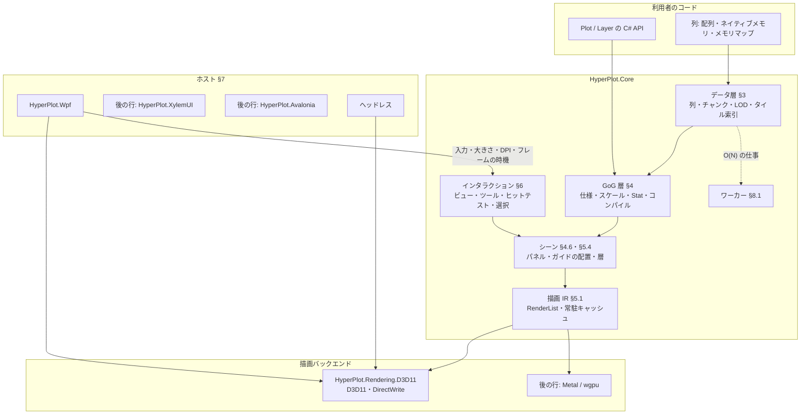

# HyperPlot 設計 v1

現行の設計だけを記す。何を満たすかは [requirements.ja.md](./requirements.ja.md)（要件の正本）、捨てた案は [design-decisions.md](./design-decisions.md)、実測を理由にした判断は [adr/](./adr/)、順序と状態は [roadmap.md](./roadmap.md) にある。要件の ID（D-1、R-2 など）は要件定義書のものを指す。

## 0. 目標・制約・外部依存の基準

C# / .NET 10 のプロットライブラリで、NativeAOT・10 億点の対話的な描画・Grammar of Graphics の構成・高度なインタラクションを両立させる（要件 §1）。

設計を貫く制約は次の 3 つである。

1. **フレームの仕事は画面の大きさで決まる**: 1 フレームの CPU 時間・GPU への転送・描画の量は、データの点数ではなく画素数と系列数で抑える。データの点数に比例する仕事（O(N)）は、フレームの外のワーカーで一度だけ行い、結果の索引をフレームで使う（不変条件 2）
2. **正しさを間引きで失わない**: 間引きは見た目を変えない方法（M4、§5.5.1）を既定とし、近似を使うときは誤差の上限を設計に書く
3. **ライブラリ本体は NativeAOT のまま**: リフレクション・実行時のコード生成を使わない。型に応じた表が要るときは手で書くか Source Generator で生成する

**外部依存の基準**: 依存を避けること自体は目的ではない。避けたいのは (1) 性能の最適化を手元に置けなくなること、(2) Windows で追加のネイティブ DLL を配布すること、(3) NativeAOT の障壁、の 3 つである。次をすべて満たすものは使ってよく、実測で理由が出たら自作に置き換える。

1. trim / AOT の警告ゼロで NativeAOT にリンクできる
2. Windows で追加の DLL を配布しない（OS の部品は使ってよい）
3. フレームの経路に入るなら、時間とアロケーションを自分たちで測れ、型が公開 API に出ない
4. MIT と両立するライセンスで、保守されている

### Dependency Decision Matrix

| 領域 | 自作 | 依存 | 理由 |
| --- | :---: | --- | --- |
| D3D11 / DXGI / D3D9Ex / DirectWrite の宣言 | | ○ TerraFX.Interop.Windows | 抽象層のない生成済みの宣言だけ。COM の vtable を直接呼ぶ。XylemUI と同じ |
| GPU の抽象（§5.2） | ○ | | 決まった数のパイプラインだけを持つ薄い層。汎用の GPU 抽象（Silk.NET・Vortice）は使わない |
| シェーダのコンパイル | ○（生成器） | Windows SDK の `fxc.exe`（ビルド時のみ） | 実行時の `d3dcompiler_47.dll` を持たない。生成物のバイトコードはリポジトリに入れる（§5.7） |
| テキストの整形とラスタライズ（Windows） | | ○ DirectWrite（OS） | 日本語のフォールバックと整形を OS に任せる。グリフのアトラスは自作（§5.6） |
| テキスト（macOS / Linux） | | 後の行で決める | XylemUI.Text（HarfBuzz）を使う案が第一候補 |
| PNG の書き出し | ○ | `System.IO.Compression`（BCL） | 書き出しだけなら小さい。zlib は BCL のもの |
| SIMD・数値 | | BCL（`System.Runtime.Intrinsics`、`System.Numerics`） | |
| メモリマップ | | BCL（`MemoryMappedFile`） | |
| WPF のホスト | | WPF（.NET の一部） | `HyperPlot.Wpf` だけが参照する |
| テスト・計測 | | xUnit v3、BenchmarkDotNet、`Microsoft.Extensions.TimeProvider.Testing` | テストとベンチマークのプロジェクトだけが参照する |
| Linux の GPU | | 後の行: wgpu-native | ドライバの組み合わせへの対応を小さなチームで続けられないため（XylemUI と同じ判断） |
| macOS の GPU | ○（後の行） | | Metal を Obj-C ランタイム経由で直接呼ぶ |

### 0.1 NativeAOT とランタイム

- 対象は .NET 10、C# 14。リリースは NativeAOT、開発は JIT（デバッガ・Hot Reload）で、両者の挙動は同じにする
- `src/` のプロジェクトは `IsAotCompatible`。ただし `HyperPlot.Wpf` だけは例外である。WPF 自体が NativeAOT と trim に対応しないので `IsAotCompatible=false` にする。それでも自身のコードではリフレクションを使わない
- 文化に依存する API を使わない（`InvariantGlobalization` で動く）。数値の書式は不変のカルチャを既定にし、利用者が書式の関数を渡せる
- 時刻は `TimeProvider` からだけ取る（§8.3）
- `unsafe` のコードを置いてよいのは、GPU のバックエンド、ホストのアダプタ、Core のデータ層のストレージ（ネイティブメモリとメモリマップのチャンク、§3.2）だけである（`.cursor/rules/interop.mdc`）

## 1. アーキテクチャ



1 枚の図（複数のプロット・ファセットを含む）は 1 つの `PlotEngine` が受け持つ。ホストは `PlotEngine` に描画先・入力・大きさ・DPI を渡し、`PlotEngine` が「次のフレームが要る」と言ったときにだけフレームを描かせる（§8.2）。何も変わらなければフレームを描かない。

## 2. プロジェクト構成

### 2.1 プロジェクト一覧

プロジェクトはそれを必要とする Issue の PR で作る（`docs/conventions.md`）。以下は予定の全体である。

| プロジェクト | TFM | 責務 |
| --- | --- | --- |
| `src/HyperPlot.Core` | `net10.0` | データ層・GoG 層・シーン・インタラクション・描画 IR・テキストの契約・ワーカー。GPU にも UI にも依存しない |
| `src/HyperPlot.Rendering.D3D11` | `net10.0-windows10.0.17763.0` | D3D11 のバックエンド（§5.3）とそのオフスクリーンの描画先、DirectWrite のテキスト（§5.6） |
| `src/HyperPlot.Wpf` | `net10.0-windows10.0.17763.0`（WPF） | `HyperPlotView`。D3DImage との共有（§7.2）。AOT の対象外 |
| `src/HyperPlot.Testing` | `net10.0` | 画像の比較（`GoldenImage`、§10.1、行 S3）。偽の時刻と入力の列の再生は、それを使う行で足す。テストと利用者のテストが使う |
| `src/HyperPlot.XylemUI` | 後の行 | XylemUI のホスト |
| `src/HyperPlot.Avalonia` | 後の行 | Avalonia のホスト |
| `src/HyperPlot.Rendering.Wgpu` / `.Metal` | 後の行 | Linux / macOS のバックエンド |
| `tests/*.Tests` | | 各 src プロジェクトのテスト |
| `samples/` | | `HelloPlot`（メモリの 1e6 点の線をヘッドレスで PNG に書く。NativeAOT の検査と要件 P-10 に使う、行 S1）、`BillionSeries`（1e9 点のメモリマップのファイルを複数の系列で、全体と拡大の PNG に書く、行 S1）、`WpfGallery` など |
| `benchmarks/HyperPlot.Benchmarks` | | BenchmarkDotNet によるカーネルの計測 |
| `benchmarks/HyperPlot.DataPath` | | GPU を使わないデータの経路の計測（NativeAOT）と、計測のデータの生成器（§9） |
| `benchmarks/HyperPlot.E2E` | | ヘッドレス描画のフレーム時間、GPU 時間、メモリ（NativeAOT）。行 S2 で作る |
| `tools/ShaderGen` | | HLSL を `fxc` でコンパイルし、バイトコードを C# のファイルに書き出す（§5.7） |

データ層を別のアセンブリ（`HyperPlot.Data`）に分けることは、利用者からの要求が出るまでしない。利用者が使う型の名前空間は `HyperPlot` 1 つにし（`using HyperPlot;` だけで書ける）、層はフォルダで分ける。バックエンドが実装する契約だけは `HyperPlot.Rendering` に置く（§5.2）。

### 2.2 依存方向

```text
HyperPlot.Core  ←  HyperPlot.Rendering.D3D11  ←  HyperPlot.Wpf
       ↑                                    ↖
HyperPlot.Testing                          （ヘッドレスは Rendering.D3D11 だけで動く）
```

- `HyperPlot.Core` は描画のバックエンドもホストも参照しない（不変条件 1）
- バックエンドは Core の描画 IR（§5.1）と GPU の抽象（§5.2）を実装する
- ホストはバックエンドとコアをつなぐ。UI フレームワークの型はホストのプロジェクトの外に出ない

## 3. データ層

### 3.1 列

列は 1 つの型の値の並びで、長さは `long` である。

```csharp
public abstract class Column                           // Column<T> と UniformColumn の基底
{
    public long Length { get; }
    public int ChunkCount { get; }
    public long Version { get; }                       // 追記・変更で増える
    public static UniformColumn Uniform(double start, double step, long length);
    public static UniformColumn UniformInteger(long start, long step, long length);   // 行 D2
}

public sealed class UniformColumn : Column              // 値を持たない等間隔の列（下の「暗黙の列」）
{
    public double Start { get; }
    public double Step { get; }
    public double Last { get; }
    public bool IsInteger { get; }                     // UniformInteger で作った列（行 D2）
    public bool TryGetInteger(out long start, out long step);   // 整数の列の正確な開始値と刻み（行 D2）
    public double GetValue(long index);
}

public sealed class Column<T> : Column, IDisposable where T : unmanaged, INumber<T>
{
    public ReadOnlySpan<T> GetChunk(int chunkIndex);   // 1 チャンク分の連続領域
    public ChunkStats<T> GetStats(int chunkIndex);     // §3.2
    public void Invalidate(long start, long length);   // 包んだ領域を利用者が書き換えたとき
}
```

- `INumber<T>` の制約は、統計のカーネル（§3.2）と統計の結合が `T` の比較と NaN の判定を要るためである。値の型の一覧に入らない数値の型は、作るときに `NotSupportedException` になる

- 値の型: `float`・`double`・`int`・`long`・`byte`。日時は `long` の列に time のスケールで意味を与える。単位と起点はスケールが持ち、既定は .NET のティック（100 ns、0001 年起点）で、ns・µs の Unix 起点の列もそのまま描ける（Issue #11。単位と起点の API は行 G2）。値が 2^53 を超えても、スケールの空間の原点と差（§3.6）で精度を保つ。カテゴリは `int` の符号の列と辞書の組（`CategoricalColumn`）
- 要素ごとの仮想呼び出しを避けるため、読み出しの単位はチャンク（`ReadOnlySpan<T>`）である。ストレージの違い（§3.2）はチャンクを取り出すところで一度だけ分岐する
- **暗黙の列**: 等間隔の X（`UniformColumn`: 開始値と刻み、要件 D-5）は値を持たない。時系列で最も多い形で、索引も二分探索も要らない。作り方は 2 つある（行 D2、Issue #11）
  - `Column.Uniform(double start, double step, long length)`: i 番目の値は `start + i * step` を倍精度で計算する（FMA の 1 回の丸め）
  - `Column.UniformInteger(long start, long step, long length)`: 整数の等間隔の列（日時のティック、ns の時刻）。i 番目の値は `start + i * step` で、`long` で正確である。`step` は正、`length` は 0 以上で、最後の値 `start + (length − 1) * step` が `long` に入らなければ `ArgumentOutOfRangeException`。`UniformColumn.IsInteger` が真になる。`double` の `start` では 2^53 を超える開始値が丸まる（2026 年のティックで 128 ティック単位）ので、別の口にする。同じ名前 `Uniform` の多重定義にしないのは、`Column.Uniform(0, 1, n)` のような整数の引数が `long` 版に解決され、今の呼び出しの意味が変わるからである（スクラッチでコンパイルして確かめた）
  - `Start`・`Step`・`Last`・`GetValue(long index)` は、どちらの列でも `double` を返す（整数の列で 2^53 を超える値は丸まる）。M4 と学習は、整数の列の値を `long` のまま読み、原点との差（§3.6）にする
  - `TryGetInteger(out long start, out long step)`: 整数の列なら正確な開始値と刻みを返して真、`double` の列なら 0 と 0 を返して偽。公開の M4 を直接つなぐ呼び出し側（§4.9、`BillionSeries`）が `ScaleOrigin` と境界を正確に作るための口で、i 番目の値は `start + i * step`（`long` で正確）である。`double` の列で投げる口（`IsInteger` が偽なら `InvalidOperationException`）にしないのは、型の種類の取り違えで公開のメソッドが投げないためである（`.cursor/rules/csharp.mdc`、PR #86 のレビュー）
- **欠損**: `float` / `double` は NaN を欠損とする。整数の列は任意の有効ビット列（1 ビット/要素）を持つ
- **表**（行 G1）: `DataTable` は長さの等しい名前付きの列の集合である。API は型付きの参照 `ColumnRef<T>`（表と列の位置）で列を指す。文字列の列名は `table.Col<float>("y")` で参照に解決し、その時点で型を確かめる

```csharp
public sealed class DataTable
{
    public static DataTableBuilder Create();
    public long Length { get; }                         // すべての列の長さ。列がなければ 0
    public int ColumnCount { get; }
    public string GetName(int index);
    public Column GetColumn(int index);
    public ColumnRef<T> Col<T>(string name) where T : unmanaged, INumber<T>;
}

public sealed class DataTableBuilder
{
    public DataTableBuilder Add(string name, Column column);
    public DataTable Build();
}

public readonly struct ColumnRef : IEquatable<ColumnRef>          // 型を忘れた参照（仕様の型が持つ）
{
    public DataTable Table { get; }
    public int Index { get; }
    public Column Column { get; }                                 // Table.GetColumn(Index)
    // Equals・GetHashCode・== と != を持つ
}

public readonly struct ColumnRef<T> : IEquatable<ColumnRef<T>> where T : unmanaged, INumber<T>
{
    public DataTable Table { get; }
    public int Index { get; }
    public Column Column { get; }
    public static implicit operator ColumnRef(ColumnRef<T> reference);
    public ColumnRef ToColumnRef();                               // 暗黙の変換の名前つきの代わり（CA2225）
    // Equals・GetHashCode・== と != を持つ
}
```

  - `Col<T>` は、列が `Column<T>` なら、または列が `UniformColumn` で、`IsInteger` が偽で `T` が `double` か、`IsInteger` が真で `T` が `long` なら参照を返す（§3.1 の暗黙の列）。名前がなければ、型が合わなければ、どちらも名前と実際の型を書いた `ArgumentException`。名前は大文字と小文字を区別する（序数の比較）
  - `Add` は、名前が null なら `ArgumentNullException`、空か、すでにある名前なら `ArgumentException`。`column` が null なら `ArgumentNullException`。`Build` は、列の長さがそろっていなければ、名前と長さを書いた `ArgumentException`。`Build` の後のビルダは使えない（`InvalidOperationException`）
  - 表は列を持つだけで、列の持ち主ではない。`DataTable` は `IDisposable` ではなく、列の寿命は利用者が持つ
  - `ColumnRef` と `ColumnRef<T>` の等しさは、表の同一性（参照）と位置の組である。`default` の参照は表を持たず、仕様に渡すと `ArgumentException`。`default` の参照の `Table` と `Column` は `InvalidOperationException` を投げる
- **ゼロコピー**: 利用者の `T[]`・`Memory<T>`・ポインタ（`Column.Wrap<T>(T* pointer, long length)`）を写さずに包める（要件 D-3）。ポインタは `Memory<T>` の `int` の上限を超える長さを包め、メモリの寿命は利用者が持つ。包んだ領域を利用者が書き換えたら `column.Invalidate(start, length)` を呼ぶ契約とする。写す API は名前に `Copy` を含める

### 3.2 チャンクとストレージ

- **チャンク**: 2^20 要素（1,048,576）。2 の冪なので、要素の位置からチャンクと内側の位置をシフトとマスクで求められる。`float` で 4 MiB、`double` で 8 MiB になり、ワーカーの仕事の単位にもなる
- **ストレージ**は 3 種類である（要件 D-2）。

| 種類 | 実体 | 用途 |
| --- | --- | --- |
| マネージド | `T[]` または `Memory<T>` | 小〜中規模、利用者の配列を包む |
| ネイティブ | `NativeMemory.AlignedAlloc`（64 バイト境界）をチャンクごとに列が持つ。または利用者が持つメモリをポインタと `long` の長さで包む（写さない。境界は利用者のメモリのまま） | 追記・リングバッファ・大規模なメモリ上のデータ、計測機器のバッファ |
| メモリマップ | `MemoryMappedFile` のビュー。列の範囲を 1 つのビューで写像し、チャンクはその中の位置で切り出す | RAM に載らない 10 億点のファイル |

- メモリマップの列は、生のリトルエンディアンの配列のファイル（先頭のオフセット・型・長さを指定）を読む。ファイル形式の網羅はしない（要件 D-8）
- **チャンクの統計**: チャンクごとに SIMD で `min`・`max`・最初と最後の値・和（`double`、NaN を除く）・値の数・NaN の数・単調非減少かどうかを計算し、`ChunkStats<T>` に持つ。統計は初めて読まれたときに計算して持ち、`Invalidate` でそのチャンクの分を捨てる（チャンクごとの世代で、古い世代の結果を返さない）。ワーカー（§8.1）は、ピラミッド（§3.3）を作るときに、統計がまだないチャンクの統計を水準 1 と同じ走査で計算して持つ。ピラミッドを作らない列（M4 の X など）は、`PlotWorkerPool.PrecomputeStats` で先に計算させる。追記（§3.5）では、チャンクを足したときに計算させる。スケールの domain（§4.2）、Y の自動範囲（§6.2）、X の二分探索の絞り込みは、まずこの統計を読む。統計の総数はチャンクの数（10 億点で 954 個）なので、全体の範囲が O(チャンク数) で分かる

### 3.3 LOD ピラミッド（時系列）

X が単調増加の列（時系列、要件 D-4）では、Y の列ごとに min / max のピラミッドを作る。

- **水準**: 水準 ℓ（ℓ = 1, 2, …）のバケットは 64 · 8^(ℓ−1) 要素（64、512、4096、32768、262144）で、各バケットに Y の min と max を持つ。1 チャンク（2^20 要素）の中に 5 水準が収まり、それより上はチャンクの統計（§3.2）がピラミッドの頂点を兼ねる
- **大きさ**: 2/64 + 2/512 + … ≈ 3.6%（要素と同じ型で min と max を持つ場合）に、バケットごとの NaN でない値の数（`float` で約 0.5%、下の「メモリ」）を足して約 4.1%。要件 P-8（10% 以下）に収まる
- **作り方**: チャンクごとに独立なので並列に作れる。水準 1 は生データを 1 回読む SIMD の min / max、それより上は下の水準から作る。メモリの帯域で律速する
- **欠損**: NaN は min / max から除き、バケットごとに NaN でない値の数を持つ（折れ線を切る場所を見つけるため、要件 D-7。下の「NaN でない値の数」）
- **単調変換との関係**: スケールの変換（log、sqrt など、§4.2）が単調増加なら、変換後の min / max は min / max の変換と等しい。単調減少なら入れ替わる。したがってピラミッドは生の値で 1 つ作れば、どの単調なスケールにも使える
- **X が等間隔でない場合**: 画素の境界に当たる要素の位置を X の二分探索で求める。チャンクの統計で探す範囲をチャンク 1 つに絞ってから探す

**区間の min / max の問い合わせ**: 要素の区間 [a, b) の min / max は、区間に完全に含まれる最も粗い水準のバケットを組み合わせて求め、両端だけ細かい水準に降りる。生データを大きさ 1 の水準 0 と数え、両端は水準 0 まで降りる。結果に誤差はない。

- 両端で読む生データは、それぞれ最大 63 要素（次の 64 要素の境界まで）である。その先は、区間に完全に含まれる最も粗い水準のバケットにつなぐ
- M4（§5.5.1）も同じ問い合わせを使う。両端で読む生データは、first / last のために読む境界の要素から 63 要素以内（`float` で 252 バイト）なので、メモリマップのデータでも新しく触るページはほとんどない
- min / max の要素の位置は、その値を持つバケットを水準 0 まで降りて求める。同じ値が複数あるときは、区間の中で最初に現れる位置をとる
- 両端を粗い水準で止め、バケットを中心で含める誤差つきの問い合わせは採らない（`design-decisions.md` の「M4 の入出力」）

**型と持ち主**（ロードマップ C2）。ピラミッドは列とは別のオブジェクトで、ワーカー（§8.1）が作る。列（§3.1）はワーカーを知らない。同じ列に複数のピラミッドを持ってもよい。

```csharp
public sealed class PlotWorkerPool : IDisposable
{
    public PlotWorkerPool(int threadCount);
    public static PlotWorkerPool Shared { get; }       // ProcessorCount − 1 本（最小 1 本）
    public int ThreadCount { get; }
    public MinMaxPyramid<T> BuildPyramid<T>(Column<T> column) where T : unmanaged, INumber<T>;
    public Task PrecomputeStats<T>(Column<T> column) where T : unmanaged, INumber<T>;  // X の列のチャンクの統計（§5.5.1）
    public void Dispose();
}

public sealed class MinMaxPyramid<T> : IDisposable where T : unmanaged, INumber<T>
{
    public Column<T> Column { get; }
    public long Version { get; }                       // チャンクが 1 つできるたびに増える
    public bool IsComplete { get; }                    // すべてのチャンクが列の今の世代でできている
    public Task Completion { get; }                    // 最初の構築がすべて終わったとき
    public Exception? Fault { get; }                   // チャンクを読む中で起きた例外
    internal Task WhenComplete();                      // 行 G1: 世代の古いチャンクを要求し、IsComplete が真になったら終わる（§4.8 のヘッドレスの待ち方）
    public MinMax<T> GetMinMax(long start, long length);
    public void Dispose();
}

public readonly struct MinMax<T> where T : unmanaged, INumber<T>
{
    public T Min { get; }
    public T Max { get; }
    public long Count { get; }                         // NaN でない値の数。0 なら Min と Max は default
    public bool HasNaN { get; }                        // 区間に NaN がある（すべてが NaN でも真）
    public bool IsProvisional { get; }                 // できていないチャンクを計算済みの統計で代えた（統計もなければ何も足さない）
}
```

- `BuildPyramid` はすぐに返り、チャンクごとの仕事をワーカーに積む。長さ 0 の列のピラミッドは、作った時点でできている
- **破棄の順**: ピラミッドは列より先に破棄する。構築中のピラミッドは列のチャンクを読むので、列を先に破棄すると、ネイティブとメモリマップのストレージでは列の契約（§3.1、`Dispose` と読み出しを並行させない）を破る
- **メモリ**: チャンクごとに、5 水準を `NativeMemory.AlignedAlloc`（64 バイト境界）の 1 ブロックに置く。列のストレージ（メモリマップを含む）によらない。長さ n のチャンクのバケットの数は Σ_{ℓ=1..5} ⌈n / (64 · 8^(ℓ−1))⌉ で、各バケットは min と max（2 · sizeof(T) バイト）と NaN でない値の数を持つ。min と max は、1e9 点の `float` で 1e9 × 8 B × (1/64 + 1/512 + 1/4096 + 1/32768 + 1/262144) ≈ 143 MB、`double` で約 286 MB になる。数は、バケットの大きさが入る最小の幅で持つ（水準 1 の 64 は 1 バイト、水準 2〜4 の 512・4096・32768 は 2 バイト、水準 5 の 262144 は 4 バイト）。1e9 点で 15,625,000 × 1 B + 1,953,125 × 2 B + 244,141 × 2 B + 30,518 × 2 B + 3,815 × 4 B ≈ 20.1 MB（`float` の元データの 0.50%）である。これに端数のバケット（チャンクあたり最大 5 個）が加わる
- **NaN でない値の数**: バケットごとに NaN でない値の数を持つ。数がバケットの大きさと同じなら「NaN なし」、0 なら「すべて NaN」、その間なら「一部が NaN」で、すべて NaN のバケットの min / max は使わない。`GetMinMax` の `Count` は、区間を覆うバケットの数を足すだけで求まり、区間の長さによらない（生データを数えるのは両端の最大 63 要素ずつ）。M4 は、この数で NaN の切れ目を見つけ、すべて NaN のバケットを飛ばして NaN でない要素を探す（§5.5.1）
- **構築**: 1 チャンクが 1 つの仕事である。ワーカーは、統計（§3.2）がまだないチャンクでは、統計と水準 1 を生データの 1 回の SIMD の走査で作り、統計を列に持たせる。統計がすでにあるチャンク（`PrecomputeStats` や `GetStats` の後）では、水準 1 だけを走査する。水準 2〜5 は下の水準から作る。1 回の走査は、統計と水準 1 を別々に走査するときの 0.53〜0.72 倍の時間で、水準 1 だけの走査は 1 回の走査より速い（行 B1 の計測、参照機、L3 に収まらない 64 チャンク、`docs/benchmarks/b1-data-layer.md`）。1 回の走査の結果は、統計のカーネルと水準 1 のカーネルを別々に回した結果と同じ値である。`Sum` は足す順が同じなのでビットまで同じで、min / max は 0 の符号だけが違いうる（x64 の `minps` は両方が 0 のとき 2 つ目の引数を返すので、−0 と +0 を積む順で符号が変わる）
- **順番**: 要求のあったチャンクを先に、残りを位置の順に作る。問い合わせや M4 が、まだできていないチャンクに当たると、そのチャンクを要求する。要求はチャンクごとのフラグを立ててワーカーを起こすだけで、確保も待ちもしない（不変条件 3・7）
- **暫定**: まだできていないチャンク（世代が古いものを含む）は、問い合わせの中で、すでに計算されたチャンクの統計（§3.2）で代え、結果に `IsProvisional` を立てる（不変条件 4）。暫定の経路は統計を計算しない。計算すると、ワーカーがまだ触っていないチャンクを呼び出し側のスレッドで走査し、構築の直後の全体表示でフレームの経路が O(N) になる（不変条件 2、要件 P-2）。統計もまだないチャンクは、結果に何も足さずに暫定にする。区間のチャンクがすべて統計もないとき、`GetMinMax` は `Count` 0、`Min` と `Max` は `default`、`HasNaN` は偽で、`IsProvisional` が真になる。「すべて NaN」の結果（`HasNaN` が真）とも `Count` 0 が同じなので、まだ答えのないことは `IsProvisional` で見分ける。区間がチャンクを丸ごと含み、統計があるなら、統計がそのまま正しいので暫定にしない。チャンクの一部だけを含むなら、min / max・`Count`・`HasNaN` はチャンク全体の値になり、範囲が広がる。利用者が値を書き換えてまだ `Invalidate` を呼んでいないときなど、ブロックが生データと食い違う（ブロックの min / max の値が生データに見つからない）チャンクも、暫定で答える。描く側は `Version` の変化で描き直す。見えているチャンクを先に作るので、暫定の表示は見えている範囲から先に正しい表示に替わる（替わるまでの時間は行 B1 で測る。§9）
- **チャンクの状態**: ピラミッドはチャンクごとに次の状態を 1 つ持ち、状態の書き換えは比較交換（CAS）で行う。ブロックは `BuildPyramid` で全チャンク分を確保する（1e9 点で 954 回の `AlignedAlloc`）ので、読む側がブロックのないチャンクに当たることはない

| 状態 | 意味 |
| --- | --- |
| 未構築 | まだ作っていない。積まれているが、要求はない |
| 要求あり | 問い合わせか M4 が要求した。先に作る |
| 処理中 | 1 つのワーカーが書いている |
| できた | ブロックが、記録した列の世代で正しい |
| 失敗 | 作る中で例外が起きた |

  - 規則 1: 1 つのチャンクに書くワーカーは同時に 1 つである。ワーカーは状態を「未構築」か「要求あり」から「処理中」へ CAS で替えられたときだけ書く。seqlock は書き手が 1 つであることを前提にする
  - 規則 2: 書き終えたワーカーは、列のチャンクの世代を読み直す。書き始めのときと同じなら「できた」にする。違えば（処理中に `Invalidate` が来た）「未構築」に戻して自分で積み直す
  - 規則 3: 「失敗」のチャンクは、要求されても積まない。そのチャンクの世代が進んだとき（`Invalidate`）に限り、次に読まれたときに「要求あり」に戻る。新しい `BuildPyramid` は新しいピラミッドを作るので、失敗を持ち越さない
  - 許す遷移: 未構築 → 要求あり（要求）、未構築・要求あり → 処理中（ワーカー）、処理中 → できた・未構築（規則 2）・失敗、できた → 要求あり（読んだときに世代が古い）、失敗 → 要求あり（世代が進んだ後に読まれた）。これ以外（たとえば 2 つ目のワーカーが処理中のチャンクを取る、世代の変わらない失敗を要求で積む）は起きない
- **世代と公開**: 各チャンクのブロックは、作ったときの列のチャンクの世代（§3.2）を持つ。`Invalidate` で世代が進んだチャンクは、次に読まれたときに「要求あり」になる（規則 3 の失敗を除く）。ワーカーはブロックをその場で書き換える。書く前と後にブロックの版を奇数・偶数に進め（seqlock）、読む側は読む前と後に版を読む。違うか奇数なら、そのチャンクを暫定として扱う。ブロックは `Dispose` まで解放しないので、読む側が解放済みのメモリを読むことはない。`Dispose` と読み出しの並行は、列と同じく契約で禁じる
- **失敗**: チャンクを読む中の例外は、そのチャンクを「失敗」にする（規則 3。失敗し続ける仕事を毎フレーム積まない）。`Fault` は最初の例外を持ち、`Completion` はその例外で終わる。失敗したチャンクは、問い合わせでは暫定（チャンクの統計）で答える
- **`WhenComplete()`**（internal、行 G1）: ヘッドレスの描画が、`Invalidate` の後の作り直しまで待つための口である（§4.8）。`IsComplete` が真なら終わった `Task` を返す。偽なら、世代の古いチャンクをすべて「要求あり」にしてワーカーを起こし（未構築のチャンクは、要求しなくてもワーカーが位置の順に作る。失敗したチャンクは `Fault` で待ちを終える）、チャンクが「できた」になるたびに `IsComplete` を確かめ、真になったときに終わる `Task` を返す。呼ぶ前にすでに `Fault` があれば、その例外で終わった `Task` を返す（失敗したチャンクは規則 3 で要求しても積まれないので、待てば終わらない）。待っている間に `Fault` が立つか、待つチャンクが「失敗」になったら、その例外で終わる。`Dispose` されたら `ObjectDisposedException` で終わる。同時に何回呼んでもよく、待っている呼び出しは同じ `Task` を受ける。終わっていないときだけ `TaskCompletionSource` を 1 つ確保する（ヘッドレスの経路で、フレームの経路ではない）
- **`GetMinMax(start, length)`**: 区間の誤差のない min / max と `Count`。両端は生データまで降りる。`length` が 0 なら `Count` が 0 の結果を返す。区間の値がすべて NaN なら、`Count` は 0、`Min` と `Max` は `default`、`HasNaN` は真（`ChunkStats<T>` と同じ）。区間が列の外なら `ArgumentOutOfRangeException`。M4 も同じ誤差のない問い合わせを使い、min / max の要素の位置も求める

### 3.4 空間タイル索引（散布）

X が単調でない列（散布図）では、点を空間の順に並べ直した写しと、四分木の索引を作る。

並べ直し（量子化・Morton 符号・数え上げソート・セル＝連続範囲の木）は、次元の数を引数に取る共通の部品にする。2 次元では 16 ビット × 2 の 32 ビットの符号と四分木になり、3 次元（v1.x の点群、§13.3）では 21 ビット × 3 の 63 ビットの符号と八分木になる。以下は 2 次元の場合を書く。

1. **量子化**: チャンクの統計から全体の範囲を求め、x と y をそれぞれ 16 ビットの格子に量子化する。2 つを交互に並べた 32 ビットの Morton 符号（Z 順）を点の位置の鍵とする
2. **並べ直し**: 符号の上位 16 ビット（256 × 256 の最上位のタイル）で数え上げソートを行う。1 回目の走査でタイルごとの点の数を数え、2 回目で各点を写しの決まった位置に書く。写しは同じ長さの列（x、y、エンコードに使う列、元の位置 `long`）である。データが RAM に載らないときは、写しを一時ファイルのメモリマップに書く。タイルの中は RAM で残りのビットを基数ソートする
3. **四分木**: Morton 順に並べたので、四分木のどのセルも写しの連続した範囲になる。点の数が `LeafCapacity`（既定 4096）以下になるまでセルを分け、各セルの範囲と点の数を表に持つ。10 億点で表は数十万〜百万行程度になる
4. **密度タイル**: 四分木の上の方のセル（点の数が `DensitySplit` を超えるセル）は、それぞれ 256 × 256 の 2D ヒストグラム（`uint`）を持つ。子の密度から親を 2 × 2 の和で作る（画像のミップマップと同じ）。どのセルまで密度を持つかは、§5.5.2 の切り替えの閾値から決める
5. **元の位置**: 選択（§6.4）とツールチップは元の行を指す。写しの `long` の列で元の位置へ戻す

タイルの大きさ（256 × 256）、`LeafCapacity`、`DensitySplit` は仮の値で、索引の行（ロードマップ C3）の計測で決める。

### 3.5 ストリーミング

- **追記**: ネイティブのストレージの最後のチャンクに書き足す。チャンクの統計と LOD の最後のバケットは追記のたびに更新し、埋まったバケットから上の水準へ伝える。埋まっていないバケットは「末尾の要約」として持ち、問い合わせでは生データと同じに扱う
- **リングバッファ**: 固定の数のチャンクを使い回す。論理的な位置（0 から増え続ける `long`）と物理的なチャンクの対応を持ち、古いチャンクを捨てるときは統計と LOD もまとめて捨てる
- **版**: 追記は列の `Version` を増やす。フレームは始まりの時点の版を読み、描く間に追記されたぶんは次のフレームで描く（要件 P-7 の 2 フレーム以内）
- **散布のストリーミング**は、v1 では生の点で描ける規模（1e7 点）までとする。空間タイル索引の追記は後の行で扱う

### 3.6 座標の精度

日時のティック（`long`）や遠い原点を持つ倍精度の値を float32 で GPU に送ると、深くズームしたときに点の位置が画素の単位で揃ってしまう（POC で起きた問題、要件 R-6）。

CPU の `double` でも同じことが起きる。2026 年の .NET のティック（約 6.39e17）の `double` の 1 ulp は 128 ティック（12.8 µs）、Unix 起点の ns（約 1.79e18）では 256 ns で、幅 1,920 画素なら .NET のティックで表示範囲が約 24.6 ms（1,920 × 128 ティック）より狭いと、画素列の境界が増加しなくなる（PR #10 のレビュー、Issue #11）。

- **原点と差**（行 D2、Issue #11）: スケールの空間（§4.2）の値は、CPU では `long` の原点と、原点からの `double` の差の組で扱う。軸ごとに原点を 1 つ持ち、ビュー範囲（§6.2）・M4 の境界と出力（§5.5.1）・画素への写像は、すべて差で計算する。差は小さく保たれるので、`double` の 53 ビットはビューの中の位置の細かさに使われる
- **原点の選び方**: 原点は整数（列の単位）で、範囲の下端の整数部 ⌊下端⌋ とする。`long` に入らなければ `long` の範囲に収めた値にする。ビュー範囲が変わるたびに、原点 += ⌊下端の差⌋、差 −= ⌊下端の差⌋ と付け直すので、下端の差は [0, 1) にある。付け直しの丸めの上限は次のとおりで、どれも画素の位置では無視できる（PR #86 のレビュー）。パンを続けても差は大きくならない
  - 下端の差 d: d ≥ 0 なら d − ⌊d⌋ は正確である。d ∈ [−1, −0.5] と d < −1 でも、結果の [0, 1) の刻みは d の刻み以下なので正確である。d ∈ (−0.5, 0) では d + 1 ∈ (0.5, 1) の刻み 2^−53 に乗らないことがあり、結果の 1 ulp の半分（2^−54）以下だけ丸まる（例: −0.3 + 1 は 5.6e-17 丸まる）
  - 上端の差 u: 原点が上がる（⌊下端の差⌋ ≥ 0）ときは、u が 2^53 未満なら正確である。原点が下がるときは u に整数を足すので、結果の刻みが粗くなり、結果の 1 ulp の半分以下だけ丸まる（例: 0.5 + 2^−53 に 1 を足すと丸まる。行 D2 の実装で見つけた）。u が 2^53 以上（データの幅が 2^53 単位を超える全体の表示）でも、結果の 1 ulp の半分以下だけ丸まる
  - 画素では、表示範囲の幅を s として、下端は (W / s) × 2^−54 以下、上端は W × ulp(u) / (2s) 以下で、u ≤ 1 + s なので s が 1 単位以上なら W × 2^−53 ほどである。s が 1 単位以上なら、幅 1,920 で約 1e-13 画素以下。s が §4.8 の狭い domain の限界（約 W × 2^−53）に近いと下端の分は半画素ほどになるが、それより狭い domain は境界が増加せず描かない
  - 付け直しは internal の値の型 `ScaleRange`（原点・下端の差・上端の差）の 1 つの関数で行い、コンパイルの domain（§4.8）と行 I1 のビュー（§6.2）が同じ関数を使う
  - 原点を domain の始まりに固定すると、データの幅が 2^53 単位（.NET のティックで約 28.5 年）を超えたとき、終わりのほうで差がまた丸まる。ビューごとに付け直せば、差は常に小さい
- **差の計算** d(v): 列の値 v から原点 o を引いた `double`。列の型ごとに次のとおりで、どれも v について単調非減少である
  - `long` の列と整数の `UniformColumn`: `(double)((Int128)v − o)`。正確な差を 1 回だけ丸める。`Int128` で引くので、`long` の差があふれる値（`long.MaxValue − long.MinValue`）でも正しい。差が 2^53 未満なら誤りがない
  - `int`・`byte` の列: `long` と同じ式（`long` にして引く）
  - `float`・`double` の列と、`double` の `UniformColumn`: `(double)v − (double)o`。v 自身の精度より細かくはならないが、原点の近くの値の差は正確である（Sterbenz の補題: y/2 ≤ x ≤ 2y なら x − y は丸めなしで表せる）。o が 2^53 を超えると `(double)o` 自体が ulp(o)/2 以下だけ丸まり（2026 年のティックで最大 64）、その列のすべての点が境界（原点からの正確な差）に対して同じ量だけずれる。ずれは原点の近くの v の 1 ulp の半分以下で、列自身の分解能の中にある。総当たりのテストも同じ式の値で判定する（PR #86 のレビュー）
  - 原点 0 では、`double` の値は今の値と同じになる。0〜1 のような普通のデータでは原点は 0 か −1 で、原点 −1 でも画素の位置は丸めの最後のビットほどしか変わらない
- GPU には「原点からの差」を float32 で送る。原点はチャンク（またはタイル）ごとに CPU が `long` で持ち、フレームごとに「チャンクの原点 − ビューの原点」を `Int128` で正確に引いて `double` にし、ビューの下端の差を引いた値を定数として渡す
- M4 の経路（§5.5.1）では、CPU が原点からの差から画素の座標まで倍精度で計算してから頂点を作るので、float32 の問題は起きない

## 4. GoG 層

### 4.1 仕様モデル

プロットは不変の値（`record`）の木で宣言する。

| 要素 | 内容 |
| --- | --- |
| `PlotSpec` | データ、レイヤーの並び、スケール、座標系、ファセット、ガイド、テーマ、インタラクション |
| `LayerSpec` | Geom、Stat、Position、エンコーディング（チャネル → 列の参照・定数・スケールの指定）、レイヤー固有のデータと変換 |
| `ScaleSpec` | 種類、domain、range、nice、zero、reverse、clamp、ガイドの書式 |
| `CoordSpec` | cartesian（flip を含む）、polar |
| `FacetSpec` | wrap / grid、行と列の列参照、軸の共有 |
| `FigureSpec` | 複数のプロットの並べ方（concat、grid）とリンク（§6.4） |

- 仕様の各ノードは同一性（`SpecId`）を持つ。仕様を差し替えたら、新旧を比べて何が変わったか（データ・Stat・スケール・配置・見た目）を求め、変わった段だけを計算し直す（要件 G-13）
- Geom・Stat・スケールは公開のインターフェース（`IGeom`・`IStat`・`IScale`）で足せる（要件 N-6）。プロットの種類は随時足していく（要件 G-14）。新しい種類はまず既存の Geom・Stat・Position・座標系の組み合わせで表せるかを確かめ（例: 箱ひげ図は summary の Stat と rect・rule・point の Geom）、表せないときだけ新しい Geom・Stat・座標系を作る。組み込みのものは `sealed` のクラスにする。インターフェースの呼び出しはレイヤーごと・フレームごとに起き、点ごとには起きない

**行 G1 の仕様の型**: G1 は、上の表のうち、データ・線のレイヤー・x と y の位置のスケール（linear）だけを持つ（Issue #76）。ほかのメンバー（座標系・ファセット・ガイド・テーマ・インタラクション、ほかの Geom とスケール）は、それを作る行で足す（`.cursor/rules/scope.mdc`）。後から足しても既存の利用者のコードが壊れないよう、仕様の型は位置引数の record にせず、init のプロパティにする。

```csharp
public readonly record struct SpecId(long Value);       // プロセスで一意。0 は使わない

public abstract record SpecNode                          // 仕様のノードの基底。持つのは Id だけ
{
    public SpecId Id { get; }                           // 作るとき、と `with` で写すたびに新しく振る
    private protected SpecNode();
    protected SpecNode(SpecNode original);              // 写しのコンストラクタ: 中身は派生の record が写し、Id は新しく振る
    // sealed でない record の写しのコンストラクタは protected 以上が要る（CS8878）ので、利用者はこれを通して派生できる。
    // G1 のコンパイルは組み込みの型だけを受け、知らない種類は拒む（§4.8 の検査）
}

public sealed record PlotSpec : SpecNode
{
    public required DataTable Data { get; init; }
    public required IReadOnlyList<LayerSpec> Layers { get; init; }
    public ScaleSpec ScaleX { get; init; }              // 既定は Scale.Linear()（domain は学習）
    public ScaleSpec ScaleY { get; init; }
    public string? Title { get; init; }                 // 行 G3。null か空ならタイトルなし
    public Theme Theme { get; init; }                   // 行 G3。既定は Theme.Light（§4.7）
    public CoordSpec Coord { get; init; }               // 行 G10。既定は Coord.Cartesian()（§4.4）。PlotSpec の中では
                                                        // このプロパティが静的クラス Coord を隠すので、既定値は HyperPlot.Coord で書く
}

public abstract record CoordSpec : SpecNode             // 行 G10。新しく作るコンストラクタは private protected

public sealed record CartesianCoordSpec : CoordSpec     // 行 G10
{
    public bool Flip { get; init; }                     // 真なら x のデータを縦の軸（左）、y のデータを横の軸（下）に置く
}

public sealed record PolarCoordSpec : CoordSpec         // 行 G11（§4.4）
{
    public PolarTheta Theta { get; init; }              // 角度に写すデータの軸。既定は X
    public double Start { get; init; }                  // 12 時からのずれ、ラジアン、有限。Clockwise の向きに当てる
    public bool Clockwise { get; init; }                // 既定は真
    public double InnerRadius { get; init; }            // 内側の穴の半径の、外側の半径に対する割合。0 以上 1 未満
}

public enum PolarTheta { X, Y }                         // 行 G11

public static class Coord                               // 行 G10
{
    public static CartesianCoordSpec Cartesian(bool flip = false);
    public static PolarCoordSpec Polar(PolarTheta theta = PolarTheta.X, double start = 0, bool clockwise = true, double innerRadius = 0);
                                                        // 行 G11。範囲の外は ArgumentOutOfRangeException
}

public abstract record LayerSpec : SpecNode             // 新しく作るコンストラクタは private protected。Geom を足す口は CustomLayerSpec（行 G4）
{
    public string? Label { get; init; }                 // 凡例のラベル。null か空なら凡例に出さない（行 G3 の LineLayerSpec.Label を行 G4 で基底へ）
}

public sealed record LineLayerSpec : LayerSpec
{
    public required ColumnRef X { get; init; }          // UniformColumn か、単調非減少で NaN のない Column<T>
    public required ColumnRef Y { get; init; }
    public StrokeSpec Style { get; init; }              // 行 G7a から StrokeSpec。既定は色なし（テーマのパレット）、太さ 1、破線なし。太さと破線は DIP（行 G3、§4.6）
}

// 行 G7a: 仕様の線。LineStyle（描画の型、§5.1）と同じメンバーで、色だけが null を取れる（Issue #153）
public readonly record struct StrokeSpec(Color? Color, float Width = 1, LineDash? Dash = null)
{
    public LineJoin Join { get; init; }                 // 行 R4 と同じ既定（丸）
    public LineCap Cap { get; init; }
    public float MiterLimit { get; init; } = 4;
}

// 行 G4: 数の列の Geom（§5.5.3、Issue #120）。チャネルは ColumnRef、線の太さと破線と ErrorBar の端の幅は DIP
public enum StepMode { After, Before, Middle }         // After: 横に進んでから縦、Before: 縦から横、Middle: 2 点の中点で縦

public sealed record StepLayerSpec : LayerSpec
{
    public required ColumnRef X { get; init; }          // 単調非減少（LineLayerSpec と同じ）
    public required ColumnRef Y { get; init; }          // Column<T>
    public StrokeSpec Style { get; init; }              // 既定は色なし、太さ 1
    public StepMode Mode { get; init; }                 // 既定は After
}

public sealed record AreaLayerSpec : LayerSpec
{
    public required ColumnRef X { get; init; }          // 単調非減少
    public required ColumnRef Y { get; init; }          // Column<T>
    public Color? Fill { get; init; }                   // 行 G7a から Color?。null ならパレットの色をアルファ 128 で
    public double Baseline { get; init; }               // 塗りの下の端の y（データの単位）。既定 0、有限
    public StrokeSpec? Outline { get; init; }           // y の線。null なら描かない。色が null ならパレットの色（不透明）
}

public sealed record BandLayerSpec : LayerSpec
{
    public required ColumnRef X { get; init; }          // 単調非減少
    public required ColumnRef YMin { get; init; }       // Column<T>
    public required ColumnRef YMax { get; init; }       // Column<T>
    public Color? Fill { get; init; }                   // null ならパレットの色をアルファ 128 で
    public StrokeSpec? Outline { get; init; }           // YMin と YMax の線
}

public sealed record BarLayerSpec : LayerSpec
{
    public required ColumnRef X { get; init; }          // 単調非減少
    public required ColumnRef Y { get; init; }          // Column<T>
    public Color? Fill { get; init; }                   // null ならパレットの色（不透明）
    public double Baseline { get; init; }               // 棒の根元の y。既定 0、有限
    public double? Width { get; init; }                 // データの単位。null なら既定（§5.5.3）、与えるなら有限で正
}

public sealed record RectLayerSpec : LayerSpec
{
    public required ColumnRef XMin { get; init; }       // 4 つとも数の列（Column<T> か UniformColumn）
    public required ColumnRef XMax { get; init; }
    public required ColumnRef YMin { get; init; }
    public required ColumnRef YMax { get; init; }
    public Color? Fill { get; init; }                   // null ならパレットの色（不透明）
}

public sealed record RuleLayerSpec : LayerSpec
{
    public ColumnRef X { get; init; }                   // 縦の線の x。X か Y のちょうど 1 つが default でない
    public ColumnRef Y { get; init; }                   // 横の線の y。どちらも単調非減少
    public StrokeSpec Style { get; init; }
}

public sealed record SegmentLayerSpec : LayerSpec
{
    public required ColumnRef X { get; init; }          // 4 つとも数の列
    public required ColumnRef Y { get; init; }
    public required ColumnRef XEnd { get; init; }
    public required ColumnRef YEnd { get; init; }
    public StrokeSpec Style { get; init; }
}

public sealed record ErrorBarLayerSpec : LayerSpec
{
    public required ColumnRef X { get; init; }          // 単調非減少
    public required ColumnRef YMin { get; init; }       // Column<T>
    public required ColumnRef YMax { get; init; }       // Column<T>
    public StrokeSpec Style { get; init; }
    public float CapWidth { get; init; }                // 端の横線の幅、DIP。既定 6、有限で 0 以上（0 は端なし）
}

public sealed record CustomLayerSpec : LayerSpec        // 利用者の Geom（§5.5.3）
{
    public CustomLayerSpec(IGeom geom);                 // null は ArgumentNullException
    public IGeom Geom { get; }
}

public interface IGeom                                   // Geom を足す口（行 G4、要件 N-6）
{
    void Learn(GeomRanges ranges);                      // domain を学ぶとき 1 回。x と y の値の範囲を足す
    void Record(GeomFrame frame, RenderList list);      // 記録するたびに 1 回。パネルに記録する
}

public sealed class GeomRanges                           // 計画が 1 つ持って使い回す
{
    public void AddX(double min, double max);           // 有限で min ≤ max。外れれば ArgumentException
    public void AddY(double min, double max);
    public void AddX(long min, long max);               // long の列（日時）を正確に
    public void AddY(long min, long max);
}

public sealed class GeomFrame                            // 計画が 1 つ持って使い回す。Record の外では InvalidOperationException
{
    public int Left { get; }                            // パネルの整数の矩形（物理画素、§4.6）
    public int Top { get; }
    public int Width { get; }
    public int Height { get; }
    public float Scale { get; }                         // DIP から物理画素への倍率
    public double PixelX(double value);                 // データの値を描画先の物理画素へ。スケールの変換・reverse・clamp を当てる
    public double PixelY(double value);                 // 写した値が有限でなければ NaN
    public double PixelX(long value);                   // long の値を原点からの正確な差で（§3.6）
    public double PixelY(long value);
    public bool Flipped { get; }                        // 行 G10。真なら PixelX は縦の座標、PixelY は横の座標
    public void Map(double x, double y, out double pixelX, out double pixelY);   // 行 G10。データの点を描画先の点（横, 縦）へ
    public bool Polar { get; }                          // 行 G11。真なら PixelX・PixelY は伸ばした空間の画素（§4.4）
    public Color SeriesColor { get; }                   // 行 G7a。この層に当たるテーマのパレットの色（§4.7）
}

// 行 G7a: 名前つきの色とパレット（Issue #153）
public static class Colors                              // CSS Color Module Level 4 の名前つきの色、148 色（AliceBlue〜YellowGreen、Gray と Grey の両方）
{
    public static Color AliceBlue { get; }              // (240, 248, 255, 255)。以下、表の順
    // …
}

public sealed class Palette : IEquatable<Palette>       // 不変の色の並び。中身で比べる
{
    public Palette(params ReadOnlySpan<Color> colors);  // 1 色以上。0 色なら ArgumentException
    public int Count { get; }
    public Color this[int index] { get; }               // 0 ≤ index < Count。外れれば ArgumentOutOfRangeException
}

public static class Palettes                            // 質的なパレット
{
    public static Palette Tab10 { get; }                // matplotlib の tab10（d3 の category10 と同じ）。テーマの既定
    public static Palette Tableau10 { get; }            // Tableau 10（d3 の schemeTableau10）
    public static Palette Set1 { get; }                 // ColorBrewer（d3 の schemeSet1、以下同じ）
    public static Palette Set2 { get; }
    public static Palette Dark2 { get; }
    public static Palette Paired { get; }
    public static Palette OkabeIto { get; }             // Okabe & Ito の 8 色
}

public abstract record ScaleSpec : SpecNode             // 新しく作るコンストラクタは private protected

// 行 G2: 連続の位置のスケール。reverse と clamp はすべてが持つ（Issue #94）
public abstract record ContinuousScaleSpec : ScaleSpec  // 新しく作るコンストラクタは private protected
{
    public bool Reverse { get; init; }                  // 写像の向きを反対にする（x は右から左、y は上から下）
    public bool Clamp { get; init; }                    // domain の外の値を domain の端に寄せて描く
    public string? Title { get; init; }                 // 行 G3。軸のタイトル。null か空ならなし
    public bool Nice { get; init; }                     // 行 G3。学習した domain を外側の目盛りまで広げる（§4.6）。既定は偽
}

public sealed record LinearScaleSpec : ContinuousScaleSpec
{
    public (double Min, double Max)? Domain { get; init; }      // null なら学習する（§4.2）
    public bool Zero { get; init; }                             // 学習した domain を 0 を含むまで広げる
    public TickFormatter? TickFormat { get; init; }             // 行 G3。null なら既定の書式（§4.6）
    public LinearScaleSpec WithDomain(double min, double max);  // 有限で min < max。外れれば ArgumentException
}

public sealed record LogScaleSpec : ContinuousScaleSpec          // log10（行 G2）
{
    public (double Min, double Max)? Domain { get; init; }
    public TickFormatter? TickFormat { get; init; }             // 行 G3
    public LogScaleSpec WithDomain(double min, double max);     // 有限で 0 < min < max。外れれば ArgumentException
}

public sealed record SymlogScaleSpec : ContinuousScaleSpec       // sign(v) · log10(1 + |v| / C)（行 G2）
{
    public double Constant { get; }                             // C。有限で正（Scale.Symlog が確かめる）
    public (double Min, double Max)? Domain { get; init; }
    public bool Zero { get; init; }
    public TickFormatter? TickFormat { get; init; }             // 行 G3
    public SymlogScaleSpec WithDomain(double min, double max);
}

public sealed record PowScaleSpec : ContinuousScaleSpec          // sign(v) · |v|^k（行 G2）
{
    public double Exponent { get; }                             // k。有限で正（Scale.Pow が確かめる）
    public (double Min, double Max)? Domain { get; init; }
    public bool Zero { get; init; }
    public TickFormatter? TickFormat { get; init; }             // 行 G3
    public PowScaleSpec WithDomain(double min, double max);
}

public enum TimeUnit { Ticks, Nanoseconds, Microseconds, Milliseconds, Seconds }   // Ticks は 100 ns（行 G2）

public sealed record TimeScaleSpec : ContinuousScaleSpec         // long の日時の列（行 G2、§3.1）
{
    public TimeUnit Unit { get; }
    public DateTime Epoch { get; }                              // 値 0 の日時。既定は Ticks なら 0001 年、ほかは Unix 起点
    public (long Min, long Max)? Domain { get; init; }          // 列の単位
    public TimeTickFormatter? TickFormat { get; init; }         // 行 G3。null なら既定の書式（§4.6）
    public TimeScaleSpec WithDomain(long min, long max);        // min < max。外れれば ArgumentException
    public TimeScaleSpec WithDomain(DateTime min, DateTime max);// 単位に直して外向きに丸める。直せなければ ArgumentOutOfRangeException
}

public sealed record TransformScaleSpec : ContinuousScaleSpec    // 利用者の変換（行 G2）
{
    public IScale Transform { get; }
    public (double Min, double Max)? Domain { get; init; }
    public TickFormatter? TickFormat { get; init; }             // 行 G3
    public TransformScaleSpec WithDomain(double min, double max);
}

// 行 G3: 目盛りの書式（§4.6）。確保しない形で、destination（64 文字）に書き、収まれば真
public delegate bool TickFormatter(double value, Span<char> destination, out int charsWritten);
public delegate bool TimeTickFormatter(long value, TimeInterval boundary, Span<char> destination, out int charsWritten);
                                                        // value は列の単位、boundary は目盛りが乗る最も粗い暦の境
public enum TimeInterval { Year, Month, Day, Hour, Minute, Second, Millisecond, Microsecond, Nanosecond }

public static class ScaleSpecExtensions                 // 行 G3
{
    public static T WithTitle<T>(this T scale, string? title) where T : ContinuousScaleSpec;   // scale with { Title = title }。null の scale は ArgumentNullException
}

public interface IScale                                 // 位置のスケールの変換を足す口（行 G2、要件 N-6）
{
    void Forward(ReadOnlySpan<double> values, Span<double> destination);   // データ → スケールの空間。狭義に単調増加
    void Inverse(ReadOnlySpan<double> values, Span<double> destination);   // スケールの空間 → データ
}

public static class Scale
{
    public static LinearScaleSpec Linear();
    public static LogScaleSpec Log();
    public static SymlogScaleSpec Symlog(double constant = 1);
    public static PowScaleSpec Pow(double exponent);
    public static PowScaleSpec Sqrt();                                                   // Pow(0.5)
    public static TimeScaleSpec Time(TimeUnit unit = TimeUnit.Ticks, DateTime? epoch = null);
    public static TransformScaleSpec Transform(IScale transform);
}

public static class Plot
{
    public static PlotBuilder Create(DataTable data);
}

public sealed class PlotBuilder
{
    public PlotBuilder Line<TX, TY>(ColumnRef<TX> x, ColumnRef<TY> y, Action<LineBuilder>? configure = null)
        where TX : unmanaged, INumber<TX>
        where TY : unmanaged, INumber<TY>;
    public PlotBuilder ScaleX(ScaleSpec scale);
    public PlotBuilder ScaleY(ScaleSpec scale);
    // 行 G4: TX・TY は Line と同じ制約（unmanaged, INumber<T>）。configure の値は LineStyle の検査を通す
    public PlotBuilder Step<TX, TY>(ColumnRef<TX> x, ColumnRef<TY> y, StepMode mode = StepMode.After, Action<LineBuilder>? configure = null);
    public PlotBuilder Area<TX, TY>(ColumnRef<TX> x, ColumnRef<TY> y, double baseline = 0, Action<AreaBuilder>? configure = null);
    public PlotBuilder Band<TX, TY>(ColumnRef<TX> x, ColumnRef<TY> yMin, ColumnRef<TY> yMax, Action<AreaBuilder>? configure = null);
    public PlotBuilder Bar<TX, TY>(ColumnRef<TX> x, ColumnRef<TY> y, double baseline = 0, double? width = null, Action<FillBuilder>? configure = null);
    public PlotBuilder Rect<TX, TY>(ColumnRef<TX> xMin, ColumnRef<TX> xMax, ColumnRef<TY> yMin, ColumnRef<TY> yMax, Action<FillBuilder>? configure = null);
    public PlotBuilder VRule<T>(ColumnRef<T> x, Action<LineBuilder>? configure = null);
    public PlotBuilder HRule<T>(ColumnRef<T> y, Action<LineBuilder>? configure = null);
    public PlotBuilder Segment<TX, TY>(ColumnRef<TX> x, ColumnRef<TY> y, ColumnRef<TX> xEnd, ColumnRef<TY> yEnd, Action<LineBuilder>? configure = null);
    public PlotBuilder ErrorBar<TX, TY>(ColumnRef<TX> x, ColumnRef<TY> yMin, ColumnRef<TY> yMax, float capWidth = 6, Action<LineBuilder>? configure = null);
    public PlotBuilder Custom(IGeom geom, string? label = null);
    public PlotBuilder Title(string? title);            // 行 G3
    public PlotBuilder Theme(Theme theme);              // 行 G3。null は ArgumentNullException
    public PlotBuilder Coord(CoordSpec coord);          // 行 G10。null は ArgumentNullException
    public PlotSpec Build();
}

public sealed class LineBuilder
{
    public LineBuilder Color(Color color);
    public LineBuilder Width(float width);              // DIP（行 G3）
    public LineBuilder Dash(LineDash? dash);            // DIP（行 G3）。8 区間は LineDash.Of で（行 R4）。null で破線なし
    public LineBuilder Join(LineJoin join);             // 行 R4
    public LineBuilder Cap(LineCap cap);                // 行 R4
    public LineBuilder MiterLimit(float limit);         // 行 R4
    public LineBuilder Label(string? label);            // 行 G3
}

public sealed class AreaBuilder                          // 行 G4。Area と Band
{
    public AreaBuilder Fill(Color color);
    public AreaBuilder Outline(LineStyle? outline);     // DIP。null なら縁なし
    public AreaBuilder Label(string? label);
}

public sealed class FillBuilder                          // 行 G4。Bar と Rect
{
    public FillBuilder Fill(Color color);
    public FillBuilder Label(string? label);
}
```

- **同一性**: `SpecId` は、ノードを作るときと、`with` で写すとき（record の写しのコンストラクタ）に、プロセスで一意の値を新しく振る（`Interlocked.Increment`）。record の写しのコンストラクタは値をそのまま写すので、`Id` だけを持つ基底 `SpecNode` が自分の写しのコンストラクタで振り直し、派生の record の生成された写しのコンストラクタがそれを呼ぶ（派生の型が自分のメンバーを手で写さずに済む）。仕様は不変なので、同じ `Id` のノードは中身も同じである。`Id` は record の等しさに入る（中身が同じでも、別に作ったノードは等しくない）。中身を比べるのは、コンパイルの差分（§4.8）の役目である
- **ビルダ**: `Line` は、`x` と `y` が `Create` に渡した表の列でなければ、`default` の参照なら、`y` の列が `Column<T>` でなければ（ピラミッドは `Column<T>` に作る。列の種類を見るだけでデータには触れない）`ArgumentException`。`configure` は `Line` の中で 1 回だけ呼び、`LineBuilder` の値は `LineStyle` の検査（§5.1）を通す。`Build` はレイヤーが 0 個でもよく（何も描かない）、`Build` の後のビルダは使えない（`InvalidOperationException`）。ビルダは不変の仕様を作るだけで、データに触れない
- 仕様の型を直接作ってもよい（ビルダを通さない）。そのときの検査は、コンパイル（§4.8）が同じ例外で行う
- **`IGeom` の口と不変条件 12**（PR #121 のレビュー）: `GeomFrame` の `PixelX`・`PixelY` と `GeomRanges` の `AddX`・`AddY` は、x と y の 2 成分の口である。v1 の Geom はすべて 2D で、成分の数に依らない形（span を受ける形）にすると、呼び出しのたびに span を作らせることになる。3D（§13）では、sealed class に z の成分の口（`PixelZ`・`AddZ`）を足し、今の Geom を壊さずに広げる。不変条件 12 の例外としてその文に書く。`GeomFrame` のメンバーは `Record` の中でだけ使え、外で呼ぶと `InvalidOperationException`。`Record` が受ける `RenderList` はパネルで切り抜かれていて、`Record` の中で `SetClip` や `ResetClip` を呼んでもよい。`Record` が戻った後、コンパイルがパネルの切り抜きを戻すので、後のレイヤーは崩れない
- **行 G4 の仕様**（Issue #120）: Geom ごとの sealed record と `PlotBuilder` のメソッドで、チャネルは `ColumnRef`、見た目はビルダの configure で変える（`LineLayerSpec` と同じ形）。凡例の `Label` は行 G3 の `LineLayerSpec.Label` を基底の `LayerSpec` に移したもので、`LineLayerSpec` の使い方は変わらない。塗りの色の既定は、行 G7a のパレットが入るまで黒の半透明（0, 0, 0, 128）だった。行 G7a から null で、パレットの色（§4.1 の行 G7a の色）。ビルダは、`Line` と同じく、列が `Create` に渡した表の列でない、`default` の参照、`Column<T>` が要るチャネル（ピラミッドを作る Y・YMin・YMax）が `Column<T>` でないときに `ArgumentException`。`Baseline` が有限でない、`Width` が有限で正でない、`CapWidth` が有限で 0 以上でないときは `ArgumentOutOfRangeException`（configure の線は §5.1 の `LineStyle` の検査）。`RuleLayerSpec` を直接作って X と Y の両方か両方とも `default` にすると、コンパイルが `ArgumentException`。`Custom` と `CustomLayerSpec` は null の `geom` に `ArgumentNullException`
- **行 G7a の色**（Issue #153）: 仕様の色は「指定していない」を null で持ち、コンパイルがテーマのパレットから決める
  - **線**: 仕様の線は `StrokeSpec` で、`LineStyle`（§5.1）と同じメンバーを持ち、色だけが `Color?` である。プロパティの名前は `Style` のまま。描画の型 `LineStyle` に「自動」の値を持たせないのは、透明や黒と区別できず、描画の型に仕様の意味が漏れるからである（`design-decisions.md`）。ビルダの書き方（`.Color()`・`.Width()`・`.Dash()`）は変わらない。`AreaBuilder.Outline` は `StrokeSpec?` を取る
  - **塗り**: area・band・bar・rect の `Fill` は `Color?`
  - **当て方**: i 番目の層（`PlotSpec.Layers` の位置、0 から）の系列の色は `Theme.Palette[i mod Count]`。色を指定した層も位置を数える。ある層の色を指定しても外しても、ほかの層の色は変わらない（色を指定していない層だけで数えると変わる。`design-decisions.md`）
  - **既定の見た目**: 線の Geom（line・step・rule・segment・errorbar）と、area・band の `Outline` は、色が null なら系列の色（不透明）。area と band の `Fill` が null なら系列の色をアルファ 128 で塗る（ほかの層と重なるので透かす。行 G4 の既定のアルファと同じ）。bar と rect の `Fill` が null なら系列の色を不透明で塗る
  - **独自 Geom**: `GeomFrame.SeriesColor` はその層の系列の色。凡例の見本（§4.6）も、行 G4 の黒の 1 の線の代わりに、この色の太さ 1 の線にする
  - **名前つきの色**: `Colors` は CSS Color Module Level 4 の名前つきの色の表（`css-color-4/Overview.bs` の `named-color-table`）の 148 色を、名前の Pascal case の静的プロパティで持つ（`aliceblue` は `AliceBlue`）。gray と grey の綴りの違い 7 組は両方持つ。文字列から引く口は、使い手が出るまで足さない
  - **パレット**: `Palettes` は質的なパレットだけを持つ。連続の色の写像（viridis など）は行 G7c の色のスケールと一緒にする。値の出どころ
    - `Tab10`: matplotlib の `_tab10_data`（`lib/matplotlib/_cm.py`）の 1f77b4・ff7f0e・2ca02c・d62728・9467bd・8c564b・e377c2・7f7f7f・bcbd22・17becf。matplotlib の既定の色の巡回（`matplotlibrc` の `axes.prop_cycle: cycler(color='tab10')`）で、d3-scale-chromatic の `category10` と同じ
    - `Tableau10`・`Set1`・`Set2`・`Dark2`・`Paired`: d3-scale-chromatic の `src/categorical/` の同じ名前のファイル（`Tableau10` は 4e79a7・f28e2c・e15759・76b7b2・59a14f・edc949・af7aa1・ff9da7・9c755f・bab0ab）
    - `OkabeIto`: Okabe と Ito の 8 色。原典のページ（jfly）の表は画像なので、値は R の `palette.colors()`（`src/library/grDevices/R/colorstuff.R`）から取り、R の順にする: 000000・E69F00・56B4E9・009E73・F0E442・0072B2・D55E00・CC79A7。R が足した 9 色めの灰色（999999）は入れない
- **行 G3 の仕様**（Issue #111）: ガイドの設定は、§4.1 の表のとおりスケールに持つ（軸のタイトル・nice・書式）。`PlotSpec` の別の軸の仕様にしないのは、軸の中身がスケールの種類（数か日時か）で決まり、スケールと軸が 1 対 1 だからである（`design-decisions.md`）。§4.9 の例の `.Title("…")` は、`Title` のプロパティと同じ名前のメソッドを C# の型が持てないので、`WithTitle` にした。`WithTitle` は `WithDomain` と違い種類によらないので、拡張メソッド 1 つにする。`Title` と `Label` は null と空を「なし」とし、例外にしない。グリッドと軸を描くかはテーマ（§4.7）で決める。`LineLayerSpec.Style` の太さと破線の長さは、行 G3 から DIP で、`HeadlessRenderer` の `Scale`（§7.5）を掛けて記録する（倍率 1 なら行 G1 と同じ画素）

### 4.2 エンコーディングとスケール

- スケールは「学習」（データから domain を求める）と「写像」（値を range へ）に分かれる
- 連続のスケールの学習は、チャンクの統計（§3.2）を読むので O(チャンク数) で済む。カテゴリのスケールは辞書を読む
- **linear（行 G1）**: domain は明示（`WithDomain`）か学習である。学習は、そのスケールを使うすべてのレイヤーの列の値の範囲の和で、`Column<T>` はチャンクの統計（NaN を除く min / max）を、`UniformColumn` は最初と最後の値（`GetValue(0)` と `GetValue(Length − 1)`）を読む。統計がまだないチャンクは、ワーカーに計算させてから読む（§4.8）。長さ 0 の列は何も足さない。NaN でない値の数（統計の `Count`）がすべて 0 なら [0, 1]、min と max が等しければ [v − 0.5, v + 0.5] にする。チャンクの統計は NaN だけを除き ±∞ を含むので、学んだ min か max が有限でなければ、学習を失敗にし、列の名前と値を書いた `InvalidOperationException` を投げる（端が無限大の domain は、どの有限の値も同じ画素に写して何も描かない。黙って空の画像を出さず、`WithDomain` で明示する道を残す）。写像は、値 v を `(v − min) / (max − min)` で [0, 1] に写し、パネルの画素へは倍精度で写す（x は左から右、y は下から上、§3.6）。zero・reverse・clamp は下の「行 G2 の位置のスケール」、nice は目盛りと一緒に行 G3（§4.6）
  - **domain の中の表し方**（行 D2、Issue #11）: コンパイルの中の domain は、§3.6 の原点と差の組（原点 `long`、下端の差、上端の差）で持つ。学習は端を列の型のまま比べる。`long`・`int`・`byte` の列の統計の min / max と、整数の `UniformColumn` の最初と最後の値は `long` で正確に読み、どれも整数の列なら `long` で比べる。`float` か `double` の列が混ざれば `double` で比べる（そのとき `long` の端は `double` に丸まる）。原点は §3.6 のとおり ⌊下端⌋ で、`long` の列だけなら原点は min そのもので、差は 0 と `max − min` の正確な差になる。値が 1 つ（v）なら下端の差と上端の差は v ± 0.5 から原点を引いた値（原点は ⌊v − 0.5⌋）。明示の domain（公開の `LinearScaleSpec.Domain` は `(double, double)` のまま）も、原点 = ⌊min⌋ として差に直す。日時の domain を `long` で正確に指定する口は、行 G2 の time のスケールが持つ
  - 写像は差で計算する: 値 v の画素は `(d(v) − 下端の差) / (上端の差 − 下端の差)` に幅を掛けた値で、d(v) は §3.6 の差である。点と domain は同じ原点で引く
- **位置のスケール**は、データの値を「スケールの空間」（log なら log10 した値、日時なら time のスケールの単位の値）に写す。スケールの空間の値は §3.6 の原点と差の組で持つ。ズームとパンはスケールの空間でのビュー範囲（§6.2）を変えるだけで、データを写し直さない。画面の座標は、ビューから座標系の変換（§4.4）で求める
- **行 G2 の位置のスケール**（Issue #94）: 連続の位置のスケールは、linear・log・symlog・pow（sqrt を含む）・time と、`IScale` で足した変換である。カテゴリのスケール（band・point）は行 G7b、色のスケール（ordinal・sequential・diverging）は行 G7c、目盛りと nice は行 G3
  - **変換**: log は log10(v)、symlog は sign(v) · log10(1 + |v| / C)（C は有限で正、既定 1）、pow は sign(v) · |v|^k（k は有限で正、sqrt は k = 0.5）。逆変換は 10^s、sign(s) · C · (10^|s| − 1)、sign(s) · |s|^(1/k)。どれも狭義に単調増加で、symlog と pow は 0 をまたいで連続である。log の 0 は −∞、負の値は NaN になる
  - **`IScale`**: 利用者の変換は `IScale` の `Forward`（データ → スケールの空間）と `Inverse` で足す。組み込みの log・symlog・pow も同じ形の internal の変換で、コンパイルは種類によらず 1 つの経路で扱う。契約は「狭義に単調増加」と「`destination` の長さは `values` と同じ」で、`Forward` と `Inverse` は互いの逆である。呼び出しは、M4 の出力（1 系列あたり最大 4W + 2 点）と境界（W + 1 個）と domain の端と segment・rect の要素の単位で、データの点ごとには呼ばない（§4.1）。行 G4 から、step の Middle の曲がり角・bar と errorbar の要素・rule の線（どれも 1 レイヤー 4W 以下、横の rule は 4H 以下）と、area と bar の `Baseline`、`GeomFrame` の `PixelX`・`PixelY`（利用者の Geom が写す値）では、1 値ずつ呼ぶ（PR #125 のレビュー）。1 値の呼び出しを軽く保つことも契約に書く。与えた domain の端の検査はノードごとに 1 回で、前の `Render` と同じノード（`Id` が同じ）なら飛ばす（PR #100 のレビュー）。呼ぶのは `Render` のスレッドだけで、`IScale` が投げた例外は `Render` からそのまま出る。単調でない変換は検査しない（読み出しの経路に O(N) の検査を入れないため）。そのときの線は保証しない
  - **time**: `Scale.Time(unit, epoch)` は、`long` の日時の列（`Column<long>` か整数の `UniformColumn`）を、単位と起点つきで読む linear である（§3.1）。写像と学習は linear と同じで、原点と差（§3.6）で正確に扱う。単位と起点は、`WithDomain(DateTime, DateTime)` を列の単位へ直すとき（と、行 G3 の目盛り）に使う。直し方は (日時 − 起点) のティックを単位へ換算し、下端は ⌊⌋（−∞ へ）、上端は ⌈⌉（+∞ へ）に丸める（範囲を外向きに丸める）。起点より前の日時は負になるので、0 へ向かう切り捨て（`long` の割り算）ではない。`DateTime` の `Kind` は見ない。結果が `long` に入らなければ（ns で 1678〜2262 年の外など）`ArgumentOutOfRangeException`。time のスケールを `long` の日時でない列に使うと、コンパイルが列の名前と種類を書いた `ArgumentException` を投げる
  - **原点**: linear と time は、データの単位で原点と差を取る（§3.6、行 D2）。log・symlog・pow と `IScale` は、データを原点 0 で読み（変換には値そのものが要る）、変換した後のスケールの空間の値で原点と差を取る。そのため 2^53 を超える整数の列（日時のティックなど）は、変換の前に `double` に丸まり、行 D2 の正確さ（要件 R-6）を持つのは linear と time だけである（PR #96 のレビュー）。domain はスケールの空間の両端（`Forward(min)`、`Forward(max)`）を `ScaleRange` にしたものである。学習の特別な場合（値がない、値が 1 つ）は、linear の規則をスケールの空間で当てる: 値がなければスケールの空間の [0, 1]（log なら 1〜10）、値が 1 つ（v）なら [f(v) − 0.5, f(v) + 0.5]。データの単位で ±0.5 すると、log の 0.3 の下端が負になり、変換が有限でなくなるからである
  - **境界と点**: 非線形のスケールの x では、画素列の境界をスケールの空間で等間隔に作り（下端の差 + 幅 × k / W）、原点を足して `Inverse` でデータの単位へ戻し、M4 に原点 0 で渡す（§5.5.1）。戻した境界が狭義に増加しなければ（極端なズームで逆変換が丸まる）、§4.8 の狭い domain と同じ `ArgumentException` にする。M4 の出力の X と Y は `Forward` でスケールの空間へ写し、原点を引いて画素にする。変換は計画が持つ 1 つの `double` の作業領域で行い、確保しない（不変条件 3）。境界は `Inverse` でデータの単位へ戻し、点は `Forward` で画素にするので、`Forward(Inverse(s))` と s の往復の誤差の分だけ、M4 が点を入れた画素列と、点の画素の写像が食い違い、境界のすぐそばの点が隣の画素列に写ることがある。§5.5.1 の「区切りは描画側が画素へ写すのと同じ変換で作る」は、非線形ではこの往復の誤差の分だけ緩む。往復の誤差は、log と symlog では max(|v|, C) の ulp で 2 + ln 10 · |f(v)| 以内（10^s が s の丸めを約 ln 10 · |s| 倍にする。log の C は 0）、pow では |v| の ulp で 2 + 1/k 以内（逆の指数 1/k が s の丸めを広げる）で、§10 の往復のテストがこの上限で判定する（|v| ≤ 1e6 で測った最大は log 9・symlog 9・pow 1、PR #100 のレビュー）（PR #96 のレビュー）
  - **有限でない変換の結果**: どのスケールでも同じ規則である。描画では、写した値が有限でない点を落として線を切る（§5.1 の折れ線の切れ目）。NaN と違い、M4 の 4 点はデータの単位で選んだ後に落ちる。NaN はピラミッドが min / max から除くので M4 は NaN を避けて選ぶが、log の 0 以下の値は選ばれた後に変換で落ちる。そのため、そういう値を含む画素列では、有限に写る値の中の min / max は保証せず（1 列に −5 と正の値があると、M4 の min は −5 で、落ちた後にその列の正の値の min は描かれない）、`M4Gaps.Connect` の「NaN を飛ばしてつなぐ」も効かない。欠損として扱いたい値は、列の側で NaN にする（PR #96 のレビュー）。学習では、domain の端の変換が有限でなければ、列の名前と値を書いた `InvalidOperationException` にする（log の学習した端が 0 以下のとき）。明示の domain は、`WithDomain` が端を変換して確かめ、有限でなければ `ArgumentException` を投げる（`TransformScaleSpec.WithDomain` は `IScale.Forward` を呼ぶ）
  - **作り方の口**: `Scale.Symlog(constant)` と `Scale.Pow(exponent)` は、値が有限で正でなければ `ArgumentOutOfRangeException`。`Scale.Time(unit, epoch)` は、`unit` が `TimeUnit` の名前のついた値でなければ `ArgumentOutOfRangeException`（`epoch` はどの `DateTime` でもよい）。`Scale.Transform(transform)` は null なら `ArgumentNullException`。これらの値は init を持たないので、作った後に変わらない。オプションは `with { Reverse = true }` のように変える
  - **zero**: 既定は偽で、linear・symlog・pow が持つ（log は 0 を表せず、time の 0 は起点で意味を持たないので持たない）。真なら、学習した domain を 0 を含むまで広げる（min を min(min, 0)、max を max(max, 0) に。整数の列だけなら `long` で）。明示の domain は変えない。値が 1 つ（v）のときは、先に 0 を含め、それでも幅がなければ（v = 0）スケールの空間で ±0.5 する。v = 5 なら [0, 5]、v = 0 なら [−0.5, 0.5]（linear）になる
  - **reverse**: 既定は偽で、連続の位置のスケールすべてが持つ。真なら、画素への写像の向きを反対にする（x は右から左、y は上から下）。境界と M4 は変えない
  - **clamp**: 既定は偽で、すべてが持つ。真なら、写した値を domain の両端に寄せてから画素にする。M4 の範囲の外の点（`Before`・`After`、§5.5.1）も端に寄るので、線は画面の端に沿う。偽なら今のとおり、端の外の点へ線を延ばし、描画先で切る。y の clamp も同じで、domain の外の min / max は上端か下端に寄る
- **行 G4 の学習**（Issue #120）: x と y の domain は、そのスケールを使うすべてのレイヤーのチャネルの範囲の和である。チャネルは、Step・Area・Bar の X と Y、Band と ErrorBar の X・YMin・YMax、Rect の XMin・XMax（x）と YMin・YMax（y）、Segment の X・XEnd（x）と Y・YEnd（y）、縦の Rule の X（x だけ）、横の Rule の Y（y だけ）。Area と Bar は `Baseline` も y に含め、Bar は x の範囲を棒の幅の半分ずつ外へ広げる（端の棒が半分切れないように）。`CustomLayerSpec` は `IGeom.Learn` が `GeomRanges` に足した範囲で、何も足さなければ寄与しない。範囲の読み方（チャンクの統計、`UniformColumn` の両端、`long` の正確な比べ方、値なし・値が 1 つ・無限大）は線と同じ。`Baseline` は、スケールが有限の値に写さないとき（log の 0）は学習に含めない。描くときにパネルの端に寄せる値（§5.5.3）で、含めると log の y の既定の area と bar が学習で投げる（Issue #124）。整数の `Baseline` は、`long` の範囲なら整数の端として足し、`long` の列の domain を正確なままにする
- **非線形のスケール**（log、symlog、sqrt、power）
  - M4 の経路（時系列）: ピラミッドは単調変換に対して不変なので（§3.3）、CPU が出力の頂点ごとに変換する
  - 生の点の経路（散布）: スケールの空間の値の写しをチャンクごとに遅延して作り、版を付けて持つ。シェーダでは変換しない
- 色・大きさ・形のスケールの写像は SIMD のカーネルで行い、結果はチャンクごとに持つ。色のスケールのうち連続のものは、GPU では 256 色のテクスチャの参照で行う

### 4.3 Stat と変換

- Stat（bin、count、summary、density、smooth）と変換（filter、calculate）はワーカーで動き、結果を版付きの派生の表として持つ
- 利用者の計算は、チャンク単位のデリゲート（`(ReadOnlySpan<double> x, Span<double> result)` の形）で渡す。式木のコンパイルは使わない（AOT のため）
- 大規模データのための集約（M4、密度）は Stat と同じ枠で表すが、ビューに依存するので、コンパイルの段ではなく描画の段（§5.5）で行う

### 4.4 座標系

座標系の契約は「スケールの空間の位置（x, y, z）からクリップ空間への写像」で、倍精度の 4×4 の変換と、その変換の原点（§3.6）で表す。非線形の座標系は、変換に加えて頂点ごとの写像を持つ。

- cartesian: ビリオン級のすべての経路に対応する。z = 0 の正射影の変換を返す。flip は x と y の役割を入れ替える（行 G10、下）
- polar: 線と面は、x に沿った画素の区切りで M4 を引き、伸ばした（角度の画素, 半径の画素）の空間で cartesian と同じに計算して、記録の段で CPU が極座標へ写す（行 G11、下）。画素で抑えるので、要件 G-7 の 1e7 点を超えても 1 フレームの仕事は増えない。点は頂点シェーダで写す（行 R3 の point の Geom）
- 3D の cartesian（v1.x、§13.2）は、同じ契約で透視または正射影の変換を返す。v1 の契約を変えずに足せる（不変条件 12）
- **行 G4**（Issue #120）: cartesian の変換を Core の internal の型として作る。倍精度の 4×4 の変換を軸ごとの因子（domain の下端だけ動かす、domain の幅からパネルの幅への拡大、反転、パネルの端へ動かす）で持ち、x・y の原点（`long`、§3.6）と合わせて、スケールの空間の原点からの差を描画先の物理画素へ写す（パネルの矩形、reverse を含む。clamp は写す前に差に当てる）。Geom の CPU の写し方（§5.5.3）と `GeomFrame` が、これを使う。因子は今の線の写し方（§4.8 の「描く」）の式と同じ順に当てるので、画素は変わらない。因子を掛け合わせた行列の要素で写すと丸めが変わり、行 G1〜G3 の厳密に比べるテストで画素が 1e-14 ずれた（Issue #124）。行列の要素は、GPU に渡す行 R3 で因子から作る。公開の契約（`CoordSpec` と flip）は行 G10、polar は行 G11、GPU でこの行列を当てる `SetTransform` はデータを GPU に置き続ける行 R3 で作る
- **行 G10**（Issue #136）: 座標系の公開の仕様は `PlotSpec.Coord`（`CoordSpec`）で、行 G10 は `CartesianCoordSpec` の flip を作る。ggplot2 の `coord_flip` と同じく（リファレンスの `coord_flip` のページ: 「`scale_x_*()` functions apply to the vertical direction, whereas `scale_y_*()` functions apply to the horizontal direction」）、flip は x のデータを縦の軸（パネルの左、値が増えると上へ）、y のデータを横の軸（パネルの下、右へ）に置く。`ScaleX` は x のデータに当たったままで、reverse・clamp もデータの側に付いたまま、軸の場所だけが替わる。変換は、x のデータを縦の画素へ、y のデータを横の画素へ写す因子で持つ（cartesian の内部の型のまま）。4×4 の変換の公開の契約（不変条件 12）は、最初の公開の使い手である行 R3 の `SetTransform` と一緒に出す。G10 の公開の口に 2D だけの型は足さない
  - **仕様として持つ理由**: ggplot2 のリファレンスは `coord_flip` を superseded とし、Geom と Stat の `orientation` で x と y を入れ替える形を勧める（同じページ: 「`coord_flip()` can easily be replaced by swapping the x and y aesthetics」）。HyperPlot の Geom は向きを推定しない。x に沿う Geom は x の単調性と画素の境界で大きなデータを抑えるので（§5.5）、向きを Geom ごとに持たせると、その道を Geom ごとに 2 通り持つことになる。座標系の 1 か所で向きを決め、Geom の計算は 1 通りに保つ
  - **大きなデータの道**: Geom は「沿う向き（x のデータの軸）× 横切る向き（y のデータの軸）」の座標で、flip によらず同じに計算する（§5.5.1・§5.5.3）。flip では沿う向きが縦になり、M4 と画素列ごとの Geom は画素行（H 本、境界は H + 1）ごとになり、4W の上限は 4H になる。記録の段で座標を入れ替える: 折れ線と矩形は CPU で点の横と縦を入れ替え、area と band の台形は `RenderList.DrawColumns` の向き `ColumnAxis.Horizontal`（辺が横の台形）で記録する（§5.1）。切り抜きはパネルの矩形のまま
  - **Geom の意味**: データの意味を保ち、画面の向きだけを入れ替える。bar は横向きの棒（`Baseline` は縦の線）、errorbar の端は縦の短い線、`VRule`（x の列）は横の線、`HRule`（y の列）は縦の線、step の `Mode` はデータの順（After は x に沿って進んでから y）。凡例の見本は変えない
  - **`IGeom`**: `GeomFrame.PixelX`・`PixelY` は「そのデータの軸に沿った画素の位置」で、flip では `PixelX` が縦の座標、`PixelY` が横の座標を返す。`Flipped` がそれを示す。`Map(x, y, out pixelX, out pixelY)` は描画先の点（横, 縦）を返し、flip でも G11 の polar でも同じに使える。`Map` は `double` だけで、`long` の値は `PixelX(long)`・`PixelY(long)` と `Flipped` で組み立てる（多重定義を 4 つに増やさない）。`Left`・`Top`・`Width`・`Height` は、flip によらずパネルの矩形
- **行 G11**（Issue #145）: polar の公開の仕様は `PolarCoordSpec`（`Coord.Polar`）で、`Theta`（角度に写すデータの軸、`PolarTheta.X` か `PolarTheta.Y`、既定 X）、`Start`（12 時からのずれ、ラジアン、既定 0）、`Clockwise`（既定 真）、`InnerRadius`（内側の穴の半径の外側の半径に対する割合、0 以上 1 未満、既定 0）を持つ。ggplot2 の `coord_polar` の `theta`・`start`・`direction` と、`coord_radial` の `inner.radius` に当たる（リファレンスの `coord_polar` のページ: 「Offset of starting point from 12 o'clock in radians」「1, clockwise; -1, anticlockwise」。`coord_radial` のページ: 「A `numeric` between 0 and 1 setting the size of a inner radius hole」）。`coord_radial` の `end`・`thetalim`（扇の一部だけ）は持たず、一周を描く。reverse と clamp はスケールに付いたまま（行 G10 と同じ）。flip とは組み合わせない（`Theta` の選び方で同じことができる）
  - **伸ばした空間**: 円の中心はパネルの中央、外側の半径 R（物理画素）は §4.6 の配置が決め、内側の半径は r0 = ⌊`InnerRadius` · R⌋ とする。theta = x では、沿う向き（x のデータの軸）は外周の長さ L = ⌈2πR⌉ 画素、横切る向き（y）は R − r0 画素。theta = y では、沿う向きが R − r0 画素、横切る向きが L 画素。Geom はこの（沿う, 横切る）の画素で、cartesian と同じに計算する（M4 の境界は沿う向きの画素の数 + 1 本、上限の 4W は 4 · 沿う向きの画素の数）。記録の段で、角度の画素 a と半径の画素 c を、θ = σ · (`Start` + a / L · 2π)（`Clockwise` なら σ = 1、偽なら −1。θ は 12 時から描画先で時計回りに測る。ggplot2 と同じく `Start` も向きに沿って当てる）と r = r0 + c に写す。角度の画素は 0 から L、半径の画素は 0 から R − r0 で、reverse は行 G10 の `Descending` と同じく向きで持つ
  - **大きなデータの道**: theta = x では角度の区切りが外周でも 1 画素なので、内側ではそれより細く、M4 の点を結ぶ線が元の線と同じ画素を覆う理由（§5.5.1）がそのまま成り立つ。theta = y では半径の区切りが 1 画素の輪で、輪の中の角度の端を結ぶ線は、下の補間で輪に沿った弧になる。1,920 × 1,080 で L は約 3,400、R − r0 は約 540 で、どちらも画素で抑えられる
  - **線分の補間**: 折れ線の隣り合う点は、伸ばした空間で直線、つまり極座標で角度と半径がそれぞれ線形に変わる線で結ぶ。CPU は、線分を n 個の小片に等分してから写し、小片の弦と曲線のずれを ε = 0.25 物理画素以下にする。半径が Δr、角度が Δθ（ラジアン）変わる線分の曲線は、t ∈ [0, 1] で点 = 中心 + (r0 + Δr t) · (sin θ(t), −cos θ(t)) と書け、2 階の微分の大きさが 2|Δr||Δθ| + r Δθ² 以下（r は両端の半径の大きい方、物理画素）なので、等分した小片の弦とのずれは (2|Δr||Δθ| + r Δθ²) / (8 n²) 以下である。そこで n = max(1, ⌈√((2|Δr||Δθ| + r Δθ²) / (8ε))⌉) とする。半径だけが変わる線分は 1 片、半径 540 の円（Δθ = 2π）は 104 片。
    - **小片の数**: theta = x の M4 の線分は、区切りの中か隣の区切りへなので Δθ ≤ 2 / R、Δr ≤ R で、n ≤ 2。小片は線分の数（4L + 2 以下）の 2 倍以下である。theta = y では、1 画素の輪の中で角度を往復する線分が弧になり、輪ごとに |Δθ| の和は 6π 以下（first → min → max → last）なので、小片の数は Σ 6π √(r / (8ε)) + 線分の数 で、1,920 × 1,080（R ≈ 540）で約 11 万本。どちらも画素で抑えられる
    - **長さで分けない理由**: ggplot2 の `R/coord-munch.R` の `coord_munch` は、座標系の `distance` で測った長さを `segment_length = 0.01` で割った数に分ける（1 片以上 10,000 片以下）。2 物理画素ずつに分けると、M4 の線は区切りごとに横切る向きを往復するので、描いた長さが約 3 × 横切る向きの画素 × 区切りの数になり、1,920 × 1,080 で小片が 140 万〜270 万本（1 フレーム 28〜55 MB）になる（PR #146 のレビュー）。弦とのずれは長さでなく曲がりで決まるので、曲がりで分ける。ggplot2 は CPU の 1 回きりの描画で、毎フレームの転送の上限がない
    - 円のグリッド、角度に沿った bar の縁、step の角度の段、theta = y の輪の中の線は弧になる
  - **塗り**: 伸ばした空間の矩形と台形（bar・rect、area と band の画素の区切りの台形）は、`RenderList.DrawSectors` の極座標の台形として記録する（§5.1）。1 つの層の塗りは 1 回の呼び出し、つまり 1 つの形にする（行 G11 の実装の PR で決めた）。隣り合う bar（画素列ごとの棒や、幅 1 の棒）の境も放射線で、画素の境に乗らないので、別の呼び出しにすると筋が出る。そのため polar の rect の重なりは 1 回だけ塗られ、cartesian の `DrawRect`（重なりを 2 回塗る）と違う。呼び出しの数も層の数で抑えられる（要素ごとに呼び出すと、1 つに 3 つの段を描き、131,072 個の rect で 39 万回の描画になる）
    - theta = x では、伸ばした空間の矩形と台形はそのまま 1 つの極座標の台形になる（角度の区切りが辺、横切る向きが半径）。theta = y では、台形の辺が半径（1 画素の輪）で、縁が角度を半径に沿って線形に変える。これは「半径が角度に線形な台形」の形ではないので、縁が交わる所で切り、四隅の角度で縦に切った帯（各帯では半径の範囲の上下がそれぞれ 1 つの辺か縁で、角度に線形）に分ける。1 つの台形は 6 つまでの極座標の台形になり、和集合（§5.1）なので切れ目は見えない
    - 角度の幅が一周を超える矩形（clamp しない domain の外まで伸びる bar）は、一周（の 1 − 10⁻⁶ 倍。float に丸めても 2π を超えないように）に切る。`DrawSectors` は一周を超える台形を描かないためである
    - 1 本の線分の小片の数は 8,192 までにする。domain の中では、半径 540 の円で 104 片、半径 4,000 でも 300 片ほどで届かない。clamp しない domain の遠い外の値で、数が限りなく増えないための上限である
  - **Geom の意味**: データの意味を保つ。theta = x の bar は角度の幅を持つ扇（バラ図）、theta = y の bar は輪の一部、`VRule` は theta = x で放射線、`HRule` は同心円。errorbar の端は伸ばした空間の短い線なので、theta = x では弧になる。凡例の見本は変えない
  - **`IGeom`**: `GeomFrame.Polar` が真なら、`PixelX`・`PixelY` は伸ばした空間の（x のデータの軸, y のデータの軸）の画素を返し、`Map` は描画先の点を返す。`Flipped` は偽、`Left`・`Top`・`Width`・`Height` はパネルの矩形。`Map` で写した点どうしを直線で結ぶと弦になる。曲げたい独自 Geom は自分で分ける（分ける補助の口は、使い手が出るまで足さない）
  - **切り抜き**: パネルの矩形。clamp しない domain の外の値は、円の外へ出てパネルの矩形の中まで描かれる
    - 半径の画素が 0 未満（内側の縁より内。`InnerRadius` の穴の中と、半径が負になる所）は domain の外で、描かない（PR #150 のレビュー、オーナーの決定）。cartesian の domain の外がパネルの端で切られるのと同じ考えで、1 つの規則で穴の中も半径が負になる所も扱う。半径が負のままだと、点が中心をまたいで反対側（角度 θ + π）に描かれ、中心で切れる塗りと食い違った
    - 線は c = 0 の所で切れる。c は線分に沿って伸ばした空間で線形なので、交点は正確に求まる。塗りは c = 0 で切る。theta = x の台形は縁が 0 をまたぐ角度で切ってから、縁を 0 で下から押さえる（切れ目の間では縁の符号が変わらないので直線のまま）。theta = y の台形は辺を c = 0 まで上げる。`GeomFrame.Map` は c < 0 の点を NaN にする

### 4.5 ファセットと複数のプロット

- ファセットは、行・列の値ごとに「選択ベクトル」（行の位置の並び）を作り、元の列を写さずに部分の表として扱う
- 大規模データのファセットでは、ファセットの値ごとに LOD と索引を作る（仕事は値の数だけ並列になる）
- 各パネルはそれぞれのビュー範囲を持つ。軸の共有はパネルのビューをリンク（§6.4）でつなぐことで表す

### 4.6 ガイドと配置

- **行**: 目盛りと、それに合わせて domain を広げる nice（要件 G-6）は、軸と一緒に行 G3 で作る。選び方が文字の幅（テキストの計測、行 T1）を使うからである（Issue #94）。nice の刻みは目盛りの刻みと同じものにし、domain の端が目盛りに乗るようにする
- **行 G3 の範囲**（Issue #111）: x（パネルの下）と y（パネルの左）の軸（軸の線・目盛り・目盛りのラベル・グリッド・軸のタイトル）、プロットのタイトル、線のレイヤーの離散の凡例（パネルの右）、配置、テーマ（§4.7）、nice、行 G2 の 6 種のスケールの目盛りと書式を作る。ほかの行が受け持つもの: 連続のカラーバーは行 G7c（色のスケールと一緒に）、テーマが決める系列の既定の色は行 G7a（パレットと一緒に。それまで線の既定の色は黒のまま）、二次軸（要件 G-9）と上や右に置く軸は行 G6、注記（要件 G-10）は行 I4、プロットの要約をアクセシビリティの API に渡すこと（要件 N-10）とホストの DPI の変化は行 W1、ズーム中に新しいラベルで確保しないことは行 I1（下の「確保」）

#### 長さの単位

- テーマの長さと文字の大きさ（§4.7）と、`LineLayerSpec.Style` の太さと破線の長さ（行 R4 から 8 区間のすべてとずれ。`MiterLimit` は太さとの比なので掛けない）は DIP（1/96 インチ）で、`HeadlessRenderer.Scale`（§7.5、以下 s）を掛けて物理画素にする（§5.1 の「DPI を掛けるのは呼び出し側」）
- 余白・間隔・目盛りの長さ・見本の長さは、掛けた後に ⌊v · s + 0.5⌋ で整数の画素にする（v · s ≥ 0 なので、ちょうど半分は切り上げ）。以下、余白 P = ⌊`Padding` · s + 0.5⌋、間隔 G = ⌊`Spacing` · s + 0.5⌋、目盛りの長さ T = ⌊`TickLength` · s + 0.5⌋。線の太さと文字の大きさは丸めない
- 文字のスタイルは `TextStyle(Foreground, 大きさ · s, FontFamily, Normal, 揃え, 揃え, 回転, Locale)`（§5.6）。1 行の高さ h(大きさ) は、そのスタイルで "0" を `TextEngine.Measure` で測った `Height` である（行の高さはフォントの値で、文字によらない）

#### 配置

図全体の矩形から、タイトル → 凡例 → 軸 → パネルの順に場所を決める。帯の中の文字の寸法（測った高さと幅）は ⌈⌉ で整数の画素に上げてから足すので、パネルの辺は整数の画素に乗る。

1. 図の矩形 F は、描画先を四方とも P だけ内側に縮めたもの
2. **タイトル**: `PlotSpec.Title` が null でも空でもなければ、F の上に「タイトルを `TitleSize` で測った高さ + G」を取る
3. **凡例**: `Label` が null でも空でもないレイヤーがあれば、F の右に「凡例の幅 + G」を取る。凡例の幅 = 見本の長さ（⌊`LegendSwatch` · s + 0.5⌋）+ G + ラベルを `LegendSize` で測った幅の最大
4. **x の帯**（`ShowAxes` が真のとき）: F の下に「T + G + h(`TickLabelSize`)」と、x の軸のタイトルがあれば「+ G + h(`AxisTitleSize`)」を取る。x の帯の高さは目盛りによらない
5. パネルの高さ H = F の高さ − タイトルの帯 − x の帯。**y の目盛り**を、軸の長さ H で選ぶ（下の「目盛りの選び方」）
6. **y の帯**（`ShowAxes` が真のとき）: F の左に「T + G + 選んだ y の目盛りのラベルの幅の最大」と、y の軸のタイトルがあれば「+ G + h(`AxisTitleSize`)」を取る
   - **flip（行 G10、Issue #136）**: 左の帯は x のデータの軸、下の帯は y のデータの軸になる。目盛りを選ぶ順は「左の軸を先に」のままで、flip では x の目盛りを H で先に選び、そのラベルの幅が W を決め、y の目盛りを W で選ぶ。目標の間隔とラベルの大きさは軸の向きに付いたままで、x は `TickSpacingY` とラベルの高さ、y は `TickSpacingX` とラベルの幅で選ぶ（Issue #140 で決めた。既定の 100 と 60 は横に長いラベルと 1 行の高さに合わせた値なので、flip しても画面の密度が変わらない）。軸のタイトルは、左（x、回転）と下（y）。グリッドの線も向きを入れ替える
7. パネルの幅 W = F の幅 − y の帯 − 凡例の帯。**x の目盛り**を、軸の長さ W で選ぶ
8. W か H が 1 未満なら、背景だけを描き、データも軸も描かない。例外にしない。ホストがウィンドウを小さくしただけで投げないためである（Issue #111）

- y を先に選ぶのは、y のラベルの幅が x の軸の長さを決め、x のラベルの高さは目盛りによらないからである。目盛りは 1 回ずつ選び、選び直さない
- x の最後のラベルが F の右へはみ出す分は取らない（描画先が切る）
- **polar（行 G11、Issue #145）**: 帯とパネルは次の順に決める。半径の軸が左、theta の軸が円の周りで、theta のラベルの帯は円の外に取る
  1. 下の帯（`ShowAxes` が真のとき）は、theta の軸のタイトルがあれば「G + h(`AxisTitleSize`)」だけ（目盛りのラベルは円の周りに置く）。H = F の高さ − タイトルの帯 − 下の帯
  2. theta のラベルの仮の帯 Θ0 = T + G + h(`TickLabelSize`) + G とし、仮の外側の半径 Rh = ⌊H / 2⌋ − Θ0 で、**半径の目盛り**を、長さ Rh − ⌊`InnerRadius` · Rh⌋ と `TickSpacingY` で選ぶ
  3. 左の帯は cartesian の y の帯と同じ（T + G + 半径のラベルの幅の最大、タイトルがあれば + G + h(`AxisTitleSize`)）。W = F の幅 − 左の帯 − 凡例の帯
  4. 仮の外側の半径 Rw = ⌊min(W, H) / 2⌋ − Θ0 で、**theta の目盛り**を、長さ ⌈2π Rw⌉ と `TickSpacingX` で選ぶ。ラベルの大きさは測った幅。目盛りの点数の重なりの値（下）の d は、外周 ⌈2π Rw⌉ に沿った目盛りの間から、隣り合う 2 つのラベルの外周に沿った大きさの半分ずつを引いたもので、ラベルの外周に沿った大きさは幅と高さの大きい方とする（ラベルは角度によって幅か高さが外周に沿うので、大きい方ならどの角度でも重なりを見落とさない）。最後と最初のラベルの間も測る（一周の端で最後のラベルを描かないときは除く）
  5. theta のラベルの帯 Θ = T + G + max(⌈theta のラベルの幅の最大⌉, ⌈h(`TickLabelSize`)⌉) + G。最後の G は、9 時のラベルと半径の軸の間を空ける（ないと、9 時のラベルが半径の軸の一番下の目盛りに接し、「0 ⊢7500000」が「−7500000」と読めた。行 G11 の実装の PR）。`ShowAxes` が偽なら Θ0 と Θ は 0。外側の半径 R = ⌊min(W, H) / 2⌋ − Θ、円の中心はパネルの中央（Left + W / 2, Top + H / 2）。目盛りは仮の長さで 1 回ずつ選び、選び直さない（cartesian と同じ）。R − ⌊`InnerRadius` · R⌋ が 1 未満なら、8 と同じく背景だけを描く
  - **描き方**: グリッドは、半径の目盛りの同心円（§4.4 の小片に分けた折れ線）と、theta の目盛りの放射線（内側の半径から R まで）。theta の軸の線は外周の円で、目盛りは外周から外へ T の放射線、ラベルは中心から R + T + G の点に、ラベルの箱の中心を (sin θ · 幅 / 2, −cos θ · 高さ / 2) だけ外へずらして置く（12 時のラベルは上、3 時は右に寄る）。半径の軸は、円の左に、x = 中心 − R − Θ（theta のラベルの帯の外）の縦の線を、円の中心の高さから外周の高さまで引き、目盛りとラベルはその線の左に cartesian の y の軸と同じ形で置く。R + Θ ≤ W / 2 なので、この線はパネルの左の辺かその右にあり、ラベルは 3 の左の帯の中かその右に収まる。軸のタイトルは theta が下、半径が左（回転）。線を画素に合わせる規則は、縦と横の線（半径の軸と目盛り）にだけ当て、円と放射線には当てない
  - **一周の端**: 最後の theta の目盛りが最初の目盛りから外周で 1 画素以内に来たら（domain の両端が同じ角度に来る一周）、最後の目盛りのラベルと放射線を描かない
- `ShowAxes` が偽なら 4 と 6 の帯は 0 で、目盛りのラベルを描かない。`ShowAxes` か `ShowGrid` が真なら目盛りを選ぶ（ラベルは描かなくても、重なりを測るために書いて測る）。両方が偽なら目盛りを選ばない

#### 描く順

`Render(PlotSpec)`（§7.5）は、1 つの `RenderList` に次の順に記録して描く（後の命令が上に乗る、§5.1）。

1. 描画先の全体を `Background` で `Clear` する（§5.2）
2. パネルを `PanelBackground` の `DrawRect`（§5.1）で塗る
3. **グリッド**（`ShowGrid`）: 目盛りの位置で、パネルを横切る線（`GridColor`、太さ `GridWidth` · s）。パネルで切り抜く
4. **データ**: パネルで切り抜き、レイヤーの順に（§4.8 の「描く」）
5. **軸の線と目盛り**（`ShowAxes`、`AxisColor`）: 軸の線は太さ `AxisWidth` · s で、その丸めた太さを w とすると、x の軸の線の中心は p = パネルの下の辺 + w / 2、y の軸の線の中心は p = パネルの左の辺 − w / 2 に置き、下の「線の画素への合わせ方」を当てる。w が奇数なら中心は 辺 + ⌊w / 2⌋ + 0.5（y は 辺 − ⌊w / 2⌋ − 0.5）、偶数なら 辺 ± w / 2 で、どちらも線の内側の縁がパネルの辺に接し、データの画素に重ならない。目盛りは太さ `TickWidth` · s で、軸の線の中心から外へ、丸い端を含めた外の端がパネルの辺から T の位置に来るように描く（x なら線分は軸の線の中心から 辺 + T − 太さ / 2 まで。それが中心より内なら長さ 0 の点）。目盛りの軸の線に重なる分は、軸の線の中にある
6. **目盛りのラベル**（`ShowAxes`）: x は目盛りの位置を中心に、上をパネルの下 + T + G にそろえ、y は右をパネルの左 − T − G に、縦の真ん中を目盛りの位置にそろえる。大きさは `TickLabelSize`
7. **軸のタイトル**（`ShowAxes`、`AxisTitleSize`）: x はパネルの中央を中心に、下を F の下にそろえる。y は `CounterClockwise90` で回し、左を F の左に、縦の真ん中をパネルの中央にそろえる（回すと文字の上が左を向く。§5.6）
8. **タイトル**: パネルの中央を中心に、上を F の上にそろえる。大きさは `TitleSize`
   - 6〜8 の置き方: `TextStyle` の横の揃えは行の束の中で行ごとに当たり、束の左の辺はいつも `Position` の x にある（§5.6）。そのため、中心にそろえる文字は `Position` の x を「中心 − 測った幅 / 2」に、右をそろえる文字は「右 − 測った幅」にして `Left` で記録する。縦は `Top`・`Middle`・`Bottom` が束に当たるので、そのまま使う。y の軸のタイトルは、回す前の束の上を `Position` に置く `Top` で、`Position` を (F の左, パネルの中央 + 測った幅 / 2) にする
9. **凡例**: x = パネルの右 + G から、パネルの上から 1 行ずつ。行の高さ = max(h(`LegendSize`), 見本の太さ)。各行に、そのレイヤーの `Style`（色・太さと破線を s 倍）で長さが見本の長さの水平の線を行の中央の高さに描き、見本の右 G に、ラベルを `Left`・`Middle` で描く。パネルの高さを超える行も描き、描画先が切る

- **線の画素への合わせ方**: グリッドと目盛りの位置（写した値 p）と軸の線の中心（上の 5 の p）は、太さを丸めた w = ⌊太さ · s + 0.5⌋ が奇数なら ⌊p⌋ + 0.5、偶数なら ⌊p + 0.5⌋ に置く。1 画素の線が 2 列にまたがってにじまないようにするためで、パネルの矩形の端（整数の画素）と同じ規則で画素に乗る。太さそのものは丸めない。データの線は丸めない（§3.6 の写し方のまま）
- 線は §5.1 の折れ線（端は丸）で、文字は `DrawText` である。グリッドと目盛りは目盛りの数だけ、ラベルは目盛りの数だけ記録するので、記録の量は画素と目盛りの数で決まり、データの点数によらない（不変条件 2）

#### 目盛りの選び方

共通の量: 軸の長さ L（W か H、画素）、目標の密度 ρt = 1 / (`TickSpacingX` か `TickSpacingY` · s)（画素あたりのラベルの数。`TickSpacingX` は下の横の軸、`TickSpacingY` は左の縦の軸に当て、flip でも画面の向きで決める）、em = `TickLabelSize` · s、ラベルの軸に沿った大きさ（下の横の軸はラベルを測った幅、左の縦の軸は h(`TickLabelSize`)）。ラベルは下の「書式」で書き、`TextEngine.Measure` で測る（整形のキャッシュ、§5.6）。

- **重なりの値**: 隣り合うラベルの、軸に沿った間 d（画素）ごとに、d ≥ 1.5 em なら 1、0 < d < 1.5 em なら 2 − 1.5 em / d、d ≤ 0 なら −∞ とし、その最小を取る（Talbot ら 2010 §4.4.4。目盛りが 1 つなら 1）

**linear・pow・sqrt・transform**: Talbot・Lin・Hanrahan「An Extension of Wilkinson's Algorithm for Positioning Tick Labels on Axes」（InfoVis 2010、Tableau の掲げる版 2010 年 10 月 27 日更新、§3〜§5）の拡張アルゴリズムを、データの単位の範囲 [dmin, dmax] に当てる。linear は domain、pow・sqrt・transform は domain の両端を `Inverse` で戻した値である。目盛りの画素の位置は、スケールの写像（`Forward` と §4.2 の画素への写し方）で求める。

- 刻みの候補は Q = [1, 5, 2, 2.5, 4, 3]（§3.2）。Q の i 番目（1 から）の q と、飛ばす数 j（1 以上）と、10 の冪 z から、刻み lstep = q · j · 10^z、目盛り lmin + n · lstep（n = 0 … k − 1）、lmax = lmin + (k − 1) · lstep を作る
- 点数 = 0.25 · simplicity + 0.2 · coverage + 0.5 · density + 0.05 · legibility（§4 の本文の重み。§5 の疑似コードは w = [0.2, 0.25, 0.5, 0.05] で最初の 2 つが入れ替わっており、論文はその違いに触れない。本文の値を使う）
  - simplicity = 1 − (i − 1) / (|Q| − 1) − j + v。v は目盛りに 0 が入れば 1、入らなければ 0（§4.1）
  - coverage = 1 − ½ · ((dmax − lmax)² + (dmin − lmin)²) / (0.1 · (dmax − dmin))²（§4.2）。計算は差を 0.1 · (dmax − dmin) で割ってから二乗する。先に二乗すると、1e±300 の範囲で桁があふれて 0 か ∞ になる
  - density = 2 − max(ρ / ρt, ρt / ρ)（§4.3）。ρ = (k − 1) / (lmin から lmax までの画素の長さ)。論文は、端のラベルがデータの外なら「ラベルの数 / 軸の長さ」、内なら「ラベルの範囲が軸より短いので密度は高くなる」とだけ書き（§4.3、p. 4）、内のときの式を書かないので、この ρ は HyperPlot の定め方である。論文の入力は ρt で（§5 の疑似コードの見出しは `EXTENDED (dmin, dmax, ρt, Q = {1, 5, 2, 2.5, 4, 3})`、p. 5）、目盛りの目標の数はない（§4.3「ラベルの数を直接は決めない」）。HyperPlot は ρt をテーマの間隔から取り、ρ を画素で測る
  - legibility は上の重なりの値。論文の legibility は書式・文字の大きさ・向き・重なりの 4 項の平均（§4.4）だが、HyperPlot は書式を 1 つに決め（下の「書式」）、大きさと向きを変えないので、重なりの項だけを使う（Issue #111）
- **探し方**: §5 の疑似コード（EXTENDED）のとおり。j = 1, 2, … の中で Q の q を順に、k = 2, 3, …、z = ⌈log10((dmax − dmin) / (k + 1) / (j · q))⌉, … 、start = ⌊dmax / lstep⌋ − (k − 1) から ⌈dmin / lstep⌉ まで 1/j ずつ（lmin = start · lstep）回す。各段で、その段から先で取りうる点数の上限を最良の点数と比べ、下回れば段を抜ける（j と q の段は simplicity の上限、k の段は density の上限、z の段は coverage の上限を使う）。最良の点数は −2 から始める。点数の高い候補が見つかったときだけ、ラベルを書いて測り legibility を求める
  - 上限は次のとおり。simplicity の上限は v = 1 とした値（§5）。density の上限は、k 個のラベルの間が軸の長さに収まる最も疎な場合で、(k − 1) / L ≥ ρt なら 2 − ((k − 1) / L) / ρt、そうでなければ 1。coverage の上限は、ラベルの範囲 r' = (k − 1) · lstep をデータの範囲 r = dmax − dmin の中央に置いた値で、r' ≤ r なら 1、r' > r なら 1 − ¼ · (r' − r)² / (0.1 · r)²。論文は、疑似コードで `simplicitymax`・`densitymax`・`coveragemax` を名前で呼ぶだけで式を載せず、本文で「v = 1 にする」「ラベルの範囲がデータの範囲より広ければ、中央に置けば最大」「density の上限は配置の仕方による」と書く（§5、p. 5）ので、coverage と density の上限の式は HyperPlot が導いた
  - どの候補も最良にならなければ（すべて重なるほど軸が短い）、目盛りを描かない（§5: ラベルが返らなければ表示しない）
- **論文から外れる点**（Issue #111）: 論文は端のラベルがデータの範囲の内にも外にも出てよい形（§3.1）を数えるが、HyperPlot は domain の外の目盛りを描けない。`Nice` が偽なら dmin ≤ lmin かつ lmax ≤ dmax の候補だけを数え、論文の「埋める」条件（§3.1: 範囲の中にもう 1 つ目盛りを足せない。lmin − lstep < dmin かつ lmax + lstep > dmax）も当てる。真なら lmin ≤ dmin かつ dmax ≤ lmax の候補だけを数え、domain を [lmin, lmax] にしたときの画素で重なりと ρ を測る
- **値の作り方**: 10q は整数なので、刻みの 1/j は lstep / j = 10q · 10^(z − 1)、start = a / j（a は整数）と書ける。目盛り n の値は M_n · 10^e（M_n = (a + n · j) · 10q は整数、e = z − 1）で、`double` には |e| ≤ 22 なら M_n · 10^e（e ≥ 0）か M_n / 10^(−e)（e < 0）で直し、ほかは "M_n e e" の文字を解析して直す（10^|e| が `double` で正確でないと、ラベルの値と 1 ulp ずれる）。0.1 刻みの 0.3 が 0.30000000000000004 にならず、書式は M_n と e から正確に書ける

**log**: スケールの空間（log10 した値）の範囲を [a, b] とする。

- b − a < 1（1 桁に満たない）なら、linear の選び方をデータの単位の範囲 [10^a, 10^b] に当てる
- そうでなければ、候補を次の順に試し、最初に当たったものを使う。(1) b − a < 3 なら {1, 2, 5} · 10^k。(2) 10^k で k が j の倍数のもの（j = 1, 2, 3, 5, 10, 20, 30, 50, 100, …）
- 当たる条件は、domain の中の目盛りが 2 つ以上、(目盛りの数 − 1) ≤ L · ρt（平均の間が目標の間隔以上）、重なりの値が −∞ でないこと。j を増やして目盛りが 2 つを下回ったら止め、目盛りを描かない
- 書式に渡す値は 10^k の正確な値（M · 10^e で M ∈ {1, 2, 5}）

**symlog**: domain [dmin, dmax]（データの単位）と C で、目盛りの候補は、domain の中なら 0 と、|値| ≥ C の ±M · 10^k（M と k の取り方は log と同じ順。(1) を使うのは、|値| の桁が両側を合わせて 3 に満たないとき）。0 と 10 の冪を合わせた目盛りが 2 つ未満になる domain（|dmin| と |dmax| がどちらも 10 · C に届かないなど）は、linear の選び方を [dmin, dmax] に当てる

**time**: 暦の刻みの段（細かい順）から選ぶ。

| 単位 | 刻み |
| --- | --- |
| ns・µs・ms | 1・2・5・10・20・50・100・200・500 |
| 秒・分 | 1・5・15・30 |
| 時 | 1・3・6・12 |
| 日 | 1・2・7 |
| 月 | 1・3・6 |
| 年 | 1・2・5 × 10^n（n ≥ 0） |

- 列の単位の 1 より細かい刻みは使わない（`Ticks` なら 100 ns の倍数でない刻み、ms の単位なら µs と ns の刻み）
- **置き方**: 日より細かい刻みは、その日の 0 時からの刻みの倍数。日の 1 と 2 は 0001 年 1 月 1 日からの日数が刻みの倍数の日、7 は月曜（0001 年 1 月 1 日は月曜なので、日数が 7 の倍数の日）。月は (月 − 1) が刻みの倍数の月の 1 日、年は年が刻みの倍数の年の 1 月 1 日。月と年は暦で数える（長さの違う月とうるう年）。`DateTime` の `Kind` は見ない（§4.2）
- **選び方**: 細かい順に、刻みの名目の長さ（日 = 86,400 秒、月 = 365.2425 / 12 日、年 = 365.2425 日）の画素が `TickSpacing` · s 以上で、重なりの値が −∞ でない最初の刻み。domain の中の目盛りが 2 つ未満になったら止め、目盛りを描かない
- **計算**: 列の値 v を、起点（`Epoch`）と合わせて `DateTime` のティック（100 ns）と、ns の単位なら 0〜99 ns の余りに分け（⌊⌋ で。起点より前は負なので、0 へ向かう切り捨てではない）、暦は `DateTime` で、余りと積は `Int128` で計算する。目盛りの値は列の単位で正確で、丸めない。domain が 0001 年 1 月 1 日 0 時〜9999 年 12 月 31 日の終わりの外にかかれば、スケールの単位・起点・domain を書いた `InvalidOperationException` にする（`ShowAxes` と `ShowGrid` が偽なら検査しない）
- d3-time v3.1.0 の `tickIntervals`（`src/ticks.js` 14〜33 行目）は秒 1・5・15・30、分 1・5・15・30、時 1・3・6・12、日 1・2、週 1、月 1・3、年 1 で、目標の数に名目の長さが最も近い段を選ぶ（48 行目）。HyperPlot の段（ns・µs・ms の段、7 日を月曜、月 6、年の 1・2・5 × 10^n）と選び方（目標の間隔を下回らない最も細かい段）は HyperPlot のものである

**nice**（`Nice`）:

- 学習した domain だけに当てる。`WithDomain` で与えた domain は変えない。既定は偽である。d3-scale v4.0.2 の `linear()` も、`nice` を呼ぶまで domain を広げない（`src/linear.js` 60〜70 行目、`nice` は 19〜55 行目）
- linear・pow・sqrt・transform は、上の「論文から外れる点」の真の場合のとおり [lmin, lmax] にする。log・symlog・time は、選んだ候補で、dmin 以下の最大の目盛りと dmax 以上の最小の目盛りまで広げる。このとき候補の当たる条件（目盛りの数・間隔・重なり）は、その候補で広げた domain の画素で測る（linear が [lmin, lmax] の画素で測るのと同じ。広げる前の画素で測ると、広げた後に間が詰まり、重なりうる）
- log・symlog・time で、広げた domain で当たる候補が 1 つもないときは、その軸に nice を当てず、nice なしの規則で選ぶ（domain は学習したまま）。広げると目盛りが増えて目標の間隔を外れ、間を空けると学習した domain の中の目盛りが 2 つを下回る軸（log の 0.3〜3,000 を約 250 画素、間隔 90 画素）で、目盛りが 1 つも出なくなるのを避けるためである（Issue #115 の実装で見つけた、オーナーの決定 2026-10-30）
- 広げるのは学習の特別な場合（§4.2: 値なし、値が 1 つ）と zero の後である。広げた domain は §4.2 の原点と差の組で持つ。time は列の単位で正確に広げる

#### 書式

- **既定**（不変のカルチャ）:
  - **数**（linear・pow・sqrt・transform・log・symlog）: 目盛りの値 M · 10^e から書く。拡張アルゴリズムの目盛りは、軸のすべての目盛りで小数の桁をそろえる（末尾の 0 を除いて要る桁の最大。論文の「0-extended」、§4.4.1）。log と symlog は目盛りごとに要る桁で書く（0.001・0.01・0.1・1）。固定の形が 12 文字を超える目盛りがあれば、その軸のすべてを指数の形（`2.5e-7`、`1e15`、仮数の桁は要る分だけ）で書く。指数は、拡張アルゴリズムの軸では目盛りの絶対値の最大の桁にそろえ、log と symlog の軸では目盛りごとの桁にする（`1e-30`、`1e30`）。負の符号は U+002D、0 は `0`（負の 0 を書かない）
  - **time**: 目盛りごとに、その目盛りが乗る最も粗い暦の境（`boundary`）で書く。年は `yyyy`（`2026`）、月は `yyyy-MM`（`2026-03`）、日は `MM-dd`（`03-15`）、時と分は `HH:mm`（`12:30`）、秒は `HH:mm:ss`（`12:30:15`）、ms は `ss.fff`（`15.250`）、µs は `ss.ffffff`、ns は `ss.fffffffff`。d3-scale v4.0.2 の時間の既定の書式も、目盛りごとに、乗る最も粗い境の書式を選ぶ（`src/time.js` 29〜37 行目）。書式の文字列は HyperPlot のものである。軸の端に日付の別の行は出さない（matplotlib v3.9.2 の `ConciseDateFormatter` は軸の端に日付の「offset」を出す、`lib/matplotlib/dates.py` 626〜635 行目。却下は `design-decisions.md`）
- **利用者の書式**（`TickFormat`）: 64 文字の作業領域に書かせる。偽を返すか、`charsWritten` が 0 から 64 の外なら、スケールの種類と値を書いた `InvalidOperationException`。デリゲートが投げた例外は `Render` からそのまま出る（`IScale` と同じ、§4.2）。呼ぶのは `Render` のスレッドだけで、目盛りを選ぶ間に候補のラベルの数だけ呼ぶ。0 文字は空のラベルで、描かず、重なりでは幅 0 とする。`Func<double, string>` の形は持たない（`design-decisions.md`）
- **ラベルの文字列**: 書いた文字は、計画が持つ文字列の表（4,096 項目の LRU。整形のキャッシュ、§5.6 と同じ大きさ）で引く。`Dictionary` を span で引く口（`GetAlternateLookup<ReadOnlySpan<char>>`、.NET 9 から）を使い、当たれば `string` を作らない。外れたときだけ作る。`DrawText` は文字列の参照を記録する（§5.1）ので、表から捨てた文字列も、記録が持つ間は生きる

#### 確保

- 同じ仕様の描き直しは、配置も記録もやり直さず、確保しない（§4.8 の差分）。domain が変わった描き直しも、目盛りの値がすでに表と整形のキャッシュにあれば（前に描いた domain に戻るときなど）確保しない。y のラベルの幅がパネルの幅 W を決めるので、y の domain が変わると W が変わりうる。W + 1 個の境界の配列は、最近の 4 つの幅の分を持ち回り、前に描いた幅に戻るときは作り直さない
- 新しい目盛りの値が出るとき、行 G3 は、ラベルの `string` と整形の結果（`ShapedText`、§5.6）を確保する。ズーム中にも確保しないこと（span を受ける `DrawText` と、確保しない整形）は、ズームを作る行 I1 で、そこで計測しながら作る（Issue #111）。不変条件 3 に、この例外を書く

#### 計測

- NativeAOT の Release で、ガイド（目盛りの選び方・配置・ラベルの記録）の CPU 時間を、同じ仕様の描き直し（キャッシュに当たる）と、domain を毎回変える描き直し（新しいラベルの書式・計測・整形を含む）の 2 つで測り、`docs/benchmarks/` に記録する（`.cursor/rules/bench.mdc`）

### 4.7 テーマ

色・フォント・線の幅・余白・目盛りの長さを 1 つの `Theme` にまとめる。ライトとダークの既定テーマを持ち、プロットごとに一部を上書きできる。

**行 G3 の形**（Issue #111）:

```csharp
namespace HyperPlot;

public sealed record Theme                    // コンストラクタは private。Light か Dark から with で作る
{
    public static Theme Light { get; }
    public static Theme Dark { get; }
    public Color Background { get; init; }       // 描画先の全体
    public Color PanelBackground { get; init; }  // パネル
    public Color Foreground { get; init; }       // タイトル・ラベル・凡例の文字
    public Color AxisColor { get; init; }        // 軸の線と目盛り
    public Color GridColor { get; init; }
    public string FontFamily { get; init; }
    public string Locale { get; init; }          // TextStyle.Locale（§5.6）
    public float TitleSize { get; init; }        // 文字の大きさ、DIP
    public float AxisTitleSize { get; init; }
    public float TickLabelSize { get; init; }
    public float LegendSize { get; init; }
    public float AxisWidth { get; init; }        // 線の太さ、DIP
    public float GridWidth { get; init; }
    public float TickWidth { get; init; }
    public float TickLength { get; init; }       // 長さ、DIP
    public float Padding { get; init; }          // 描画先の縁と図の間
    public float Spacing { get; init; }          // タイトル・凡例・軸・ラベルの間
    public float LegendSwatch { get; init; }     // 凡例の線の見本の長さ
    public float TickSpacingX { get; init; }     // 下の横の軸の目盛りの目標の間隔（§4.6 の ρt）。flip でも下の軸
    public float TickSpacingY { get; init; }     // 左の縦の軸の目盛りの目標の間隔
    public bool ShowAxes { get; init; }          // 軸の線・目盛り・ラベル・軸のタイトル
    public bool ShowGrid { get; init; }
    public Palette Palette { get; init; }        // 行 G7a。系列の既定の色（§4.1）
}
```

| メンバー | `Light` | `Dark` |
| --- | --- | --- |
| `Background`・`PanelBackground` | (255, 255, 255, 255) | (24, 24, 27, 255) |
| `Foreground` | (34, 34, 34, 255) | (230, 230, 230, 255) |
| `AxisColor` | (34, 34, 34, 255) | (200, 200, 200, 255) |
| `GridColor` | (229, 229, 229, 255) | (60, 60, 64, 255) |
| `FontFamily`・`Locale` | "Segoe UI"・"en-us"（`TextStyle` の既定と同じ） | 同じ |
| `TitleSize`・`AxisTitleSize`・`TickLabelSize`・`LegendSize` | 16・13・12・12 | 同じ |
| `AxisWidth`・`GridWidth`・`TickWidth`・`TickLength` | 1・1・1・5 | 同じ |
| `Padding`・`Spacing`・`LegendSwatch` | 10・4・24 | 同じ |
| `TickSpacingX`・`TickSpacingY` | 100・60 | 同じ |
| `ShowAxes`・`ShowGrid` | 真・真 | 同じ |
| `Palette`（行 G7a） | `Palettes.Tab10` | 同じ |

- コンストラクタを private にするのは、すべてのメンバーに値のあるテーマから `with` で作らせ、値の欠けたテーマを作らせないためである。`Theme` は record の等しさ（中身）で比べ、§4.8 の差分は等しさで「見た目」を判断する
- **検査**（コンパイル、§4.8）: `PlotSpec.Theme` が null なら `ArgumentNullException`（行 G10 から `PlotSpec.Coord` も。`with { Coord = null! }` で作った仕様の経路）。次のときはメンバーの名前と値を書いた `ArgumentException`: `PolarCoordSpec` の `Start` が有限でない、`InnerRadius` が 0 以上 1 未満でない、`Theta` が名前のある値でない（行 G11。`with` で作った仕様の経路。`Coord.Polar` は同じ条件で `ArgumentOutOfRangeException`）。文字の大きさが有限で 0 より大きく、s を掛けて 512 以下（`TextStyle` の範囲、§5.1）でない。線の太さ・長さ・`Padding`・`Spacing`・`LegendSwatch` が有限で 0 以上でない。`TickSpacingX`・`TickSpacingY` が有限で 0 より大きくない。`FontFamily` か `Locale` が null か空。色はどの値でもよい
- **系列の既定の色**（行 G7a、Issue #153）: `Palette` が層の系列の色を決める（§4.1 の当て方）。ライトとダークで同じ tab10 にする（Grill の決定）。`Palette` は中身で比べるので、`Theme` の record の等しさは中身の等しさのままである。パレットだけが変わったら、§4.8 の「見た目」の段（配置と記録だけをやり直す）
- **検査**（行 G7a）: `Palette` が null なら、コンパイルが `ArgumentNullException`（`with` で作ったテーマの経路。`Coord` と同じ形）。0 色のパレットは作れない（`Palette` のコンストラクタが `ArgumentException`）

### 4.8 コンパイル

`PlotSpec` を `PlotPlan` にする段である。

1. 列の参照を解決し、型とレイヤーのエンコーディングの整合を確かめる（誤りは例外で返す）
2. スケールを学習する（§4.2）
3. Stat・変換の仕事をワーカーに出す（§4.3）
4. 必要な索引（LOD、タイル）がなければワーカーに作らせる
5. ガイドとパネルを配置する（§4.6）

ワーカーの仕事が終わるまでの間は、終わったものから描く。索引ができるまで時系列は「チャンクの統計だけの粗い表示」で描き、それと分かる印をホストへ通知する（要件 P-2）。

**行 G1 のコンパイル**: G1 は 1〜2 と 4 を行う（Stat は G5、配置は G3）。結果の `PlotPlan`（internal）は、レイヤーごとの X の列・Y のピラミッド・M4 の出力の場所・線の見た目と、x と y の domain（§4.2 の原点と差の組、行 D2）を持つ。domain は internal の値の型 `ScaleRange`（§3.6）で持ち、原点の選び方と付け直しはその 1 つの関数で行う。行 I1 のビューも同じ関数を使う。

- **検査**: 次のときは `ArgumentException`（null は `ArgumentNullException`）。`Data`・`Layers`・`ScaleX`・`ScaleY` が null、レイヤーが null。列の参照が `default` か `Data` 以外の表を指す。Y の列が `Column<T>` でない（ピラミッドは `Column<T>` に作る）。レイヤーが `LineLayerSpec` でない、スケールが行 G2 の 6 種（`LinearScaleSpec`・`LogScaleSpec`・`SymlogScaleSpec`・`PowScaleSpec`・`TimeScaleSpec`・`TransformScaleSpec`）でない（写しのコンストラクタを通した利用者の派生を含む。メッセージに型の名前を書く。Geom を足す口は G4。利用者の変換は派生でなく `IScale` で足す、§4.2）。`with` で入れた `Domain` が、その種類の `WithDomain` の条件（linear・symlog・pow は有限で min < max、log はそれに加えて 0 < min、time は min < max、transform は両端の `Forward` が有限）を外れる。time のスケールの列が `long` の日時（`Column<long>` か整数の `UniformColumn`）でない。symlog の C・pow の k・time の単位と起点・transform の `IScale` は init を持たず、`Scale` の作り方の口だけが検査して入れるので、コンパイルは検査しない（落ちようがない）。`Style` が §5.1 の `LineStyle` の検査を外れるときは、記録の `RenderList.DrawPolyline` が `ArgumentOutOfRangeException`（`ArgumentException` の派生）を投げる。コンパイルが同じ検査を重ねても結果は変わらないので、重ねない（Issue #81）。X の単調性は M4 が確かめ（§5.5.1）、`InvalidOperationException` がそのまま出る。X の列の種類と step は検査しない。`Column` のコンストラクタは `private protected` なので列は `UniformColumn` か `Column<T>` だけで、`UniformColumn` の step は作るときに正と決まっている（§3.1）。落ちようのない検査は書かない（Issue #81）
- **索引**: Y の列ごとに `MinMaxPyramid` をプールで作る。同じ Y の列を指すレイヤーは、ピラミッドを 1 つ共有する。X が `Column<T>` なら `PlotWorkerPool.PrecomputeStats` で X の統計を先に計算させる（§5.5.1）。学習も、作られた統計を読む
- **差分（要件 G-13）**: 前のコンパイルの結果があれば、新しい仕様とノードの `Id` で比べ、変わった段だけをやり直す。`Id` が同じノードは変わっていない。違うノードは中身で分ける。表かレイヤーの列の参照が変わったら「データ」で、新しく要る Y の列のピラミッドを作り、要らなくなったものを解放し、domain を学び直す。スケールの種類か中身（`Domain`・`Zero`・symlog の C・pow の k・time の単位と起点・transform の `IScale` の参照）が変わったら「スケール」で、domain を決め直して M4 を引き直す。線の見た目（`Style`）か、スケールの `Reverse`・`Clamp` だけが変わったら「見た目」で、M4 の出力をそのまま使って記録し直す（reverse と clamp は画素への写像だけを変え、境界を変えない、§4.2）。レイヤーの数か並びが変わったら、残ったレイヤーの索引を使い回して、ほかの段をやり直す。差分は、作ったピラミッドの数・M4 を引いた数・記録した数を internal の数え口で数え、テストがそれを見る
- **ヘッドレスの待ち方**: `HeadlessRenderer.Render(PlotSpec)`（§7.5）は、描くたびに、使うピラミッドと X の統計が列の今の世代でそろうのを待ってから描く。ヘッドレスの出力は、いつ描いても同じでなければならないからである。ヘッドレスは UI のスレッドではないので、不変条件 7 に触れない。上の段落の暫定の表示とホストへの通知は、それを使うホストの行（W1）で作る
  - ピラミッドは internal の `MinMaxPyramid<T>.WhenComplete()`（§3.3）で待つ。`Completion` は最初の構築だけを表し、`Invalidate` の後の作り直しを知らせないからである。`WhenComplete` は、`IsComplete` が真ならすでに終わった `Task` を返し、偽なら世代の古いチャンクをすべて要求して、それらができて `IsComplete` が真になったときに終わる `Task` を返す
  - X が `Column<T>` なら、統計のないチャンク（`Invalidate` で捨てられたものを含む）があるときだけ `PlotWorkerPool.PrecomputeStats` を出して待つ
  - 版: 待つ前に、各レイヤーの X と Y の列の `Version` を読み、M4 を引いた後にその値を「引いたときの版」として持つ。次の `Render` は、読んだ版が引いたときの版と違えば引き直す。`Invalidate` は読み出しと並行してよい（`Column<T>` の XML ドキュメントの契約）ので、待ちや抽出の途中に来ることがある。そのとき持つ版は列の版より古いままなので、次の `Render` が引き直す。抽出の後に版を読むと、古い値で引いた結果に新しい版が付き、次の `Render` が引き直さない（PR #82 のレビュー）
  - 失敗: ピラミッドが `Fault` を持つか、`WhenComplete` か `PrecomputeStats` の `Task` が例外で終わったら、`Render` はその例外を包まずに投げ直す（`ExceptionDispatchInfo`）。失敗したチャンクは列の世代が進むまで作り直されない（§3.3 の規則 3）ので、`Render` は暫定の画像を描かない。`Fault` はピラミッドに残り、`WhenComplete` は呼ぶ前の `Fault` で終わる（§3.3）。そのため列を `Invalidate` しても、`HeadlessRenderer` がその列のピラミッドを持つ間（その列を描く仕様が続く間）は、その列を描けない。ホストで同じことが困るなら、行 W1 で、世代が進んだら `Fault` を捨てる形を Grill する（PR #82 のレビュー）
- **描く**: プロットの領域は描画先の全体である（行 G3 からは配置のパネル。下の「行 G3 のコンパイル」）。x の domain の差から画素列の境界（W + 1 個、x の原点からの差）を作り、x と y の domain の原点を `ScaleOrigin` にして `M4Batch` で全レイヤーを引き（domain の幅が狭く、倍精度の W + 1 個の境界の差が狭義に増加しないときは、`M4Batch` に渡す前に、x の domain と描画先の幅を書いた `ArgumentException` にする。差で計算し、下端の差は [0, 1) にあるので、値の大きさによらず、幅が約 W × 2^−53 より狭い domain だけが当たる。例は幅 1,000 の `[0.5, 0.5 + 1e-14]` で、0.5 の 1 ulp は 2^−53（約 1.1e-16）、境界の間隔は 1e-17 なので、隣り合う境界が同じ値になる）、y の domain の差で画素に写して（倍精度）、レイヤーの順に `RenderList` の折れ線として記録する。同じ仕様を描き直すとき、温まった後は確保しない（不変条件 3）

**行 G4 のコンパイル**（Issue #120）: レイヤーは行 G4 の 9 種（`LineLayerSpec` と §4.1 の 8 つと `CustomLayerSpec`）で、知らない派生は今と同じ `ArgumentException`。

- **検査**: チャネルの参照（`default`・別の表）、ピラミッドを作るチャネルが `Column<T>`、X（と横の Rule の Y）の単調性は、線と同じ（単調性は M4 か境界の探索が確かめ、`InvalidOperationException`）。`RuleLayerSpec` の X と Y のちょうど 1 つが `default` でない。`Baseline` が有限、`Width` が null か有限で正、`CapWidth` が有限で 0 以上、`Fill` はどの色でもよい。time のスケールは、そのスケールに乗るすべてのチャネルが `long` の日時の列。segment と rect の要素の上限（131,072、§5.5.3）は、コンパイルで確かめる
- **差分**: チャネルの参照が変わったら「データ」、`Baseline` と Bar の `Width` が変わったら学習の範囲が変わるので「スケール」と同じ段（domain を決め直して M4 を引き直す）、`Fill`・`Outline`・`Style`・`Mode`・`CapWidth`・`Label` だけなら「見た目」。`CustomLayerSpec` は `Geom` の参照が変わったら「データ」で、同じ参照の新しいノードは「スケール」と同じ段で、domain を学び直して記録し直す（`IGeom` の中身が変わったことを計画は知らないので、利用者は新しいノードを作って知らせる。Issue #124）
- **差分（行 G10）**: `PlotSpec.Coord` の flip が変わったら、配置と境界と M4 をやり直す（「スケール」と同じ段）。同じノード、または同じ種類で同じ flip なら何もしない
- **差分（行 G11）**: 座標系の種類（cartesian と polar）、`Theta`、`InnerRadius` が変わったら「スケール」の段（沿う向きの画素の数と M4 の境界が変わる）。`Start` と `Clockwise` だけが変わったら、配置と記録だけをやり直す（区切りの数は変わらない）。同じ値なら何もしない
- **差分（行 G7a）**: `Theme.Palette` だけが変わったら「見た目」の段（配置と記録だけ。`Theme` の等しさで判断する）。層の色を指定した・外した変化は、ほかの見た目と同じく層の新しいノードなので「見た目」
- **描く**: §5.5.3 の道で、レイヤーの順に、パネルで切り抜いて記録する。ピラミッドは、Y・YMin・YMax の列ごとに 1 つで、同じ列を指すチャネルは共有する（線と同じ）

**行 G3 のコンパイル**（Issue #111）: 5（配置、§4.6）を足す。順は、1 → 2（学習）→ 4（索引）→ 5（配置: y の目盛り、x の目盛り、nice）→ M4 → 記録で、nice が広げた domain で M4 を引く。

- **検査**: 上の検査に加えて、§4.7 のテーマの検査。`PlotSpec.Title`・`Label`・スケールの `Title` はどの文字列でも、null でもよい。time のスケールの domain が `DateTime` の範囲の外にかかるときの `InvalidOperationException`（§4.6）は、学習の後、配置で投げる
- **描く**: パネルは配置（§4.6）の整数の矩形で、境界の数 W はパネルの幅、画素への写し方はパネルの左上を原点にした §3.6 の写し方で、パネルで切り抜く。狭い domain の `ArgumentException` も、W をパネルの幅で数える。§4.6 の「描く順」のとおり、背景の `Clear`、パネル、グリッド、データ、軸、ラベル、タイトル、凡例の順に記録する。パネルの幅か高さが 1 未満なら、`Clear` だけを行う
- **差分**: 上の段に「配置」を足す。`PlotSpec.Title`・`Theme`、レイヤーの `Label`、スケールの `Title`・`TickFormat`（デリゲートの参照）だけが変わったら「見た目」で、配置と記録をやり直し、M4 は引き直さない。ただし、配置でパネルの幅 W が変わったら境界が変わるので M4 を引き直す（パネルの高さだけの変化は y の写像だけなので、記録だけ）。`Nice` が変わったら「スケール」。スケールの段（domain の変化）は目盛りを変えるので、配置もやり直す。同じ仕様の描き直しは、配置・M4・記録のどれもやり直さない。internal の数え口に「配置した数」を足す
- **ガイドのないテーマ**: `ShowAxes`・`ShowGrid` が偽、`Padding` が 0 で、タイトルとラベルがなければ、パネルは描画先の全体で、行 G2 までと同じ境界と写し方になる。パネルの矩形は `PanelBackground` で塗るので、`Background` と同じ色なら画素は行 G2 までの `Clear` の後と同じである。行 G1 と G2 のテスト（§10）は、このテーマで、手で組んだ記録との比較を続ける

### 4.9 C# API

```csharp
// 10 億点の等間隔の時系列（ファイルをメモリマップ）
var table = DataTable.Create()
    .Add("t", Column.Uniform(start: 0.0, step: 1e-6, length: 1_000_000_000))
    .Add("ch1", Column.MapFile<float>("ch1.f32"))
    .Build();
var t = table.Col<double>("t");
var ch1 = table.Col<float>("ch1");

var plot = Plot.Create(table)
    .Line(x: t, y: ch1, l => l.Color(Colors.Blue).Width(1))
    .ScaleX(Scale.Linear().WithTitle("Time [s]"))
    .Interact(i => i.ZoomPan().Hover(HoverMode.NearestX).Crosshair())
    .Build();

view.Plot = plot; // HyperPlotView（WPF）

// 散布図: カテゴリで色分けし、地域ごとのファセット
var scatter = Plot.Create(points)
    .Point(x: px, y: py, p => p.Color(category).Size(2).Opacity(0.6))
    .ScaleColor(Scale.Categorical(Palettes.Tableau10))
    .FacetWrap(region, columns: 3)
    .Build();
```

- ビルダは `PlotSpec` を作るだけで、データに触れない
- エンコーディングの引数は `ColumnRef<T>` で型付けされ、`Geom` ごとに必要なチャネルが揃わなければビルドの時点で例外にする
- 拡張メソッドの形で Geom を足せる（`IGeom` の実装と組で配る）
- データ層の核（列の型、`PlotWorkerPool`・`MinMaxPyramid<T>`・`MinMax<T>`・`M4`・`M4Batch`、§3.3・§5.5.1）も公開する。行 S1（1e9 点の時系列をヘッドレスで描くサンプル）が G1 の `DataTable` より前に来るので、利用者とサンプルが列・ピラミッド・M4 を直接つなげる必要がある（オーナーの決定、2026-10-28）。ジェネリックの公開の型が NativeAOT のサンプルの大きさに与える分（`.cursor/rules/aot.mdc`）は、サンプルのできる S1 で最初に測る
- 色の型 `Color`（§5.2）は利用者の書く型なので公開する（`HyperPlot` 名前空間）。GPU の契約（`IGpuBackend`・`IRenderTarget`・`RenderTargetDescription`・`DepthFormat`・`GpuDeviceLostException`・`GpuFrameTime`・`FrameScope`、`HyperPlot.Rendering`）は「バックエンドが実装する契約」として、`HeadlessRenderer`（`HyperPlot.Rendering`、§7.5）は画像の出力とテストに使う型として、`GoldenImage`・`ImageTolerance`・`ImageDifference`・`ImageMismatchException`（`HyperPlot.Testing`、§10.1、行 S3）は利用者のテストが描いた画像を比べる型として、`RenderList`・`LineStyle`・`LineDash`（§5.1、行 R2）は S1 のサンプルが GoG の層より前に線を描く型として、`D3D11Backend`（`HyperPlot.Rendering.D3D11`、§5.3）は D3D11 のバックエンドとして公開する（行 R1）
- 行 G4 は、Geom の仕様（`StepLayerSpec`・`StepMode`・`AreaLayerSpec`・`BandLayerSpec`・`BarLayerSpec`・`RectLayerSpec`・`RuleLayerSpec`・`SegmentLayerSpec`・`ErrorBarLayerSpec`・`CustomLayerSpec`）、Geom を足す口（`IGeom`・`GeomRanges`・`GeomFrame`）、ビルダ（`PlotBuilder` の Geom のメソッド、`AreaBuilder`・`FillBuilder`）、`LayerSpec.Label`、`RenderList.DrawColumns` と `ColumnTrapezoid`（§5.1）を公開する（Issue #120）。`LineLayerSpec.Label` は基底に移る。行 G4 で書ける形は次のとおりで、これを `src/` と同じ設定のスクラッチでコンパイルした
- 行 G10 は、座標系の仕様（`CoordSpec`・`CartesianCoordSpec`・`Coord`、`PlotSpec.Coord`、`PlotBuilder.Coord`）、`GeomFrame.Flipped`・`Map`、`RenderList.DrawColumns` の向き（`ColumnAxis`）を公開する（Issue #136）。4×4 の変換の型は R3 で公開する
- 行 G11 は、polar の仕様（`PolarCoordSpec`・`PolarTheta`・`Coord.Polar`）、`GeomFrame.Polar`、`RenderList.DrawSectors` と `SectorTrapezoid` を公開する（Issue #145）
- 行 G7a は、仕様の線 `StrokeSpec`、名前つきの色 `Colors`、パレット `Palette`・`Palettes`、`Theme.Palette`、`GeomFrame.SeriesColor` を公開する（Issue #153）。線の Geom の `Style` の型は `LineStyle` から `StrokeSpec` に、塗りの `Fill` は `Color` から `Color?` に、`AreaBuilder.Outline` の引数は `StrokeSpec?` に替わる（仕様の型を直接書く使い手だけが影響を受ける）

```csharp
// 行 G4: 帯と平均の線、棒、誤差の棒、閾値の横線
using var mean = Column.MapFile<float>("mean.f32");
using var low = Column.MapFile<float>("low.f32");
using var high = Column.MapFile<float>("high.f32");
var table = DataTable.Create()
    .Add("t", Column.Uniform(start: 0.0, step: 1.0, length: mean.Length))
    .Add("mean", mean)
    .Add("low", low)
    .Add("high", high)
    .Build();
var t = table.Col<double>("t");
var plot = Plot.Create(table)
    .Band(t, table.Col<float>("low"), table.Col<float>("high"), a => a.Fill(new Color(31, 119, 180, 64)).Label("range"))
    .Step(t, table.Col<float>("mean"), StepMode.Middle, l => l.Color(new Color(31, 119, 180, 255)).Label("mean"))
    .ErrorBar(t, table.Col<float>("low"), table.Col<float>("high"), capWidth: 4)
    .Build();

using var backend = D3D11Backend.Create();
using var renderer = new HeadlessRenderer(backend, 1280, 720);
renderer.Render(plot);
```

- 行 G3 は、テーマ `Theme`（§4.7）、目盛りの書式の口 `TickFormatter`・`TimeTickFormatter`・`TimeInterval`、`ScaleSpecExtensions.WithTitle`（§4.1）、`PlotSpec.Title`・`PlotSpec.Theme`・`LineLayerSpec.Label`・`ContinuousScaleSpec.Title`・`ContinuousScaleSpec.Nice`・各スケールの `TickFormat`、`PlotBuilder.Title`・`PlotBuilder.Theme`・`LineBuilder.Label`、塗りつぶしの `RenderList.DrawRect`（§5.1）、`HeadlessRenderer` の倍率 `Scale`（§7.5）を公開する（Issue #111）。行 G3 で書ける形は次のとおりで、これを `src/` と同じ設定のスクラッチでコンパイルした

```csharp
// 行 G3: 軸・タイトル・凡例のある 2 系列を、ライトとダークで描く
using var ch1 = Column.MapFile<float>("ch1.f32");
using var ch2 = Column.MapFile<float>("ch2.f32");
var start = (new DateTime(2026, 1, 1) - DateTime.UnixEpoch).Ticks * 100;   // Unix 起点からの ns
var table = DataTable.Create()
    .Add("t", Column.UniformInteger(start: start, step: 1_000_000, length: ch1.Length))   // 1 ms ごと
    .Add("ch1", ch1)
    .Add("ch2", ch2)
    .Build();
var t = table.Col<long>("t");
var plot = Plot.Create(table)
    .Line(x: t, y: table.Col<float>("ch1"), l => l.Color(new Color(31, 119, 180, 255)).Label("ch1"))
    .Line(x: t, y: table.Col<float>("ch2"), l => l.Color(new Color(255, 127, 14, 255)).Dash(new LineDash(4, 2)).Label("ch2"))
    .ScaleX(Scale.Time(TimeUnit.Nanoseconds).WithTitle("Time"))
    .ScaleY(Scale.Linear().WithTitle("Value [V]") with { Nice = true })
    .Title("Two channels")
    .Build();

using var backend = D3D11Backend.Create();
using var renderer = new HeadlessRenderer(backend, 1280, 720, scale: 1.5f);   // 150 %
renderer.Render(plot);                                  // 背景もテーマで塗る（§4.6）
renderer.Render(plot with { Theme = Theme.Dark });      // 見た目だけが変わったので、M4 は引き直さない（§4.8）
```

- 行 T1 は、テキストの型（`HyperPlot.Rendering` の `TextStyle`・`FontWeight`・`TextAlign`・`TextBaseline`・`TextRotation`・`TextMetrics`・`TextEngine`・`ITextBackend`・`ShapedText`・`PlacedGlyph`・`TextLine`・`GlyphBox`）と、`RenderList.DrawText`・`IGpuBackend.Text`・`HeadlessRenderer.MeasureText` を公開する（§5.6、Issue #103）。`ITextBackend` とその型は、`IGpuBackend` と同じく「バックエンドが実装する契約」である
- 行 G2 は、位置のスケールの型（`ContinuousScaleSpec`・`LogScaleSpec`・`SymlogScaleSpec`・`PowScaleSpec`・`TimeScaleSpec`・`TimeUnit`・`TransformScaleSpec`、§4.1）と、変換を足す口 `IScale`（§4.2、要件 N-6）を公開する（Issue #94）。`LinearScaleSpec` は基底が `ContinuousScaleSpec` に変わり、`Zero`・`Reverse`・`Clamp` を持つ
- 行 D2 は、M4 の原点の型 `ScaleOrigin`（§5.5.1）と、整数の等間隔の列の口 `Column.UniformInteger`・`UniformColumn.IsInteger`・`UniformColumn.TryGetInteger`（§3.1）を公開する（Issue #11）。`M4.Extract`・`M4Batch`・`PlotWorkerPool.Extract` はもともと公開で、引数に `ScaleOrigin` が加わる
- 行 G1 は、表（`DataTable`・`DataTableBuilder`・`ColumnRef`・`ColumnRef<T>`、§3.1）と、仕様とビルダ（`SpecId`・`SpecNode`・`PlotSpec`・`LayerSpec`・`LineLayerSpec`・`ScaleSpec`・`LinearScaleSpec`・`Scale`・`Plot`・`PlotBuilder`・`LineBuilder`、§4.1）を公開する。上の例は将来の形で、`Colors.Blue`（名前つきの色、G7）と `.WithTitle`（G3）、`.Interact`（I1）、`.Point`（R3）と `.ScaleColor`（G7）、`.FacetWrap`（G6）、`view.Plot`（W1）は、それを作る行で足す。行 G1 で書ける形は次のとおりで、これを `src/` と同じ設定のスクラッチでコンパイルした（Issue #76、PR #77）

```csharp
// 行 G1: 表から線のプロットを宣言し、ヘッドレスで描く
using var ch1 = Column.MapFile<float>("ch1.f32");
var table = DataTable.Create()
    .Add("t", Column.Uniform(start: 0.0, step: 1e-6, length: ch1.Length))
    .Add("ch1", ch1)
    .Build();
var plot = Plot.Create(table)
    .Line(x: table.Col<double>("t"), y: table.Col<float>("ch1"), l => l.Color(new Color(31, 119, 180, 255)).Width(1))
    .ScaleY(Scale.Linear().WithDomain(-1, 1))
    .Build();

using var backend = D3D11Backend.Create();
using var renderer = new HeadlessRenderer(backend, 1920, 1080);
renderer.Clear(new Color(255, 255, 255, 255));
renderer.Render(plot);                                  // 索引ができるのを待って描く（§4.8）
var thicker = plot with { Layers = [((LineLayerSpec)plot.Layers[0]) with { Style = new LineStyle(new Color(0, 0, 0, 255), 2) }] };
renderer.Render(thicker);                               // 見た目だけが変わったので、記録し直すだけ（§4.8 の差分）
```

## 5. 描画層

### 5.1 描画 IR

Core はフレームごとに、層（§5.4）ごとの `RenderList` を作る。`RenderList` は GPU の資源をハンドルで指すコマンドの並びで、再利用するバッファに書く（フレームの経路でアロケーションしない）。

| コマンド | 内容 |
| --- | --- |
| `SetClip` / `SetTransform` | パネルの矩形、スケールの空間からクリップ空間への 4×4 の変換（倍精度から作った float の行列と原点、§3.6）。2D では z を使わない。行 R2 は `SetClip` だけを持ち、座標は物理画素である。`SetTransform` は、データを GPU に置き続けて GPU で写す最初の行 R3（生の点の常駐）で足す。行 G1 の線と行 G4 の Geom は、CPU が倍精度で画素まで計算するので（§3.6・§5.5.3）使わない（Issue #76、#120） |
| `DrawPolyline` | 折れ線。線分のインスタンスに展開する（アンチエイリアス・太さ・破線、行 R2。結合は丸・マイター・面取り、端は丸・平ら・四角、破線は 8 区間まで、行 R4） |
| `DrawMarkers` | 点のインスタンス（形・大きさ・色。SDF） |
| `DrawRects` | 矩形のインスタンス（棒・タイル・背景・選択範囲）。行 G3 は塗りつぶしの `DrawRect` を足す（パネルの背景、§4.6） |
| `DrawColumns` | 画素列ごとの台形のインスタンス（area・band の塗り、行 G4、§5.5.3） |
| `DrawSectors` | 極座標の台形のインスタンス（polar の bar・rect・area・band の塗り、行 G11、§4.4） |
| `DrawDensityTiles` | 密度タイルのテクスチャと色の写像（§5.5.2） |
| `DrawImage` | ラスタ（ヒートマップ・画像の Geom） |
| `DrawText` | 文字列・位置・`TextStyle`。描くときにバックエンドが整形し、アトラスのグリフを並べる（§5.6、行 T1） |

- **3D への備え**: 各コマンドは深度のモード（なし・検査・検査と書き込み）を持つ。位置が 3 成分のインスタンスは、2 成分のものとは別の記録の形（別のストリーム）に入れる。1 つの記録に使わない z を持たせないので、2D のマークの記録は大きくならない。v1 の 2D はすべて深度のモード「なし」と 2 成分の記録を使う。深度のモードの欄は最初から記録に持ち（v1 は「なし」だけ）、3 成分の記録のストリームは行 K1 で足す（§13、不変条件 12）
- **常駐キャッシュ**（行 R3 から。GPU にデータを置き続ける最初の行）: GPU に置くもの（生の点のチャンク、密度タイル、色の表、アトラス）は Core の `ResidencyCache` が、バイトの予算と LRU で管理する。資源は「何から作ったか」（列・チャンク・版）を記述子として持ち、GPU 側が失われても Core の状態から作り直せる（不変条件 10、要件 N-9）
- バックエンドは記述子に従って資源を作り、コマンドを描くだけで、どのデータを置くかは決めない

**折れ線（行 R2）**: 公開の `RenderList` に、線を描く命令を記録する。GoG の層（行 G1）より前の行 S1 のサンプルも、これで M4 の線を描く（オーナーの決定、2026-10-28、Issue #42）。

```csharp
namespace HyperPlot.Rendering;                // Core

public enum LineJoin { Round, Miter, Bevel }    // 行 R4。既定 Round
public enum LineCap { Round, Butt, Square }     // 行 R4。既定 Round

public readonly record struct LineDash          // 物理画素、線に沿った長さ
{
    public const int MaxIntervals = 8;                               // 行 R4
    public LineDash(float on, float off, float offset = 0);          // オン・オフ 1 組
    public static LineDash Of(params ReadOnlySpan<float> intervals);  // 行 R4。1〜8 個。奇数個は 2 回繰り返す
    public int Count { get; }                                        // 区間の数（偶数）
    public float this[int index] { get; }                            // 偶数番がオン、奇数番がオフ
    public float Offset { get; init; }
    public float Period { get; }                                     // 区間の和
}

public readonly record struct LineStyle(Color Color, float Width, LineDash? Dash = null)   // Width は物理画素
{
    public LineJoin Join { get; init; }                              // 行 R4
    public LineCap Cap { get; init; }                                // 行 R4
    public float MiterLimit { get; init; } = 4;                      // 行 R4。マイターの長さ / 太さの上限
}

public sealed class RenderList
{
    public void Clear();                                   // 命令を消し、切り抜きを描画先の全体に戻す。バッファは残す
    public void SetClip(int x, int y, int width, int height);   // 整数の画素の矩形
    public void ResetClip();                               // 描画先の全体
    public void DrawPolyline(ReadOnlySpan<Vector2> points, in LineStyle style);   // 物理画素
    public void DrawText(string text, Vector2 position, in TextStyle style);      // 行 T1、§5.6。物理画素
    public void DrawRect(float x, float y, float width, float height, Color color);   // 行 G3。物理画素、塗りつぶし
    public void DrawColumns(ReadOnlySpan<ColumnTrapezoid> columns, Color color, ColumnAxis axis = ColumnAxis.Vertical);
                                                            // 行 G4。物理画素、塗りつぶし。axis は行 G10
    public void DrawSectors(ReadOnlySpan<SectorTrapezoid> sectors, Vector2 center, Color color);
                                                            // 行 G11。center は物理画素、塗りつぶし
}

public readonly record struct ColumnTrapezoid(float Left, float Right, float TopLeft, float TopRight, float BottomLeft, float BottomRight);

public readonly record struct SectorTrapezoid(float From, float To, float OuterFrom, float OuterTo, float InnerFrom, float InnerTo);
                                              // 行 G11。角度（ラジアン、12 時から描画先で時計回り）と、From・To での外側と内側の半径（物理画素）

public enum ColumnAxis { Vertical, Horizontal }    // 行 G10。Horizontal: Left・Right を縦の範囲、上と下の縁を横の値として読む（x と y を入れ替えた台形）
                                              // 行 G4。左右の辺 x と、上と下の縁の左右の辺での y（物理画素）
```

- 座標は描画先の物理画素で、原点は左上、画素の中心は +0.5 にある。太さも物理画素で、DPI を掛けるのは呼び出し側である（GoG の層とホスト）。GPU は DPI を知らない
- **欠損**: 有限でない座標（NaN・±∞）の点の前後で折れ線を切る。その点に向かう線分と、そこから出る線分を描かない。破線の累計の長さは切れ目で 0 に戻す（要件 D-7）。M4 の結果は、`BreakBefore` の位置に NaN の点を置けばそのまま渡せる（§5.5.1）
- **引数**: `points` が 0 個か 1 個なら何も描かない（M4 の列の切れ目で 1 点が残る形は普通にあり、点として描かない方が意図に近い）。隣り合う同じ点（長さ 0 の線分）は描く（丸なら円。丸でない端と結合は下の「結合と端」）。`Width` は有限で 0 以上（0 は何も描かない）。`Dash` は、区間の数が 2 以上（`default(LineDash)` は 0 で外れる）、各区間が有限で 0 以上、`Period` が 0 より大きく、`Offset` が有限。`Join` と `Cap` は名前のある値。`Join` が `Miter` のとき、`MiterLimit` は有限で 1 以上（`default(LineStyle)` の `MiterLimit` は 0 で、丸の結合では見ない）。外れれば `ArgumentOutOfRangeException`。`LineDash.Of` は、区間が 0 個か、繰り返した後に 8 個を超えると `ArgumentOutOfRangeException`。`SetClip` の幅と高さは 0 以上（0 は何も描かない）で、矩形は描画先と重なる部分だけを使う
- **記録**: `DrawPolyline` は、Core の中で折れ線を線分のインスタンスに展開する（始点と終点、線分の始点までの破線の累計の長さ）。線分の記録は 2 成分で、深度のモードの欄は「なし」だけを持つ（§13.1）。バッファは使い回し、足りなければ 2 倍にする。温まった後のフレームの経路で確保しない（不変条件 3）。`RenderList` は一度に 1 つのスレッドだけが使う。丸でない結合か端の折れ線は、部品の記録（結合と端、下）も同じ使い回しのバッファに展開する（行 R4）。部品は、run の内側の点ごとの結合と、run の両端の端で、線分の数 S と run の数 r に対して S + r 以下になる（segment・rule・errorbar のように 2 点の run が並ぶ折れ線では 2S、§5.5.3）。線分の中にある破線の区間の端は記録せず、シェーダが求める（区間の端がちょうど点に当たるときは、結合の代わりの端として記録する）（§5.3）。区間の数は線分の長さに比例するので、記録すると数が画素の数で抑えられない
- **結合と端（行 R4、Issue #128）**: `Join` と `Cap` の既定は丸で、破線が 2 区間以下なら行 R2 の形（線分ごとのカプセルの和集合）のまま描く。`Join` か `Cap` が丸でない折れ線と、破線が 3 区間以上の折れ線（R2 のシェーダはオンとオフの 1 組しか読まない）は、形を次の部品の和集合として描く（r は太さの半分）。
  - 線分: 線分に沿った長方形 [0, 長さ] × [−r, r]。両端で平らに切れる
  - 結合（折れ線の内側の点ごと）: 入る線分と出る線分の外側の角を埋める。`Bevel` は、結合の点と 2 本の長方形の外側の角の 3 点の三角形。`Miter` は、外側の 2 本の縁を延ばした交点までの四角形（結合の点・2 つの外側の角・交点）。`Round` は半径 r の円。結合の点から交点までの長さ / r = 1 / cos(θ / 2)（θ は 2 本の向きのなす角）が `MiterLimit` を超えれば `Bevel` にする（ちょうど上限ならマイターのまま）。SVG 1.1 §11.4 の `stroke-miterlimit` の miterLength / stroke-width = 1 / sin(φ / 2)（φ は 2 本の線分の間の角 = π − θ）と同じ比で、上限を超えたらマイターを面取りにするのも同じ。上限 1 未満は SVG でも誤り
  - 端（run の両端と破線の区間の両端）: `Butt` は何も足さない。`Square` は線分の向きに r だけ伸ばした長方形 [−r, 0] × [−r, r]。`Round` は半径 r の円
  - 向き: 長さ 0 の線分は、結合と端の向きを決めるときに飛ばし、長さのある隣の線分の向きを使う。2 本の向きがほぼ同じ（sin θ の絶対値が 1e-4 未満で、同じ向き）なら結合の部品を作らない（面積がほぼ 0 で、被覆は点の判定なので切れ目に筋が出ない、§5.3）。折り返し（逆向き）は、マイターの長さが限りなく大きいので `Bevel` になり、三角形の面積も 0 で、平らに切れた 2 つの長方形だけが残る（SVG 1.1 §11.4 の比の定義から出る形）。向きの決め方は SVG 2 §9.4（Path directionality）と同じで、長さ 0 の線分は最も近い長さのある線分の向きを使う
  - 長さ 0 の線分だけの run（同じ点の並び）は、`Round` なら円、`Square` なら一辺 2r の正方形、`Butt` なら何も描かない（SVG 2 §13.5.4 の長さ 0 の部分パス）。正方形は正の x 軸にそろえる（SVG 2 §9.4 で、パス全体の長さが 0 なら向きは正の x 軸）。Canvas 2D は長さ 0 の部分パスを捨てて描かない（HTML の「trace a path」の手順 2・3）ので、Canvas とは違う
  - NaN の切れ目では結合を作らず、切れ目の両側の run の端に `Cap` を付ける
  - 部品の和集合は、画素の中の 32 点の覆いで作る（§5.3）。部品どうしが辺で接するだけでも、和集合に切れ目の筋が出ない
- **文字列（行 T1）**: `DrawText` は、文字列の参照・位置・スタイルを記録するだけで、整形しない（整形はバックエンドが描くとき、§5.6）。記録は使い回すバッファに書き、温まった後は確保しない。命令は記録の順に描き、折れ線と文字列が混ざっても後の命令が上に乗る。`text` が null なら `ArgumentNullException`、空なら何も描かない。`position` が有限でなければ `ArgumentOutOfRangeException`。`Size` が有限で 0 より大きく 512 以下でなければ、または太さ・揃え・回転が名前のある値でなければ `ArgumentOutOfRangeException`。`FontFamily` か `Locale` が null なら `ArgumentNullException`、空なら `ArgumentException`。切り抜きは折れ線と同じく、記録したときの `SetClip` が文字列にも当たる
- **矩形（行 G3、Issue #111）**: `DrawRect` は、左上 (x, y)、幅と高さの軸に沿った矩形を `color` で塗る。各画素に、矩形と画素の正方形が重なる面積をカバレッジとして与える。画素 (i, j) のカバレッジは ox · oy で、ox = clamp(min(i + 1, x + width) − max(i, x), 0, 1)、oy も同じ（軸に沿った矩形の重なりは、x と y の重なりの長さの積で正確に決まる）。整数の端の矩形はカバレッジがちょうど 1 か 0 で、端数の端は面積の分だけ薄くなる（G4 の棒もこの命令で描ける）。前乗算した色にカバレッジを掛けて、`ONE`・`INV_SRC_ALPHA` で合成する。重なる矩形はそれぞれが合成される（折れ線の MAX のように 1 つの形にはしない。棒もパネルも重ならない）。`x`・`y` が有限でない、`width`・`height` が有限で 0 以上でなければ `ArgumentOutOfRangeException`。幅か高さが 0 なら何も描かない。切り抜きは折れ線と同じく記録したときの `SetClip`。記録は 2 成分で、深度のモードは「なし」（§13.1）。バッファは使い回し、温まった後は確保しない。枠線は行 G4 の rect の Geom で描く
- **列の台形（行 G4、Issue #120）**: `DrawColumns` は、台形ごとに、x が [Left, Right]、y が上の縁と下の縁の間（それぞれ左右の辺の値を結ぶ直線）の領域を `color` で塗る。カバレッジは、画素の正方形と領域が重なる面積で、矩形（上）と同じく正確に求める。画素 (i, j) では、x ∈ [max(i, Left), min(i + 1, Right)] で、|clamp(下の縁(x), j, j + 1) − clamp(上の縁(x), j, j + 1)| を積分した値である。2 つの縁の間の面積で、上と下の順によらない（縁が交わる列は蝶ネクタイの形に塗る）。縁が直線なので、clamp の折れ目と縁の交点で区切れば閉じた式になる（PR #121 のレビュー）。台形どうしは重ならない前提で（area と band は画素列ごとに 1 つ）、それぞれが合成される。座標が有限でない台形、または Left ≥ Right の台形は描かない（例外にしない。写した値が有限でない所は §4.2 のとおり落とすため）。切り抜き・記録・確保は `DrawRect` と同じ。1 回の呼び出しの台形は 1 つの命令で、同じ切り抜きの続く命令はまとめて描く
- **台形の向き（行 G10、Issue #136）**: `ColumnAxis.Horizontal` の台形は、`Left`・`Right` を縦の範囲（上から下）、`TopLeft`・`BottomLeft` を `Left` の行での横の両端、`TopRight`・`BottomRight` を `Right` の行での横の両端として読む。被覆は `Vertical` の定義の x と y を入れ替えたもの（画素の正方形と領域が重なる面積）で、シェーダは同じ式に入れ替えた座標を渡す。flip した area と band が使う（§4.4）。`axis` は名前のある値で、外れれば `ArgumentOutOfRangeException`（PR #142 のレビュー）
- **極座標の台形（行 G11、Issue #145）**: `DrawSectors` は、台形ごとに、角度 θ が [From, To]、半径 r が内側の縁と外側の縁の間（それぞれ From と To での値を θ に沿って線形に結んだもの）の領域を、`center` のまわりに `color` で塗る。θ は 12 時から描画先で時計回りに測る（点は center + r · (sin θ, −cos θ)）。被覆は、画素の中の 32 点（R4 の `LineMask` と同じ n-rooks の並び、§5.3）を (θ, r) へ逆に写し、内側に入る点の数 / 32 とする。θ は From の周りの 1 周の中へ折り返して比べるので、12 時をまたぐ台形（From < 0 や To > 2π）も描ける。内と外の縁が入れ替わった所は、2 つの縁の間（順によらない）を塗る。座標が有限でないもの、From ≥ To のもの、To − From > 2π のものは描かない（例外にしない）。`center` が有限でなければ何も描かない。記録では、台形を幅 π / 16 以下の小片に等分し（縁の半径は切れ目で線形に取る）、小片ごとにその辺の向き (sin θ, −cos θ) を倍精度で求めて持つ（§5.3）。切り抜き・記録・確保は `DrawRect` と同じ。1 回の呼び出しの台形は 1 つの形として 1 回だけ塗る: 画素の被覆は、32 点のうちどれかの台形に入る点の数 / 32 である。極座標の台形の境（放射線と弧）は描画先の画素の境に乗らないので、台形ごとに合成すると、境の画素が 2 つの台形に被覆 a と b（a + b = 1）で分かれ、合成後のアルファが 1 − ab になって筋が出る（`DrawColumns` の台形の境は整数の画素列にあるので出ない）。1 回の呼び出しは 1 つの命令で、続く命令はまとめない（別の呼び出しは別の形として重ねて塗る）。真の面積との差の上限は、放射線の辺（直線）で `LineMask` の 32 点の並びを測った 0.111、円弧の縁で 0.112（§5.3）
- **破線**: `LineDash` は、最大 8 区間（オンとオフを交互に。偶数番がオン）と開始のずれを持つ。オン・オフ 1 組の形は行 R2 から（XylemUI と同じ形、`src/XylemUI.Rendering.D3D11/QuadShaders.cs`）。区間を並べる `LineDash.Of` は、SVG の `stroke-dasharray` と同じく奇数個を 2 回繰り返す（行 R4）。8 区間はインラインに持ち、確保しない。`LineStyle` は値で比べるので、§4.8 の差分は区間の変更を見落とさない。折れ線に沿った長さの累計を CPU が線分ごとに求めるので、破線は結合をまたいで続き、NaN の切れ目で 0 に戻る。
  - 意味は SVG 2 §13.5.7（Computing the shape of the stroke）と同じ（行 R4）: 線をオンの区間で切り、各区間の両端に `Cap` を付け、区間の内側にある結合だけに `Join` を付ける。奇数個の繰り返しは SVG 1.1 §11.4 の `stroke-dasharray` と、Canvas の `setLineDash` の手順 2 と同じ。結合の点の累計の長さがオンの区間の内側（端ちょうどは除く）にあるときだけ結合の部品を作る。区間がちょうど結合の点で終わるときは、そこが端になる
  - 長さ 0 のオンの区間（`On` 0 の点の列）は、`Round` なら円、`Square` なら線分の向きにそろった一辺 2r の正方形を描き、`Butt` なら描かない（SVG 2 §13.5.7 の、始まりと終わりが同じ位置の区間に 2 つの端を付ける形。XylemUI の `QuadShaders.cs` 276 行目の `DashDrawn` も、長さ 0 の区間を平らな端でだけ描かない）
  - 丸の結合と丸の端の 2 区間の破線（既定）は、行 R2 のとおり各区間がカプセルになる。3 区間以上なら、丸でも部品の和集合で描き、結合は円、端は円になる

### 5.2 GPU の抽象

バックエンドが実装する契約 `IGpuBackend` は、汎用の GPU API ではなく、決まった数のパイプラインの集合である。

- 資源: バッファ・テクスチャの生成・部分更新・破棄、描画先（層のテクスチャ）、readback
- パイプライン: 線分・点・矩形・密度タイル・画像・グリフ（行 T1、§5.6）・層の合成。compute は v1 では密度の集計（§5.5.2 の中間の領域、計測で必要になった場合）だけ
- フレーム: 開始・終了・GPU 時間の計測（タイムスタンプのクエリ）

v1.x の 3D（§13）は、メッシュ（陰影）、ボリューム（レイマーチ）、半透明の合成のパイプラインを足す。v1 で 3D に備えるのは契約の形だけである。§5.1 のコマンドの記録は深度のモードと 3 成分の記録を持ち、`IGpuBackend` の資源の種類は描画先に深度のテクスチャを付けられる形にする。v1 のシェーダは 2 成分・深度なしだけを実装する。深度のモードが「なし」でないコマンドや 3 成分の記録を受けたら、v1 のバックエンドは `NotSupportedException` を投げ、黙って描き落とさない。既存の線分と点のパイプラインに深度と 3 成分の位置を足すのは行 K1 である。v1 で描かない経路のコードとテストと GPU 時間の計測を v1 に持たせないためで、シェーダのコードは通らない画素も含めて描く画素すべてを遅くする（`.cursor/rules/perf.mdc`）。

パイプラインを固定にしたのは、Metal と wgpu のバックエンドを、それぞれ 10 程度のシェーダとその呼び出しだけで足せるようにするためである（要件 N-6）。契約は `HyperPlot.Rendering` 名前空間の公開の型で、利用者向けの API とは文書を分ける。

契約は、作った行が実装してテストした分だけを公開する。行 R1 は、デバイス・オフスクリーンの描画先・塗りつぶし・readback・フレームの開始と終了を持つ。行 R2 は `RenderList` の折れ線を描く `Draw` を足す（§5.1）。行 T1 は `Text`（`TextEngine`）と、`Draw` の文字列の命令を足す（§5.6）。行 G3 は `Draw` の矩形の命令を足す（§5.1）。行 G4 は列の台形の命令を足す。パイプラインはそれを作る行（線分は R2）で足し、GPU 時間の計測（タイムスタンプのクエリ）は最初に使う行 S2 で足す。まだない部分を `NotSupportedException` で先に公開しない（`.cursor/rules/scope.mdc`）。

```csharp
namespace HyperPlot;                          // Core

public readonly record struct Color(byte R, byte G, byte B, byte A);   // sRGB、8 ビット、前乗算しない

namespace HyperPlot.Rendering;                // Core

public enum DepthFormat { None = 0, Float32 = 1 }

public readonly record struct RenderTargetDescription(int Width, int Height, DepthFormat Depth = DepthFormat.None)
{
    public const int MaxSide = 16384;          // D3D11 のテクスチャの一辺の上限
}

public interface IGpuBackend : IDisposable
{
    bool IsWarp { get; }
    IRenderTarget CreateRenderTarget(in RenderTargetDescription description);
    FrameScope BeginFrame();                  // 喪失の後は、ここでデバイスと描画先を作り直す。行 S2 から FrameScope を返す
    void Draw(IRenderTarget target, RenderList list);   // 行 R2。フレームの外でも呼べる。別のバックエンドの描画先は ArgumentException、null は ArgumentNullException
    void EndFrame(long token);                // FrameScope.Dispose が呼ぶ。行 S2
    GpuFrameTime? LastFrameTime { get; }      // 行 S2。最近 GPU 時間の分かったフレーム、なければ null
    TextEngine Text { get; }                  // 行 T1。整形のキャッシュとアトラス（§5.6）
}

public interface IRenderTarget : IDisposable
{
    RenderTargetDescription Description { get; }
    void Clear(Color color);
    void ReadPixels(Span<byte> destination);  // RGBA、前乗算を戻す、上の行から。Width · Height · 4 バイト
}

public readonly record struct GpuFrameTime(long Frame, TimeSpan Duration);   // 行 S2

public readonly struct FrameScope : IDisposable                              // 行 S2。確保なし
{
    public FrameScope(IGpuBackend backend, long token);   // バックエンドが BeginFrame で作る
    public void Dispose();                                 // backend.EndFrame(token)。default なら何もしない
}

public sealed class GpuDeviceLostException : Exception
{
    public int RemovedReason { get; }         // デバイスが返した理由の HRESULT
}

public sealed class HeadlessRenderer : IDisposable   // §7.5
{
    public HeadlessRenderer(IGpuBackend backend, int width, int height, PlotWorkerPool? pool = null, float scale = 1);   // pool は行 G1、scale は行 G3
    public int Width { get; }
    public int Height { get; }
    public float Scale { get; }            // 行 G3。DIP から物理画素への倍率（§4.6）
    public void Clear(Color color);
    public void Render(RenderList list);   // 行 R2
    public void Render(PlotSpec plot);     // 行 G1、§4.8
    public TextMetrics MeasureText(string text, in TextStyle style);   // 行 T1、§5.6、§7.5
    public void ReadPixels(Span<byte> destination);
    public void WritePng(Stream stream);
}
```

- `Color` は GoG（行 G7c の色のスケール）も使う型である。名前つきの色（`Colors`）とパレットは行 G7a で足す
- `RenderTargetDescription` の幅と高さは 1 以上 16,384 以下（D3D11 のテクスチャの一辺の上限）で、外れれば `ArgumentOutOfRangeException`。`Depth` が `None` でなければ、v1 のバックエンドは `NotSupportedException`（§13.1）
- **フレームと GPU 時間（行 S2）**: `BeginFrame` は `FrameScope` を返し、その `Dispose` がフレームを閉じる（`using var frame = backend.BeginFrame();`）。例外で抜けるときも `using` が閉じるので、呼び出し側が `try` / `finally` を書く必要はない。フレームは入れ子にできる。いちばん外の `BeginFrame` がフレームを開いて番号（0 から 1 ずつ増える）を振り、それを閉じたときにフレームが終わる。`CreateRenderTarget`・`Clear`・`ReadPixels`・`Draw` は中で `BeginFrame` を開いて `using` で閉じるので、外のフレームが開いていればその一部になり、開いていなければそれだけで 1 つのフレームになる（例外で抜けるときも閉じる）。`BeginFrame` は開くたびに新しいトークンを振り、`EndFrame(token)` は、そのトークンが開いているフレームなら、それとその中でまだ開いているフレームを閉じ、閉じたものや `default` のトークンなら何もしない。`EndFrame` は公開の契約だが、呼ぶのは `FrameScope` で、対応がなくても例外を投げない（`csharp.mdc`: 段階の違いで投げない。オーナーの判断、PR #59 のレビュー）。GPU 時間は、いちばん外のフレームの開始から終わりまでを、タイムスタンプのクエリで測る。結果は数フレーム後にしか読めないので、`LastFrameTime` は、GPU 時間の分かった最も新しいフレームの番号と時間を返す。まだ分かったフレームがなければ null。読むのは閉じるときで、待たずに読める分だけ読む（同じフレームの中で待つと、GPU がフレームの間に空になってクロックを下げる。`docs/benchmarks/r2-lines.md`）。GPU の時計が乱れた（disjoint）フレームは飛ばす。喪失を見たフレームは、その後に中で作り直されても時間を持たない（喪失でクエリを捨て、作り直したクエリには測りかけのフレームがない。印は持たない）。喪失の状態でフレームを閉じるのは、入れ子を戻すだけである（§5.3）
- `Clear` と `ReadPixels` はフレームの外でも呼べる。バックエンドがその中でフレームを開いて閉じる（上の「フレームと GPU 時間」）。`Clear` は、各色を前乗算した整数 `k = (c · a + 127) / 255`（整数の除算）を CPU で求め、`k / 255f` を描画先に書く。GPU の float から UNORM への変換は最も近い整数に丸め、`k / 255f · 255` の誤差は 1e-5 程度なので、書かれる値はちょうど `k` になる
- `ReadPixels` は `destination` が `Width · Height · 4` バイトより短ければ `ArgumentException`。前乗算を戻す式は、各色について `(k · 255 + a / 2) / a`（整数の除算で、ちょうど半分は切り上げ。`a` が 0 なら 4 つとも 0）である。前乗算の式は半分にならない（`2ca = 255(2m + 1)` は左が偶数で右が奇数）が、戻しの式は `a` が偶数のとき半分になりうる（例: `Color(43, 43, 43, 6)` は `k = 1`、`1 · 255 / 6 = 42.5` で 43）ので、丸めを整数の式で決める

### 5.3 D3D11

- TerraFX.Interop.Windows の宣言で D3D11 / DXGI の COM の vtable を直接呼ぶ。`D3D11CreateDevice` は `D3D11_CREATE_DEVICE_BGRA_SUPPORT` を付け、機能レベル 11_1 と 11_0 を求める。ハードウェアのデバイスが作れなければ WARP に落とす（要件 §3）
- デバイスは図ごとではなくプロセスに 1 つ持ち、複数のビューで共有する。`D3D11Backend.Shared` は初めて読まれたときにデバイスを作り、プロセスの終わりまで使う（`Dispose` は何もしない）。テストや別のデバイスが要るときは `D3D11Backend.Create(bool useWarp = false)` で自分のバックエンドを作り、`Dispose` でデバイスとまだ破棄されていない描画先を解放する。解放の後の描画先は `ObjectDisposedException` を投げる。デバイスが作れなければ（WARP も含めて）、`Shared` の読み出しと `Create` が `InvalidOperationException`（`HResult` つき）を投げる
```csharp
namespace HyperPlot.Rendering.D3D11;

public sealed class D3D11Backend : IGpuBackend
{
    public static D3D11Backend Shared { get; }                  // プロセスの終わりまで。Dispose は何もしない
    public static D3D11Backend Create(bool useWarp = false);    // 自分のバックエンド。Dispose で解放する
    public bool IsWarp { get; }
    // IGpuBackend の残り（CreateRenderTarget・BeginFrame・EndFrame・Dispose）
}
```

- 即時コンテキストは一度に 1 つのスレッドだけが使う（v1 は描画のスレッド、§8.1）。バックエンドはスレッドを検査せず、XML ドキュメントに書く
- D3D11 の描画先の `ReadPixels` は、読み出し用（staging）のテクスチャを描画先ごとに 1 つ作って使い回し、2 回目からは確保しない。`CopyResource` の後の `Map`（`D3D11_MAP_READ`）が GPU の完了を待つのは、不変条件 7 の「ヘッドレス描画の readback を明示的に求めた場合」である。行の幅は `RowPitch` で読み、上の行から書く
- XylemUI はウィンドウごとにデバイスを持ち（`src/XylemUI.Rendering.D3D11/D3D11Renderer.cs` 78〜80 行目）、最初の `D3D11CreateDevice` は 160〜175 ms かかった（XylemUI の `docs/design.ja.md` 3066 行目）。図ごとに作ると、この時間とメモリを図の数だけ払う
- **描画先**: `B8G8R8A8_UNORM`、前乗算アルファ、MSAA なし。`_SRGB` のビューは使わず、sRGB の値をそのまま持ってそのまま合成する（WPF の `D3DImage` と同じ）。アンチエイリアスはシェーダで行う（行 R2）。描画先は、ホストが渡す共有テクスチャ（WPF）か、バックエンドが作るオフスクリーンのテクスチャ（ヘッドレス）である。スワップチェーンは v1 では持たない（後の XylemUI のホストで要るかを決める）
- **折れ線の描き方（行 R2）**: 折れ線ごとに 3 回描く。
  1. **覆う割合**: 線分ごとに四角形を 1 つ描く（頂点は `SV_VertexID` から作り、インスタンスは線分の記録）。四角形は線分を太さの半分と 1 画素だけ広げたものである。ピクセルシェーダは画素の中心から線分（破線なら近い 2 本の破線）までの距離 `D` を求め、覆う割合 `saturate(0.5 + r − D) − saturate(0.5 − r − D)`（`r` は太さの半分）を、描画先と同じ大きさの R8 の中間テクスチャに `D3D11_BLEND_OP_MAX` で書く。この式は、幅 1 画素の箱の中で `[−r, r]` の帯が占める長さで、XylemUI の `saturate(0.5 − d) − saturate(0.5 − d − w)`（`QuadShaders.cs` 478 行目）と、`d` を辺までの距離 `D − r` と読めば同じ形である。1 画素より細い線は覆う面積の分だけ薄くなり、太さ 0 は何も描かない
  2. **色**: 折れ線の外接矩形に四角形を 1 つ描き、中間テクスチャの値を読んで、前乗算した色に掛けて描画先に `ONE`・`INV_SRC_ALPHA` で合成する
  3. **戻し**: 同じ四角形で中間テクスチャに 0 を書き、次の折れ線に備える

  2 と 3 の外接矩形は、有限の点の外接矩形を太さの半分と 1 画素だけ広げ、切り抜きと重ねたものである（NaN と ±∞ の点は入れない）。1 の四角形は端の丸と縁のアンチエイリアスの帯にも覆う割合を書くので、点だけの外接矩形では、その帯に色が乗らず、0 に戻らない値が中間テクスチャに残って次の折れ線の MAX に混ざる。2 で中間テクスチャをシェーダの資源として読む前に、描画先として束ねたビューを外す（D3D11 は同じテクスチャを描画先とシェーダの資源に同時に束ねられず、黙って外して警告を出す）。3 の前に、シェーダの資源の束ねも外す

  不透明の線も半透明の線も同じ経路で描く。線分を直接描くと、結合で隣の線分のカプセルが重なり、半透明の線は二重に濃くなり、不透明の線でも縁のアンチエイリアスの画素が二重に合成されて濃くなる。M4 の線は 1 画素列に 4 点あるので、結合はほぼ全画素にある。MAX で合成すると、折れ線は SVG と同じく 1 つの形として 1 回だけ塗られる（Issue #42、オーナーの判断）。中間テクスチャは描画先ごとに 1 枚（幅 × 高さ バイト）で、描画先と一緒に作り、喪失の後に作り直す
- **GPU 時間（行 S2）**: 4 フレーム分のクエリの輪（`D3D11_QUERY_TIMESTAMP_DISJOINT` 1 つと `D3D11_QUERY_TIMESTAMP` 2 つずつ）を持つ。いちばん外の `BeginFrame` で輪の次の組の disjoint を始めて開始の時刻を置き、`EndFrame` で終わりの時刻を置いて disjoint を終える。`EndFrame` は、古い組から順に `GetData`（`D3D11_ASYNC_GETDATA_DONOTFLUSH`）で読めるかを見て、読めた組から `LastFrameTime` を更新する。輪がすべて読めていない組で埋まっていたら、そのフレームは測らない（待たない）。いちばん外のフレームを閉じるときは、disjoint を終えた後に `ID3D11DeviceContext::Flush` を 1 回呼ぶ。`DONOTFLUSH` で読むだけでは、`Present` のないヘッドレスで命令が GPU に送られず、クエリがいつまでも終わらないことがある（`Flush` は送るだけで待たないので、不変条件 7 に触れない）。時間は、2 つのタイムスタンプの差を `D3D11_QUERY_DATA_TIMESTAMP_DISJOINT` の `Frequency`（Hz）で割って秒にし、`TimeSpan` にする。クエリはデバイスと一緒に作り、喪失の後に作り直す
- **丸でない結合と端（行 R4、Issue #128）**: `Join` か `Cap` が丸でない折れ線と、破線が 3 区間以上の折れ線は、1 の覆う割合を、距離の式でなく画素の中の 32 点の覆いで作る（シェーダは `Shaders/LineMask.hlsl`。線分と外接矩形の頂点シェーダは R2 のものを使い、定数は R2 の 64 バイトの後に区間の累計の位置の 32 バイトを足した 96 バイトで、2 つ目の 16 バイトを R2 の破線の 1 組の代わりに最初の部品・端・ずれ・区間の数として読む）。2 と 3 の段は同じ形のまま。
  - 被覆の段: 部品（§5.1 の結合と端: 線分の長方形・結合の三角形と四角形・端の長方形・円）ごとに四角形を 1 つ描き（線分は線分の記録、ほかは部品の記録をインスタンスにする）、ピクセルシェーダが画素の中の決まった 32 点それぞれについて部品の内側かを判定して、内側の点のビットを、描画先と同じ大きさの `R32_UINT` の中間テクスチャに `InterlockedOr` で足す（ピクセルシェーダの UAV。機能レベル 11.0 で使える）。破線は、オンの区間を端の形を付けた長方形か円として判定する。画素の線に沿った範囲（太さの半分と √2 / 2 だけ広げたもの）にかかる区間を画素ごとに 1 回集め（4 つまで）、点ごとにはその区間だけを判定する。5 つ以上かかる画素（周期が太さよりずっと短い模様）は、点ごとに、点の位置の周期とその前後の周期の区間を判定する（同じ直線の上の同じ形の区間は、線に沿って近いものほど点を覆いやすいので、近い周期で足りる）。線分から太さの半分と √2 / 2 より遠い画素は、点を数える前に捨てる部品が辺で接するだけでも、和集合が点の単位で正確なので、切れ目に筋が出ない。同じ折れ線の中で重なる部品も 1 回だけ数える（R2 の MAX と同じく、折れ線は 1 つの形として 1 回だけ塗られる）
  - 32 点の並び: x と y のどちらも 32 段の、行も列も重ならない n-rooks の並びで、点 i は ((i + 0.5) / 32, ((13 i mod 32) + 0.5) / 32)。被覆は立ったビットの数 / 32 で、33 段になる。真の面積との差の上限は、縁の向き 0.1° ごととずれ 512 段を全部走査して（行 R4 の実装の PR）、直線の縁で 0.111、太さ 1 と 2 の帯で 0.109、太さ 0.5 で 0.138、太さ 0.25 で 0.156 だった（最悪はどれも法線が 101〜102° か 281〜282° の、傾き 1/5 付近の浅い縁。(5, 1)/32 が並びの短い格子の向きで、縁と点の列がそろう）。テスト（`LineJoinTests.Samples_DifferFromTheAreaWithinTheBounds`）は 0.5° ごとの走査がこの上限の 0.01 以内に入ることを確かめる。画素ごとの差は線に沿って打ち消し合い、場面 (10) の傾き 1/5 付近の太さ 1 の直線で、画素の列ごとの被覆の和は 1.000〜1.031 だった（うねりは 3 % 以内で、目では見えない）。行 R4 の設計の試作が測った結合の場面（太さ 1 と 6、30°・150° の結合と短い線分の連続）では 0.08 以内だった。円の縁（行 G11 の極座標の台形の弧）では、半径 0.5〜600 の円を画素の中の 64 の中心で走査し、円と画素の正方形が重なる面積（閉じた式）との差の最悪が 0.112 だった（行 G11 の実装の PR、`SectorTests.Samples_DifferFromTheAreaOfACircle`）。最悪は半径 600 の縁の法線が約 101° の所で、直線の縁の最悪と同じ向きである。曲がりが加える差は、この半径の範囲ではほとんどない
  - 距離の式（R2）を部品の和集合へ広げる案は、部品が辺で接する所で、両方の被覆が半分ほどになり、最大値でも半分のまま残る（太さ 6 画素の 30° の結合で、真の面積との差 0.32）。各線分が隣の領域まで伸びて重なる凸の形にする案は、90° を超える角と短い線分の連続で形が外れた（`design-decisions.md`）
  - 色の段は、`R32_UINT` の値の立ったビットの数（`countbits`）/ 32 を覆う割合にする。戻しの段は 0 を書く
  - 外接矩形は、マイターの先まで含めて、有限の点の外接矩形を r · max(`MiterLimit`, √2)（`Miter` のとき）か r · √2（ほかの部品の線。四角の端と点が最も遠い）と、1 画素だけ広げる
  - 中間テクスチャ（幅 × 高さ × 4 バイト。1,920 × 1,080 で 8 MB）は、丸でない線か極座標の台形（行 G11）を初めて描くときに描画先ごとに作り、丸の線だけなら作らない。喪失の後は R8 と同じく作り直す
  - 部品の記録は 32 バイト（点・入る向き・出る向き、種類と使わない 4 バイト）で、線分と別の構造化バッファに置く。28 バイトの記録は、CPU で重なる 16 バイトの半分で写されてストアの転送が止まり、記録の時間の半分を占めた（`docs/benchmarks/r4-lines.md`）。端と結合の種類と破線の区間の累計の位置（最大 8 個）は、折れ線ごとの定数に入れる。シェーダの分岐は折れ線ごとに決まり、画素ごとには変わらない。丸の結合と丸の端の 2 区間以下の線（既定）は、行 R2 のシェーダと定数の値のまま描く
- **グリフ（行 T1）**: アトラスの頁は `R8_UNORM` のテクスチャで、頁ごとに 1 枚。描く前に、Core の頁の書き換えた矩形を `UpdateSubresource` で送る。グリフは 1 つにつき四角を 1 つ描き（頂点は `SV_VertexID` から、インスタンスはグリフの記録: 画面の整数の矩形・アトラスの左上・回転・前乗算した色の 48 バイト。頁は段ごとに束ねるので記録に持たない）、ピクセルシェーダはアトラスを点で読み（補間しない。四角は整数の画素に乗る。回したグリフは回した向きでテクセルを読み、向きは条件の値で選んで分岐しない）、前乗算した色に掛けて `ONE`・`INV_SRC_ALPHA` で合成する。記録の順の中で、続く文字列の命令は、頁か切り抜きが変わるまでまとめて 1 回の `DrawInstanced` にする（シザー矩形は命令ごとなので、切り抜きが変われば切る）。喪失の後は、頁のテクスチャを Core の CPU の頁から作り直す
- **矩形（行 G3）**: 矩形は 1 つにつき四角を 1 つ描く（頂点は `SV_VertexID` から、インスタンスは矩形の記録: 左上・幅・高さの float 4 つと前乗算した色の float 4 つの 32 バイト）。四角は矩形を外向きに整数の画素へ広げたもの（⌊x⌋ から ⌈x + width⌉）で、ピクセルシェーダは画素の左上（`SV_Position.xy` − 0.5）から §5.1 の ox · oy を求め、前乗算した色に掛けて `ONE`・`INV_SRC_ALPHA` で合成する。続く矩形の命令は、切り抜きが変わるまでまとめて 1 回の `DrawInstanced` にする（グリフと同じ）。記録は動的なバッファに書き、足りなければ 2 倍にする。喪失の後はシェーダとバッファを作り直す。座標は描画先の大きさ（16,384 以下）の float で、整数の端は正確に表せる
- **列の台形（行 G4）**: 台形は 1 つにつき四角を 1 つ描く（頂点は `SV_VertexID` から、インスタンスは台形の 6 つの float と前乗算した色の float 4 つを 48 バイトにそろえた記録）。四角は台形の外接矩形を外向きに整数の画素へ広げたもので、ピクセルシェーダは §5.1 の積分を閉じた式で求め、前乗算した色に掛けて `ONE`・`INV_SRC_ALPHA` で合成する。続く命令は切り抜きが変わるまでまとめる。記録は動的なバッファに書き、足りなければ 2 倍にする。喪失の後はシェーダとバッファを作り直す
- **極座標の台形（行 G11、Issue #145）**: 1 回の呼び出しを、行 R4 の丸でない線と同じ 3 つの段で描く（シェーダは `Shaders/Sectors.hlsl`）。隣り合う台形の境の画素を 1 回だけ合成するためである（§5.1）
  - 被覆の段: 小片（§5.1）は 1 つにつき四角を 1 つ描く（頂点は `SV_VertexID` から、インスタンスは小片の 6 つの float と両辺の向きの 4 つの float を 48 バイトにそろえた記録。中心と前乗算した色は呼び出しごとの定数）。四角は、小片の両辺の半直線の間を、外側の半径に接する直線と内側の半径の弦で切った四角形で、各辺を 1 画素外へ出したもの。幅 π / 16 以下の小片はその中にある。外接矩形にしないのは、細い楔の外接矩形が大きいからである。中心から半径 R まで斜め 45° に延びる楔の外接矩形は約 R² / 2 画素（R = 540 で約 15 万）になる。四角形なら楔ごとに約 R × 3 画素で、1e6 点の area（1,920 × 1,080、2,991 の楔）の四角は合わせて 273 万画素だった（行 G11 の実装の PR）
  - ピクセルシェーダは、行 R4 の 32 点の並びの点ごとに、点が From の辺から時計回りの側で To の辺を過ぎていない（2 つの半平面。幅が π / 16 以下なので足りる）か、半径がその角度での内と外の縁の間に入るかを調べ、入る点のビットを R4 の `R32_UINT` の中間テクスチャに `InterlockedOr` で足す。辺の向きを GPU の sin と cos で求めると、WARP で辺から 0.006 画素外の点が内に数えられた（行 G11 の実装の PR）ので、CPU が倍精度で求めた向きを記録に持たせる
  - 画素の中心が半径の範囲か辺から √2 / 2 より外なら、点を数えずに抜ける（中心の近くで細い楔の四角の余白が重なる所の多く）。縁の半径が角度で変わらず、中心がどの縁からも √2 / 2 より内なら、32 点すべてを立てる。点ごとの判定は、画素の中心の値に点ごとの定数を足す形で、展開したループの積和だけにする。縁の半径が角度で変わる小片（傾いた縁。少ない）は、点ごとに角度を `atan2` で求める別のループにし、画素ごとに 1 回選ぶ。同じループの分岐の中に置くと、コンパイラが `atan2` を全部の点で求めた。ループを分けると、1e7 点の area の 1 フレームの GPU 時間（JIT のスクラッチで 1 回）が 1.96 ms から 0.75 ms に下がった（`.cursor/rules/perf.mdc` の「まれな道は共通のループの外のループに」と同じ）
  - 色の段と戻しの段: 呼び出しの小片の四角（被覆の段の余白に 1 画素足したもの）の外接矩形の和を、切り抜きと重ねた四角を 1 つ描き、R4 と同じく、立ったビットの数 / 32 を前乗算した色に掛けて `ONE`・`INV_SRC_ALPHA` で合成し、次に 0 を書く
  - 中間テクスチャは R4 のものを共有する（描画先ごとに 1 枚、初めて要るときに作る。1,920 × 1,080 で 8 MB）
- **切り抜き**: `SetClip` はシザー矩形（`RSSetScissorRects`）にする。プロットのパネルは軸に沿った整数の矩形なので、シェーダに手を入れず、どの画素も遅くしない。XylemUI はシェーダの中で距離で切り抜く（変換のかかった矩形のため、`QuadShaders.cs` 88〜89 行目）
- **インスタンスの送り方**: 線分の記録は動的なバッファ（`D3D11_USAGE_DYNAMIC`）に `Map`（`D3D11_MAP_WRITE_DISCARD`）で毎フレーム書き、足りなければ 2 倍にする（XylemUI と同じ、`D3D11Renderer.cs` 1993〜2009 行目）。1 系列の M4 は最大 4W 点なので、送る量は画素数で抑えられる（要件 R-1）
- **デバイスの喪失**: HRESULT を返す呼び出しで `DXGI_ERROR_DEVICE_REMOVED`・`DXGI_ERROR_DEVICE_RESET`・`DXGI_ERROR_DEVICE_HUNG`・`DXGI_ERROR_DRIVER_INTERNAL_ERROR` を受けたら（XylemUI の `HResults.cs` 15〜20 行目と同じ 4 つ）、バックエンドを「喪失」にし、その呼び出しは `GpuDeviceLostException` を投げる。`RemovedReason` は `GetDeviceRemovedReason` の値で、それが `S_OK`（理由がまだ出ていない）なら受けた HRESULT にする。`ClearRenderTargetView` と `CopyResource` は HRESULT を返さないので、`EndFrame` が `GetDeviceRemovedReason` を 1 回呼んで検査する。これで、塗りつぶしだけのフレームでも、喪失はそのフレームの終わりで見える。黙って作り直して続けると、描画先の中身が失われたことが呼び出し側に伝わらない。次の `BeginFrame`（`Clear` や `ReadPixels` が中で始めるフレームを含む）で、デバイスを作り直し（`Shared` はハードウェア、作れなければ WARP。`Create(useWarp: true)` は WARP）、まだ破棄されていない描画先をすべて記述から作り直し、透明（`0, 0, 0, 0`）に塗る。D3D11 は新しいテクスチャの中身を決めていないので、塗らないと作り直しの直後の `ReadPixels` の値が決まらない。前の中身は失われるので、呼び出し側が描き直す。喪失の状態で `CreateRenderTarget` を呼ぶと、`BeginFrame` と同じ作り直しを先に行う。喪失の状態の `EndFrame` は何もしない。作り直しが失敗したら `InvalidOperationException` を投げ、喪失のままにして、次の `BeginFrame` でまた試す。行 R2 からは、パイプラインの物（シェーダ・状態・動的なバッファ・中間テクスチャ）も作り直し、行 R3 からは常駐キャッシュの記述子から資源も作り直す

| 状態 | 意味 | 移る先 |
| --- | --- | --- |
| 使える | デバイスがある | 喪失（4 つの HRESULT のどれか）、破棄 |
| 喪失 | デバイスを解放し、描画先の記述だけを持つ | 使える（`BeginFrame` か `CreateRenderTarget` の作り直しが成功）、喪失（失敗）、破棄 |
| 破棄 | すべて解放した | なし（どの呼び出しも `ObjectDisposedException`） |

- テストは、HRESULT を検査する場所と `GetDeviceRemovedReason` に internal の差し込み口を置き、喪失の HRESULT と理由の両方を返させる。実際のデバイスの喪失は、テストで決まった形に起こせない（XylemUI も HRESULT を直接与えるテストだけを持つ、`HResultsTests.cs` 23〜36 行目）

### 5.4 層の合成と差分描画

POC の層の構成を引き継ぐ（要件 R-5）。

| 層 | 内容 | 描き直す契機 |
| --- | --- | --- |
| 背景 | 背景・グリッド・軸の線 | 大きさ・DPI・ビュー範囲・テーマの変化 |
| データ | パネルごとのプロット本体 | ビュー範囲・データの版・エンコーディングの変化 |
| インタラクション | ホバーの強調、クロスヘア、選択範囲、注釈 | 入力（マウスの移動など） |
| オーバーレイ | 目盛りのラベル、凡例、ツールチップ、タイトル | ビュー範囲・ホバーの内容・配置の変化 |

- データ層はパネルごとのテクスチャに描いて持つ。マウスを動かしただけのフレームでは、インタラクション層だけを描き直して合成する（要件 P-6）
- ズーム・パン中はデータ層を毎フレーム描き直す。そのためデータ層の仕事が画面の大きさで抑えられていること（§5.5）が前提になる
- 合成は前乗算アルファで行う。WPF の要素と重ねるため、描画先も前乗算アルファである
- 3D のパネル（v1.x）のデータ層は、色と一緒に深度のテクスチャを持つ。カメラが動いている間は、2D のズーム・パン中と同じく毎フレーム描き直す

### 5.5 大規模描画の経路

#### 5.5.1 時系列: M4

（行 G10 の flip では、x のデータが縦の軸なので、以下の「画素の列」は「画素の行」、W は H と読む。M4 は x のデータの軸に沿った画素で区切るだけで、横か縦かを知らない。§4.4）（行 G11 の polar では、以下の「画素の列」は伸ばした空間の沿う向きの画素、W は沿う向きの画素の数（theta = x なら外周の L、theta = y なら半径の画素）と読む。§4.4）

画面の 1 画素の列ごとに、その列に入る要素の first・last・min・max の 4 点を取り、4 点を順に結ぶ折れ線を描く。各画素列の中で値が通る範囲と、隣の列との接続が元の折れ線と同じになるので、ラスタ化の結果が変わらない（Jugel ら 2014, "M4: A Visualization-Oriented Time Series Data Aggregation"）。

- 1 系列の頂点は画面の幅 W に対して最大 4W。転送量は点の数によらない（要件 R-1）
- 画素列の境界の要素の位置は、等間隔の X なら計算で、そうでなければ二分探索で求める。min / max はピラミッドの問い合わせ（§3.3）で求め、first / last は境界の 2 要素を直接読む
- 1 画素列に入る要素が 4 以下になったら、生の要素の線分を描く。M4 は見た目を変えないので、切り替えの継ぎ目は見えない
- area・band・step も同じ抽出（min / max の包絡）で描く
- 計算は CPU で行う。系列が多いときは、ワーカーで系列ごとに分けて並列に行う（§8.1 のフレーム内の並列）

```csharp
public static class M4
{
    public static int MaxPointCount(int pixelColumns);  // 4W + 2
    public static M4Result Extract<TX, TY>(Column<TX> x, MinMaxPyramid<TY> y, ScaleOrigin origin,
        ReadOnlySpan<double> boundaries, Span<M4Point> destination, M4Options options = default)
        where TX : unmanaged, INumber<TX> where TY : unmanaged, INumber<TY>;
    public static M4Result Extract<TY>(UniformColumn x, MinMaxPyramid<TY> y, ScaleOrigin origin,
        ReadOnlySpan<double> boundaries, Span<M4Point> destination, M4Options options = default)
        where TY : unmanaged, INumber<TY>;
}

public readonly record struct ScaleOrigin(long X, long Y);   // 行 D2: X と Y の原点（列の単位、§3.6）
public readonly record struct M4Options(M4Gaps Gaps);   // 既定は Break
public enum M4Gaps { Break, Connect }
[Flags] public enum M4Roles : byte { None = 0, First = 1, Min = 2, Max = 4, Last = 8, Raw = 16, Before = 32, After = 64 }

public readonly struct M4Point
{
    public long Index { get; }        // Y の列の要素の位置
    public double X { get; }          // X の原点からの差 d(x)（§3.6）
    public double Y { get; }          // Y の原点からの差 d(y)
    public M4Roles Roles { get; }
    public bool BreakBefore { get; }  // 前の点とつながない（NaN の切れ目）
}

public readonly struct M4Result
{
    public int Count { get; }          // destination に書いた点の数
    public bool IsProvisional { get; } // できていないチャンクに当たった列がある
}
```

- **原点**（行 D2、Issue #11）: `origin` は X と Y の原点で、`boundaries` と出力の `M4Point.X` / `.Y` はすべて原点からの差 d（§3.6）である。原点は必須の引数で、既定値を持たない。日時の列を原点なしで渡すと黙って精度を落とすので、呼ぶ側が原点を選ぶことを型で見せる。原点が 0 なら、`double` の値は差を取らない値と同じになる
- **境界**: `boundaries` は W + 1 個（W ≥ 1）の、有限で狭義に増加する `double` で、X のデータの単位の、X の原点からの差で書く。画素列 k は半開区間 [b_k, b_{k+1}) で、b_W ちょうどの要素は範囲の外である。区切りは描画側が画素へ写すのと同じ変換で作る（Jugel ら §4.1）。非線形のスケール（log・symlog・pow と `IScale`、§4.2）は、スケールの空間で等間隔の境界を `Inverse` でデータの単位へ戻し、原点 0 で渡す（行 G2）。time は linear と同じく、原点と差で渡す。論文の式 (2) の round は鍵が w + 1 個になるので採らない。条件を満たさない `boundaries` は `ArgumentException`
- **X**: 境界 b の要素の位置は、d(x(i)) ≥ b を満たす最小の i である。d は §3.6 の差で、v について単調非減少なので、`Column<TX>` の単調性はそのまま差の単調性になる。x(i) は、`double` の `UniformColumn` なら `GetValue(i)`（FMA の 1 回の丸め）の値で、d(x(i)) = `GetValue(i) − (double)origin.X`。整数の `UniformColumn` なら d(x(i)) = `(double)((Int128)start + i · step − origin.X)` で、正確な差を 1 回だけ丸める。総当たりのテストも同じ値で判定する。`UniformColumn` では ⌈(b − d(start)) / step⌉ で求めた i から、d(x(i)) を確かめながら正しい位置まで前後へ歩いて直す。割り算と FMA は丸めが違い、ふつうは 1 つずれるだけだが、刻みが開始値の ulp より小さい列（値が同じまま続く）では推定が 1 より大きくずれうるので、1 回の修正に限らない（PR #89 のレビュー）。`Column<TX>` では、チャンクの統計の `Last`（単調）の上の二分探索でチャンクを決め、その中を二分探索する（境界ごとに O(log N)）。`Column<TX>` は単調非減少で NaN がないこと。抽出は、すでに計算された X のチャンクの統計だけを読み（O(チャンク数)）、自分では計算しない。初回に計算すると X の全体を走査し、フレームの経路が O(N) になるからである（不変条件 2）。すべてのチャンクの統計がそろっていれば単調性を確かめ、そうでなければ `InvalidOperationException`。そろっていなければ、境界の位置を要素の上の二分探索（O(log N) の読み出し）で求め、単調性はまだ確かめず、結果を暫定にする。X の統計は `PlotWorkerPool.PrecomputeStats` で先に計算させる（オーナーの決定、2026-10-28、PR #19）。X と Y の長さが違えば `ArgumentException`
- **出力**: 列ごとに first・min・max・last を位置の順に書く。同じ要素が複数の役割を持つときは 1 点にまとめ、役割を `Roles` に重ねる（重複した位置を返さない）。要素のない列には何も書かない。暫定の結果だけは例外で、暫定の min / max を範囲の端の要素の位置に置くので、`First` / `Last` と同じ `Index` で Y の違う点が並ぶことがある。X と Y は原点からの差 d にして書く（行 D2。`long` の Y も、Y の原点の近くでは 2^53 を超えても正確で、正確な差を 1 回だけ丸める）。±∞ の Y はそのまま書き（d(±∞) = ±∞）、描く側が扱う
- **範囲の外の点**: b_0 より前の最後の要素（`Before`）と、b_W 以上の最初の要素（`After`）を 1 つずつ足す。線を画面の端まで届かせるためで、Jugel らの問い合わせ（範囲の内側だけ）にはない。該当する要素がなければ足さない
- **NaN（`Break`、既定）**: 書こうとした要素が NaN なら書かず、次に書く点に `BreakBefore` を立てる。つまり、境界の要素が NaN なら隣の列とつながない。min / max は NaN を除いた値である。すべて NaN の列は何も書かず、次の点に `BreakBefore` を立てる。列の中の min と max は常につなぐ（1 画素の幅の中なので、切れ目は描いても見えない）
- **NaN（`Connect`）**: NaN を無視してつなぐ（SciChart の `DrawNaNAs` の ClosedLines にあたる）。first / last は、列の中の最初と最後の NaN でない要素で、すべて NaN のバケットを NaN でない値の数で飛ばして探す。ピラミッドのできていないチャンクでは生データを走査せず、`Break` と同じく境界の要素を使って暫定にする
- **暫定と要求**: ピラミッドのできていないチャンクに当たった列があれば、結果に `IsProvisional` を立て、そのチャンクの構築を要求する（§3.3）。統計もまだないチャンクだけに当たった列は、min / max を書かない（first / last の境界の要素は書く）。チャンクの統計は位置を持たないので、暫定の min は範囲の最初の要素、max は最後の要素の位置に置き、Y は統計の値の差 d にする（その位置の要素の値と限らない）
- **min / max**: 各列の min / max と、その要素の位置は、§3.3 の誤差のない問い合わせで求める
- **メモリマップの初回**: first / last は列ごとに境界の要素を生データから読む。1e9 点の `float` のファイルを全体表示すると、境界の要素は約 2 MB ごとに 1 つで、1 フレームに約 2W のページを別々に触る。ページキャッシュに載る前の 1 フレームの時間は、P-1 とは別に行 B1 で測る（§9 の「冷えた 1 フレーム」）。水準 1 のバケットに first / last も持つ案（メモリは約 6.7%、P-8 の内）は、行 B1 の計測で却下した（`design-decisions.md`）。ページキャッシュから追い出された後に M4 が生データを読む分は、参照機で 1 フレーム約 0.2 s（3,840 ページ、1 回だけで、その後はキャッシュに載る）で、追い出しはメモリが足りないときだけ起きるので、メモリを常に払う得がない。冷えたファイルを開いた直後の最初のフレームは、構築でディスクを読むワーカーと並んで約 0.6 s かかる（`docs/benchmarks/b1-data-layer.md`）。ファイルを開いて 1 回だけ起き、要件にこの場面の目標がないので、このままにする（オーナーの判断、2026-10-28）
- `destination` が `MaxPointCount(W)` より短ければ `ArgumentException`。抽出は確保しない（不変条件 3）

**系列ごとの並列（行 S1）**: 複数の系列の M4 を、ワーカーのプールで系列ごとに並べて抽出する入り口（§8.1）。

```csharp
namespace HyperPlot;                          // Core

public sealed class M4Batch
{
    public int Count { get; }
    public int Add<TX, TY>(Column<TX> x, MinMaxPyramid<TY> y, M4Point[] destination, M4Options options = default)
        where TX : unmanaged, INumber<TX> where TY : unmanaged, INumber<TY>;   // 系列の番号を返す
    public int Add<TY>(UniformColumn x, MinMaxPyramid<TY> y, M4Point[] destination, M4Options options = default)
        where TY : unmanaged, INumber<TY>;
    public void Clear();
    public M4Result GetResult(int series);     // 最後の抽出の結果
    public Exception? GetError(int series);    // 最後の抽出で投げた例外、なければ null
}

public sealed class PlotWorkerPool
{
    public void Extract(M4Batch batch, ScaleOrigin origin, double[] boundaries);   // 全系列が終わるまで待つ
}
```

- 系列は 1 度登録し、フレームでは `Extract` だけを呼ぶ。系列ごとの仕事の構造は `Add` で作るので、`Extract` は確保しない（不変条件 3）。境界はすべての系列で同じ（1 つのパネルの画素列）で、ワーカーが読むので配列で渡す。原点（行 D2）もすべての系列で同じ（1 つのパネルの x と y の軸）で、値の型なので確保しない
- 各系列の抽出は `M4.Extract` と同じ結果を出す。出力の配列は系列ごとで、`MaxPointCount(W)` より短ければ、その系列の失敗（`ArgumentException`）になる
- 系列を 1 つの仕事にし、1 系列を画素列の範囲で分けない。系列が少なくてコアが余るときも分けない: 行 S2 の計測で、1 系列のフレームの CPU の p95 は 4.4〜5.8 ms で P-1 の内だった（`docs/benchmarks/s2-e2e.md`、オーナーの判断 2026-10-29）。P-1 を割る場面が出たら考え直す
- 引数: `batch` と `boundaries` が null なら `ArgumentNullException`。境界は、系列に配る前に `Extract` が 1 回だけ、`M4.Extract` と同じ条件（2 個以上、有限、狭義に増加）で検査し、外れれば `ArgumentException` を投げる（W = 1,920 で 1,920 回の比較）。呼び出し側の誤りを、全系列の失敗としてでなく 1 つの例外として見せるためである。系列ごとの失敗は、出力の長さ・ピラミッドの破棄・X の単調性など、系列に固有のものだけになる。プールが破棄されていれば `ObjectDisposedException`。`Shared` は使える
- `GetResult` と `GetError` の番号が範囲の外なら `ArgumentOutOfRangeException`

#### 5.5.2 散布: 密度タイルと生の点

| 画面内の点の数（四分木で求める） | 描き方 |
| --- | --- |
| `RawThreshold`（既定 1e7）以下 | 生の点を描く。Morton 順の写しの範囲を GPU に常駐させ（LRU）、`DrawMarkers` で描く |
| それより多い | 密度タイルを描く。画面の解像度に合う水準のタイルを選び、`DrawDensityTiles` で色の写像（線形・log・立方根）をシェーダで行う |

- 画面内の点の数は、四分木の表を画面の矩形で引けば O(見えるセルの数) で求まる
- 切り替えは利用者が無効にできる（常に生の点、常に密度。要件 R-3）
- 色をカテゴリで分ける散布図の密度は、カテゴリごとの密度の合成で表す（後の行で決める。v1 はカテゴリの数を上限付きにする）
- 生の点と密度の中間（1e7〜1e8 点を GPU で毎フレーム集計する）は、計測で必要になったときに compute のパイプラインで足す

#### 5.5.3 その他の Geom

- **行 G4**（Issue #120）: 数の列の Geom を、CPU が倍精度で画素まで写して記録する（§4.4 の cartesian の変換）。1 フレームに記録する量は、どれもパネルの画素の数か定数で抑える（要件 R-1、不変条件 2）。W と H はパネルの幅と高さ（行 G10 の flip では、x のデータが縦、y のデータが横になるので、下の W と H、画素列と画素行を入れ替えて読む。x に沿う Geom は 4H と画素行、横の rule は 4W と画素列になる、§4.4）。行 G11 の polar では、W と H を伸ばした空間の沿う向きと横切る向きの画素の数と読み、記録の段で極座標へ写す（折れ線は弦とのずれ 0.25 画素以下の小片、矩形と台形は `DrawSectors`、§4.4）。どの Geom でも、写した値が有限でない点・端を持つ要素は描かない（log の x で 0 以下になる bar の端、NaN の値。線は §4.2 のとおり切れる）。例外は area と bar の `Baseline` で、パネルの端に寄せる
  - **step**: X は単調非減少。線と同じく M4 で点を引き（§5.5.1）、点の間を `Mode` の階段にして 1 本の折れ線で記録する。After は (xᵢ, yᵢ) → (xᵢ₊₁, yᵢ) → (xᵢ₊₁, yᵢ₊₁)、Before は (xᵢ, yᵢ) → (xᵢ, yᵢ₊₁) → (xᵢ₊₁, yᵢ₊₁)、Middle は 2 点の x の中点で縦に進む。M4 は画素列ごとの first・min・max・last を保つので、間引いた階段は間引かない階段と同じ画素列に同じ縦の幅を描く
  - **area**: X は単調非減少。M4 で点を引き、画素列ごとに台形を 1 つ作って `DrawColumns`（§5.1）で塗る。列の中に点がなければ、一方の縁は列の左右の辺での補間（隣り合う点を結ぶ直線）で斜めになり、もう一方は `Baseline` である。線が `Baseline` をまたぐ列は、縁が交わり、蝶ネクタイの形に塗られる（§5.1 のカバレッジは順によらない）。列の中に点があれば平らにし、上は max(左右の辺での値, 列の点の max, `Baseline`)、下は min(左右の辺での値, 列の点の min, `Baseline`) とする。平らにした列は、点が列の中の極小か極大のとき、線より最大で「隣り合う線分の傾き × 列の幅（1 画素）」だけ広く塗る（大きなデータでは画素列の中の点の min と max そのもので、誤差はない。少ないデータで、点のある列だけに出る）。`Baseline` の画素は、有限に写らないか domain の外なら、パネルの端（y の下端、reverse なら上端）に寄せる。log の y で既定の 0 は −∞ に写るので、軸の下端まで塗る（clamp と同じ扱い、PR #121 のレビュー）。`Outline` があれば、y の線を線と同じ道で記録する
  - **band**: X は単調非減少。YMin と YMax のそれぞれのピラミッドで、同じ境界の M4 を引き、画素列ごとの台形の上を YMax、下を YMin で area と同じ規則にする（YMax は max、YMin は min を取る）。`Outline` があれば YMin と YMax の 2 本の線を記録する
  - **bar**: X は単調非減少。見える棒（x が、x の domain を棒の幅の半分ずつ外へ広げた範囲に入る要素。端で半分だけ見える棒も描く。`UniformColumn` は算術で、保存された X は境界の二分探索で数える。M4 と同じ）が 4W 以下なら、棒ごとに [x − 幅/2, x + 幅/2] × [`Baseline`, y] を `DrawRect` で記録する。`Baseline` の画素は area と同じくパネルの端に寄せる。4W を超えたら、M4 の画素列ごとの max（`Baseline` より上）と min（下）で、画素列の幅の棒を 1 つか 2 つ記録する。幅の既定は、`UniformColumn` なら刻み × 0.9、保存された列なら (x の最大 − 最小) / (要素の数 − 1) × 0.9（最大と最小が等しいときは、要素が 1 つのときと同じ 0.9。PR #125 のレビュー）（チャンクの統計だけで求まる平均の間隔。隣り合う差の最小は全要素の走査が要るので使わない。間隔が不揃いで棒が重なるときは `Width` を与える）。要素が 1 つなら 1 × 0.9
  - **errorbar**: X は単調非減少。見える要素が 4W 以下なら、要素ごとに YMin から YMax への縦の線と、`CapWidth` · s の幅の端の横線 2 本を記録する。4W を超えたら、画素列ごとに YMin の min から YMax の max への縦の線を記録し、端は描かない
  - **rule**: 縦の線（X）は X が単調非減少で、見える線が 4W 以下なら線ごとにパネルの高さいっぱいに、4W を超えたら、要素のある画素列ごとに列の中央に 1 本を記録する（境界の二分探索で、列に要素があるかを数える）。横の線（Y）は Y が単調非減少で、同じことを画素の行ごと（4H）に行う
  - **segment と rect**: 並びを求めない。要素の総数が 131,072（2^17）以下なら、毎フレームすべての要素を写して記録する（走査と記録は定数で抑えられ、rect の記録で 4 MB。要件 R-1 の「1 フレームの転送は数 MB 以下」は画素の数でなく量の条件なので、上限はパネルの大きさに依らない。パネルの大きさに依ると、ウィンドウを縮めただけで投げることになり、行 G3 の小さい描画先の扱いと逆になる。PR #121 のレビュー、オーナーの決定 2026-10-30）。超えたら、要素の数と上限を書いた `InvalidOperationException`。見える要素だけを数えると毎フレーム全要素の走査になり、不変条件 2 を破るので、総数で決める（Issue #120）。大きなデータの道（密度）は行 R3。rect は 2 つの角を写し、小さい方を左上にして `DrawRect` で記録する（reverse と log でも向きによらない）
  - **線のまとめ方**: segment・rule・errorbar の多数の線は、NaN の点で区切った 1 本の折れ線として記録する（§5.1 の欠損の切れ目）。折れ線は 1 本につき 3 回描くので（§5.3）、1 本ずつだと描画の呼び出しが線の数の 3 倍になる。1 本にまとめると、重なった半透明の線は 1 つの形として 1 回だけ塗られる（線の Geom と同じ）
  - **`IGeom`**: `CustomLayerSpec` の `Learn` は domain を学ぶたびに 1 回、`Record` は記録するたびに 1 回呼ぶ。`Record` はパネルで切り抜かれた `RenderList` に記録し、`GeomFrame` の写し方で画素を求める。呼び出しはレイヤーごとで、点ごとには呼ばない（§4.1）。記録する量を画素の数で抑えるのは実装する側の責任で、XML に書く。呼ぶのは `Render` のスレッドだけで、投げた例外は `Render` からそのまま出る（`IScale` と同じ）。組み込みの Geom も同じ形の internal の実装で、コンパイルはレイヤーの種類によらず 1 つの道で扱う
  - **凡例**（§4.6）: 塗りの Geom（area・band・bar・rect）の見本は、行の高さの正方形を塗りの色で塗る（`DrawRect`）。線の Geom（step・rule・segment・errorbar）は線と同じ見本。`CustomLayerSpec` は線の見本を、行 G7a から系列の色（`GeomFrame.SeriesColor`、§4.1）の太さ 1 で描く（それまでは黒）。見本の色は、コンパイルが決めた色（指定がなければパレットの色）
- **ほかの行**: point（散布）は行 R3、text の Geom は行 G8、image（ラスタ）は行 G9、カテゴリの x の bar は行 G7b。画像・ヒートマップの大きなラスタは、タイルとミップマップを作って見える部分だけを置く（行 G9）

### 5.6 テキスト

Core はテキストの契約 `ITextBackend` を持ち、バックエンドが実装する。グリフのアトラスと整形のキャッシュは Core の `TextEngine` が持ち、バックエンドは `ITextBackend`（整形・ラスタライズ）と、アトラスのテクスチャの更新だけを行う。`TextEngine` はバックエンドごとに 1 つで、バックエンドが自分の `ITextBackend` で作って `IGpuBackend.Text` に出す。計測（`HeadlessRenderer.MeasureText`）と描画（バックエンドの `Draw`）は同じ `TextEngine` を引くので、同じ文字列を 2 度整形しない。フェイスの番号はバックエンドごとなので、`D3D11Backend.Shared` を 2 つの `HeadlessRenderer` が使っても、キャッシュとアトラスは 1 つである（Issue #103、PR #105 のレビュー）。

- アンチエイリアスはグレースケールだけにする。ClearType は背景を知る必要があり、前乗算アルファで WPF の要素の上に重ねる層では正しく描けない（Microsoft Learn の `DWRITE_TEXT_ANTIALIAS_MODE`: 「ClearType is not suitable for rendering text onto a transparent intermediate bitmap」）

**行 T1 の形**（Issue #103）: 利用者は `RenderList.DrawText` で文字列を記録し（§5.1）、`HeadlessRenderer.MeasureText` で寸法を得る（§7.5）。テキストを使うライブラリの部品（軸・凡例・タイトル）は行 G3 で、T1 の使う側は利用者と `HelloPlot` の見出しである。

```csharp
namespace HyperPlot.Rendering;                // Core

public enum FontWeight { Normal, Bold }
public enum TextAlign { Left, Center, Right }                          // 横の揃え（行の束の中で行ごと）
public enum TextBaseline { Top, Middle, Baseline, Bottom }              // 縦の揃え（行の束に対して）
public enum TextRotation { None, Clockwise90, CounterClockwise90 }

public readonly record struct TextStyle(
    Color Color,
    float Size,                                // 物理画素の em の大きさ。有限で 0 より大きく 512 以下
    string FontFamily = "Segoe UI",
    FontWeight Weight = FontWeight.Normal,
    TextAlign Horizontal = TextAlign.Left,
    TextBaseline Vertical = TextBaseline.Baseline,
    TextRotation Rotation = TextRotation.None,
    string Locale = "en-us");                 // 整形のロケール（DirectWrite が漢字に当てるフォントを選ぶ）

public readonly record struct TextMetrics(float Width, float Height, float Ascent, float Descent);   // 物理画素

public readonly record struct PlacedGlyph(int Face, ushort Glyph, Vector2 Position);   // 最初の行の基準線の始まりから
public readonly record struct TextLine(int FirstGlyph, int GlyphCount, float Width, float Baseline);
public readonly record struct GlyphBox(int Left, int Top, int Width, int Height);   // グリフの原点からの整数の画素

public sealed class ShapedText                // 不変。Core が整形のキャッシュに持つ。コンストラクタは配列を写す
{
    public ShapedText(TextMetrics metrics, PlacedGlyph[] glyphs, TextLine[] lines);
    public TextMetrics Metrics { get; }
    public ReadOnlySpan<PlacedGlyph> Glyphs { get; }
    public ReadOnlySpan<TextLine> Lines { get; }
}

public sealed class TextEngine               // 整形のキャッシュとアトラスの持ち主。バックエンドごとに 1 つ
{
    public TextEngine(ITextBackend backend);
    public ITextBackend Backend { get; }
    public TextMetrics Measure(string text, in TextStyle style);   // 整形のキャッシュを使う。引数の検査は DrawText と同じ
    // internal: 整形を引く、グリフをアトラスに引き当てる、書き換えた矩形を読む（バックエンドの Draw が使う）
}

public interface ITextBackend                 // バックエンドが実装する（D3D11 は DirectWrite）
{
    ShapedText Shape(string text, string fontFamily, float size, FontWeight weight, string locale);
    GlyphBox MeasureGlyph(int face, ushort glyph, float size, float phase);            // phase は 0・0.25・0.5・0.75
    void RasterizeGlyph(int face, ushort glyph, float size, float phase, Span<byte> coverage);   // Width · Height バイト
}
```

- **契約**: `Shape` は、文字列をフォント名・大きさ・太さ・ロケールで整形する。ロケールは、DirectWrite のシステムのフォールバックが漢字（Han の統合の範囲）に当てるフォントを選ぶのに使う（"ja-jp" なら日本語のフォント）。OS のカルチャは `InvariantGlobalization` で読めないので、利用者が `TextStyle.Locale` で渡す。結果はグリフの並び（フェイスの番号、グリフの番号、最初の行の基準線の始まりからの位置）と、行ごとの最初のグリフ・数・幅・基準線の位置（最初の行の基準線から下へ測る。最初の行は 0）と、全体の寸法である。行は `\n` で分け、自動の折り返しはしない。見つからないフォント名と、そのフォントにない文字（日本語など）は、バックエンドのシステムのフォールバックに任せる。フェイスの番号はバックエンドが振り、バックエンドの寿命の間は同じフェイスに同じ番号を返す。`MeasureGlyph` と `RasterizeGlyph` は、1 つのグリフを、横の小数の位置 `phase` に置いたときのカバレッジ（1 画素 1 バイト、0〜255）の矩形と中身を返す。揃え・回転・色は整形に入らず、描くときに Core が当てる
- **寸法**: `Width` は行の幅の最大、`Height` は行の高さの和、`Ascent` は最初の行の上から基準線まで、`Descent` は最後の行の基準線から下まで。空の文字列は幅 0 で、高さはフォントの 1 行分
- **整形のキャッシュ**: `TextEngine` は `Shape` の結果を、文字列・フォント名・大きさ・太さ・ロケールで引く表に持つ。2 回目からは整形しない。項目の数の上限は 4,096 で、超えたら最も古く使った項目を捨てる。1 項目の大きさは、グリフの数 × 16 バイト（`PlacedGlyph`）と行の数 × 16 バイト（`TextLine`）に、配列と表の頭である。目盛りのラベルはズーム中に変わるが、同じ文字列が繰り返し現れる（§4.6）
- **アトラス**: 2,048 × 2,048 の 8 ビット（4 MB）の頁を、Core が CPU に持ち、バックエンドが同じ大きさのテクスチャに写す。グリフの鍵はフェイス・グリフ・大きさ・横の段（0〜3）で、頁の中に棚詰め（高さの近いグリフを横に並べる）で置く。グリフの間に 1 画素の空きを置き、隣のグリフを拾わない。数える単位は `Draw` の 1 回で、各グリフは最後に使われた `Draw` の番号を持つ（`Draw` はフレームの外でも、1 フレームに何度でも呼べるので、`BeginFrame` に結ばない。§5.2）。頁が満ちたら棚を空けるが、今の `Draw` で使ったグリフは動かさない。棚は、その棚のグリフがすべて今の `Draw` で使われていないときだけ空け、空ける棚は、棚のグリフの最後に使われた番号の最大が小さい順に選ぶ。空けた棚のグリフは、次に使うときラスタライズし直す。グリフの記録（アトラスの座標）は置きながら書くので、今の `Draw` のグリフを動かすと、先に書いた命令の座標が古くなるからである。前の `Draw` の描画は発行済みなので、その後に頁を書き換えても、前の描画は前の中身で描かれる（D3D11 の即時コンテキストは命令を順に実行する）。空けられる棚で足りなければ（今の `Draw` のグリフだけで満ちるなら）頁を足し、上限は 8 頁（CPU と GPU にそれぞれ 32 MB）。それも超えたら、何頁要るかを書いた `InvalidOperationException` にする。頁の数は、今の `Draw` のグリフ（置いたものと、まだ置いていないもの）のセルを空の頁に高い順に棚詰めして数え、9 未満なら 9 とする。置き場所は、使っている棚のうち高さがセルの高さ以上で差が max(2, セルの高さ / 4) 以下の最も低い棚、なければ空いた棚のうちセルが入る最も低い棚（セルの高さに切り、残りは空いた棚として下に残す）、なければ頁の最後の棚の下である。空けた棚は隣の空いた棚とつなぎ、頁の最後の棚なら頁の下の空きに戻す。今の `Draw` のグリフが前の `Draw` のグリフの棚に並ぶと、その棚は空けられないので、前の `Draw` のグリフもその棚に残る。インクのないグリフ（空白）は頁に置かず、ないことを覚えて `MeasureGlyph` を 2 度呼ばない。グリフの矩形が頁の一辺以上なら `InvalidOperationException`。大きさの上限 512 画素は、グリフの矩形（em の 2 倍ほど）が 1 頁に収まるためである。書き換えた矩形を頁ごとに覚え（同じ棚に続けて置いたセルは 1 つの矩形にまとめる）、バックエンドは描く前にその矩形だけをテクスチャに送る。テクスチャのない頁（新しい頁と、喪失の後のすべての頁）は、CPU の頁を初めの中身にしてテクスチャを作る。デバイスの喪失の後は、CPU の頁からテクスチャを作り直す（不変条件 10）
- **画素への合わせ方**: 行の始まり（揃えを当てた後の位置）と基準線は、整数の画素に丸める（⌊x + 0.5⌋）。グリフの横の位置は 1/4 画素に丸め（⌊4x + 0.5⌋ / 4）、整数の部分で置き、小数の部分（0・0.25・0.5・0.75）をアトラスの鍵の段にする。縦は整数の画素。回転したテキストでは、文字の進む向き（画面の縦）に段を当てる。切り抜きと描画先の重なりの外にあるグリフは描かない。原点が重なりから 1 頁の一辺より遠いグリフはアトラスにも置かない（グリフの矩形は原点から 1 頁より遠くに届かない）
- **揃えと回転**: 横の揃えは、行の束の幅の中で行ごとに当てる（Left は 0、Center は (束の幅 − 行の幅) / 2、Right は束の幅 − 行の幅）。縦の揃えは束に当て、`Position` の y が、Top は最初の行の上、Middle は束の高さの真ん中、Baseline は最初の行の基準線、Bottom は最後の行の下になる。回転は揃えを当てた後の束を `Position` の周りに回す。Clockwise90 は文字が上から下へ進み、CounterClockwise90 は下から上へ進む（ふつうの y 軸のタイトル）。グリフは回さずにラスタライズし、置く四角を 90° 回す。90° の倍数なので、画素の格子に乗ったまま描ける
- **描き方（行 T1）**: バックエンドの `Draw` は、`RenderList` の命令を記録の順に描く（折れ線と文字列が混ざっても、後の命令が上に乗る）。描く前に、Core の `TextEngine` が命令の列を段（折れ線 1 本、または同じ頁と切り抜きの続くグリフ）に分ける。文字列の命令ごとに、整形のキャッシュから `ShapedText` を引き（なければ `ITextBackend.Shape`）、各グリフをアトラスに引き当て（なければ `MeasureGlyph` と `RasterizeGlyph` で頁に書く）、グリフの記録を書く。整形とアトラスは描く前にすべて済ませるので、整形やアトラスで失敗した文字列があれば、その `Draw` は何も描かない。バックエンドは段を順に描き、グリフごとに四角を 1 つ描く。ピクセルシェーダはアトラスのカバレッジを読み、前乗算した色に掛けて `ONE`・`INV_SRC_ALPHA` で合成する（折れ線の色の段と同じ式、§5.3）。四角の位置とアトラスの座標は CPU で求め、グリフの記録のバッファに書く（線分と同じく、足りなければ 2 倍。温まった後は確保しない、不変条件 3）
- **DirectWrite**（`HyperPlot.Rendering.D3D11`）: `DWriteCreateFactory` で `IDWriteFactory3`（Windows 10、要件の WPF の範囲は Windows 10 1809 以降）をバックエンドに 1 つ作る
  - 整形: `IDWriteFactory.CreateTextFormat`（フォント名・太さ・大きさ・ロケール）と `CreateTextLayout`（幅と高さの上限は十分大きな値）で配置を作り、`SetWordWrapping(DWRITE_WORD_WRAPPING_NO_WRAP)` で折り返しを切る。グリフは `IDWriteTextLayout::Draw` に自前の `IDWriteTextRenderer` を渡して受け取る。`DrawGlyphRun` は、フォールバックした後のフェイス（`DWRITE_GLYPH_RUN.fontFace`）・グリフの番号・送り幅・ずれを、基準線の始まりの位置と一緒に渡すので、送り幅を足して各グリフの位置にする。左から右の run（`bidiLevel` が偶数）では i 番目のグリフの原点は 始まり + Σ(j < i) 送り幅_j、右から左の run（奇数）では 始まり − Σ(j ≤ i) 送り幅_j である（`dwrite.h` の `DWRITE_GLYPH_RUN.bidiLevel`: 「For right-to-left languages, the text origin is on the right, and text should be drawn to the left」）。ずれ（`glyphOffsets`）の `advanceOffset` は、左から右の run では足し、右から左の run では引く（`dwrite.h` の `DWRITE_GLYPH_OFFSET.advanceOffset`: 「A positive advance offset moves the glyph to the right (in pre-transform coordinates) if the run is left-to-right or to the left if the run is right-to-left」。アラビア語の母音記号はこのずれで置かれる）。`ascenderOffset` はどちらの run でも上向き（「A positive ascender offset moves the glyph up」）なので、下向きの画面の y からは引く。run は、`DWRITE_GLYPH_RUN_DESCRIPTION.textPosition` を `GetLineMetrics` の各行の `length` の累計と比べて行に割り当てる（`baselineOriginY` で分けるより、同じ行の run が同じ行に入ることが確かである）。行の幅はその行の run の送り幅の和（末尾の空白を含む）、行の基準線と高さは `GetLineMetrics` の `baseline` と `height`、全体の幅は行の幅の最大である。フォールバック（日本語を含む）と `\n` の改行は、レイアウトに任せる（`IDWriteTextLayout2::SetFontFallback`: 「If none is specified, the layout uses the system fallback list」）
  - プロセスとスレッド（`.cursor/rules/interop.mdc`: 初めて使う OS の部品の記述）: ファクトリは `DWRITE_FACTORY_TYPE_SHARED` で作る（`dwrite.h` の `DWriteCreateFactory`: 「In most cases it is recommended to use the shared factory object」。プロセスの中でフォントのキャッシュを共有する）。`DWriteCreateFactory` は `dwrite.dll` の普通のエクスポートで、ヘッダとその説明は COM の初期化を求めていない。テストは、`CoInitialize` を呼ばないテストのスレッドで整形とラスタライズが動くことを確かめる。DirectWrite の物は描画のスレッドだけが呼ぶ（`IDWriteTextFormat` は `dwrite.h` に「This object may not be thread-safe」とある）。`IDWriteTextRenderer` のコールバックは、`IDWriteTextLayout::Draw` を呼んだスレッドで、`Draw` の中で同期に呼ばれる
  - 大きさ: DirectWrite は DIP で測るので、物理画素の大きさをそのまま em の大きさに渡し、pixelsPerDip は 1 にする。物理画素と DIP が 1 対 1 になる
  - ラスタライズ: `IDWriteFactory3::CreateGlyphRunAnalysis` に、グリフ 1 つの `DWRITE_GLYPH_RUN`、`DWRITE_RENDERING_MODE1_NATURAL_SYMMETRIC`（縦横ともアンチエイリアス）、`DWRITE_MEASURING_MODE_NATURAL`、`DWRITE_GRID_FIT_MODE_DISABLED`、`DWRITE_TEXT_ANTIALIAS_MODE_GRAYSCALE`、基準線の始まり（`phase`, 0）を渡し、`GetAlphaTextureBounds` と `CreateAlphaTexture` を `DWRITE_TEXTURE_ALIASED_1x1` で呼んで 1 画素 1 バイトを得る。グレースケールで `ALIASED_1x1` が段階のある値を返すことは Microsoft の資料に書かれておらず、Skia の DirectWrite の実装（`SkScalerContext_win_dw.cpp`、https://codereview.chromium.org/2065833002/diff/1/src/ports/SkScalerContext_win_dw.cpp ）が「グレースケールでもこれを使う」と注記して使っているので、§10 の T1 の行のテストが段階を確かめる。グリッドフィットを切るのは、1/4 画素の段が輪郭そのものを動かすことで、格子に合わせる処理と合わないからである。グリッドフィットが小数の位置に効くかは資料に書かれていないので、同じテストが位置 0 と 0.25 のカバレッジの違いを確かめる（違わなければ、横の段の決定をオーナーに問い直す）
  - コールバック: `IDWriteTextRenderer`（`IUnknown` の 3 つ、`IDWritePixelSnapping` の 3 つ、`DrawGlyphRun`・`DrawUnderline`・`DrawStrikethrough`・`DrawInlineObject`、計 10 の入口）は、ネイティブのメモリの構造体の最初の欄に、`[UnmanagedCallersOnly]` の静的な関数の表を指させて作る（`.cursor/rules/interop.mdc`）。`QueryInterface` は `IUnknown`・`IDWritePixelSnapping`・`IDWriteTextRenderer` に答え、`AddRef` と `Release` は数えるだけで、構造体はバックエンドが持つ。`IsPixelSnappingDisabled` は真（位置は Core が丸める）、`GetCurrentTransform` は単位行列、`GetPixelsPerDip` は 1。`DrawGlyphRun` は、`Draw` の `clientDrawingContext` に渡した `GCHandle` から集める先を引く。`DrawGlyphRun` は例外を捕まえ、`E_FAIL` を返す（ネイティブの呼び出しの中で例外を投げない）。ほかの入口はポインタの引数を読み書きするだけで、投げるものを呼ばず確保もしないので、`catch` を持たない（`.cursor/rules/interop.mdc`）。捕まえた例外は集める先に置き、`Draw` が戻った後に、HRESULT からの例外の代わりにそれを投げ直す（`ExceptionDispatchInfo`）。添字の外れやグリフの一覧を伸ばすときの失敗の原因を消さないためである。`DrawUnderline` などは使わないので `S_OK` で何もしない。リポジトリで最初の COM のコールバックである。テストの差し込み口は internal の `DWriteTextBackend.GlyphRunHook` で、`DrawGlyphRun` が `try` の中で最初に呼ぶ
  - フェイスの番号: `IDWriteFontFace` のポインタから番号への表を持ち、初めて見たフェイスに番号を振って `AddRef` する。バックエンドの `Dispose` で `Release` する。ポインタで見分けるのは、同じファクトリが同じフェイスに同じオブジェクトを返す（フォントフェイスのキャッシュ）ことに乗っている。資料はそれを約束していないが、外れても同じフェイスに番号が 2 つ付き、アトラスに同じグリフが 2 度載るだけで、描画は正しい
  - 失敗: DirectWrite の呼び出しが失敗の HRESULT を返したら、呼び出しの名前と HRESULT を書いた `InvalidOperationException`（`HResult` つき）にする。D3D11 のデバイスの喪失とは別で、整形とラスタライズはデバイスを使わない
- テキストは描画のスレッドだけが使う（`RenderList` とバックエンドと同じ、§8.1）。整形のキャッシュとアトラスもそのスレッドのもので、ロックを持たない

### 5.7 シェーダのビルド

- HLSL は `src/HyperPlot.Rendering.D3D11/Shaders/*.hlsl` に置く
- `tools/ShaderGen` が Windows SDK の `fxc.exe` でシェーダモデル 5.0 のバイトコードにし、`Shaders.g.cs`（`ReadOnlySpan<byte>` のプロパティ。アロケーションしない）に書き出す。生成物はリポジトリに入れ、ゲートは生成器を動かさない
- 生成物には元の HLSL の SHA-256 を書き込む。テストで今の HLSL の SHA-256 と比べ、生成し忘れをどの OS のゲートでも見つける。そのテストは Core のテスト（両 OS で回る）に置き、`Shaders.g.cs` と `*.hlsl` をファイルとして読む。場所は、テストの出力のディレクトリから上にたどって `HyperPlot.slnx` のあるディレクトリを見つけ、そこからの相対パスで `src/HyperPlot.Rendering.D3D11/Shaders/` を開く。`[CallerFilePath]` は使わない。CI のビルドは `ContinuousIntegrationBuild` でソースのパスを `/_/` に置き換えるので、そのパスにファイルはない（PR #47 の CI で見つけた）
- `tools/ShaderGen`（Windows で動くコンソール）は、`fxc.exe` を環境変数 `HYPERPLOT_FXC` か、`C:\Program Files (x86)\Windows Kits\10\bin\` の下の最も新しい版の `x64\fxc.exe` から探す。見つからなければ、探した場所を書いて終了コード 1 で終わる。引数は `/T vs_5_0`（か `ps_5_0`）`/E <入口> /O3 /Qstrip_reflect /Qstrip_debug /Qstrip_priv /WX` で、同じ HLSL からは同じバイト列を出す。生成物の中の順は、ファイル名と入口の名前の順である

## 6. インタラクション

### 6.1 入力のモデル

ホストは OS・UI フレームワークの入力を、デバイスの画素の座標と `TimeProvider` の時刻を持つイベントに変えて渡す。

- `PointerEvent`（移動・押下・解放・取り消し、ボタン、修飾キー、ポインタの種類）
- `WheelEvent`（縦横、行単位か画素単位か）
- `KeyEvent`
- `GestureEvent`（ピンチ・2 本指スクロール。ホストが渡せる場合だけ）

入力は UI のスレッドで受け取り、ツールの状態機械を進め、ビューの状態を変えて、要るフレームを要求する。入力の列はそのまま記録・再生できる（要件 I-9、§10）。

### 6.2 ビューの操作

- 各パネルはビューを持つ。2D は x と y のビュー範囲（スケールの空間の原点と差の組、§3.6。軸ごとに `long` の原点と、下端と上端の `double` の差）、3D（v1.x、§13.8）はカメラ（注視点・距離・方位角・仰角・視野角または正射影の幅）と x・y・z の軸の範囲である。公開の型はビューの種類を 1 つの抽象（`PanelView`）で表し、2D の範囲だけを前提にしない（不変条件 12）
- **ツール**の状態機械: 待機 → パン / 矩形ズーム / 投げ縄 / 軸のドラッグ / 注釈のドラッグ / 計測。どの入力でどのツールに入るかは割り当ての表（`InputBindings`）で決め、利用者が変えられる（要件 I-7）
- ホイールのズームはカーソルの位置を中心にする。ズームのアニメーションは `TimeProvider` の時刻で補間する
- **Y の自動範囲**: X のビュー範囲が変わったら、見えている X の区間の Y の min / max をピラミッドの問い合わせ（§3.3）で求めて Y の範囲にする（オプション）。O(log N) で済む
- ズームの履歴（戻る・進む）はビュー範囲のスタックで持つ（要件 I-1）
- **原点の付け直し**（行 D2 の規則、使うのは行 I1）: パン・ズーム・履歴の移動・リンクの共有でビュー範囲が変わるたびに、§3.6 のとおり 原点 += ⌊下端の差⌋、差 −= ⌊下端の差⌋ と付け直す。ズームの中心（カーソルの位置）も同じ原点の差で計算する。リンクしたパネルは、原点と差の組をそのまま渡す。カーソルの位置をスケールの空間へ戻す（§6.3）ときも、原点と差の組で返す

### 6.3 ヒットテスト

| 対象 | 方法 | 計算量 |
| --- | --- | --- |
| 時系列、X の最近傍 | カーソルの X をスケールの空間へ戻し、X の二分探索（等間隔なら計算） | O(log N) |
| 時系列、XY の最近傍 | 半径内の画素列それぞれで、カーソルの Y を含む min / max のバケットをピラミッドで降りて探す | O(列の数 × 水準 × バケットの幅) |
| 散布（生の点の領域） | 四分木でカーソルの半径にかかる葉を引き、葉の中の点（`LeafCapacity` 以下）を調べる | O(log N + 葉の大きさ) |
| 散布（密度の領域） | カーソルの下のビンの点の数を返す。点そのものは返さない | O(1) |
| 棒・矩形・注釈 | 要素の矩形の一覧（要素が多ければ格子の索引） | |

- ヒットテストの契約は「画面の位置・半径（画素）・パネルのビュー」を受け取る。2D の層は画面の位置をスケールの空間へ戻し、3D の層（§13.8）はカメラからのレイにする。契約に 2D の座標を前提にした型を出さない
- ヒットテストは UI のスレッドで行い、要件 P-5（1e9 点で p99 1 ms 以下）を満たす
- POC の QuadTree（点ごとのノード）は、10 億点ではノードのメモリが元データより大きくなるため使わず、Morton 順の範囲の表（§3.4）に置き換える

### 6.4 選択とリンク

- 選択は Vega-Lite の selection（param）に当たる `Selection` で表す。種類は interval（スケールの空間の範囲）、point（点の集合）、polygon（投げ縄）
- 選択の中身はまず「述語」（範囲・多角形）として持つ。強調の描画はシェーダが述語で判定する（生の点）か、ワーカーが作る選択部分の密度で描く（密度の領域）
- 選択した点の位置の集合が API で要るときは、ワーカーがチャンクごとにビット列（1 ビット/点）を作る。10 億点で 125 MB になるので、要求されたときだけ作る
- **リンク**: `LinkGroup` に入れたパネル・プロットの間で、ビュー範囲（x だけ・y だけ・両方）、カーソル、選択を共有する。ファセットの軸の共有もこれで表す（§4.5）

### 6.5 ツール

- 注釈: 線・矩形・テキスト・マーカー。データの座標か画面の座標に固定する。ドラッグで動かし、変更をイベントで通知する（要件 I-5）
- 計測: 2 点の差（Δx・Δy・傾き）、範囲の統計（件数・平均・最小・最大）。範囲の min / max はピラミッドで求め、平均はチャンクの和（チャンクの統計に和を足す）とバケットで求める
- ツールチップの中身は利用者のデリゲートで変えられる。既定は系列名・x・y

## 7. ホスト統合

### 7.1 ホストの契約

ホストは次を `PlotEngine` に渡す（要件 H-1）。

| 渡すもの | 内容 |
| --- | --- |
| 描画先 | バックエンドが描けるテクスチャ（共有テクスチャなど）と、その大きさ |
| 大きさと DPI | デバイスの画素の大きさ、DPI の倍率。変わったら通知する |
| 入力 | §6.1 のイベント |
| フレームの時機 | `PlotEngine.FrameRequested` を受けたら、ホストの描画の時機（WPF なら `CompositionTarget.Rendering`）に `RenderFrame` を呼ぶ |

### 7.2 WPF

- **方式**: D3D11 で共有テクスチャ（`B8G8R8A8_UNORM`、`D3D11_RESOURCE_MISC_SHARED`）に描き、その共有ハンドルから D3D9Ex のテクスチャを開いて `D3DImage.SetBackBuffer` に渡す。WPF の要素をプロットの上に重ねられる（要件 H-2）。子の HWND（`HwndHost`）は WPF の要素を上に重ねられないので採らない
- **同期**: D3D11 の描画を `Flush` し、イベントのクエリで GPU の完了を待ってから `D3DImage` に dirty 領域を伝える。待ちで UI のスレッドを止めないよう、共有テクスチャを 2 枚持ち、完了したほうを渡す
- **フロントバッファの喪失**: `IsFrontBufferAvailableChanged` で共有を作り直す。WPF がソフトウェア描画のときは、D3D11 の結果を readback して `WriteableBitmap` に写す経路に切り替える（要件 H-3）
- **DPI**: `VisualTreeHelper.GetDpi` と `DpiChanged` で受け取り、描画先の画素の大きさを変える
- **入力**: マウス・スタイラス・キーボードのイベントを §6.1 に変える。ポインタはキャプチャして、ドラッグ中にコントロールの外へ出ても追う
- **AOT**: WPF は NativeAOT に対応しないので、このプロジェクトは `IsAotCompatible=false`。自身のコードはリフレクションを使わず、Core とバックエンドの AOT の検査は WPF のないサンプルで行う

### 7.3 XylemUI

後の行で設計する。案は、XylemUI の D3D11 のデバイスを共有し、HyperPlot の描いたテクスチャを XylemUI の DisplayList の要素として合成すること。XylemUI 側に「外部のテクスチャを描く要素」が要るので、XylemUI のロードマップと合わせて決める。

### 7.4 Avalonia

後の行で設計する。Windows では Avalonia の GPU の相互運用（共有ハンドルの取り込み）を使う案、macOS / Linux では Metal / wgpu のバックエンドとの組み合わせになる。

### 7.5 ヘッドレス

`HeadlessRenderer`（Core の `HyperPlot.Rendering`、§5.2）は、バックエンドのオフスクリーンの描画先に描き、readback して PNG にする（要件 R-8）。テスト（§10）、画像の出力、NativeAOT の検査のサンプル（`samples/HelloPlot`）がこれを使う。描いた画像を基準と比べるのは `HyperPlot.Testing` の `GoldenImage`（§10.1）である。使うのは GPU の契約（`IGpuBackend`・`IRenderTarget`）と BCL だけなので、Metal / wgpu のバックエンドを足すときに書き直さない（要件 N-6、オーナーの決定 2026-10-28）。バックエンドに固有の readback（D3D11 の staging と `RowPitch`）は、そのバックエンドの描画先の側にある（§5.3）。

- 幅と高さは物理画素で、画面の大きさと別に決める。範囲は `RenderTargetDescription`（§5.2）と同じ
- `Render(RenderList list)`（行 R2）は、フレームを開始し、`IGpuBackend.Draw` で描画先に描いて終える。`Clear` と組み合わせて、背景を塗ってから線を描く
- `Render(PlotSpec plot)`（行 G1）は、仕様をコンパイルし（§4.8）、索引ができるのを待って、プロットを描画先の全体に描く。行 G3 からは、描画先をテーマの背景で塗り、ガイドを配置して、パネルにデータを、まわりに軸・タイトル・凡例を描く（§4.6）。コンパイルの結果は最後に描いた仕様の分を持ち、次の仕様とは差分でやり直す（§4.8）。ピラミッドを作るプールは、コンストラクタの省略できる引数 `pool` で渡し、渡さなければ `PlotWorkerPool.Shared` を使う。`plot` が null なら `ArgumentNullException`、検査と学習の例外は §4.8・§4.2 のとおり。ピラミッドか X の統計の失敗は、その例外を包まずに投げ直す（§4.8 のヘッドレスの待ち方）
- **倍率（行 G3）**: コンストラクタの `scale` は DIP から物理画素への倍率（150 % なら 1.5）で、`Render(PlotSpec)` がテーマの長さと `LineLayerSpec.Style` に掛ける（§4.6）。有限で 0 より大きくなければ `ArgumentOutOfRangeException`。作った後に変えない。DPI の変化を受けて描き直す口はホストの行 W1 で作る。`Render(RenderList)` と `MeasureText` は物理画素のままで、倍率を掛けない
- **`SpecPlot`（行 G3）**: `samples/SpecPlot` は、`PlotSpec` で 2 系列（1e6 点、Unix 起点の ns で 2026 年 1 月 1 日から 1 ms ごとの `Column.UniformInteger` の X、シードつきの正弦波と雑音の `float` の Y、ラベル "ch1" と "ch2"）を、time の x 軸（タイトル "Time"）、nice の linear の y 軸（タイトル "Value"）、タイトル、凡例つきで、1,280 × 720 に `Theme.Light` と `Theme.Dark` の 2 枚の PNG に書く。NativeAOT の検査に `HelloPlot` と並べて使う（`.cursor/rules/aot.mdc`）。行 G4 から、3 枚目の PNG に、同じ時系列から作った band（移動の min と max の列）と step と bar と errorbar を描く。`HelloPlot` は変えない（ゴールデン画像の場面を共有している、§10.1）
- `MeasureText(string text, in TextStyle style)`（行 T1）は、`IGpuBackend.Text.Measure` を呼ぶ（バックエンドの `TextEngine` の整形のキャッシュを使う、§5.6）。描かないのでフレームを開かない。引数の検査は `RenderList.DrawText` と同じ（`position` を除く、§5.1）
- **`HelloPlot` の見出し（行 T1）**: `samples/HelloPlot` は、`HelloScene.Record` の後に `DrawText` で 1 行の見出し（点の数と系列の数）を足して描く。ゴールデン画像のテスト（§10.1）は `HelloScene` だけを描くので、DirectWrite の画素は基準に入らない（§10 の T1 の行）
- `Dispose` は自分の描画先と、コンパイルの結果（ピラミッド）を解放する。`backend` と `pool` と表の列は持ち主が解放する（`PlotWorkerPool.Shared` は解放しない）
- **PNG**: 自前で書く（§0 の表、`System.IO.Compression.ZLibStream`）。前乗算を戻した 8 ビットの RGBA（色の型 6）で、チャンクは `IHDR`・`sRGB`（rendering intent 0）・`gAMA`（45455）・`cHRM`（sRGB の白色点と原色）・`IDAT`・`IEND` の順。PNG の仕様（W3C の第 3 版 §11.3.2.5）は、`sRGB` を読まない読み手のために、`sRGB` を書く書き手に `gAMA` を（`cHRM` は任意で）併せて書くよう勧め、値を Table 17 に決めている（`gAMA` 45455、`cHRM` は白色点 31270 / 32900・赤 64000 / 33000・緑 30000 / 60000・青 15000 / 6000）。任意の `cHRM` も書くのは、§12.2 の勧め（`cHRM` を書くなら `gAMA` も）と合わせて、どの読み手にも同じ色を渡すためである。行のフィルタは 0（なし）。圧縮した出力は 64 KiB のバッファにため、埋まるごとに `IDAT` を 1 つ書く（PNG は `IDAT` をどこで切ってもよい）。確保は、画像 1 枚分の画素（幅 × 高さ × 4 バイト、最大 1 GiB）と、そのバッファと 1 行の分である。`IRenderTarget.ReadPixels` が画像全体を読む形なので、画素は 1 枚分を持つ（オーナーの判断、2026-10-28、`design-decisions.md`）。`stream` は巻き戻せなくてよい。CRC32 も自前で書く（`System.IO.Hashing.Crc32` は BCL ではなく NuGet のパッケージ）。`WritePng` はフレームの経路ではない。`stream` が null なら `ArgumentNullException`

## 8. スレッドとフレーム

### 8.1 スレッドのモデル

| スレッド | 仕事 |
| --- | --- |
| UI のスレッド | ホストの呼び出し、入力、仕様の差し替え、ヒットテスト、フレームの描画（v1）。WPF の `D3DImage` は UI のスレッドで更新する必要があるので、v1 は描画も UI のスレッドで行う |
| ワーカー（`PlotWorkerPool`、固定の数のスレッド） | O(N) の仕事: チャンクの統計、LOD、タイル索引、Stat、変換、選択のビット列。フレームの中の並列（系列ごとの M4）もここで行う。その入り口は行 S1 で足す |

- ワーカーの結果は不変のスナップショットとして作り、版を付けて差し替える（参照の原子的な入れ替え）。フレームは始まりに最新の版を読む
- 例外はピラミッドのブロックで、作り直しのたびに確保と解放をしないよう、その場で書き換えて版の前後読み（seqlock）で確かめる（§3.3）
- UI のスレッドはワーカーの完了を待たない（不変条件 7）。間に合わなかった結果は次のフレームで使う
- フレームの中の並列は、事前に確保した仕事の構造体で fork-join する（アロケーションしない）。UI のスレッドは、この画素数で抑えた仕事の終わりだけを待つ（不変条件 7 の例外）。入り口は、フレームの経路で最初に M4 を呼ぶ行 S1 で足す（§5.5.1 の `M4Batch`）
- **fork-join の動き（行 S1）**: `PlotWorkerPool.Extract` は、バッチの系列を仕事として積み、ワーカーを起こし、呼び出し側のスレッドも仕事を取って進め、すべての仕事の終わりを待つ。ワーカーは、次の仕事を選ぶたびにフレームの仕事をピラミッドのチャンクや統計の先行計算より先に取る。全部のワーカーがチャンクを構築中でも、フレームは呼び出し側だけで終わるので、待つのは構築中のチャンク 1 つ分（2^20 要素の統計と水準 1 の 1 回の走査は、`float` で 762 µs。`docs/benchmarks/b1-data-layer.md`）までである
- **ワーカーへの見せ方**: プールは、進行中のバッチの連結リストの先頭をロックの中で持つ。各 `M4Batch` はリストの節（次への参照）を自分の中に 1 つ持ち、`Extract` の始めにリストにつなぎ、終わりに外す。今の `_works` の配列のように登録のたびに配列を作り直さないので、`Extract` は確保しない（確保はバッチを作るときの 1 度だけ）。終わったバッチの参照はプールに残らない。ワーカーの `RunOne` は、このリストを `_works` より先に見る。別のバッチの `Extract` は、別のスレッドから同時に呼べる
- 待つ間は、仕事が残っていれば呼び出し側が取り、残りがワーカーの手の中だけになったら、バッチの中の同期のオブジェクトのモニター（`Monitor.Wait` と、最後の仕事の `PulseAll`）で待つ。イベントの型（`ManualResetEventSlim`）を持たないので、バッチは破棄の要る型にならず、フレームで確保もしない
- **途中のプールの破棄**: `Extract` の途中でプールが `Dispose` されると、ワーカーは止まり、呼び出し側が残りの仕事をすべて取って終える。`ObjectDisposedException` は次の `Extract` から投げる
- **例外**: 系列の抽出が投げた例外は、その系列の失敗として残し、ほかの系列は続ける。すべての仕事が終わった後、系列の番号の最も小さい失敗の例外を、元のスタックのまま投げ直す（`ExceptionDispatchInfo`）。`AggregateException` にまとめないのは、まとめる確保をフレームの経路に置かないためである。どの系列が失敗したかは `M4Batch.GetError` で読める
- **スレッドの約束**: 1 つのバッチの `Add`・`Clear`・`Extract`・`GetResult`・`GetError` は、一度に 1 つのスレッドだけが呼ぶ（XML ドキュメントに書く。`RenderList` と同じ形）。プールのワーカーのスレッドから `Extract` を呼ぶと、そのワーカーが自分の仕事を待つことになるので `InvalidOperationException` を投げる
- **寿命**: `PlotWorkerPool` はコンストラクタで `threadCount` 本の専用のバックグラウンドスレッドを作り（0 以下は `ArgumentOutOfRangeException`）、仕事がないときはイベントで待たせる。スレッドを作れなければコンストラクタが例外を投げる。`Dispose` は新しい仕事を受け付けなくし（`BuildPyramid` は `ObjectDisposedException`）、処理中のチャンクを終えてからスレッドを join する。プールの破棄の後は、`Invalidate` されたチャンクも作り直されないので、プールのすべてのピラミッドの `Fault` を `ObjectDisposedException` にする（最初の構築が終わっていたものも）。残った仕事のピラミッドは未構築のままである。終わっていない `PrecomputeStats` のタスクも `ObjectDisposedException` で終わる
- `PlotWorkerPool.Shared` は初めて読まれたときに `ProcessorCount − 1` 本（最小 1 本）で作り、プロセスの終わりまで使う。`Shared` は `Lazy<T>`（`LazyThreadSafetyMode.ExecutionAndPublication`）で作る。`Shared` の `Dispose` は何もしない（XML ドキュメントに書く）
- ピラミッドの `Dispose` は、そのピラミッドの残った仕事を取り下げ、処理中のチャンクの終わりを待ってからブロックを解放する。プールとピラミッドの `Dispose` が待つのは処理中のチャンク 1 つ分（1 チャンク 2^20 要素の構築）で、不変条件 7 の例外である

### 8.2 フレームの経路

1. ワーカーの結果を取り込む（版の入れ替え）
2. ビューのアニメーションを進める
3. 配置が無効なら配置し直す（§4.6）
4. パネルごとに、データ層が無効なら幾何（M4・タイルの選択）を作り、GPU へ送り（量は画面で抑えられる）、データ層を描く
5. インタラクション層・オーバーレイを描く
6. 合成してホストの描画先へ渡す

各段の時間と GPU 時間をカウンタに記録し、計測（§9）と診断に使う。フレームの経路はマネージドのアロケーションをしない（不変条件 3、要件 P-9）。

### 8.3 時刻

時刻とタイマーは `TimeProvider` からだけ取る。`DateTime.Now`・`Stopwatch`・`Thread.Sleep` などは `BannedSymbols.txt` でビルドエラーにする（`HyperPlot.Wpf` と `HyperPlot.Testing` を除く）。テストは偽の `TimeProvider` で時刻を進め、実時間で待たない。

## 9. 性能目標と計測

目標の値は要件定義書 §5 にあり、値は同じ節の参照機で測る。計測は次の 3 つで行う。

- **カーネル**（`benchmarks/HyperPlot.Benchmarks`、BenchmarkDotNet）: チャンクの統計と LOD の構築の速さ（GB/s）、区間の min / max の問い合わせ、M4 の抽出（画素列あたり）、タイル索引の構築、ヒットテスト。カーネルの計測は、そのカーネルを作る行が足す。行 B1 は統計・LOD・区間の問い合わせ・M4 の分を作る
- **データの経路**（`benchmarks/HyperPlot.DataPath`、NativeAOT、GPU を使わない）: カーネルを 1 つずつでなく、ワーカーとメモリマップを通した 1e9 点の場面を測る。Y は `float` のメモリマップの列、X は `UniformColumn` で、要件 P-1 の等間隔時系列と同じである（X が `Column<TX>` なら、X の統計がそろうまで境界ごとに要素の二分探索が X のページも読み、場面の意味が変わる。§5.5.1）。ワーカーのスレッドはコアに固定せず OS に任せる。利用者のアプリと同じ置かれ方で測るためで、参照機では一部のワーカーが E コアに乗る。その揺れは、交互に繰り返す回数で見る（`.cursor/rules/bench.mdc`）。行 B1 で作る場面は次の 3 つ
  - **構築**: 1e9 点の `float` のメモリマップの列のピラミッドを、`BuildPyramid` から `Completion` まで作る速さ（GB/s、要件 P-2）。ワーカーは 8 本と、`Shared` の既定の数（論理プロセッサの数 − 1）の両方で測る。ファイルがページキャッシュにある場合とない場合の両方を測る
  - **暫定が替わるまで**: 構築を始めてから、16.7 ms ごとのフレームを模して M4 を 1,920 列で抽出し続け、結果の `IsProvisional` が偽になるまでの時間（§3.3）。全体の表示と、列の中ほどの 1% を拡大した表示で測る。拡大した表示は、見えているチャンクが要求で先に作られるので、全体の構築より早く替わるはずである
  - **冷えた 1 フレーム**: ページキャッシュに載る前のファイルを開き、`BuildPyramid` の直後に 1 回目の M4（1,920 列、全体の表示）にかかる時間。ピラミッドもチャンクの統計もまだないので、M4 は列の境界の要素だけを生データから読み、約 2W のページをディスクから読む（§5.5.1）。ワーカーの構築が同じディスクを読むのと並ぶので、比べるために、同じ要素を `Column<T>.GetValue` で読むだけの時間も、ワーカーなしで測る。この読み方は、構築の後にページがキャッシュから追い出されたとき M4 が生データを読む分と同じで、§5.5.1 の「水準 1 のバケットに first / last を持つ案」はこの値で判断した（却下）
- **End-to-end**（`benchmarks/HyperPlot.E2E`、NativeAOT、行 S2）: ヘッドレス描画で、表示の範囲の列を台本どおりに流し、フレームの CPU 時間（段ごと）・GPU 時間（`LastFrameTime`）・アロケーション・メモリを測る。入力のモデル（行 I1）とホバー（行 I2）はまだないので、ズームとパンは表示の範囲の列で表す: 全体からの拡大（各段で 2 倍、全体の 100 万分の 1 まで）、拡大の各段でのパン、全体へ戻る、で約 600 フレーム。P-1 の p95 は、台本を 2 回以上続けて流した 1,200 フレーム以上（最初の 30 フレームは捨てる）から取る。GPU 時間はクロックの段で動くので、少ないフレームの p95 は段の一時の値になりうる（`.cursor/rules/bench.mdc`、R2 の記録）。1 フレームは `samples/BillionSeries` と同じ手順（`PlotWorkerPool.Extract` → 画素へ写す → `RenderList` → `IGpuBackend.Draw`）で、描画先は 1,920 × 1,080。ホバーの場面（要件 P-5・P-6）は、ヒットテストを作る行 I2 で足す
  - **P-1 の判定**: 1 系列（1e9 点の `float` のメモリマップ、X は `UniformColumn`、ピラミッドは構築済み、ファイルはページキャッシュに載った状態）で、フレームの CPU 時間と GPU 時間のそれぞれの p95 を 8 ms と比べる。4 系列と 16 系列は、目標なしの参考として記録する
  - **満たさないとき**: CPU のプロファイル（`.agents/skills/cpu-profile`）で段と関数の内訳を測る。p95 が 8 ms を超えたら、PR の前に、直し方の選択肢と推奨をオーナーに出す（`.cursor/rules/consent.mdc`）。設計に関わる直しは S2 の中で黙って入れない。「1 系列を画素列の範囲で分けるか」（§5.5.1）の判断の材料も、この内訳から出す

計測のデータは、`HyperPlot.DataPath` の生成器がシードから作り、ファイルに置く（リポジトリの外、`.cursor/rules/bench.mdc`）。生成器はファイルをバッファなし（`FILE_FLAG_NO_BUFFERING`）で書き、ページキャッシュに載る前の状態を、管理者権限も再起動もなしに作る。行 B1 の試作（Issue #26）では、2 GiB のファイルをメモリマップで 4 KiB ごとに読んだ速さは、バッファなしで書いた直後の 1 回目で 1.9〜2.1 GB/s、2 回目で 4.4 GB/s だった。通常の書き込みの直後は 1 回目から 4.1〜4.6 GB/s で、キャッシュに載っていたファイルもバッファなしで書き直すと 1 回目は 1.9〜2.1 GB/s に戻った。バッファなしの書き込みは冷やす手段で、冷えたことを確かめる手段ではない。計測の前にファイルを読んで確かめると、その読みがページをキャッシュに載せる。そこで、冷えた場面は同じ場面を続けて 2 回測り、1 回目（冷）と 2 回目（温）の比で確かめる。比が場面ごとに決めた下限に届かない 1 回目は、冷えていなかったとして数えず、数えなかった回数も記録する。試作の値は、4 KiB ごとに順に読む、OS の先読みが効く読み方のもので、冷と温を見分けられることの根拠である。2 MB おきに読む「冷えた 1 フレーム」の時間の予想には使えない。結果は `docs/benchmarks/` に行ごとに記録する。

## 10. テスト

| 層 | 内容 |
| --- | --- |
| Core の単体 | 列・統計・LOD・M4（総当たりの結果と、乱数のデータで比べる。NaN を含み、チャンクとバケットの境界をまたぎ、すべての水準にわたるズームで、M4 の点の位置と値が総当たりと一致することを確かめる）・スケール・目盛り・配置・ツールの状態機械 |
| 描画 IR のスナップショット | 仕様と入力から作った `RenderList` をテキストに書き出して比べる。GPU なしで動く |
| WARP のゴールデン画像 | ヘッドレス描画を WARP で行い、`HyperPlot.Testing` の `GoldenImage` で基準の画像と比べる（許容差つき、§10.1）。Windows のみ |
| インタラクションの再生 | 入力の列と偽の時刻を流し、ビュー・選択・イベントを確かめる |
| ワーカーとピラミッド（C2） | 構築中の問い合わせが `IsProvisional` を返し、`Completion` の後は同じ問い合わせが暫定でなく総当たりと一致する。構築中の `Invalidate` で世代が進んだチャンクが作り直され、`IsComplete` が偽から真になる。`Fault` は構築中に失敗させたチャンクで立ち、`Completion` がその例外で終わり、そのチャンクが要求で再び積まれない。構築中のピラミッドとプールの `Dispose`（残った仕事の `Fault`）。seqlock は書き手 1 つと読み手数本で数百回繰り返し、読んだ結果が「暫定」か「総当たりと一致」のどちらかで、途中の値がない。要求したチャンクが位置の順より先にできる。§3.3 の状態の表の許す遷移をすべてと、許さない遷移を 1 つ試す。暫定の経路は統計を計算しない（統計のないチャンクを問い合わせても、その統計が計算されないことを internal の `TryGetStoredStats` で見る）。統計もないチャンクだけの区間の `GetMinMax` は `Count` 0 で暫定。まばらな NaN で `Count` が総当たりと一致し、生データを読む数が両端の 63 要素ずつまで（テスト用のストレージの読み出しの記録で数える）。統計もないチャンクだけに当たった列は first / last だけを書き、`Connect` でも未構築のチャンクでは境界の要素を使う。統計と水準 1 の 1 回の走査は、別々のカーネルの結果と値が同じ（`Sum` はビットまで）（長さ 1〜70 と端数のバケット、NaN・整列・1 か所の減少・符号つきの 0 と無限大）。統計のないチャンクを作ると、その統計が列に保存され、列が自分で計算した統計と一致する。構築中の `Invalidate` の後、保存される統計は 2 回目の構築のものである。テストは自分のスレッドを持つ `PlotWorkerPool` を作り、`Completion` を上限つきの watchdog で待ってから片付ける |
| D3D11 とヘッドレス（R1） | WARP のデバイスで、Windows でだけ回す（`tests/HyperPlot.Rendering.D3D11.Tests`）。`Clear` の後の `ReadPixels` が、前乗算と戻しの整数の式（§5.2）から求めた値とちょうど一致する（不透明・透明・半透明の色、戻しが半分になる `Color(43, 43, 43, 6)`、1 × 1・奇数の幅・16,384 の幅）。`Create(useWarp: true)` の `IsWarp` が真。2 回目からの `ReadPixels` は確保しない。幅と高さの範囲の外・短い `destination`・`Depth` が `None` でない記述が、§5.2 の例外を投げる。差し込み口で 4 つの喪失の HRESULT と理由を返させると、その呼び出しが `GpuDeviceLostException` を投げ、`RemovedReason` が差し込んだ理由と一致する（理由が `S_OK` なら受けた HRESULT）。`EndFrame` の検査で、塗りつぶしだけのフレームの喪失が見える。次の `BeginFrame` で作り直された描画先は、直後の `ReadPixels` が 0 で、塗りつぶしと readback ができる。喪失の状態の `CreateRenderTarget` が作り直しを先に行い、`EndFrame` は何もしない。作り直しの失敗は `InvalidOperationException` で喪失のままになり、次の `BeginFrame` で使えるに戻る。差し込み口でデバイスの作成を失敗させると、`Create` が `InvalidOperationException`（`HResult` つき）を投げる。描画先が 2 つあるときの喪失で、両方が作り直される。破棄の後の呼び出しは `ObjectDisposedException`（バックエンドの破棄で、残った描画先も）、`Shared` の `Dispose` は何もしない。`WritePng(null)` は `ArgumentNullException`。PNG は、書き手と別に書いた復号器（`HyperPlot.Testing` の internal、§10.1。`IDAT` をつないで `ZLibStream` で展開し、CRC32 は別に書く）で読み戻し、チャンクの並び・CRC・`sRGB`・`gAMA`・`cHRM`・画素が `ReadPixels` と一致する。64 KiB を超える画像で `IDAT` が複数になる。`HeadlessRenderer.Dispose` の後も `backend` が使える |
| 折れ線（R2） | WARP で描いて読み戻し、CPU の基準（画素の中心で、折れ線全体のカプセルと破線までの最小の距離から §5.3 の覆う割合を求め、背景の上に 8 ビットで合成したもの）と各チャネル 1 以内で一致する: 太さ 0.25・0.5・1・1.5・3、端数の位置、水平・垂直・斜め、鋭い折り返しの結合（半透明と不透明のどちらも、結合が二重に濃くならない）、M4 の 1 画素列に 4 点の折れ線、破線（結合をまたいで続く、ずれ、`On` 0 の点の列）。太さ 0 は何も描かない。点が 0 個と 1 個（NaN で区切られて 1 点だけ残る形を含む）は何も描かず、長さ 0 の線分は円を描く。端の丸と縁の帯にも色が乗り、次の折れ線に値が残らない（同じ場所に色の違う 2 本を続けて描く）。NaN と ±∞ の点で折れ線が切れ、破線の累計が 0 に戻る。別のバックエンドの描画先への `Draw` は `ArgumentException`。切り抜きの外に描かない。§5.1 の引数の例外。温まった後の記録と描画（`Clear` → `DrawPolyline` 16 本 → `Draw`）が確保しない。喪失の後に、パイプラインと中間テクスチャが作り直されて同じ画素を描く。生成物の SHA-256 が今の HLSL と一致する（Core のテスト、両 OS） |
| 系列ごとの並列（S1） | `PlotWorkerPool.Extract` の各系列の結果が、同じ系列の `M4.Extract` と点まで同じ（等間隔の X と保存された X、`Break` と `Connect`、系列 1・4・16）。温まった後の `Extract` が確保しない。全部のワーカーをチャンクの構築で止めても、呼び出し側だけで全系列が終わる。ワーカーがフレームの仕事をチャンクより先に取る（チャンクの仕事を積んだまま、フレームの仕事が先に終わる）。1 つの系列が投げると、ほかの系列の結果は残り、最も小さい番号の失敗の例外が投げ直され、`GetError` がその系列で非 null。ワーカーのスレッドからの `Extract` は `InvalidOperationException`。§5.5.1 の引数の例外（増加していない境界・有限でない境界・2 個より少ない境界は、系列の失敗でなく `Extract` の `ArgumentException`）。2 つのバッチを 2 つのスレッドから同時に `Extract` しても、それぞれの結果が `M4.Extract` と同じ。`Extract` の途中でプールを破棄しても全系列が終わり、次の `Extract` は `ObjectDisposedException`。サンプル（`HelloPlot`）は NativeAOT で発行して警告 0、実行して PNG を書く |
| フレームと GPU 時間（S2） | WARP で: `FrameScope` を入れ子にすると、いちばん外だけがフレームを数え、中の `Clear`・`Draw` は外のフレームの一部になる。外のフレームなしの `Draw` は自分で 1 つのフレームになる。外のスコープを中より先に閉じると中も閉じる。閉じたトークン・`default` の `FrameScope`・2 度目の `Dispose` は何もしない（例外を投げない）。中で開いたフレームの途中の喪失（差し込み口）の後も入れ子が残らず、次の `BeginFrame` がいちばん外として番号を振る。外のフレームの途中で喪失し、中の `Clear` が作り直してから外を閉じても、`LastFrameTime` にそのフレームの番号は現れず、例外も起きない。`ReadPixels` を呼ばずに `Draw` だけを続けても、数フレームのうちに `LastFrameTime` が null でなくなり、番号は増え、閉じたフレームより先にならず、時間は 0 より大きい。閉じるときは GPU を待たない（クエリの輪が埋まっていれば、そのフレームを測らずに進み、輪が空いたら埋まっていた 4 フレームの時間が順に届く）。古いフレームのクエリが読めない間は、新しいフレームの時間も届かない（差し込み口で 1 フレームだけ止める）。GPU の時計が乱れた組は時間を持たず、輪を空ける（差し込み口で乱れたことにする。WARP は乱れない）。喪失の後もクエリが作り直されて時間が届く。温まった後のフレームが確保しない |
| 画像の比較（S3） | `tests/HyperPlot.Testing.Tests`（両 OS、GPU なし）で、作った画像を使って: 差がちょうど `Channel` の画素は超えず、`Channel` + 1 で超える（R・G・B・A のそれぞれで）。超えた画素の数がちょうど `Pixels` なら合い、1 つ多いと合わない。`MaxDelta` と最初の位置（行の順）が正しく、`Tolerance` が渡したものである。`Exact` は 1 の差でも合わない。負の許容差・長さの合わない配列・1 未満の幅と高さ・null の引数が §10.1 の例外を投げる。基準のファイルがないと実際の画像だけを書いて投げ、基準は作られない。大きさの違う基準で両方の大きさを書いて投げる。合わないと `actual` と `diff` の PNG を書き、`diff` の超えた画素が赤、それ以外が基準の灰色である。`HYPERPLOT_UPDATE_GOLDEN=1` で基準が書き直されて合い、`0` や空では書き直さない。復号器が §7.5 の書き手の画像を画素まで読み戻し、ほかのカラータイプ・インターレース・フィルタ 0 以外・CRC の不一致・短いファイルを `InvalidDataException` にする。WARP で（D3D11 のテスト）: §10.1 の 2 場面が基準の PNG と合う |
| 仕様とコンパイル（G1） | 表: `Col<T>` が `Column<T>` と、`T` が `double` の `UniformColumn` を返し、ほかの型と知らない名前と大文字小文字の違う名前を `ArgumentException` にする。`Add` の null・空・重なる名前、`Build` の長さの違い、`Build` の後のビルダ、`ColumnRef` の等しさ（同じ表と位置、別の表は違う）、`default` の参照。仕様: `Id` が作るときと `with` のたびに新しく振られ、すべて違う。ビルダ: 別の表と `default` の参照、Y が `UniformColumn`、`configure` が 1 回だけ呼ばれる、`Build` の後、レイヤー 0 個。linear: 学習した domain がすべてのレイヤーの和（`Column<T>` は NaN を除いた統計、`UniformColumn` は最初と最後）、長さ 0 の列、NaN でない値なし（[0, 1]）、すべて同じ値（± 0.5）、+∞ か −∞ を含む列（列の名前を書いた `InvalidOperationException`。明示の domain なら描ける）、明示の domain、`WithDomain` の NaN・無限大・min ≥ max。コンパイル（仕様を直接作って）: Y が `UniformColumn`、単調でない X（`InvalidOperationException`）、別の表の列、`ScaleX` か `ScaleY` が null、写しのコンストラクタで派生した知らない `LayerSpec` と `ScaleSpec`（型の名前を書いた `ArgumentException`）、外れた `Domain` と `Style`、x の domain が狭すぎて境界が増加しない（`WithDomain(0.5, 0.5 + 1e-14)` を幅 1,000 で。原点は 0 で、0.5 の ulp は 2^−53（約 1.1e-16）なので、境界の間隔 1e-17 では隣り合う境界が同じ値になる。行 D2 の前の値 `WithDomain(1e15, 1e15 + 0.25)` は、原点 1e15 と差 0〜0.25 になって描ける）。描く（WARP）: 2 つのレイヤー（`UniformColumn` の X と保存された X、NaN の切れ目、破線）のプロットの画素が、同じ境界と写し方で `M4Batch` と `RenderList` を手で組んで描いた画素と一致し、ゴールデン画像（§10.1）と合う。差分（数え口）: 同じ仕様の描き直しはピラミッド 0・M4 0・記録 0、見た目だけはピラミッド 0・M4 0・記録 1、domain だけはピラミッド 0・M4 1・記録 1、Y の列の差し替えはその列のピラミッドだけ 1 つで古いものが解放される、レイヤーを足すと新しい列の分だけ、同じ Y の列の 2 つのレイヤーはピラミッド 1 つ、レイヤー 0 個はピラミッド 0・M4 1・記録 1 で折れ線を記録せず、前の仕様のピラミッドを解放する。待ち: ピラミッドの構築を止めたプールで `Render` が構築の終わりまで戻らず、戻った画像が止めないときと同じ。描いた後に Y の列を書き換えて `Invalidate` すると、次の `Render` が作り直しを待ち、書き換えた値で描く（止めずに描いた画像と同じ）。X の `Column<T>` を `Invalidate` しても同じ。M4 がピラミッドを読む途中で Y の列を書き換えて `Invalidate` すると、次の同じ仕様の `Render` が引き直し、書き換えた値で描く。チャンクの読み出しを失敗させると、`Render` がその例外をそのまま投げ、暫定の画像を描かない。`WhenComplete`（Core）: 完全なピラミッドで終わった `Task`、`Invalidate` の後に古いチャンクだけが作り直されて終わる、呼ぶ前に `Fault` があるときその例外で終わった `Task`、待つ間の失敗でその例外、`Dispose` で `ObjectDisposedException`、2 回の呼び出しが同じ `Task`。`Dispose` がピラミッドを解放する。温まった後、同じ仕様の `Render` が確保しない |
| スケールの空間の精度（D2） | R-6: 2026 年の .NET のティックの `Column<long>` の X と、ns・Unix 起点の `Column<long>` の X、整数の `UniformColumn`（2026 年のティックの開始値、刻み 10）で、全体の表示から、表示範囲がデータの 1 単位を幅 1,920 いっぱいに広げるところまでの各段で、境界の差が狭義に増加し、M4 の点が総当たり（`Int128` の正確な差を 1 回丸めた値で判定）と位置・値・役割まで一致し、画素の位置が理想の値（正確な差から倍精度で計算した値）と一致する。差 d: `long.MaxValue` と `long.MinValue` の値を反対の端の原点で引いて例外にならず、単調非減少のまま。`float`・`double`・`double` の `UniformColumn` で、原点 0 の結果が D2 の前と点まで同じ。Y: 2026 年のティックの近くで 1 ずつ変わる `long` の Y の M4 の Y が、Y の原点からの正確な差。原点の付け直し（`ScaleRange` の関数）: 下端の差が (−0.5, 0)・[−1, −0.5]・−1 より小さい値・[0, 1)・大きい正の値で、付け直した後の下端の差が [0, 1) にあり、付け直す前と後の位置（原点 + 差を `Int128` と分数で正確に比べた値）の違いが §3.6 の上限の中にある。d ∈ (−0.5, 0) の −0.3 で丸まること、ほかの範囲で下端がビットまで同じこと、上端の差が結果の 1 ulp の半分以下だけ動き、原点が上がるときは動かず、原点が下がる 0.5 + 2^−53 と 2^53 以上の 2^60 + 1024 で動くこと。`long` の範囲に収める端（`long.MinValue` の近くと、`double` の −1e300）。整数の列: `Column.UniformInteger` の `step` が 0 以下と、最後の値が `long` に入らない長さで `ArgumentOutOfRangeException`、`IsInteger`、`Col<long>` が参照を返し `Col<double>` が `ArgumentException`、`double` の `UniformColumn` は逆。`TryGetInteger` が整数の列で真と正確な開始値と刻み（2^53 を超える開始値で、`start + i * step` が `long` の値と一致）を返し、`double` の列で偽と 0 と 0 を返す。`double` の列の d: 原点が 2^53 を超えるとき、点のずれが ulp(o)/2 以下で、総当たりが同じ式の値と一致する。学習（コンパイル）: `long` の列の domain の原点が min そのもので、上端の差が `max − min` の正確な値。整数の列だけの和は `long` で、`double` の列が混ざると `double` で比べる。値が 1 つの `long` の列で原点が v − 1、差が 0.5 と 1.5。`PlotWorkerPool.Extract` の各系列の結果が、同じ原点の `M4.Extract` と点まで同じ。温まった後、原点の違う x の domain の切り替えでも確保しない |
| 位置のスケール（G2） | 変換: log・symlog（C = 1 と 0.5）・pow（k = 2 と 0.5）の `Forward` と `Inverse` が式の値で、互いの逆（往復の差が、log と symlog は max(|v|, C) の ulp で 2 + ln 10 · |f(v)|、pow は |v| の ulp で 2 + 1/k 以内）。並べた乱数の値（負・0・正、0 の近くの ±1e-9 を含む）で狭義に単調増加。symlog と pow は 0 で連続。log の 0 は −∞、負は NaN。作り方の口: `Symlog` と `Pow` の 0・負・NaN・∞、`Time` の名前のない単位、`Transform(null)`。`WithDomain`: log の min ≤ 0、transform の端の `Forward` が有限でない、time の min ≥ max。time の `DateTime` の domain が外向きに丸まる（ms の単位で 5 ティック余る端の下端は ⌊⌋、上端は ⌈⌉。1969 年の日時でも下端が −∞ へ丸まる）、ns で 2300 年が `ArgumentOutOfRangeException`、`Kind` が違っても同じ値。コンパイル: 写しのコンストラクタで派生した知らない `ScaleSpec`（型の名前）、`with` で入れた範囲の外の `Domain`（種類ごと）、time のスケールの列が `double`（列の名前と種類）。学習: log の学習した端が 0 以下で列の名前と値を書いた `InvalidOperationException`、値が 1 つ（log の 0.3 で [log10 0.3 ± 0.5]）と値なし（log で 1〜10）をスケールの空間で、zero（linear・symlog・pow で学習した domain が 0 を含み、明示の domain は変わらない。整数の列は `long` で。値が 1 つの v = 5 で [0, 5]、v = 0 で [−0.5, 0.5]）。描く（記録が、同じ変換で手で組んだ M4 と `RenderList` と一致）: log の y、0 をまたぐ symlog の y、sqrt と pow 2 の y、ns と ticks の time の x（同じ `long` の列を linear で描いた画素と同じ）、利用者の `IScale`（log2）の x、log の 0 以下の値と利用者の変換が NaN を返す値で線が切れる（1 画素列に −5 と正の値が混ざる場面で、M4 がデータの単位で選んだ min の −5 が落ち、その列の正の値の min が描かれないことを固定する）、reverse の x と y、clamp の x と y（domain の外の点と `Before`・`After` が端に寄る）。非線形の境界: `Scale.Log().WithDomain(1, 1 + 1e-13)` を幅 1,000 で（log の空間の境界は増加するが、10^s に戻すと重なる）`ArgumentException`。差分: `Reverse` か `Clamp` だけでピラミッド 0・M4 0・記録 1、スケールの種類・`Zero`・`IScale` の参照の変化で 0・1・1。`IScale` が投げた例外が `Render` からそのまま出る。描く（WARP）: log の y と time の x の線のプロットのゴールデン画像。温まった後、log・symlog・pow の x で、domain を与えた同じ仕様の描き直しと domain の切り替えが確保しない（symlog と pow はスケールが変換を 1 つ持ち、検査も描画も作り直さない）。利用者の変換の与えた domain の検査は、同じノードの描き直しでは `Forward` を呼ばない |
| テキスト（T1） | 偽のバックエンド（Core と D3D11 のテストに置く `ITextBackend`。グリフの番号から決まる矩形のカバレッジを返し、整形は 1 文字 1 グリフで送り幅が一定。D3D11 のテストは、internal の `D3D11Backend.CreateForTest` に、偽の `ITextBackend` で作った `TextEngine` を渡す差し込み口で使う）で: 横 3 通り × 縦 4 通りの揃え・回転 3 通り・2 行と 3 行の束・1/4 画素の 4 段の置き場所が、CPU の基準（同じ式で画素を求める）と WARP で一致する。折れ線と文字列を交互に記録した順のとおりに重なる。切り抜きが文字列に当たる。アトラス: 2 回の `Draw` で違うグリフを使い、3 回目で頁を満たすと、最後に使われた番号の小さい棚から空けて、今の `Draw` のグリフは動かさない、空けたグリフを次に使うときラスタライズし直す、今の `Draw` のグリフだけで満ちるとき頁を足す、9 頁要るとき `InvalidOperationException`、グリフの間の 1 画素の空き、書き換えた矩形だけを送る、喪失の後に CPU の頁から作り直して同じ画素。整形のキャッシュ: 同じ文字列で `Shape` を 2 回呼ばない、`MeasureText` で測った文字列を同じバックエンドの `Draw` が整形し直さない、2 つの `HeadlessRenderer` が同じバックエンドで 1 つのキャッシュを使う、ロケールの違いでは整形し直す、4,097 個目で最も古い項目を捨てる、色・揃え・回転の違いでは整形し直さない。`DrawText` の引数（null・空・有限でない位置・大きさ 0 と 512 を超える値と NaN・空のフォント名・名前のない列挙値）。`MeasureText` が `ShapedText.Metrics` を返し、フレームを開かず、`DrawText` と同じ引数で同じ例外を投げる。`ShapedText` のコンストラクタが配列を写す（渡した配列を後で書き換えても変わらない）。ゴールデン画像: 偽のバックエンドの場面 1 枚（揃えと回転と複数行）。DirectWrite（WARP、画素でなく性質で）: 末尾に空白のない 1 行の送り幅の和が `IDWriteTextLayout::GetMetrics` の `width` と一致し、末尾に空白のある 1 行の幅が `widthIncludingTrailingWhitespace` と一致する、アラビア語の文字列で最初の文字のグリフが行の右端にある、日本語（"日本語"）が Segoe UI からのフォールバックで描け、カバレッジがある、グレースケールのカバレッジが 0 と 255 以外の値を持つ、位置 0 と 0.25 のカバレッジが違う、太字の和が細字より大きい、見つからないフォント名でも描ける、"日本語" を ja-jp と zh-cn で整形するとフェイスの番号が違う（漢字に別のフォントが当たる）、`\n` で 2 行になり高さが 1 行のほぼ 2 倍。`IDWriteTextRenderer` のコールバックが例外を投げずに `E_FAIL` を返し、`Draw` が戻った後に、差し込み口で投げさせたその例外がそのまま出る。`CoInitialize` を呼ばないテストのスレッドで整形とラスタライズが動く。確保: 温まった後、同じ 100 個のラベルを毎フレーム記録して描いても確保しない（偽のバックエンドと DirectWrite の両方）。NativeAOT: `HelloPlot` の見出しが描ける（COM のコールバックが NativeAOT で動く） |
| Geom（G4） | ビルダ（Core）: Geom ごとに、別の表と `default` の参照、`Column<T>` が要るチャネルの `UniformColumn`、`Baseline` の NaN と ∞、`Width` の 0・負・NaN、`CapWidth` の負と NaN、configure の線の §5.1 の例外、`Custom(null)` と `new CustomLayerSpec(null)` の `ArgumentNullException`。`RuleLayerSpec` の X と Y の両方と両方とも `default` がコンパイルで `ArgumentException`。`LineBuilder.Label` と `LineLayerSpec.Label` が基底の `Label` に入る。学習: Geom ごとに、domain が §4.2 のチャネルの和（Area と Bar は `Baseline` を含み、Bar の x は幅の半分ずつ広がる、縦の Rule は x だけ、横の Rule は y だけ）。`IGeom.Learn` の `AddX`・`AddY` が和に入り、`long` の範囲が正確で、何も足さなければ寄与せず、有限でない値と min > max が `ArgumentException`。記録（Core、`RenderList` を手で組んだものと比べる）: step の 3 つの `Mode` の点。M4 で間引いた階段が、間引かない階段と画素列ごとの縦の幅で同じ。area の台形が、点のない列で斜め、点のある列で平ら（上が max(左右の辺の値, 列の max, `Baseline`)、下が min(…)）、線が `Baseline` をまたぐ列で縁が交わる。log の y と既定の `Baseline` 0 の area と bar が、パネルの下端まで塗る（reverse で上端）。平らな列の塗りの線からのはみ出しが、隣り合う線分の傾き × 1 画素以内。band の上が YMax の max、下が YMin の min。bar が 4W 以下で棒ごと、4W を超えて画素列ごとの max と min。bar の幅の既定（`UniformColumn` の刻み × 0.9、保存された列の平均の間隔 × 0.9、要素 1 つで 0.9）。errorbar が 4W 以下で端の幅 `CapWidth` · s、`CapWidth` 0 で端なし、4W を超えて画素列ごとで端なし。縦と横の rule が 4W（4H）以下で線ごと、超えて要素のある列（行）ごと。segment と rect が 131,072 ちょうどで描き、1 つ多いと要素の数と上限を書いた `InvalidOperationException`（小さいパネルでも同じ上限）。どの Geom も、写した値が有限でない端の要素を描かない（log の x で 0 以下に写る bar の端を含む）。横の rule の Y が減ると `InvalidOperationException`。新しい Geom のチャネルが time のスケールで `long` の日時の列でないと、列の名前と種類を書いた `ArgumentException`。rect の角が reverse と log でも左上になる。segment・rule・errorbar がレイヤーごとに NaN で区切った 1 本の折れ線。`IGeom`: `Learn` が学ぶたびに 1 回、`Record` が記録するたびに 1 回、同じ仕様の描き直しで 0 回。`Record` の外の `GeomFrame` が `InvalidOperationException`。`Record` の中の `SetClip` が後のレイヤーの切り抜きを変えない。投げた例外が `Render` からそのまま出る。`GeomFrame` の `PixelX`・`PixelY` が、同じスケールの線の点の画素と一致する（linear・log・reverse・clamp、`long` の 2026 年のティックで正確、有限でない写しで NaN）。凡例: 塗りの Geom が塗りの色の正方形、線の Geom が線の見本、`CustomLayerSpec` が黒の太さ 1。差分（数え口）: チャネルの参照でピラミッドと M4、`Baseline` と `Width` で M4 1、`Fill`・`Outline`・`Style`・`Mode`・`CapWidth`・`Label` で M4 0・記録 1。座標: cartesian の 4×4 の変換で写した線が、行 G3 までの式と同じ値（G1・G2・G3 のテストとゴールデン画像が変わらない）。列の台形（WARP）: CPU の基準（§5.1 の積分を数値で細かく求め、背景の上に 8 ビットで合成したもの）と各チャネル 1 以内で一致する（斜めの上と下の縁、1 画素の行を何本もまたぐ縁、1 画素より細い列、縁が交わる蝶ネクタイの形で 2 つの三角を塗る）。座標が有限でない台形と Left ≥ Right の台形を描かない、切り抜き、温まった後の記録と描画が確保しない、喪失の後に同じ画素。確保: 温まった後、Geom ごとに同じ仕様の描き直しが確保しない。ゴールデン画像: §10.1 の場面 (8) と (9)。サンプル（`SpecPlot`）の 3 枚目の Geom の画像を NativeAOT で書く |
| 線の結合と端（R4） | 記録（Core）: `LineStyle` の既定（丸・丸・4）と `default(LineStyle)` が R2 と同じ記録になる。部品の数（run の内側の点ごとに結合 1 つ、ほぼ直線の結合は作らない、run の両端の端。2 点の run が並ぶ折れ線で 2S。破線の区間の端は記録しない）、`MiterLimit` の前後で `Miter` と `Bevel` が切り替わる（1 / cos(θ / 2) がちょうど上限の角を含む）、折り返しで `Bevel`、長さ 0 の線分を飛ばして向きを決める、長さ 0 だけの run（円・軸にそろった正方形・なし）、NaN の切れ目の両側の端、結合の点の累計の長さがオンの区間の内側のときだけ結合を作り、区間がちょうど結合で終わると端になる。`LineDash.Of` の 1〜8 個、奇数個の繰り返し（3 個から 6 個に）、0 個と 9 個以上と繰り返して 8 を超える場合の `ArgumentOutOfRangeException`、`default(LineDash)` と負の区間と `Period` 0 と `Offset` の NaN、`Miter` のときの `MiterLimit` の 1 未満と NaN と、丸のときの 0 を見ないこと、名前のない `Join` と `Cap`。`LineDash` が区間の値で等しい。`LineBuilder` の `Dash(LineDash.Of(…))`・`Join`・`Cap`・`MiterLimit` が仕様に入り（`Dash(null)` が破線を消す）、§4.8 の差分で記録 1。倍率 1.5 で 8 区間とずれが 1.5 倍になり、`MiterLimit` は変わらない。温まった後の記録が確保しない。描画（WARP）: CPU の基準（同じ 32 点の並びで、部品の内側の判定から立つビットを数え、背景の上に 8 ビットで合成したもの）と、各画素で立ったビットの数が一致し（合成した後に各チャネル 1 以内。暗い色を明るい背景に重ねる場面では、1 点の違いが約 8 段の差になる。点の位置は、基準も同じ並びを使うので見ない）、各チャネル 1 以内: 3 つの結合 × 3 つの端（太さ 6 の 3 本の折れ線）、マイターの上限の前後の鋭い角、折り返し、長さ 0 の線分と長さ 0 だけの run、結合をまたぐ 8 区間の破線、区間がちょうど結合で終わる場面、`On` 0 の点の列（円・正方形・なし）、太さ 0.5、半透明の線の自分との重なりが 1 回だけ塗られる。真の面積（細かい格子の数え上げ）との差が、§5.3 に書いた上限以内。その場面に、固定の 32 点の並びで差が最も出る浅い縁（傾き 1/5 付近とその鏡の向きの、太さ 1 の直線）を含める。丸の線の画素が R2 の基準のまま。外接矩形がマイターの先と四角の端を含み、次の折れ線に値が残らない。中間テクスチャが丸でない線を描くまで作られず、喪失の後に作り直されて同じ画素を描く。温まった後の記録と描画が確保しない。ゴールデン画像: §10.1 の場面 (10) |
| 座標系の flip（G10） | 仕様（Core）: `PlotSpec.Coord` の既定が `Coord.Cartesian()` で、今の画像と同じ記録になる。`PlotBuilder.Coord(null)` と `with { Coord = null! }` で作った仕様の描画が `ArgumentNullException`。差分: flip の変化で配置 1・M4 1・記録 1、同じ仕様の描き直しで 0。記録（Core）: 正方形のパネル（W = H、軸なしのテーマ）で、flip ありで `ScaleX` と `ScaleY` の両方を reverse にした記録のデータの部分（折れ線の点、矩形、台形とその向き、切り抜き）が、flip なしの記録の x と y を入れ替えたものになる（画面の y は下向きなので、flip だけの記録は入れ替えたものをパネルの中心で点対称に写したものになり、入れ替えだけとは一致しない。両軸の reverse でその反転が消える。PR #137 のレビュー）。線・step（3 つの `Mode`）・area・band・bar（4W 以下と超える場合）・errorbar（同じ）・縦と横の rule（同じ）・rect・segment・`IGeom`（`Map` と `PixelX`・`PixelY` と `Flipped`）のそれぞれで。flip の M4 の境界が H + 1 本。配置: flip で左の帯が x の目盛り、下の帯が y の目盛り、x を先に選ぶ（x のラベルの幅が W を決める）、軸のタイトルの位置と回転。目盛りの間隔は画面の向きで、flip で左の x の目盛りが `TickSpacingY` とラベルの高さと H で、下の y の目盛りが `TickSpacingX` とラベルの幅と W で選ばれる（PR #142 のレビュー）。列の台形（WARP）: `ColumnAxis.Horizontal` の台形が、CPU の基準（`Vertical` の基準の x と y を入れ替えたもの）と各チャネル 1 以内で一致する。名前のない `ColumnAxis`（2）で `DrawColumns` が `ArgumentOutOfRangeException`。確保: 温まった後、flip した仕様の描き直しが確保しない。ゴールデン画像: §10.1 の場面 (11) |
| 座標系の polar（G11） | 仕様（Core）: `Coord.Polar` の既定（X・0・時計回り・0）と、範囲の外（`Start` が有限でない、`InnerRadius` が 0 未満か 1 以上、名前のない `Theta`）で `ArgumentOutOfRangeException`、`with` で作った同じ仕様の描画で `ArgumentException`。差分: 種類・`Theta`・`InnerRadius` の変化で配置 1・M4 1・記録 1、`Start`・`Clockwise` の変化で配置 1・M4 0・記録 1、同じ仕様の描き直しで 0。記録（Core）: 伸ばした空間の画素から描画先への写しが、式（θ = σ · (`Start` + a / L · 2π)、r = r0 + c、点 = 中心 + r · (sin θ, −cos θ)）で作った基準と 1e-3 以内で一致する（theta = x と y、時計回りと反時計回り、`Start` 0 と π / 2、`InnerRadius` 0 と 0.4、reverse）。theta = x の M4 の境界が L + 1 本、theta = y が R − r0 + 1 本。折れ線の小片の数が §4.4 の n の式に等しく、どの小片も弦と極座標で線形の曲線のずれが 0.25 物理画素以下（小片の中の 16 点で測る）。theta = x の M4 の折れ線で、小片の数が線分の数の 2 倍以下。bar・rect・area・band が `DrawSectors` の台形として、層ごとに 1 回の呼び出しで記録され、area の台形の数が沿う向きの画素の数以下。`VRule` が放射線、`HRule` が同心円。`IGeom`: `Polar` が真、`PixelX`・`PixelY` が伸ばした空間の画素、`Map` が描画先の点、`Flipped` が偽。配置: 円の中心がパネルの中央、R が §4.6 の式、半径の軸が円の左（中心 − R − Θ）、theta のラベルが円の外の §4.6 の位置、一周の最後のラベルと放射線を描かない、theta の目盛りが `TickSpacingX`、半径が `TickSpacingY`、Θ が最後の G を含み、`ShowAxes` が偽なら Θ0 と Θ が 0（R = ⌊min(W, H) / 2⌋）。theta の重なりの値: ラベルの大きさが幅と高さの大きい方、最後から最初へのすき間も測る、一周の端では測らない。R − r0 が 1 未満の描画先で背景だけ（例外にしない）。切り抜き: データの層がパネルの矩形で切り抜かれ、clamp しない domain の外の値が円の外へ出る。半径の domain の下端を割る線が内側の縁で切れて中心をまたがず（穴があれば切れ目の間が描かれない）、rect と area が内側の縁より内を塗らず、theta = x と y の台形が c ≥ 0 の部分を覆い、`Map` が c < 0 で NaN。極座標の台形: 32 点と、円と画素の正方形が重なる面積との差が 0.112 以内（半径 0.5〜600 を走査、§5.3）。極座標の台形（WARP）: `DrawSectors` が、同じ 32 点で、呼び出しの台形の和集合に入る点を数える CPU の基準と各チャネル 1 以内で一致する（扇、輪の一部、縁の傾いた台形、12 時をまたぐもの、内と外が入れ替わるもの、切り抜き）。隣り合う台形の境の画素が 1 回だけ塗られる（area の台形を 1 回の呼び出しで描き、不透明の色で背景が透けず、半透明の色で境の画素が台形の内部と同じ色）。別の呼び出しの重なりは 2 回塗られる（2 回の合成がそれぞれ 8 ビットに丸まるので、基準と各チャネル 2 以内）。記録（Core）: 台形が π / 16 以下の小片に切られ、縁の半径が切れ目で線形、辺の向きが倍精度の (sin θ, −cos θ)。小片の四角が、小片の点を √2 / 2 だけ動かしたものを含む（ランダムな 2,000 個）。続く 2 回の呼び出しが別々の段になる。描かないもの（有限でない、From ≥ To、To − From > 2π）。確保: 温まった後、polar の仕様の描き直しと `DrawSectors` の記録と描画が確保しない。ゴールデン画像: §10.1 の場面 (12) |
| 色とパレット（G7a） | 仕様（Core）: `StrokeSpec` の既定（色なし・太さ 1・丸・丸・4）。`Palette` の 0 色で `ArgumentException`、範囲の外の添字で `ArgumentOutOfRangeException`、中身が同じなら等しく、ハッシュも同じ。`Palettes` の 7 つと `Colors` の 148 色が §4.1 の出どころの値と一致する（テストは出どころの 16 進の文字列から作った表と比べる）。`with` で null のパレットを入れたテーマで `ArgumentNullException`。記録（Core）: 色を指定していない i 番目の層の線と `Outline` が `Palette[i mod Count]`（不透明）、area・band の塗りがアルファ 128、bar・rect が不透明。色を指定した層は指定の色で、ほかの層の色を変えない（層 0 に色を指定しても、層 1 は `Palette[1]`）。層の数がパレットより多いと巡回する。`GeomFrame.SeriesColor` がその層の色。凡例の見本が決めた色（独自 Geom は系列の色の太さ 1）。差分: パレットだけの変化で配置 1・M4 0・記録 1。確保: 温まった後、色を指定しない仕様の描き直しが確保しない。ゴールデン画像: §10.1 の場面のうち既定の色で描くものを描き直す |
| ガイドと配置（G3） | 目盛り（Core、偽の `ITextBackend` で測る）: 拡張アルゴリズムの探し方が、枝刈りなしの総当たり（j ≤ 8、k ≤ 30、z は §5 の最初から 6 つ上まで、start は §5 の範囲）と同じ候補を選ぶ（乱数の範囲・軸の長さ・目標の間隔で 100 通り）。点数の 4 項が §4.6 の式の値で、重みが 0.25・0.2・0.5・0.05（疑似コードの入れ替えた重みと違う候補になる範囲を 1 つ含める）、v が 0 を含む目盛りで 1。`Nice` が偽で目盛りがすべて domain の中にあり「埋める」条件を満たし、真で domain を覆い、domain が [lmin, lmax] になる。軸が短くてすべて重なるとき目盛りを描かない。重なりの値の 3 つの場合（1.5 em ちょうど、その間、重なり）。値が M · 10^e で正確（0.1 刻みの 0.3 が "0.3"）。負の範囲・0 をまたぐ範囲・1e300 と 1e-300 の大きさ。pow と sqrt と利用者の `IScale` の目盛りの画素が `Forward` の位置。log: 1 桁に満たない範囲で linear の選び方、3 桁に満たない範囲で {1, 2, 5} · 10^k、多い桁で j 個おき、重ならない、目盛りが 2 つを下回る j で止まる、nice が 10 の冪に広げる、nice の候補の当たる条件を広げた domain の画素で測る（広げる前の画素では当たり、広げた後は重なる候補を選ばない。symlog と time も）、広げた domain で当たる候補がなければ nice なしの選び方になり domain は学習したまま（log の 0.3〜3,000 を 250 画素、間隔 90）。symlog: 0 を含み両側、10 · C に届かない domain で linear。time: 各段（ns から年まで）が選ばれる範囲、置き方（7 日が月曜、月の 3 と 6 が 1 月から、年が倍数、日の 2 が 0001 年からの日数）、ns の単位で 2262 年の近くまで正確、`Ticks` の単位で 100 ns の倍数でない刻みを使わず、ms の単位で ms より細かい刻みを使わない、起点より前（1969 年）が ⌊⌋ で分かれる、`boundary` が目盛りごとに最も粗い境、`DateTime` の範囲の外の domain が `InvalidOperationException`（`ShowAxes` と `ShowGrid` が偽なら投げない）、nice が刻みの目盛りに広げる。書式: 拡張アルゴリズムの軸で小数の桁がそろう、log で目盛りごと、12 文字を超えると軸のすべてが指数の形、負の 0 を書かない、time の 9 つの境の形。利用者の書式: 偽・64 を超える `charsWritten`・負の `charsWritten` が `InvalidOperationException`、投げた例外がそのまま出る、0 文字のラベル（`DrawText` を記録せず、重なりでは幅 0 として隣のラベルとの間を測る）。文字列の表: 当たれば `string` を作らない、4,097 個目で最も古いものを捨てる。配置（偽の `ITextBackend` で、パネルの矩形が §4.6 の式の値）: タイトルあり・なし、凡例あり・なし、軸のタイトルあり・なし、倍率 1 と 1.5（丸め）、`ShowAxes` が偽、y を x より先に選ぶ（y のラベルの幅が W を決める）、小さい描画先で背景だけを描き例外を投げない。記録（`RenderList` の命令の列を見る）: §4.6 の描く順、パネルの切り抜き、太さ 1 と 2 の線の位置（奇数は ⌊p⌋ + 0.5、偶数は ⌊p + 0.5⌋）、太さ 1 と 2 の軸の線がパネルの画素に重ならない（WARP で、パネルの最後の行と最初の列が軸の色を持たず、そのすぐ外が持つ）、目盛りが軸の線の中心から始まり、丸い端を含めた外の端がパネルの辺から T、凡例の見本が `Style` の s 倍、文字のスタイルが `Foreground`・大きさ · s・`FontFamily`・`Locale`。テーマの検査（メンバーごとの範囲の外、s を掛けて 512 を超える大きさ、null のテーマ）。`HeadlessRenderer` の `scale` の 0・負・NaN・∞。倍率: 1.5 でデータの線の太さと破線の長さ（`On`・`Off`・`Offset`）が 1.5 倍で記録され、1 で行 G1 と同じ値で記録される。倍率 1.5 の `HeadlessRenderer` の `Render(RenderList)` の画素と `MeasureText` の値が、倍率 1 のものと同じ。`WithTitle` の null の scale と `PlotBuilder.Theme(null)` が `ArgumentNullException`。`PlotSpec.Title`・`Label`・スケールの `Title` が null のときと空のときのどちらも「なし」で、タイトルの帯・凡例の行・軸のタイトルの帯を取らない。差分（数え口）: 同じ仕様の描き直しは配置 0・M4 0・記録 0、タイトル・テーマ・ラベル・書式・軸のタイトルだけは配置 1・M4 0・記録 1、W を変えるテーマ（`Padding`）は M4 1、`Nice` は M4 1。矩形（WARP）: CPU の基準（§5.1 の ox · oy を背景の上に 8 ビットで合成したもの）と各チャネル 1 以内で一致する（整数の端、端数の端、1 画素より小さい矩形、半透明の 2 つの重なり）。幅か高さ 0 は何も描かない、切り抜き、§5.1 の引数の例外、温まった後の記録と描画が確保しない、喪失の後に同じ画素。確保: 温まった後、同じ仕様の描き直しが確保しない。2 つの domain を交互に描くと、両方を一度描いた後は確保しない。ゴールデン画像: §10.1 の場面 (6) と (7)。サンプル（`SpecPlot`）は NativeAOT で発行して警告 0、実行して 2 枚の PNG を書く。行 G1 と G2 の行の「手で組んだ記録との比較」と確保のテストは、§4.8 のガイドのないテーマで描く |
| ゼロアロケーション | 定常状態のフレームの経路のアロケーションが 0 バイトであること |
| ホスト | WPF のコントロールを実際のウィンドウで動かし、描画と入力を確かめる。Windows のみ |

テストは xUnit v3。CI は Windows がマージの条件で、Linux でも GPU の要らない層を回す。

### 10.1 画像の比較（`HyperPlot.Testing`、行 S3）

`src/HyperPlot.Testing`（`net10.0`）は、描いた画像を基準の PNG と許容差つきで比べる。HyperPlot のテストと利用者のテストが使うので公開し、テストの枠組み（xUnit）には依らない。参照するのは Core だけで、GPU にも OS にも依らないので、比較そのものは両 OS で動く。偽の時刻と入力の列の再生（§2.1）は、それを使う行で足す（`.cursor/rules/scope.mdc`）。

```csharp
namespace HyperPlot.Testing;

public readonly struct ImageTolerance : IEquatable<ImageTolerance>
{
    public ImageTolerance(int channel, long pixels);   // どちらも 0 以上。負なら ArgumentOutOfRangeException
    public int Channel { get; }                         // 1 画素の各チャネル（R・G・B・A）の差の許容差
    public long Pixels { get; }                         // Channel を超えてよい画素の数
    public static ImageTolerance Exact { get; }         // (0, 0)
    // Equals・GetHashCode・== と != を持つ
}

public readonly record struct ImageDifference(
    ImageTolerance Tolerance,   // 数えたときの許容差。Compare が渡されたものを入れる
    long PixelsOver,            // どれかのチャネルの差が Tolerance.Channel を超えた画素の数
    int MaxDelta,               // すべての画素とチャネルでの差の最大
    int FirstX,                 // 最初に超えた画素（行の順）。なければ -1
    int FirstY)
{
    public bool Matches => PixelsOver <= Tolerance.Pixels;   // 数えたときと同じ許容差で決まる
}

public static class GoldenImage
{
    public const string UpdateVariable = "HYPERPLOT_UPDATE_GOLDEN";   // 基準を書き直す環境変数の名前（下の「更新」）

    // 2 つの画像（前乗算を戻した 8 ビットの RGBA、行の間に詰め物なし）を比べる。ファイルに触れない
    public static ImageDifference Compare(ReadOnlySpan<byte> actual, ReadOnlySpan<byte> expected, int width, int height, ImageTolerance tolerance);

    // 基準の PNG と比べ、合わなければ実際の画像と差の画像を outputDirectory に書いて ImageMismatchException を投げる
    public static void AssertMatches(ReadOnlySpan<byte> actual, int width, int height, string baselinePath, ImageTolerance tolerance, string outputDirectory);
    public static void AssertMatches(HeadlessRenderer renderer, string baselinePath, ImageTolerance tolerance, string outputDirectory);
}

public sealed class ImageMismatchException : Exception
{
    // 例外の標準の 3 つのコンストラクタ（CA1032）と、(string message, ImageDifference? difference)
    public ImageDifference? Difference { get; }   // 基準がないときと大きさが違うときは null
}
```

- **比べ方**: 画素ごとに 4 つのチャネルの差の絶対値を取り、どれかが `Channel` を超えた画素を数える。超えた画素の数が `Pixels` 以下なら合う。許容差は `Compare` に 1 度だけ渡し、`ImageDifference` が数えたときの値を持つので、`Matches` は別の許容差で決められない（PR #67 のレビュー）。平均の差や PSNR のような全体の値は使わない。小さな場所の崩れ（線の切れ、端の 1 画素）が、画像全体の値に埋もれるためである（`design-decisions.md`）
- **許容差の数値**: 場面ごとに持つ。数値は、行 S3 の実装で、同じ場面を手元の WARP と CI の WARP（windows-latest）で描いた差を測ってから決め、その差と理由を記録に書く
- **基準の画像**: テストのプロジェクトの下の `Golden/<名前>.png` に置き、git で持つ。基準の変更は、PR の差分の PNG をレビューで目で見て承認する
- **更新**: 環境変数 `HYPERPLOT_UPDATE_GOLDEN` が `1` のときだけ、`AssertMatches` は比べずに実際の画像で基準を書き直し（フォルダがなければ作る）、合ったことにして返る。それ以外の値と、変数がないときは比べる
- **基準がないとき**: 実際の画像を `outputDirectory` に書き、`ImageMismatchException` を投げる。黙って基準を作らない
- **合わないとき**: `<名前>` は `baselinePath` のファイル名から拡張子を除いたもの（基準をどこに置いても同じ）。`outputDirectory`（なければ作る）に `<名前>.actual.png`（実際の画像）と `<名前>.diff.png`（差の画像）を書き、`ImageMismatchException` を投げる。差の画像は、`Channel` を超えた画素を不透明の赤（255, 0, 0, 255）に、それ以外を基準の画素の輝度を薄めた灰色（`255 − (255 − Y) / 4`、Y は Rec. 709 の係数で 8 ビットに丸めた輝度、不透明）にする。メッセージには、基準のパス、超えた画素の数と許容の数、差の最大、最初に超えた画素の位置、書いた 2 つのファイルのパスを書く。大きさが基準と違うときは、両方の大きさを書き、実際の画像だけを書く（差の画像は作らない）
- **PNG**: 書くのは `HeadlessRenderer` と同じ書き手（§7.5）。読むのは `HyperPlot.Testing` の internal の復号器で、§7.5 の書き手が書く形（8 ビットの RGBA、カラータイプ 6、インターレースなし、行のフィルタ 0）だけを読む。それ以外の形、壊れたチャンク（CRC の不一致、`IDAT` の展開の失敗、足りない長さ）は、理由を書いた `InvalidDataException` にする。外部のライブラリは使わない（§0 の表、`design-decisions.md`）。今テストの中にある復号器（`tests/HyperPlot.Core.Tests/Rendering/PngDecoder.cs`）をここへ移し、Core と D3D11 のテストは `InternalsVisibleTo` でそれを使う（チャンクの並びと CRC を見る §7.5 の PNG のテストも含む）
- **引数**: `actual`・`expected` の長さが `width × height × 4` でない、`width`・`height` が 1 未満なら `ArgumentException`。パスと `renderer` が null なら `ArgumentNullException`。基準の PNG が読めないとき（§10.1 の「PNG」の形の外、壊れたチャンク）は、`AssertMatches` は復号器の `InvalidDataException` をそのまま投げ、`ImageMismatchException` に包まない（合わないのでなく、基準のファイルが壊れている）。`AssertMatches(HeadlessRenderer, ...)` は、`renderer` の大きさで 1 枚分を確保して `ReadPixels` で読む（テストの経路で、フレームの経路ではない）
- **ゴールデン画像の場面**（`tests/HyperPlot.Rendering.D3D11.Tests`、WARP、Windows のみ）: (1) `HelloPlot` の場面（§2.1。4 系列の正弦波＋シードつきの雑音＋NaN の欠け、ピラミッド・`M4Batch`・格子・M4 の線、1,280 × 720）を 1e5 点で描いたもの。場面の組み立ては `samples/Shared` にあり、`HelloPlot` とテストが同じコードで描く。点の数を引数にし、欠けの位置と正弦波の周波数は点の数に対する割合で決める。場面を出す前と後で、`HelloPlot`（1e6 点）の PNG が画素まで同じことを、行 S3 の実装の PR で確かめる。(2) R2 の線の種類（太さ 0.5・1・1.5・3、破線、切り抜き、半透明の重なり）を 1 枚に並べた場面。R2 の各ケースは CPU の基準と比べているので（§10 の表）、画像では持たない。(3) 行 G1 の線のプロット（`HeadlessRenderer.Render(PlotSpec)`、640 × 360、1e5 点の 2 レイヤー: 等間隔の X と NaN の欠けのある `float` の Y、保存された X と破線の `double` の Y）。同じテストが、手で組んだ `M4Batch` と `RenderList` の画素と一致することも確かめる（§10 の G1 の行）。(4) 行 G2 の位置のスケール（640 × 360、1e5 点: 1970 年起点の ns で 1 µs 刻みの `Column<long>` の X を `Scale.Time(TimeUnit.Nanoseconds)` で、0.1〜約 1,000 の `float` の Y を NaN の欠けつきで `Scale.Log()` で、`Golden/plot-scales.png`）。画素の正しさは §10 の G2 の行の手で組んだ記録との比較が見る。(5) 行 T1 のテキスト（640 × 360、偽の `ITextBackend` で: 横 3 通り × 縦 4 通りの揃え、回転 3 通り、2 行と 3 行の束、`Golden/text.png`）。DirectWrite の画素は OS のフォントと版に依るので、基準に入れない（§5.6、不変条件 11 の例外）。(6) 行 G3 のガイドのライトテーマ（640 × 360、偽の `ITextBackend`、倍率 1、1e5 点の 2 レイヤー: ns の time の x とタイトル、nice の linear の y とタイトル、破線のレイヤーを含む 2 つのラベルの凡例、プロットのタイトル、`Theme.Light`、`Golden/guides-light.png`）。(7) 行 G3 のガイドのダークテーマ（640 × 360、偽の `ITextBackend`、倍率 1.5、log の y を nice で、sqrt の x、`Theme.Dark`、`Golden/guides-dark.png`）。行 G3 から、(3) と (4) は §4.8 のガイドのないテーマで描き、基準は変わらない。(8) 行 G4 の塗りの Geom（640 × 360、偽の `ITextBackend`、`Theme.Light`、100 点の X に、`Baseline` 0 と縁つきの area、band、20 本の bar、4 つの rect）、`Golden/geoms-fill.png`。(9) 行 G4 の線の Geom（同じ大きさで、3 つの `Mode` の step、縦と横の rule、segment、端つきの errorbar）、`Golden/geoms-line.png`。(10) 行 R4 の線の結合と端（640 × 360、`RenderList` で直接: 3 つの結合 × 3 つの端の太さ 12 の折れ線の格子、`MiterLimit` の前後の鋭い角、2・4・6・8 区間の平らな端の破線の見本（四角の端は太さより狭い隙間を埋めるので、見本には使わない）、半透明の自分と重なる折れ線、傾き 1/5 付近の太さ 1 のマイターの直線）、`Golden/lines-joins.png`。(11) 行 G10 の flip（640 × 360、偽の `ITextBackend`、`Theme.Light`、軸とタイトルつきで、flip した線・area・bar・縦と横の rule・端つきの errorbar）、`Golden/coord-flip.png`。(12) 行 G11 の polar（640 × 360、偽の `ITextBackend`、`Theme.Light`、軸とタイトルつき）の 2 枚: theta = x の線・area・bar（バラ図）と、theta = y の bar（ドーナツ、`InnerRadius` 0.4）、`Golden/coord-polar.png` と `Golden/coord-polar-donut.png`。大きなデータの道（4W を超える要素）は、§10 の G4 の行の記録の比べ方で見る。ゴールデン画像の役目は、記録から readback までの経路全体が知らないうちに変わったのを見つけることである 行 G7a で線と塗りの既定の色がパレットの色になるので、色を指定せずに描く場面は、行 G7a の実装の PR で描き直す（どの場面かは、その PR が場面のコードを読んで決めて書く）
- **CI**: Windows の回は、ゴールデン画像のテストが書いた `golden-output/`（テストの実行のフォルダの下）を artifact として上げる

## 11. 不変条件

1. `HyperPlot.Core` は描画のバックエンドもホストも参照しない
2. フレームの経路は、データの点数に比例する走査をしない。1 フレームに GPU へ送る量は画素数と系列数で抑えられる。行 G4 の segment と rect は、要素の総数が 131,072 以下のときだけ毎フレームすべてを走査する（走査は定数で抑えられる。超えれば例外で、大きなデータの道は行 R3、§5.5.3）
3. 定常状態のフレームの経路は、マネージドのアロケーションをしない。ランタイムがプロセスで 1 回だけ行う初期化の確保（NativeAOT で `Lock` を初めて待つときの 56 バイト）は除き、その出どころを記録に書く（要件 P-9、`.cursor/rules/bench.mdc`、オーナーの判断 PR #63）。行 G3 から行 I1 までの例外: 新しい目盛りの値が出るとき、そのラベルの `string` と整形の結果を確保する（§4.6 の「確保」。同じ仕様の描き直しと、すでに描いた domain に戻る描き直しは確保しない）
4. 派生のデータ（統計・LOD・タイル・Stat の結果）は元の列の版を持つ。古い版の結果を描くときは、それを「暫定」として扱い、ホストへ通知する
5. M4 の間引きは、各画素列の first・min・max・last を誤差なしで保つ。点の位置と値は元の要素のものである
6. スケールの空間の値は CPU では `long` の原点と `double` の差の組で扱う（§3.6、行 D2）。GPU には原点からの差の float32 だけを送る
7. UI のスレッドは、ワーカーと GPU の完了を待たない。例外は 3 つで、ヘッドレス描画の readback を明示的に求めた場合、ピラミッドとワーカーのプールの `Dispose` が処理中のチャンク 1 つ分の構築を待つ場合（§8.1）、フレームの中で画素数で抑えた仕事（系列ごとの M4）の fork-join を待つ場合（§8.1）
8. 時刻は `TimeProvider` からだけ取る
9. `src/` のコードはリフレクションと実行時のコード生成を使わない
10. GPU の資源は、Core の状態（常駐キャッシュの記述子）から作り直せる
11. 同じ入力（データ・仕様・入力の列・時刻）から、WARP 上で同じ画素が出る。例外は DirectWrite で描いたテキストの画素で、OS のフォントと DirectWrite の版に依る（§5.6、行 T1）。テキストの画素の比較は、偽の `ITextBackend` の場面で行う（§10 の T1 の行）
12. 座標系・ビュー・描画 IR・ヒットテスト・空間索引の公開の契約は、引数と戻り値を抽象（`PanelView`、4×4 の変換、画面の位置とビュー）で表す。2 次元を前提にした型（x と y だけの範囲・3×3 の行列など）を契約の引数や戻り値にしない。2D の範囲はその抽象の 1 つの種類（§6.2）として持ってよい。3D（§13）は、契約を変えずに種類を足して入れる。例外: 行 G4 の `IGeom` の口（`GeomFrame`・`GeomRanges`）は x と y の成分ごとのメソッドで、3D では z の成分のメソッドを sealed class に足して広げる（§4.1、PR #121 のレビュー）

## 12. 対象外

要件定義書 §7 のとおり。地図、Web 出力、PDF / SVG の出力、印刷、ファイル形式の網羅は扱わない。3D（§13）と macOS / Linux のバックエンドは、v1 の後の行で扱う。

## 13. 3D（v1.x）

要件定義書 §4.6 の 3D は v1 の後に入れる。v1 が持つのは、3D を足しても公開 API が壊れないための契約だけである（§3.4・§4.4・§5.1・§5.2・§6.2・§6.3、不変条件 12）。本章は方針で、詳細は v1.x の最初の行（ロードマップ K0）の `design` Issue で決める。

### 13.1 v1 の行で守ること

| v1 の行 | 3D のために守ること |
| --- | --- |
| C3（空間タイル索引） | 並べ直しの部品が次元の数を引数に取る（§3.4） |
| R1・R2（D3D11・線分） | `IGpuBackend` の資源の種類が、描画先に深度のテクスチャを付けられる形である。コマンドの記録が深度のモードの欄を持つ（v1 は「なし」だけ、§5.1）。3 成分の記録は行 K1 で足す。シェーダは 2 成分・深度なしだけで、3D の値を持つコマンドは `NotSupportedException`（§5.2） |
| G1（仕様モデル） | 仕様の型を init のプロパティで持ち、エンコーディングのチャネル（`z` を含む）を後から足しても既存のコードが壊れない（§4.1） |
| G4（Geom 一式） | 座標系の 4×4 の変換の形（倍精度の因子と原点）を Core の internal の型として作り、CPU の写し方が使う（§4.4）。座標系の公開の仕様 `CoordSpec` は G10、4×4 の変換の公開の契約と GPU で行列を当てる `SetTransform` は R3 で作る（Issue #76、#120、#136） |
| G10（座標系の flip） | 公開の仕様 `CoordSpec` を作り、変換は internal のまま（§4.4）。4×4 の変換の公開の契約は R3 の `SetTransform` と一緒に出す。`GeomFrame.Map` は描画先の点を返す 2D の画面の口で、3D は z の口を足す（不変条件 12 の例外の `GeomFrame` と同じ扱い、Issue #136） |
| G11（座標系の polar） | 公開の仕様 `PolarCoordSpec` を作り、伸ばした空間から描画先への写しは internal のまま（§4.4）。`DrawSectors` は `DrawColumns` と同じ 2D の塗りの命令で、3D は描画 IR の深度の口（§5.1 の「3D への備え」）で広げる。`GeomFrame.Polar` は `Flipped` と同じ 2D の画面の口で、不変条件 12 の例外の `GeomFrame` と同じ扱い（Issue #145） |
| I1・I2（ビューとヒットテスト） | ビューが `PanelView` の抽象で、ヒットテストが画面の位置とビューを受け取る（§6.2・§6.3） |

### 13.2 座標系とカメラ

- 3D の cartesian は、透視と正射影の変換を返す。精度は §3.6 と同じく、カメラの原点からの差を float32 で送る
- 軸の箱: 各軸の目盛りは §4.6 と同じ選び方で決める。ラベルは箱の手前側の辺に置き、投影した位置を CPU で求めてオーバーレイの層に描く（文字は常に画面を向く）

### 13.3 散布（点群）: 八分木の LOD

- §3.4 の並べ直しを 3 次元で行い、八分木の節点を写しの連続した範囲にする
- 各節点は、その下の点から間引いた代表の点を決まった数だけ持つ。代表の点は写しとは別の列に置く。描画は、画面上で大きく見える節点から順に代表の点を描き、点の予算（既定 1e7）に達したら止める
- 視点が止まったら、予算を増やして細かい節点まで描き足す（要件 K-2）
- 節点の大きさ・代表の点の数・追加のメモリは K0 で計測して決める

### 13.4 線（軌跡）

時系列の M4（§5.5.1）は、画素列の順が点の順と一致することに頼る。3D の投影ではこれが成り立たないので使えない。頂点の列を区間に分け、区間ごとに 3D の距離の誤差の段で単純化した列を持つ。視点ごとに、画面上の誤差が上限（既定 1 画素）に収まる最も粗い段を選ぶ。

### 13.5 面とメッシュ

- 面（z = f(x, y)）: 格子をタイルに分け、タイルごとに解像度の段（ミップマップ）を持つ。画面上の誤差で段を選ぶ（地形の LOD の考え方）。隣のタイルとの段の違いで生じる隙間は K0 で方式を決める
- メッシュ: v1.x では三角形をそのまま描く（1e7 三角形まで、LOD なし）。陰影は方向の光 1 つと環境光

### 13.6 ボリューム

- 3D のテクスチャをブロック（64³ を仮の値とする）に分けて置き、レイマーチで描く。伝達関数は 1D のテクスチャ
- 断面は平面とブロックの交わりを描く。等値面は marching cubes でワーカーが抽出し、メッシュとして描く

### 13.7 半透明

密な点と面の半透明は、描く順によらない合成（weighted blended OIT、McGuire と Bavoil 2013）を第一候補にする。方式は K0 で比べて決める（要件 K-8）。

### 13.8 インタラクション

- カメラ: オービット（ターンテーブル。上方向の軸を固定）、パン、ズーム（カーソルの下の深度へ向かう）、決まった視点
- ヒットテスト: カメラからのレイを、点群は八分木、面はタイル、メッシュは BVH で引く
- 選択: 画面上の矩形と投げ縄を、点の投影で判定する。選択の述語（§6.4）として持ち、2D のプロットとリンクできる（要件 K-7）
