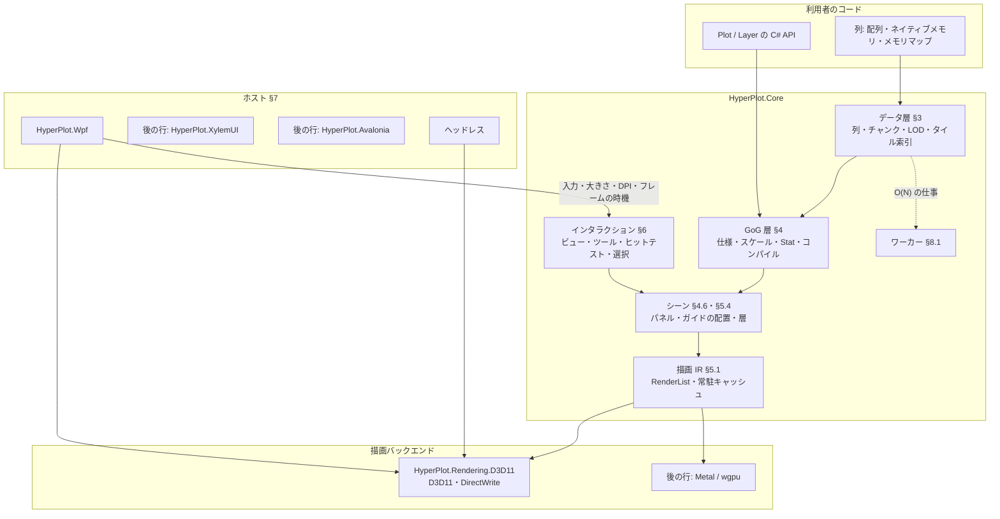

# HyperPlot 設計 v1

現行の設計だけを記す。何を満たすかは [requirements.ja.md](./requirements.ja.md)（要件の正本）、捨てた案は [design-decisions.md](./design-decisions.md)、実測を理由にした判断は [adr/](./adr/)、順序と状態は [roadmap.md](./roadmap.md) にある。要件の ID（D-1、R-2 など）は要件定義書のものを指す。

## 0. 目標・制約・外部依存の基準

C# / .NET 10 のプロットライブラリで、NativeAOT・10 億点の対話的な描画・Grammar of Graphics の構成・高度なインタラクションを両立させる（要件 §1）。

設計を貫く制約は次の 3 つである。

1. **フレームの仕事は画面の大きさで決まる**: 1 フレームの CPU 時間・GPU への転送・描画の量は、データの点数ではなく画素数と系列数で抑える。データの点数に比例する仕事（O(N)）は、フレームの外のワーカーで一度だけ行い、結果の索引をフレームで使う（不変条件 2）
2. **正しさを間引きで失わない**: 間引きは見た目を変えない方法（M4、§5.5.1）を既定とし、近似を使うときは誤差の上限を設計に書く
3. **ライブラリ本体は NativeAOT のまま**: リフレクション・実行時のコード生成を使わない。型に応じた表が要るときは手で書くか Source Generator で生成する

**外部依存の基準**: 依存を避けること自体は目的ではない。避けたいのは (1) 性能の最適化を手元に置けなくなること、(2) Windows で追加のネイティブ DLL を配布すること、(3) NativeAOT の障壁、の 3 つである。次をすべて満たすものは使ってよく、実測で理由が出たら自作に置き換える。

1. trim / AOT の警告ゼロで NativeAOT にリンクできる
2. Windows で追加の DLL を配布しない（OS の部品は使ってよい）
3. フレームの経路に入るなら、時間とアロケーションを自分たちで測れ、型が公開 API に出ない
4. MIT と両立するライセンスで、保守されている

### Dependency Decision Matrix

| 領域 | 自作 | 依存 | 理由 |
| --- | :---: | --- | --- |
| D3D11 / DXGI / D3D9Ex / DirectWrite の宣言 | | ○ TerraFX.Interop.Windows | 抽象層のない生成済みの宣言だけ。COM の vtable を直接呼ぶ。XylemUI と同じ |
| GPU の抽象（§5.2） | ○ | | 決まった数のパイプラインだけを持つ薄い層。汎用の GPU 抽象（Silk.NET・Vortice）は使わない |
| シェーダのコンパイル | ○（生成器） | Windows SDK の `fxc.exe`（ビルド時のみ） | 実行時の `d3dcompiler_47.dll` を持たない。生成物のバイトコードはリポジトリに入れる（§5.7） |
| テキストの整形とラスタライズ（Windows） | | ○ DirectWrite（OS） | 日本語のフォールバックと整形を OS に任せる。グリフのアトラスは自作（§5.6） |
| テキスト（macOS / Linux） | | 後の行で決める | XylemUI.Text（HarfBuzz）を使う案が第一候補 |
| PNG の書き出し | ○ | `System.IO.Compression`（BCL） | 書き出しだけなら小さい。zlib は BCL のもの |
| SIMD・数値 | | BCL（`System.Runtime.Intrinsics`、`System.Numerics`） | |
| メモリマップ | | BCL（`MemoryMappedFile`） | |
| WPF のホスト | | WPF（.NET の一部） | `HyperPlot.Wpf` だけが参照する |
| テスト・計測 | | xUnit v3、BenchmarkDotNet、`Microsoft.Extensions.TimeProvider.Testing`、`Microsoft.Testing.Extensions.HangDump`（止まったテストのダンプ、Issue #260） | テストとベンチマークのプロジェクトだけが参照する |
| Linux の GPU | | 後の行: wgpu-native | ドライバの組み合わせへの対応を小さなチームで続けられないため（XylemUI と同じ判断） |
| macOS の GPU | ○（後の行） | | Metal を Obj-C ランタイム経由で直接呼ぶ |

### 0.1 NativeAOT とランタイム

- 対象は .NET 10、C# 14。リリースは NativeAOT、開発は JIT（デバッガ・Hot Reload）で、両者の挙動は同じにする
- `src/` のプロジェクトは `IsAotCompatible`。ただし `HyperPlot.Wpf` だけは例外である。WPF 自体が NativeAOT と trim に対応しないので `IsAotCompatible=false` にする。それでも自身のコードではリフレクションを使わない
- 文化に依存する API を使わない（`InvariantGlobalization` で動く）。数値の書式は不変のカルチャを既定にし、利用者が書式の関数を渡せる
- 時刻は `TimeProvider` からだけ取る（§8.3）
- `unsafe` のコードを置いてよいのは、GPU のバックエンド、ホストのアダプタ、Core のデータ層のストレージ（ネイティブメモリとメモリマップのチャンク、§3.2）だけである（`.cursor/rules/interop.mdc`）

## 1. アーキテクチャ



1 枚の図（複数のプロット・ファセットを含む）は 1 つの `PlotEngine` が受け持つ。ホストは `PlotEngine` に描画先・入力・大きさ・DPI を渡し、`PlotEngine` が「次のフレームが要る」と言ったときにだけフレームを描かせる（§8.2）。何も変わらなければフレームを描かない。

## 2. プロジェクト構成

### 2.1 プロジェクト一覧

プロジェクトはそれを必要とする Issue の PR で作る（`docs/conventions.md`）。以下は予定の全体である。

| プロジェクト | TFM | 責務 |
| --- | --- | --- |
| `src/HyperPlot.Core` | `net10.0` | データ層・GoG 層・シーン・インタラクション・描画 IR・テキストの契約・ワーカー。GPU にも UI にも依存しない |
| `src/HyperPlot.Rendering.D3D11` | `net10.0-windows10.0.17763.0` | D3D11 のバックエンド（§5.3）とそのオフスクリーンの描画先、DirectWrite のテキスト（§5.6） |
| `src/HyperPlot.Wpf` | `net10.0-windows10.0.17763.0`（WPF） | `HyperPlotView`。D3DImage との共有（§7.2）。AOT の対象外 |
| `src/HyperPlot.Testing` | `net10.0` | 画像の比較（`GoldenImage`、§10.1、行 S3）。偽の時刻と入力の列の再生は、それを使う行で足す。テストと利用者のテストが使う |
| `src/HyperPlot.XylemUI` | 後の行 | XylemUI のホスト |
| `src/HyperPlot.Avalonia` | 後の行 | Avalonia のホスト |
| `src/HyperPlot.Rendering.Wgpu` / `.Metal` | 後の行 | Linux / macOS のバックエンド |
| `tests/*.Tests` | | 各 src プロジェクトのテスト |
| `samples/` | | `WpfPlot`（`HyperPlotView` の時系列・ファセット・図のタブと、プロットの上に重ねた WPF のボタン。JIT で動かす、行 W1a、§7.2）、`HelloPlot`（メモリの 1e6 点の線をヘッドレスで PNG に書く。NativeAOT の検査と要件 P-10 に使う、行 S1）、`BillionSeries`（1e9 点のメモリマップのファイルを複数の系列で、全体と拡大の PNG に書く、行 S1）、`WpfGallery` など |
| `benchmarks/HyperPlot.Benchmarks` | | BenchmarkDotNet によるカーネルの計測 |
| `benchmarks/HyperPlot.DataPath` | | GPU を使わないデータの経路の計測（NativeAOT）と、計測のデータの生成器（§9） |
| `benchmarks/HyperPlot.E2E` | | ヘッドレス描画のフレーム時間、GPU 時間、メモリ（NativeAOT）。行 S2 で作る |
| `tools/ShaderGen` | | HLSL を `fxc` でコンパイルし、バイトコードを C# のファイルに書き出す（§5.7） |

データ層を別のアセンブリ（`HyperPlot.Data`）に分けることは、利用者からの要求が出るまでしない。利用者が使う型の名前空間は `HyperPlot` 1 つにし（`using HyperPlot;` だけで書ける）、層はフォルダで分ける。バックエンドが実装する契約だけは `HyperPlot.Rendering` に置く（§5.2）。

### 2.2 依存方向

```text
HyperPlot.Core  ←  HyperPlot.Rendering.D3D11  ←  HyperPlot.Wpf
       ↑                                    ↖
HyperPlot.Testing                          （ヘッドレスは Rendering.D3D11 だけで動く）
```

- `HyperPlot.Core` は描画のバックエンドもホストも参照しない（不変条件 1）
- バックエンドは Core の描画 IR（§5.1）と GPU の抽象（§5.2）を実装する
- ホストはバックエンドとコアをつなぐ。UI フレームワークの型はホストのプロジェクトの外に出ない

## 3. データ層

### 3.1 列

列は 1 つの型の値の並びで、長さは `long` である。

```csharp
public abstract class Column                           // Column<T> と UniformColumn の基底
{
    public long Length { get; }
    public int ChunkCount { get; }
    public long Version { get; }                       // 追記・変更で増える
    public static UniformColumn Uniform(double start, double step, long length);
    public static UniformColumn UniformInteger(long start, long step, long length);   // 行 D2
}

public sealed class UniformColumn : Column              // 値を持たない等間隔の列（下の「暗黙の列」）
{
    public double Start { get; }
    public double Step { get; }
    public double Last { get; }
    public bool IsInteger { get; }                     // UniformInteger で作った列（行 D2）
    public bool TryGetInteger(out long start, out long step);   // 整数の列の正確な開始値と刻み（行 D2）
    public double GetValue(long index);
}

public sealed class Column<T> : Column, IDisposable where T : unmanaged, INumber<T>
{
    public ReadOnlySpan<T> GetChunk(int chunkIndex);   // 1 チャンク分の連続領域
    public ChunkStats<T> GetStats(int chunkIndex);     // §3.2
    public void Invalidate(long start, long length);   // 包んだ領域を利用者が書き換えたとき
}
```

- `INumber<T>` の制約は、統計のカーネル（§3.2）と統計の結合が `T` の比較と NaN の判定を要るためである。値の型の一覧に入らない数値の型は、作るときに `NotSupportedException` になる

- 値の型: `float`・`double`・`int`・`long`・`byte`。カテゴリは `CategoricalColumn`（行ごとの番号と名前の並び、行 G7b、§4.2）。日時は `long` の列に time のスケールで意味を与える。単位と起点はスケールが持ち、既定は .NET のティック（100 ns、0001 年起点）で、ns・µs の Unix 起点の列もそのまま描ける（Issue #11。単位と起点の API は行 G2）。値が 2^53 を超えても、スケールの空間の原点と差（§3.6）で精度を保つ。
- 要素ごとの仮想呼び出しを避けるため、読み出しの単位はチャンク（`ReadOnlySpan<T>`）である。ストレージの違い（§3.2）はチャンクを取り出すところで一度だけ分岐する
- **暗黙の列**: 等間隔の X（`UniformColumn`: 開始値と刻み、要件 D-5）は値を持たない。時系列で最も多い形で、索引も二分探索も要らない。作り方は 2 つある（行 D2、Issue #11）
  - `Column.Uniform(double start, double step, long length)`: i 番目の値は `start + i * step` を倍精度で計算する（FMA の 1 回の丸め）
  - `Column.UniformInteger(long start, long step, long length)`: 整数の等間隔の列（日時のティック、ns の時刻）。i 番目の値は `start + i * step` で、`long` で正確である。`step` は正、`length` は 0 以上で、最後の値 `start + (length − 1) * step` が `long` に入らなければ `ArgumentOutOfRangeException`。`UniformColumn.IsInteger` が真になる。`double` の `start` では 2^53 を超える開始値が丸まる（2026 年のティックで 128 ティック単位）ので、別の口にする。同じ名前 `Uniform` の多重定義にしないのは、`Column.Uniform(0, 1, n)` のような整数の引数が `long` 版に解決され、今の呼び出しの意味が変わるからである（スクラッチでコンパイルして確かめた）
  - `Start`・`Step`・`Last`・`GetValue(long index)` は、どちらの列でも `double` を返す（整数の列で 2^53 を超える値は丸まる）。M4 と学習は、整数の列の値を `long` のまま読み、原点との差（§3.6）にする
  - `TryGetInteger(out long start, out long step)`: 整数の列なら正確な開始値と刻みを返して真、`double` の列なら 0 と 0 を返して偽。公開の M4 を直接つなぐ呼び出し側（§4.9、`BillionSeries`）が `ScaleOrigin` と境界を正確に作るための口で、i 番目の値は `start + i * step`（`long` で正確）である。`double` の列で投げる口（`IsInteger` が偽なら `InvalidOperationException`）にしないのは、型の種類の取り違えで公開のメソッドが投げないためである（`.cursor/rules/csharp.mdc`、PR #86 のレビュー）
- **欠損**: `float` / `double` は NaN を欠損とする。整数の列は任意の有効ビット列（1 ビット/要素）を持つ
- **表**（行 G1）: `DataTable` は長さの等しい名前付きの列の集合である。API は型付きの参照 `ColumnRef<T>`（表と列の位置）で列を指す。文字列の列名は `table.Col<float>("y")` で参照に解決し、その時点で型を確かめる

```csharp
public sealed class DataTable
{
    public static DataTableBuilder Create();
    public long Length { get; }                         // すべての列の長さ。列がなければ 0
    public int ColumnCount { get; }
    public string GetName(int index);
    public Column GetColumn(int index);
    public ColumnRef<T> Col<T>(string name) where T : unmanaged, INumber<T>;
    public CategoryRef Cat(string name);                // 行 G7b。名前の列が CategoricalColumn でなければ ArgumentException
}

// 行 G7b: カテゴリの列（Issue #159）。行ごとのカテゴリの番号と、カテゴリの名前の並び。メモリの上で不変
public sealed class CategoricalColumn : Column
{
    public int CategoryCount { get; }
    public IReadOnlyList<string> Categories { get; }    // 番号の順の名前
    public int GetCode(long index);                     // 0 ≤ 番号 < CategoryCount、欠けは −1
}
// Column の作り方に足す:
//   public static CategoricalColumn Categorical(ReadOnlySpan<string?> values);                                  // カテゴリは名前の昇順（序数）
//   public static CategoricalColumn Categorical(ReadOnlySpan<string?> values, ReadOnlySpan<string> categories);  // 与えた順

public readonly struct CategoryRef : IEquatable<CategoryRef>      // 行 G7b。カテゴリの列への型つきの参照
{
    public DataTable Table { get; }
    public int Index { get; }
    public CategoricalColumn Column { get; }
    public ColumnRef ToColumnRef();
    // Equals・GetHashCode・== と != を持つ
}

public sealed class DataTableBuilder
{
    public DataTableBuilder Add(string name, Column column);
    public DataTable Build();
}

public readonly struct ColumnRef : IEquatable<ColumnRef>          // 型を忘れた参照（仕様の型が持つ）
{
    public DataTable Table { get; }
    public int Index { get; }
    public Column Column { get; }                                 // Table.GetColumn(Index)
    // Equals・GetHashCode・== と != を持つ
}

public readonly struct ColumnRef<T> : IEquatable<ColumnRef<T>> where T : unmanaged, INumber<T>
{
    public DataTable Table { get; }
    public int Index { get; }
    public Column Column { get; }
    public static implicit operator ColumnRef(ColumnRef<T> reference);
    public ColumnRef ToColumnRef();                               // 暗黙の変換の名前つきの代わり（CA2225）
    // Equals・GetHashCode・== と != を持つ
}
```

  - `Col<T>` は、列が `Column<T>` なら、または列が `UniformColumn` で、`IsInteger` が偽で `T` が `double` か、`IsInteger` が真で `T` が `long` なら参照を返す（§3.1 の暗黙の列）。名前がなければ、型が合わなければ、どちらも名前と実際の型を書いた `ArgumentException`。名前は大文字と小文字を区別する（序数の比較）
  - `Add` は、名前が null なら `ArgumentNullException`、空か、すでにある名前なら `ArgumentException`。`column` が null なら `ArgumentNullException`。`Build` は、列の長さがそろっていなければ、名前と長さを書いた `ArgumentException`。`Build` の後のビルダは使えない（`InvalidOperationException`）
  - 表は列を持つだけで、列の持ち主ではない。`DataTable` は `IDisposable` ではなく、列の寿命は利用者が持つ
  - `ColumnRef` と `ColumnRef<T>` の等しさは、表の同一性（参照）と位置の組である。`default` の参照は表を持たず、仕様に渡すと `ArgumentException`。`default` の参照の `Table` と `Column` は `InvalidOperationException` を投げる
- **ゼロコピー**: 利用者の `T[]`・`Memory<T>`・ポインタ（`Column.Wrap<T>(T* pointer, long length)`）を写さずに包める（要件 D-3）。ポインタは `Memory<T>` の `int` の上限を超える長さを包め、メモリの寿命は利用者が持つ。包んだ領域を利用者が書き換えたら `column.Invalidate(start, length)` を呼ぶ契約とする。写す API は名前に `Copy` を含める

### 3.2 チャンクとストレージ

- **チャンク**: 2^20 要素（1,048,576）。2 の冪なので、要素の位置からチャンクと内側の位置をシフトとマスクで求められる。`float` で 4 MiB、`double` で 8 MiB になり、ワーカーの仕事の単位にもなる
- **ストレージ**は 3 種類である（要件 D-2）。

| 種類 | 実体 | 用途 |
| --- | --- | --- |
| マネージド | `T[]` または `Memory<T>` | 小〜中規模、利用者の配列を包む |
| ネイティブ | `NativeMemory.AlignedAlloc`（64 バイト境界）をチャンクごとに列が持つ。または利用者が持つメモリをポインタと `long` の長さで包む（写さない。境界は利用者のメモリのまま） | 追記・リングバッファ・大規模なメモリ上のデータ、計測機器のバッファ |
| メモリマップ | `MemoryMappedFile` のビュー。列の範囲を 1 つのビューで写像し、チャンクはその中の位置で切り出す | RAM に載らない 10 億点のファイル |

- メモリマップの列は、生のリトルエンディアンの配列のファイル（先頭のオフセット・型・長さを指定）を読む。ファイル形式の網羅はしない（要件 D-8）
- **チャンクの統計**: チャンクごとに SIMD で `min`・`max`・最初と最後の値・和（`double`、NaN を除く）・値の数・NaN の数・単調非減少かどうかを計算し、`ChunkStats<T>` に持つ。統計は初めて読まれたときに計算して持ち、`Invalidate` でそのチャンクの分を捨てる（チャンクごとの世代で、古い世代の結果を返さない）。ワーカー（§8.1）は、ピラミッド（§3.3）を作るときに、統計がまだないチャンクの統計を水準 1 と同じ走査で計算して持つ。ピラミッドを作らない列（M4 の X など）は、`PlotWorkerPool.PrecomputeStats` で先に計算させる。追記（§3.5）では、チャンクを足したときに計算させる。スケールの domain（§4.2）、Y の自動範囲（§6.2）、X の二分探索の絞り込みは、まずこの統計を読む。統計の総数はチャンクの数（10 億点で 954 個）なので、全体の範囲が O(チャンク数) で分かる

### 3.3 LOD ピラミッド（時系列）

X が単調増加の列（時系列、要件 D-4）では、Y の列ごとに min / max のピラミッドを作る。

- **水準**: 水準 ℓ（ℓ = 1, 2, …）のバケットは 64 · 8^(ℓ−1) 要素（64、512、4096、32768、262144）で、各バケットに Y の min と max を持つ。1 チャンク（2^20 要素）の中に 5 水準が収まり、それより上はチャンクの統計（§3.2）がピラミッドの頂点を兼ねる
- **大きさ**: 2/64 + 2/512 + … ≈ 3.6%（要素と同じ型で min と max を持つ場合）に、バケットごとの NaN でない値の数（`float` で約 0.5%、下の「メモリ」）を足して約 4.1%。行 I4b のバケットの和（下）を足して約 4.15%。要件 P-8（10% 以下）に収まる
- **バケットの和**（行 I4b、Issue #390 の決定 4）: 水準 3（4,096 要素）のバケットに、NaN を除いた値の和（`double`）を足す。範囲の平均（§6.5 の「計測」）を、範囲の内側はチャンクの統計の和とこの和で、端は高々 2 × 4,096 個の元の値で求めるためである。1e9 点で約 2 MB（1e9 / 4,096 × 8 バイト、`float` の列の約 0.05%）。水準 1 を作るために元の値を読む同じパスで、4,096 要素ごとに足す（元の値を読み直さない）
- **作り方**: チャンクごとに独立なので並列に作れる。水準 1 は生データを 1 回読む SIMD の min / max、それより上は下の水準から作る。メモリの帯域で律速する
- **欠損**: NaN は min / max から除き、バケットごとに NaN でない値の数を持つ（折れ線を切る場所を見つけるため、要件 D-7。下の「NaN でない値の数」）
- **単調変換との関係**: スケールの変換（log、sqrt など、§4.2）が単調増加なら、変換後の min / max は min / max の変換と等しい。単調減少なら入れ替わる。したがってピラミッドは生の値で 1 つ作れば、どの単調なスケールにも使える
- **X が等間隔でない場合**: 画素の境界に当たる要素の位置を X の二分探索で求める。チャンクの統計で探す範囲をチャンク 1 つに絞ってから探す

**区間の min / max の問い合わせ**: 要素の区間 [a, b) の min / max は、区間に完全に含まれる最も粗い水準のバケットを組み合わせて求め、両端だけ細かい水準に降りる。生データを大きさ 1 の水準 0 と数え、両端は水準 0 まで降りる。結果に誤差はない。

- 両端で読む生データは、それぞれ最大 63 要素（次の 64 要素の境界まで）である。その先は、区間に完全に含まれる最も粗い水準のバケットにつなぐ
- M4（§5.5.1）も同じ問い合わせを使う。両端で読む生データは、first / last のために読む境界の要素から 63 要素以内（`float` で 252 バイト）なので、メモリマップのデータでも新しく触るページはほとんどない
- min / max の要素の位置は、その値を持つバケットを水準 0 まで降りて求める。同じ値が複数あるときは、区間の中で最初に現れる位置をとる
- 両端を粗い水準で止め、バケットを中心で含める誤差つきの問い合わせは採らない（`design-decisions.md` の「M4 の入出力」）

**型と持ち主**（ロードマップ C2）。ピラミッドは列とは別のオブジェクトで、ワーカー（§8.1）が作る。列（§3.1）はワーカーを知らない。同じ列に複数のピラミッドを持ってもよい。

```csharp
public sealed class PlotWorkerPool : IDisposable
{
    public PlotWorkerPool(int threadCount);
    public static PlotWorkerPool Shared { get; }       // ProcessorCount − 1 本（最小 1 本）
    public int ThreadCount { get; }
    public MinMaxPyramid<T> BuildPyramid<T>(Column<T> column) where T : unmanaged, INumber<T>;
    public Task PrecomputeStats<T>(Column<T> column) where T : unmanaged, INumber<T>;  // X の列のチャンクの統計（§5.5.1）
    public void Dispose();
}

public sealed class MinMaxPyramid<T> : IDisposable where T : unmanaged, INumber<T>
{
    public Column<T> Column { get; }
    public long Version { get; }                       // チャンクが 1 つできるたびに増える
    public bool IsComplete { get; }                    // すべてのチャンクが列の今の世代でできている
    public Task Completion { get; }                    // 最初の構築がすべて終わったとき
    public Exception? Fault { get; }                   // チャンクを読む中で起きた例外
    internal Task WhenComplete();                      // 行 G1: 世代の古いチャンクを要求し、IsComplete が真になったら終わる（§4.8 のヘッドレスの待ち方）
    public MinMax<T> GetMinMax(long start, long length);
    public void Dispose();
}

public readonly struct MinMax<T> where T : unmanaged, INumber<T>
{
    public T Min { get; }
    public T Max { get; }
    public long Count { get; }                         // NaN でない値の数。0 なら Min と Max は default
    public bool HasNaN { get; }                        // 区間に NaN がある（すべてが NaN でも真）
    public bool IsProvisional { get; }                 // できていないチャンクを計算済みの統計で代えた（統計もなければ何も足さない）
}
```

- `BuildPyramid` はすぐに返り、チャンクごとの仕事をワーカーに積む。長さ 0 の列のピラミッドは、作った時点でできている
- **破棄の順**: ピラミッドは列より先に破棄する。構築中のピラミッドは列のチャンクを読むので、列を先に破棄すると、ネイティブとメモリマップのストレージでは列の契約（§3.1、`Dispose` と読み出しを並行させない）を破る
- **メモリ**: チャンクごとに、5 水準を `NativeMemory.AlignedAlloc`（64 バイト境界）の 1 ブロックに置く。列のストレージ（メモリマップを含む）によらない。長さ n のチャンクのバケットの数は Σ_{ℓ=1..5} ⌈n / (64 · 8^(ℓ−1))⌉ で、各バケットは min と max（2 · sizeof(T) バイト）と NaN でない値の数を持つ。min と max は、1e9 点の `float` で 1e9 × 8 B × (1/64 + 1/512 + 1/4096 + 1/32768 + 1/262144) ≈ 143 MB、`double` で約 286 MB になる。数は、バケットの大きさが入る最小の幅で持つ（水準 1 の 64 は 1 バイト、水準 2〜4 の 512・4096・32768 は 2 バイト、水準 5 の 262144 は 4 バイト）。1e9 点で 15,625,000 × 1 B + 1,953,125 × 2 B + 244,141 × 2 B + 30,518 × 2 B + 3,815 × 4 B ≈ 20.1 MB（`float` の元データの 0.50%）である。これに端数のバケット（チャンクあたり最大 5 個）が加わる
- **NaN でない値の数**: バケットごとに NaN でない値の数を持つ。数がバケットの大きさと同じなら「NaN なし」、0 なら「すべて NaN」、その間なら「一部が NaN」で、すべて NaN のバケットの min / max は使わない。`GetMinMax` の `Count` は、区間を覆うバケットの数を足すだけで求まり、区間の長さによらない（生データを数えるのは両端の最大 63 要素ずつ）。M4 は、この数で NaN の切れ目を見つけ、すべて NaN のバケットを飛ばして NaN でない要素を探す（§5.5.1）
- **構築**: 1 チャンクが 1 つの仕事である。ワーカーは、統計（§3.2）がまだないチャンクでは、統計と水準 1 を生データの 1 回の SIMD の走査で作り、統計を列に持たせる。統計がすでにあるチャンク（`PrecomputeStats` や `GetStats` の後）では、水準 1 だけを走査する。水準 2〜5 は下の水準から作る。1 回の走査は、統計と水準 1 を別々に走査するときの 0.53〜0.72 倍の時間で、水準 1 だけの走査は 1 回の走査より速い（行 B1 の計測、参照機、L3 に収まらない 64 チャンク、`docs/benchmarks/b1-data-layer.md`）。1 回の走査の結果は、統計のカーネルと水準 1 のカーネルを別々に回した結果と同じ値である。`Sum` は足す順が同じなのでビットまで同じで、min / max は 0 の符号だけが違いうる（x64 の `minps` は両方が 0 のとき 2 つ目の引数を返すので、−0 と +0 を積む順で符号が変わる）
- **順番**: 要求のあったチャンクを先に、残りを位置の順に作る。問い合わせや M4 が、まだできていないチャンクに当たると、そのチャンクを要求する。要求はチャンクごとのフラグを立ててワーカーを起こすだけで、確保も待ちもしない（不変条件 3・7）
- **暫定**: まだできていないチャンク（世代が古いものを含む）は、問い合わせの中で、すでに計算されたチャンクの統計（§3.2）で代え、結果に `IsProvisional` を立てる（不変条件 4）。暫定の経路は統計を計算しない。計算すると、ワーカーがまだ触っていないチャンクを呼び出し側のスレッドで走査し、構築の直後の全体表示でフレームの経路が O(N) になる（不変条件 2、要件 P-2）。統計もまだないチャンクは、結果に何も足さずに暫定にする。区間のチャンクがすべて統計もないとき、`GetMinMax` は `Count` 0、`Min` と `Max` は `default`、`HasNaN` は偽で、`IsProvisional` が真になる。「すべて NaN」の結果（`HasNaN` が真）とも `Count` 0 が同じなので、まだ答えのないことは `IsProvisional` で見分ける。区間がチャンクを丸ごと含み、統計があるなら、統計がそのまま正しいので暫定にしない。チャンクの一部だけを含むなら、min / max・`Count`・`HasNaN` はチャンク全体の値になり、範囲が広がる。利用者が値を書き換えてまだ `Invalidate` を呼んでいないときなど、ブロックが生データと食い違う（ブロックの min / max の値が生データに見つからない）チャンクも、暫定で答える。描く側は `Version` の変化で描き直す。見えているチャンクを先に作るので、暫定の表示は見えている範囲から先に正しい表示に替わる（替わるまでの時間は行 B1 で測る。§9）
- **チャンクの状態**: ピラミッドはチャンクごとに次の状態を 1 つ持ち、状態の書き換えは比較交換（CAS）で行う。ブロックは `BuildPyramid` で全チャンク分を確保する（1e9 点で 954 回の `AlignedAlloc`）ので、読む側がブロックのないチャンクに当たることはない

| 状態 | 意味 |
| --- | --- |
| 未構築 | まだ作っていない。積まれているが、要求はない |
| 要求あり | 問い合わせか M4 が要求した。先に作る |
| 処理中 | 1 つのワーカーが書いている |
| できた | ブロックが、記録した列の世代で正しい |
| 失敗 | 作る中で例外が起きた |

  - 規則 1: 1 つのチャンクに書くワーカーは同時に 1 つである。ワーカーは状態を「未構築」か「要求あり」から「処理中」へ CAS で替えられたときだけ書く。seqlock は書き手が 1 つであることを前提にする
  - 規則 2: 書き終えたワーカーは、列のチャンクの世代を読み直す。書き始めのときと同じなら「できた」にする。違えば（処理中に `Invalidate` が来た）「未構築」に戻して自分で積み直す
  - 規則 3: 「失敗」のチャンクは、要求されても積まない。そのチャンクの世代が進んだとき（`Invalidate`）に限り、次に読まれたときに「要求あり」に戻る。新しい `BuildPyramid` は新しいピラミッドを作るので、失敗を持ち越さない
  - 許す遷移: 未構築 → 要求あり（要求）、未構築・要求あり → 処理中（ワーカー）、処理中 → できた・未構築（規則 2）・失敗、できた → 要求あり（読んだときに世代が古い）、失敗 → 要求あり（世代が進んだ後に読まれた）。これ以外（たとえば 2 つ目のワーカーが処理中のチャンクを取る、世代の変わらない失敗を要求で積む）は起きない
- **世代と公開**: 各チャンクのブロックは、作ったときの列のチャンクの世代（§3.2）を持つ。`Invalidate` で世代が進んだチャンクは、次に読まれたときに「要求あり」になる（規則 3 の失敗を除く）。ワーカーはブロックをその場で書き換える。書く前と後にブロックの版を奇数・偶数に進め（seqlock）、読む側は読む前と後に版を読む。違うか奇数なら、そのチャンクを暫定として扱う。ブロックは `Dispose` まで解放しないので、読む側が解放済みのメモリを読むことはない。`Dispose` と読み出しの並行は、列と同じく契約で禁じる
- **失敗**: チャンクを読む中の例外は、そのチャンクを「失敗」にする（規則 3。失敗し続ける仕事を毎フレーム積まない）。`Fault` は最初の例外を持ち、`Completion` はその例外で終わる。失敗したチャンクは、問い合わせでは暫定（チャンクの統計）で答える
- **`WhenComplete()`**（internal、行 G1）: ヘッドレスの描画が、`Invalidate` の後の作り直しまで待つための口である（§4.8）。`IsComplete` が真なら終わった `Task` を返す。偽なら、世代の古いチャンクをすべて「要求あり」にしてワーカーを起こし（未構築のチャンクは、要求しなくてもワーカーが位置の順に作る。失敗したチャンクは `Fault` で待ちを終える）、チャンクが「できた」になるたびに `IsComplete` を確かめ、真になったときに終わる `Task` を返す。呼ぶ前にすでに `Fault` があれば、その例外で終わった `Task` を返す（失敗したチャンクは規則 3 で要求しても積まれないので、待てば終わらない）。待っている間に `Fault` が立つか、待つチャンクが「失敗」になったら、その例外で終わる。`Dispose` されたら `ObjectDisposedException` で終わる。同時に何回呼んでもよく、待っている呼び出しは同じ `Task` を受ける。終わっていないときだけ `TaskCompletionSource` を 1 つ確保する（ヘッドレスの経路で、フレームの経路ではない）
- **`GetMinMax(start, length)`**: 区間の誤差のない min / max と `Count`。両端は生データまで降りる。`length` が 0 なら `Count` が 0 の結果を返す。区間の値がすべて NaN なら、`Count` は 0、`Min` と `Max` は `default`、`HasNaN` は真（`ChunkStats<T>` と同じ）。区間が列の外なら `ArgumentOutOfRangeException`。M4 も同じ誤差のない問い合わせを使い、min / max の要素の位置も求める

### 3.4 空間タイル索引（散布）

X が単調でない列（散布図）では、点を空間の順に並べ直した写しと、四分木の表と、密度タイルを作る（要件 D-4・R-3）。行 C3a が写し・表・問い合わせを、行 C3b が密度タイルを作る。point の Geom、密度と生の点の切り替え、GPU への常駐、ヒットテストの配線は行 R3a〜R3d3 で作る（Issue #401 の決定 1、Issue #431、Issue #499。§5.5.2）。

**型と持ち主**（行 C3a）。索引は列とは別のオブジェクトで、ワーカー（§8.1）が作る。型は internal で、行 R3a でも公開しない（使い手は Core の中だけである。Issue #431。試験と `HyperPlot.DataPath` は `InternalsVisibleTo` で使う）。internal の間は、不変条件 12（§11）の公開の契約に当たらない。`SpatialRect` は 2 次元の矩形なので、公開するときは不変条件 12 の抽象に合わせる。

```csharp
public sealed class PlotWorkerPool
{
    internal SpatialIndex BuildSpatialIndex<TX, TY>(Column<TX> x, Column<TY> y, in SpatialIndexInput input)
        where TX : unmanaged, INumber<TX> where TY : unmanaged, INumber<TY>;
    internal SpatialIndex BuildSpatialIndex<TX, TY>(Column<TX> x, Column<TY> y, in SpatialIndexInput input,
        SpatialIndexTuning tuning, SpatialCopyAllocator allocator)          // 試験と計測の口（下の「試験と計測の口」）
        where TX : unmanaged, INumber<TX> where TY : unmanaged, INumber<TY>;
}

internal readonly record struct SpatialIndexInput
{
    public required RowRange Rows { get; init; }        // 索引に入れる行の範囲。RowRange.All は列の全体
    public IScale? XTransform { get; init; }            // null は変換なし（linear と time）
    public IScale? YTransform { get; init; }
    public ScaleRange? XRange { get; init; }            // スケールの空間の範囲（原点と差、§3.6）。null は有限な値の範囲
    public ScaleRange? YRange { get; init; }
    public string? TempFolder { get; init; }            // 一時ファイルのフォルダ。null は Path.GetTempPath()
}

internal abstract class SpatialIndex : IDisposable
{
    public Column X { get; }
    public Column Y { get; }
    public SpatialIndexInput Input { get; }
    public long Version { get; }                        // スナップショットを公開するたび、密度タイルを付けるたびに増える
    public bool IsComplete { get; }                     // 最後の段まで、列の今の版でできている
    public Task Completion { get; }                     // 状態が初めて「完了」になったとき
    public Exception? Fault { get; }                    // 構築の中で起きた最初の例外
    internal Task WhenComplete();                       // IsComplete が真になったら終わる（§4.8 のヘッドレスの待ち方）
    public SpatialSnapshot Acquire();                   // 今のスナップショットを借りる。確保も待ちもしない
    public void Dispose();
}

internal abstract class SpatialSnapshot
{
    public SpatialStage Stage { get; }                  // None（まだ何もない）・Coarse（1 段目）・Full（2 段目）
    public bool IsProvisional { get; }                  // 暫定（下の「暫定」）
    public long PointCount { get; }                     // 索引に入った点の数
    public long ExcludedCount { get; }                  // 変換した値が有限でなく、索引に入れなかった点の数
    public ScaleRange XRange { get; }                   // 格子を張った x の範囲。その原点が x の差の基準になる（§3.6）
    public ScaleRange YRange { get; }
    public ReadOnlySpan<long> CoarseDensity { get; }    // 水準 8 の 256 × 256 の点の数（行優先、y × 256 + x）。Stage が None のときは空
    public DensityTiles? Tiles { get; }                 // 行 C3b で足す。付く前は null
    public SpatialCount Count(in SpatialRect rect, int maxLevel);
    public int GetCells(in SpatialRect rect, int maxLevel, Span<SpatialCell> destination);
    public void ReadPoints(long first, Span<double> x, Span<double> y, Span<long> rows);
    public void Release();                              // Acquire で借りたものを返す
}

internal readonly record struct SpatialRect(double XMin, double XMax, double YMin, double YMax);   // スナップショットの原点からの差
internal readonly record struct SpatialCount(long Inside, long Touching);
internal readonly record struct SpatialCell(ulong Code, int Level, long First, long Count, SpatialCellKind Kind);
internal enum SpatialStage { None, Coarse, Full }
internal enum SpatialCellKind { Inner, Leaf, CoincidentLeaf, CappedLeaf }
```

- `BuildSpatialIndex` はすぐに返り、構築をワーカーに積む。引数の誤りはその場で投げる: 列が null なら `ArgumentNullException`、2 つの列の長さが違う・`Rows` の `Start` が負か `End` より大きい・渡した範囲の `Lower` か `Upper` が有限でないか `Lower` が `Upper` より大きいなら `ArgumentException`、プールが破棄済みなら `ObjectDisposedException`。この順に確かめる。一時ファイルを作れない、メモリを確保できないといった構築の中の失敗は投げずに `Fault` に入れる（下の「失敗」）
- **入力と鍵**（決定 4）: 索引を決めるのは、x と y の列、それぞれの変換、範囲、行の範囲である。変換は索引の入力なので、linear と time（どちらも変換なし）は同じ索引を使える。変換が同じかどうかは、今のコンパイル（`PlotPlan` の軸の比べ方）と同じく参照で比べる。行 R3a は索引を使い回さない（部分の計画が自分の索引を持つ。§5.5.2 の「索引の持ち主」）
- **追記する列は対象外**（決定 6）: 索引は、構築を始めたときの `Rows.EndIn(列の長さ)` までの行を持つ。索引への追記は v1 で作らない（§3.5、要件 §7）
- **破棄の順**: 索引は列より先に破棄する。構築中の索引は列のチャンクを読むので、列を先に破棄すると、ネイティブとメモリマップのストレージでは列の契約（§3.1、`Dispose` と読み出しを並行させない）を破る。借りたスナップショットは列を読まない
- **`IScale` を呼ぶスレッド**: 構築は `IScale.Forward` をワーカーのスレッドから呼び、複数のワーカーが同時に呼ぶ（1 回に最大 `RowsPerUnit` 個の値）。組み込みの変換（log・symlog・pow）は状態を持たない。利用者の `IScale` は、今の XML ドキュメントでは「描くスレッドだけが呼ぶ」としているので、行 C3a で「散布の索引を作るときは、ワーカーのスレッドから同時に呼ぶ。`Forward` は複数のスレッドから同時に呼べること」に書き換える。`Inverse` は索引からは呼ばない。`Forward` が投げた例外は構築の失敗になる
- **試験と計測の口**: `BuildSpatialIndex` のもう 1 つの多重定義は、構築の定数の `SpatialIndexTuning`（`LeafCapacity`・`RowsPerUnit`・`TableShare`、カウンタを 8 バイトにする行の数 `WideRows`、仕事が終わるたびにその仕事と時間を受け取る `JobEnded`）と、写しの置き場所を作る `SpatialCopyAllocator` を受け取る。引数が 3 つの口は、この口を既定の値（下の「定数」）と、下の「置き場所」の規則で呼ぶ。この口は、範囲の検査の後、プールの破棄の検査の前に、`RowsPerUnit` が 2^20 以下の 2 の冪でなければ `ArgumentException` を投げる。試験はほかに、索引の状態（`State`）、表の行（`SpatialSnapshot.Rows`）、スナップショットを解放したか（`IsFreed`）、作業用の領域の大きさ、写しを閉じたかを、internal のメンバーで読む

**格子と符号**（決定 4・8）。

- **スケールの空間**: 量子化はスケールの空間の値で行う。変換がある軸は、列の値を `double` にして `Forward` に通す。写しに入れる値は、変換がない軸では列の型のまま、変換がある軸では `float` の列なら `float`、ほかは `double` である（決定 9）。符号は、写しに入れる値（変換の後、その型に丸めた値）から作る。有限かどうかと、範囲の最小と最大も、写しに入れる値で決める。写しの値から符号を計算し直しても同じセルになる
- **有限でない値**: 写しに入れる x か y が有限でない（NaN・±∞）点は、数え上げと書き込みで読み飛ばす。数にも写しにも入れず、1 回目の数え上げで数だけを `ExcludedCount` に持つ。変換のある `float` の列では、`Forward` の結果が `double` で有限でも、`float` に丸めると ±∞ になる点がある（k = 2 の pow で 1e30 は 1e60 になり、`float` の最大の約 3.4e38 を超える）。この点も有限でない点として読み飛ばす。範囲を引数で渡したときも、±∞ は端のセルに入れずに読み飛ばす
- **範囲と原点**（§3.6、不変条件 6）: 軸ごとの範囲は `ScaleRange`（`long` の原点、下端の差、上端の差）で持つ。引数で渡されなければ、その軸の写しに入れる値のうち、有限なものの最小と最大から作る。相手の軸の値が有限でないために読み飛ばす点の値も、範囲には入れる（変換のない軸はチャンクの統計から範囲を作るので、点ごとに相手の軸を見ない）。変換のない整数の列（`long`・`int`・`byte`）の軸は `ScaleRange.FromInteger(最小, 最大)` で、原点は最小である。ほかの軸は `ScaleRange.FromDouble(最小, 最大)` で、原点は ⌊最小⌋ を `long` に収めた値である。有限な値が 1 つもない軸（n = 0 のときを含む）の範囲は、原点 0、下端の差 0、上端の差 0 にする（下の hi = lo の軸）。範囲の外の有限な点は端のセルに入れる
- **差**: 点の値は、その軸の原点からの差 d(v)（`ScaleSpace.Difference`、§3.6）にしてから量子化する。変換のない `long` の列は `Int128` で引くので、2026 年の .NET のティック（約 6.39e17）のように 2^53 を超える値でも、1 ティック違う点の差は 1 違う。変換のある軸は、値を原点 0 の `double` にしてから変換するので、変換の前に丸まる（§4.2 の「原点」と同じ）。以下、v は点の差 d(v)、lo と hi は範囲の下端と上端の差である
- **量子化**: 軸ごとに g = ⌊(v − lo) / (hi − lo) × 2^32⌋ を `double` で計算し、[0, 2^32 − 1] に収める（v = hi は 2^32 − 1 になる）。hi = lo の軸は g = 0 とする。hi − lo が `double` で有限にならない範囲（`-double.MaxValue` から `double.MaxValue` など）は、v・lo・hi をそれぞれ 2 で割ってから同じ式で計算する。割った値の差は `double.MaxValue` 以下で、有限である。どちらの式も v について単調（v1 ≤ v2 なら g1 ≤ g2）なので、値の矩形は格子の矩形に写る。問い合わせは、矩形の端を同じ式で格子に写して比べる
- **符号**: x と y の g のビットを交互に並べた 64 ビットの Morton 符号（`ulong`、Z 順。y のビットが上）を点の鍵とする。水準 L のセルは符号の上位 2L ビットで決まり、水準 0 が全体、水準 8 が 256 × 256、水準 32 が格子の 1 目である
- **3 次元への備え**（§13.1）: 量子化・符号・数え上げ・表・写しへの書き込みは、次元の数 D を引数に取る共通の部品にする。軸あたりのビットは ⌊64 / D⌋（2 次元で 32、3 次元で 21）、セルの子は 2^D 個（4、8）、1 回目の数え上げの水準は ⌊16 / D⌋（8、5）、1 回の走査で降りる水準は最大 ⌊8 / D⌋（4、2）である。写しは D 本の値の列と元の位置を持つ。以下は 2 次元で書く。3 次元の索引（八分木と代表の点、§13.3）は行 K2 で作り、行 C3a は D = 3 の部品を試験する（§10）

**構築の段**（決定 5・8・11）。構築は次の段を上から順に進む。以下、n は行の範囲の行の数（`Rows.EndIn(列の長さ)` の長さ）である。

| 段 | すること | 仕事の分け方 |
| --- | --- | --- |
| 確保 | 写しの全体（n 行分）と、数え上げの作業用の領域を確保する。n = 0 なら写しを作らない。足りなければここで失敗する（決定 13） | 1 つの仕事 |
| 範囲 | 軸ごとに有限な値の最小と最大を求める。範囲を引数で渡した軸では行わない | 単位ごと |
| 数え上げ 1 回目 | 水準 8 のセル（65,536 個）ごとに、点の数と、符号の最小と最大を求める | 単位ごと |
| 粗い公開 | グループのカウンタを足して水準 0〜8 の点の数を作り、1 段目のスナップショットを公開する | 1 つの仕事 |
| 数え上げの繰り返し | 点の数が `LeafCapacity` を超えるセルを分けて数える。分けるセルがなくなるまで走査を繰り返す | 単位ごとと、走査ごとに 1 つの仕事 |
| 表 | 葉ごとに、写しの中の範囲を決める | 1 つの仕事 |
| 書き込み | 各点の x、y、元の位置を、その点の葉の範囲に書く | 単位ごと |
| 確定の公開 | 2 段目のスナップショットを公開する | 1 つの仕事 |
| 密度タイル（行 C3b） | 密度タイルを作り、同じスナップショットに付ける | 単位ごとと、1 つの仕事 |

- 段の順は決定 15 による。決定 8 のとおり、数え上げを葉が決まるまで繰り返してから 1 回で書くので、表は書き込みの前にでき、葉までの並べ直しは書き込みに含まれる。決定 11 がはじめに書いた並び（書き込みの後に葉までの並べ直しと表）は、決定 15 で直した
- **点のない索引**: n = 0（空の行の範囲、長さ 0 の列）の構築も、同じ段を同じ順に進む。確保の段は写し（一時ファイルもネイティブのブロックも）を作らず、走査の段は単位を持たない。粗い公開と確定の公開は点の数が 0 のスナップショットを公開し、状態は「完了」になる。n > 0 で、有限な点が 1 つもないときは、n 行分の写しを確保し、同じく点の数が 0 のスナップショットを公開する（`ExcludedCount` は n）。どちらも失敗ではない
- **範囲**: 変換のない軸は、チャンクの統計（§3.2）の `Min` と `Max` を使う。統計がないチャンクは統計を計算して列に持たせる。`Min` か `Max` が有限でないチャンクと、行の範囲に一部だけ入るチャンクは、値を走査する。変換のある軸は、すべての値を `Forward` に通し、写しに入れる型に丸めてから比べる（利用者の `IScale` は単調とは限らないので、統計の両端だけを変換しても範囲にならない）
- **数え上げ 1 回目**: カウンタはセルごとに点の数（8 バイト）と符号の最小と最大（16 バイト）である。符号の最小と最大が同じセルは、点がすべて同じ格子の目にある
- **数え上げの繰り返し**: 分けるのは、点の数が `LeafCapacity`（既定 4096）を超え、符号の最小と最大が違うセルである。セルの点がすべて入るいちばん深いセル（符号の最小と最大の共通の上位ビットで決まる）から k 水準だけ降りたセル（水準は 32 まで）を数える。k = ⌈log4(点の数 / `LeafCapacity`)⌉ を 1 以上 4 以下に収めた値で、カウンタは 4^k 個（4 バイト、n が 2^32 以上のときは 8 バイト）になる。走査は、分けているセルごとに、その走査で見た点の符号の最小と最大も求める（16 バイト）。次の走査はこれを使って、同じ目に重なった点のセルを分けるのをやめ、点が初めて分かれる水準から数える
  - 分けているセルの点の数は、いちばん後の走査で数えた数である。走査は、分けているセルを数え始めたセル（上の「いちばん深いセル」）の外にある点を数えない。そこに点があるのは、走査の間に列が変わったときだけである（下の「構築中に列が変わったとき」）
  - 走査は、点ごとに符号で表を降りて、その点の分けているセルを求める。走査の終わりの仕事は、下に分けているセルが 1 つもない分けたセルに、構築の間だけの印を付ける。点は印のあるセルで降りるのをやめ、どのセルにも数えない。印は表の仕事が表に番号を付ける前に消す。深く入れ子になった塊では、走査のたびに降りる水準が増え、降りる時間が走査の時間の多くを占めるためである（1e8 点の塊のある分布で、構築は 13.2〜13.4 秒から 9.5〜9.9 秒になった。`docs/benchmarks/c3a-spatial-index.md`）
  - 一様な 1e9 点では、水準 8 のセルに 1e9 / 65,536 ≈ 15,259 点が入る。15,259 / 4096 ≈ 3.73 なので k = 1 で、水準 9 のセルは約 3,815 点になり、数え上げは 2 回の走査で終わる
  - 走査のたびに、まだ分けるセルは少なくとも 1 水準深くなり、水準は 32 までなので、数え上げの走査は多くても 1 + 24 = 25 回である
- **葉**: 表のセルは、点の数が `LeafCapacity` 以下なら葉である。点の数が `LeafCapacity` を超えるのに葉になるのは 2 つの場合で、点がすべて同じ格子の目にある場合（同じ位置の点の葉、`CoincidentLeaf`、決定 8）と、表の行の上限で分けられなかった場合（上限で止まった葉、`CappedLeaf`、下の「表の上限」）である。点の数が `LeafCapacity` を超える水準 32 のセルは、点がすべて同じ目にあるので、いつも前者になる。まとめると、分けたセル（`Inner`）・同じ位置の点の葉・上限で止まった葉は点の数が `LeafCapacity` を超え、ほかの葉（`Leaf`）は `LeafCapacity` 以下である
- **表**: 1 行は 32 バイト（符号 `ulong`、写しの中の先頭 `long`、点の数 `long`、最初の子の行 `int`、水準 `byte`、種類 `byte`、詰め 2 バイト）である。分けたセルの 4 つの子は、表の連続した 4 行に符号の順で並べ、点のない子も行を持つ。葉の写しの中の先頭は、葉を符号の順に並べたときの点の数の累積である。Morton 順なので、分けたセルの範囲は、子の範囲をつないだ連続した範囲になる。点が 1 つもない索引の表は、根の 1 行（水準 0 の葉、点の数 0）である
  - 一様な 1e9 点では、葉は水準 9 の 262,144 個、分けたセルは水準 0〜8 の (4^9 − 1) / 3 = 87,381 個で、表は 349,525 行 × 32 B = 11,184,800 B（約 11.2 MB、`float` の x, y の元データ 8 GB の 0.14 %）になる
- **表の上限**（決定 14）: 上限を置かないと、深く入れ子になった塊のデータで、表は 1 + 4 × 32 × n / `LeafCapacity` 行（1 点あたり約 1 バイト、`float` の x, y の 12.5 %）まで増え、P-8 の 10 % に収まらない。そこで表の行の数を `MaxTableRows` = max(1, ⌊`TableShare` × 元データのバイト数 / 32⌋) 以下にする。元データのバイト数は n × (x の要素の幅 + y の要素の幅)、`TableShare` は 0.02（2 %）で、1e9 点の `float` の x, y では ⌊0.02 × 8e9 / 32⌋ = 5,000,000 行（160 MB）である。数え上げの走査の後で子の 4 行を足すと上限を超えるときは、その走査で新しく分けるセルを浅い水準から（同じ水準では符号の順に）上限まで分け、残りを上限で止まった葉にして、数え上げを終える。表の行は浅い水準から作るので、上限で止めた表の行は、上限のない表の先頭の行と同じセルである。上限のない表で分けたセルのうち、子の行が上限に入らなかったものが上限で止まった葉になる（`MaxTableRows` が 350 の試験では 349 行。分けると 4 行増えるため）。一様なデータの表は多くても n / 768 行（葉が 1,024 点を少し超えるとき。葉 n / 1,024 個の 4/3 倍）で、`float` の x, y の上限 n / 200 行に届かない。`TableShare` の値と、上限に届くデータがあるかは、行 C3a が 2 種類の分布で測って確かめる（§9）
- **書き込み**: 各点の符号から表を降りて葉を求め、その葉の中の自分のグループの位置に x、y、元の位置を書く。符号から葉を引くときは、水準 8 のセルごとに持つ表の行の番号（65,536 個 × 4 B = 262,144 B）から降りる

**グループと単位**（決定 11）。

- 走査の段は、行の範囲を `RowsPerUnit`（16,384 行）の単位に分ける。`RowsPerUnit` は 2^20 以下の 2 の冪から選ぶ。単位の境界は行の番号で `RowsPerUnit` の倍数に置くので、チャンクの境界（2^20 行ごと）はいつも単位の境界になり、単位はチャンクをまたがない。1 つの単位が 1 つの仕事で、数え上げの単位の時間を 1 チャンクのピラミッドの構築（762 µs、`docs/benchmarks/b1-data-layer.md`）と同じ程度に抑える。行 C3a の計測で 16,384 にした。1e9 点で、数え上げの単位は中央値 0.21〜1.49 ms、書き込みの単位は写しの離れた場所に書くので 4.1〜8.6 ms で、構築の全体の時間は 16,384 から 1,048,576 のどれでも変わらなかった（`docs/benchmarks/c3a-spatial-index.md`、`docs/adr/0001-spatial-index-build-time.md`）
- 単位を、行の順に `GroupCount`（8）個のグループに分ける。グループ i は、単位の数を U として ⌊i × U / 8⌋ 番目から ⌊(i + 1) × U / 8⌋ − 1 番目までの単位を持つ。グループは自分の単位を行の順に 1 つずつ進め、1 つのグループを同時に進めるワーカーは 1 つである（グループごとのフラグを比較交換で取る）。構築は、行を単位に分ける前からワーカーに見える（`Dispose` が写しを見つけられるように、確保の仕事の初めに置く）。そこで、グループは取れる単位がない状態で始まり、段が始まるまで単位を渡さない。カウンタと作業用の領域はグループごとに持つので、ワーカーどうしは同じカウンタに書かない。1 つの索引を同時に進めるワーカーは多くても 8 つである。8 は、要件 P-15 の計測の条件のワーカーの数である
- **ワーカーの数によらない写し**: 表を作るとき、葉ごとに、グループごとの点の数を持つ。書き込みでは、グループ g の点を、その葉の中で g より前のグループの点の後ろに書く。グループの中は行の順に進むので、葉の中の点は元の行の順に並ぶ。同じ入力からは、ワーカーの数にも仕事の順にもよらず、同じ表と同じ写しができる
- 1 つの仕事で行う段（確保、粗い公開、走査ごとのカウンタの足し合わせ、表、確定の公開）は、単位に分けない。その時間は行 C3a で段ごとに測る（§9）。フレームの仕事は、索引の仕事より先に取る（§8.1）

**写しと置き場所**（決定 2・3・9・13）。

- **写し**: x の値、y の値、元の位置の 3 つの領域を、それぞれ 64 バイト境界に置く。値はスケールの空間の値である（型は上の「スケールの空間」）。元の位置は行の範囲の先頭からの行の数（行 − `Rows.Start`）で、n が 2^32 以下なら `uint`（4 バイト）、超えれば `long`（8 バイト）で持つ。領域を分けるのは、密度タイルの構築と行 R3a の描画が x と y だけを読み、元の位置の領域（1e9 点で 4 GB）に触れずに済むようにするためである
  - 大きさは n × (x の幅 + y の幅 + 元の位置の幅) バイトで（一時ファイルでは、各領域の先頭を 64 の倍数のバイトに置くので、これより 126 バイトまで大きい。70,001 点の `float` の x, y で 840,132 バイト）、1e9 点の `float` の x, y（変換なし）では 1e9 × (4 + 4 + 4) = 12 GB（元データの 150 %、要件 P-8 の例外）になる。`float` の列に変換があるときも同じである。`float` のほかの型の列に変換があると、その軸は `double` の 8 バイトになる
  - 有限でない点は写しに入らないので、使うのは先頭の `PointCount` 点分である
  - n = 0 の索引は写しを持たず、一時ファイルもネイティブのブロックも作らない。大きさ 0 の写像は作れない（長さ 0 のメモリマップの列がビューを持たないのと同じである）。空のファイルに大きさ 0 を渡した `MemoryMappedFile.CreateFromFile` は `ArgumentException` を投げ（下の「確かめたこと」）、`posix_fallocate` は 0 以下の大きさに `EINVAL` を返す（man-pages の `posix_fallocate(3)`）
- **置き場所**: x か y のどちらかが `ColumnStorageKind.MemoryMapped` の列なら、一時ファイルのメモリマップに置く。どちらもマネージド配列かネイティブメモリなら、`NativeMemory.AlignedAlloc`（64 バイト境界）の 3 つのブロックに置く
- **一時ファイル**: `TempFolder`（既定は `Path.GetTempPath()`）に `hyperplot-<GUID>.tmp` を作り、全体を 1 つのビューで写像する。作るときに全体の大きさを確保し、プロセスが落ちても残らないようにする。OS ごとに方法が違う
  - **Windows**: `FileStream` を `FileMode.CreateNew`・`FileAccess.ReadWrite`・`FileShare.None`・`FileOptions.DeleteOnClose`・`PreallocationSize`（全体の大きさ）・`BufferSize` 0（写しには写像を通して書くので、`FileStream` の書き込みの緩衝は持たない）で開き、`MemoryMappedFile.CreateFromFile(FileStream, null, 大きさ, MemoryMappedFileAccess.ReadWrite, HandleInheritability.None, leaveOpen: true)` で写像する。`DeleteOnClose` は `FILE_FLAG_DELETE_ON_CLOSE` で、ファイルはすべてのハンドルが閉じた直後に消える（Microsoft Learn の `CreateFileW`）。プロセスが止められたときも OS がハンドルを閉じる。`PreallocationSize` は `SetFileInformationByHandle`（`FileAllocationInfo`）を呼び、空きが足りないとき（`ERROR_DISK_FULL`）は .NET がファイルを消して `IOException` を投げる（dotnet/runtime v10.0.0 の `SafeFileHandle.Windows.cs`）
  - **Linux**: `FileMode.CreateNew` で開き、直後に `File.Delete` で名前を消してから、ファイルの大きさ分のブロックを確保し、同じ `FileStream` から写像する。確保は、まず `fallocate(fd, 0, 0, 大きさ)` を 1 回呼ぶ（`EINTR` なら呼び直す）。ファイルシステムが対応せず `EOPNOTSUPP` で失敗したときだけ、`posix_fallocate` を 1 MB（`ReservePiece`）ずつ呼び、呼ぶ前ごとに構築が止まったかを確かめる。止まっていれば、`OperationCanceledException` を投げてファイルを閉じる。構築を止めた側が後を片づけるので、この例外は `Fault` に入らない。.NET の `PreallocationSize` は使わない。Linux では `fallocate(fd, FALLOC_FL_KEEP_SIZE, …)` を呼び、`ENOSPC` と `EFBIG` のほかの失敗を無視するので（v10.0.0 の `SafeFileHandle.Unix.cs` の `Init` と `pal_io.c` の `SystemNative_FAllocate`）、`fallocate` のないファイルシステムでは確保されないまま進むためである。`FileOptions.DeleteOnClose` も使わない。Unix ではハンドルを解放するときに .NET が名前を消すので（同じファイル）、プロセスが止められると残るためである。`fallocate` と `posix_fallocate` は、成功すれば、その範囲への後の書き込みが空きの不足で失敗しないことを保証する（man-pages の `fallocate(2)` と `posix_fallocate(3)`）。ほかの失敗は、その番号を持つ `IOException` にする（`ENOSPC` のほか、musl でファイルシステムが対応しないときの `posix_fallocate` の `EOPNOTSUPP` を含む）。確保しないで写像に書くと、空きがなくなったときにプロセスが終わる。glibc の `posix_fallocate` は、`fallocate` のないファイルシステムでは、ブロックごとに 1 バイトを書いて確保する。同じ文書の CAVEATS は、この手順を効率が悪いとしている。WSL2 の 9p（`/mnt/c`）では、12 GB の確保に 17.4 分、1 MB あたり 67〜87 ms かかった（ext4 は `fallocate` の 1 回で 3〜15 ms。`docs/benchmarks/c3a-spatial-index.md`）。1 回の呼び出しで確保すると、`Dispose` はその終わりまで待つ。1 MB ずつに分けたのはこのためである（`docs/adr/0001-spatial-index-build-time.md`）。このファイルシステムでは、確保が終わるまで、索引は空のスナップショットのままである
  - `fallocate` と `posix_fallocate` は `[LibraryImport("libc")]` で呼ぶ。`HyperPlot.Core` の最初の P/Invoke で、引数はファイルのハンドルと整数だけである（`.cursor/rules/interop.mdc`）。`fallocate` は失敗の番号を `errno` に置くので `SetLastError = true` で受け取り、`posix_fallocate` は番号を戻り値で返す。呼ぶスレッドに条件はなく、確保の仕事のワーカーが呼ぶ
  - **ほかの OS**（macOS）: 一時ファイルは行 P2 で作る。それまで、メモリマップの列の索引を作ると `PlatformNotSupportedException` が `Fault` に入る。ネイティブメモリの置き場所は OS によらない
  - 確かめたこと（2026-11-10）: Windows 11（ビルド 26300）と .NET 10 で、上の開き方の 64 MB のファイルは `Process.Kill` の後に残らず、空きより 16 GB 大きい `PreallocationSize` は `IOException` になってファイルを残さなかった。同じ開き方の空のファイルに大きさ 0 を渡した `MemoryMappedFile.CreateFromFile` は、`ArgumentException` を投げた（.NET 10.0.14）。WSL2（ext4 と 8 MB の tmpfs）と .NET 8 で、上の手順のファイルは `kill -9` の後に残らず、8 MB の tmpfs に 64 MB を求めた `posix_fallocate` は 28（`ENOSPC`）を返し、確保しないで写像に書いたプロセスは終了コード 134 で終わった。行 C3a は、子プロセスを止める試験を両方の OS の CI で回す（§10）
  - 次の起動で残ったファイルを探して消す処理は持たない。ライブラリは、自分が今作ったファイルのほかを消さない（決定 13）

**メモリ**（決定 2、要件 P-8）。

| もの | 大きさ | 一様な 1e9 点の `float` の x, y | いつまで持つか |
| --- | --- | --- | --- |
| 写し | n × (x の幅 + y の幅 + 元の位置の幅) | 12 GB | スナップショットが解放されるまで |
| 表 | 行の数 × 32 B。行の数は `MaxTableRows` 以下 | 11,184,800 B（上限は 160 MB） | 同上 |
| 密度タイル（行 C3b） | 下の「密度タイル」。表との合計が元データの 10 % 以下 | 95,027,200 B | 同上 |
| 水準 0〜8 の点の数 | 87,381 × 8 B = 699,048 B（n によらない） | 699,048 B | 同上。行 R3d3 から、確定のスナップショットの公開まで（下の「粗い点の数を捨てる」） |
| エンコードの写し（行 R3d2） | 列 1 本ごとに n × 値の幅（カテゴリの番号は 1 B、数の値は 4 B） | 番号 1 GB、値 4 GB | スナップショットが解放されるか、列の版が変わるまで（§5.5.2 の「行 R3d2 のエンコードの列」） |
| 1 回目のカウンタ | 65,536 × 24 B × 8 グループ = 12,582,912 B（n によらない） | 12,582,912 B | 数え上げの終わりまで |
| 繰り返しのカウンタ | 1 回の走査で 256 × n / `LeafCapacity` バイト未満 | 62,500,000 B 未満 | その走査の終わりまで |
| 分けているセルの記録と並び | 248 × n / `LeafCapacity` + 56 バイト以下 | 60,546,931 B 以下 | 数え上げの終わりまで |
| 葉ごとのグループの点の数 | (点のある葉の数 + 1) × 8 グループ × 2 つ（書く位置と終わり）× 4 B。表の大きさの 2 倍 + 64 B 以下 | 262,145 × 64 B = 16,777,280 B | 書き込みの終わりまで |
| グループの作業用の領域 | 65,536 × 8 B × 3（変換した x と y、符号）× 8 グループ = 12,582,912 B | 12,582,912 B | 構築の終わりまで |

- 繰り返しのカウンタの上限: 分けるセルは点の数が `LeafCapacity` を超え、互いに重ならないので、n / `LeafCapacity` 個より少ない。セルのカウンタは 4^k 個で、k < log4(点の数 / `LeafCapacity`) + 1 なので 4 × 点の数 / `LeafCapacity` 個より少なく、合計は 4 × n / `LeafCapacity` 個より少ない。1e9 点では 4 × 1e9 / 4096 ≈ 976,563 個より少なく、976,563 × 4 B × 8 グループ ≈ 31.25 MB である。符号の最小と最大は、1e9 / 4096 ≈ 244,141 個 × 16 B × 8 グループ ≈ 31.25 MB より少ない。合わせて 256 × n / `LeafCapacity` = 62,500,000 B より少ない。n が 2^32 以上のときは、カウンタと葉ごとの点の数が 8 バイトになる。数が前もって決まらない作業用の領域（表、分けているセルの記録、葉ごとの点の数）は、足りなくなったら 2 倍に広げる
- **P-8 の確かめ方**: 表と密度タイルの合計が元データのバイト数の 10 % 以下であることを、行 C3a（表）と行 C3b（合計）の試験と計測で確かめる（§9・§10）。水準 0〜8 の点の数（699,048 B）は n によらない固定の大きさなので、割合には入れずに別に書く（1e9 点の `float` の x, y で 0.0087 %）。表の根の 1 行（32 B）も n によらず持つ。元データが 320 B より小さい索引（n = 0 を含む）では、この 1 行が 10 % を超える。そこで割合は、元データが 320 B 以上の索引で確かめる。作り直しの間は、古いスナップショットと新しい写しの両方を持つ（決定 6）
- **エンコードの写し**（行 R3d2、Issue #499 の決定 15）: エンコードの列（色・大きさ・形）を元の位置で Morton 順に並べ直した写しも、x と y の写しと同じく要件 P-8 の写しの例外である。10 % には入らない。1e9 点の `float` の x, y（元データ 8 GB）に対して、カテゴリの番号の列（1 点 1 B）は 1e9 × 1 B = 1 GB で元データの 12.5 %、数の列の値（1 点 4 B）は 1e9 × 4 B = 4 GB で 50 % になる。置き場所は写しと同じ規則（上の「置き場所」）で決める。カテゴリごとの密度のタイル（行 R3d1・R3d3）は、表と密度タイルと同じく 10 % に入れる
- **粗い点の数を捨てる**（行 R3d3、Issue #499 の決定 14）: 水準 0〜8 の点の数（699,048 B）は、確定のスナップショットを公開するときに捨てる。行 R3d3 では 1 つの層がパネルごとに索引を持ち、パネルは 256 まであるので、残すと 256 × 699,048 B ≈ 179 MB になる。今のコードが粗い点の数を読むのは、スナップショットが `Full` でないときだけである（`SpatialSnapshot.Count` は `Full` なら表を数える。`IndexedPointPlan` が粗い密度を描いて `ResidencyCache.RequestCoarseDensity` に渡すのは、`Stage` が `Full` でないときだけ）。行 R3c の粗い密度のヒットテスト（§6.3）も、索引ができる前だけである。行 R3d3 の実装は、確定の後に読む所がないことを確かめてから捨てる

**状態と公開**（決定 5・6・11）。索引は次の状態を 1 つ持ち、状態の書き換えは比較交換（CAS）で行う。

| 状態 | 意味 |
| --- | --- |
| 構築待ち | 構築が積まれていて、まだどのワーカーも始めていない（最初の構築と作り直し） |
| 数え上げ | 確保から表までの段を進めている |
| 書き込み | 書き込みと確定の公開の段を進めている |
| 密度タイル | 確定のスナップショットを公開した後、密度タイルを作っている（行 C3b から） |
| 完了 | 最後の段まで終わった |
| 失敗 | 構築の中で例外が起きた |
| 破棄済み | `Dispose` された |

- 規則 1: 1 つの索引で同時に進む構築は 1 つである。ワーカーは、状態を「構築待ち」から「数え上げ」へ CAS で替えられたときだけ構築を始め、始めに x と y の列の `Version` を記録する。段の中の単位は、その構築が積む。段の最後の単位を終えたワーカー（残りの単位の数を 0 にしたワーカー）が、次の 1 つの仕事を積む。単位が 1 つもない段（n = 0 の走査の段、タイルを持つセルのない密度タイルの段）では、その段の単位を積むはずの仕事が、代わりに次の 1 つの仕事を積む
- 規則 2: 最後の段を終えた仕事は、列の `Version` を読み直す。記録した版と同じなら「完了」にする。違えば（構築中に `Invalidate` が来た）「構築待ち」に戻して自分で積み直す
- 規則 3: 「完了」の索引は、`Acquire` か `WhenComplete()` が、記録した版と列の今の版の違いを見つけたときに「構築待ち」に戻る。CAS で替えられた呼び出しだけがワーカーを起こす。起こすのはフラグを立ててイベントを立てるだけで、確保も待ちもしない（不変条件 3・7）。構築中（数え上げ・書き込み・密度タイル）の索引は、版の違いを見つけても何もしない（規則 2 が見る）
- 規則 4: 「失敗」の索引は、列の版が失敗した構築の記録した版から進んだ後に読まれたときに限り、規則 3 と同じ手順で「構築待ち」に戻る。版の変わらない失敗は積み直さない（失敗し続ける構築を毎フレーム積まない）
- 規則 5: スナップショットの公開は、索引のロックの中で状態を確かめてから行う。「破棄済み」なら公開せず、作ったスナップショットを解放する。`Dispose` は同じロックの中で状態を「破棄済み」にする
- 許す遷移: 構築待ち → 数え上げ（ワーカー）、数え上げ → 書き込み（表の仕事）、書き込み → 密度タイル（確定の公開、行 C3b から）、書き込み → 完了・構築待ち（行 C3a の間。規則 2）、密度タイル → 完了・構築待ち（規則 2）、数え上げ・書き込み・密度タイル → 失敗、完了 → 構築待ち（規則 3）、失敗 → 構築待ち（規則 4）、破棄済みのほかのどの状態からも → 破棄済み。これ以外（たとえば 2 つ目のワーカーが構築を始める、版の変わらない失敗を積み直す、破棄済みの後に公開する）は起きない
- **スナップショット**: 問い合わせに答えるのはスナップショットで、公開した後は書き換えない（密度タイルを 1 度付けることだけが例外）。3 種類ある
  - 空（`Stage` が `None`）: `BuildSpatialIndex` が作る。何も持たない
  - 粗い（`Coarse`、1 段目）: 水準 0〜8 の点の数（87,381 個の `long` の配列。水準ごとに行優先）と、範囲、`PointCount`、`ExcludedCount` を持つ
  - 確定（`Full`、2 段目）: 粗いスナップショットの中身に加えて、表と写しを持つ。密度タイルは、できたときに同じスナップショットに付ける
- **公開の順**: 最初の構築は、空 → 粗い → 確定の順に差し替える。作り直しでは、今のスナップショットが確定なら粗いスナップショットを公開しない。古い確定のスナップショットが、新しい確定ができるまで暫定として答える（決定 6）。差し替えと密度タイルの取り付けのたびに、索引の `Version` を増やす。描く側は `Version` の変化で描き直す
- **参照の数**: 作り直しは写しを新しく作るので、古い写しを読んでいる側がいる間は解放できない。そこで、スナップショットは参照の数を持つ（ピラミッドのその場の書き換えと seqlock は使えない）。索引が今のスナップショットに 1 つ持ち、`Acquire` が 1 つ足し、`Release` が 1 つ引く。`Acquire` は今のスナップショットの数を、0 より大きいときだけ CAS で 1 増やす。0 なら（読んだ直後に差し替えられて解放が始まった）今のスナップショットを読み直す。数が 0 になったスナップショットの写しと表と密度タイルは、ワーカーが解放する（ビューを外しファイルを閉じる仕事を、フレームの経路でしない）。スナップショットは自分の中に待ち行列の節を持つので、解放を積むときに確保しない。プールが破棄済みなら、`Release` を呼んだスレッドが解放する。どちらのときも、一時ファイルのビューを外して閉じるのは .NET のスレッドプールである（下の「寿命」）。借りたスナップショットは、索引が差し替えられても破棄されても、`Release` まで読める。`Acquire` と `Release` は対で呼び、`Release` の後のスナップショットには触らない（XML ドキュメントに書く）
- **暫定**: `IsProvisional` は次のどれかのときに真である（不変条件 4）。`Stage` が `Full` でない。そのスナップショットを作った構築で、写しと数え上げが合わなかった（下の「構築中に列が変わったとき」）。構築の始めに記録した列の版が、列の今の版と違う。3 つ目は読むたびに列の `Version` と比べる
- **`IsComplete`**: 状態が「完了」で、今のスナップショットの記録した版が列の今の版と同じときに真である。`Completion` は、状態が初めて「完了」になったときに終わる
- **構築中に列が変わったとき**（決定 11）: 構築は止めずに最後の段まで走らせる。走査ごとに読む値が違うと、数え上げと書き込みが合わなくなるので、次のように扱う
  - 表を作るとき、葉の点の数の累積が n を超える分は、葉の範囲を n で切る
  - 書き込みで、葉の中の自分のグループの範囲がもう埋まっている点は捨てる
  - 書き込みの後、範囲に空きが残った葉は、空きを直前の書かれた点（写しの先頭に空きがあるときは最初の書かれた点）の写しで埋める。どのセルも連続した範囲のままで、どの位置にも実際の点が入る。1 点も書かれなかったときは、点の数が 0 の表にする
  - 点を捨てたか、空きを埋めたか、範囲を切ったスナップショットは、暫定として公開する。規則 2 が版の違いを見て、続けて作り直す。版が変わらないのに合わなかったとき（利用者が値を書き換えてまだ `Invalidate` を呼んでいない、利用者の `IScale` が同じ値に違う結果を返す）は、列の版が進むまで暫定のままである
- **失敗**（決定 11）: 構築の中の例外（空きの不足の `IOException`、メモリの確保の失敗、利用者の `IScale` の例外、チャンクを読む中の例外）は、その構築を止め、状態を「失敗」にする。公開していない写しはその仕事が解放する。`Fault` は最初の例外を持ち、後の作り直しが成功しても消さない（ピラミッドと同じ）。`Completion` は、終わっていなければその例外で終わる。今のスナップショットは残り、問い合わせには暫定で答え続ける（最初の構築の失敗なら、空か粗いスナップショットのままである）。書き込みで失敗した最初の構築の後の作り直しは、今のスナップショットが粗いので、粗いスナップショットをもう一度公開する（上の「公開の順」）
- **寿命**: 写しの一時ファイルとネイティブのブロックは、構築の確保の段でワーカーが作る（n = 0 なら作らない）。作れなければ「失敗」になる。解放するのは、スナップショットの参照の数を 0 にしたときのワーカー（プールが破棄済みならそのスレッド）である。一時ファイルの写しを解放する側は、領域の番地を消し、ビューを外してファイルを閉じる仕事を .NET のスレッドプールに渡して戻る。この仕事は 1e9 点の写しで 1.3〜2.9 秒かかり（`docs/benchmarks/c3a-spatial-index.md`）、公開していない写しを解放する `Dispose` は UI のスレッドから呼ばれうるためである。ビューは、アクセサの `Dispose` より先に、ビューのハンドル（`SafeMemoryMappedViewHandle`）を閉じて外す。書き込めるアクセサの `Dispose` は、ビューが開いていれば、変えたページをファイルに書き出して終わりを待つ（dotnet/runtime v10.0.0 の `MemoryMappedViewAccessor.cs`。Windows は `FlushViewOfFile`、Unix は `msync` の `MS_SYNC`）。写しは消すファイルなので書き出さない。書き出すと、書き込みの段の途中の 1e9 点の写しで 25〜44 秒かかった。Windows では、ファイルは閉じ終わるまでフォルダに残る。その前にプロセスが終われば、OS が消す（上の「一時ファイル」の `DeleteOnClose`）。確保の途中で失敗した写しは、例外が呼び出し側に届く前に、その場で閉じる。試験と計測は、閉じ終わったときに終わる `SpatialCopy.Closed` の `Task` で待つ。`Dispose` は、処理中の構築を止めてから状態を「破棄済み」にし（どちらも規則 5 のロックの中）、残った仕事を取り下げ、処理中の仕事（多くても 8 つの単位か、1 つの仕事）の終わりを待ち、公開していない写しと作業用の領域を解放し、今のスナップショットの索引の持つ参照を返す。構築を先に止めるのは、処理中の仕事を早く終わらせるためである。途中でやめた単位も段の終わりを数えるので、段の最後の単位がやめると、次の 1 つの仕事が積まれる。構築が止まる前に入っていたワーカーがその仕事を取っても、取った後に構築が止まっているかを確かめ、止まっていれば走らせない（書き終えていない写しを確定のスナップショットとして公開しない。プールの破棄と、ほかの単位の失敗で止まった構築に当たる）。構築を始めるワーカーは、状態を読んでから構築を置くので、その間に始まった破棄は構築を見ない。そこで、ワーカーは構築を置いた後に状態とプールの破棄の印を読み直し、`Dispose` は状態を書いた後にもう一度構築を読む。どちらの書き込みも完全なメモリバリアを伴うので、どちらかが必ず相手を見て構築を止める。書き込みの単位は、`StopCheckRows`（256）行ごとに構築が止まったかを確かめ、止まっていれば残りの行を書かずに終わる。止まった構築は何も公開せず、写しは捨てるので、書きかけのままでよい。確保の仕事は、1 MB ずつ確保する間に同じことを確かめる（上の「一時ファイル」）。終わっていない `Completion` と `WhenComplete()` の `Task` は `ObjectDisposedException` で終わる。破棄の後の `Acquire` は `ObjectDisposedException` を投げる。2 度目の `Dispose` は何もしない。`Dispose` は `Fault` を変えない。`ObjectDisposedException` の `ObjectName` は、`Dispose` の後なら `SpatialIndex`、プールの破棄の後なら `PlotWorkerPool` である。`Dispose` が待つのは処理中の仕事の分で、不変条件 7 の例外である（§8.1）。写しを閉じる時間は待たない。1e9 点で `Dispose` が戻るまでの時間は、構築のどの時点でも 0.01〜6.1 ms だった（`docs/adr/0001-spatial-index-build-time.md`）
- **プールの破棄**: プールが破棄されると、ピラミッドと同じく、プールのすべての索引のうち、`Fault` がまだないものの `Fault` を `ObjectDisposedException` にする（§8.1）。終わっていない `Completion` と `WhenComplete()` の `Task` も同じ例外で終わる。作り直しは行われず、今のスナップショットは残り、状態も変わらない。先に `Dispose` された索引はプールから外れているので、その `Fault` は変わらない
- **`WhenComplete()`**（internal）: ヘッドレスの描画が、`Invalidate` の後の作り直しまで待つための口である（§4.8）。`IsComplete` が真なら終わった `Task` を返す。プールが破棄されていれば、状態と列の版によらず、プールの `ObjectDisposedException` で終わった `Task` を返す。状態が「完了」か「失敗」で列の版が進んでいれば、規則 3・4 のとおり構築を積む。状態が「失敗」で版が進んでいなければ、最後の構築の例外で終わった `Task` を返す（待てば終わらない。`Fault` は最初の例外のままなので、2 度目の失敗の後は `Fault` と違う）。そのほかは、状態が「完了」になるたびに `IsComplete` を確かめ、真になったときに終わる `Task` を返す。待っている間に構築が失敗したら、その例外で終わる。`Dispose` されるか、プールが破棄されたら、`ObjectDisposedException` で終わる。同時に何回呼んでもよく、待っている呼び出しは同じ `Task` を受ける。`Completion` と `WhenComplete()` の `Task` は `TaskCompletionSource`（`TaskCreationOptions.RunContinuationsAsynchronously`）で作り、ワーカーが終わらせる。完了で終わらせるのは、確定のスナップショットを公開した仕事で、その仕事を `JobEnded` に知らせた後である。状態は先に「完了」になるが、`Task` を待った側は、すべての仕事が `JobEnded` に届いた後に動く。続きは .NET のスレッドプールで走り、ワーカーのスレッドでは走らない。終わっていないときだけ `TaskCompletionSource` を 1 つ確保する（ヘッドレスの経路で、フレームの経路ではない）

**問い合わせ**（決定 1・5）。問い合わせは借りたスナップショットに対して行い、確保も待ちもしない。時間は n によらない（不変条件 2・3・7）。

- **矩形**: `SpatialRect` は、そのスナップショットの原点（`XRange.Origin`・`YRange.Origin`）からの差である。ビューの範囲から作るときは、ビューの原点と索引の原点の差を `Int128` で正確に引いてから `double` にする（§3.6 のチャンクの原点と同じ）。作り直しで範囲が変わると原点も変わるので、呼び出し側は借りたスナップショットの原点を使う。端を量子化の式で格子に写し、セルと比べる。端が NaN か、最小が最大より大きい矩形は `ArgumentException`、`maxLevel` が 0 より小さいか 32 より大きいと `ArgumentOutOfRangeException` である。範囲を引数で渡した索引では、範囲の外の点は端の目に入っているので、問い合わせはその点を範囲の端にある点として数える
- **範囲で切る**（行 R3c、Issue #471 の決定 3）: 範囲を索引が自分で求めた軸（軸ごとに決める。Issue #471 の「設計を書きながら決めた細部」。`Input` のその軸の範囲が null。プロットの索引は、行 R3a のとおり範囲を渡さないので、両軸ともこれに当たる）では、`Count` と `GetCells` は、矩形をその軸の範囲（`XRange`・`YRange` の下端と上端の差）で切ってから格子に写す。切った矩形が空なら（矩形の最大が下端より小さいか、最小が上端より大きい）、`Count` は `Inside` 0・`Touching` 0 を、`GetCells` は 0 を返す。その範囲は写しに入れた有限な点の最小と最大なので、範囲の外に点はなく、切っても数える点は変わらない。切らないと、範囲と重ならない矩形の両端が端の目に写り、どれだけ離れていても端の列のセルを数える（行 R3b1 までの形）。範囲を引数で渡した軸は、範囲の外の点が端の目にあるので切らない（上の文のまま）。空のスナップショットは範囲を持たないので、今のまま `Inside` 0、`Touching` n を返す（同じ細部）
- **`Count(rect, maxLevel)`**（矩形の中の点の数）: 根から降り、矩形に完全に入るセルの点の数を `Inside` に足す。矩形に一部だけかかるセルは、葉か水準が `maxLevel` なら点の数を `Touching` に足し、そうでなければ子へ降りる。矩形の中の点の数は `Inside` 以上、`Inside + Touching` 以下である。ここで矩形の中の点は、格子の目が、矩形を格子に写した範囲に入る点である。量子化した目で決めるので、矩形の端の近くの点は、値が矩形の外でも中に数えることがあり、その逆もある。写しは読まない。呼び出し側がセルを 1 画素ほどにする水準を選ぶと、降りるセルは矩形の周の画素の数に比例する。粗いスナップショットは水準 8 までの点の数で同じように答える（`maxLevel` が 8 より大きければ 8 として扱う）。空のスナップショットは `Inside` 0、`Touching` n を返す
- **`GetCells(rect, maxLevel, destination)`**（矩形にかかるセル、半径にかかる葉）: 矩形にかかる点のあるセルのうち、葉か、水準が `maxLevel` のものを、符号の順に `destination` に書く。戻り値は条件に合うセルの数で、`destination` の長さを超える分は書かない（呼び出し側は、持ち続けるバッファを大きくするか、`maxLevel` を下げて呼び直す）。半径にかかる葉は、矩形を [x − rx, x + rx] × [y − ry, y + ry]、`maxLevel` を 32 にして引く。`SpatialCell` の `First` と `Count` は写しの中の範囲である。確定でないスナップショットは 0 を返す（決定 5。呼び出し側は `IsProvisional` で暫定と知る）
- **`ReadPoints(first, x, y, rows)`**（写しの点と元の行）: 写しの `first` 番目から、3 つのスパンの長さ分の点を読む。x と y はスナップショットの原点からの差 d(v) を `double` で、`rows` は元の列の行の番号（元の位置 + `Rows.Start`）で返す。ツールチップの値は、この行で元の列から読む（決定 9）。3 つのスパンの長さが違えば `ArgumentException`、範囲が `PointCount` を超えれば `ArgumentOutOfRangeException`、確定でないスナップショットでは `InvalidOperationException` である。写しは列の型のままなので、変換のない `long` の列でも、差が 2^53 未満なら戻り値に誤りがない（§3.6、不変条件 6）。GPU へ送るための読み出し（`ReadBlock`）は、行 R3a で足す（決定 9、§5.5.2 の「常駐のセルとページ」。`float32` の差でなく、セルの中の整数の位置で書く）。型のままの読み出しは作らない（使い手がない）
- **点の多い葉**: `CoincidentLeaf` と `CappedLeaf` は `LeafCapacity` を超える点を持つ。ヒットテスト（行 R3c、§6.3）は、葉の先頭の `LeafCapacity` 点だけを調べる（決定 8・14）

**密度タイル**（行 C3b、決定 12）。

```csharp
internal sealed class DensityTiles : IDisposable
{
    public int TileCount { get; }
    public long ByteCount { get; }                      // タイルと目次の合計
    public bool TryGetTile(ulong code, int level, out DensityTile tile);   // そのセルがタイルを持てば真
}

internal readonly ref struct DensityTile
{
    public int BytesPerBin { get; }                     // 1・2・4・8
    public ulong Largest { get; }                       // 行 R3b1。いちばん大きいビンの点の数（タイルの水準のまま）
    public ReadOnlySpan<byte> Bins { get; }             // 256 × 256 のビン（行優先、y × 256 + x）
    public ulong this[int x, int y] { get; }            // 1 つのビンの点の数
}
```

- **タイルを持つセル**: 表の分けたセル（`Inner`）のうち、点の数が `DensitySplit`（既定 2^18 = 262,144）を超え、水準が 24 以下のものである。水準 L のセルのタイルは、そのセルを 256 × 256 に分けたビン（水準 L + 8 のセル）の点の数を持つ。水準 24 のタイルのビンが格子の 1 目である。`DensitySplit` は、`RawThreshold`（1e7）を基準の画面（約 2048 × 1152）に並ぶタイルの数（8 × 4.5 = 36）で割った約 277,778 を 2 の冪に丸めた値である。行 C3b の計測で 2^18 のままにした（1e9 点で、表との合計が一様 1.33 %、塊 2.80 %。2^17 は 4.68 % と 4.59 %。`docs/adr/0002-density-tiles.md`）
- **ビンの値**: 表が水準 L + 8 まで分かれているところは、表のセルの点の数がビンの値である。表がそれより浅い葉で止まっているところは、葉の点を写しから読み、値から符号を作り直してビンに数える。密度タイルは表と写しから作るので、有限でない点は入らない
- **親と子**: タイルは深い水準から作る。子がタイルを持つ象限（128 × 128 のビン）は、子のタイルの 2 × 2 の和で作る。子がタイルを持たない象限は、上の「ビンの値」で作る
- **仕事の単位**: 1 つのタイルの 1 つの象限が 1 つの仕事である。子がタイルを持つ象限と、同じ位置の点の葉だけの象限は、点の数によらず 1 つの仕事である（前者は子のタイルを足し、後者は 1 点だけを読んで点の数をそのビンに足す）。そのほかの象限は、写しの位置の順に `RowsPerUnit` 点ずつの仕事に分ける（点が `RowsPerUnit` 以下なら 1 つ）。点のない象限は仕事を持たない。分けた仕事は、表を降りて自分の位置の範囲にかかる葉だけを読む。水準が L + 8 以上のセルは 1 つのビンに入るので、写しを読まずに、範囲にかかる点の数を表から足す。写しを読む仕事は、`RowsPerUnit` 点を読むたびに構築が止まったかを確かめる（上の「寿命」）
- **水準とグループ**: 密度タイルの段は、確定の公開の後、タイルを持つセルを選ぶ 1 つの仕事（`PlanDensity`）で始まる。そこから、いちばん深い水準から水準 0 まで、1 水準ずつ進める。1 つの水準は、その水準のタイルの仕事（`Density`）と、次の水準を始める 1 つの仕事（`EndDensityLevel`）である。最後に 1 つの仕事（`PublishDensity`）がタイルを公開する。水準ごとに、その水準のタイルを符号の順に 8 つのグループに分ける（グループ i は ⌊i × T / 8⌋ 番目から。T はその水準のタイルの数）。1 つのタイルの仕事はすべて同じグループに入り、グループは 1 度に 1 つのワーカーが順に進める。グループごとに 65,536 × 8 B = 524,288 B の作業用のタイルを持ち、タイルの最後の仕事が、いちばん大きいビンから幅を決めて詰める。親の水準は子の水準の後なので、子のタイルはいつも詰め終わっている
- **構築が借りるスナップショット**: 密度タイルの段は、公開した確定のスナップショットの表と写しを読む。構築は、公開の直後にそのスナップショットの参照を 1 つ足し、構築が片づくときに返す。`Dispose` が索引の参照を返しても、仕事が読んでいる間は表と写しが残る
- **カウンタの幅**（決定 12・16）: タイルごとに、いちばん大きいビンの値で決める。255 以下は `byte`、65,535 以下は `ushort`、4,294,967,295 以下は `uint`、それを超えれば `ulong` で、飽和しない
- **上限**: 表と密度タイルの合計を、元データのバイト数の 10 % 以下にする（要件 P-8）。10 % は構築の定数 `TotalShare` で、試験は大きな値を渡す（タイルは 1 つ 65,536 B 以上で、数千点の試験のデータの 10 % に収まらない）。タイルを作る前に、タイルごとの大きさを表から見積もる。ビンの値の上限は、表が水準 L + 8 まで分かれていればそのセルの点の数、浅い葉で止まっていればその葉の点の数で、タイルの中のいちばん大きい上限から幅を決める。水準 0 から順に、その水準のタイルの見積もりの合計を足し、10 % から表の大きさを引いた残りを超える水準の手前で止める（決定 12）。実際の幅は見積もりの幅以下なので、実際の合計も上限を超えない。逆に、見積もりの幅は実際より広いことがあるので、実際の幅なら収まる水準を止めることがある。止めた水準があれば、実際の幅なら収まったかを行 C3b の計測で記録する（§9）。止めた水準より深いセルはタイルを持たない
- **公開**: すべてのタイルができてから、目次（符号・水準・幅・いちばん大きいビンの点の数・位置の 32 バイトの行を、水準と符号の順に並べたもの。いちばん大きいビンは行 R3b1 で足した、§5.5.2 の「行 R3b1 の密度と切り替え」）と一緒に確定のスナップショットに 1 度だけ付け、`Version` を増やす。タイルを持つセルが 1 つもない索引（点の数が `DensitySplit` 以下の索引、点のない索引）にも、`TileCount` が 0 の `DensityTiles` を付けて `Version` を増やす。`Tiles` が null でなければ、密度タイルの段は終わっている。タイルは `NativeMemory.AlignedAlloc` のブロックに置き、スナップショットと一緒に解放する。`TryGetTile` は目次を二分探索し（O(log タイルの数)）、確保しない。そのセルがタイルを持たなければ偽を返し、`level` が 0 より小さいか 32 より大きいと `ArgumentOutOfRangeException` である
- **一様な 1e9 点**: 水準 L のセルの点は 1e9 / 4^L で、水準 5 は約 976,563（`DensitySplit` を超える）、水準 6 は約 244,141（超えない）なので、タイルを持つのは水準 0〜5 の 1 + 4 + 16 + 64 + 256 + 1,024 = 1,365 個である。ビンの平均は、水準 0〜3 のタイルで約 15,259・3,815・954・238、水準 4・5 で約 60・15 である。水準 3 のタイルは、平均が 238 でも、65,536 個のビンのいちばん大きい値が 255 を超えるので `ushort` になる。水準 0〜3 の 85 個が `ushort`、水準 4・5 の 1,280 個が `byte` で、85 × 131,072 B + 1,280 × 65,536 B = 95,027,200 B（元データ 8 GB の 1.19 %）になる。見積もりでは、水準 4・5 のタイルも、表の葉（水準 9、約 3,815 点）の点の数がビンの値の上限になるので `ushort` になり、1,365 × 131,072 B = 178,913,280 B（2.24 %）である
- **一様なデータのいちばん大きい割合**: いちばん深いタイルのセルが `DensitySplit` をわずかに超えるときである。そのタイルのビンは平均 4 点で 65,536 B / 262,144 点 = 0.25 B / 点、1 つ上の水準はタイルの数が 1/4 で 0.0625、2 つ上は 0.0156 になる。3 つ上からはビンの平均が 256 以上で `ushort` になり、0.0078・0.0020・0.0005・0.0001 と続き、7 つ上からは `uint` で、残りは 0.0001 より小さい。合計は約 0.339 B / 点で、`float` の x, y（8 B / 点）の約 4.2 % である。見積もりでは、表の葉（約 1,024 点）の点の数がビンの値の上限になるので、いちばん深いタイルも `ushort` になる。そこから 6 つ上までが `ushort`（上限は 1,024 点から 16,384 点）、7 つ上から（上限は 65,536 点以上）が `uint` で、合計は 0.5 × 4/3 ≈ 0.667 B / 点（約 8.3 %）である。表（多くても n / 768 行で約 0.52 %）を足しても約 8.9 % なので、一様なデータは見積もりでも上限に届かない。すべてを `uint` で持つと 4 × 0.25 × 4/3 ≈ 1.33 B / 点（16.7 %）になり、10 % を超える
- 塊のあるデータの割合は、行 C3b が測った。外れ値のある塊の 1e9 点で、タイルは水準 0〜24 の 2,354 個、201,514,160 B（2.52 %）、表との合計は 2.80 %、見積もりでも 4.37 % で、上限に届かなかった（`docs/benchmarks/c3b-density-tiles.md`）

**定数**。値を決めた行を右に書く。

| 名前 | 値 | 意味 | 決める行 |
| --- | --- | --- | --- |
| `LeafCapacity` | 4096 | 葉の点の数の上限（同じ位置の点の葉と上限で止まった葉を除く）。ヒットテストが 1 つの葉で調べる点の数の上限 | C3a |
| `RowsPerUnit` | 16,384 | 走査の 1 つの仕事が読む行の数。2^20 以下の 2 の冪 | C3a |
| `StopCheckRows` | 256 | 書き込みの単位が、構築が止まったかを確かめる間隔の行の数 | C3a |
| `ReservePiece` | 1 MB | `fallocate` のないファイルシステムで、`posix_fallocate` が 1 回に確保する大きさ | C3a |
| `GroupCount` | 8 | 単位のグループの数。1 つの索引を同時に進めるワーカーの数の上限 | C3a |
| `TableShare` | 0.02 | 表の大きさの上限の、元データのバイト数に対する割合 | C3a |
| `TotalShare` | 0.10 | 表と密度タイルの合計の上限の、元データのバイト数に対する割合（要件 P-8） | C3b |
| 1 回目の数え上げの水準 | 8 | 粗いスナップショットの点の数の細かさ（256 × 256） | C3a |
| 1 回の走査で降りる水準 | 最大 4 | 分けるセル 1 つのカウンタの数の上限（256） | C3a |
| `DensitySplit` | 2^18 | セルがタイルを持つ点の数 | C3b |
| タイルの大きさ | 256 × 256 | 1 つのタイルのビンの数 | C3b |

**行 R3a で決めたこと**（Issue #431）。索引の持ち主と、どの散布が索引を作るか（§5.5.2 の「索引の持ち主」）。GPU へ送る点の読み出し（`ReadBlock`。セルの中の整数の位置）と、位置の基準になる常駐のセルの表（§5.5.2 の「常駐のセルとページ」）。軸の定義域は索引の範囲として渡さない: 索引は列の値から自分で範囲を求めるので、ズームとパンで作り直さない。型は公開しない（決定 1）。

**行 R3a より後で決めること**（Issue #401）。行 R3b1（Issue #462 で決めた。§5.5.2 の「行 R3b1 の密度と切り替え」）: 上限で止まったセルと、タイルを持たない疎なセルの描き方。色の写像（eq_hist は入れない）。切り替えの判定に使う点の数（上限の `Inside + Touching`）。行 R3c（Issue #471 で決めた）: 範囲を索引が求めた軸で、`Count` と `GetCells` が矩形を範囲で切ること（上の「範囲で切る」）。`SeriesHit` に密度の領域の点の数を入れる形（`SeriesHit.Count`、§6.3）。選択部分の密度は、ワーカーが作らず、密度タイルを述語の領域で切り抜いて描く（§6.4）。半径のヒットテストの探し方（`GetCells` に渡す `maxLevel` を画素の大きさで止めるかを含む）は、最良優先の探しにした（§6.3、Issue #471 の決定 19、Issue #496 の計測）。前の形（`maxLevel` 32 で半径にかかる葉をすべて引き、葉ごとに先頭の `LeafCapacity` 点まで読む）の仕事は、半径にかかる葉の数 × `LeafCapacity` 点に比例する。行 C3a の計測では、塊の中心の半径 8 画素に中央値 7,378〜54,241 個、最大 145,497 個の葉がかかった。その場面は最初の 1,024 の葉しか読んでおらず、p99 の 10〜19 ms は、その 1,024 の葉を読んだ時間である（全部の葉を読む時間はこれより長い。Issue #473、`docs/benchmarks/c3a-spatial-index.md`）。行 R3d1〜R3d3（Issue #499 で決めた。§5.5.2）: カテゴリごとの密度の順によらない合成（行 R3d1）。エンコードの列を元の位置で Morton 順に並べ直した派生データ（決定 10、行 R3d2）。1 つの層をパネルごとの 1 つの索引で描くことと、索引の保管庫（行 R3d3）。カテゴリごとの密度の持ち方、並べ直す時期、256 パネルの構築の時間は、試作（Issue #517）の後に決める。

### 3.5 ストリーミング

- **追記**: ネイティブのストレージの最後のチャンクに書き足す。チャンクの統計と LOD の最後のバケットは追記のたびに更新し、埋まったバケットから上の水準へ伝える。埋まっていないバケットは「末尾の要約」として持ち、問い合わせでは生データと同じに扱う
- **リングバッファ**: 固定の数のチャンクを使い回す。論理的な位置（0 から増え続ける `long`）と物理的なチャンクの対応を持ち、古いチャンクを捨てるときは統計と LOD もまとめて捨てる
- **版**: 追記は列の `Version` を増やす。フレームは始まりの時点の版を読み、描く間に追記されたぶんは次のフレームで描く（要件 P-7 の 2 フレーム以内）
- **散布のストリーミング**は、v1 では生の点で描ける規模（1e7 点）までとする。空間タイル索引への追記は v1 で作らない（要件 §7、Issue #401 の決定 6）

### 3.6 座標の精度

日時のティック（`long`）や遠い原点を持つ倍精度の値を float32 で GPU に送ると、深くズームしたときに点の位置が画素の単位で揃ってしまう（POC で起きた問題、要件 R-6）。

CPU の `double` でも同じことが起きる。2026 年の .NET のティック（約 6.39e17）の `double` の 1 ulp は 128 ティック（12.8 µs）、Unix 起点の ns（約 1.79e18）では 256 ns で、幅 1,920 画素なら .NET のティックで表示範囲が約 24.6 ms（1,920 × 128 ティック）より狭いと、画素列の境界が増加しなくなる（PR #10 のレビュー、Issue #11）。

- **原点と差**（行 D2、Issue #11）: スケールの空間（§4.2）の値は、CPU では `long` の原点と、原点からの `double` の差の組で扱う。軸ごとに原点を 1 つ持ち、ビュー範囲（§6.2）・M4 の境界と出力（§5.5.1）・画素への写像は、すべて差で計算する。差は小さく保たれるので、`double` の 53 ビットはビューの中の位置の細かさに使われる
- **原点の選び方**: 原点は整数（列の単位）で、範囲の下端の整数部 ⌊下端⌋ とする。`long` に入らなければ `long` の範囲に収めた値にする。ビュー範囲が変わるたびに、原点 += ⌊下端の差⌋、差 −= ⌊下端の差⌋ と付け直すので、下端の差は [0, 1) にある。付け直しの丸めの上限は次のとおりで、どれも画素の位置では無視できる（PR #86 のレビュー）。パンを続けても差は大きくならない
  - 下端の差 d: d ≥ 0 なら d − ⌊d⌋ は正確である。d ∈ [−1, −0.5] と d < −1 でも、結果の [0, 1) の刻みは d の刻み以下なので正確である。d ∈ (−0.5, 0) では d + 1 ∈ (0.5, 1) の刻み 2^−53 に乗らないことがあり、結果の 1 ulp の半分（2^−54）以下だけ丸まる（例: −0.3 + 1 は 5.6e-17 丸まる）
  - 上端の差 u: 原点が上がる（⌊下端の差⌋ ≥ 0）ときは、u が 2^53 未満なら正確である。原点が下がるときは u に整数を足すので、結果の刻みが粗くなり、結果の 1 ulp の半分以下だけ丸まる（例: 0.5 + 2^−53 に 1 を足すと丸まる。行 D2 の実装で見つけた）。u が 2^53 以上（データの幅が 2^53 単位を超える全体の表示）でも、結果の 1 ulp の半分以下だけ丸まる
  - 画素では、表示範囲の幅を s として、下端は (W / s) × 2^−54 以下、上端は W × ulp(u) / (2s) 以下で、u ≤ 1 + s なので s が 1 単位以上なら W × 2^−53 ほどである。s が 1 単位以上なら、幅 1,920 で約 1e-13 画素以下。s が §4.8 の狭い domain の限界（約 W × 2^−53）に近いと下端の分は半画素ほどになるが、それより狭い domain は境界が増加せず描かない
  - 付け直しは internal の値の型 `ScaleRange`（原点・下端の差・上端の差）の 1 つの関数で行い、コンパイルの domain（§4.8）と行 I1 のビュー（§6.2）が同じ関数を使う
  - 原点を domain の始まりに固定すると、データの幅が 2^53 単位（.NET のティックで約 28.5 年）を超えたとき、終わりのほうで差がまた丸まる。ビューごとに付け直せば、差は常に小さい
- **差の計算** d(v): 列の値 v から原点 o を引いた `double`。列の型ごとに次のとおりで、どれも v について単調非減少である
  - `long` の列と整数の `UniformColumn`: `(double)((Int128)v − o)`。正確な差を 1 回だけ丸める。`Int128` で引くので、`long` の差があふれる値（`long.MaxValue − long.MinValue`）でも正しい。差が 2^53 未満なら誤りがない
  - `int`・`byte` の列: `long` と同じ式（`long` にして引く）
  - `float`・`double` の列と、`double` の `UniformColumn`: `(double)v − (double)o`。v 自身の精度より細かくはならないが、原点の近くの値の差は正確である（Sterbenz の補題: y/2 ≤ x ≤ 2y なら x − y は丸めなしで表せる）。o が 2^53 を超えると `(double)o` 自体が ulp(o)/2 以下だけ丸まり（2026 年のティックで最大 64）、その列のすべての点が境界（原点からの正確な差）に対して同じ量だけずれる。ずれは原点の近くの v の 1 ulp の半分以下で、列自身の分解能の中にある。総当たりのテストも同じ式の値で判定する（PR #86 のレビュー）
  - 原点 0 では、`double` の値は今の値と同じになる。0〜1 のような普通のデータでは原点は 0 か −1 で、原点 −1 でも画素の位置は丸めの最後のビットほどしか変わらない
- GPU には「原点からの差」を float32 で送る。原点はチャンク（またはタイル）ごとに CPU が `long` で持ち、フレームごとに「チャンクの原点 − ビューの原点」を `Int128` で正確に引いて `double` にし、ビューの下端の差を引いた値を定数として渡す
  - 散布の常駐の点（行 R3a）は別の形である。セルの中の位置を 32 ビットの整数で送り、頂点シェーダが、画面の中の基準の位置との差を整数のまま引いてから画素にする（§5.5.2）。`float32` の差は、原点からの広がりの 2^-24 までしか表せず、x と y の拡大の度合いが違う画面を守れない（PR #432 のレビュー）
  - 3D の点（v1.x）も同じ理由で、八分木の節点の基準からの 32 ビットの整数を x・y・z で送り、節点ごとの基準と倍率を CPU が倍精度で持つ。3D のズームも軸ごとの範囲を変えるので、カメラの原点からの `float32` の差は使わない（§13.2、Issue #470 の決定 12）
- M4 の経路（§5.5.1）では、CPU が原点からの差から画素の座標まで倍精度で計算してから頂点を作るので、float32 の問題は起きない

### 3.7 ラスタ（行 G9）

ラスタは、行優先の 2 次元の格子である（Issue #196）。中身は §3.1 の `Column<T>` で持ち、管理・ネイティブ・メモリマップの 3 つの置き方と、写さずに包む口（要件 D-3）と `Invalidate` をそのまま使う。

```csharp
public abstract class Raster                            // 行 G9。行優先の 2 次元の格子（Issue #196）
{
    public int Width { get; }
    public int Height { get; }
    public bool IsRgba { get; }                         // Rgba で作ったラスタ（1 画素 4 バイト）
    public Column Values { get; }                       // 包んだ列
    public void Invalidate(int firstRow, int rowCount); // 書き換えた行。Values.Invalidate へ渡す
    public static Raster<T> Of<T>(Column<T> values, int width) where T : unmanaged, INumber<T>;   // 数のラスタ
    public static Raster<byte> Rgba(Column<byte> values, int width);                                // RGBA の画像
}

public sealed class Raster<T> : Raster where T : unmanaged, INumber<T>
{
    public new Column<T> Values { get; }
}
```

- **大きさ**: 幅と高さは 1 以上の `int`。数のラスタは列の長さが幅 × 高さ、RGBA は 4 × 幅 × 高さで、割り切れなければ、または高さが `int` に入らなければ、長さと幅を書いた `ArgumentException`。`values` が null なら `ArgumentNullException`、幅が 1 未満なら `ArgumentOutOfRangeException`。要素の総数は `long` で、1 辺が D3D11 のテクスチャの上限（16,384）を超えるラスタも、下のタイルに分けて描く
- **値**: 数のラスタは §3.1 の 5 つの値の型（`float`・`double`・`int`・`long`・`byte`）。`float`・`double` の NaN は欠けで、描かない（透明）。RGBA は 1 画素 4 バイト（R・G・B・A）で、アルファは前乗算しない値（`Color` と同じ）。GPU へ送るときに前乗算する
- **書き換え**: `Invalidate(firstRow, rowCount)` は、その行の要素の範囲を `Values.Invalidate` へ渡す。行が範囲の外なら `ArgumentOutOfRangeException`。列の `Invalidate` を直接呼んでもよい（下のミップマップはチャンクの世代で書き換えた行を知る）
- **持ち主**: ラスタは列を包むだけで、`IDisposable` ではない。列の寿命は利用者が持つ（`DataTable` と同じ、§3.1）
- **タイルとミップマップ**（`RasterPyramid`、internal）: 段 0 は元のラスタそのもので、写さない。段 ℓ（ℓ ≥ 1）は、段 ℓ − 1 の 2 × 2 の画素の平均で、幅と高さは ⌈前の段 / 2⌉（端の 1 画素はそのまま）。最上の段は幅と高さがどちらも 256 以下になる段である。どの段も 256 × 256 のタイルに分け、GPU へはタイルの単位で送る（§5.5.3）
  - **平均**: `float`・`double` は NaN を除いた平均で、4 つとも NaN なら NaN。整数の型は平均を最も近い整数に丸める（ちょうど半分は 0 から遠い方。4 つの和はあふれない幅で取り、`long` は 128 ビット）。どの段もラスタと同じ型で持つので、段 1 から上の合計は元の約 1/3（1/4 + 1/16 + … < 1/3）である。RGBA は前乗算した 4 つの値の平均を前乗算のまま持つ（前乗算しない平均は、透明な画素の色を混ぜて縁を暗くする）
  - **メモリ**: 段 1 から上は、ネイティブのメモリ（§3.2 のネイティブのストレージと同じ `NativeMemory.AlignedAlloc`）に持つ。2 万 × 2 万の `float`（1.6 GB）で約 530 MB である。元の約 33 % で、要件 P-8（LOD の索引は元の 10 % 以下）の例外として要件に書く（オーナーの決定、Issue #196）。10 % に収める形（段 1 を持たず元の段から読む）は、2 倍に縮めた表示で 4 倍のデータを送ることになり、1 フレームの転送の予算（§5.5.3）を超える（`design-decisions.md`）。RAM に載らないほど大きいラスタのミップマップをファイルに置く形は、行 G9 では作らない
  - **作る仕事**: ワーカーが、タイルの行ごとに段 1 を作り、続けて上の段を作る（O(N)、要件 N-8）。計画がラスタごとに 1 つ持ち、同じラスタを使う層で共有する（ピラミッドと同じ、§4.8）
  - **作り直し**: 列のチャンクの世代（§3.2）を段ごとに覚え、変わったチャンクにかかる行のタイルと、その上の段の対応するタイルだけを作り直す。どの行が変わったかはチャンクの単位で分かるので、`Invalidate(firstRow, rowCount)` は、その行を含むチャンクの行の分を作り直す
  - **版**: ミップマップは作ったときの列の版を持ち、古い版の段は暫定の表示として描く（不変条件 4）
  - **更新の進め方（行 W1b3、Issue #314）**: 更新は、各段の平均の仕事（`RunChunks`）の Task に次の段の仕事をつなげて進め、待つスレッドを作らない（決定 1）。フレームは、更新が走っているか、最初の更新が終わったかを見るだけで、待たない。ヘッドレスは、つなげた Task の終わりを待つ（決定 6）
    - 更新を始めるときに、読むチャンクの世代を取っておき、全部の段の平均が成功してから記す。失敗したら記さない。今の `Update` は平均の前に記すので、失敗したチャンクを二度と作り直さない（決定 4）
    - 平均の仕事の例外は、そのミップマップを読む層の失敗にする（`WorkFailed` を 1 回）。もう一度更新するのは、列の版が動いたときだけで、同じ版では始め直さない（決定 4、PR #311 の教訓）
    - 段は同じネイティブのメモリに上書きする。更新の間は、どの段のタイルも常駐キャッシュへ送らない（§5.5.3。決定 2・3）
    - 行 W1b3 の実装: 更新の仕事は平均だけを行う。読んだ世代を記すことと、帯の印を進めることは、終わった更新をフレームが見つけたときに、計画のスレッドで行う。そのため、帯の印と世代は計画のスレッドだけが触る。更新の間は帯の印が動かないので、置いてあるタイルは同じ記述子で見つかる。置いていないタイルは送らず（`ResidencyCache.Find`）、上の段で埋める
    - 更新の途中でミップマップを捨てるとき（計画の `Dispose`、仕様の変更、層の作り直し）は待たない。段のメモリの解放を、走っている平均の仕事が終わるまで延ばす（決定 5）

## 4. GoG 層

### 4.1 仕様モデル

プロットは不変の値（`record`）の木で宣言する。

| 要素 | 内容 |
| --- | --- |
| `PlotSpec` | データ、レイヤーの並び、スケール、座標系、ファセット、ガイド、テーマ、インタラクション |
| `LayerSpec` | Geom、Stat、Position、エンコーディング（チャネル → 列の参照・定数・スケールの指定）、レイヤー固有のデータと変換 |
| `ScaleSpec` | 種類、domain、range、nice、zero、reverse、clamp、ガイドの書式 |
| `CoordSpec` | cartesian（flip を含む）、polar |
| `FacetSpec` | wrap / grid、行と列の列参照、軸の共有 |
| `FigureSpec` | 複数のプロットの並べ方（concat、grid）。プロットの間のリンクは仕様に書かず、`PlotEngine.Links` で持つ（§6.4、行 I3b） |

- 仕様の各ノードは同一性（`SpecId`）を持つ。仕様を差し替えたら、新旧を比べて何が変わったか（データ・Stat・スケール・配置・見た目）を求め、変わった段だけを計算し直す（要件 G-13）
- Geom・Stat・スケールは公開のインターフェース（`IGeom`・`IStat`・`IScale`）で足せる（要件 N-6）。プロットの種類は随時足していく（要件 G-14）。新しい種類はまず既存の Geom・Stat・Position・座標系の組み合わせで表せるかを確かめ（例: 箱ひげ図は summary の Stat と rect・rule・point の Geom）、表せないときだけ新しい Geom・Stat・座標系を作る。組み込みのものは `sealed` のクラスにする。インターフェースの呼び出しはレイヤーごと・フレームごとに起き、点ごとには起きない

**行 G1 の仕様の型**: G1 は、上の表のうち、データ・線のレイヤー・x と y の位置のスケール（linear）だけを持つ（Issue #76）。ほかのメンバー（座標系・ファセット・ガイド・テーマ・インタラクション、ほかの Geom とスケール）は、それを作る行で足す（`.cursor/rules/scope.mdc`）。後から足しても既存の利用者のコードが壊れないよう、仕様の型は位置引数の record にせず、init のプロパティにする。

```csharp
public readonly record struct SpecId(long Value);       // プロセスで一意。0 は使わない

public abstract record SpecNode                          // 仕様のノードの基底。持つのは Id だけ
{
    public SpecId Id { get; }                           // 作るとき、と `with` で写すたびに新しく振る
    private protected SpecNode();
    protected SpecNode(SpecNode original);              // 写しのコンストラクタ: 中身は派生の record が写し、Id は新しく振る
    // sealed でない record の写しのコンストラクタは protected 以上が要る（CS8878）ので、利用者はこれを通して派生できる。
    // G1 のコンパイルは組み込みの型だけを受け、知らない種類は拒む（§4.8 の検査）
}

public sealed record PlotSpec : SpecNode
{
    public required DataTable Data { get; init; }
    public required IReadOnlyList<LayerSpec> Layers { get; init; }
    public ScaleSpec ScaleX { get; init; }              // 既定は Scale.Linear()（domain は学習）
    public ScaleSpec ScaleY { get; init; }
    public string? Title { get; init; }                 // 行 G3。null か空ならタイトルなし
    public Theme Theme { get; init; }                   // 行 G3。既定は Theme.Light（§4.7）
    public CoordSpec Coord { get; init; }               // 行 G10。既定は Coord.Cartesian()（§4.4）。PlotSpec の中では
                                                        // このプロパティが静的クラス Coord を隠すので、既定値は HyperPlot.Coord で書く
    public ColorScaleSpec? ScaleColor { get; init; }    // 行 G7c。ColorBy と FillBy が共有する色のスケール。null なら列の種類で決める（§4.2）
    public SizeScaleSpec? ScaleSize { get; init; }      // 行 R3f。SizeBy が共有する大きさのスケール。null なら Scale.Size()（§4.2）
    public ShapeScaleSpec? ScaleShape { get; init; }    // 行 R3f。ShapeBy が共有する形のスケール。null なら Scale.Shape()（§4.2）
    public ContinuousScaleSpec? ScaleX2 { get; init; }  // 行 G6a。二次の独立した x のスケール。SecondaryX の層が載る。null ならなし
    public ContinuousScaleSpec? ScaleY2 { get; init; }  // 行 G6a。二次の独立した y のスケール。SecondaryY の層が載る。null ならなし
    public FacetSpec? Facet { get; init; }              // 行 G6b。ファセット（下の「行 G6b のファセット」）。null なら 1 つのパネル
    public string? Subtitle { get; init; }              // 行 I4a。タイトルの下の副題。null か空ならなし（§4.6）
    public string? Caption { get; init; }               // 行 I4a。プロットの右下の注記。null か空ならなし（§4.6）
    public IReadOnlyList<AnnotationSpec> Annotations { get; init; }  // 行 I4a。注釈（下の「行 I4a の注釈」）。既定は空。1,024 個まで
}

// 行 I4a: 注釈（要件 I-5、Issue #382）。データの層の後に、パネルで切り抜いて描く（§5.4）
public enum AnnotationCoord { Data, Data2, Panel }      // 軸ごとの固定: 主のスケールの値、二次のスケールの値、パネルの中の割合（その軸の画面の向きに沿う。下の注）

public readonly record struct AnnotationValue(AnnotationCoord Coord, long Origin, double Offset)  // 値は Origin + Offset（§3.6）
{
    public static AnnotationValue Data(double value);   // 主のスケールの値（原点は §3.6 のとおりに選ぶ）
    public static AnnotationValue Data(long origin, double offset);  // 時間の軸の原点の精度を落とさない形
    public static AnnotationValue Data2(double value);  // 二次のスケールの値
    public static AnnotationValue Panel(double share);  // パネルの中の割合。原点は 0
}

public readonly record struct AnnotationPoint(AnnotationValue X, AnnotationValue Y);
// 点の X はいつも x のスケールの画面の向き（flip では縦）に、Y は y のスケールの向きに沿う。Panel の割合は、その向きのパネルの端からで、
// 横は左が 0、縦は下が 0。スケールの Reverse には依らない。軸ごとに Data と Panel を混ぜても、flip で意味が保たれる（PR #383 のレビュー、
// Issue #382 の決定 18）

public enum MarkerShape { Circle, Square, Cross, Triangle, Diamond, X }   // 行 R3f で Triangle・Diamond・X を足す。Cross は縦と横の線（+）、X は斜めの線（×）。値は 0〜5 で、前の 3 つの値は変えない

public abstract record AnnotationSpec : SpecNode        // 新しく作るコンストラクタは private protected
{
    public int? Panel { get; init; }                    // null ならファセットのすべてのパネル、番号ならそのパネルだけ。描くパネルの外の番号は、そのフレームで描かない（例外にしない）
    public Color? Color { get; init; }                  // null ならテーマの Foreground
    public bool Draggable { get; init; }                // 既定は偽。偽はヒットテストに出ない（§6.3）
}

public sealed record LineAnnotationSpec(AnnotationPoint From, AnnotationPoint To) : AnnotationSpec
{
    public float Width { get; init; } = 1;              // DIP
}

public sealed record RectAnnotationSpec(AnnotationPoint Corner, AnnotationPoint Opposite) : AnnotationSpec
{
    public float Width { get; init; } = 1;              // 縁の太さ、DIP
    public Color? Fill { get; init; }                   // null なら塗らない
}

public sealed record TextAnnotationSpec(AnnotationPoint At, string Text) : AnnotationSpec
{
    public float? Size { get; init; }                   // DIP。null ならテーマの TickLabelSize
    public TextAlign Horizontal { get; init; } = TextAlign.Left;
    public TextBaseline Vertical { get; init; } = TextBaseline.Bottom;
}

public sealed record MarkerAnnotationSpec(AnnotationPoint At) : AnnotationSpec
{
    public MarkerShape Shape { get; init; } = MarkerShape.Circle;
    public float Radius { get; init; } = 4;             // DIP
}

public static class Annotation                          // 作る口。Line(from, to)・Rect(corner, opposite)・Text(at, text)・Marker(at)
{
    public static LineAnnotationSpec Line(AnnotationPoint from, AnnotationPoint to);
    public static RectAnnotationSpec Rect(AnnotationPoint corner, AnnotationPoint opposite);
    public static TextAnnotationSpec Text(AnnotationPoint at, string text);
    public static MarkerAnnotationSpec Marker(AnnotationPoint at);
}

// 行 G6b: ファセット（要件 G-8、Issue #238）。分ける列はカテゴリの列
public enum FacetScales { Fixed, FreeX, FreeY, Free }  // 軸の共有。Fixed は全パネルで 1 つ、Free の向きはパネルごと（ggplot2 の scales）

public abstract record FacetSpec : SpecNode             // 新しく作るコンストラクタは private protected
{
    public FacetScales Scales { get; init; }            // 既定は Fixed
}

public sealed record FacetWrapSpec : FacetSpec          // 1 つの列の値ごとのパネルを、行を折り返して並べる
{
    public required ColumnRef By { get; init; }         // カテゴリの列
    public int? ColumnCount { get; init; }              // 並べる列の数。null なら R の n2mfrow。1 以上
}

public sealed record FacetGridSpec : FacetSpec          // 行の列と列の列の値の組ごとのパネルを、格子に並べる
{
    public ColumnRef? Rows { get; init; }               // 行に分けるカテゴリの列。null なら 1 行
    public ColumnRef? Columns { get; init; }            // 列に分けるカテゴリの列。null なら 1 列。Rows と両方 null はコンパイルが ArgumentException
}

public static class Facet                               // 行 G6b
{
    public static FacetWrapSpec Wrap(CategoryRef by, int? columns = null, FacetScales scales = FacetScales.Fixed);
                                                        // columns が 1 未満、scales が定義にないなら ArgumentOutOfRangeException。default の by は ArgumentException
    public static FacetGridSpec Grid(CategoryRef? rows = null, CategoryRef? columns = null, FacetScales scales = FacetScales.Fixed);
                                                        // 両方 null は ArgumentException
}

// 行 G6c: 複数のプロットの図（要件 G-9、Issue #254）。セルに置くのは PlotSpec だけで、図は入れ子にしない
public abstract record FigureSpec : SpecNode            // 新しく作るコンストラクタは private protected
{
    public string? Title { get; init; }                 // 図の上のタイトル。null か空ならなし
    public Theme Theme { get; init; } = Theme.Light;    // 図の背景・余白・タイトルの文字。各プロットは自分の Theme で描く
    public float Spacing { get; init; } = 20;           // セルの間（DIP）。有限で 0 以上。Vega-Lite の spacing の既定と同じ
}

public sealed record ConcatFigureSpec : FigureSpec      // プロットを左から右、上から下に並べる（Vega-Lite の concat）
{
    public required IReadOnlyList<PlotSpec> Plots { get; init; }    // 1〜256 個
    public int? Columns { get; init; }                  // 1 行の数。null なら 1 行。1 以上。プロットの数より多ければプロットの数
}

public sealed record GridFigureSpec : FigureSpec        // 格子のセルに置く（matplotlib の GridSpec のまたぎ）
{
    public required int Rows { get; init; }             // 1 以上
    public required int Columns { get; init; }          // 1 以上
    public required IReadOnlyList<FigureCell> Cells { get; init; }  // 1〜256 個。格子の外に出るセルと重なるセルはコンパイルが ArgumentException
}

public sealed record FigureCell                         // 行 G6c。grid のセル。SpecNode でない値で、差分は値で比べる
{
    public required PlotSpec Plot { get; init; }
    public required int Row { get; init; }              // 0 から
    public required int Column { get; init; }           // 0 から
    public int RowSpan { get; init; } = 1;              // 1 以上
    public int ColumnSpan { get; init; } = 1;           // 1 以上
}

public static class Figure                              // 行 G6c
{
    public static ConcatFigureSpec Concat(int? columns, params PlotSpec[] plots);
                                                        // columns が 1 未満は ArgumentOutOfRangeException。null の配列か要素は ArgumentNullException、
                                                        // 0 個と 257 個以上は ArgumentException
    public static ConcatFigureSpec HConcat(params PlotSpec[] plots);    // 1 行。Concat(null, plots)
    public static ConcatFigureSpec VConcat(params PlotSpec[] plots);    // 1 列。Concat(1, plots)
    public static GridFigureSpec Grid(int rows, int columns, params FigureCell[] cells);
                                                        // rows・columns が 1 未満は ArgumentOutOfRangeException。null は ArgumentNullException、
                                                        // 0 個・257 個以上・格子の外・重なりは ArgumentException
    public static FigureCell Cell(PlotSpec plot, int row, int column, int rowSpan = 1, int columnSpan = 1);
                                                        // null の plot は ArgumentNullException、負の位置と 1 未満のまたぎは ArgumentOutOfRangeException
}

public abstract record CoordSpec : SpecNode             // 行 G10。新しく作るコンストラクタは private protected

public sealed record CartesianCoordSpec : CoordSpec     // 行 G10
{
    public bool Flip { get; init; }                     // 真なら x のデータを縦の軸（左）、y のデータを横の軸（下）に置く
}

public sealed record PolarCoordSpec : CoordSpec         // 行 G11（§4.4）
{
    public PolarTheta Theta { get; init; }              // 角度に写すデータの軸。既定は X
    public double Start { get; init; }                  // 12 時からのずれ、ラジアン、有限。Clockwise の向きに当てる
    public bool Clockwise { get; init; }                // 既定は真
    public double InnerRadius { get; init; }            // 内側の穴の半径の、外側の半径に対する割合。0 以上 1 未満
}

public enum PolarTheta { X, Y }                         // 行 G11

public static class Coord                               // 行 G10
{
    public static CartesianCoordSpec Cartesian(bool flip = false);
    public static PolarCoordSpec Polar(PolarTheta theta = PolarTheta.X, double start = 0, bool clockwise = true, double innerRadius = 0);
                                                        // 行 G11。範囲の外は ArgumentOutOfRangeException
}

public abstract record LayerSpec : SpecNode             // 新しく作るコンストラクタは private protected。Geom を足す口は CustomLayerSpec（行 G4）
{
    public string? Label { get; init; }                 // 凡例のラベル。null か空なら凡例に出さない（行 G3 の LineLayerSpec.Label を行 G4 で基底へ）
    public ColumnRef? ColorBy { get; init; }            // 行 G7c。色を分ける列（下の「行 G7c の色のチャネル」）。null なら分けない
    public ColumnRef? FillBy { get; init; }             // 行 G7c。塗りだけを分ける列。塗りの Geom で ColorBy より優先
    public PositionSpec? Position { get; init; }        // 行 G5a。null なら Geom の既定（下の「行 G5a の Position」）
    public StatSpec? Stat { get; init; }                // 行 G5b。null なら identity（下の「行 G5b の Stat」）
    public bool SecondaryX { get; init; }               // 行 G6a。x を PlotSpec.ScaleX2 で写す。既定は偽（主の ScaleX）
    public bool SecondaryY { get; init; }               // 行 G6a。y を PlotSpec.ScaleY2 で写す。既定は偽（主の ScaleY）
}

// 行 G5a: 層の中の要素の置き直し（要件 G-5、Issue #204）。グループは ColorBy か FillBy のカテゴリ
public abstract record PositionSpec : SpecNode          // 新しく作るコンストラクタは private protected
public sealed record IdentityPositionSpec : PositionSpec    // 置き直さない
public sealed record StackPositionSpec : PositionSpec       // 同じ x のグループを積む。正は上、負は下
public sealed record FillPositionSpec : PositionSpec        // 積んでから、x ごとの和で 1 に割る
public sealed record DodgePositionSpec : PositionSpec       // band（数の x の bar は Width）をグループの数で等分して並べる
{
    public double Padding { get; init; }                // 1 つの場所の中で空ける割合。0 以上 1 未満、既定 0
}

public static class Position                            // 行 G5a
{
    public static IdentityPositionSpec Identity { get; }
    public static StackPositionSpec Stack { get; }
    public static FillPositionSpec Fill { get; }
    public static DodgePositionSpec Dodge(double padding = 0);   // 範囲の外は ArgumentOutOfRangeException
}

// 行 G5b: 層の Stat（要件 G-4、Issue #214）。結果はワーカーが作る派生の表で、層はその上で描く
public abstract record StatSpec : SpecNode              // 新しく作るコンストラクタは private protected

public enum StatOutput { Count, Density }               // 数か密度。行 G5b の BinOutput を行 G5c で改名（Issue #222）

public sealed record BinStatSpec : StatSpec             // 数の x を区切って数える
{
    public int MaxBins { get; init; } = 10;             // 区切りの数の上限。1 以上 10,000 以下。Step を与えたら使わない
    public double? Step { get; init; }                  // 区切りの幅（x のスケールの空間）。null なら選ぶ。与えるなら有限で正
    public double? Anchor { get; init; }                // 区切りの端が通る値（x のスケールの空間）。null なら刻みの倍数。有限
    public StatOutput Output { get; init; }             // 既定は Count。密度は度数 / (n · 幅)
}

public sealed record CountStatSpec : StatSpec;          // カテゴリの x の行を数える

public sealed record SummaryStatSpec : StatSpec         // カテゴリの x ごとに y をまとめる
{
    public SummaryOp? Value { get; init; }              // bar の値。null なら Mean
    public SummaryOp? Low { get; init; }                // errorbar の下端。null なら Min
    public SummaryOp? High { get; init; }               // errorbar の上端。null なら Max
}

public enum SummaryKind { Mean, Min, Max, Quantile, Custom }

public sealed record SummaryOp                          // コンストラクタは private
{
    public static SummaryOp Mean { get; }
    public static SummaryOp Min { get; }
    public static SummaryOp Max { get; }
    public static SummaryOp Median { get; }             // Quantile(0.5)
    public static SummaryOp Quantile(double p);         // 0 以上 1 以下。外れれば ArgumentOutOfRangeException
    public static SummaryOp Custom(IStat stat);         // null は ArgumentNullException
    public SummaryKind Kind { get; }
    public double P { get; }                            // Quantile の p。ほかは 0
    public IStat? Stat { get; }                         // Custom の IStat。ほかは null
}

public interface IStat                                  // 利用者の Stat（要件 N-6）: セルごとに畳んで合わせる
{
    int StateLength { get; }                            // セルの状態の double の数。1 以上 64 以下
    void Fold(ReadOnlySpan<double> values, Span<double> state);   // セルの値の一続き（NaN を除いた、あるチャンクの分）を畳む
    void Merge(ReadOnlySpan<double> other, Span<double> state);   // 別の状態を合わせる
    double Result(ReadOnlySpan<double> state);          // 状態からセルの値
}

// 行 G5c: 残りの Stat（要件 G-4、Issue #222）
public sealed record DensityStatSpec : StatSpec         // 数の x の KDE（ガウスの核、R の density() の手順）
{
    public double? Bandwidth { get; init; }             // 帯域幅（x のスケールの空間）。null なら群ごとに bw.nrd0。与えるなら有限で正
    public double Adjust { get; init; } = 1;            // 帯域幅に掛ける倍率。有限で正
    public int Points { get; init; } = 512;             // 評価する点の数。2 以上 4,096 以下
    public StatOutput Output { get; init; } = StatOutput.Density;   // Count は密度 × 群の値の数
}

public sealed record SmoothStatSpec : StatSpec          // 数の x の窓の中の y の平均（移動平均）
{
    public required double Window { get; init; }        // 窓の幅（x のスケールの空間、time は列の単位）。有限で正
    public int Points { get; init; } = 512;             // 評価する点の数。2 以上 131,072 以下
}

public sealed record Bin2DStatSpec : StatSpec           // 数の x と y を区切ってセルを数える
{
    public BinStatSpec X { get; init; }                 // x の区切り。既定は Stat.Bin()。Output は Count に限る
    public BinStatSpec Y { get; init; }                 // y の区切り。同上
    public StatOutput Output { get; init; }             // 既定は Count。密度は数 / (n · x の幅 · y の幅)
}

public static class Stat                                // 行 G5b
{
    public static CountStatSpec Count { get; }
    public static BinStatSpec Bin(int maxBins = 10, double? step = null, double? anchor = null, StatOutput output = StatOutput.Count);
                                                        // 範囲の外は ArgumentOutOfRangeException
    public static SummaryStatSpec Summary(SummaryOp? value = null);            // bar
    public static SummaryStatSpec Summary(SummaryOp low, SummaryOp high);      // errorbar。null は ArgumentNullException
    public static DensityStatSpec Density(double? bandwidth = null, double adjust = 1, int points = 512, StatOutput output = StatOutput.Density);
                                                        // 行 G5c。範囲の外は ArgumentOutOfRangeException
    public static SmoothStatSpec Smooth(double window, int points = 512);       // 行 G5c。範囲の外は ArgumentOutOfRangeException
    public static Bin2DStatSpec Bin2D(BinStatSpec? x = null, BinStatSpec? y = null, StatOutput output = StatOutput.Count);
                                                        // 行 G5c。null の軸は Stat.Bin()。Output が Count でない軸は ArgumentException。output が定義にないなら ArgumentOutOfRangeException
}

public sealed record LineLayerSpec : LayerSpec
{
    public required ColumnRef X { get; init; }          // UniformColumn か、単調非減少で NaN のない Column<T>（Stat の層は並びを問わない）
    public ColumnRef Y { get; init; }                   // Column<T>。行 G5c から required でない（density の Stat の層は持たない）
    public StrokeSpec Style { get; init; }              // 行 G7a から StrokeSpec。既定は色なし（テーマのパレット）、太さ 1、破線なし。太さと破線は DIP（行 G3、§4.6）
}

// 行 G7a: 仕様の線。LineStyle（描画の型、§5.1）と同じメンバーで、色だけが null を取れる（Issue #153）
public readonly record struct StrokeSpec(Color? Color, float Width = 1, LineDash? Dash = null)
{
    public LineJoin Join { get; init; }                 // 行 R4 と同じ既定（丸）
    public LineCap Cap { get; init; }
    public float MiterLimit { get; init; } = 4;
}

// 行 G4: 数の列の Geom（§5.5.3、Issue #120）。チャネルは ColumnRef、線の太さと破線と ErrorBar の端の幅は DIP
public enum StepMode { After, Before, Middle }         // After: 横に進んでから縦、Before: 縦から横、Middle: 2 点の中点で縦

public sealed record StepLayerSpec : LayerSpec
{
    public required ColumnRef X { get; init; }          // 単調非減少（LineLayerSpec と同じ）
    public ColumnRef Y { get; init; }                   // Column<T>。行 G5b から required でない（bin の Stat の層は持たない）
    public StrokeSpec Style { get; init; }              // 既定は色なし、太さ 1
    public StepMode Mode { get; init; }                 // 既定は After
}

public sealed record AreaLayerSpec : LayerSpec
{
    public required ColumnRef X { get; init; }          // 単調非減少
    public ColumnRef Y { get; init; }                   // Column<T>。行 G5b から required でない（bin の Stat の層は持たない）
    public Color? Fill { get; init; }                   // 行 G7a から Color?。null ならパレットの色をアルファ 128 で
    public double Baseline { get; init; }               // 塗りの下の端の y（データの単位）。既定 0、有限
    public StrokeSpec? Outline { get; init; }           // y の線。null なら描かない。色が null ならパレットの色（不透明）
}

public sealed record BandLayerSpec : LayerSpec
{
    public required ColumnRef X { get; init; }          // 単調非減少
    public required ColumnRef YMin { get; init; }       // Column<T>
    public required ColumnRef YMax { get; init; }       // Column<T>
    public Color? Fill { get; init; }                   // null ならパレットの色をアルファ 128 で
    public StrokeSpec? Outline { get; init; }           // YMin と YMax の線
}

public sealed record BarLayerSpec : LayerSpec
{
    public required ColumnRef X { get; init; }          // 単調非減少
    public ColumnRef Y { get; init; }                   // Column<T>。行 G5b から required でない（bin と count の Stat の層は持たない）
    public Color? Fill { get; init; }                   // null ならパレットの色（不透明）
    public double Baseline { get; init; }               // 棒の根元の y。既定 0、有限
    public double? Width { get; init; }                 // データの単位。null なら既定（§5.5.3）、与えるなら有限で正
}

public sealed record RectLayerSpec : LayerSpec
{
    public ColumnRef XMin { get; init; }                // 4 つとも数の列（Column<T> か UniformColumn）。行 G5c から required でない
    public ColumnRef XMax { get; init; }                // （bin 2D の Stat の層は x を XMin、y を YMin に持ち、XMax と YMax は default か同じ列）
    public ColumnRef YMin { get; init; }
    public ColumnRef YMax { get; init; }
    public Color? Fill { get; init; }                   // null ならパレットの色（不透明）
}

public sealed record RuleLayerSpec : LayerSpec
{
    public ColumnRef X { get; init; }                   // 縦の線の x。X か Y のちょうど 1 つが default でない
    public ColumnRef Y { get; init; }                   // 横の線の y。どちらも単調非減少
    public StrokeSpec Style { get; init; }
}

public sealed record SegmentLayerSpec : LayerSpec
{
    public required ColumnRef X { get; init; }          // 4 つとも数の列
    public required ColumnRef Y { get; init; }
    public required ColumnRef XEnd { get; init; }
    public required ColumnRef YEnd { get; init; }
    public StrokeSpec Style { get; init; }
}

public sealed record PointLayerSpec : LayerSpec          // 行 R3a。散布の点（§5.5.2）
{
    public required ColumnRef X { get; init; }
    public required ColumnRef Y { get; init; }
    public Color? Color { get; init; }                  // null は系列の色
    public float Size { get; init; } = 6;               // 直径、DIP。0 より大きく 512 以下。SizeBy があれば使わない
    public MarkerShape Shape { get; init; } = MarkerShape.Circle;   // 注釈と同じ列挙。ShapeBy があれば使わない
    public double Opacity { get; init; } = 1;           // 0 以上 1 以下。点の色のアルファに掛ける
    public ColumnRef? SizeBy { get; init; }             // 行 R3f。数の列。点ごとの直径を ScaleSize で決める
    public ColumnRef? ShapeBy { get; init; }            // 行 R3f。カテゴリの列。点ごとの形を ScaleShape で決める
    public PointDraw Draw { get; init; } = PointDraw.Auto;   // 行 R3b1。生の点と密度の切り替え（§5.5.2「行 R3b1 の密度と切り替え」）
    public long DensityThreshold { get; init; } = 10_000_000;   // 行 R3b1。Auto で密度にする画面内の点の数。1 以上
    public DensityNorm DensityNorm { get; init; } = DensityNorm.Log;   // 行 R3b1。ビンの数の写し方
    public ColorMap? DensityMap { get; init; }          // 行 R3b1。null なら層の色の濃淡。写像を与えれば、その色。カテゴリの ColorBy では取らない（行 R3d1）
}

public enum PointDraw { Auto, Points, Density }         // 行 R3b1。Auto は画面内の点の数で切り替える
public enum DensityNorm { Log, Linear, Cbrt }           // 行 R3b1。ビンの数 c と濃さの上端 m で、t = log(1 + c) / log(1 + m)、c / m、∛c / ∛m

public sealed record ErrorBarLayerSpec : LayerSpec
{
    public required ColumnRef X { get; init; }          // 単調非減少
    public required ColumnRef YMin { get; init; }       // Column<T>
    public required ColumnRef YMax { get; init; }       // Column<T>
    public StrokeSpec Style { get; init; }
    public float CapWidth { get; init; }                // 端の横線の幅、DIP。既定 6、有限で 0 以上（0 は端なし）
}

// 行 G8: データの文字列のラベル（§5.5.3、Issue #184）。プロットの text の層の行の総和は 4,096 まで
public sealed record TextLayerSpec : LayerSpec
{
    public required ColumnRef X { get; init; }          // 数の列か、カテゴリの列（band の真ん中に置く）。並びは求めない
    public required ColumnRef Y { get; init; }          // 数の列
    public required ColumnRef Text { get; init; }       // ラベル。カテゴリの列（名前）か、数の列（Format で文字列にする）
    public TickFormatter? Format { get; init; }         // 数のラベルの書式。null なら "G6"・インバリアントカルチャ。カテゴリの列には使わない
    public Color? Color { get; init; }                  // null なら系列の色（不透明）
    public float Size { get; init; } = 12;              // 文字の大きさ、DIP。有限で 0 より大きく 512 以下
    public TextAlign Horizontal { get; init; } = TextAlign.Center;     // 基準点に当てる箱の横の点
    public TextBaseline Vertical { get; init; } = TextBaseline.Middle; // 基準点に当てる箱の縦の点
    public float OffsetX { get; init; }                 // 基準点からのずらし、DIP。右が正。有限
    public float OffsetY { get; init; }                 // 上が正。有限
    public TextRotation Rotation { get; init; }         // 既定は None
}

// 行 G9: ラスタ（§3.7、§5.5.3、Issue #196）。Raster を直接持つ（要素の数が表の列の長さと合わないため）
public enum RasterOrigin { Upper, Lower }               // 行 0 を画像の上の辺に置くか、下の辺に置くか
public enum RasterInterpolation { Nearest, Bilinear }   // テクセルが画素より大きいときの読み方

public readonly record struct RasterExtent(double Left, double Right, double Bottom, double Top);   // データの単位。画像の左右と上下の辺

public sealed record ImageLayerSpec : LayerSpec
{
    public required Raster Raster { get; init; }
    public RasterExtent? Extent { get; init; }          // null なら (−0.5, 幅 − 0.5, −0.5, 高さ − 0.5)
    public RasterOrigin Origin { get; init; }           // 既定は Upper
    public RasterInterpolation Interpolation { get; init; }   // 既定は Nearest
    public double Opacity { get; init; } = 1;           // 0 以上 1 以下
}

public sealed record CustomLayerSpec : LayerSpec        // 利用者の Geom（§5.5.3）
{
    public CustomLayerSpec(IGeom geom);                 // null は ArgumentNullException
    public IGeom Geom { get; }
}

public interface IGeom                                   // Geom を足す口（行 G4、要件 N-6）
{
    void Learn(GeomRanges ranges);                      // domain を学ぶとき 1 回。x と y の値の範囲を足す
    void Record(GeomFrame frame, RenderList list);      // 記録するたびに 1 回。パネルに記録する
}

public sealed class GeomRanges                           // 計画が 1 つ持って使い回す
{
    public void AddX(double min, double max);           // 有限で min ≤ max。外れれば ArgumentException
    public void AddY(double min, double max);
    public void AddX(long min, long max);               // long の列（日時）を正確に
    public void AddY(long min, long max);
}

public sealed class GeomFrame                            // 計画が 1 つ持って使い回す。Record の外では InvalidOperationException
{
    public int Left { get; }                            // パネルの整数の矩形（物理画素、§4.6）
    public int Top { get; }
    public int Width { get; }
    public int Height { get; }
    public float Scale { get; }                         // DIP から物理画素への倍率
    public double PixelX(double value);                 // データの値を描画先の物理画素へ。スケールの変換・reverse・clamp を当てる
    public double PixelY(double value);                 // 写した値が有限でなければ NaN
    public double PixelX(long value);                   // long の値を原点からの正確な差で（§3.6）
    public double PixelY(long value);
    public bool Flipped { get; }                        // 行 G10。真なら PixelX は縦の座標、PixelY は横の座標
    public void Map(double x, double y, out double pixelX, out double pixelY);   // 行 G10。データの点を描画先の点（横, 縦）へ
    public bool Polar { get; }                          // 行 G11。真なら PixelX・PixelY は伸ばした空間の画素（§4.4）
    public Color SeriesColor { get; }                   // 行 G7a。この層に当たるテーマのパレットの色（§4.7）
    public double BandX(int category);                  // 行 G7b。x が band のとき、カテゴリの band の始まりの画素（PixelX と同じ向きと空間）
    public double BandWidth { get; }                    // 行 G7b。band の幅の画素。x が band でなければ、どちらも InvalidOperationException
                                                        // x が band のとき、PixelX（double と long）と Map は InvalidOperationException（カテゴリは BandX で読む）
}

// 行 G7a: 名前つきの色とパレット（Issue #153）
public static class Colors                              // CSS Color Module Level 4 の名前つきの色、148 色（AliceBlue〜YellowGreen、Gray と Grey の両方）
{
    public static Color AliceBlue { get; }              // (240, 248, 255, 255)。以下、表の順
    // …
}

public sealed class Palette : IEquatable<Palette>       // 不変の色の並び。中身で比べる
{
    public Palette(params ReadOnlySpan<Color> colors);  // 1 色以上。0 色なら ArgumentException
    public int Count { get; }
    public Color this[int index] { get; }               // 0 ≤ index < Count。外れれば ArgumentOutOfRangeException
}

public static class Palettes                            // 質的なパレット
{
    public static Palette Tab10 { get; }                // matplotlib の tab10（d3 の category10 と同じ）。テーマの既定
    public static Palette Tableau10 { get; }            // Tableau 10（d3 の schemeTableau10）
    public static Palette Set1 { get; }                 // ColorBrewer（d3 の schemeSet1、以下同じ）
    public static Palette Set2 { get; }
    public static Palette Dark2 { get; }
    public static Palette Paired { get; }
    public static Palette OkabeIto { get; }             // Okabe & Ito の 8 色
}

// 行 G7c: 連続の色の写像（Issue #168）。256 色の表
public sealed class ColorMap : IEquatable<ColorMap>     // 不変。中身で比べる
{
    public ColorMap(params ReadOnlySpan<Color> colors); // 2 色以上（1 色以下は ArgumentException）。等間隔に置き、256 段に線形に補間する
    public int Count { get; }                           // 256
    public Color this[int index] { get; }               // 0 ≤ index < 256。外れれば ArgumentOutOfRangeException
    public Color Map(double t);                         // 位置 ⌊t · 256⌋（t = 1 は 255）。t < 0 は最初、t > 1 は最後の色。NaN は透明 (0, 0, 0, 0)
}

public static class ColorMaps                           // matplotlib の写像（値の出どころは下の「行 G7c の色のチャネル」）
{
    public static ColorMap Viridis { get; }             // 知覚的に一様。sequential の既定
    public static ColorMap Plasma { get; }
    public static ColorMap Inferno { get; }
    public static ColorMap Magma { get; }
    public static ColorMap Cividis { get; }
    public static ColorMap Blues { get; }               // ColorBrewer の 1 色相の連続
    public static ColorMap Greens { get; }
    public static ColorMap Oranges { get; }
    public static ColorMap Reds { get; }
    public static ColorMap RdBu { get; }                // ColorBrewer の発散。diverging の既定
    public static ColorMap BrBG { get; }
    public static ColorMap PuOr { get; }
}

public abstract record ScaleSpec : SpecNode             // 新しく作るコンストラクタは private protected

// 行 G2: 連続の位置のスケール。reverse と clamp はすべてが持つ（Issue #94）
public abstract record ContinuousScaleSpec : ScaleSpec  // 新しく作るコンストラクタは private protected
{
    public bool Reverse { get; init; }                  // 写像の向きを反対にする（x は右から左、y は上から下）
    public bool Clamp { get; init; }                    // domain の外の値を domain の端に寄せて描く
    public string? Title { get; init; }                 // 行 G3。軸のタイトル。null か空ならなし
    public bool Nice { get; init; }                     // 行 G3。学習した domain を外側の目盛りまで広げる（§4.6）。既定は偽
    public AxisSide? Side { get; init; }                // 行 G6a。軸を置く側。null なら既定（主の x は下、主の y は左、二次は主の反対）
    public SecondaryAxisSpec? SecondaryAxis { get; init; }  // 行 G6a。主の軸の変換の軸を反対の側に。null ならなし。time のスケールは取らない
}

// 行 G6a: 軸の置き場所と、主の軸の変換の軸（Issue #230）
public enum AxisSide { Bottom, Top, Left, Right }       // x は Bottom か Top、y は Left か Right

public sealed record SecondaryAxisSpec : SpecNode       // 主のスケールと同じ写像のまま、変換した値の目盛りを反対の側に出す
{
    public IScale? Transform { get; init; }             // 主のデータの値 → 軸の値。狭義に単調。null なら写し（ggplot2 の dup_axis）
    public string? Title { get; init; }                 // 軸のタイトル。null か空ならなし
    public TickFormatter? TickFormat { get; init; }     // null なら既定の書式（§4.6）
}

public sealed record LinearScaleSpec : ContinuousScaleSpec
{
    public (double Min, double Max)? Domain { get; init; }      // null なら学習する（§4.2）
    public bool Zero { get; init; }                             // 学習した domain を 0 を含むまで広げる
    public TickFormatter? TickFormat { get; init; }             // 行 G3。null なら既定の書式（§4.6）
    public LinearScaleSpec WithDomain(double min, double max);  // 有限で min < max。外れれば ArgumentException
}

public sealed record LogScaleSpec : ContinuousScaleSpec          // log10（行 G2）
{
    public (double Min, double Max)? Domain { get; init; }
    public TickFormatter? TickFormat { get; init; }             // 行 G3
    public LogScaleSpec WithDomain(double min, double max);     // 有限で 0 < min < max。外れれば ArgumentException
}

public sealed record SymlogScaleSpec : ContinuousScaleSpec       // sign(v) · log10(1 + |v| / C)（行 G2）
{
    public double Constant { get; }                             // C。有限で正（Scale.Symlog が確かめる）
    public (double Min, double Max)? Domain { get; init; }
    public bool Zero { get; init; }
    public TickFormatter? TickFormat { get; init; }             // 行 G3
    public SymlogScaleSpec WithDomain(double min, double max);
}

public sealed record PowScaleSpec : ContinuousScaleSpec          // sign(v) · |v|^k（行 G2）
{
    public double Exponent { get; }                             // k。有限で正（Scale.Pow が確かめる）
    public (double Min, double Max)? Domain { get; init; }
    public bool Zero { get; init; }
    public TickFormatter? TickFormat { get; init; }             // 行 G3
    public PowScaleSpec WithDomain(double min, double max);
}

public enum TimeUnit { Ticks, Nanoseconds, Microseconds, Milliseconds, Seconds }   // Ticks は 100 ns（行 G2）

public sealed record TimeScaleSpec : ContinuousScaleSpec         // long の日時の列（行 G2、§3.1）
{
    public TimeUnit Unit { get; }
    public DateTime Epoch { get; }                              // 値 0 の日時。既定は Ticks なら 0001 年、ほかは Unix 起点
    public (long Min, long Max)? Domain { get; init; }          // 列の単位
    public TimeTickFormatter? TickFormat { get; init; }         // 行 G3。null なら既定の書式（§4.6）
    public TimeScaleSpec WithDomain(long min, long max);        // min < max。外れれば ArgumentException
    public TimeScaleSpec WithDomain(DateTime min, DateTime max);// 単位に直して外向きに丸める。直せなければ ArgumentOutOfRangeException
}

public sealed record TransformScaleSpec : ContinuousScaleSpec    // 利用者の変換（行 G2）
{
    public IScale Transform { get; }
    public (double Min, double Max)? Domain { get; init; }
    public TickFormatter? TickFormat { get; init; }             // 行 G3
    public TransformScaleSpec WithDomain(double min, double max);
}

// 行 G3: 目盛りの書式（§4.6）。確保しない形で、destination（64 文字）に書き、収まれば真
public delegate bool TickFormatter(double value, Span<char> destination, out int charsWritten);
public delegate bool TimeTickFormatter(long value, TimeInterval boundary, Span<char> destination, out int charsWritten);
                                                        // value は列の単位、boundary は目盛りが乗る最も粗い暦の境
public enum TimeInterval { Year, Month, Day, Hour, Minute, Second, Millisecond, Microsecond, Nanosecond }

public static class ScaleSpecExtensions                 // 行 G3
{
    public static T WithTitle<T>(this T scale, string? title) where T : ContinuousScaleSpec;   // scale with { Title = title }。null の scale は ArgumentNullException
    public static BandScaleSpec WithTitle(this BandScaleSpec scale, string? title);           // 行 G7b
    public static OrdinalScaleSpec WithTitle(this OrdinalScaleSpec scale, string? title);     // 行 G7c。連続の色のタイトルは中のスケールに入れる
    public static SizeScaleSpec WithRange(this SizeScaleSpec scale, float min, float max);     // 行 R3f。直径、DIP。0 < min ≤ max ≤ 512（外れれば ArgumentOutOfRangeException）
    public static ShapeScaleSpec WithShapes(this ShapeScaleSpec scale, params ReadOnlySpan<MarkerShape> shapes);   // 行 R3f。1 個以上の、名前のある、重ならない形
    public static ShapeScaleSpec WithTitle(this ShapeScaleSpec scale, string? title);          // 行 R3f。大きさのタイトルは中のスケールに入れる
    public static T WithAxisSide<T>(this T scale, AxisSide side) where T : ContinuousScaleSpec; // 行 G6a。定義にない side は ArgumentOutOfRangeException
    public static BandScaleSpec WithAxisSide(this BandScaleSpec scale, AxisSide side);        // 行 G6a
    public static T WithSecondaryAxis<T>(this T scale, IScale? transform = null, string? title = null) where T : ContinuousScaleSpec;
                                                        // 行 G6a。TimeScaleSpec は ArgumentException（下の「行 G6a の軸」）
}

public interface IScale                                 // 位置のスケールの変換を足す口（行 G2、要件 N-6）
{
    void Forward(ReadOnlySpan<double> values, Span<double> destination);   // データ → スケールの空間。狭義に単調増加
    void Inverse(ReadOnlySpan<double> values, Span<double> destination);   // スケールの空間 → データ
}

public static class Scale
{
    public static LinearScaleSpec Linear();
    public static LogScaleSpec Log();
    public static SymlogScaleSpec Symlog(double constant = 1);
    public static PowScaleSpec Pow(double exponent);
    public static PowScaleSpec Sqrt();                                                   // Pow(0.5)
    public static TimeScaleSpec Time(TimeUnit unit = TimeUnit.Ticks, DateTime? epoch = null);
    public static TransformScaleSpec Transform(IScale transform);
    public static BandScaleSpec Band(double paddingInner = 0.1, double paddingOuter = 0.05, double align = 0.5);
                                                        // 行 G7b。3 つとも 0 以上 1 以下、外れれば ArgumentOutOfRangeException
    public static OrdinalScaleSpec Ordinal(Palette? palette = null);                                   // 行 G7c。null ならテーマのパレット
    public static SequentialScaleSpec Sequential(ColorMap? map = null, ContinuousScaleSpec? scale = null);
                                                        // 行 G7c。null なら viridis と Scale.Linear()
    public static DivergingScaleSpec Diverging(ColorMap? map = null, double? mid = null, ContinuousScaleSpec? scale = null);
                                                        // 行 G7c。null なら RdBu、domain の真ん中、Scale.Linear()。mid は有限（外れれば ArgumentOutOfRangeException）
    public static SizeScaleSpec Size(ContinuousScaleSpec? scale = null);   // 行 R3f。null なら Scale.Linear()。直径の範囲は 2〜16 DIP
    public static ShapeScaleSpec Shape();                                   // 行 R3f。形の並びは Circle・Square・Triangle・Diamond・Cross・X
}

public abstract record ColorScaleSpec : ScaleSpec       // 行 G7c。色のスケール（§4.2）。新しく作るコンストラクタは private protected

public sealed record OrdinalScaleSpec : ColorScaleSpec  // カテゴリの色。コンストラクタは internal
{
    public Palette? Palette { get; init; }              // null ならテーマのパレット（Theme.Palette）
    public string? Title { get; init; }                 // 凡例のタイトル
}

public sealed record SequentialScaleSpec : ColorScaleSpec   // 数の色。コンストラクタは internal
{
    public ColorMap Map { get; init; }
    public ContinuousScaleSpec Scale { get; init; }     // 変換・domain・reverse・nice・タイトル（カラーバーのタイトル）を持つ。Clamp は使わない（domain の外は端の色）
}                                                       // 型の中では Scale がこのプロパティを指すので、静的クラスは HyperPlot.Scale と書く

public sealed record DivergingScaleSpec : ColorScaleSpec    // 中点で分かれる数の色。コンストラクタは internal
{
    public ColorMap Map { get; init; }
    public double? Mid { get; init; }                   // 中点（データの単位）。null ならスケールの空間で domain の真ん中
    public ContinuousScaleSpec Scale { get; init; }
}

public sealed record SizeScaleSpec : ScaleSpec          // 行 R3f。点の大きさのスケール（§4.2）。コンストラクタは internal
{
    public ContinuousScaleSpec Scale { get; init; }     // 変換、domain、タイトル、目盛りの書式
    public float RangeMin { get; init; } = 2;           // domain の下端の直径、DIP
    public float RangeMax { get; init; } = 16;          // domain の上端の直径、DIP
}

public sealed record ShapeScaleSpec : ScaleSpec         // 行 R3f。点の形のスケール（§4.2）。コンストラクタは internal
{
    public IReadOnlyList<MarkerShape> Shapes { get; init; }   // カテゴリ i の形は Shapes[i]
    public string? Title { get; init; }
}

public sealed record BandScaleSpec : ScaleSpec          // 行 G7b。カテゴリの位置のスケール（§4.2）。コンストラクタは internal
{
    public double PaddingInner { get; init; }           // 既定 0.1（Vega-Lite の bar の既定）
    public double PaddingOuter { get; init; }           // 既定 0.05（内側の半分）
    public double Align { get; init; }                  // 既定 0.5。外側の余白の左右の割り振り
    public bool Reverse { get; init; }
    public string? Title { get; init; }                 // 軸のタイトル。ScaleSpecExtensions.WithTitle(BandScaleSpec, string?) で入れる
    public AxisSide? Side { get; init; }                // 行 G6a。軸を置く側（x の band は Bottom か Top）。null なら下
}

public static class Plot
{
    public static PlotBuilder Create(DataTable data);
}

public sealed class PlotBuilder
{
    public PlotBuilder Line<TX, TY>(ColumnRef<TX> x, ColumnRef<TY> y, Action<LineBuilder>? configure = null)
        where TX : unmanaged, INumber<TX>
        where TY : unmanaged, INumber<TY>;
    public PlotBuilder ScaleX(ScaleSpec scale);
    public PlotBuilder ScaleY(ScaleSpec scale);
    // 行 G4: TX・TY は Line と同じ制約（unmanaged, INumber<T>）。configure の値は LineStyle の検査を通す
    public PlotBuilder Step<TX, TY>(ColumnRef<TX> x, ColumnRef<TY> y, StepMode mode = StepMode.After, Action<LineBuilder>? configure = null);
    public PlotBuilder Area<TX, TY>(ColumnRef<TX> x, ColumnRef<TY> y, double baseline = 0, Action<AreaBuilder>? configure = null);
    public PlotBuilder Band<TX, TY>(ColumnRef<TX> x, ColumnRef<TY> yMin, ColumnRef<TY> yMax, Action<AreaBuilder>? configure = null);
    public PlotBuilder Bar<TX, TY>(ColumnRef<TX> x, ColumnRef<TY> y, double baseline = 0, double? width = null, Action<FillBuilder>? configure = null);
    public PlotBuilder Bar<TY>(CategoryRef x, ColumnRef<TY> y, double baseline = 0, Action<FillBuilder>? configure = null);
                                                        // 行 G7b。棒の幅は band の幅（Width は null）
    public PlotBuilder Rect<TX, TY>(ColumnRef<TX> xMin, ColumnRef<TX> xMax, ColumnRef<TY> yMin, ColumnRef<TY> yMax, Action<FillBuilder>? configure = null);
    public PlotBuilder Point<TX, TY>(ColumnRef<TX> x, ColumnRef<TY> y, Action<PointBuilder>? configure = null);   // 行 R3a
    public PlotBuilder VRule<T>(ColumnRef<T> x, Action<LineBuilder>? configure = null);
    public PlotBuilder HRule<T>(ColumnRef<T> y, Action<LineBuilder>? configure = null);
    public PlotBuilder Segment<TX, TY>(ColumnRef<TX> x, ColumnRef<TY> y, ColumnRef<TX> xEnd, ColumnRef<TY> yEnd, Action<LineBuilder>? configure = null);
    public PlotBuilder ErrorBar<TX, TY>(ColumnRef<TX> x, ColumnRef<TY> yMin, ColumnRef<TY> yMax, float capWidth = 6, Action<LineBuilder>? configure = null);
    public PlotBuilder ErrorBar<TY>(CategoryRef x, ColumnRef<TY> yMin, ColumnRef<TY> yMax, float capWidth = 6, Action<LineBuilder>? configure = null);
                                                        // 行 G5a。カテゴリごとに 1 本（§5.5.3）
    public PlotBuilder VRule(CategoryRef x, Action<LineBuilder>? configure = null);   // 行 G5a。行のあるカテゴリの band の真ん中
    public PlotBuilder Histogram<TX>(ColumnRef<TX> x, BinStatSpec? bin = null, Action<FillBuilder>? configure = null);
                                                        // 行 G5b。bar と bin。bin が null なら Stat.Bin()
    public PlotBuilder Count(CategoryRef x, Action<FillBuilder>? configure = null);   // 行 G5b。カテゴリの x の bar と count
    public PlotBuilder Summary<TY>(CategoryRef x, ColumnRef<TY> y, SummaryOp? value = null, Action<FillBuilder>? configure = null);
                                                        // 行 G5b。カテゴリの x の bar と summary（既定は Mean）
    public PlotBuilder SummaryRange<TY>(CategoryRef x, ColumnRef<TY> y, SummaryOp? low = null, SummaryOp? high = null, float capWidth = 6, Action<LineBuilder>? configure = null);
                                                        // 行 G5b。カテゴリの x の errorbar と summary（既定は Min と Max）
    public PlotBuilder Density<TX>(ColumnRef<TX> x, DensityStatSpec? density = null, Action<LineBuilder>? configure = null);
                                                        // 行 G5c。line と density。density が null なら Stat.Density()
    public PlotBuilder Smooth<TX, TY>(ColumnRef<TX> x, ColumnRef<TY> y, double window, int points = 512, Action<LineBuilder>? configure = null);
                                                        // 行 G5c。line と Stat.Smooth(window, points)
    public PlotBuilder Bin2D<TX, TY>(ColumnRef<TX> x, ColumnRef<TY> y, Bin2DStatSpec? bin = null);
                                                        // 行 G5c。rect と bin 2D。bin が null なら Stat.Bin2D()
    public PlotBuilder Custom(IGeom geom, string? label = null);
    // 行 G8: x は数の列かカテゴリの列、ラベルはカテゴリの列か数の列の 4 通り。TX・TY・TL は Line と同じ制約
    public PlotBuilder Text<TX, TY, TL>(ColumnRef<TX> x, ColumnRef<TY> y, ColumnRef<TL> text, Action<TextBuilder>? configure = null);
    public PlotBuilder Text<TX, TY>(ColumnRef<TX> x, ColumnRef<TY> y, CategoryRef text, Action<TextBuilder>? configure = null);
    public PlotBuilder Text<TY, TL>(CategoryRef x, ColumnRef<TY> y, ColumnRef<TL> text, Action<TextBuilder>? configure = null);
    public PlotBuilder Text<TY>(CategoryRef x, ColumnRef<TY> y, CategoryRef text, Action<TextBuilder>? configure = null);
    public PlotBuilder Image(Raster raster, Action<ImageBuilder>? configure = null);   // 行 G9。null は ArgumentNullException
    public PlotBuilder Title(string? title);            // 行 G3
    public PlotBuilder Theme(Theme theme);              // 行 G3。null は ArgumentNullException
    public PlotBuilder Coord(CoordSpec coord);          // 行 G10。null は ArgumentNullException
    public PlotBuilder ScaleColor(ColorScaleSpec scale);// 行 G7c。null は ArgumentNullException
    public PlotBuilder ScaleSize(SizeScaleSpec scale);  // 行 R3f。null は ArgumentNullException
    public PlotBuilder ScaleShape(ShapeScaleSpec scale);// 行 R3f。null は ArgumentNullException
    public PlotBuilder ScaleX2(ContinuousScaleSpec scale);  // 行 G6a。null は ArgumentNullException
    public PlotBuilder ScaleY2(ContinuousScaleSpec scale);  // 行 G6a。null は ArgumentNullException
    public PlotBuilder FacetWrap(CategoryRef by, int? columns = null, FacetScales scales = FacetScales.Fixed);   // 行 G6b。Facet.Wrap と同じ検査
    public PlotBuilder FacetGrid(CategoryRef? rows = null, CategoryRef? columns = null, FacetScales scales = FacetScales.Fixed);
                                                        // 行 G6b。Facet.Grid と同じ検査。どちらも別の表の列は ArgumentException
    public PlotSpec Build();
}

public sealed class LineBuilder
{
    public LineBuilder ColorBy(CategoryRef category);   // 行 G7c。線の Geom はカテゴリだけ（数の列は拒む）
    public LineBuilder Color(Color color);
    public LineBuilder Width(float width);              // DIP（行 G3）
    public LineBuilder Dash(LineDash? dash);            // DIP（行 G3）。8 区間は LineDash.Of で（行 R4）。null で破線なし
    public LineBuilder Join(LineJoin join);             // 行 R4
    public LineBuilder Cap(LineCap cap);                // 行 R4
    public LineBuilder MiterLimit(float limit);         // 行 R4
    public LineBuilder Label(string? label);            // 行 G3
    public LineBuilder Position(PositionSpec position); // 行 G5a。errorbar と縦の rule の dodge。null は ArgumentNullException
    public LineBuilder SecondaryX();   // 行 G6a。層を ScaleX2 に載せる
    public LineBuilder SecondaryY();   // 行 G6a。層を ScaleY2 に載せる
}

public sealed class AreaBuilder                          // 行 G4。Area と Band
{
    public AreaBuilder Fill(Color color);
    public AreaBuilder Outline(LineStyle? outline);     // DIP。null なら縁なし
    public AreaBuilder Label(string? label);
    public AreaBuilder ColorBy(CategoryRef category);   // 行 G7c。塗りと縁
    public AreaBuilder FillBy(CategoryRef category);    // 行 G7c。塗りだけ
    public AreaBuilder Position(PositionSpec position); // 行 G5a。area の stack と fill。null は ArgumentNullException
    public AreaBuilder SecondaryX();   // 行 G6a。層を ScaleX2 に載せる
    public AreaBuilder SecondaryY();   // 行 G6a。層を ScaleY2 に載せる
}

public sealed class FillBuilder                          // 行 G4。Bar と Rect
{
    public FillBuilder Fill(Color color);
    public FillBuilder Label(string? label);
    public FillBuilder ColorBy(CategoryRef category);   // 行 G7c。カテゴリで系列に分ける
    public FillBuilder ColorBy<T>(ColumnRef<T> values) where T : unmanaged, INumber<T>;   // 行 G7c。要素ごとの連続の色
    public FillBuilder Position(PositionSpec position); // 行 G5a。bar の stack・fill・dodge。null は ArgumentNullException
    public FillBuilder SecondaryX();   // 行 G6a。層を ScaleX2 に載せる
    public FillBuilder SecondaryY();   // 行 G6a。層を ScaleY2 に載せる
}

public sealed class PointBuilder                         // 行 R3a。Point
{
    public PointBuilder Color(Color color);
    public PointBuilder Size(float size);               // 直径、DIP
    public PointBuilder Shape(MarkerShape shape);
    public PointBuilder Opacity(double opacity);        // 0 以上 1 以下
    public PointBuilder Label(string? label);
    public PointBuilder ColorBy(CategoryRef category);  // カテゴリで部分に分ける
    public PointBuilder ColorBy<T>(ColumnRef<T> values) where T : unmanaged, INumber<T>;   // 点ごとの連続の色。行の数が 131,072 以下の層だけ
    public PointBuilder SizeBy<T>(ColumnRef<T> values) where T : unmanaged, INumber<T>;    // 行 R3f。点ごとの大きさ。行の数が 131,072 以下の層だけ
    public PointBuilder ShapeBy(CategoryRef category);  // 行 R3f。点ごとの形
    public PointBuilder Draw(PointDraw draw);           // 行 R3b1。名前のない値は ArgumentOutOfRangeException
    public PointBuilder Density(DensityNorm norm = DensityNorm.Log, ColorMap? map = null, long threshold = 10_000_000);
                                                        // 行 R3b1。threshold が 1 未満、norm が名前のない値は ArgumentOutOfRangeException
    public PointBuilder SecondaryX();
    public PointBuilder SecondaryY();
}

public sealed class TextBuilder                          // 行 G8。Text
{
    public TextBuilder Color(Color color);
    public TextBuilder Size(float size);                // DIP
    public TextBuilder Align(TextAlign horizontal, TextBaseline vertical);
    public TextBuilder Offset(float x, float y);        // DIP。右と上が正
    public TextBuilder Rotation(TextRotation rotation);
    public TextBuilder Format(TickFormatter? format);   // 数のラベルの書式。null で既定
    public TextBuilder Label(string? label);
    public TextBuilder ColorBy(CategoryRef category);   // カテゴリだけ（数の列は取らない）
    public TextBuilder SecondaryX();   // 行 G6a。層を ScaleX2 に載せる
    public TextBuilder SecondaryY();   // 行 G6a。層を ScaleY2 に載せる
}

public sealed class ImageBuilder                         // 行 G9。Image
{
    public ImageBuilder Extent(double left, double right, double bottom, double top);
    public ImageBuilder Origin(RasterOrigin origin);
    public ImageBuilder Interpolation(RasterInterpolation interpolation);
    public ImageBuilder Opacity(double opacity);
    public ImageBuilder SecondaryX();  // 行 G6a。層を ScaleX2 に載せる
    public ImageBuilder SecondaryY();  // 行 G6a。層を ScaleY2 に載せる
}
```

- **同一性**: `SpecId` は、ノードを作るときと、`with` で写すとき（record の写しのコンストラクタ）に、プロセスで一意の値を新しく振る（`Interlocked.Increment`）。record の写しのコンストラクタは値をそのまま写すので、`Id` だけを持つ基底 `SpecNode` が自分の写しのコンストラクタで振り直し、派生の record の生成された写しのコンストラクタがそれを呼ぶ（派生の型が自分のメンバーを手で写さずに済む）。仕様は不変なので、同じ `Id` のノードは中身も同じである。`Id` は record の等しさに入る（中身が同じでも、別に作ったノードは等しくない）。中身を比べるのは、コンパイルの差分（§4.8）の役目である
- **ビルダ**: `Line` は、`x` と `y` が `Create` に渡した表の列でなければ、`default` の参照なら、`y` の列が `Column<T>` でなければ（ピラミッドは `Column<T>` に作る。列の種類を見るだけでデータには触れない）`ArgumentException`。`configure` は `Line` の中で 1 回だけ呼び、`LineBuilder` の値は `LineStyle` の検査（§5.1）を通す。`Build` はレイヤーが 0 個でもよく（何も描かない）、`Build` の後のビルダは使えない（`InvalidOperationException`）。ビルダは不変の仕様を作るだけで、データに触れない
- 仕様の型を直接作ってもよい（ビルダを通さない）。そのときの検査は、コンパイル（§4.8）が同じ例外で行う
- **`IGeom` の口と不変条件 12**（PR #121 のレビュー）: `GeomFrame` の `PixelX`・`PixelY` と `GeomRanges` の `AddX`・`AddY` は、x と y の 2 成分の口である。v1 の Geom はすべて 2D で、成分の数に依らない形（span を受ける形）にすると、呼び出しのたびに span を作らせることになる。3D（§13）では、sealed class に z の成分の口（`PixelZ`・`AddZ`）を足し、今の Geom を壊さずに広げる。不変条件 12 の例外としてその文に書く。`GeomFrame` のメンバーは `Record` の中でだけ使え、外で呼ぶと `InvalidOperationException`。`Record` が受ける `RenderList` はパネルで切り抜かれていて、`Record` の中で `SetClip` や `ResetClip` を呼んでもよい。`Record` が戻った後、コンパイルがパネルの切り抜きを戻すので、後のレイヤーは崩れない
- **行 G4 の仕様**（Issue #120）: Geom ごとの sealed record と `PlotBuilder` のメソッドで、チャネルは `ColumnRef`、見た目はビルダの configure で変える（`LineLayerSpec` と同じ形）。凡例の `Label` は行 G3 の `LineLayerSpec.Label` を基底の `LayerSpec` に移したもので、`LineLayerSpec` の使い方は変わらない。塗りの色の既定は、行 G7a のパレットが入るまで黒の半透明（0, 0, 0, 128）だった。行 G7a から null で、パレットの色（§4.1 の行 G7a の色）。ビルダは、`Line` と同じく、列が `Create` に渡した表の列でない、`default` の参照、`Column<T>` が要るチャネル（ピラミッドを作る Y・YMin・YMax）が `Column<T>` でないときに `ArgumentException`。`Baseline` が有限でない、`Width` が有限で正でない、`CapWidth` が有限で 0 以上でないときは `ArgumentOutOfRangeException`（configure の線は §5.1 の `LineStyle` の検査。行 G7a から線は `StrokeSpec` で、色を除くメンバーに同じ検査）。`RuleLayerSpec` を直接作って X と Y の両方か両方とも `default` にすると、コンパイルが `ArgumentException`。`Custom` と `CustomLayerSpec` は null の `geom` に `ArgumentNullException`
- **行 G7a の色**（Issue #153）: 仕様の色は「指定していない」を null で持ち、コンパイルがテーマのパレットから決める
  - **線**: 仕様の線は `StrokeSpec` で、`LineStyle`（§5.1）と同じメンバーを持ち、色だけが `Color?` である。プロパティの名前は `Style` のまま。描画の型 `LineStyle` に「自動」の値を持たせないのは、透明や黒と区別できず、描画の型に仕様の意味が漏れるからである（`design-decisions.md`）。ビルダの書き方（`.Color()`・`.Width()`・`.Dash()`）は変わらない。`AreaBuilder.Outline` は `StrokeSpec?` を取る。`StrokeSpec` の位置引数 `Color` の型は `Nullable<Color>` で、型の名前と同じ名前のメンバー（`Color Color`）の規則は効かない。構造体の中では `Color` はプロパティを指す（`Color ?? fallback` は通る）ので、`Color` 型の静的なメンバーを中で使うときは `HyperPlot.Color` と書く。使い手の `with { Color = … }` は外なので影響しない（PR #154 で、この形と `Palette(params ReadOnlySpan<Color>)`・`Colors`・`Palettes` の静的プロパティを、Core を参照するスクラッチでコンパイルし、NativeAOT の発行でも警告 0 で動いた。0 色の `new Palette()` はコンパイルを通り、実行で `ArgumentException`）
  - **塗り**: area・band・bar・rect の `Fill` は `Color?`
  - **当て方**: i 番目の層（`PlotSpec.Layers` の位置、0 から）の系列の色は `Theme.Palette[i mod Count]`。色を指定した層も位置を数える。ある層の色を指定しても外しても、ほかの層の色は変わらない（色を指定していない層だけで数えると変わる。`design-decisions.md`）
  - **既定の見た目**: 線の Geom（line・step・rule・segment・errorbar）と、area・band の `Outline` は、色が null なら系列の色（不透明）。area と band の `Fill` が null なら系列の色をアルファ 128 で塗る（ほかの層と重なるので透かす。行 G4 の既定のアルファと同じ）。bar と rect の `Fill` が null なら系列の色を不透明で塗る
  - **独自 Geom**: `GeomFrame.SeriesColor` はその層の系列の色。凡例の見本（§4.6）も、行 G4 の黒の 1 の線の代わりに、この色の太さ 1 の線にする
  - **名前つきの色**: `Colors` は CSS Color Module Level 4 の名前つきの色の表（`css-color-4/Overview.bs` の `named-color-table`）の 148 色を、名前の Pascal case の静的プロパティで持つ（`aliceblue` は `AliceBlue`）。語の切れ目は `System.Drawing.Color` の名前に合わせる（`Cornsilk`・`Honeydew`・`SeaShell`・`PapayaWhip`・`LavenderBlush`。PR #158 のレビュー）。gray と grey の綴りの違い 7 組は両方持つ。文字列から引く口は、使い手が出るまで足さない
  - **パレット**: `Palettes` は質的なパレットだけを持つ。連続の色の写像（viridis など）は行 G7c の色のスケールと一緒にする。値の出どころ
    - `Tab10`: matplotlib の `_tab10_data`（`lib/matplotlib/_cm.py`）の 1f77b4・ff7f0e・2ca02c・d62728・9467bd・8c564b・e377c2・7f7f7f・bcbd22・17becf。matplotlib の既定の色の巡回（`matplotlibrc` の `axes.prop_cycle: cycler(color='tab10')`）で、d3-scale-chromatic の `category10` と同じ
    - `Tableau10`・`Set1`・`Set2`・`Dark2`・`Paired`: d3-scale-chromatic の `src/categorical/` の同じ名前のファイル（`Tableau10` は 4e79a7・f28e2c・e15759・76b7b2・59a14f・edc949・af7aa1・ff9da7・9c755f・bab0ab）
    - `OkabeIto`: Okabe と Ito の 8 色。原典のページ（jfly）の表は画像なので、値は R の `palette.colors()`（`src/library/grDevices/R/colorstuff.R`）から取り、R の順にする: 000000・E69F00・56B4E9・009E73・F0E442・0072B2・D55E00・CC79A7。R が足した 9 色めの灰色（999999）は入れない
- **行 G7c の色のチャネル**（Issue #168）: 列の値で色を分けるチャネル `ColorBy`・`FillBy` と、それが共有する色のスケール `PlotSpec.ScaleColor`
  - **意味**: `ColorBy` は、線の Geom（line・step・rule・segment・errorbar）では線の色、塗りの Geom（area・band・bar・rect）では塗りの色と縁（area・band の `Outline`）の色を分ける（Vega-Lite の `color` と同じ）。`FillBy` は塗りの Geom の塗りだけを分け、`ColorBy` より優先する（area の塗りを `FillBy`、縁を `ColorBy` で分けられる）
  - **カテゴリの列**（`CategoryRef.ToColumnRef()` で入れる）: 層を、カテゴリごとの系列に分ける。どの Geom でも使え、分けた系列は Geom のふだんの道（M4、画素列ごとの道、要素ごとの道）でそのまま描く（§5.5.3）。系列の色は ordinal のスケールで、カテゴリの番号 i に対して `Palette[i mod n]`。分けるのは 256 カテゴリまで（列の `CategoryCount`。使われないカテゴリも数える）で、超えたら、数と上限と「カテゴリの多いデータは密度（行 R3g）で描く」ことを書いた `ArgumentException`（Issue #499 の決定 2。行 R3d から R3g に送った）。1 フレームの仕事は系列の数 × 画素で、256 カテゴリ・1,920 画素列の線で M4 の点は約 200 万（256 × 4 × 1,920）になる。線分の記録は 20 B なので 1 フレームの転送は約 39 MB、GPU は行 R4 の計測（丸の M4 の線 16 本、約 12 万の線分で約 0.68 ms、`docs/benchmarks/r4-lines.md`）から線分の数に比べて 10 ms を超える見込みである。不変条件 2（画素数と系列数で抑える）は守るが、要件 R-1 の「1 フレームの転送は数 MB 以下」は系列が少ないときの数で、256 は上限であって目標の系列数ではない。ロードマップの計測（256 カテゴリの線）の結果で、上限を下げるか、多い系列を密度の行（今は行 R3g）に送るかを決める（PR #169 のレビュー）。行 G7c の実装の計測（`docs/benchmarks/g7c-color.md`、1e8 行の混ざる線）で、1 フレームの CPU は系列 1 本あたり約 0.17 ms 増え（8 カテゴリで中央値 4.9 ms、256 で 50 ms）、要件 P-1（1 系列で p95 8 ms 以下）に収まるのは約 12 系列までだった。P-1 は 1 系列の要件なので上限は 256 のままとし、この費用を XML に書く（オーナーの決定、Issue #172）
  - **数の列**: 行 R3e4 までは、塗りの bar と rect だけが取り、要素ごとに sequential か diverging の色を付ける。要素ごとの色は画素列ごとにまとめられない（まとめた棒の色が決まらない）ので、数の x の bar は見える棒の数、rect は要素の総数が 131,072 以下なら要素ごとに描き、超えたら要素の数と上限を書いた `InvalidOperationException`（rect と segment の上限と同じ数、§5.5.3）。カテゴリの x の bar（行 G7b）では、行の総数が 131,072 以下なら行ごとの棒を番号の順に重ねて描き、超えたらコンパイルで同じ例外にする。行 R3e3 から、この 3 つの例外は cartesian ではなくなる（polar のパネルでは例外のまま、§5.5.3）。数の色の bar は棒を矩形として、要素が 131,072 を超える層を segment と rect の大きなデータの道（§5.5.3 の「行 R3e3 の大きなデータの道」）で描く。数の x の棒は層の要素の数で道が決まるので、見える棒を数えて投げるフレームの中の例外もなくなる（Issue #504 の決定 4・7）。M4 の線の Geom（line・step・area・band）は数の列を取らない（`ArgumentException`）。M4 は画素列ごとに点を選ぶので、線に沿った色の値が決まらない
  - **線分ごとの色**（行 R3e4、Issue #504 の決定 8）: rule・segment・errorbar は、行 R3e4 から数の列の `ColorBy` を取る（それまでは `ArgumentException`）。線の記録は折れ線ごとに 1 回の描画（§5.3 の 3 つの段）で色も 1 つなので、要素ごとの色を要素ごとの折れ線にすると、131,072 本で約 39 万回の描画になる。そこで線分ごとの色を線のパイプラインに足す（オーナーの決定、Issue #168。§5.3 の「線分ごとの色」）。rule と errorbar は、見える要素が 4W を超えても画素列ごとにまとめず（まとめた線の色が決まらない）、見える要素が 131,072 まで要素ごとに描く。segment は要素の総数 131,072 の今の上限のままである。超えた分は行 R3e3 の密度で描き、行 R3e3 までは、要素の数と上限と「行 R3e3」を書いた `InvalidOperationException` にする（rule と errorbar は見える要素を数えるフレームの中、segment はコンパイル）。errorbar は 1 要素（縦線と端の横線 2 本）に 1 色である。色の値が NaN の要素は描かず、ヒットテスト（§6.3）にも答えない
  - **定数の色との関係**: 同じ層で、定数の色と、同じものを分けるチャネルの両方を与えたら `ArgumentException`（線の Geom の `Style.Color` と `ColorBy`、塗りの Geom の `Fill` と `FillBy`、`Fill` と `ColorBy`（`FillBy` がないとき）、area・band の `Outline` の色と `ColorBy`）。`FillBy` を線の Geom に与えたら `ArgumentException`
  - **両方を与えた area と band**: 塗りは `FillBy` の列で、縁（`Outline`）は `ColorBy` の列で、それぞれ別に分ける。塗りと縁はもともと別に記録するので（§5.5.3）、組み合わせの系列は作らない
  - **層の数え方**: 行 G7a の系列の色は層の位置で数える。分けた層も位置は 1 つで、ある層を分けても外しても、ほかの層の色は変わらない
  - **欠け**: カテゴリの番号が −1 の行はどの系列にも入らず、描かない。数の色の列が NaN の要素も描かない（matplotlib の「bad」の既定の透明、Vega-Lite の null の行を外す形と同じ）
  - **列の長さ**: 色の列は、層の要素の列（X、rect は XMin）と同じ表の、同じ長さの列で、違えば `ArgumentException`
  - **独自 Geom**: `CustomLayerSpec` に `ColorBy`・`FillBy` を与えたら `ArgumentException`。`IGeom` は自分で列を読み、系列に分ける口を持たない。`GeomFrame` から色のスケールを引く口は、使い手が出てから足す
  - **重なり**: 分けた bar と area は、同じ x の棒や塗りが重なり、カテゴリの番号の順に描く（ggplot2 の `position = "identity"`）。行 G5a から、分けた bar と area の既定は積み上げで、この重ね描きは `Position.Identity` を与えたときになる（下の「行 G5a の Position」）
  - **ビルダ**: `LineBuilder.ColorBy(CategoryRef)`、`AreaBuilder.ColorBy`・`FillBy(CategoryRef)`、`FillBuilder.ColorBy(CategoryRef)` と `ColorBy<T>(ColumnRef<T>)`。列が `Create` に渡した表の列でない、`default` の参照なら `ArgumentException`（ほかのチャネルと同じ）。線と area のビルダに数の列の口を作らないのは、取らないものを型で書けるからである
  - **色の写像の値**（Grill の決定）: 12 の写像はすべて matplotlib から取る。viridis・plasma・inferno・magma・cividis は `lib/matplotlib/_cm_listed.py` の `_viridis_data` などの 256 色の表（0〜1 の実数）をそのまま 256 段にする。Blues・Greens・Oranges・Reds・RdBu・BrBG・PuOr は `lib/matplotlib/_cm.py` の `_Blues_data` などの色の並び（9 色か 11 色）を、`LinearSegmentedColormap.from_list` と同じく 0〜1 に等間隔に置いて 256 段（`image.lut` の既定 256、`lib/matplotlib/cm.py`）に線形に補間する。バイトへは matplotlib の `bytes=True` と同じく ⌊v · 255⌋（`colors.py` の `(lut * 255).astype(np.uint8)`）。値 t から位置へは `Colormap.__call__` と同じく ⌊t · 256⌋ で、t = 1 は 255、範囲の外は端の色、NaN は透明（`colors.py` の `_get_rgba_and_mask`）。d3-scale-chromatic の ColorBrewer の写像は B スプラインで補間するので値が違い、使わない（`design-decisions.md`）。`ColorMap` のコンストラクタも、与えた色を同じ形で 256 段にする。コードの中では、viridis など 5 つの数を 10^6 倍した `int` の表（matplotlib は小数 6 桁で書くので、n / 10^6 が解析と同じ double になる）、ColorBrewer の数を書かれたままの `double` の表で持つ。文字列で持って起動のときに解析すると、NativeAOT の実行ファイルが約 70 KB 大きくなった（行 G7c の実装、`docs/benchmarks/g7c-color.md`）。表は CPU の色の写しに使い、行 R3b1 の密度タイル（画像と同じ `DrawImage` で描く、§5.5.2）が同じ表を 256 × 1 のテクスチャにする（§4.2）
  - **スクラッチのコンパイル**: この形（3 つのスケールの型と `Scale` の 3 つの口、`ColorMap(params ReadOnlySpan<Color>)`、`LayerSpec.ColorBy`・`FillBy`、`PlotSpec.ScaleColor`、ビルダの口、§4.9 の例）を Core の中のスクラッチと、それを使うスクラッチの実行ファイルでコンパイルし、NativeAOT の発行でも警告 0 だった。`OrdinalScaleSpec` は、汎用の `WithTitle<T>` の制約（`ContinuousScaleSpec`）を満たさないので、band と同じく専用の多重定義が要る（CS0311）。`UniformColumn` は破棄する型でない（`using` は CS1674）
- **行 G8 の text**（Issue #184）: データの行ごとに、文字列のラベルを 1 つ置く Geom（要件 G-3）
  - **ラベルの元**: `Text` は、カテゴリの列（`CategoryRef.ToColumnRef()`）ならカテゴリの名前、数の列（`Column<T>` か `UniformColumn`）なら値を `Format` で書いた文字列である。文字列の列の型は作らない。行ごとに違う文字列が無数にありうる列は、整形のキャッシュ（§5.6）に収まらず、描くたびに整形して確保する。カテゴリの列なら文字列の種類はカテゴリの数で抑えられ、名前の文字列は列が持つ（`design-decisions.md`）。数の列の値は、整数の列（`long`・`int`・`byte` の `Column<T>` と整数の `UniformColumn`）も `double` にして書く。2^53 を超える `long` は丸まり、`long` の日時も数として書かれる（日時の書式は軸の time のスケールだけで、§4.6）
  - **書式**: `Format` は軸の `TickFormat` と同じ `TickFormatter` で、契約も同じ（64 文字の作業領域に書かせ、偽を返すか `charsWritten` が 0 から 64 の外なら、層の番号と値を書いた `InvalidOperationException`。デリゲートの例外は `Render` からそのまま出る。§4.6 の「利用者の書式」）。null なら `double` の `"G6"`（有効数字 6 桁、インバリアントカルチャ）。0 文字は空のラベルで、描かない。カテゴリの列に `Format` を与えたら `ArgumentException`。`Format` が変わったかは、デリゲートの参照の等しさで決める。同じ書式は同じデリゲート（`static` のラムダかメソッドグループ）で渡す。仕様を毎フレーム作り直すホストが、毎フレーム新しいデリゲートを渡すと、毎フレーム全行の文字列を書き直して確保する（XML に書く）
  - **位置**: x が数の列なら x のスケールで、カテゴリの列なら band の真ん中（`BandX(i) + BandWidth / 2` と同じ点、§4.2）に置く。y は数の列だけで、カテゴリの y は取らない（行 G7b と同じ）。並びは求めない（segment・rect と同じ）
  - **見た目**: `Color` が null なら系列の色（行 G7a）を不透明で。`Size` は DIP で、`HeadlessRenderer` の `Scale` を掛けて記録する。書体とロケールはテーマの `FontFamily` と `Locale`（§4.7）、太さは `Normal`。`Horizontal` と `Vertical` は、ラベルの箱のどの点を基準点に当てるか（既定は箱の真ん中）、`OffsetX` と `OffsetY` は基準点から画面の向きにずらす量（右と上が正）、`Rotation` は箱を回す（`TextStyle` と同じ 3 通り）
  - **色を分ける**: `ColorBy` はカテゴリの列だけを取り、層を行 G7c の分けた層（§5.5.3 の「カテゴリで分けた系列」の区間の道と集める道）に乗せ、カテゴリごとの系列を text のふだんの道で、その系列の色（ordinal、§4.2）で描く。新しい道は作らず、凡例も行 G7c の分けた層と同じ（カテゴリの行を出し、見本は text の「a」）。集める列は 4,096 行以下なので小さい（PR #185 のレビュー）。数の列の `ColorBy` と、`FillBy` は `ArgumentException`。`Color` と `ColorBy` の両方も `ArgumentException`（行 G7c の「定数の色との関係」と同じ）
  - **ビルダ**: `PlotBuilder.Text` の 4 つの多重定義（x とラベルのそれぞれが数の列かカテゴリの列）と `TextBuilder`。列が `Create` に渡した表の列でない、`default` の参照なら `ArgumentException`。`Size` が有限で 0 より大きく 512 以下でない、`Offset` が有限でない、`TextAlign`・`TextBaseline`・`TextRotation` の定義にない値なら `ArgumentOutOfRangeException`。ラベルがカテゴリの列の `Text` で、configure が `Format` を与えたら `ArgumentException`。仕様を直接作ったときは、コンパイルが同じ例外で確かめる。`Size` に倍率 s を掛けて 512 を超えたら、コンパイルが学習の前に、層の番号と値を書いた `ArgumentException` を投げる（テーマの文字の大きさの検査と同じ形、§4.7。記録の途中で `DrawText` が投げる形にしない）
  - **列の長さ**: X・Y・`Text`（と `ColorBy`）は同じ表の列で、表の列はどれも同じ長さである（`DataTableBuilder.Build` が確かめる、§3.1）。そのため text の層は長さを確かめない（行 G8 の実装。設計は「違えば `ArgumentException`」としていたが、その場合は作れない）
  - **スクラッチのコンパイル**: この形（`TextLayerSpec`、`PlotBuilder.Text` の 4 つ、`TextBuilder`、§4.9 の例）を Core を参照するスクラッチでコンパイルした（下の §4.9）
- **行 G9 の image**（Issue #196）: ラスタ（§3.7）を矩形に置く Geom（要件 G-3）
  - **持ち方**: `ImageLayerSpec` は `Raster` を直接持つ。表の列はどれも同じ長さで、ラスタの要素の数（幅 × 高さ）とは合わないからである。`PlotSpec.Data` はほかの層のための表のままで、image だけのプロットでも要る（空の表でよい）
  - **置く所と向き**: `Extent` はデータの単位で、画像の左・右・下・上の辺の座標である。`Origin` が `Upper` なら行 0 を上の辺に、`Lower` なら下の辺に置く。列 0 はいつも左の辺である。既定の `Extent` は (−0.5, 幅 − 0.5, −0.5, 高さ − 0.5) で、画素 (列 c、行 r) の中心は x = c、y は `Upper` なら 高さ − 1 − r、`Lower` なら r にある。画像の向きは画面で決まり、層は y のスケールを逆にしない（Issue #196 のオーナーの決定。matplotlib の `imshow` は既定の extent (−0.5, 幅 − 0.5, 高さ − 0.5, −0.5) で y 軸を逆にして行 0 を上に出すが、HyperPlot の層はスケールを変えない、`design-decisions.md`）。y の目盛りで行の番号を読みたいときは、`Lower` と y の `Reverse` を使う。`Left` > `Right` や `Bottom` > `Top` の `Extent` は、画像を左右や上下に裏返す
  - **値**: 数のラスタは、プロットの色のスケール（`PlotSpec.ScaleColor`、sequential か diverging、行 G7c）で塗る。`ScaleColor` が null なら、ほかの数の色の層と同じく sequential（viridis、linear）。ordinal のスケールと数のラスタの組は `ArgumentException`。RGBA の画像は色のスケールを使わない
  - **読み方**: テクセルが画素より大きいとき（拡大）は `Interpolation`（既定は `Nearest`、`Bilinear` も選べる）。縮小はミップマップの段（§3.7）が平均を受け持つ。matplotlib の既定の Hanning の補間（`lib/matplotlib/image.py` の `_resample`）は作らない
  - **`Opacity`**: 画像全体に掛けるアルファ（0〜1）。NaN の画素は `Opacity` によらず透明
  - **座標系**: flip は受ける（画像の x の向きが縦になる）。polar は、層の番号を書いた `ArgumentException`（極座標へ曲げて描くには画素ごとの逆写像が要る。`design-decisions.md`）
  - **色のチャネル**: `ColorBy` と `FillBy` は `ArgumentException`。`Label` は持てるが、凡例の層の行は出さない（数のラスタの色はカラーバーで読む、§4.6）
  - **ビルダ**: `PlotBuilder.Image` と `ImageBuilder`。`raster` が null なら `ArgumentNullException`。`Extent` の値が有限でない、`Left` と `Right` か `Bottom` と `Top` が等しいとき、`Opacity` が 0〜1 の外か NaN、`RasterOrigin`・`RasterInterpolation` の定義にない値なら `ArgumentOutOfRangeException`。仕様を直接作ったときは、コンパイルが同じ例外で確かめる
  - **スクラッチのコンパイル**: この形（`Raster`・`Raster<T>`、`ImageLayerSpec`、`PlotBuilder.Image`、`ImageBuilder`、§4.9 の例）を Core を参照するスクラッチでコンパイルした（§4.9）
- **行 G5a の Position**（Issue #204）: 層の中の要素を、グループごとに積むか並べる（要件 G-5）
  - **グループ**: 層の `FillBy`（塗りの Geom）か `ColorBy` のカテゴリで、行 G7c の分けた層の系列がそのままグループである。`Group` のチャネルは作らない（ggplot2 は離散のチャネルの組み合わせでグループを作る、`R/grouping.R`）。分けない層はグループが 1 つ。積み上げと並べは層の中だけで、層をまたがない（ggplot2 の Position と同じ）。層をまたぎたいときは、1 つの層にまとめて色のカテゴリで分ける
  - **既定**（`Position` が null）: カテゴリで分けた bar と area は `Stack`、ほかは `Identity`。ggplot2 の `geom_bar`・`geom_col`・`geom_area` の既定は stack（`R/geom-bar.R`・`R/geom-ribbon.R`）、Vega-Lite は bar・area・arc を既定で積む（`src/stack.ts` の `STACK_BY_DEFAULT_MARKS`）。行 G7c の重ね描きは `Position.Identity` で選べる。分けない層の既定は identity のままで、行 G7b のカテゴリの x の bar（カテゴリごとの最大と最小の棒）は変わらない。Vega-Lite は色のない bar も行ごとに積む（`stack` は色を求めない）が、行 G7b の棒の意味を変えないため、分けない層は `Stack` を与えたときだけ積む
  - **Geom**: `Stack` と `Fill` は bar と area、`Dodge` は bar・errorbar・縦の rule が取る。Geom が取らない種類の Position を与えたら、層の番号と Geom と Position の種類を書いた `ArgumentException`。area の `Dodge`、errorbar と縦の rule の `Stack`・`Fill`、ほかの Geom（line・step・band・rect・横の rule・segment・text・image・独自 Geom）の `Identity` でない Position がこれに当たる。errorbar を積まないのは、根元に付かない範囲を積む意味が定まらないからである（ggplot2 は「Stacking not well defined when not anchored on the axis」と警告して ymax で積む、`R/position-stack.R`）。連続の色（数の `ColorBy`）の bar に `Stack`・`Fill` を与えたら `ArgumentException`（要素ごとの色を、行の和の段の 1 つの色にできない）。連続の色の bar の `Dodge` はグループが 1 つで、identity と同じに描く
  - **stack**: 同じ x のグループの値を積む。同じ x と同じグループに行が何本もあれば、その行の和を積む。ggplot2 は行を 1 本ずつ `cumsum` で積み（`pos_stack`）、Vega-Lite も行ごとに積む（vega の `packages/vega-encode/src/Stack.js`）ので、グループの段の高さは行の和で、同じ形になる
    - **正と負**: 正の値と負の値は別に積み、正は 0 から上へ、負は 0 から下へ積む（ggplot2 と、Vega-Lite の既定の `zero` と同じ）
    - **順**: カテゴリの番号の最後のものを 0 の隣に、最初のものを一番外に置く。ggplot2 は `order(xmin, -group)` で積むので group 1 が一番上（`R/position-collide.R`）、Vega-Lite は y の積み上げを降順に並べるので最初のカテゴリが一番上である（`src/compile/data/stack.ts`）。凡例の上からの並び（§4.6）と同じになる
    - **欠け**: NaN の値と、番号 −1 の行（x か色のカテゴリ）は足さない（ggplot2 は NA を 0 として積む）
    - **根元**: 積んだ層は 0 から積む。bar と area の `Baseline` が 0 でなければ `ArgumentException`（ggplot2 と Vega-Lite の積み上げにも根元の値はない）
    - **x のそろえ方**: カテゴリの x はカテゴリごとに積む。数の x の bar は x の値が正確に等しい行どうしを積む（ggplot2 は `xmin` ごと、Vega-Lite は x の値でまとめる）。数の x の area は、ggplot2 の `stat_align`（`R/stat-align.R`）と同じく、系列ごとに線形に補間した値を x の和集合の上で積む（§5.5.3）
  - **fill**: 積んだ後、x ごとに、正の段を正の和で、負の段を負の和の絶対値で割る（正は 0〜1、負は −1〜0）。和が 0 の x は 0 のまま（ggplot2 の `position_fill`、`R/position-stack.R`）。vega の normalize は負の値を絶対値にして上へ積み、和が 0 の x で NaN を出す（`Stack.js`）ので取らない
  - **dodge**: band の幅をグループの数 nk（色のカテゴリの列の `CategoryCount`）で等分した場所に、グループを番号の順に左から置く（`Reverse` の band でも番号の順に左から）。値のない x でも、そのグループの場所は空ける（ggplot2 の `preserve = "single"`、Vega-Lite の `xOffset` の入れ子の band と同じ。ggplot2 の既定の `"total"` は x ごとにあるグループの数で等分し直すので、セルが空かを数える仕事が要る、`R/position-dodge.R`）。各場所の中で `Padding` の割合を空け、要素を場所の真ん中に置く。既定の 0 は、ggplot2 の `position_dodge` と、Vega-Lite の offset の band（`offsetBandPaddingInner` に既定がなく vega の 0）と同じ
    - **数の x の bar**: `Width`（既定は §5.5.3）を nk で等分し、系列 s の棒を x + Width · ((s + 0.5) / nk − 0.5) を真ん中に、幅 Width / nk · (1 − `Padding`) で描く（ggplot2 の `position_dodge` の式 `x + width * ((idx - 0.5) / n - 0.5)` と同じ）
    - **errorbar と縦の rule**: band の x だけで、数の x の errorbar と縦の rule に `Dodge` を与えたら `ArgumentException`。ずらす幅をデータの単位で決めるものがない（ggplot2 は `position_dodge(width = …)` で与えさせる）。errorbar の端の幅は `CapWidth` のまま（場所の幅に合わせない）
  - **ビルダ**: `FillBuilder`・`AreaBuilder`・`LineBuilder` の `Position(PositionSpec)`。null は `ArgumentNullException`。Geom との組は、ビルダからは決まらない（`LineBuilder` は line にも使う）ので、コンパイルが確かめる。`Position.Dodge` の `padding` が 0 以上 1 未満でなければ `ArgumentOutOfRangeException`、`with` で範囲の外の `Padding` を入れた仕様は、コンパイルが `ArgumentException`。`Position.Identity`・`Stack`・`Fill` は 1 つの値を使い回す（不変なので共有してよい）。`PlotBuilder.ErrorBar(CategoryRef, …)` と `VRule(CategoryRef, …)` はカテゴリの x の口で、列の検査は `Bar(CategoryRef, …)` と同じ
  - **カテゴリの x の errorbar と縦の rule**（行 G7b から）: errorbar はカテゴリごとに 1 本で、YMin の最小から YMax の最大までの線と端を、band の真ん中（dodge なら場所の真ん中）に引く。縦の rule は、行のあるカテゴリ（分けた層では、そのグループの行があるセル）の band の真ん中に、パネルの高さいっぱいの線を引く。描き方は §5.5.3
  - **名前**: 静的クラス `Position` と、`LayerSpec.Position` とビルダの `Position` メソッドは同じ名前である。利用者のコードの `b.Position(Position.Stack)` は、メンバーの呼び出しと型の名前に分かれて通る。ライブラリの中で、`LayerSpec` とビルダの型の中から静的クラスを使うときは `HyperPlot.Position` と書く（`PlotSpec.Coord` と静的クラス `Coord` と同じ）
  - **スクラッチのコンパイル**: この形（`PositionSpec` と 4 つの派生、`Position`、`LayerSpec.Position`、3 つのビルダの `Position`、`PlotBuilder.ErrorBar(CategoryRef, …)`・`VRule(CategoryRef, …)`、`with` で `Padding` を変える写し）を Core の中のスクラッチと、それを使うスクラッチの実行ファイルでコンパイルし、NativeAOT の発行でも警告 0 で動いた。`private protected` のコンストラクタの summary は StyleCop の SA1642 の決まった文で始める
- **行 G5b の Stat**（Issue #214）: 層の列から、描く値の表を作る（要件 G-4）。Stat の結果は、ワーカーが列の版ごとにデータ全体から作る派生の表で、層はその表の上で、Geom のふだんの道と Position（行 G5a）で描く（§4.3・§5.5.3）。ggplot2 と同じく、Stat を層に置き（`geom_bar(stat = "count")`、`geom_histogram` は bar と bin、`R/stat-.R`）、Vega-Lite のようにチャネルの `bin` と `aggregate` には書かない（`design-decisions.md`）
  - **y**: Stat を持つ層は、y を Stat の出力から取る。bin と count の層は `Y` を持たない（`default`。与えたら `ArgumentException`）。summary の層は、まとめる値の列を `Y`（bar）か `YMin`（errorbar。`YMax` は `default` か `YMin` と同じ列）に持つ。そのため step・area・bar の `Y` は、行 G5b から `required` でない。Stat のない層で `Y` が `default` なら、コンパイルが層の番号を書いた `ArgumentException`
  - **Geom**: bin は bar・area・step、count はカテゴリの x の bar、summary はカテゴリの x の bar（`Value` の 1 つの値）と errorbar（`Low` から `High`）が取る。ほかの組（数の x の count・summary、カテゴリの x の bin、line・band・rect・rule・segment・text・image・独自 Geom の Stat）は、層の番号と Geom と Stat の種類を書いた `ArgumentException`。Stat を持つ層の `ColorBy`・`FillBy` はカテゴリの列に限り、数の列（要素ごとの連続の色、行 G7c）なら層の番号を書いた `ArgumentException`（Stat の出力には行ごとの値がなく、数の色の列で塗れない）。ggplot2 の `stat_count` は数の x でも値ごとに数える（`R/stat-count.R`）が、1e9 行では値の種類に上限がないので取らない。ggplot2 の `stat_summary` の既定の Geom は pointrange（`R/stat-summary.R`）だが、点の Geom は行 R3a で作り、pointrange は v1 で作らず、要件 G-14 の行 G12 で足す（要件 G-3 の Geom にないため。Issue #504 の決定 2）
  - **グループと Position**: Stat は層の色のグループ（`ColorBy` か `FillBy` のカテゴリ、行 G5a）ごとに計算し、その後で Position を当てる。ggplot2 も、グループごとに Stat を計算してから Position を当てる（`R/plot-build.R` の `compute_statistic` の後の `compute_position`）。そのため、色で分けたヒストグラムは既定で積み上がる
  - **bin の区切り**: Vega の刻み（`vega-statistics/src/bin.js`）で選ぶ。範囲の幅 span から level = ⌈log₁₀ `MaxBins`⌉、刻み = 10^(round(log₁₀ span) − level) とし、⌈span / 刻み⌉ が `MaxBins` を超える間は 10 倍する。次に、刻みを 5 で割って区切りの数が `MaxBins` 以下に収まればそれを取り、続けてその刻みを 2 で割って収まればそれを取る（`divide` [5, 2] を順に試す）。端は刻みの倍数に丸める（下端は ⌊min / 刻み⌋ · 刻み、上端は ⌈max / 刻み⌉ · 刻み）。`Step` を与えたらそれを刻みに、`Anchor` を与えたら端がその値を通るようにずらす。Vega-Lite の既定 `maxbins` 10 と `nice` と同じで、端が軸の目盛りと同じきりのよい数になる。ggplot2 の既定 30 個（範囲から決め、使うよう促す表示を出す、`R/bin.R` の `fix_bin_params`）と、numpy・matplotlib の 10 個（範囲の端そのもの）は取らない（`design-decisions.md`）
  - **区間**: [a, b) とし、最後の区間だけ [a, b]（最大の値は最後の区間に入る）。numpy（`histogram` の「The last bin includes the right edge」）、matplotlib、Vega（最大の値を最後の区間に寄せる、`Bin.js`）と同じ。ggplot2 は (a, b]（`closed = "right"`）
  - **数えない値**: NaN と ±∞ は数えない（ggplot2 は数えずに警告する、`R/stat-.R` の `remove_missing`）。番号 −1 の色のカテゴリの行も数えない
  - **区切りの範囲**: 層の x の、有限の値の最小と最大（スケールの空間）。区間のパネル（行 G6b）では、列の全体でなく区間の範囲（§5.5.3 の「学習」）を使う。列の統計（§3.2）の端が有限ならそれを使い、±∞ を含むなら、ワーカーが 1 度なめて有限の値の最小と最大を求める（数えない値と同じ扱い。行 G4 の学習は無限大の端で投げるが、bin は数えない値を除いて区切る）。有限の値がなければ区切りも矩形もない。幅 span は Vega と同じく (max − min) が 0 なら |min|、それも 0 なら 1（`bin.js`）。`Step` を与えたら、区切りの数は ⌈span / `Step`⌉（`Anchor` でずれる分を含む）で、10,000 を超えたら、数と上限を書いた `ArgumentException`（`MaxBins` の上限と同じ数。§4.8 の検査）
  - **区切りの共有**: 区切りは、層の x 全体の範囲（列の統計）で 1 つにし、色のグループに共有する。ggplot2 もパネルの範囲で区切る（`R/bin.R` の `compute_bins`）ので、積み上げた棒の位置がそろう
  - **y の値**: `Output` が `Count` なら区切りの度数、`Density` なら度数 / (n · 幅)（n はそのグループの数えた値の数、幅は x のスケールの空間の幅。log の x なら log の単位、time の x ならスケールの単位）。区切りをスケールの空間で選ぶので、幅もその空間で測り、軸の上で棒の面積が密度に比例する（区切りの面積の和が 1）。ggplot2 は変換の後の値で区切って `count / width / sum(count)` を出す（`R/bin.R` の `bin_out`）ので同じ値で、numpy の `density=True` とは、linear の x（log の x なら log の値を渡したとき）で同じ値になる（PR #215 のレビューでオーナーが決定）。ggplot2 の `ncount`・`ndensity` は作らない
  - **スケールの空間**: 区切りは x のスケールの空間で選ぶ（log の x では log の値で等間隔。ggplot2 も変換した後の値で区切る）。time の x では、刻みを行 G3 の日時の目盛りの段（§4.6）から、区切りの数が `MaxBins` 以下に収まる最も細かい段で選び、端は暦の境（月・年は長さが違うので、区切りの幅もそろわない）。`Step` を time の x に与えたら、time のスケールの単位の幅として使う
  - **count**: カテゴリの x のカテゴリごと（色で分けたらセルごと）に行を数える。x の番号 −1 の行は数えない
  - **summary**: カテゴリの x のセルごとに、`SummaryOp` で値をまとめる。NaN の値は数えない。値のないセルは描かない
    - `Mean`・`Min`・`Max`: 平均・最小・最大
    - `Quantile(p)`: 厳密な type 7（Hyndman と Fan）。値を小さい順に並べた n 個の x₍₁₎…x₍ₙ₎ で、h = (n − 1) p、x₍⌊h⌋+1₎ + (h − ⌊h⌋)(x₍⌊h⌋+2₎ − x₍⌊h⌋+1₎)。numpy の既定の `linear`、R の既定、d3、Vega（`vega-statistics/src/quantiles.js`）と同じ値になる。近似（t-digest、KLL、Spark の Greenwald-Khanna）は取らない（`design-decisions.md`）
    - `Custom(IStat)`: 利用者の Stat（下の「`IStat`」）
    - ggplot2 の既定の `mean_se`（平均 ± 標準誤差、`R/stat-summary.R`）は、標準偏差が要件 G-4 にないので作らない。`IStat` で書ける
  - **`IStat`**（要件 N-6）: セルの状態（`StateLength` 個の double、0 で始まる）に、そのセルの値（NaN を除く）の一続きを `Fold` で畳み、ワーカーの部分の状態を `Merge` で合わせ、`Result` でセルの値にする。呼び方の契約: (1) `Fold` は 1 つのセルについて何度でも、どんな長さの span（長さ 1 を含む）でも呼ばれうる。呼ぶ回数と span の長さに意味を持たせない（ワーカーはチャンクの行をセルごとに仕分けた一続きで呼ぶが、その切れ目は約束しない）。(2) `Merge` は 2 つの状態を合わせる結合的な操作で、0 の状態と合わせても変わらない。(3) `Result` はセルごとに 1 回で、値が 1 つもないセル（状態が 0 のまま）には呼ばない。XML にも書く。和や積率のように、部分から合わせられる量を書ける。quantile のような、全部の値が要る量は書けない。合わせる順は、チャンクを決まった数の組に分け、組ごとにチャンクの順に畳んでから、組の順に合わせる（行 G5a のセルの和と同じ。ワーカーの数で結果が変わらない）。`Fold`・`Merge`・`Result` はワーカーのスレッドから呼ぶので、`IStat` の実装は自分の状態だけを読み書きする（XML に書く）。投げた例外は、ワーカーの仕事の失敗として `Render` から出る（§4.8）。§4.3 の「チャンク単位のデリゲート」はこの形で作る
  - **ビルダ**: `PlotBuilder.Histogram`（bar と `Stat.Bin`）、`Count`（カテゴリの x の bar と `Stat.Count`）、`Summary`（カテゴリの x の bar と `Stat.Summary(value)`）、`SummaryRange`（カテゴリの x の errorbar と `Stat.Summary(low, high)`）。area と step の bin は、仕様の型（`new AreaLayerSpec { X = …, Stat = Stat.Bin() }`）で作る（`PlotBuilder.Area` は y の列を取るので）。`Stat.Bin` の引数（`maxBins` が 1 から 10,000 の外、`step` が有限で正でない、`anchor` が有限でない、`Output` が定義にない）は `ArgumentOutOfRangeException`。`with` で範囲の外を入れた仕様はコンパイルが `ArgumentException`
  - **名前**: 静的クラス `Stat` と `LayerSpec.Stat` は同じ名前で、`Position`（行 G5a）と同じ扱い（ライブラリの中では `HyperPlot.Stat` と書く）
  - **スクラッチのコンパイル**: この形（`StatSpec` と 3 つの派生、`BinOutput`、`SummaryOp`・`SummaryKind`、`IStat` を実装した型、`Stat`、`LayerSpec.Stat`、`required` を外した step・area・bar の `Y`、`PlotBuilder` の 4 つの口と省略した引数、`with` で `MaxBins` を変える写し）を Core の中のスクラッチと、それを使うスクラッチの実行ファイルでコンパイルし、NativeAOT の発行と実行で警告 0 だった。`Stat.Summary()` は 1 つめの多重定義に決まる
- **行 G5c の Stat**（Issue #222）: 行 G5b の枠の上に、density（KDE、1D）・smooth（移動平均）・bin（2D）を足し、要件 G-4 の Stat をそろえる。派生の表、群（`ColorBy` か `FillBy` のカテゴリ）ごとの計算とその後の Position、x のスケールの空間で計算すること、数えない値（NaN・±∞・番号 −1 の群）は行 G5b と同じ
  - **Geom**: density は line と area、smooth は line、bin 2D は rect が取る。行 G5b の「ほかの組」の `ArgumentException` から、line の density と smooth、rect の bin 2D を外す。ほかの組（bar・step の density と smooth、area の smooth、rect でない bin 2D、カテゴリの x のこの 3 つ）は行 G5b と同じ `ArgumentException`。Stat を持つ層の X（bin 2D は `XMin` と `YMin`）は並びを問わない（行 G5b の bin と同じく、並んだ値は派生の表が持つ）
  - **y**: density の層は `Y` を持たない（`default`。与えたら `ArgumentException`）。そのため line の `Y` は行 G5c から `required` でなく、Stat のない line の `default` の `Y` は、行 G5b の step・area・bar と同じくコンパイルが層の番号を書いた `ArgumentException`。smooth の層は、平均する値の列を `Y` に持つ
  - **bin 2D のチャネル**: x の列を `XMin`、y の列を `YMin` に持ち、`XMax`・`YMax` は `default` か同じ列（行 G5b の summary の errorbar が値の列を `YMin` に持つのと同じ扱いで、新しいチャネルを足さない。オーナーが決定）。そのため rect の 4 つのチャネルは行 G5c から `required` でなく、Stat のない rect の `default` のチャネルはコンパイルが `ArgumentException`。セルは数（か密度）で塗るので、層の `Fill`・`ColorBy`・`FillBy` は null、`Position` は null か `Identity` に限る（違えば `ArgumentException`）
  - **density の計算**: R の `density.default`（`src/library/stats/R/density.R`。ggplot2 の `stat_density` が `R/stat-density.R` で `stats::density(x, bw = "nrd0", kernel = "gaussian", n = 512, from = range[1], to = range[2])` と呼ぶ）の手順を移す。群 k の有限の値 n_k 個（スケールの空間）と帯域幅 h_k から:
    1. 格子の点の数 m = max(`Points`, 512) で、512 を超えたら 2 の冪に上げる（R の `n <- max(n, 512)` と `2^ceiling(log2(n))`）。格子は lo = from − 4 h_k から up = to + 4 h_k までの m 点で、間隔 δ = (up − lo) / (m − 1)（R の `ext = 4`）。[from, to] は下の「範囲」
    2. 線形の配り（R の `BinDist`、`src/library/stats/src/massdist.c`）: 値 v ごとに p = (v − lo) / δ、i = ⌊p⌋、f = p − i として、i ≤ m − 2 なら格子 i に 1 − f、i + 1 に f を足し、i = m − 1 なら格子 m − 1 に 1 − f を足す（R の右の端と同じ）。値は [from, to] にあり lo は from より下なので p ≥ 0 で、R の左の端（i = −1）と範囲の外は起きない。i = m − 1 は、範囲が帯域幅より極端に広く、up = to + 4 h_k が丸めで to に等しいときに起きる（行 G5c の実装のミュータントで確かめた）。最後に n_k で割る（R は重み 1 / n_k を足す。丸めだけが違う）
    3. 畳み込み: 格子 j の値 = Σ_i y_i · φ((j − i) δ / h_k) / h_k（φ は標準正規の密度、i と j は 0〜m − 1）。R は長さ 2m の FFT で巡回の畳み込みを行うが（`kords` の 2m 点のうち、使う差は |j − i| ≤ m − 1 だけ）、直接の和と丸めを除いて同じ値になる。これは R 4.4.0 から（`old.coords = FALSE` が既定。R の NEWS の PR#18337「density() more consistently computes grid values for the FFT-based convolution」）で、`kords` を [0, (2m − 1)/(m − 1) · (up − lo)] の 2m 点に置くので、核の間隔がデータの格子の δ と等しい。R 4.3 までの `kords`（[0, 2 (up − lo)] の 2m 点、`old.coords = TRUE` で選べる）は間隔が δ の (2m − 2)/(2m − 1) 倍で、密度が約 0.999 倍ずれる。新しい間隔だけを移し、基準も R 4.4 以降で作る（§10）。核の値は差 d = 0…m − 1 の m 個を 1 度求め、積和は m² 回（`Points` 512 で約 2.6e5、4,096 で約 1.7e7 回）。FFT の実装を持たない。負の値は 0 にする（R の `pmax.int(0, …)`）
    4. 補間: `Points` 個の点 x_t = from + t (to − from) / (`Points` − 1)（t = 0…`Points` − 1）で、格子の値を線形に補間する（R の `approx`）
  - **帯域幅**: `Bandwidth` を与えたらそれ、null なら群ごとに R の `bw.nrd0`（`src/library/stats/R/bandwidths.R`）: h = 0.9 · lo · n^(−1/5)、lo = min(s, IQR / 1.34)。s は n − 1 で割る標準偏差、IQR は type 7 の 0.75 と 0.25 の quantile の差（行 G5b の厳密な quantile）で、どちらもスケールの空間の値。スケールの変換で有限の値にならない値（log の x の 0 以下の値など）は、n にも平均・平方和・順位にも、配りにも入れない（数えない値と同じ）。lo が 0 なら s、それも 0 なら群の最初の行の値の絶対値、それも 0 なら 1（R と同じ）。どちらの帯域幅にも `Adjust` を掛ける（ggplot2 の `adjust`、R の `bw <- adjust * bw`）。Vega の Scott の式（1.06 倍、`vega-statistics/src/bandwidth.js`）は取らない（`design-decisions.md`）
  - **値が少ない群**: 自動の帯域幅で有限の値が 2 つ未満の群は描かない（R の `bw.nrd0` は止まり、ggplot2 は警告して落とす）。`Bandwidth` を与えたら、値が 1 つの群も描く（ggplot2 は帯域幅によらず 2 つ未満の群を落とすが、R の `density()` は値が 1 つでも数の帯域幅で計算する。オーナーが決定）。有限の値のない群は描かない
  - **範囲**: [from, to] は層の全群の有限の値の最小と最大（スケールの空間）で、群に共通。群の曲線が同じ x を持つので、Position の `Stack`・`Fill` で積める（Vega も積むときは範囲をそろえるよう勧める、`vega-transforms/src/Density.js`）。ggplot2 は x のスケールの `dimension()`（全層の範囲）を使うが、行 G5b の bin の区切りと同じく層の中で閉じる。R の既定の `cut = 3`（範囲の外へ 3 h 延ばす）は取らない（ggplot2 と同じ）。最小と最大が等しいときは、[v − 3 h, v + 3 h]（h は描く群の帯域幅の最大）にする（R の既定の範囲。幅 0 の範囲では、点がすべて同じ x に重なる）
  - **核と空間**: 核はガウスだけ（R と ggplot2 のほかの核は作らない）。値・帯域幅・範囲は x のスケールの空間で、log の x なら log10 の値の KDE（ggplot2 も変換の後に Stat を計算する）、密度は log10 の単位あたり。time の x は列の単位の差（範囲の最小からの差）で計算し、密度は列の単位あたり
  - **出力**: `Output` が `Density`（既定）なら密度、`Count` なら密度 × n_k（ggplot2 の `count`。群の値の数の比が残るので、積むと層全体の密度の形になる）。行 G5b の `BinOutput` は、density と bin 2D でも使うので、行 G5c で `StatOutput` に改名する（公開前の改名）
  - **Position**: density の area は `Identity`・`Stack`・`Fill`（行 G5a の数の x の area の積み上げ。群が同じ x を持つので、x の和集合は `Points` 個）、density の line と smooth は `Identity` だけ（行 G5a の line）。既定は行 G5a のとおりで、分けた area は `Stack`、line は `Identity`（ggplot2 の `geom_density` の既定は identity。`PlotBuilder.Density` は line を描く）
  - **smooth**: 範囲 [from, to]（density と同じく層の全群の x の有限の値の最小と最大、スケールの空間）を `Points` 個に等分した点 x_t ごとに、窓 [x_t − `Window` / 2, x_t + `Window` / 2) にある行の y の平均を群ごとに求める（区間は行 G5b の bin と同じ [a, b)）。y はデータの値で平均する（行 G5b の summary と同じ）。NaN の y と有限でない x の行は数えない。窓に行がない点は NaN で、線が切れる（§5.1 の欠損の切れ目）。`Window` は x のスケールの空間の幅で、time の x では列の単位（行 G5b の bin の `Step` と同じ）。範囲の最小と最大が等しいときは、点がすべてその値に重なる（描く線の長さは 0）。窓の幅に既定を置かない（データによらないよい既定がない）。行の数の窓（pandas の `rolling`、Vega の `window`）は取らない（`design-decisions.md`）
  - **bin 2D**: x と y を、それぞれの `BinStatSpec`（行 G5b の区切りの選び方・区間・スケールの空間・time の暦の段）で区切り、セル（x の区切り × y の区切り）ごとに数える。区切りの範囲は、それぞれの列の有限の値の最小と最大で、x と y がともに有限の行だけを数える。軸の `BinStatSpec` の `Output` は `Count` に限る（違えば `ArgumentException`。セルの値は `Bin2DStatSpec.Output` で決める）。`Output` が `Count`（既定）ならセルの数、`Density` なら数 / (n · x の幅 · y の幅)（幅はスケールの空間、n は数えた行の数で、セルの面積の和が 1。1D の密度と同じ形）。ggplot2 の `density` は数 / 数の和で、面積で割らない（`R/stat-bin2d.R`）。数 0 のセルは描かない（ggplot2 の `drop = TRUE`）。既定の区切りは軸ごとに Vega の 10 で、ggplot2 の 30 は取らない（行 G5b と同じ理由）
  - **bin 2D の色**: セルの値は、層の連続の色の塗り（行 G7c の数の `FillBy` と同じ道）として `PlotSpec.ScaleColor` で写す。色のスケールが連続でなければ `ArgumentException`。凡例はカラーバー（§4.6）
  - **上限**: density の `Points` は 2〜4,096（格子 4,096 で積和が約 1.7e7 回）、smooth の `Points` は 2〜131,072（行ごとの仕事は窓の端の二分探索だけ）。派生の表は `Points` × 群の行（x と y の double で 1 行 16 B と、内側の line の層のピラミッド）で、smooth の最大は 131,072 × 256 群 ≈ 3.4e7 行、約 540 MB（とピラミッド）、density の最大は 4,096 × 256 ≈ 1.0e6 行、約 17 MB（行 G5a の数の x の積み上げの累積の列と同じく、データの行の数によらない上限）。bin 2D のセルの数（x の区切りの数 × y の区切りの数）は rect の上限 131,072 まで（行 G5b の区切りの数 × 群の数と同じく、数 0 のセルも数える。区切りは列の統計から決まるので、なめる前に確かめる）で、超えたら 2 つの区切りの数と上限を書いた `ArgumentException`。各軸の区切りの数は 10,000 まで（行 G5b）
  - **ビルダ**: `PlotBuilder.Density`（line と `Stat.Density`）、`Smooth`（line と `Stat.Smooth`）、`Bin2D`（rect と `Stat.Bin2D`。色はセルの値で決まり、凡例の行を持たないので `configure` を取らない）。仕様の型で `Label` を与えた bin 2D の層も、行 G9 の image と同じく凡例に層の行を出さない（凡例はカラーバー、PR #227 のレビュー）。density の area は仕様の型（`new AreaLayerSpec { X = …, Stat = Stat.Density() }`）で作る（行 G5b の bin の area と同じ）。`Stat.Density`（`bandwidth` が有限で正でない、`adjust` が有限で正でない、`points` が 2〜4,096 の外、`output` が定義にない）と `Stat.Smooth`（`window` が有限で正でない、`points` が 2〜131,072 の外）と `Stat.Bin2D`（`output` が定義にない）は `ArgumentOutOfRangeException`、`Stat.Bin2D` の `Output` が `Count` でない軸の `BinStatSpec` は `ArgumentException`。`with` で範囲の外を入れた仕様はコンパイルが `ArgumentException`
  - **スクラッチのコンパイル**: この形（`StatOutput` への改名、`DensityStatSpec`・`SmoothStatSpec`・`Bin2DStatSpec`、`Stat.Density`・`Smooth`・`Bin2D`、`required` を外した line の `Y` と rect の 4 つのチャネル、`PlotBuilder` の 3 つの口と省略した引数、`with` で `Points` を変える写し、§4.9 の例）を Core の中のスクラッチと、それを使うスクラッチの実行ファイルでコンパイルし、NativeAOT の発行と実行で警告 0 だった。`FillBy` は `ColumnRef` を取るので、カテゴリは `CategoryRef.ToColumnRef()` で渡す（§4.9 の例）
- **行 G6a の軸**（Issue #230）: 軸を上と右にも置き、二次軸を作る（要件 G-9）。二次軸は 2 種類で、matplotlib の `twinx`（独立した y 軸、`axes/_base.py`）と `secondary_yaxis`（変換の関数の軸、`axes/_axes.py`）の両方に当たる
  - **置き場所**: スケールの `Side`（`WithAxisSide`）。x は `Bottom` か `Top`、y は `Left` か `Right` で、向きに合わない値（x の `Left` など）は `ArgumentException`。null なら主の x は下、主の y は左、二次のスケールと変換の軸は主の反対の側。軸の設定をスケールに持つのは行 G3 と同じで、ggplot2 の `scale_x_continuous(position = "top")` と同じ置き方である
  - **独立したスケール**（二次のスケール）: `PlotSpec.ScaleX2`・`ScaleY2`。種類は連続のスケール（linear・log・symlog・pow・time・利用者の変換）で、型で band を取らない。`SecondaryX`・`SecondaryY` が真の層は、その向きをこのスケールで写し、このスケールの domain は、そこに載る層だけから行 G2〜G5c の規則（学習、nice、zero、基準線、Stat の派生の表）で学ぶ。主のスケールの domain は、載らない層だけから学ぶ。Vega-Lite の `resolve` の `"independent"` と同じく、独立したスケールは独立した軸を持つ。カテゴリの x の層は `SecondaryX` を取らない（band は主の x だけ）。主の x が band でも、`ScaleX2` に載る数の x の層は描け、band の検査とカテゴリは主の x の層だけから読む（Issue #248 で直した。それまでは band の検査がどの層の x も見て、`ScaleX2` の層を拒んでいた）。写すのも載るスケールで、`SecondaryY` の層の y の画素は `ScaleY2` の domain と変換で、`SecondaryX` の層の x の画素は `ScaleX2` で写す。M4 の境界（§5.5.1 の b）は x のスケールごとに 1 組で、`SecondaryX` の層は `ScaleX2` の境界で引く（主と二次の x が同じ列でも、domain が違えば画素列の境界は別）。層は x と y のスケールの組（主・二次の 4 通り）ごとの M4 の組に入り、組ごとの境界と原点で、すべての組を 1 回の取り出しで並べて走らせる（`PlotWorkerPool` の internal の `ExtractTogether`。組を順に取り出すと、主と二次の系列が並ばず、1e9 点の 2 系列で 1 フレームの CPU が約 4 ms 増えた。行 G6a の実装、`docs/benchmarks/g6a-axes.md`）
  - **変換の軸**: 主のスケールの `SecondaryAxis`（`WithSecondaryAxis(transform, title)`）。写像は主のスケールのままで、反対の側に、`Transform` で写した値の目盛りを出す（ggplot2 の `sec_axis`、`R/axis-secondary.R`「axes must be based on a one-to-one transformation of the primary axes」）。目盛りは、主の domain の両端を `Transform` で写した範囲 [a, b]（a > b なら入れ替える）を、軸の長さと目標の間隔で、ふだんの選び方（拡張アルゴリズム、§4.6）で選ぶ。`Nice` では広げない（domain は主のもの）。各目盛り t の画素は、`Transform.Inverse` で主のデータへ戻した値を主のスケールで写したもの。変換は狭義に単調（増加でも減少でもよい）とし、両端を写して戻した値が元の両端から、両端の絶対値の大きい方の 1e-9 倍より離れたら（端が 0 の domain がいちばん多いので、端ごとの相対にしない。PR #235 のレビュー）、層の番号でなく「ScaleY の二次軸」と書いた `ArgumentException`。確かめるのは両端の往復だけで、domain の中で折り返す変換（x² を 0 をまたぐ domain で）は検査を通り、目盛りが重なって並ぶ（狭義の単調は利用者の契約で、XML に書く）。目盛りの重なりの値（§4.6 の d）は、変換の空間の間隔でなく、戻した画素の位置で測る（主が log か変換が非線形なら、画面で等間隔にならない）。`Transform` が null なら写しの軸（ggplot2 の `dup_axis`）で、目盛りは主の軸と同じ。グリッドは引かない。time のスケールの変換の軸は取らない（`WithSecondaryAxis` が `ArgumentException`。日時の値を `double` の変換に渡す形がない）。目盛りの書式は `SecondaryAxisSpec.TickFormat`、なければ §4.6 の既定
  - **検査**（§4.8）: 次はどれも `ArgumentException`。`SecondaryY` の層があるのに `ScaleY2` が null（x も同じ）。`ScaleY2` があるのに、`SecondaryY` の層がない（学ぶ層がない。x も同じ）。すべての層が二次の y に載り、主の y に載る層がなく、主のスケールに与えた domain（`WithDomain`）もない（x も同じ。意味のない「値なし」の [0, 1] の軸を出さない。PR #231 のレビューでオーナーが決定）。同じ向きに `ScaleY2` と主の `SecondaryAxis` の両方がある（主の反対の側に置ける軸は 1 本）。二次のスケールの `Side` が主の軸と同じ側。二次のスケールに `SecondaryAxis` がある（変換の軸は主のスケールだけ）。色のスケールの中のスケール（`SequentialScaleSpec.Scale` など）の `Side` か `SecondaryAxis` が null でない（カラーバーは凡例の一部で、軸でない）
  - **グリッド**: 主の軸の目盛りだけから引く。二次の軸は、軸の線・目盛り・目盛りのラベル・タイトルだけを持つ。ggplot2 の二次軸もグリッドを持たず、2 組の目盛りのグリッドを重ねると、どちらの線か見分けにくい
  - **座標系**: flip では、置き場所は描かれる向きに従う。flip は x のデータを縦に描くので、x のスケールの `Bottom` は左、`Top` は右に、y のスケールの `Left` は下、`Right` は上に置く（ggplot2 の `coord_flip` で二次の y が上に移るのと同じ）。polar では、`Side` が null でないスケール、二次のスケール、変換の軸は `ArgumentException`（角度と半径の軸に上下左右がない）
  - **ビルダ**: `PlotBuilder.ScaleX2`・`ScaleY2` と、層のビルダ（`LineBuilder`・`AreaBuilder`・`FillBuilder`・`TextBuilder`・`ImageBuilder`）の `SecondaryX()`・`SecondaryY()`。`WithAxisSide` の定義にない値は `ArgumentOutOfRangeException`。`with` で入れた向きに合わない `Side` と、time の主の `SecondaryAxis` は、コンパイルが `ArgumentException`
  - **スクラッチのコンパイル**: この形（`AxisSide`、`ContinuousScaleSpec.Side`・`SecondaryAxis`、`BandScaleSpec.Side`、`SecondaryAxisSpec`、`WithAxisSide` の 2 つと `WithSecondaryAxis`、`PlotSpec.ScaleX2`・`ScaleY2`、`LayerSpec.SecondaryX`・`SecondaryY`、`PlotBuilder.ScaleX2`・`ScaleY2`、5 つの層のビルダの `SecondaryX`・`SecondaryY`、§4.9 の例と、仕様の型を直接書いた形）を Core の中のスクラッチと、それを使うスクラッチの実行ファイルでコンパイルし、NativeAOT の発行と実行で警告 0 だった。`LayerSpec.SecondaryX`・`SecondaryY` の XML は StyleCop の SA1623 の決まった文（「Gets or initializes a value indicating whether」）で始める
- **行 G3 の仕様**（Issue #111）: ガイドの設定は、§4.1 の表のとおりスケールに持つ（軸のタイトル・nice・書式）。`PlotSpec` の別の軸の仕様にしないのは、軸の中身がスケールの種類（数か日時か）で決まり、スケールと軸が 1 対 1 だからである（`design-decisions.md`）。§4.9 の例の `.Title("…")` は、`Title` のプロパティと同じ名前のメソッドを C# の型が持てないので、`WithTitle` にした。`WithTitle` は `WithDomain` と違い種類によらないので、拡張メソッド 1 つにする。`Title` と `Label` は null と空を「なし」とし、例外にしない。グリッドと軸を描くかはテーマ（§4.7）で決める。`LineLayerSpec.Style` の太さと破線の長さは、行 G3 から DIP で、`HeadlessRenderer` の `Scale`（§7.5）を掛けて記録する（倍率 1 なら行 G1 と同じ画素）

### 4.2 エンコーディングとスケール

- スケールは「学習」（データから domain を求める）と「写像」（値を range へ）に分かれる
- 連続のスケールの学習は、チャンクの統計（§3.2）を読むので O(チャンク数) で済む。カテゴリのスケールは辞書を読む
- **linear（行 G1）**: domain は明示（`WithDomain`）か学習である。学習は、そのスケールを使うすべてのレイヤーの列の値の範囲の和で、`Column<T>` はチャンクの統計（NaN を除く min / max）を、`UniformColumn` は最初と最後の値（`GetValue(0)` と `GetValue(Length − 1)`）を読む。統計がまだないチャンクは、ワーカーに計算させてから読む（§4.8）。長さ 0 の列は何も足さない。NaN でない値の数（統計の `Count`）がすべて 0 なら [0, 1]、min と max が等しければ [v − 0.5, v + 0.5] にする。チャンクの統計は NaN だけを除き ±∞ を含むので、学んだ min か max が有限でなければ、学習を失敗にし、列の名前と値を書いた `InvalidOperationException` を投げる（端が無限大の domain は、どの有限の値も同じ画素に写して何も描かない。黙って空の画像を出さず、`WithDomain` で明示する道を残す）。写像は、値 v を `(v − min) / (max − min)` で [0, 1] に写し、パネルの画素へは倍精度で写す（x は左から右、y は下から上、§3.6）。zero・reverse・clamp は下の「行 G2 の位置のスケール」、nice は目盛りと一緒に行 G3（§4.6）
  - **domain の中の表し方**（行 D2、Issue #11）: コンパイルの中の domain は、§3.6 の原点と差の組（原点 `long`、下端の差、上端の差）で持つ。学習は端を列の型のまま比べる。`long`・`int`・`byte` の列の統計の min / max と、整数の `UniformColumn` の最初と最後の値は `long` で正確に読み、どれも整数の列なら `long` で比べる。`float` か `double` の列が混ざれば `double` で比べる（そのとき `long` の端は `double` に丸まる）。原点は §3.6 のとおり ⌊下端⌋ で、`long` の列だけなら原点は min そのもので、差は 0 と `max − min` の正確な差になる。値が 1 つ（v）なら下端の差と上端の差は v ± 0.5 から原点を引いた値（原点は ⌊v − 0.5⌋）。明示の domain（公開の `LinearScaleSpec.Domain` は `(double, double)` のまま）も、原点 = ⌊min⌋ として差に直す。日時の domain を `long` で正確に指定する口は、行 G2 の time のスケールが持つ
  - 写像は差で計算する: 値 v の画素は `(d(v) − 下端の差) / (上端の差 − 下端の差)` に幅を掛けた値で、d(v) は §3.6 の差である。点と domain は同じ原点で引く
- **位置のスケール**は、データの値を「スケールの空間」（log なら log10 した値、日時なら time のスケールの単位の値）に写す。スケールの空間の値は §3.6 の原点と差の組で持つ。ズームとパンはスケールの空間でのビュー範囲（§6.2）を変えるだけで、データを写し直さない。画面の座標は、ビューから座標系の変換（§4.4）で求める
- **行 G2 の位置のスケール**（Issue #94）: 連続の位置のスケールは、linear・log・symlog・pow（sqrt を含む）・time と、`IScale` で足した変換である。カテゴリのスケール（band・point）は行 G7b、色のスケール（ordinal・sequential・diverging）は行 G7c、目盛りと nice は行 G3
- **行 G7b のカテゴリ**（Issue #159）: カテゴリの位置のスケールは band で、カテゴリの x の bar が使う。カテゴリの x の line・step・point は行 R3e1（下の「行 R3e1 のカテゴリの位置」）、カテゴリの x の errorbar・rule は、並べ（dodge）と一緒に行 G5a で作る（§4.1 の「行 G5a の Position」）。y はカテゴリを取らない（横の棒は flip の bar で描く）。point も同じで、カテゴリを縦に並べるときは flip で描く（Issue #504 の決定 3）
  - **列**: `CategoricalColumn` は、行ごとのカテゴリの番号（`int` のチャンク）と名前の並びを持つ。メモリの上で不変で、`Version` は変わらない（追記とメモリマップのファイルはストリーミングの行 C4）。`Column.Categorical(values)` のカテゴリは、値の名前を序数の比較で昇順に並べたもの（R の `factor` の既定の水準と Vega-Lite の既定の並びが昇順。`src/library/base/R/factor.R`・`src/sort.ts`）。`Column.Categorical(values, categories)` は与えた順で、並びにない値は `ArgumentException`。カテゴリの名前の null・空・重複は `ArgumentException`。値の null は欠け（番号 −1）で、描かない（数の列の NaN と同じ）
  - **参照**: `ColumnRef<T>` は数の型に限るので、カテゴリの列は `CategoryRef`（`table.Cat("name")`）で指す。仕様の `BarLayerSpec.X` は型を忘れた `ColumnRef` のままで、カテゴリの列を指したら band で読む
  - **写像**（d3-scale の `src/band.js` と同じ意味）: カテゴリの数 n、x に沿った画素の数 W（flip では縦、polar では伸ばした空間の沿う向き）で、step = W / max(1, n − `PaddingInner` + 2 · `PaddingOuter`)、始まり = (W − step · (n − `PaddingInner`)) · `Align`、band の幅 = step · (1 − `PaddingInner`)。番号 i の band は [始まり + step · i, その + band の幅]。`Reverse` なら番号の順を逆にする（n − 1 − i）。既定の余白は Vega-Lite の bar の既定（`barBandPaddingInner` 0.1、`bandPaddingOuter` は内側の半分、`src/config.ts`・`src/scale.ts`）。d3 の既定は余白 0 で、棒が隙間なく並ぶ
  - **学習**: domain は列のカテゴリの並びの全部。使われないカテゴリも落とさない。ggplot2 は落とす（`drop = TRUE`）が、使われているかはデータを 1 度なめないと分からず、版ごとに O(N) の仕事が要る。落としたいときは、カテゴリの並びを与えて列を作り直す（`design-decisions.md`）
  - **検査**: band の x を使う層は、どれも同じカテゴリの並び（同じ列か、名前の並びが等しい列）を持つ。band のスケールに数の列、連続のスケールにカテゴリの列、bar の外の Geom にカテゴリの列（行 R3e1 から、line・step・point の x は取る）、y にカテゴリの列を渡したら、どれもコンパイルで、層の番号と列の名前と種類を書いた `ArgumentException`。カテゴリの x の bar の `Width` は null（棒の幅は band の幅）で、与えたら `ArgumentException`。x の列を持たない層（横の rule、独自 Geom）は、band の x のプロットにも置ける。`with` で範囲の外の余白を入れた `BandScaleSpec` も `ArgumentException`
  - **独自 Geom**: `GeomFrame.BandX(int)` と `BandWidth` で、カテゴリの band の画素を読む。`PixelX` と同じく、flip では縦、polar では伸ばした空間の画素を返す
  - **polar**: band は伸ばした空間の沿う向きで写すので、theta = x ではバラ図、theta = y では輪ごとのカテゴリになる。道は今のまま
  - **行 R3e1 のカテゴリの位置**（Issue #504 の決定 10）: カテゴリの x の line・step・point の点は、別の point のスケールを持たず、band の真ん中（`BandX(i) + BandWidth / 2`、text と同じ）に置く。既定の余白（内側 0.1、外側はその半分）では step = W / n、真ん中は (i + 0.5) · W / n で、Vega-Lite の point のスケールの既定（`pointPadding` 0.5。`src/scale.ts` 455〜463 行、v6.5.0）の位置 (i + 0.5) · W / n と同じ画素になる。軸・`BandX` と `BandWidth`・ヒットテストを 1 つに保ち、並べ（dodge）にも幅が残る。Vega-Lite も、bar と point を重ねると band が勝つ（`src/scale.ts` 105〜107 行）
  - **変換**: log は log10(v)、symlog は sign(v) · log10(1 + |v| / C)（C は有限で正、既定 1）、pow は sign(v) · |v|^k（k は有限で正、sqrt は k = 0.5）。逆変換は 10^s、sign(s) · C · (10^|s| − 1)、sign(s) · |s|^(1/k)。どれも狭義に単調増加で、symlog と pow は 0 をまたいで連続である。log の 0 は −∞、負の値は NaN になる
  - **`IScale`**: 利用者の変換は `IScale` の `Forward`（データ → スケールの空間）と `Inverse` で足す。組み込みの log・symlog・pow も同じ形の internal の変換で、コンパイルは種類によらず 1 つの経路で扱う。契約は「狭義に単調増加」と「`destination` の長さは `values` と同じ」で、`Forward` と `Inverse` は互いの逆である。呼び出しは、M4 の出力（1 系列あたり最大 4W + 2 点）と境界（W + 1 個）と domain の端と segment・rect の要素の単位で、データの点ごとには呼ばない（§4.1）。行 G4 から、step の Middle の曲がり角・bar と errorbar の要素・rule の線（どれも 1 レイヤー 4W 以下、横の rule は 4H 以下）と、area と bar の `Baseline`、`GeomFrame` の `PixelX`・`PixelY`（利用者の Geom が写す値）では、1 値ずつ呼ぶ（PR #125 のレビュー）。1 値の呼び出しを軽く保つことも契約に書く。与えた domain の端の検査はノードごとに 1 回で、前の `Render` と同じノード（`Id` が同じ）なら飛ばす（PR #100 のレビュー）。呼ぶのは `Render` のスレッドだけで、`IScale` が投げた例外は `Render` からそのまま出る。単調でない変換は検査しない（読み出しの経路に O(N) の検査を入れないため）。そのときの線は保証しない
  - **time**: `Scale.Time(unit, epoch)` は、`long` の日時の列（`Column<long>` か整数の `UniformColumn`）を、単位と起点つきで読む linear である（§3.1）。写像と学習は linear と同じで、原点と差（§3.6）で正確に扱う。単位と起点は、`WithDomain(DateTime, DateTime)` を列の単位へ直すとき（と、行 G3 の目盛り）に使う。直し方は (日時 − 起点) のティックを単位へ換算し、下端は ⌊⌋（−∞ へ）、上端は ⌈⌉（+∞ へ）に丸める（範囲を外向きに丸める）。起点より前の日時は負になるので、0 へ向かう切り捨て（`long` の割り算）ではない。`DateTime` の `Kind` は見ない。結果が `long` に入らなければ（ns で 1678〜2262 年の外など）`ArgumentOutOfRangeException`。time のスケールを `long` の日時でない列に使うと、コンパイルが列の名前と種類を書いた `ArgumentException` を投げる
  - **原点**: linear と time は、データの単位で原点と差を取る（§3.6、行 D2）。log・symlog・pow と `IScale` は、データを原点 0 で読み（変換には値そのものが要る）、変換した後のスケールの空間の値で原点と差を取る。そのため 2^53 を超える整数の列（日時のティックなど）は、変換の前に `double` に丸まり、行 D2 の正確さ（要件 R-6）を持つのは linear と time だけである（PR #96 のレビュー）。domain はスケールの空間の両端（`Forward(min)`、`Forward(max)`）を `ScaleRange` にしたものである。学習の特別な場合（値がない、値が 1 つ）は、linear の規則をスケールの空間で当てる: 値がなければスケールの空間の [0, 1]（log なら 1〜10）、値が 1 つ（v）なら [f(v) − 0.5, f(v) + 0.5]。データの単位で ±0.5 すると、log の 0.3 の下端が負になり、変換が有限でなくなるからである
  - **境界と点**: 非線形のスケールの x では、画素列の境界をスケールの空間で等間隔に作り（下端の差 + 幅 × k / W）、原点を足して `Inverse` でデータの単位へ戻し、M4 に原点 0 で渡す（§5.5.1）。戻した境界が狭義に増加しなければ（極端なズームで逆変換が丸まる）、§4.8 の狭い domain と同じ `ArgumentException` にする。M4 の出力の X と Y は `Forward` でスケールの空間へ写し、原点を引いて画素にする。変換は計画が持つ 1 つの `double` の作業領域で行い、確保しない（不変条件 3）。境界は `Inverse` でデータの単位へ戻し、点は `Forward` で画素にするので、`Forward(Inverse(s))` と s の往復の誤差の分だけ、M4 が点を入れた画素列と、点の画素の写像が食い違い、境界のすぐそばの点が隣の画素列に写ることがある。§5.5.1 の「区切りは描画側が画素へ写すのと同じ変換で作る」は、非線形ではこの往復の誤差の分だけ緩む。往復の誤差は、log と symlog では max(|v|, C) の ulp で 2 + ln 10 · |f(v)| 以内（10^s が s の丸めを約 ln 10 · |s| 倍にする。log の C は 0）、pow では |v| の ulp で 2 + 1/k 以内（逆の指数 1/k が s の丸めを広げる）で、§10 の往復のテストがこの上限で判定する（|v| ≤ 1e6 で測った最大は log 9・symlog 9・pow 1、PR #100 のレビュー）（PR #96 のレビュー）
  - **有限でない変換の結果**: どのスケールでも同じ規則である。描画では、写した値が有限でない点を落として線を切る（§5.1 の折れ線の切れ目）。NaN と違い、M4 の 4 点はデータの単位で選んだ後に落ちる。NaN はピラミッドが min / max から除くので M4 は NaN を避けて選ぶが、log の 0 以下の値は選ばれた後に変換で落ちる。そのため、そういう値を含む画素列では、有限に写る値の中の min / max は保証せず（1 列に −5 と正の値があると、M4 の min は −5 で、落ちた後にその列の正の値の min は描かれない）、`M4Gaps.Connect` の「NaN を飛ばしてつなぐ」も効かない。欠損として扱いたい値は、列の側で NaN にする（PR #96 のレビュー）。学習では、domain の端の変換が有限でなければ、列の名前と値を書いた `InvalidOperationException` にする（log の学習した端が 0 以下のとき）。明示の domain は、`WithDomain` が端を変換して確かめ、有限でなければ `ArgumentException` を投げる（`TransformScaleSpec.WithDomain` は `IScale.Forward` を呼ぶ）
  - **作り方の口**: `Scale.Symlog(constant)` と `Scale.Pow(exponent)` は、値が有限で正でなければ `ArgumentOutOfRangeException`。`Scale.Time(unit, epoch)` は、`unit` が `TimeUnit` の名前のついた値でなければ `ArgumentOutOfRangeException`（`epoch` はどの `DateTime` でもよい）。`Scale.Transform(transform)` は null なら `ArgumentNullException`。これらの値は init を持たないので、作った後に変わらない。オプションは `with { Reverse = true }` のように変える
  - **zero**: 既定は偽で、linear・symlog・pow が持つ（log は 0 を表せず、time の 0 は起点で意味を持たないので持たない）。真なら、学習した domain を 0 を含むまで広げる（min を min(min, 0)、max を max(max, 0) に。整数の列だけなら `long` で）。明示の domain は変えない。値が 1 つ（v）のときは、先に 0 を含め、それでも幅がなければ（v = 0）スケールの空間で ±0.5 する。v = 5 なら [0, 5]、v = 0 なら [−0.5, 0.5]（linear）になる
  - **reverse**: 既定は偽で、連続の位置のスケールすべてが持つ。真なら、画素への写像の向きを反対にする（x は右から左、y は上から下）。境界と M4 は変えない
  - **clamp**: 既定は偽で、すべてが持つ。真なら、写した値を domain の両端に寄せてから画素にする。M4 の範囲の外の点（`Before`・`After`、§5.5.1）も端に寄るので、線は画面の端に沿う。偽なら今のとおり、端の外の点へ線を延ばし、描画先で切る。y の clamp も同じで、domain の外の min / max は上端か下端に寄る
- **行 G4 の学習**（Issue #120）: x と y の domain は、そのスケールを使うすべてのレイヤーのチャネルの範囲の和である。チャネルは、Step・Area・Bar の X と Y、Band と ErrorBar の X・YMin・YMax、Rect の XMin・XMax（x）と YMin・YMax（y）、Segment の X・XEnd（x）と Y・YEnd（y）、縦の Rule の X（x だけ）、横の Rule の Y（y だけ）。Area と Bar は `Baseline` も y に含め、Bar は x の範囲を棒の幅の半分ずつ外へ広げる（端の棒が半分切れないように）。`CustomLayerSpec` は `IGeom.Learn` が `GeomRanges` に足した範囲で、何も足さなければ寄与しない。範囲の読み方（チャンクの統計、`UniformColumn` の両端、`long` の正確な比べ方、値なし・値が 1 つ・無限大）は線と同じ。`Baseline` は、スケールが有限の値に写さないとき（log の 0）は学習に含めない。描くときにパネルの端に寄せる値（§5.5.3）で、含めると log の y の既定の area と bar が学習で投げる（Issue #124）。整数の `Baseline` は、`long` の範囲なら整数の端として足し、`long` の列の domain を正確なままにする
- **行 G5a の学習**（Issue #204）: 積んだ層（§4.1 の「行 G5a の Position」の `Stack`）の y の範囲は、列の統計でなく、積んだ結果の範囲（正の累積の最大と、負の累積の最小）と 0 の和である。積んだ結果はワーカーが作る（§5.5.3）ので、学習はその後になる（コンパイルは待ちの段の後に学ぶ、§4.8）。ワーカーは作るときに範囲も持ち、学習は O(1) で読む。`Fill` の y の範囲は、負の値がなければ [0, 1]、あれば [−1, 1]（[0, 1] の端は 0 と 1 の正確な値）。積んだ層の x の範囲は、積まないときと同じ（列の統計。数の x の bar は棒の幅の半分ずつ外へ）。`Dodge` は x も y も範囲を変えない（場所は band の中、数の x の bar の場所は x ± Width/2 の中）。y のスケールが log なら、積んだ範囲の 0 は学習に含めない（`Baseline` の 0 と同じ扱い、上の「行 G4 の学習」）
- **行 G5b の学習**（Issue #214）: Stat を持つ層は、派生の表（§4.3）から学ぶ。bin の x は区切りの端から端まで（bar の層と、区切りの真ん中に点を置く area と step の層のどちらも）、count と summary の x は band。y は Stat の出力の範囲と 0（count と bin は 0 から、summary は値の範囲で、bar は `Baseline` を含む）。積んだ層は行 G5a のとおり、積んだ結果の範囲と 0 から学ぶ。派生の表はワーカーが作るので、学習はその後になる（待ちの段の後、§4.8）
- **行 G5c の学習**（Issue #222）: density と smooth の x は範囲 [from, to]（スケールの空間からデータへ戻した値）。density の y は 0 と出力の最大（積んだ層は行 G5a のとおり積んだ結果の範囲）、smooth の y は有限の平均の最小と最大（NaN の点は除く）。bin 2D の x と y は、それぞれの区切りの端から端まで。bin 2D の色の domain は、描くセル（数 0 を除く）の値の最小と最大（行 G7c の数の `FillBy` と同じく、塗る列から学ぶ）
- **行 G6a の学習**（Issue #230）: 二次のスケール（`ScaleX2`・`ScaleY2`）の domain は、そこに載る層（`SecondaryX`・`SecondaryY`）だけから、主のスケールと同じ規則（与えた domain、学習、nice、zero、基準線、無限大の端の例外）で学ぶ。主のスケールは載らない層だけから学ぶ。x と y の学びは向きごとに独立で、`SecondaryY` だけの層は x を主の `ScaleX` から学ぶ
- **非線形のスケール**（log、symlog、sqrt、power）
  - M4 の経路（時系列）: ピラミッドは単調変換に対して不変なので（§3.3）、CPU が出力の頂点ごとに変換する
  - 生の点の経路（散布）: スケールの空間の値の写しをチャンクごとに遅延して作り、版を付けて持つ。シェーダでは変換しない。空間タイル索引を使う散布は、索引の写し（§3.4。スケールの空間の値を持つ）を読み、チャンクごとの写しを作らない。索引を使うのは、行の数が 131,072 を超える層である（行 R3a、§5.5.2）。チャンクごとの写しを GPU に置く道は作らない（Issue #431 の決定 3）
- 色・大きさ・形のスケールの写像は SIMD のカーネルで行い、結果はチャンクごとに持つ。色のスケールのうち連続のものは、GPU では 256 色のテクスチャの参照で行う。行 G7c の連続の色は、要素の数が 131,072 以下に限られるので、フレームごとに CPU で写す（下）。131,072 行を超える point の層の数の色（行 R3d2）は、写した色をチャンクごとに持たず、点ごとの値を色のスケールの空間の位置 t（0〜1）でエンコードの写しに持ち、頂点シェーダが下の色の表を引く。写像を変えても値を送り直さず、domain・変換・`Mid` が変わったら値を作り直す（§5.5.2 の「行 R3d2 のエンコードの列」、Issue #499 の決定 7）。行 G9 の数のラスタは、GPU で写す最初の形で、タイルの値（R32_FLOAT）を、シェーダが中のスケールの変換（linear・log・symlog・pow の 4 つ）でスケールの空間へ写し、下の sequential か diverging の式で t を求め、色の表のテクスチャの、写像の行を点で引く。CPU の `ColorMap.Map`（⌊t · 256⌋、t = 1 は 255、範囲の外は端の色、NaN は透明）と同じ添字になるよう、シェーダも t から ⌊t · 256⌋ を整数で求めて表を引く（テクスチャの補間を使わない）。利用者の `IScale` はシェーダで走らせられないので、数のラスタを塗る色のスケールが `TransformScaleSpec` なら、層の番号を書いた `ArgumentException`（Issue #196）
- **行 G7c の色のスケール**（Issue #168）: `ColorBy`・`FillBy`（§4.1）の値を色に写す。3 種で、すべての層の `ColorBy`・`FillBy` が 1 つの `PlotSpec.ScaleColor` を共有する
  - **既定**: `ScaleColor` が null なら、色の列がカテゴリなら `Scale.Ordinal()`、数（time の `long` を含む）なら `Scale.Sequential()`（viridis、linear）。色の列がなければ使わない
  - **検査**: ordinal に数の列、sequential か diverging にカテゴリの列を与えたら、列の名前とスケールの種類を書いた `ArgumentException`。色の列がカテゴリと数で混ざっても同じ。カテゴリなら、色の列はどれも同じカテゴリの並び（同じ列か、名前の並びが序数で同じ列）で、違えば `ArgumentException`（行 G7b の band と同じ）。中のスケールの検査（`with` の domain など）は位置のスケールと同じ（§4.8）。中のスケールが time なら、色の列は `long` の日時
  - **ordinal**: domain はカテゴリの列の並びの全部（使われないカテゴリも落とさない、行 G7b と同じ）。カテゴリ i の色は `Palette[i mod n]`（`Palette` が null ならテーマのパレット）
  - **sequential**: 値 v を中のスケールの変換でスケールの空間へ写し（位置のスケールと同じ変換、§4.2 の上）、domain の下端を 0、上端を 1 とする t を `Map.Map(t)` で色にする。`Reverse` は t を 1 − t にする。domain の外は端の色（matplotlib の under と over の既定と同じ）で、中のスケールの `Clamp` は使わない
  - **diverging**: 中点 m（`Mid` をスケールの空間へ写した値、null なら domain の下端と上端の真ん中）で分け、v ≤ m なら t = 0.5 · (v − 下端) / (m − 下端)、v > m なら t = 0.5 + 0.5 · (v − m) / (上端 − m)（d3-scale の diverging と同じ。`src/diverging.js`）。m が domain の内（下端 < m < 上端）でなければ、値を書いた `ArgumentException`（学習の後、配置の前）。`Mid` は `double` なので、`long` の日時の中点は 2^53 を超えると丸まる
  - **学習**: 数の色の domain は、色の列の範囲の和（位置のスケールと同じく、チャンクの統計と `UniformColumn` の両端を読む。O(チャンクの数)）。行 G9 から、数のラスタの列（`Raster.Values`）の範囲もこの和に入る（ラスタの位置の domain は `Extent` から、§4.1）。中のスケールが `Domain` を持てばそれを使う。`Nice` は、カラーバーの目盛り（§4.6）で domain を外側へ広げる。`Zero` は位置のスケールと同じ
  - **写す時**: 要素ごとの色は、記録の段で、見える要素だけを CPU で写す（131,072 以下。行 R3e4 の rule・segment・errorbar も同じ）。系列の色（ordinal）は記録で 1 回引く。どちらも確保しない
  - **差分**（§4.8）: 色の列の参照が変わったら「データ」（分ける系列を作り直す、§5.5.3）。中のスケールの domain・変換（種類と中身）・`Mid`・`Nice`・`Zero` が変わったら「スケール」。`Palette`・`Map`・`Reverse`・`Title` だけなら「見た目」（配置と記録だけ）
- **行 R3f の大きさと形のスケール**（Issue #448）: point の層の `SizeBy`・`ShapeBy`（§4.1、§5.5.2 の「大きさと形のチャネル」）の値を、直径と形に写す。色と同じく、すべての層の `SizeBy` が 1 つの `PlotSpec.ScaleSize` を、`ShapeBy` が 1 つの `PlotSpec.ScaleShape` を共有する
  - **既定**: `ScaleSize` が null なら `Scale.Size()`（linear、直径 2〜16 DIP）、`ScaleShape` が null なら `Scale.Shape()`（6 つの形）。そのチャネルを持つ層がなければ使わず、検査もしない（色と同じ）
  - **大きさ**: 値 v を中のスケールの変換でスケールの空間へ写し、domain の下端を 0、上端を 1 とする t を [0, 1] に留める。直径は √(`RangeMin`² + t · (`RangeMax`² − `RangeMin`²)) DIP で、面積が t に線形になる（ggplot2 の `scale_size` の `area_pal`、Vega-Lite の `size` と同じ。直径に線形の写像は取らない）。domain の外の値は端の大きさになり、中のスケールの `Clamp` は使わない（色と同じ）。domain の幅が 0 なら t = 0.5。値が NaN の点は描かない
  - **大きさの学習**: domain は、`SizeBy` の列の範囲の和（色の domain と同じ読み方。チャンクの統計、O(チャンクの数)）。中のスケールが `Domain` を持てばそれを使う。`Zero` は位置のスケールと同じ。`Nice` は使わない（凡例は目盛りの線を持たない）。列の版が変わったら、色と同じ段で学び直す
  - **形**: カテゴリ i の形は `Shapes[i]`。domain はカテゴリの列の並びの全部で（使われないカテゴリも落とさない。ordinal の色と同じ）、カテゴリの数が `Shapes` の数（既定は 6）を超えたら `ArgumentException`（形を使い回さない。ggplot2 が形で見分けられる上限とする 6 と同じ）。`ShapeBy` の列は、どれも同じカテゴリの並びでなければ `ArgumentException`（色と同じ）
  - **差分**（§4.8）: `SizeBy`・`ShapeBy` の参照が変わったら「データ」。`ScaleSize` の中のスケールの domain・変換・`Zero` が変わったら「スケール」。`RangeMin`・`RangeMax`・`Shapes`・タイトルだけなら「見た目」（配置と記録だけ）

### 4.3 Stat と変換

- Stat（bin、count、summary、density、smooth）はワーカーで動き、結果を版付きの派生の表として持つ。変換（filter、calculate）は要件にないので作らない（Issue #214 でオーナーが決めた。要る使い手が出たら、要件から足す）
- 利用者の計算は、チャンク単位のデリゲート（`(ReadOnlySpan<double> x, Span<double> result)` の形）で渡す。式木のコンパイルは使わない（AOT のため）
- 大規模データのための集約（M4、密度）は Stat と同じ枠で表すが、ビューに依存するので、コンパイルの段ではなく描画の段（§5.5）で行う
- **行 G5a の Position**（Issue #204）: 積み上げの結果（カテゴリの x のセルの和、数の x の累積の列）も、ワーカーが列の版ごとに作る派生の値である（§5.5.3）。Stat の枠（`IStat` と版付きの派生の表）は行 G5b で作り、行 G5a の積み上げはそれを待たずに、行 G7b のカテゴリごとの最小・最大と同じ、層の計画が持つ internal の仕事で作る。行 G5b の Stat の出力（bin の数など）を積むときは、Stat の派生の表を層の列として、同じ積み上げの道に渡す
- **行 G5b の Stat**（Issue #214）: 上の「版付きの派生の表」を作る。Stat を持つ層の計画は、ワーカーに Stat の仕事を出し、その結果を小さな派生の表（ネイティブの列。行の数は区切りかセルの数で、データの行の数によらない）にして、同じ層の Stat のない仕様をその表の上で作り、Geom のふだんの道と Position で描く（§5.5.3）。列の版が変わったら、派生の表と層の計画を作り直す（行 G5a の数の x の積み上げと同じ）。利用者の計算は `IStat`（§4.1）で、チャンクの値の一続き（`ReadOnlySpan<double>`）を状態に畳む形が、上のデリゲートの形にあたる
- **行 G5c の Stat**（Issue #222）: density・smooth・bin 2D も、行 G5b と同じ版付きの派生の表で、大きさは行の数によらない（density と smooth は `Points` × 群、bin 2D はセルの数）。ワーカーの仕事は §5.5.3

### 4.4 座標系

座標系の契約は「スケールの空間の位置（x, y, z）からクリップ空間への写像」で、倍精度の 4×4 の変換と、その変換の原点（§3.6）で表す。非線形の座標系は、変換に加えて頂点ごとの写像を持つ。

- cartesian: ビリオン級のすべての経路に対応する。z = 0 の正射影の変換を返す。flip は x と y の役割を入れ替える（行 G10、下）
- polar: 線と面は、x に沿った画素の区切りで M4 を引き、伸ばした（角度の画素, 半径の画素）の空間で cartesian と同じに計算して、記録の段で CPU が極座標へ写す（行 G11、下）。画素で抑えるので、要件 G-7 の 1e7 点を超えても 1 フレームの仕事は増えない。点は、層の行の数が 131,072 以下なら CPU で写し（行 R3a）、131,072 を超え 1e7 以下の層は索引の道で頂点シェーダが写す（行 R3e2。それまでは例外）。1e7 を超える polar の層は、要件 G-7 を書いた例外である。polar の層は密度を持たない（§5.5.2 の「索引の道の polar（行 R3e2）」、Issue #504 の決定 5）
- 3D の cartesian（v1.x、§13.2）は、`CoordSpec` の新しい種類として、同じ契約で透視または正射影の変換を返す。v1 の契約を変えずに足せる（不変条件 12、Issue #470 の決定 3）
- **行 G4**（Issue #120）: cartesian の変換を Core の internal の型として作る。倍精度の 4×4 の変換を軸ごとの因子（domain の下端だけ動かす、domain の幅からパネルの幅への拡大、反転、パネルの端へ動かす）で持ち、x・y の原点（`long`、§3.6）と合わせて、スケールの空間の原点からの差を描画先の物理画素へ写す（パネルの矩形、reverse を含む。clamp は写す前に差に当てる）。Geom の CPU の写し方（§5.5.3）と `GeomFrame` が、これを使う。因子は今の線の写し方（§4.8 の「描く」）の式と同じ順に当てるので、画素は変わらない。因子を掛け合わせた行列の要素で写すと丸めが変わり、行 G1〜G3 の厳密に比べるテストで画素が 1e-14 ずれた（Issue #124）。行 R3a の常駐の点は、行列でなく、セルごとの基準の画素と倍率（因子を倍精度で畳んだ値）を GPU に渡す（§5.5.2 の「GPU での写し方と精度」）。公開の契約（`CoordSpec` と flip）は行 G10、polar は行 G11、GPU で 4×4 の行列を当てる公開の `SetTransform` は、最初の公開の使い手になる 3D の行 K1 で作る（Issue #431 の決定 11。行 R3 で作るとしていた Issue #136 の決定を変えた）
- **行 G10**（Issue #136）: 座標系の公開の仕様は `PlotSpec.Coord`（`CoordSpec`）で、行 G10 は `CartesianCoordSpec` の flip を作る。ggplot2 の `coord_flip` と同じく（リファレンスの `coord_flip` のページ: 「`scale_x_*()` functions apply to the vertical direction, whereas `scale_y_*()` functions apply to the horizontal direction」）、flip は x のデータを縦の軸（パネルの左、値が増えると上へ）、y のデータを横の軸（パネルの下、右へ）に置く。`ScaleX` は x のデータに当たったままで、reverse・clamp もデータの側に付いたまま、軸の場所だけが替わる。変換は、x のデータを縦の画素へ、y のデータを横の画素へ写す因子で持つ（cartesian の内部の型のまま）。4×4 の変換の公開の契約（不変条件 12）は、最初の公開の使い手になる行 K1 の `SetTransform` と一緒に出す（行 R3a の常駐の点の命令は internal で、公開の使い手にならない。Issue #431 の決定 11）。G10 の公開の口に 2D だけの型は足さない
  - **仕様として持つ理由**: ggplot2 のリファレンスは `coord_flip` を superseded とし、Geom と Stat の `orientation` で x と y を入れ替える形を勧める（同じページ: 「`coord_flip()` can easily be replaced by swapping the x and y aesthetics」）。HyperPlot の Geom は向きを推定しない。x に沿う Geom は x の単調性と画素の境界で大きなデータを抑えるので（§5.5）、向きを Geom ごとに持たせると、その道を Geom ごとに 2 通り持つことになる。座標系の 1 か所で向きを決め、Geom の計算は 1 通りに保つ
  - **大きなデータの道**: Geom は「沿う向き（x のデータの軸）× 横切る向き（y のデータの軸）」の座標で、flip によらず同じに計算する（§5.5.1・§5.5.3）。flip では沿う向きが縦になり、M4 と画素列ごとの Geom は画素行（H 本、境界は H + 1）ごとになり、4W の上限は 4H になる。記録の段で座標を入れ替える: 折れ線と矩形は CPU で点の横と縦を入れ替え、area と band の台形は `RenderList.DrawColumns` の向き `ColumnAxis.Horizontal`（辺が横の台形）で記録する（§5.1）。切り抜きはパネルの矩形のまま
  - **Geom の意味**: データの意味を保ち、画面の向きだけを入れ替える。bar は横向きの棒（`Baseline` は縦の線）、errorbar の端は縦の短い線、`VRule`（x の列）は横の線、`HRule`（y の列）は縦の線、step の `Mode` はデータの順（After は x に沿って進んでから y）。凡例の見本は変えない
  - **`IGeom`**: `GeomFrame.PixelX`・`PixelY` は「そのデータの軸に沿った画素の位置」で、flip では `PixelX` が縦の座標、`PixelY` が横の座標を返す。`Flipped` がそれを示す。`Map(x, y, out pixelX, out pixelY)` は描画先の点（横, 縦）を返し、flip でも G11 の polar でも同じに使える。`Map` は `double` だけで、`long` の値は `PixelX(long)`・`PixelY(long)` と `Flipped` で組み立てる（多重定義を 4 つに増やさない）。`Left`・`Top`・`Width`・`Height` は、flip によらずパネルの矩形
- **行 G11**（Issue #145）: polar の公開の仕様は `PolarCoordSpec`（`Coord.Polar`）で、`Theta`（角度に写すデータの軸、`PolarTheta.X` か `PolarTheta.Y`、既定 X）、`Start`（12 時からのずれ、ラジアン、既定 0）、`Clockwise`（既定 真）、`InnerRadius`（内側の穴の半径の外側の半径に対する割合、0 以上 1 未満、既定 0）を持つ。ggplot2 の `coord_polar` の `theta`・`start`・`direction` と、`coord_radial` の `inner.radius` に当たる（リファレンスの `coord_polar` のページ: 「Offset of starting point from 12 o'clock in radians」「1, clockwise; -1, anticlockwise」。`coord_radial` のページ: 「A `numeric` between 0 and 1 setting the size of a inner radius hole」）。`coord_radial` の `end`・`thetalim`（扇の一部だけ）は持たず、一周を描く。reverse と clamp はスケールに付いたまま（行 G10 と同じ）。flip とは組み合わせない（`Theta` の選び方で同じことができる）
  - **伸ばした空間**: 円の中心はパネルの中央、外側の半径 R（物理画素）は §4.6 の配置が決め、内側の半径は r0 = ⌊`InnerRadius` · R⌋ とする。theta = x では、沿う向き（x のデータの軸）は外周の長さ L = ⌈2πR⌉ 画素、横切る向き（y）は R − r0 画素。theta = y では、沿う向きが R − r0 画素、横切る向きが L 画素。Geom はこの（沿う, 横切る）の画素で、cartesian と同じに計算する（M4 の境界は沿う向きの画素の数 + 1 本、上限の 4W は 4 · 沿う向きの画素の数）。記録の段で、角度の画素 a と半径の画素 c を、θ = σ · (`Start` + a / L · 2π)（`Clockwise` なら σ = 1、偽なら −1。θ は 12 時から描画先で時計回りに測る。ggplot2 と同じく `Start` も向きに沿って当てる）と r = r0 + c に写す。角度の画素は 0 から L、半径の画素は 0 から R − r0 で、reverse は行 G10 の `Descending` と同じく向きで持つ
  - **大きなデータの道**: theta = x では角度の区切りが外周でも 1 画素なので、内側ではそれより細く、M4 の点を結ぶ線が元の線と同じ画素を覆う理由（§5.5.1）がそのまま成り立つ。theta = y では半径の区切りが 1 画素の輪で、輪の中の角度の端を結ぶ線は、下の補間で輪に沿った弧になる。1,920 × 1,080 で L は約 3,400、R − r0 は約 540 で、どちらも画素で抑えられる
  - **線分の補間**: 折れ線の隣り合う点は、伸ばした空間で直線、つまり極座標で角度と半径がそれぞれ線形に変わる線で結ぶ。CPU は、線分を n 個の小片に等分してから写し、小片の弦と曲線のずれを ε = 0.25 物理画素以下にする。半径が Δr、角度が Δθ（ラジアン）変わる線分の曲線は、t ∈ [0, 1] で点 = 中心 + (r0 + Δr t) · (sin θ(t), −cos θ(t)) と書け、2 階の微分の大きさが 2|Δr||Δθ| + r Δθ² 以下（r は両端の半径の大きい方、物理画素）なので、等分した小片の弦とのずれは (2|Δr||Δθ| + r Δθ²) / (8 n²) 以下である。そこで n = max(1, ⌈√((2|Δr||Δθ| + r Δθ²) / (8ε))⌉) とする。半径だけが変わる線分は 1 片、半径 540 の円（Δθ = 2π）は 104 片。
    - **小片の数**: theta = x の M4 の線分は、区切りの中か隣の区切りへなので Δθ ≤ 2 / R、Δr ≤ R で、n ≤ 2。小片は線分の数（4L + 2 以下）の 2 倍以下である。theta = y では、1 画素の輪の中で角度を往復する線分が弧になり、輪ごとに |Δθ| の和は 6π 以下（first → min → max → last）なので、小片の数は Σ 6π √(r / (8ε)) + 線分の数 で、1,920 × 1,080（R ≈ 540）で約 11 万本。どちらも画素で抑えられる
    - **長さで分けない理由**: ggplot2 の `R/coord-munch.R` の `coord_munch` は、座標系の `distance` で測った長さを `segment_length = 0.01` で割った数に分ける（1 片以上 10,000 片以下）。2 物理画素ずつに分けると、M4 の線は区切りごとに横切る向きを往復するので、描いた長さが約 3 × 横切る向きの画素 × 区切りの数になり、1,920 × 1,080 で小片が 140 万〜270 万本（1 フレーム 28〜55 MB）になる（PR #146 のレビュー）。弦とのずれは長さでなく曲がりで決まるので、曲がりで分ける。ggplot2 は CPU の 1 回きりの描画で、毎フレームの転送の上限がない
    - 円のグリッド、角度に沿った bar の縁、step の角度の段、theta = y の輪の中の線は弧になる
  - **塗り**: 伸ばした空間の矩形と台形（bar・rect、area と band の画素の区切りの台形）は、`RenderList.DrawSectors` の極座標の台形として記録する（§5.1）。1 つの層の塗りは 1 回の呼び出し、つまり 1 つの形にする（行 G11 の実装の PR で決めた）。隣り合う bar（画素列ごとの棒や、幅 1 の棒）の境も放射線で、画素の境に乗らないので、別の呼び出しにすると筋が出る。そのため polar の rect の重なりは 1 回だけ塗られ、cartesian の `DrawRect`（重なりを 2 回塗る）と違う。呼び出しの数も層の数で抑えられる（要素ごとに呼び出すと、1 つに 3 つの段を描き、131,072 個の rect で 39 万回の描画になる）。行 G5a の実装で、1 つの形は 1 つの色に限った。`DrawRect` は、待っている台形と違う色の矩形が来たら、待っている形を記録してから新しい形を始める。行 G11 の実装は層の最後の色で全部を塗っていたので、積み上げた群（行 G5a）と、数の値で塗る bar と rect（行 G7c）は、polar で 1 色になっていた（Issue #208）。色が隣で変わるたびに呼び出しが 1 つ増えるので、数の値で塗る rect 131,072 個を polar で描くと、最悪で 131,072 回の呼び出し（39 万回の描画）になる。色の数で抑えるには、色ごとにまとめて記録する形が要る（同じ色の台形を 1 つの形にすると重なりの塗り方が変わる）
    - theta = x では、伸ばした空間の矩形と台形はそのまま 1 つの極座標の台形になる（角度の区切りが辺、横切る向きが半径）。theta = y では、台形の辺が半径（1 画素の輪）で、縁が角度を半径に沿って線形に変える。これは「半径が角度に線形な台形」の形ではないので、縁が交わる所で切り、四隅の角度で縦に切った帯（各帯では半径の範囲の上下がそれぞれ 1 つの辺か縁で、角度に線形）に分ける。1 つの台形は 6 つまでの極座標の台形になり、和集合（§5.1）なので切れ目は見えない
    - 角度の幅が一周を超える矩形（clamp しない domain の外まで伸びる bar）は、一周（の 1 − 10⁻⁶ 倍。float に丸めても 2π を超えないように）に切る。`DrawSectors` は一周を超える台形を描かないためである
    - 1 本の線分の小片の数は 8,192 までにする。domain の中では、半径 540 の円で 104 片、半径 4,000 でも 300 片ほどで届かない。clamp しない domain の遠い外の値で、数が限りなく増えないための上限である
  - **Geom の意味**: データの意味を保つ。theta = x の bar は角度の幅を持つ扇（バラ図）、theta = y の bar は輪の一部、`VRule` は theta = x で放射線、`HRule` は同心円。errorbar の端は伸ばした空間の短い線なので、theta = x では弧になる。凡例の見本は変えない
  - **`IGeom`**: `GeomFrame.Polar` が真なら、`PixelX`・`PixelY` は伸ばした空間の（x のデータの軸, y のデータの軸）の画素を返し、`Map` は描画先の点を返す。`Flipped` は偽、`Left`・`Top`・`Width`・`Height` はパネルの矩形。`Map` で写した点どうしを直線で結ぶと弦になる。曲げたい独自 Geom は自分で分ける（分ける補助の口は、使い手が出るまで足さない）
  - **切り抜き**: パネルの矩形と、外側の縁。clamp しない domain の上端より外の値（半径の画素が R − r0 と許容差 0.25 画素より外）は、内側の縁の内と同じく domain の外として描かない。行 G11 では円の外へ出てパネルの矩形の中まで描いたが、行 I1b で半径を拡大すると、ビューの外のデータが円の外のパネル全体に広がるので、内側の縁と同じ規則にした（Issue #278、オーナーの決定）。許容差（`PolarTransform.OuterTolerance`）は、domain の上端にちょうど来る点が丸めで切れないためで、ゴールデン画像の場面の結果は変わらない。線を小片に分けるときの弦とのずれ（`Tolerance`）と値は同じ 0.25 画素だが、意味が違うので別の定数にする
    - 半径の画素が 0 未満（内側の縁より内。`InnerRadius` の穴の中と、半径が負になる所）は domain の外で、描かない（PR #150 のレビュー、オーナーの決定）。cartesian の domain の外がパネルの端で切られるのと同じ考えで、1 つの規則で穴の中も半径が負になる所も扱う。半径が負のままだと、点が中心をまたいで反対側（角度 θ + π）に描かれ、中心で切れる塗りと食い違った
    - 線は c = 0 の所で切れる。c は線分に沿って伸ばした空間で線形なので、交点は正確に求まる。塗りは c = 0 で切る。theta = x の台形は縁が 0 をまたぐ角度で切ってから、縁を 0 で下から押さえる（切れ目の間では縁の符号が変わらないので直線のまま）。theta = y の台形は辺を c = 0 まで上げる。`GeomFrame.Map` は c < 0 の点を NaN にする
    - 外側の縁も同じに切る（行 I1b）: 線は外側の縁をまたぐ所で切れて途切れ、塗りの台形は縁が外側の縁をまたぐ角度で切ってから外側の縁で上から押さえる（1 つの台形が 3 つまでに分かれる）、`GeomFrame.Map` は外側の縁より外の点を NaN にする

### 4.5 ファセットと複数のプロット

- ファセットは、分ける列のカテゴリごとの行を、行 G7c の分けた層の道（§5.5.3 の「カテゴリで分けた系列」）で 1 つのパネルの層にする。カテゴリが行の区間に並べば写さずに区間で読み、混ざれば X と Y を集めた列を作る。パネルごとにピラミッドと M4 の系列を持つ（行 G6b で決めた。以前の「値ごとに選択ベクトル（行の位置の並び）を作る」形は、1e9 行で 8 GB の位置の並びに加え、ピラミッドのために Y を集めることになるので取らない、`design-decisions.md`）
- 大規模データのファセットでは、パネルごとのピラミッドと集める列の仕事を、ワーカーが並列に作る
- 各パネルはそれぞれのビュー範囲を持つ。描く domain の共有は `FacetSpec.Scales` で決め（行 G6b）、操作中の共有はパネルのビューをリンク（§6.4、行 I3b）でつなぐことで表す
- **行 G6b のファセット**（Issue #238）: 要件 G-8 の wrap と grid、軸の shared と free
  - **口**: `PlotSpec.Facet`。`FacetWrapSpec` は 1 つのカテゴリの列 `By` の値ごとのパネルを、`ColumnCount` 列で行を折り返して並べる（ggplot2 の `facet_wrap`、Vega-Lite の `facet` と `columns`）。`FacetGridSpec` は `Rows` と `Columns` のカテゴリの組ごとのパネルを格子に並べる（`facet_grid`、Vega-Lite の `row` と `column`）。分ける列はプロットの表のカテゴリの列だけで、数の列・別の表の列は `ArgumentException`（表の列の長さは `DataTableBuilder.Build` がそろえるので、長さの違う列は作れない）
  - **パネルの並び**: カテゴリの番号の順。wrap は左から右、上から下（ggplot2 の `as.table = TRUE`、`dir = "h"`）。`ColumnCount` が null なら、R の `n2mfrow`（`src/library/grDevices/R/utils.R`）の値を ggplot2 の `wrap_dims` と同じく使う: n 枚が 3 以下なら 1 行 n 列、6 以下なら 2 行 ⌈n / 2⌉ 列、12 以下なら 3 行 ⌈n / 3⌉ 列、それより多いと ⌈√n⌉ 列 ⌈n / ⌈√n⌉⌉ 行。`ColumnCount` を与えたら ⌈n / `ColumnCount`⌉ 行
  - **パネルの鍵**: wrap のパネルは `By` のカテゴリで、行 G7c のカテゴリの区間の表（列が持つ）をそのまま使う。grid の `Rows` か `Columns` の片方だけなら、その列で同じ。grid の両方があれば、組を 1 つの鍵「行のカテゴリの番号 × 列のカテゴリの数 + 列のカテゴリの番号」にして、wrap と同じ 1 段の道（§5.5.3）に乗せる。鍵の区間の表（鍵ごとの最初の行・最後の行・行の数と、集める道のチャンクごとの数）は、ワーカーが 2 つの列を 1 度なめて（O(N)）作る。列の組のものなので、列でなく計画が持ち、同じ 2 つの列の仕様の差分では使い回す。どちらかの列が欠け（−1）の行は、どのパネルにも入らない
  - **区間のパネルの層**（Issue #243）: 区間に並ぶパネルでは、どの層も写さずにパネルの行の区間だけを読む。単純な Geom の計画（行 G7c の区間の道）に加え、Stat（行 G5b・G5c）のパス、積み上げ（行 G5a の stack と fill）の x の和と群、色の分割（行 G7c）のカテゴリの区間の表と集める道も、行の区間を受け取り、区間の外の行を読まない。区間の中の色のカテゴリの区間の表は、列が持つ全体の表とは別に層の計画が持ち、カテゴリの列は不変なので作り直さない
  - **行を持たない層**（Issue #243）: image（行 G9）と custom（`IGeom`）の層は、分ける行がないので、どのパネルにも同じものを描く（ggplot2 が、ファセットの列を持たないデータの層をどのパネルにも描くのと同じ）。free の向きでは、どのパネルの範囲にもその層の範囲が入る。ラスタの mipmap は全パネルで 1 つ。見えるタイルも 1 つの常駐キャッシュ（§5.2）を全パネルで共有し、同じラスタの同じ段のタイルは 1 度だけ送る。1 フレームに送る量は `FrameUpload`（4 MB）の予算のままで、パネルの数で増えない（小さいパネルは粗い段を選ぶので、画素の数で抑える §5.5.3 の規則もそのまま）
  - **行のないカテゴリ**: パネルにしない（ggplot2 の `drop = TRUE`）。行の数は、上の鍵の区間の表から読む。grid では、行のない行と列を落とし（行と列は、組に行があるかで残す。行の列のカテゴリの行がすべて列の列の欠けなら、その行は落とす。PR #247 のレビュー）、行と列の組に行がないセルは空のパネル（パネルの背景とグリッドと軸だけ）として残す。どのカテゴリにも行がなければ、見出しのない空のパネルを 1 つ描く
  - **上限**: パネルは 256 枚まで（grid は残った行の数 × 列の数）。16 × 16 の格子では、1,920 × 1,080 でもパネルが幅約 100 画素・高さ約 50 画素になり、それより多いと目盛りも見出しも読めない。誤って行の数ほどのカテゴリの列で分けたときに、配置と M4 の組が増え続けることも防ぐ。超えたら、パネルの数と上限を書いた `ArgumentException`。色で分ける層は、パネルの中で行 G7c のとおりに分ける
  - **軸の共有**: `Scales` が `Fixed`（既定）なら、x と y のどちらも全パネルの学んだ範囲の和を 1 つの domain にする。`FreeX` は x を、`FreeY` は y を、`Free` は両方を、パネルごとにそのパネルの層だけから学ぶ。与えた domain（`WithDomain`）は、どのパネルにもそのまま当てる。nice は、共有する domain には 1 回、free の domain にはパネルごとに当てる。二次のスケール（行 G6a）も、同じ向きの free に従う。band のスケール（行 G7b）は、`Scales` によらず、どのパネルも列のカテゴリの全部を domain にする（§4.2 の規則のまま。パネルで使われたカテゴリだけにするには（パネル、カテゴリ）の数が要り、行 G7b が避けたなめ直しになる）。`FreeX` と `FreeY` は連続のスケールにだけ効き、主の x が band なら、x の向きの二次のスケール（行 G6a）も共有する（計画とガイドは同じ 1 つの決まりを読む、PR #247 のレビュー）
  - **Stat**: パネルの中で、行 G5b・G5c のとおりに群ごとに計算する（ggplot2 もパネルごとに Stat を計算する）。bin の区切りと、density と smooth の範囲は、その向きが共有なら全パネルの行（区間か集めた列）の範囲の和で全パネルに共通、free ならパネルのデータの範囲で決める。どのパネルにも入らない行（分ける列の欠け）は、共有の範囲にも入れない。和は層ごとに 1 回求め、全パネルで使う
  - **Position**: パネルの中で働く（行 G5a）。パネルをまたいで積まない
  - **座標系**: flip と polar のどちらとも組める。どのパネルも同じ座標系で描く
  - **凡例**: 図に 1 つで、右に置く（パネルごとに出さない）
  - **検査**（§4.8）: grid の `Rows` と `Columns` が両方 null、分ける列がカテゴリの列でない・別の表の列、パネルが 256 枚を超える、`with` で入れた 1 未満の `ColumnCount`・定義にない `Scales` で `ArgumentException`。`Facet.Wrap` の `columns` が 1 未満と `scales` が定義にないのは `ArgumentOutOfRangeException`
  - **ビュー**: パネルごとにビューを持つ（§6.2）。ズームとパンがパネルの間でどう動くか（共有する domain を一緒に動かすか）は、行 I1（ズームとパン）と行 I3b（パネルのビューのリンク）で決める。共有する軸は、行 I1b で、あるパネルを動かすと共有するパネルも一緒に動く（§6.2）。行 I3b は、ファセットのパネルも `LinkGroup` に入れられる形を足すだけで、既定の動きは変えない（Issue #364 の決定 2）。共有する軸とリンクを合わせた閉包の中で、各パネルは 1 回だけ動く（§6.4、Issue #373 の決定 10）。どちらの行もロードマップでファセットを名指ししている

- **行 G6c の図**（Issue #254）: 要件 G-9 の「複数のプロットを並べた構成（concat・subplots）」
  - **口**: `FigureSpec`。`ConcatFigureSpec` はプロットを左から右、上から下に `Columns` 列で並べる（Vega-Lite の `concat` と `columns`。`hconcat` は `Columns` が null、`vconcat` は 1）。`GridFigureSpec` は `Rows` 行 `Columns` 列の格子に、`FigureCell` を置く。セルは `RowSpan` 行 `ColumnSpan` 列をまたげる（matplotlib の `GridSpec` の `gs[0, :]` と同じ）。セルに置くのは `PlotSpec` だけで、図の中に図は置かない（入れ子の並べ方は grid のまたぎで作る。ファセットを持つプロットは置ける）。描くのは `HeadlessRenderer.Render(FigureSpec)`（§7.5）
  - **セル**: どのセルも同じ大きさで、行と列の大きさの比は持たない（Vega-Lite の既定の `align: "all"`）。大きいプロットはまたぎで作る。concat の欠けた最後の行は左に寄せ、列の数はプロットの数を超えない（Vega-Lite と同じ）
  - **図の設定**: `Title`（図の上に 1 つ）、`Theme`（描画先の背景、図の余白、タイトルの文字）、`Spacing`（セルの間、DIP）。軸・凡例・プロットのタイトルは、各プロットの `Theme` で描く
  - **セルの中**: 各プロットは、自分のセルの矩形を描画先の全体の代わりにして、1 枚の図と同じ配置で描く（§4.6）。タイトル・軸・凡例・テーマはプロットごとで、軸のラベルの幅が違えば、セルの間でパネルの端はそろわない（Vega-Lite の `bounds: "full"`。そろえる配置は取らない、`design-decisions.md`）
  - **独立**: 位置と色のスケール、凡例、Stat、ファセットはプロットごとで、プロットの間で共有しない（Vega-Lite は位置のスケールを既定で独立、色を共有にするが、ここではすべて独立）。同じ domain にしたいときは各プロットに同じ domain を与え、操作中の共有はリンク（§6.4、行 I3b）で表す
  - **データとワーカー**: 各プロットは自分の表を持ち、自分の計画（§4.8）でコンパイルする。図の中の同じ列のピラミッドは 1 つで、全プロットが共有する（§5.5.3）。全プロットの全パネルの M4 の組は、1 回の `ExtractTogether`（行 G6a）で取り出す。プロットごとの上限（text の層の 4,096 行など）はプロットごとのまま。グリフの atlas のページ（§5.6）と、ラスタの常駐キャッシュ（§5.2 の `ResidencyCache`）はバックエンドの 1 つを全プロットで共有するので、atlas のページの上限と 1 フレームの送る量の上限（4 MB）は図の全体に当たる
  - **検査**（§4.8）: プロットが 0 個か 257 個以上（256 個は 16 × 16 の格子で、1,920 × 1,080 でもセルが約 110 × 60 画素になり、それより多いと読めない。ファセットのパネルと同じ数）、全プロットのパネルの数の和が 257 枚以上（ファセットを持つプロットを並べても、図の全体のパネルは 256 枚まで。同じ理由で、M4 の組と配置も増え続けない）、`Columns`・`Rows`・またぎが 1 未満、セルの位置が負、セルが格子の外に出る、セル同士が重なる、`Spacing` が有限で 0 以上でない、で `ArgumentException`（`with` で入れた値も、コンパイルが確かめる）。同じ `PlotSpec` を 2 つのセルに置くのは許し、それぞれを別の計画で描く。各プロットの検査は、今の 1 枚の図と同じ
  - **後の行**: 図のプロットの間のビュー・カーソル・選択のリンクは行 I3b（`PlotEngine.Links`、§6.4）、ホストでの図の表示は行 W1a（`HyperPlotView.Spec` に `FigureSpec` を置く、§7.2）、図のどのプロットを操作しているかの当たり判定とそのプロットの操作は行 I1 で作る

### 4.6 ガイドと配置

- **行**: 目盛りと、それに合わせて domain を広げる nice（要件 G-6）は、軸と一緒に行 G3 で作る。選び方が文字の幅（テキストの計測、行 T1）を使うからである（Issue #94）。nice の刻みは目盛りの刻みと同じものにし、domain の端が目盛りに乗るようにする
- **行 G3 の範囲**（Issue #111）: x（パネルの下）と y（パネルの左）の軸（軸の線・目盛り・目盛りのラベル・グリッド・軸のタイトル）、プロットのタイトル、線のレイヤーの離散の凡例（パネルの右）、配置、テーマ（§4.7）、nice、行 G2 の 6 種のスケールの目盛りと書式を作る。ほかの行が受け持つもの: 連続のカラーバーは行 G7c（色のスケールと一緒に）、テーマが決める系列の既定の色は行 G7a（パレットと一緒に。それまで線の既定の色は黒のまま）、二次軸（要件 G-9）と上や右に置く軸は行 G6a、注記（要件 G-10）は行 I4a（§4.6 の「副題」「注記」）、プロットの要約をアクセシビリティの API に渡すこと（要件 N-10）は行 W1c、ホストの DPI の変化は行 W1a、ズーム中に新しいラベルで確保しないことは行 I1（下の「確保」）

#### 長さの単位

- テーマの長さと文字の大きさ（§4.7）と、`LineLayerSpec.Style` の太さと破線の長さ（行 R4 から 8 区間のすべてとずれ。`MiterLimit` は太さとの比なので掛けない）は DIP（1/96 インチ）で、`HeadlessRenderer.Scale`（§7.5、以下 s）を掛けて物理画素にする（§5.1 の「DPI を掛けるのは呼び出し側」）
- 余白・間隔・目盛りの長さ・見本の長さは、掛けた後に ⌊v · s + 0.5⌋ で整数の画素にする（v · s ≥ 0 なので、ちょうど半分は切り上げ）。以下、余白 P = ⌊`Padding` · s + 0.5⌋、間隔 G = ⌊`Spacing` · s + 0.5⌋、目盛りの長さ T = ⌊`TickLength` · s + 0.5⌋。線の太さと文字の大きさは丸めない
- 文字のスタイルは `TextStyle(Foreground, 大きさ · s, FontFamily, Normal, 揃え, 揃え, 回転, Locale)`（§5.6）。1 行の高さ h(大きさ) は、そのスタイルで "0" を `TextEngine.Measure` で測った `Height` である（行の高さはフォントの値で、文字によらない）

#### 配置

図全体の矩形から、タイトル → 凡例 → 軸 → パネルの順に場所を決める。帯の中の文字の寸法（測った高さと幅）は ⌈⌉ で整数の画素に上げてから足すので、パネルの辺は整数の画素に乗る。

1. 図の矩形 F は、描画先を四方とも P だけ内側に縮めたもの
2. **タイトル**: `PlotSpec.Title` が null でも空でもなければ、F の上に「タイトルを `TitleSize` で測った高さ + G」を取る
   - **副題**（行 I4a、Issue #382 の決定 2・14。下の注記とともに、タイトルの帯に続けて取る）: `PlotSpec.Subtitle` が null でも空でもなければ、タイトルの帯の下に「副題を `SubtitleSize` で測った高さ + G」を足す。文字はタイトルと同じ横の位置（ggplot2 4.0.3 の `labs` の `subtitle` は「タイトルの下」）
   - **注記**（行 I4a。タイトルの項の中に書くが、取るのは F の下の帯で、凡例と軸の帯より先）: `PlotSpec.Caption` が null でも空でもなければ、F の下に「注記を `CaptionSize` で測った高さ + G」を、ほかの帯より先に取る（凡例も含めた全体の下）。文字は F の右端に右をそろえる（`labs` の `caption` は「既定でプロットの右下」）。色はどちらも `Foreground`。図ではプロットごとのセルの中で同じに取る
3. **凡例**: `Label` が null でも空でもないレイヤー（image の層を除く。行 G9、§4.1）があれば、F の右に「凡例の幅 + G」を取る。凡例の幅 = 見本の長さ（⌊`LegendSwatch` · s + 0.5⌋）+ G + ラベルを `LegendSize` で測った幅の最大。行 R3f から、形の凡例と大きさの凡例（下の「形と大きさの凡例」）があるときも帯を取り、その行とタイトルの幅も最大に入れる。大きさの凡例の見本の長さは、max(見本の長さ, 最大の円の直径) である
   - **行 G7c**（Issue #168）: 色のスケールを使う層があれば、凡例に色の項を足す（下の「色の凡例」）。ordinal なら、カテゴリ名の行を層のラベルの行の後に続け、ラベルの幅の最大にカテゴリ名とスケールのタイトルを含める。連続ならカラーバーで、その幅（太さ + T + G + 目盛りのラベルの幅の最大、タイトルがあればその幅との大きい方）と、上の幅の大きい方を凡例の幅にする。カラーバーの長さはパネルの高さで決まり（下）、パネルの高さは 4 の x の帯の高さで決まる。x の帯の高さは目盛りによらないので、ここで 4 を先に求め、カラーバーの目盛りを選んでから凡例の幅を決める
4. **x の帯**（`ShowAxes` が真のとき）: F の下に「T + G + h(`TickLabelSize`)」と、x の軸のタイトルがあれば「+ G + h(`AxisTitleSize`)」を取る。x の帯の高さは目盛りによらない
5. パネルの高さ H = F の高さ − タイトルの帯 − x の帯。**y の目盛り**を、軸の長さ H で選ぶ（下の「目盛りの選び方」）
6. **y の帯**（`ShowAxes` が真のとき）: F の左に「T + G + 選んだ y の目盛りのラベルの幅の最大」と、y の軸のタイトルがあれば「+ G + h(`AxisTitleSize`)」を取る
   - **flip（行 G10、Issue #136）**: 左の帯は x のデータの軸、下の帯は y のデータの軸になる。目盛りを選ぶ順は「左の軸を先に」のままで、flip では x の目盛りを H で先に選び、そのラベルの幅が W を決め、y の目盛りを W で選ぶ。目標の間隔とラベルの大きさは軸の向きに付いたままで、x は `TickSpacingY` とラベルの高さ、y は `TickSpacingX` とラベルの幅で選ぶ（Issue #140 で決めた。既定の 100 と 60 は横に長いラベルと 1 行の高さに合わせた値なので、flip しても画面の密度が変わらない）。軸のタイトルは、左（x、回転）と下（y）。グリッドの線も向きを入れ替える
7. パネルの幅 W = F の幅 − y の帯 − 凡例の帯。**x の目盛り**を、軸の長さ W で選ぶ
8. W か H が 1 未満なら、背景だけを描き、データも軸も描かない。例外にしない。ホストがウィンドウを小さくしただけで投げないためである（Issue #111）

- y を先に選ぶのは、y のラベルの幅が x の軸の長さを決め、x のラベルの高さは目盛りによらないからである。目盛りは 1 回ずつ選び、選び直さない
- **端のラベル**（行 G3b、Issue #176）: 目盛りのラベルは目盛りの中心に置き、その箱が図の矩形 F の端を越えるときだけ、越えない所まで内側へ寄せる。下の軸は左右の端、左の軸は上下の端で寄せる。flip では画面の向きで決め（左の軸が x でも上下の端）、polar の軸には当てない（下の「polar の軸」）。目盛りの線とグリッドは目盛りの位置のままで、帯の幅（配置の 1〜8）は変えない。寄せるのはラベルの箱の位置だけである
  - **寄せ方**: 軸に沿った箱の範囲 [p − e / 2, p + e / 2]（p は目盛りの画素、e はラベルの軸に沿った大きさ: 下の軸は測った幅、左の軸は h(`TickLabelSize`)）を、F の範囲 [F の始まり, F の終わり] に収まるよう、越えた分だけずらす。e が F より大きいときは、軸の低い端（画素 0 の側。reverse なら右か上）の F の端にそろえる。寄せたラベルは寄せた位置に画素へ丸めずに置き、寄せないラベルは今までどおり画素に丸めた目盛りの位置に置く。丸めた目盛りの位置に寄せる量を足すと、丸めた分（最大 0.5 画素）だけ F を越えるからである（PR #181）。下の軸の F の範囲は描画先の左右から P を除いたもの、左の軸は上下から P を除いたもの（タイトルの帯は F の中なので、タイトルの下に寄せない）
  - **選ぶ段が知る余白**: 寄せた後の箱で重なりを測るには、軸の始まりの前と終わりの後の、F までの余白（画素）が要る。下の軸では左が y の帯、右が凡例の帯（なければ 0）、左の軸では上がタイトルの帯、下が x の帯で、どれも各軸の目盛りを選ぶ段（配置の 5 と 7）より前に決まっている。配置の順は変わらない（PR #177 のレビュー）
  - **F を限りにした帰結**: タイトルのない左の軸の一番上のラベルと、凡例のない下の軸の最後のラベルは、目盛りが軸の端にあれば、描画先では切れていなくても（P = 10 は h / 2 より大きい）箱が F を越える分だけふだんから寄る。左の軸の一番上のラベルは h / 2（`TickLabelSize` 12 で約 6〜7 画素）下へ寄り、上端が目盛りにそろう。タイトル・凡例・帯がすべて F の中という配置の約束に、ラベルも合わせるためである（オーナーの決定、PR #177 のレビュー）
  - **polar の軸**: 半径の軸にも角度の軸にも当てない（余白を限りなく大きいとする）。角度の軸のラベルは円の外の帯に置く（下の polar の 5）。半径の軸に当てても寄る量はいつも 0 である。一番上のラベルは円の上端にあり、その上に theta のラベルの帯 Θ ≥ T + G + h があるので F を越えず、下の端は円の中心である（PR #181 のレビュー）
  - **カラーバーの目盛りのラベル**: 寄せない。行 G3b の範囲は軸で、カラーバーは凡例の一部（行 G7c）である。プロットのタイトルも凡例のタイトルもないと、一番上のラベルが F の上端を h / 2 越えるが、P = 10 は h / 2 より大きいので描画先では切れない（PR #181 のレビュー）
  - **理由**: はみ出す分を帯に取ると、帯の幅がパネルの幅を変え、パネルの幅が目盛りを変えるので、目盛りを 2 度選ぶことになる。はみ出すラベルを隠すと、端の目盛りの値が読めなくなる。Vega-Lite は量と時刻の x 軸で端のラベルを軸の端にそろえる（`src/compile/axis/properties.ts` の `defaultLabelFlush`）が、そろえるのは F を越えるときだけにして、今の画像を変えない（`design-decisions.md`）
  - 行 G3b より前は、x の最後のラベルが F の右へはみ出す分を取らず（描画先が切る）、最初のラベルが y の帯より左へはみ出す分も取らずに、描画先の左端で切れていた（PR #164 のレビュー。band の軸の長い名前で目立った）
- **polar（行 G11、Issue #145）**: 帯とパネルは次の順に決める。半径の軸が左、theta の軸が円の周りで、theta のラベルの帯は円の外に取る
  1. 下の帯（`ShowAxes` が真のとき）は、theta の軸のタイトルがあれば「G + h(`AxisTitleSize`)」だけ（目盛りのラベルは円の周りに置く）。H = F の高さ − タイトルの帯 − 下の帯
  2. theta のラベルの仮の帯 Θ0 = T + G + h(`TickLabelSize`) + G とし、仮の外側の半径 Rh = ⌊H / 2⌋ − Θ0 で、**半径の目盛り**を、長さ Rh − ⌊`InnerRadius` · Rh⌋ と `TickSpacingY` で選ぶ
  3. 左の帯は cartesian の y の帯と同じ（T + G + 半径のラベルの幅の最大、タイトルがあれば + G + h(`AxisTitleSize`)）。W = F の幅 − 左の帯 − 凡例の帯
  4. 仮の外側の半径 Rw = ⌊min(W, H) / 2⌋ − Θ0 で、**theta の目盛り**を、長さ ⌈2π Rw⌉ と `TickSpacingX` で選ぶ。ラベルの大きさは測った幅。目盛りの点数の重なりの値（下）の d は、外周 ⌈2π Rw⌉ に沿った目盛りの間から、隣り合う 2 つのラベルの外周に沿った大きさの半分ずつを引いたもので、ラベルの外周に沿った大きさは幅と高さの大きい方とする（ラベルは角度によって幅か高さが外周に沿うので、大きい方ならどの角度でも重なりを見落とさない）。最後と最初のラベルの間も測る（一周の端で最後のラベルを描かないときは除く）
  5. theta のラベルの帯 Θ = T + G + max(⌈theta のラベルの幅の最大⌉, ⌈h(`TickLabelSize`)⌉) + G。最後の G は、9 時のラベルと半径の軸の間を空ける（ないと、9 時のラベルが半径の軸の一番下の目盛りに接し、「0 ⊢7500000」が「−7500000」と読めた。行 G11 の実装の PR）。`ShowAxes` が偽なら Θ0 と Θ は 0。外側の半径 R = ⌊min(W, H) / 2⌋ − Θ、円の中心はパネルの中央（Left + W / 2, Top + H / 2）。目盛りは仮の長さで 1 回ずつ選び、選び直さない（cartesian と同じ）。R − ⌊`InnerRadius` · R⌋ が 1 未満なら、8 と同じく背景だけを描く
  - **描き方**: グリッドは、半径の目盛りの同心円（§4.4 の小片に分けた折れ線）と、theta の目盛りの放射線（内側の半径から R まで）。theta の軸の線は外周の円で、目盛りは外周から外へ T の放射線、ラベルは中心から R + T + G の点に、ラベルの箱の中心を (sin θ · 幅 / 2, −cos θ · 高さ / 2) だけ外へずらして置く（12 時のラベルは上、3 時は右に寄る）。半径の軸は、円の左に、x = 中心 − R − Θ（theta のラベルの帯の外）の縦の線を、円の中心の高さから外周の高さまで引き、目盛りとラベルはその線の左に cartesian の y の軸と同じ形で置く。R + Θ ≤ W / 2 なので、この線はパネルの左の辺かその右にあり、ラベルは 3 の左の帯の中かその右に収まる。軸のタイトルは theta が下、半径が左（回転）。線を画素に合わせる規則は、縦と横の線（半径の軸と目盛り）にだけ当て、円と放射線には当てない
  - **一周の端**: 最後の theta の目盛りが最初の目盛りから外周で 1 画素以内に来たら（domain の両端が同じ角度に来る一周）、最後の目盛りのラベルと放射線を描かない
- **上と右の軸（行 G6a、Issue #230）**: 下と左の軸と同じ帯を、上と右にも取る。どの側に何の軸が来るかは、スケールの `Side`、二次のスケール、変換の軸で決まる（§4.1 の「行 G6a の軸」。flip では向きが入れ替わる）。配置の順は次のとおりで、目盛りは 1 回ずつ選ぶ
  1. 上の帯: 上に軸があれば、タイトルの帯の下に「T + G + h(`TickLabelSize`)」と、その軸のタイトルがあれば「+ G + h(`AxisTitleSize`)」を取る（下の帯の鏡）。下の帯は、下に軸があるときだけ取る（4 と同じ）
  2. H = F の高さ − タイトルの帯 − 上の帯 − 下の帯。左と右の軸の目盛りを、どちらも軸の長さ H で選ぶ（左を先に）
  3. 左の帯と右の帯（右の帯は凡例の帯の内側）は、6 と同じ式で、それぞれの側の軸のラベルの幅で決める。W = F の幅 − 左の帯 − 右の帯 − 凡例の帯。上と下の軸の目盛りを、どちらも W で選ぶ
  4. 端のラベル（行 G3b）は、上の軸を下の軸と、右の軸を左の軸と同じ規則で寄せる。右の軸の上下の余白は左の軸と同じ（タイトルの帯と下の帯、上の帯）、上の軸の左右の余白は下の軸と同じ（左の帯と、右の帯と凡例の帯の和）
  - **描き方**: 上の軸の線の中心はパネルの上の辺 − w / 2（下の軸の鏡）で、目盛りは外（上）へ、ラベルは下をパネルの上 − T − G にそろえる。右の軸の線の中心はパネルの右の辺 + w / 2 で、目盛りは外（右）へ、ラベルは左をパネルの右 + T + G に、縦の真ん中を目盛りにそろえる（`Left`・`Middle`）。上の軸のタイトルは、上をタイトルの帯の下（なければ F の上）にそろえる。右の軸のタイトルは `Clockwise90` で回して上から下へ読む向きにし、右を凡例の帯の左（なければ F の右）にそろえる（ggplot2 の `axis.title.y.right` の `angle = -90`、`R/theme-defaults.R`）。軸の線を画素に合わせる規則は下と左と同じ
  - **凡例**: 右の帯の外に置く（x = パネルの右 + 右の帯 + G）。右の軸がなければ今までと同じ
- **ファセットの配置（行 G6b、Issue #238）**: パネルを r 行 c 列の格子に置く。プロットのタイトル・凡例・軸のタイトルは図に 1 つで、目盛りの帯と見出しの帯をパネルの格子の中に取る
  1. タイトルの帯は 1 パネルと同じ。軸のタイトルの帯（下の x、左の y、行 G6a の上と右）は図の外側に 1 つずつで、帯の幅は「G + h(`AxisTitleSize`)」
  2. **見出しの帯**: wrap は各行の上に「h(`AxisTitleSize`) + G」。grid は、上に列の見出しの帯を 1 つ、右に行の見出しの帯（幅は同じ式で、文字は `Clockwise90` で回す）を 1 つ。上に軸があるパネルでは、見出しをパネルの隣に、軸の帯をその外に置く（ggplot2 の既定の `strip.placement = "inside"`）
  3. **x の帯**: x が共有なら、目盛りの帯を格子の下に 1 つ（行 G6a の上の軸があれば、格子の上にも 1 つ）。x が free なら、各行の下に同じ高さの帯を 1 つずつ（上の軸があれば、各行の上にも）。どちらも高さは目盛りによらない（T + G + h(`TickLabelSize`)）
  4. パネルの高さ Hp = ⌊(残りの高さ − 帯と見出しの帯の和 − (r − 1) · G) / r⌋。y の目盛りを、共有なら長さ Hp で 1 回、free ならパネルごとに長さ Hp で選ぶ。続けて、凡例の帯を 1 パネルと同じ式で求める。カラーバー（行 G7c）の長さは、1 パネルの H の代わりに格子の全体の高さ r · Hp + (r − 1) · G から取る（帯の高さは目盛りによらないので、Hp は凡例の前に決まる）
  5. **y の帯**: y が共有なら、ラベルの幅の最大で、格子の左に 1 つ（行 G6a の右の軸があれば、格子の右にも 1 つ）。y が free なら、列ごとに、その列のパネルのラベルの幅の最大の帯を、各列の左に 1 つずつ（右の軸があれば、各列の右にも）（ggplot2 もパネルの大きさをそろえる）
  6. パネルの幅 Wp = ⌊(残りの幅 − 帯と見出しの帯の和 − (c − 1) · G) / c⌋。x の目盛りを、共有なら長さ Wp で 1 回、free ならパネルごとに選ぶ。⌊⌋ で余った画素は、格子の右と下に残す
  7. Wp か Hp が 1 未満なら、背景だけを描く（1 パネルの 8 と同じ）
  - **polar のファセット**: 見出しと軸のタイトルとパネルの格子は直交座標と同じに置き、x と y の目盛りの帯の代わりに、半径のラベルの帯を列の左に取る（共有の半径なら左の列だけ、free なら各列）。各パネルに、1 つの polar の図と同じ手順（§4.6 の polar の 2〜5）で円を置く。角度の軸は、どのパネルにも描く
- **図の配置（行 G6c、Issue #254）**: 図の `Theme` の余白 Pf = ⌊`Padding` · s + 0.5⌋ とセルの間 S = ⌊`Spacing` · s + 0.5⌋ で、
  1. 図のタイトルの帯は、1 枚の図のタイトルの帯と同じ式（h(`TitleSize`) + G、G は図の `Theme` の間隔）。タイトルは図の上 Pf に、セルの範囲の横の中央に置く
  2. セルの範囲は、描画先から上下左右の Pf とタイトルの帯を除いた矩形。r 行 c 列（concat は ⌈n / c⌉ 行、c は `Columns` とプロットの数の小さい方、null なら n）のセルの幅 Wc = ⌊(範囲の幅 − (c − 1) · S) / c⌋、高さ Hc = ⌊(範囲の高さ − (r − 1) · S) / r⌋。⌊⌋ で余った画素は、範囲の右と下に残す
  3. 行 i 列 j のセルの左上は（範囲の左 + j · (Wc + S)、範囲の上 + i · (Hc + S)）。`RowSpan` a 行 `ColumnSpan` b 列のセルは、幅 b · Wc + (b − 1) · S、高さ a · Hc + (a − 1) · S
  4. 各プロットは、自分のセルの矩形を描画先の全体の代わりにして、1 枚の図の配置（上の 1〜8、ファセットならファセットの配置）をする: 図の矩形 F はセルの矩形から自分の `Padding` を除いたもの、端のラベルを寄せる限りもその F。描画先の左上がセルの左上に動くだけで、ほかの値は同じ大きさの描画先に 1 枚で描いたときと同じ
  5. Wc か Hc が 1 未満なら、図の背景だけを描く。セルの中でプロットが小さすぎる（1 枚の図の 8）なら、そのセルの背景だけを描く
  - **背景**: 描画先は図の `Theme.Background` で塗り、各セルの矩形はそのプロットの `Theme.Background` で塗る（明るい図に暗いテーマのプロットを置ける）。grid のどのセルにも当たらない所と、セルの間の S は、図の背景のまま
  - **軸を描くパネル**: 共有の向きは、外側のパネルにだけ軸（線・目盛り・ラベル）を描く。x は各列の一番下のパネル（wrap の欠けた最後の行では、下にパネルのない上の行のパネルにも描く。ggplot2 の `axes = "margins"` と同じ）、y は左の列のパネル（右の軸は右の列）。free の向きは、どのパネルにも描く。グリッドは、どのパネルにもそのパネルの目盛りで引く
  - **端のラベル**（行 G3b）: 図の端に面した軸の端は、今までどおり図の矩形 F まで寄せる。ただし共有の軸を 2 つ以上の列（行）に描くときは、1 組の目盛りをどの列（行）でも使うので、両端とも G / 2 で寄せる（左端の列の左の端も G / 2。PR #247 のレビュー）。隣にパネルがある軸の端（共有の x の内側の列の左右の端、共有の y の内側の行の上下の端、free の軸、wrap の欠けた行の上のパネルの x など）は、余白を隙間の半分 G / 2 とし、端のラベルを同じ寄せ方で「パネルの端 + G / 2」に収める。隣のパネルのラベルとは会わず、目盛りを選ぶ段が知る余白（行 G3b）にもこの G / 2 を渡すので、重なりの計算はそのまま使える
  - **見出しの文字**: カテゴリ名を `AxisTitleSize` と `Foreground` で、wrap と grid の列はパネルの中央に横の真ん中を、パネルの上 G に下端をそろえ（見出しの帯の h(`AxisTitleSize`) の部分。下の G はパネルとの隙間）、grid の行は帯の外の端に回した文字の上をそろえ、パネルの縦の中央に置く（Vega-Lite の header と同じく文字だけで、ggplot2 の灰色の箱は描かない。`design-decisions.md`）
- `ShowAxes` が偽なら軸の帯（4 と 6、行 G6a からは上と右も含めた 4 つ）は 0 で、目盛りのラベルを描かない。`ShowAxes` か `ShowGrid` が真なら目盛りを選ぶ（ラベルは描かなくても、重なりを測るために書いて測る）。両方が偽なら目盛りを選ばない

#### 描く順

`Render(PlotSpec)`（§7.5）は、1 つの `RenderList` に次の順に記録して描く（後の命令が上に乗る、§5.1）。

1. 描画先の全体を `Background` で `Clear` する（§5.2）
2. パネルを `PanelBackground` の `DrawRect`（§5.1）で塗る
3. **グリッド**（`ShowGrid`）: 目盛りの位置で、パネルを横切る線（`GridColor`、太さ `GridWidth` · s）。パネルで切り抜く
4. **データ**: パネルで切り抜き、レイヤーの順に（§4.8 の「描く」）
5. **軸の線と目盛り**（`ShowAxes`、`AxisColor`）: 軸の線は太さ `AxisWidth` · s で、その丸めた太さを w とすると、x の軸の線の中心は p = パネルの下の辺 + w / 2、y の軸の線の中心は p = パネルの左の辺 − w / 2 に置き、下の「線の画素への合わせ方」を当てる。w が奇数なら中心は 辺 + ⌊w / 2⌋ + 0.5（y は 辺 − ⌊w / 2⌋ − 0.5）、偶数なら 辺 ± w / 2 で、どちらも線の内側の縁がパネルの辺に接し、データの画素に重ならない。目盛りは太さ `TickWidth` · s で、軸の線の中心から外へ、丸い端を含めた外の端がパネルの辺から T の位置に来るように描く（x なら線分は軸の線の中心から 辺 + T − 太さ / 2 まで。それが中心より内なら長さ 0 の点）。目盛りの軸の線に重なる分は、軸の線の中にある
6. **目盛りのラベル**（`ShowAxes`）: x は目盛りの位置を中心に、上をパネルの下 + T + G にそろえ、y は右をパネルの左 − T − G に、縦の真ん中を目盛りの位置にそろえる。大きさは `TickLabelSize`
7. **軸のタイトル**（`ShowAxes`、`AxisTitleSize`）: x はパネルの中央を中心に、下を F の下にそろえる。y は `CounterClockwise90` で回し、左を F の左に、縦の真ん中をパネルの中央にそろえる（回すと文字の上が左を向く。§5.6）
8. **タイトル**: パネルの中央を中心に、上を F の上にそろえる。大きさは `TitleSize`
   - 6〜8 の置き方: `TextStyle` の横の揃えは行の束の中で行ごとに当たり、束の左の辺はいつも `Position` の x にある（§5.6）。そのため、中心にそろえる文字は `Position` の x を「中心 − 測った幅 / 2」に、右をそろえる文字は「右 − 測った幅」にして `Left` で記録する。縦は `Top`・`Middle`・`Bottom` が束に当たるので、そのまま使う。y の軸のタイトルは、回す前の束の上を `Position` に置く `Top` で、`Position` を (F の左, パネルの中央 + 測った幅 / 2) にする
9. **凡例**: x = パネルの右 + G から、パネルの上から 1 行ずつ。行の高さ = max(h(`LegendSize`), 見本の太さ)。各行に、そのレイヤーの `Style`（色・太さと破線を s 倍）で長さが見本の長さの水平の線を行の中央の高さに描き、見本の右 G に、ラベルを `Left`・`Middle` で描く。パネルの高さを超える行も描き、描画先が切る

**色の凡例**（行 G7c、Issue #168）: 層のラベルの行の後に、上から続けて置く。

- **分けた層**: `ColorBy` か `FillBy` にカテゴリの列を持つ層は、層の `Label` の行を出さず、代わりに色の項がカテゴリごとの行を出す（Vega-Lite の色の凡例と同じく、スケールに 1 つ）。スケールのタイトルがあれば最初の行に `LegendSize` で書き、続けてカテゴリの番号の順に、見本とカテゴリ名の行を置く。見本は、そのスケールを使う最初の層の Geom の見本（§5.5.3。塗りなら正方形、線なら線）を、カテゴリの色で描く。256 カテゴリなら 256 行になり、パネルを超える行は描画先が切る（層のラベルと同じ）
- **カラーバー**: sequential と diverging は、縦の帯 1 本。行 G9 から、数のラスタの層もこのカラーバーを出す（数の色の層と `ScaleColor` を共有する。RGBA の画像の層は色の項を出さない）。太さ B = ⌊`ColorBarThickness` · s + 0.5⌋、長さ Lc = パネルの高さ H を [⌊`ColorBarLength` · s / 2 + 0.5⌋, ⌊`ColorBarLength` · s + 0.5⌋] に収めた値（既定で 100〜200、Vega の `gradientThickness` 16・`gradientLength` 200 と Vega-Lite の縦の帯の 100〜200）。タイトルがあれば上に `LegendSize` の 1 行を置き、その下に帯を置く。帯は、長さの画素の行ごとに 1 本の矩形（行の中心の t で写した色、下が domain の下端。`Reverse` でも帯の向きは同じで、色の並びが逆になる）を `DrawRect` で記録し、Lc 本（200 以下）で済む。新しい描画の命令は要らない
- **カラーバーの目盛り**: 凡例の一部なので、`ShowAxes` と `ShowGrid` が偽でも選んで描く（行 G7c の実装）。帯の長さ Lc を軸の長さとし、位置の軸と同じ選び方（拡張アルゴリズム、time なら日時の目盛り、`TickSpacingY`、書式は中のスケールの `TickFormat`）で選ぶ。目盛りは帯の右に長さ T の線、ラベルはその右 G に `Left`・`Middle`。線とラベルの色は軸と同じ（`AxisColor`・`Foreground`）。`Nice` が真なら、選んだ目盛りで domain を広げる（位置の軸の nice と同じ規則）

**形と大きさの凡例**（行 R3f、Issue #448）: 色の凡例の後に、上から続けて置く。

- **形の凡例**: `ShapeBy` を持つ層があれば、スケールに 1 つ出す。スケールのタイトルがあれば最初の行に書き、続けてカテゴリの番号の順に、そのカテゴリの形の印とカテゴリ名の行を置く。印の色はテーマの `Foreground`、直径は、`ShapeBy` を持つ最初の層の `Size` に倍率 s を掛けた値（行の高さまで。層の見本と同じ、§5.5.2）である
- **同じ列の色と形**: `ColorBy` のカテゴリの列と `ShapeBy` の列が同じ列なら、形の凡例を出さず、色の凡例の各行の見本を、そのカテゴリの形で描く（ggplot2 が同じ変数の凡例を 1 つにまとめるのと同じ）。同じかどうかは、列の参照で決める（名前の並びが同じでも、別の列なら別の凡例）。色のスケールを使う最初の層が point でなければ、見本はその層の Geom のままで、形の凡例を別に出す
- **大きさの凡例**: `SizeBy` を持つ層があれば、スケールに 1 つ出す。タイトルは中のスケールの `Title`。値は、domain を長さ 160 DIP の軸として、位置の軸と同じ選び方（拡張アルゴリズム、書式は中のスケールの `TickFormat`）で、目盛りの間隔の目標 40 DIP（約 4 個）で選び、domain の中の 3〜5 個を使う（5 個を超えたら、両端を含めて等しい間隔で 5 個を取る）。domain の中が 3 個より少なければ、間隔の目標を 20 DIP、10 DIP と狭めて選び直す。それでも少なければ、選べた分だけを使う。domain の幅が 0 なら、その値の 1 行だけにする（ラベルは "G6"・インバリアントカルチャ）。どの値も目盛りの選び方から出るので、ラベルは軸のラベルと同じ書式になる（行 R3f の実装、Issue #456）。各行に、その値の直径の円と値のラベルを置く。行の高さは max(h(`LegendSize`), その円の直径)、円の中心は、見本の列の幅（最大の直径）の中央にそろえる。円の直径に上限は置かない: 大きさの凡例は、その値の点が画面で持つ大きさを見せるもので、縮めると読めなくなる（層の見本の「行の高さまで」は、大きさを見せない見本だからである）。`WithRange` で大きな範囲（512 DIP まで）を与えると凡例がパネルより大きくなり、はみ出す分は描画先が切る（ほかの凡例の行と同じ）。円の色はテーマの `Foreground`。数の `ColorBy` が同じ列なら、円をその値の色で塗る（カラーバーは残す。連続の色は帯で読むため）
- **記録の量**: 色の項は、カテゴリの行（256 以下）か帯の矩形（200 以下）と目盛りで、データの量によらない

- **線の画素への合わせ方**: グリッドと目盛りの位置（写した値 p）と軸の線の中心（上の 5 の p）は、太さを丸めた w = ⌊太さ · s + 0.5⌋ が奇数なら ⌊p⌋ + 0.5、偶数なら ⌊p + 0.5⌋ に置く。1 画素の線が 2 列にまたがってにじまないようにするためで、パネルの矩形の端（整数の画素）と同じ規則で画素に乗る。太さそのものは丸めない。データの線は丸めない（§3.6 の写し方のまま）
- 線は §5.1 の折れ線（端は丸）で、文字は `DrawText` である。グリッドと目盛りは目盛りの数だけ、ラベルは目盛りの数だけ記録するので、記録の量は画素と目盛りの数で決まり、データの点数によらない（不変条件 2）

#### 目盛りの選び方

共通の量: 軸の長さ L（W か H、画素）、目標の密度 ρt = 1 / (`TickSpacingX` か `TickSpacingY` · s)（画素あたりのラベルの数。`TickSpacingX` は下の横の軸、`TickSpacingY` は左の縦の軸に当て、flip でも画面の向きで決める）、em = `TickLabelSize` · s、ラベルの軸に沿った大きさ（下の横の軸はラベルを測った幅、左の縦の軸は h(`TickLabelSize`)）。ラベルは下の「書式」で書き、`TextEngine.Measure` で測る（整形のキャッシュ、§5.6）。

- **重なりの値**: 隣り合うラベルの、軸に沿った間 d（画素）ごとに、d ≥ 1.5 em なら 1、0 < d < 1.5 em なら 2 − 1.5 em / d、d ≤ 0 なら −∞ とし、その最小を取る（Talbot ら 2010 §4.4.4。目盛りが 1 つなら 1）。d は、上の「端のラベル」で F の内に寄せた後の箱の間で測る（行 G3b）。寄せたせいで隣と近づく候補は、重なりの値が下がり、選ばれにくくなるか −∞ で外れる。band の軸の k（下の「カテゴリの軸」）も、寄せた後の箱で重なりを判定する
- **カテゴリの軸**（行 G7b、Issue #159）: band のスケールの軸は、拡張アルゴリズムを使わない。目盛りはカテゴリごとに band の真ん中に 1 本、ラベルはカテゴリの名前（書式はない）。ラベルの大きさは、下の軸で測った幅、左の軸で行の高さ（連続の軸と同じ）。番号が k の倍数のカテゴリだけにラベルを出し、k は、出すラベルの隣り合う 2 つの間 d（重なりの値（上）の d）がどれも 0.5 em 以上になる自然数を、次の手順で選ぶ。0.5 em の下限は、間が 0 に近いラベルが接して並ぶのを避けるためである（PR #164 のレビュー、オーナーの決定。連続の軸は読みやすさの重みで間を取るが、band の軸は重みを持たない）。測る数は、出すラベルの数で抑える（PR #160 のレビュー）: e を測らずに分かるラベルの大きさの下限（左の軸では行の高さ、下の軸では 1 画素）、w₀ を最初のカテゴリのラベルの大きさ、g = 0.5 em として、k は k₀ = max(1, ⌈(e + g) / step⌉, ⌈((w₀ + e) / 2 + g + s₀) / step⌉) から始める（どの 2 つのラベルも、最初のラベルとその隣も、g 離れるのに要る最小）。s₀ は最初のラベルを F の内へ寄せる量（上の「端のラベル」、行 G3b）で、寄せると隣との間がその分だけ狭まる。各 k で、出すラベルを番号の順に測り、隣との間が g 未満の最初の組（大きさ a と b）で打ち切って、k を max(k + 1, ⌈((a + b) / 2 + g + s) / step⌉)（その組の大きさのラベルが g 離れる最小。s はその組の端のラベルを寄せる量で、端のラベルを含まなければ 0。最後に出すラベルの寄せる量は k で変わるが、出すラベルを測る途中で分かる）にする。k を 1 ずつ増やすと、1e5 カテゴリで k₀ ≈ 170 から要る数千の k まで、打ち切った k ごとに少なくとも 2 個を測り、整形のキャッシュを超える（行 G7b の実装）。選んだ k では出すラベルが g 以上離れ、k は最も大きい 2 つのラベルが g 離れる k 以下だが、間が g 以上になる最小とは限らない（跳ばした k で、別の組が離れていた場合）。打ち切らなかった k で測ったのは、出すラベル（隣と g 以上離れるので、軸の長さ / (e + g) + 1 個以下）だけである。測る数は「打ち切った k ごとに、打ち切るまでに測った出すラベルの数 + 打ち切らなかった k の出すラベルの数」で（PR #164 のレビュー）、どの項も出すラベルの数以下である。近すぎる組が最初の 2 つなら、打ち切った k ごとに 2 個になる。後ろに長い名前があると、打ち切るまでに測る数は 2 個より多い。行 G3b からは、端のラベルが寄るので、名前の長さが揃っていても最後の組で打ち切ることがあり、そのときはその k で出すラベルをすべて測っている（PR #181 のレビュー）。整形のキャッシュ（§5.6）に収まり、同じ仕様の描き直しで確保しない。目盛りとグリッドの線も、ラベルを出すカテゴリだけに引く（カテゴリが画素より多くても、線の数が画素で抑えられる）。nice はない。`Reverse` なら番号の順を逆に置く。配置の手順（§4.6 の 5〜7、flip と polar を含む）は連続の軸と同じで、選ぶ段だけが替わる

**linear・pow・sqrt・transform**: Talbot・Lin・Hanrahan「An Extension of Wilkinson's Algorithm for Positioning Tick Labels on Axes」（InfoVis 2010、Tableau の掲げる版 2010 年 10 月 27 日更新、§3〜§5）の拡張アルゴリズムを、データの単位の範囲 [dmin, dmax] に当てる。linear は domain、pow・sqrt・transform は domain の両端を `Inverse` で戻した値である。目盛りの画素の位置は、スケールの写像（`Forward` と §4.2 の画素への写し方）で求める。

- 刻みの候補は Q = [1, 5, 2, 2.5, 4, 3]（§3.2）。Q の i 番目（1 から）の q と、飛ばす数 j（1 以上）と、10 の冪 z から、刻み lstep = q · j · 10^z、目盛り lmin + n · lstep（n = 0 … k − 1）、lmax = lmin + (k − 1) · lstep を作る
- 点数 = 0.25 · simplicity + 0.2 · coverage + 0.5 · density + 0.05 · legibility（§4 の本文の重み。§5 の疑似コードは w = [0.2, 0.25, 0.5, 0.05] で最初の 2 つが入れ替わっており、論文はその違いに触れない。本文の値を使う）
  - simplicity = 1 − (i − 1) / (|Q| − 1) − j + v。v は目盛りに 0 が入れば 1、入らなければ 0（§4.1）
  - coverage = 1 − ½ · ((dmax − lmax)² + (dmin − lmin)²) / (0.1 · (dmax − dmin))²（§4.2）。計算は差を 0.1 · (dmax − dmin) で割ってから二乗する。先に二乗すると、1e±300 の範囲で桁があふれて 0 か ∞ になる
  - density = 2 − max(ρ / ρt, ρt / ρ)（§4.3）。ρ = (k − 1) / (lmin から lmax までの画素の長さ)。論文は、端のラベルがデータの外なら「ラベルの数 / 軸の長さ」、内なら「ラベルの範囲が軸より短いので密度は高くなる」とだけ書き（§4.3、p. 4）、内のときの式を書かないので、この ρ は HyperPlot の定め方である。論文の入力は ρt で（§5 の疑似コードの見出しは `EXTENDED (dmin, dmax, ρt, Q = {1, 5, 2, 2.5, 4, 3})`、p. 5）、目盛りの目標の数はない（§4.3「ラベルの数を直接は決めない」）。HyperPlot は ρt をテーマの間隔から取り、ρ を画素で測る
  - legibility は上の重なりの値。論文の legibility は書式・文字の大きさ・向き・重なりの 4 項の平均（§4.4）だが、HyperPlot は書式を 1 つに決め（下の「書式」）、大きさと向きを変えないので、重なりの項だけを使う（Issue #111）
- **探し方**: §5 の疑似コード（EXTENDED）のとおり。j = 1, 2, … の中で Q の q を順に、k = 2, 3, …、z = ⌈log10((dmax − dmin) / (k + 1) / (j · q))⌉, … 、start = ⌊dmax / lstep⌋ − (k − 1) から ⌈dmin / lstep⌉ まで 1/j ずつ（lmin = start · lstep）回す。各段で、その段から先で取りうる点数の上限を最良の点数と比べ、下回れば段を抜ける（j と q の段は simplicity の上限、k の段は density の上限、z の段は coverage の上限を使う）。最良の点数は −2 から始める。点数の高い候補が見つかったときだけ、ラベルを書いて測り legibility を求める
  - 上限は次のとおり。simplicity の上限は v = 1 とした値（§5）。density の上限は、k 個のラベルの間が軸の長さに収まる最も疎な場合で、(k − 1) / L ≥ ρt なら 2 − ((k − 1) / L) / ρt、そうでなければ 1。coverage の上限は、ラベルの範囲 r' = (k − 1) · lstep をデータの範囲 r = dmax − dmin の中央に置いた値で、r' ≤ r なら 1、r' > r なら 1 − ¼ · (r' − r)² / (0.1 · r)²。論文は、疑似コードで `simplicitymax`・`densitymax`・`coveragemax` を名前で呼ぶだけで式を載せず、本文で「v = 1 にする」「ラベルの範囲がデータの範囲より広ければ、中央に置けば最大」「density の上限は配置の仕方による」と書く（§5、p. 5）ので、coverage と density の上限の式は HyperPlot が導いた
  - どの候補も最良にならなければ（すべて重なるほど軸が短い）、目盛りを描かない（§5: ラベルが返らなければ表示しない）
- **論文から外れる点**（Issue #111）: 論文は端のラベルがデータの範囲の内にも外にも出てよい形（§3.1）を数えるが、HyperPlot は domain の外の目盛りを描けない。`Nice` が偽なら dmin ≤ lmin かつ lmax ≤ dmax の候補だけを数え、論文の「埋める」条件（§3.1: 範囲の中にもう 1 つ目盛りを足せない。lmin − lstep < dmin かつ lmax + lstep > dmax）も当てる。真なら lmin ≤ dmin かつ dmax ≤ lmax の候補だけを数え、domain を [lmin, lmax] にしたときの画素で重なりと ρ を測る
- **値の作り方**: 10q は整数なので、刻みの 1/j は lstep / j = 10q · 10^(z − 1)、start = a / j（a は整数）と書ける。目盛り n の値は M_n · 10^e（M_n = (a + n · j) · 10q は整数、e = z − 1）で、`double` には |e| ≤ 22 なら M_n · 10^e（e ≥ 0）か M_n / 10^(−e)（e < 0）で直し、ほかは "M_n e e" の文字を解析して直す（10^|e| が `double` で正確でないと、ラベルの値と 1 ulp ずれる）。0.1 刻みの 0.3 が 0.30000000000000004 にならず、書式は M_n と e から正確に書ける

**log**: スケールの空間（log10 した値）の範囲を [a, b] とする。

- b − a < 1（1 桁に満たない）なら、linear の選び方をデータの単位の範囲 [10^a, 10^b] に当てる
- そうでなければ、候補を次の順に試し、最初に当たったものを使う。(1) b − a < 3 なら {1, 2, 5} · 10^k。(2) 10^k で k が j の倍数のもの（j = 1, 2, 3, 5, 10, 20, 30, 50, 100, …）
- 当たる条件は、domain の中の目盛りが 2 つ以上、(目盛りの数 − 1) ≤ L · ρt（平均の間が目標の間隔以上）、重なりの値が −∞ でないこと。j を増やして目盛りが 2 つを下回ったら止め、目盛りを描かない
- 書式に渡す値は 10^k の正確な値（M · 10^e で M ∈ {1, 2, 5}）

**symlog**: domain [dmin, dmax]（データの単位）と C で、目盛りの候補は、domain の中なら 0 と、|値| ≥ C の ±M · 10^k（M と k の取り方は log と同じ順。(1) を使うのは、|値| の桁が両側を合わせて 3 に満たないとき）。0 と 10 の冪を合わせた目盛りが 2 つ未満になる domain（|dmin| と |dmax| がどちらも 10 · C に届かないなど）は、linear の選び方を [dmin, dmax] に当てる

**time**: 暦の刻みの段（細かい順）から選ぶ。

| 単位 | 刻み |
| --- | --- |
| ns・µs・ms | 1・2・5・10・20・50・100・200・500 |
| 秒・分 | 1・5・15・30 |
| 時 | 1・3・6・12 |
| 日 | 1・2・7 |
| 月 | 1・3・6 |
| 年 | 1・2・5 × 10^n（n ≥ 0） |

- 列の単位の 1 より細かい刻みは使わない（`Ticks` なら 100 ns の倍数でない刻み、ms の単位なら µs と ns の刻み）
- **置き方**: 日より細かい刻みは、その日の 0 時からの刻みの倍数。日の 1 と 2 は 0001 年 1 月 1 日からの日数が刻みの倍数の日、7 は月曜（0001 年 1 月 1 日は月曜なので、日数が 7 の倍数の日）。月は (月 − 1) が刻みの倍数の月の 1 日、年は年が刻みの倍数の年の 1 月 1 日。月と年は暦で数える（長さの違う月とうるう年）。`DateTime` の `Kind` は見ない（§4.2）
- **選び方**: 細かい順に、刻みの名目の長さ（日 = 86,400 秒、月 = 365.2425 / 12 日、年 = 365.2425 日）の画素が `TickSpacing` · s 以上で、重なりの値が −∞ でない最初の刻み。domain の中の目盛りが 2 つ未満になったら止め、目盛りを描かない
- **計算**: 列の値 v を、起点（`Epoch`）と合わせて `DateTime` のティック（100 ns）と、ns の単位なら 0〜99 ns の余りに分け（⌊⌋ で。起点より前は負なので、0 へ向かう切り捨てではない）、暦は `DateTime` で、余りと積は `Int128` で計算する。目盛りの値は列の単位で正確で、丸めない。domain が 0001 年 1 月 1 日 0 時〜9999 年 12 月 31 日の終わりの外にかかれば、スケールの単位・起点・domain を書いた `InvalidOperationException` にする（`ShowAxes` と `ShowGrid` が偽なら検査しない）
- d3-time v3.1.0 の `tickIntervals`（`src/ticks.js` 14〜33 行目）は秒 1・5・15・30、分 1・5・15・30、時 1・3・6・12、日 1・2、週 1、月 1・3、年 1 で、目標の数に名目の長さが最も近い段を選ぶ（48 行目）。HyperPlot の段（ns・µs・ms の段、7 日を月曜、月 6、年の 1・2・5 × 10^n）と選び方（目標の間隔を下回らない最も細かい段）は HyperPlot のものである

**nice**（`Nice`）:

- 学習した domain だけに当てる。`WithDomain` で与えた domain は変えない。既定は偽である。d3-scale v4.0.2 の `linear()` も、`nice` を呼ぶまで domain を広げない（`src/linear.js` 60〜70 行目、`nice` は 19〜55 行目）
- linear・pow・sqrt・transform は、上の「論文から外れる点」の真の場合のとおり [lmin, lmax] にする。log・symlog・time は、選んだ候補で、dmin 以下の最大の目盛りと dmax 以上の最小の目盛りまで広げる。このとき候補の当たる条件（目盛りの数・間隔・重なり）は、その候補で広げた domain の画素で測る（linear が [lmin, lmax] の画素で測るのと同じ。広げる前の画素で測ると、広げた後に間が詰まり、重なりうる）
- log・symlog・time で、広げた domain で当たる候補が 1 つもないときは、その軸に nice を当てず、nice なしの規則で選ぶ（domain は学習したまま）。広げると目盛りが増えて目標の間隔を外れ、間を空けると学習した domain の中の目盛りが 2 つを下回る軸（log の 0.3〜3,000 を約 250 画素、間隔 90 画素）で、目盛りが 1 つも出なくなるのを避けるためである（Issue #115 の実装で見つけた、オーナーの決定 2026-10-30）
- 広げるのは学習の特別な場合（§4.2: 値なし、値が 1 つ）と zero の後である。広げた domain は §4.2 の原点と差の組で持つ。time は列の単位で正確に広げる

#### 書式

- **既定**（不変のカルチャ）:
  - **数**（linear・pow・sqrt・transform・log・symlog）: 目盛りの値 M · 10^e から書く。拡張アルゴリズムの目盛りは、軸のすべての目盛りで小数の桁をそろえる（末尾の 0 を除いて要る桁の最大。論文の「0-extended」、§4.4.1）。log と symlog は目盛りごとに要る桁で書く（0.001・0.01・0.1・1）。固定の形が 12 文字を超える目盛りがあれば、その軸のすべてを指数の形（`2.5e-7`、`1e15`、仮数の桁は要る分だけ）で書く。指数は、拡張アルゴリズムの軸では目盛りの絶対値の最大の桁にそろえ、log と symlog の軸では目盛りごとの桁にする（`1e-30`、`1e30`）。負の符号は U+002D、0 は `0`（負の 0 を書かない）
  - **time**: 目盛りごとに、その目盛りが乗る最も粗い暦の境（`boundary`）で書く。年は `yyyy`（`2026`）、月は `yyyy-MM`（`2026-03`）、日は `MM-dd`（`03-15`）、時と分は `HH:mm`（`12:30`）、秒は `HH:mm:ss`（`12:30:15`）、ms は `ss.fff`（`15.250`）、µs は `ss.ffffff`、ns は `ss.fffffffff`。d3-scale v4.0.2 の時間の既定の書式も、目盛りごとに、乗る最も粗い境の書式を選ぶ（`src/time.js` 29〜37 行目）。書式の文字列は HyperPlot のものである。軸の端に日付の別の行は出さない（matplotlib v3.9.2 の `ConciseDateFormatter` は軸の端に日付の「offset」を出す、`lib/matplotlib/dates.py` 626〜635 行目。却下は `design-decisions.md`）
- **利用者の書式**（`TickFormat`）: 64 文字の作業領域に書かせる。偽を返すか、`charsWritten` が 0 から 64 の外なら、スケールの種類と値を書いた `InvalidOperationException`。デリゲートが投げた例外は `Render` からそのまま出る（`IScale` と同じ、§4.2）。呼ぶのは `Render` のスレッドだけで、目盛りを選ぶ間に候補のラベルの数だけ呼ぶ。0 文字は空のラベルで、描かず、重なりでは幅 0 とする。`Func<double, string>` の形は持たない（`design-decisions.md`）
- **ラベルの文字（行 I1c、Issue #266）**: ラベルの文字は、計画が持つ文字の置き場（軸ごとの `char` の配列。足りなければ 2 倍にして、縮めない）に書き、ラベルは置き場の中の始まりと長さで持つ。文字列（`string`）は作らない。記録は span を受ける `DrawText`（§5.1）で、測るのは文字で引く整形のキャッシュ（§5.6）である。既定の書式（数と日時、上の「書式」）も利用者の書式（行 G3 の `TickFormatter`・`TimeTickFormatter`。もとから span に書くデリゲート）も、今は span に書いた文字を表で文字列にしている。行 I1c からは、今と同じ 64 文字の作業領域（`TickFormat.BufferLength`）に書かせ、書けた文字を置き場へ写す。偽を返すか `charsWritten` が範囲の外なら、今までどおり `InvalidOperationException` である（上の「利用者の書式」の契約は変えない。PR #267 のレビュー）。行 G3 からの文字列の表（`LabelTable`、4,096 項目の LRU）は要らなくなるので消す（`.cursor/rules/no-dead-code.mdc`）

#### 確保

- 同じ仕様の描き直しは、配置も記録もやり直さず、確保しない（§4.8 の差分）。domain が変わった描き直しも、目盛りの値がすでに表と整形のキャッシュにあれば（前に描いた domain に戻るときなど）確保しない。y のラベルの幅がパネルの幅 W を決めるので、y の domain が変わると W が変わりうる。W + 1 個の境界の配列（主と副の x の境界と、横の規則線が使う y の境界）は、これまでで最も広い幅以上の長さで持ち（足りなくなったら 2 倍に広げる。PR #480 のレビュー）、狭い幅ではその先頭を使う。幅が変わっても作り直さない。最近の 4 つの幅の分を持ち回す作りでは、中心を保って 3 桁拡大する台本が 5 つ以上の幅を巡り、温まった後も幅が戻るフレームで 1 回 9 KB ほど確保した（Issue #474）
- 新しい目盛りの値が出るとき、行 G3 から行 I1c の前までは、ラベルの `string` と整形の結果（`ShapedText`、§5.6）を確保した。測った値（Issue #266、Windows の WARP、1,280 × 720、x の domain を毎フレーム 1,370 ずらして x のラベルがすべて新しくなる場面、500 フレームの平均）: 1 フレーム 8.0 KB（DirectWrite）、11.2 KB（偽の文字のバックエンド）。目盛りの候補の組をいくつも測る（上の手順）ので、1 フレームに整形するラベルは見えている数より多い。DirectWrite の `Shape` だけで、7 文字の新しいラベル 1 つに 480 B（`ShapedText` の配列を含む）。行 I1c からは、既定の書式なら、ズームやパンで新しいラベルが出続けても確保しない（上の「ラベルの文字」と §5.1・§5.6）。行 I1c の実装は、最初に DirectWrite の整形の残りの確保（`ShapedText` を除いた分）を測り、あれば同じ行で使い回しの置き場にする

#### 計測

- NativeAOT の Release で、ガイド（目盛りの選び方・配置・ラベルの記録）の CPU 時間を、同じ仕様の描き直し（キャッシュに当たる）と、domain を毎回変える描き直し（新しいラベルの書式・計測・整形を含む）の 2 つで測り、`docs/benchmarks/` に記録する（`.cursor/rules/bench.mdc`）
- **行 G6a**（Issue #230）: NativeAOT の Release、1,920 × 1,080、ハードウェアの D3D11、3 回で、1e9 点の `float`（メモリマップ）の系列 2 本を左の y と右の y（`ScaleY2`）に載せ、主の x（`UniformColumn`）に上の変換の軸を付けた場面の 1 フレームの CPU と GPU の時間と確保を、同じ 2 本を左の y 1 本に載せた場面と比べる（y の domain を毎フレーム変える。要件 P-1）。記録は `docs/benchmarks/g6a-axes.md`
- **行 G6b**（Issue #238）: NativeAOT の Release、1,920 × 1,080、ハードウェアの D3D11、3 回で、1e9 点の `float`（メモリマップ）の系列を 8 カテゴリ（行の区間に並ぶ）で分けた wrap（3 列 3 行、`Fixed`）と、同じ系列の 1 パネルを比べ、作る時間と 1 フレームの CPU と GPU の時間と確保を測る（要件 P-1）。カテゴリが行に混ざる場合は、集める列が 1e9 行で約 12 GB になるので、1e8 点で同じものを測る。記録は `docs/benchmarks/g6b-facets.md`
- **行 G6c**（Issue #254）: NativeAOT の Release、1,920 × 1,080、ハードウェアの D3D11、3 回で、2 × 2 の grid の 4 つのプロットに同じ 1e9 点の `float`（メモリマップ）の系列を描いた図（ピラミッドは 1 つを共有）と、同じ系列の 1 枚の図を比べ、作る時間と 1 フレームの CPU と GPU の時間と確保を測る（要件 P-1）。記録は `docs/benchmarks/g6c-figures.md`

### 4.7 テーマ

色・フォント・線の幅・余白・目盛りの長さを 1 つの `Theme` にまとめる。ライトとダークの既定テーマを持ち、プロットごとに一部を上書きできる。

**行 G3 の形**（Issue #111）:

```csharp
namespace HyperPlot;

public sealed record Theme                    // コンストラクタは private。Light か Dark から with で作る
{
    public static Theme Light { get; }
    public static Theme Dark { get; }
    public Color Background { get; init; }       // 描画先の全体
    public Color PanelBackground { get; init; }  // パネル
    public Color Foreground { get; init; }       // タイトル・ラベル・凡例の文字
    public Color AxisColor { get; init; }        // 軸の線と目盛り
    public Color GridColor { get; init; }
    public string FontFamily { get; init; }
    public string Locale { get; init; }          // TextStyle.Locale（§5.6）
    public float TitleSize { get; init; }        // 文字の大きさ、DIP
    public float AxisTitleSize { get; init; }
    public float TickLabelSize { get; init; }
    public float LegendSize { get; init; }
    public float AxisWidth { get; init; }        // 線の太さ、DIP
    public float GridWidth { get; init; }
    public float TickWidth { get; init; }
    public float TickLength { get; init; }       // 長さ、DIP
    public float Padding { get; init; }          // 描画先の縁と図の間
    public float Spacing { get; init; }          // タイトル・凡例・軸・ラベルの間
    public float LegendSwatch { get; init; }     // 凡例の線の見本の長さ
    public float TickSpacingX { get; init; }     // 下の横の軸の目盛りの目標の間隔（§4.6 の ρt）。flip でも下の軸
    public float TickSpacingY { get; init; }     // 左の縦の軸の目盛りの目標の間隔
    public bool ShowAxes { get; init; }          // 軸の線・目盛り・ラベル・軸のタイトル
    public bool ShowGrid { get; init; }
    public Palette Palette { get; init; }        // 行 G7a。系列の既定の色（§4.1）
    public float ColorBarThickness { get; init; }// 行 G7c。カラーバーの太さ、DIP（§4.6）
    public float ColorBarLength { get; init; }   // 行 G7c。カラーバーの長さの上限、DIP。下限はその半分
    public float SubtitleSize { get; init; }     // 行 I4a。副題の文字の大きさ、DIP（§4.6）
    public float CaptionSize { get; init; }      // 行 I4a。注記の文字の大きさ、DIP（§4.6）
}
```

| メンバー | `Light` | `Dark` |
| --- | --- | --- |
| `Background`・`PanelBackground` | (255, 255, 255, 255) | (24, 24, 27, 255) |
| `Foreground` | (34, 34, 34, 255) | (230, 230, 230, 255) |
| `AxisColor` | (34, 34, 34, 255) | (200, 200, 200, 255) |
| `GridColor` | (229, 229, 229, 255) | (60, 60, 64, 255) |
| `FontFamily`・`Locale` | "Segoe UI"・"en-us"（`TextStyle` の既定と同じ） | 同じ |
| `TitleSize`・`AxisTitleSize`・`TickLabelSize`・`LegendSize` | 16・13・12・12 | 同じ |
| `AxisWidth`・`GridWidth`・`TickWidth`・`TickLength` | 1・1・1・5 | 同じ |
| `Padding`・`Spacing`・`LegendSwatch` | 10・4・24 | 同じ |
| `TickSpacingX`・`TickSpacingY` | 100・60 | 同じ |
| `ShowAxes`・`ShowGrid` | 真・真 | 同じ |
| `Palette`（行 G7a） | `Palettes.Tab10` | 同じ |
| `ColorBarThickness`・`ColorBarLength`（行 G7c） | 16・200 | 同じ |
| `SubtitleSize`・`CaptionSize`（行 I4a） | 13・11 | 同じ |

- コンストラクタを private にするのは、すべてのメンバーに値のあるテーマから `with` で作らせ、値の欠けたテーマを作らせないためである。`Theme` は record の等しさ（中身）で比べ、§4.8 の差分は等しさで「見た目」を判断する
- **検査**（コンパイル、§4.8）: `PlotSpec.Theme` が null なら `ArgumentNullException`（行 G10 から `PlotSpec.Coord` も。`with { Coord = null! }` で作った仕様の経路）。次のときはメンバーの名前と値を書いた `ArgumentException`: `PolarCoordSpec` の `Start` が有限でない、`InnerRadius` が 0 以上 1 未満でない、`Theta` が名前のある値でない（行 G11。`with` で作った仕様の経路。`Coord.Polar` は同じ条件で `ArgumentOutOfRangeException`）。文字の大きさが有限で 0 より大きく、s を掛けて 512 以下（`TextStyle` の範囲、§5.1）でない。線の太さ・長さ・`Padding`・`Spacing`・`LegendSwatch` が有限で 0 以上でない。`TickSpacingX`・`TickSpacingY` が有限で 0 より大きくない。`FontFamily` か `Locale` が null か空。色はどの値でもよい
- **系列の既定の色**（行 G7a、Issue #153）: `Palette` が層の系列の色を決める（§4.1 の当て方）。ライトとダークで同じ tab10 にする（Grill の決定）。`Palette` は中身で比べるので、`Theme` の record の等しさは中身の等しさのままである。パレットだけが変わったら、§4.8 の「見た目」の段（配置と記録だけをやり直す）
- **検査**（行 G7a）: `Palette` が null なら、コンパイルが `ArgumentNullException`（`with` で作ったテーマの経路。`Coord` と同じ形）。0 色のパレットは作れない（`Palette` のコンストラクタが `ArgumentException`）
- **検査**（行 G7c）: `ColorBarThickness` と `ColorBarLength` が有限で 0 より大きくなければ、メンバーの名前と値を書いた `ArgumentException`（ほかの寸法と同じ形）。色の項がないプロットでも検査する

### 4.8 コンパイル

`PlotSpec` を `PlotPlan` にする段である。

1. 列の参照を解決し、型とレイヤーのエンコーディングの整合を確かめる（誤りは例外で返す）
2. スケールを学習する（§4.2）
3. Stat・変換の仕事をワーカーに出す（§4.3）
4. 必要な索引（LOD、タイル）がなければワーカーに作らせる
5. ガイドとパネルを配置する（§4.6）

ワーカーの仕事が終わるまでの間は、終わったものから描く。索引ができるまで時系列は「チャンクの統計だけの粗い表示」で描き、それと分かる印をホストへ通知する（要件 P-2）。これを行うのは `PlotEngine` で（行 W1b1・W1b2、下の「`PlotEngine` の待たない描き方」）、`HeadlessRenderer` は待つ（下の「ヘッドレスの待ち方」）。

**行 G1 のコンパイル**: G1 は 1〜2 と 4 を行う（Stat は G5b と G5c、配置は G3）。結果の `PlotPlan`（internal）は、レイヤーごとの X の列・Y のピラミッド・M4 の出力の場所・線の見た目と、x と y の domain（§4.2 の原点と差の組、行 D2）を持つ。domain は internal の値の型 `ScaleRange`（§3.6）で持ち、原点の選び方と付け直しはその 1 つの関数で行う。行 I1 のビューも同じ関数を使う。

- **検査**: 次のときは `ArgumentException`（null は `ArgumentNullException`）。`Data`・`Layers`・`ScaleX`・`ScaleY` が null、レイヤーが null。列の参照が `default` か `Data` 以外の表を指す。Y の列が `Column<T>` でない（ピラミッドは `Column<T>` に作る）。レイヤーが `LineLayerSpec` でない、スケールが行 G2 の 6 種（`LinearScaleSpec`・`LogScaleSpec`・`SymlogScaleSpec`・`PowScaleSpec`・`TimeScaleSpec`・`TransformScaleSpec`）でない（行 G7b から、x の `BandScaleSpec` も取る。§4.2。写しのコンストラクタを通した利用者の派生を含む。メッセージに型の名前を書く。Geom を足す口は G4。利用者の変換は派生でなく `IScale` で足す、§4.2）。`with` で入れた `Domain` が、その種類の `WithDomain` の条件（linear・symlog・pow は有限で min < max、log はそれに加えて 0 < min、time は min < max、transform は両端の `Forward` が有限）を外れる。time のスケールの列が `long` の日時（`Column<long>` か整数の `UniformColumn`）でない。symlog の C・pow の k・time の単位と起点・transform の `IScale` は init を持たず、`Scale` の作り方の口だけが検査して入れるので、コンパイルは検査しない（落ちようがない）。`Style` が §5.1 の `LineStyle` の検査を外れるときは、記録の `RenderList.DrawPolyline` が `ArgumentOutOfRangeException`（`ArgumentException` の派生）を投げる。コンパイルが同じ検査を重ねても結果は変わらないので、重ねない（Issue #81）。X の単調性は M4 が確かめ（§5.5.1）、`InvalidOperationException` がそのまま出る。X の列の種類と step は検査しない。`Column` のコンストラクタは `private protected` なので列は `UniformColumn` か `Column<T>` だけで、`UniformColumn` の step は作るときに正と決まっている（§3.1）。落ちようのない検査は書かない（Issue #81）
- **索引**: Y の列ごとに `MinMaxPyramid` をプールで作る。同じ Y の列を指すレイヤーは、ピラミッドを 1 つ共有する。X が `Column<T>` なら `PlotWorkerPool.PrecomputeStats` で X の統計を先に計算させる（§5.5.1）。学習も、作られた統計を読む
- **差分（要件 G-13）**: 前のコンパイルの結果があれば、新しい仕様とノードの `Id` で比べ、変わった段だけをやり直す。`Id` が同じノードは変わっていない。違うノードは中身で分ける。表かレイヤーの列の参照が変わったら「データ」で、新しく要る Y の列のピラミッドを作り、要らなくなったものを解放し、domain を学び直す。スケールの種類か中身（`Domain`・`Zero`・symlog の C・pow の k・time の単位と起点・transform の `IScale` の参照）が変わったら「スケール」で、domain を決め直して M4 を引き直す。線の見た目（`Style`）か、スケールの `Reverse`・`Clamp` だけが変わったら「見た目」で、M4 の出力をそのまま使って記録し直す（reverse と clamp は画素への写像だけを変え、境界を変えない、§4.2）。レイヤーの数か並びが変わったら、残ったレイヤーの索引を使い回して、ほかの段をやり直す。差分は、作ったピラミッドの数・M4 を引いた数・記録した数を internal の数え口で数え、テストがそれを見る
- **ヘッドレスの待ち方**: `HeadlessRenderer.Render(PlotSpec)`（§7.5）は、描くたびに、使うピラミッドと X の統計が列の今の世代でそろうのを待ってから描く。ヘッドレスの出力は、いつ描いても同じでなければならないからである。ヘッドレスは UI のスレッドではないので、不変条件 7 に触れない。上の段落の暫定の表示とホストへの通知は、`PlotEngine` の行 W1b1・W1b2 で作る（下の「`PlotEngine` の待たない描き方」）
  - ピラミッドは internal の `MinMaxPyramid<T>.WhenComplete()`（§3.3）で待つ。`Completion` は最初の構築だけを表し、`Invalidate` の後の作り直しを知らせないからである。`WhenComplete` は、`IsComplete` が真ならすでに終わった `Task` を返し、偽なら世代の古いチャンクをすべて要求して、それらができて `IsComplete` が真になったときに終わる `Task` を返す
  - 散布の空間タイル索引は internal の `SpatialIndex.WhenComplete()`（§3.4）で待つ。配線は行 R3a で作る（§5.5.2 の「索引ができるまで」）
  - X が `Column<T>` なら、統計のないチャンク（`Invalidate` で捨てられたものを含む）があるときだけ `PlotWorkerPool.PrecomputeStats` を出して待つ
  - 版: 待つ前に、各レイヤーの X と Y の列の `Version` を読み、M4 を引いた後にその値を「引いたときの版」として持つ。次の `Render` は、読んだ版が引いたときの版と違えば引き直す。`Invalidate` は読み出しと並行してよい（`Column<T>` の XML ドキュメントの契約）ので、待ちや抽出の途中に来ることがある。そのとき持つ版は列の版より古いままなので、次の `Render` が引き直す。抽出の後に版を読むと、古い値で引いた結果に新しい版が付き、次の `Render` が引き直さない（PR #82 のレビュー）
  - 失敗: ピラミッドが `Fault` を持つか、`WhenComplete` か `PrecomputeStats` の `Task` が例外で終わったら、`Render` はその例外を包まずに投げ直す（`ExceptionDispatchInfo`）。失敗したチャンクは列の世代が進むまで作り直されない（§3.3 の規則 3）ので、`Render` は暫定の画像を描かない。`Fault` はピラミッドに残り、`WhenComplete` は呼ぶ前の `Fault` で終わる（§3.3）。そのため列を `Invalidate` しても、`HeadlessRenderer` がその列のピラミッドを持つ間（その列を描く仕様が続く間）は、その列を描けない。ホストで同じことが困るので、`PlotEngine` は行 W1b1 から、失敗を投げずに通知し、列の版が変わったら作り直す（下の「`PlotEngine` の待たない描き方」、Issue #282 の決定 15。`HeadlessRenderer` はこのまま。PR #82 のレビュー）
- **`PlotEngine` の待たない描き方（行 W1b1・W1b2、Issue #282・#291）**: `PlotEngine.RenderFrame` は、索引とワーカーの仕事を待たずに、そのときあるもので描く（不変条件 7）。行 W1b1 はフレームの中の待ちをなくし、行 W1b2 は層を作る段の待ちをなくす（Issue #291 の決定 1）。
  - 待つかどうかは計画が持つ。`HeadlessRenderer` は待ち、`PlotEngine` は待たない形で作る。層ごとの口 `Poll` は、待つときは待ってから「できた」を返し、待たないときは「できた」「前の版を描く」「まだ描かない」のどれかを返す（行 W1b1 の実装）
  - ピラミッドの層: M4 の暫定の結果（統計のあるチャンクで代える、§3.3・§5.5.1 の `IsProvisional`）で描く。各フレームで、計画が持つピラミッドの古い世代のチャンクを、待たずに要求し直す（`WhenComplete` の要求と同じ。見えない範囲のチャンクも作られる）
  - 学習: 統計ができているチャンクから学ぶ。統計のまだないチャンクがあれば、その domain は暫定で、暫定の間はフレームごとに学び直す。全体表示（§6.2 の「ビューと domain」）はそれに付いていき、利用者がズームやパンで動かしたビューは動かさない
    - ピラミッドのない列（色の列、rect・segment・text の列、ラスタの値、Stat の元の列、層を待つ間の X）は、統計がなければワーカーに計算させる（列の版ごとに 1 回）。呼んだスレッドで列を全部走査しない（Issue #291 の決定 3）
    - `Invalidate` の後で統計を計算し直すチャンクは、前の値の統計で代える（暫定）。ピラミッドの古い世代のチャンクと同じ扱いで、データを流し込むたびに domain が空に戻らない（行 W1b1 の実装。テストで domain が [0, 1] に落ちることが分かった）
    - 統計のないチャンクは学習から外す。区間の両端のチャンクの一部は、今と同じく呼んだスレッドで計算する（チャンク 1 つ分まで）
  - ワーカーの結果の層（積み上げのセルの和と累積、カテゴリごとの最小と最大、縦の rule のカテゴリの数、統計のまだない `Column<T>` の X、rule の単調性の確認に要る統計）: 最初の構築の間は、その層を描かない。`Invalidate` の後に作り直す間は、前の版の結果を描き続け、フレームを暫定にする。前の版は、新しい版ができたら差し替えて捨てる（Issue #291 の決定 4。ちらつかないため）。描かない層の M4 の系列は、そのフレームの抽出から外す（データを読まない）
  - 行 W1b2 の前まで待ったもの: Stat の派生の表、数の x の積み上げ、`ColorBy`・`FillBy` で分けた系列の集め、ファセットのパネルと集め。これらは層を作る段でワーカーを待った。行 W1b2 からは下の「層を作る段」で、フレームの外で作る。ラスタのミップマップの更新も行 W1b3 の前まで待った。行 W1b3 からは下の「ラスタ」の項のとおり待たない（Issue #297 の決定 1、Issue #314）
  - **層を作る段（行 W1b2、Issue #297）**: 上の 4 つの層を、フレームの外で作る
    - 計算: 層を作る計算（Stat の派生の表、積み上げの和集合と積み上げの列、分けた系列とファセットの集め、そのための範囲と統計）は、今の同期の形のまま、ピラミッドの保管庫ごと（1 つのプロットなら計画ごと、図なら図ごと）に 1 つの .NET のスレッドプールのタスクで、作る層を順に作る。タスクはワーカーの仕事を待ってよい（UI のスレッドではない）。呼んだスレッドで列を全部走査していた所（統計のない列の範囲、210 万行未満の積み上げ）も、このタスクに移る（決定 2・10。決定 3 の違反をなくす）
    - フレームは、タスクが作り終えたかを待たずに見る。作り終えた層は、計画のスレッドで系列を登録し、ピラミッドを取りに行かせる。M4 の一括抽出（`M4Batch`）とピラミッドの保管庫は、計画のスレッドだけが触る（§8.1 のスレッドの約束のまま）
    - 一括抽出は層ごとに持つ（今はパネルごと）。抽出は今と同じく、全部の層の一括をまとめて 1 回で行い、記録はその層の一括を読む。層を差し替えるときは、その層の一括を取り替えるだけで、ほかの層は作り直さない（決定 6）
    - 列の版が変わったら、その層だけを裏で作り直す。ほかの層の結果（カテゴリの最小と最大など）は捨てない（決定 3）。新しい層はピラミッドを取りに行くが、描かずに古い層と並べて置き、新しい層の `Poll` が「できた」になってから差し替えて、古い層を放す。それまでは古い層を描き、フレームは暫定（決定 7。決定 4 をピラミッドが粗い間も守る）
    - データの段の変更（仕様が新しい列を指す）で作る層は最初の構築で、できるまで描かない。前の仕様の層は描かない（決定 9）
    - 分けた系列とファセットの集め直しは、今と同じく同じ列に上書きする（メモリを増やさない）。集め直しの間は、その途中の値を暫定として描き、終わったら列を `Invalidate` する（決定 4）
    - ファセットのパネルが分からない間（最初の構築）は、背景とプロットのタイトルだけを描いてフレームを暫定にし、パネルが分かった次のフレームで配置する（Issue #291 の決定 5）
    - 作る段の失敗（ワーカーの例外、ビンやセルの数の上限、単調でない積み上げの x、ファセットのパネルの数の上限）は `WorkFailed` で知らせ、その層を描かず、列の版が変わったらもう一度試す。ファセットのパネルの数の上限は、パネルがなければどの層も描けないので、プロットの全部の層の失敗にする（決定 5・11）
    - 作っている途中で計画を捨てるとき（仕様の変更、エンジンの `Dispose`）は、タスクを待たない。タスクは自分の結果を自分で捨てる（作った列を放す）。プールを捨てた後なら、残りの仕事は `ObjectDisposedException` で終わる（決定 8）
    - ヘッドレス（`HeadlessRenderer`）は今のとおり、層を作り終えるまで待つ（同じ計算を呼んだスレッドで回してよい）
    - 行 W1b2 の実装:
      - タスクの列は、ピラミッドの保管庫ごとに 1 つ持つ（1 つのプロットなら計画ごと、図ならプロットで共有する 1 つ）。列は 1 つの .NET のスレッドプールのタスクで、積まれた仕事を順に回す。図のプロットが同じ列のピラミッドを 2 度作らないためである。仕事は作ったときの仕様、ファセット、パネルの行を持ち、計画のほかの状態には触らない
      - 全部の層を作る仕事（最初の構築、データの段の変更、失敗のもう一度、描画先の成長、スケールの空間の変化、ファセットを探し直すとき）の間は、背景とタイトルだけを描く。列の版が変わった層は、その層だけの仕事で、全パネルの新しい層を作る
      - 仕事はピラミッドを保管庫に「予約」し（使う計画がなくても捨てない）、計画が層を受け取るときに計画の持ち分に変える。捨てた仕事は予約を戻す。保管庫は変えるたびに項目の新しい写しを出すので、フレームの読みはロックを取らない（ロックの初めての待ちは確保する。Issue #304）
      - 作るときに失敗した層は、何も描かない層で、層の列（ファセットの失敗ではファセットの列も）の版を持つ。その版が動いたらもう一度作る。もう一度作る仕事が走っている間は、失敗はその版を持ち、次のフレームが仕事をやり直さない
      - ファセットの失敗では、パネルを何も描かない層の 1 枚にし、ファセットを捨てる。次に全部の層を作る仕事が、ファセットを探し直す
      - ファセットの集め直しは、ファセットの行を持つ数を持ち、それが 0 になるまで `Dispose` を延ばす。全部の層を作る仕事は、ファセットを探し直すときだけ、走っている集め直しを捨てる
      - 並べて置いた層は、`Poll` が「できた」で、かつ読むピラミッドができたとき（`RequestStale` が真）に差し替える。ピラミッドが粗いまま差し替えると、前の層より粗い絵に戻る（決定 7。PR #311 のレビュー）。差し替えまで描いている層は `Stale` のままなので、同じ版で作った層が並んでいる間は、作り直しを始めない
      - 古い層を放すときは、先に、どの層も読まなくなったピラミッドを放し（処理中のチャンクを待つ）、その後に層とファセットを放す。層とファセットは、集めた列（ネイティブメモリ）を解放するので、逆の順では、ワーカーが解放済みの列を読みうる（PR #311 のレビュー）。仕事が自分の結果を捨てるときも、予約を戻してから層を放す
  - **ラスタ（行 W1b3、Issue #297 の決定 1、Issue #314）**: ミップマップの更新をフレームの外で行う（§3.7 の「更新の進め方」）。最初の更新が終わるまでは、その層を描かない（Pending）。`Invalidate` の後の更新の間は、GPU にもう置いてあるタイルだけを描き（Previous）、タイルを 1 枚も送らない。段 0（元の列）も送らない（Issue #291 の決定 6、Issue #314 の決定 2・3）。どちらの間もフレームは暫定。更新が失敗した行を二度と作り直さない不具合（`_seenGenerations` を平均の前に進める）もここで直す（Issue #314 の決定 4）
  - 上のどれかに当たったフレームは暫定である。`IsProvisional` は最後に描いたフレームが暫定かを返し、真と偽が入れ替わったフレームの終わりに `ProvisionalChanged` を 1 回出す（不変条件 4 の通知）。暫定の間は、`RenderFrame` の終わりに次のフレームを要求し、次のフレームは学び直して抽出し直す（アニメーションと同じ形、§6.2）。ワーカーから UI のスレッドへ知らせる仕組みは作らない（`design-decisions.md`）
  - 失敗: ワーカーの失敗（ピラミッドの `Fault`、X の統計・カテゴリの最小と最大・積み上げの仕事の例外）と、データで決まる誤り（単調でない X、学ぶ domain の無限の端、行 W1b2 からは Stat のビンやセルの数の上限、ファセットのパネルの数の上限）で `RenderFrame` は投げない（Issue #291 の決定 2）。仕様の誤り（列の型、引数の値）は今どおり `SetPlot` と `RenderFrame` から投げる
    - 失敗した層は描かず、学習にも入れない。`WorkFailed` は失敗ごとに 1 回出す（§7.1）。計画は失敗を仕様の層の位置で持つので、ファセットの全パネルでその層を描かず、1 回だけ知らせる
    - その層の列のどれかの版が変わったら、層を作り直してもう一度試す。`Fault` を持つピラミッドに作り直しを頼むのでなく、新しいピラミッドを作るので、§3.3 の規則 3 は変えない（図の他のプロットと共有するピラミッドも作り直す。そのプロットは同じ列の版の変化で層を作り直す）。ほかの理由で層を作り直したとき（データの段、描画先の成長）も、もう一度試す
    - 抽出の中の系列の失敗（単調でない X など）は、系列に付けた層の位置で、その層の失敗にする。抽出は投げずに、系列ごとの失敗を残す
    - 失敗した層だけが残ったフレームは暫定ではない（待っても描けるものがない）
  - 暫定の間のフレームも、温まった後は確保しない（不変条件 3）
  - テスト: エンジンには、ヘッドレスと同じく待つ形にする internal の口（`WaitsForIndexes`、テストだけ）がある。対話のテストは、ワーカーの速さによらず、待ったフレームが描くものを見る。待たないフレームは、それを見るテストで確かめる（§10 の W1b1 の行。行 W1b1 の実装）
- **描く**: プロットの領域は描画先の全体である（行 G3 からは配置のパネル。下の「行 G3 のコンパイル」）。x の domain の差から画素列の境界（W + 1 個、x の原点からの差）を作り、x と y の domain の原点を `ScaleOrigin` にして `M4Batch` で全レイヤーを引き（domain の幅が狭く、倍精度の W + 1 個の境界の差が狭義に増加しないときは、`M4Batch` に渡す前に、x の domain と描画先の幅を書いた `ArgumentException` にする。差で計算し、下端の差は [0, 1) にあるので、値の大きさによらず、幅が約 W × 2^−53 より狭い domain だけが当たる。例は幅 1,000 の `[0.5, 0.5 + 1e-14]` で、0.5 の 1 ulp は 2^−53（約 1.1e-16）、境界の間隔は 1e-17 なので、隣り合う境界が同じ値になる）、y の domain の差で画素に写して（倍精度）、レイヤーの順に `RenderList` の折れ線として記録する。同じ仕様を描き直すとき、温まった後は確保しない（不変条件 3）

**行 G4 のコンパイル**（Issue #120）: レイヤーは行 G4 の 9 種（`LineLayerSpec` と §4.1 の 8 つと `CustomLayerSpec`）で、知らない派生は今と同じ `ArgumentException`。

- **検査**: チャネルの参照（`default`・別の表）、ピラミッドを作るチャネルが `Column<T>`、X（と横の Rule の Y）の単調性は、線と同じ（単調性は M4 か境界の探索が確かめ、`InvalidOperationException`）。`RuleLayerSpec` の X と Y のちょうど 1 つが `default` でない。`Baseline` が有限、`Width` が null か有限で正、`CapWidth` が有限で 0 以上、`Fill` はどの色でもよい。time のスケールは、そのスケールに乗るすべてのチャネルが `long` の日時の列。segment と rect の要素の上限（131,072、§5.5.3）は、コンパイルで確かめる
- **差分**: チャネルの参照が変わったら「データ」、`Baseline` と Bar の `Width` が変わったら学習の範囲が変わるので「スケール」と同じ段（domain を決め直して M4 を引き直す）、`Fill`・`Outline`・`Style`・`Mode`・`CapWidth`・`Label` だけなら「見た目」。`CustomLayerSpec` は `Geom` の参照が変わったら「データ」で、同じ参照の新しいノードは「スケール」と同じ段で、domain を学び直して記録し直す（`IGeom` の中身が変わったことを計画は知らないので、利用者は新しいノードを作って知らせる。Issue #124）
- **差分（行 G10）**: `PlotSpec.Coord` の flip が変わったら、配置と境界と M4 をやり直す（「スケール」と同じ段）。同じノード、または同じ種類で同じ flip なら何もしない
- **差分（行 G11）**: 座標系の種類（cartesian と polar）、`Theta`、`InnerRadius` が変わったら「スケール」の段（沿う向きの画素の数と M4 の境界が変わる）。`Start` と `Clockwise` だけが変わったら、配置と記録だけをやり直す（区切りの数は変わらない）。同じ値なら何もしない
- **差分（行 G7a）**: `Theme.Palette` だけが変わったら「見た目」の段（配置と記録だけ。`Theme` の等しさで判断する）。層の色を指定した・外した変化は、ほかの見た目と同じく層の新しいノードなので「見た目」
- **差分（行 G7b）**: カテゴリの列が変わったら「データ」の段。band の `PaddingInner`・`PaddingOuter`・`Align` が変わったら「スケール」の段（配置と境界をやり直す）。`Reverse` と `Title` は「見た目」の段（配置と記録）。連続のスケールと同じ分け方
- **検査（行 G7c）**: §4.1 の「行 G7c の色のチャネル」と §4.2 の「行 G7c の色のスケール」の `ArgumentException`（チャネルの参照、列の長さ、Geom と列の種類、定数の色との組、`FillBy` の線の Geom、独自 Geom、256 カテゴリ、カテゴリの x の bar を色で分けるときの nk × nx ≤ 2^24、スケールと列の種類、カテゴリの並び、diverging の中点）を、学習の前にコンパイルが確かめる（中点だけは学習の後）。`ScaleColor` を `with` で作った中のスケールは位置のスケールと同じ検査を通す。131,072 の上限の `InvalidOperationException` は、数の x の bar では見える棒を数える記録の段で、rect とカテゴリの x の bar では総数でコンパイルが投げる
- **差分（行 G7c）**: 色の列の参照（`ColorBy`・`FillBy`）が変わったら「データ」の段で、分けた系列（§5.5.3 の区間か集めた列）を作り直す。`ScaleColor` の中のスケールの domain・変換・`Mid`・`Nice`・`Zero` は「スケール」の段で、色の domain を学び直し、記録し直す（位置の M4 は引き直さない。色は位置の境界を変えない）。`Palette`・`Map`・中のスケールの `Reverse`・`Title` だけが変わったら「見た目」の段（配置と記録だけ）。スケールの種類（ordinal と連続）が変わったら、列の検査からやり直す（「データ」）
- **検査（行 R3f）**: 学習の前にコンパイルが確かめる。`SizeBy` がカテゴリの列、`ShapeBy` がカテゴリでない列、どちらかが `default` の参照か別の表の列か長さの違う列なら、層の番号と列の名前を書いた `ArgumentException`。`ShapeBy` のカテゴリの数が `Shapes` の数を超える、`ShapeBy` の列のカテゴリの並びが層の間で違う、も `ArgumentException`。`SizeBy` を持つ層の行の数が 131,072 を超えたら「行 R3d」と書いた `InvalidOperationException`（数の列の `ColorBy` と同じ。§5.5.2。行 R3d2 で外す）。`with` で入れたスケールは、`RangeMin`・`RangeMax` が 0 < min ≤ max ≤ 512 でない、`Shapes` が null・空・名前のない値・重なる値を持つ、中のスケールが null、で例外（null は `ArgumentNullException`、ほかは `ArgumentException`）。中のスケールは位置のスケールと同じ検査を通す。`SizeBy`・`ShapeBy` は point の層だけが持つので、ほかの Geom との組の検査はない
- **差分（行 R3f）**: §4.2 の「行 R3f の大きさと形のスケール」の「差分」のとおり
- **検査（行 R3b1）**: `Draw` と `DensityNorm` が名前のない値、`DensityThreshold` が 1 未満なら、層の番号を書いた `ArgumentOutOfRangeException`（`with` で入れた値も、コンパイルが確かめる）。`DensityMap` は null を許す。1e7 行を超える層の例外（行 R3a）は外す
- **差分（行 R3b1）**: `Draw`・`DensityThreshold`・`DensityNorm`・`DensityMap` だけが変わったら「見た目」（記録だけ。覚えた描き方は捨てて数え直す）
- **検査（行 R3d1）**: カテゴリの `ColorBy` で分けた point の層が `DensityMap` を持てば、層の番号を書いた `ArgumentException`（`with` で入れた値も、学習の前にコンパイルが確かめる。行の数によらない。§5.5.2 の「行 R3d1 のカテゴリの密度の合成」、Issue #499 の決定 4）
- **検査（行 G8）**: §4.1 の「行 G8 の text」の例外（列の参照・種類、`Format` とカテゴリのラベル、`Size`（倍率を掛けた 512 を含む）・`Offset`・揃え・回転の値、数の列の `ColorBy` と `FillBy`、`Color` と `ColorBy` の組）を、学習の前にコンパイルが確かめる。4,096 の上限（プロットの text の層の行の和）の `InvalidOperationException` も、列の長さだけで決まるので、学習の前に確かめる（データをなめない）
- **差分（行 G8）**: X・Y・`Text`・`ColorBy` の参照が変わったら「データ」の段。`Format` が変わったら、数のラベルの文字列を書き直し、配置と記録をやり直す（§5.5.3）。`Text` の列の版が変わったら、ほかの列の版と同じく学び直して M4 を引き直し、記録で文字列を書き直す（行 G8 の実装。版は層の列ごとに 1 つの道で見るので、ラベルの列だけを記録だけの道に分けない。位置の domain は変わらない）。`Color`・`Size`・揃え・ずらし・`Rotation`・`Label` だけなら「見た目」（配置と記録だけ。`Label` と `Size` は凡例の幅を変えうる）
- **検査（行 G9）**: §4.1 の「行 G9 の image」の例外（`Raster` の null、`Extent`・`Opacity`・`Origin`・`Interpolation` の値、polar、`ColorBy`・`FillBy`、ordinal のスケールと数のラスタ、`TransformScaleSpec` の色のスケールと数のラスタ）を、学習の前にコンパイルが確かめる
- **索引（行 G9）**: 計画はラスタ（参照の同一性）ごとにミップマップ（§3.7）を 1 つ持ち、同じラスタを使う層で共有する。ラスタの列の版が変わったら、変わったチャンクの行のタイルと上の段だけを作り直す（ピラミッドの `Invalidate` と同じ、§3.3）。ヘッドレス（§7.5）は、ピラミッドと同じく、描く前にミップマップが列の今の版でそろうのを待ち、見えるタイルがすべて GPU に届くまで、転送の予算によらず送ってから描く（§5.5.3。画像はいつ描いても同じ）
- **差分（行 G9）**: `Raster` の参照が変わったら「データ」の段（ミップマップを作り直す）。`Extent` が変わったら位置の domain が変わるので「スケール」の段。`Origin`・`Interpolation`・`Opacity`・`Label` だけなら「見た目」（配置と記録だけ）。ラスタの列の版が変わったら、ほかの列の版と同じく学び直し（色の domain）、記録し直す
- **検査（行 G5a）**: §4.1 の「行 G5a の Position」の例外（Geom が取らない種類の Position（area の `Dodge`、errorbar と縦の rule の `Stack`・`Fill`、Position を取らない Geom の `Identity` でない Position）、errorbar と縦の rule の数の x の `Dodge`、連続の色と `Stack`・`Fill`、0 でない `Baseline` と `Stack`・`Fill`、`Padding` の範囲、写しのコンストラクタで派生した知らない `PositionSpec`（型の名前））を、学習の前にコンパイルが確かめる。カテゴリの x の積み上げと、カテゴリの x の errorbar を色で分けるときのセルの上限（nk × nx ≤ 2^24、行 G7c と同じ数と文）も、学習の前に確かめる
- **索引（行 G5a）**: 積んだ層とカテゴリの x の errorbar・縦の rule は、ワーカーの仕事（§5.5.3 のセルの和・セルの最小と最大・累積の列と、そのピラミッド）を、行 G7b のカテゴリごとの最小・最大と同じく待ちの段で待ち、その後に学ぶ。作り直すのは、層の X・Y（YMin・YMax）・色のカテゴリの列のどれかの版が変わったときで、待ちの段で待つ（エンジンは行 W1b1 から待たずに、できるまで描かず、作り直しの間は前の版を描く。「`PlotEngine` の待たない描き方」）。数の x の積み上げは、累積の列の長さが版で変わりうるので、層の計画を作るときに作り、層の列の版が変わったら、描く前に層の計画を作り直す（行 G5a の実装）
- **差分（行 G5a）**: `Stack` か `Fill` が関わる `Position` の変化（`Identity` か `Dodge` と `Stack`・`Fill` の間、`Stack` と `Fill` の間）は「データ」の段（ワーカーの仕事か作る値が変わる）。`Identity` と `Dodge` の間の変化と、`Dodge` の `Padding` だけの変化は「見た目」の段（配置と記録だけ）。並べは置く場所を変えるだけで、ワーカーの仕事（カテゴリの x の errorbar・縦の rule の結果を含む）も domain も変わらない（§5.5.3）。同じ種類の新しいノード（`Stack` を新しく作り直した仕様）は何もしない
- **検査（行 G5b）**: §4.1 の「行 G5b の Stat」の例外（Geom と Stat の組、Stat の層の数の色の列、bin の bar の `Width` と、bin の bar と area の `Baseline`、bin と count の層の `Y`、summary の errorbar の `YMax`、Stat のない層の `default` の `Y`、`BinStatSpec` の値、`SummaryOp` の p、`IStat` の `StateLength`、写しのコンストラクタで派生した知らない `StatSpec`（型の名前））を、学習の前にコンパイルが確かめる。quantile のメモリの上限（セル × 順位 × 2 KB が 256 MB、§5.5.3）と、bin の区切りの数の上限（10,000）（`MaxBins` の値と、`Step` で割った区切りの数の両方）は、列のカテゴリの数と統計で決まるので、待ちの段の前に確かめる。time の x の bin は、そのスケールの列が `long` の日時であること（行 G2 の time の検査と同じ）
- **索引（行 G5b）**: Stat を持つ層は、層の計画を作るときにワーカーの Stat の仕事（§5.5.3）を待って派生の表を作り（ヘッドレス。エンジンは行 W1b2 から、フレームの外の層を作るタスクで作る。「`PlotEngine` の待たない描き方」の「層を作る段」）、その上で内側の層の計画を作る（行 G5a の数の x の積み上げと同じ）。学習は待ちの段の後で、派生の表から学ぶ。作り直すのは、層の列（X・Y・色のカテゴリ）のどれかの版が変わったとき（`Stale`）と、bin の層で x のスケールの空間（種類と変換の引数。domain は入らない）が変わったときで、層の計画ごと作り直す。x や y の domain だけの変化（ズーム）は作り直さない（行 G5b の実装。y の domain の変化で作り直すと、ヒストグラムの 1 フレームが 6〜9 ms になり確保もした）。`IStat` が投げた例外は、ワーカーの仕事の失敗として、包まずに `Render` から出る（ピラミッドの失敗と同じ）
- **差分（行 G5b）**: Stat の種類か引数（`BinStatSpec` の値、`SummaryOp`、`IStat` の参照）が変わったら「データ」の段（派生の表を作り直す）。Stat を持つ層の `Position` の変化も、`Identity` と `Dodge` の間や `Padding` だけの変化を含めて「データ」の段（bin の bar の場所は Stat の中で当てるので、行 G5a の「見た目」の段の例外）。同じ値の新しいノードは何もしない
- **検査（行 G5c）**: §4.1 の「行 G5c の Stat」の例外（Geom と Stat の組、density の層の `Y`、smooth の層の `default` の `Y`、Stat のない line と rect の `default` のチャネル、bin 2D の `XMin`・`YMin` の `default` と、それと違う `XMax`・`YMax`、bin 2D の層の `Fill`・`ColorBy`・`FillBy`・`Identity` でない `Position`、density の line と smooth の `Identity` でない `Position`、density の area の 0 でない `Baseline`、軸の `Output` が `Count` でない bin 2D、連続でない色のスケールの bin 2D、`with` で入れた範囲の外の `DensityStatSpec`・`SmoothStatSpec`・`Bin2DStatSpec`）を、学習の前にコンパイルが確かめる。bin 2D のセルの数の上限（131,072）と軸ごとの区切りの数の上限（10,000）は、列の統計で決まるので待ちの段の前に確かめる。time の x（bin 2D は time の y も）は、そのスケールの列が `long` の日時であること（行 G5b と同じ）
- **索引（行 G5c）**: 行 G5b と同じく、層の計画を作るときにワーカーの Stat の仕事を待って派生の表を作る（エンジンは行 W1b2 から、フレームの外で作る）。作り直すのは、層の列の版が変わったとき（`Stale`）と、x のスケールの空間（種類と変換の引数）が変わったとき（density・smooth・bin 2D。どれも x のスケールの空間で計算する）で、bin 2D は y のスケールの空間が変わったときも。domain だけの変化（ズーム）は作り直さない
- **差分（行 G5c）**: `DensityStatSpec`・`SmoothStatSpec`・`Bin2DStatSpec` の値（軸の `BinStatSpec` を含む）が変わったら「データ」の段。Stat を持つ層の `Position` の変化は行 G5b と同じく「データ」の段。同じ値の新しいノードは何もしない
- **検査（行 G6a）**: §4.1 の「行 G6a の軸」の例外（二次のスケールと層の組、同じ向きの 2 本の二次軸、`Side` の向きと側、二次のスケールの `SecondaryAxis`、色のスケールの中のスケールの `Side` と `SecondaryAxis`、polar の軸の指定、変換の軸の単調性）を、学習の前にコンパイルが確かめる。変換の軸の単調性は、学んだ domain の両端で確かめる（domain が決まった後、目盛りを選ぶ前）
- **差分（行 G6a）**: 層の `SecondaryX`・`SecondaryY` の変化は「データ」の段（層が写すスケールが変わり、M4 の画素列も変わる）。`ScaleX2`・`ScaleY2` の変化は、主のスケールの変化と同じ段（domain だけなら「スケール」、種類と変換なら「データ」。Stat を持つ層は、載るスケールの空間で作り直しを決める）。`Side` と `SecondaryAxis` の変化は「配置」の段（帯と目盛りが変わり、データの写しは変わらない。M4 は帯がパネルの幅を変えたときだけ）。`SecondaryAxis` は、行 G2 の `TransformScaleSpec` と同じく `Transform` を参照で、`Title` と `TickFormat` を値で比べ、同じ値の新しいノードは何もしない。毎フレーム仕様を作り直すホストは、`IScale` を 1 つ作って使い回す（XML に書く。新しい `IScale` を毎回作ると、毎フレーム配置の段になる）
- **検査（行 I4a、Issue #382 の決定 5・11・13）**: `Annotations` が null か null の要素を持てば `ArgumentNullException`（`with` の経路）、1,024 個を超えれば `ArgumentException`。各注釈について、値が有限でないもの、`Panel` が負、`Width`・`Size`・`Radius` が正で有限でないもの、`TextAnnotationSpec.Text` が null（`ArgumentNullException`）、名前のない `AnnotationCoord`・`MarkerShape`・揃え、二次のスケールのない軸の `Data2`、polar のプロットの `Data`・`Data2` の矩形と、polar のプロットで片方の軸がデータ、もう片方がパネルの割合の点（極の変換で写すか、パネルの矩形に置くかが決まらない。行 I4a の実装、Issue #386 の決定 2）は、注釈の番号を書いた `ArgumentException`（`ArgumentOutOfRangeException` は名前のない列挙の値）。`Subtitle`・`Caption` は `Title` と同じ文字の検査（§4.7）。注釈はスケールの domain の学習に加えない（データではない）
- **差分（行 I4a）**: `Subtitle`・`Caption` の変化は「配置」の段、`Annotations` の変化は「記録」の段（注釈はスケールも配置も変えない）
- **検査（行 G6b）**: §4.5 の「行 G6b のファセット」の例外を、学習の前にコンパイルが確かめる。パネルの数の上限は、パネルの鍵の区間の表（wrap は行 G7c の列の表、grid の組は計画の表、§4.5。待ちの段の前に作る）から行のある鍵を数えて確かめる
- **差分（行 G6b）**: `Facet` の種類か分ける列の変化は「データ」の段（パネルと分けた層を作り直す）。`Scales` の変化は「スケール」の段（学びと目盛りと M4）で、Stat の層があれば区切りの元が変わるので層を作り直す。`ColumnCount` の変化は「配置」の段（パネルの大きさが変わるので M4 も）。同じ値の新しいノードは何もしない
- **ビュー（行 I1a、Issue #266）**: `PlotEngine` は、パネルごとの軸のビュー範囲（§6.2）を計画に渡す。ビューのある軸は、学んで nice を当てた domain の代わりにビューの範囲で描く。ビューだけが変わったら「ビュー」の段で、目盛りを選び直し（配置。y のラベルの幅が変わればパネルの幅も）、M4 を引き直し、記録し直す。学習・データ・Stat の作り直しはしない（行 G5b の「domain だけの変化（ズーム）は作り直さない」と同じ）。ビューを持たない計画（`HeadlessRenderer`）は今と同じ
- **図の計画（行 G6c）**: `Render(FigureSpec)` は、プロットごとの計画（上の段のとおり）を持つ図の計画で描く。図の検査（§4.5 の「行 G6c の図」）は、プロットの計画の前に確かめる。ただしパネルの数の和は、各プロットのパネルの表（行 G6b）を作った後に数えるので、全プロットのコンパイル（検査とデータの段）の後、待ちの段の前に確かめる（PR #255 のレビュー）。セルが 1 画素未満の図（§4.6 の配置の 5）も全プロットをコンパイルして検査し、図のリストを空にして、待ち・取り出し・記録をしない。前のフレームの図のリストを残さず、小さすぎる図に置いた壊れた仕様も例外になる（PR #259 のレビュー）。図の計画は、セルの矩形を求め、各プロットの計画にその矩形で描かせ、全プロットの M4 の組を 1 回で取り出し、各プロットの計画は自分の描画のリストに、セルの左上のずれで直接記録し、変わっていないプロットは記録し直さない。図の計画は自分のリスト（セルの背景と図のタイトル）を持ち、描画先は図のリストとプロットのリストをセルの順（concat は並びの順、grid は `Cells` の順）に、1 つのフレームの中で続けて描く（`IGpuBackend.Draw` は開いたフレームの中で何度でも呼べる、§5.2）。どのリストも写さず、フレームの経路で写しも確保も増えない（実装で直した。1 つのリストにつなぐと、変わっていないプロットも毎フレーム記録し直すことになり、§10 の「ほかのプロットの記録の回数が変わらない」と両立しない。Issue #258）
- **差分（行 G6c）**: プロットは位置（concat は `Plots` の何番目か、grid は `Cells` の何番目か）で前の図と対応させる。対応するプロットの仕様の変化は、そのプロットの計画の中の差分（上の段）だけで、ほかのプロットは何もしない。プロットの数、並べ方（`Columns`・`Rows`・セルの位置とまたぎ）、`Spacing`、図の `Title` と `Theme` の余白とタイトルの大きさの変化は、セルの矩形を作り直し、矩形の変わったプロットを配置し直す（矩形の大きさが変われば M4 も）。増えたプロットは新しい計画で作り、減ったプロットの計画は捨てる。図の `Theme` の色だけの変化は記録し直すだけ。同じ値の新しいノード（図、セル、プロット）は何もしない
- **描く**: §5.5.3 の道で、レイヤーの順に、パネルで切り抜いて記録する。ピラミッドは、Y・YMin・YMax の列ごとに 1 つで、同じ列を指すチャネルは共有する（線と同じ）

**行 G3 のコンパイル**（Issue #111）: 5（配置、§4.6）を足す。順は、1 → 4（索引。ワーカーの仕事を待つ）→ 2（学習）→ 5（配置: y の目盛り、x の目盛り、nice）→ M4 → 記録で、nice が広げた domain で M4 を引く。

- **検査**: 上の検査に加えて、§4.7 のテーマの検査。`PlotSpec.Title`・`Label`・スケールの `Title` はどの文字列でも、null でもよい。time のスケールの domain が `DateTime` の範囲の外にかかるときの `InvalidOperationException`（§4.6）は、学習の後、配置で投げる
- **描く**: パネルは配置（§4.6）の整数の矩形で、境界の数 W はパネルの幅、画素への写し方はパネルの左上を原点にした §3.6 の写し方で、パネルで切り抜く。狭い domain の `ArgumentException` も、W をパネルの幅で数える。§4.6 の「描く順」のとおり、背景の `Clear`、パネル、グリッド、データ、軸、ラベル、タイトル、凡例の順に記録する。パネルの幅か高さが 1 未満なら、`Clear` だけを行う
- **差分**: 上の段に「配置」を足す。`PlotSpec.Title`・`Theme`、レイヤーの `Label`、スケールの `Title`・`TickFormat`（デリゲートの参照）だけが変わったら「見た目」で、配置と記録をやり直し、M4 は引き直さない。ただし、配置でパネルの幅 W が変わったら境界が変わるので M4 を引き直す（パネルの高さだけの変化は y の写像だけなので、記録だけ）。`Nice` が変わったら「スケール」。スケールの段（domain の変化）は目盛りを変えるので、配置もやり直す。同じ仕様の描き直しは、配置・M4・記録のどれもやり直さない。internal の数え口に「配置した数」を足す
- **ガイドのないテーマ**: `ShowAxes`・`ShowGrid` が偽、`Padding` が 0 で、タイトルとラベルがなければ、パネルは描画先の全体で、行 G2 までと同じ境界と写し方になる。パネルの矩形は `PanelBackground` で塗るので、`Background` と同じ色なら画素は行 G2 までの `Clear` の後と同じである。行 G1 と G2 のテスト（§10）は、このテーマで、手で組んだ記録との比較を続ける

### 4.9 C# API

```csharp
// 10 億点の等間隔の時系列（ファイルをメモリマップ）
var table = DataTable.Create()
    .Add("t", Column.Uniform(start: 0.0, step: 1e-6, length: 1_000_000_000))
    .Add("ch1", Column.MapFile<float>("ch1.f32"))
    .Build();
var t = table.Col<double>("t");
var ch1 = table.Col<float>("ch1");

var plot = Plot.Create(table)
    .Line(x: t, y: ch1, l => l.Color(Colors.Blue).Width(1))
    .ScaleX(Scale.Linear().WithTitle("Time [s]"))
    .Build();

view.Spec = plot; // HyperPlotView（WPF、行 W1a）

// ズーム・パンとホバーは、エンジンの既定の割り当てにある（§6.5、行 I1a・I2b）。ホバーを XY の最近傍にする
var hover = (HoverTool)view.Engine.Bindings.First(b => b.Tool is HoverTool).Tool!;
(hover.Mode, hover.Crosshair) = (HitMode.XY, HoverCrosshair.Both);

// 散布図: カテゴリで色分けし、地域ごとのファセット
var scatter = Plot.Create(points)
    .Point(x: px, y: py, p => p.ColorBy(category).Size(2).Opacity(0.6))
    .ScaleColor(Scale.Ordinal(Palettes.Tableau10))
    .FacetWrap(region, columns: 3)
    .Build();
```

- ビルダは `PlotSpec` を作るだけで、データに触れない
- エンコーディングの引数は `ColumnRef<T>` で型付けされ、`Geom` ごとに必要なチャネルが揃わなければビルドの時点で例外にする
- 拡張メソッドの形で Geom を足せる（`IGeom` の実装と組で配る）
- データ層の核（列の型、`PlotWorkerPool`・`MinMaxPyramid<T>`・`MinMax<T>`・`M4`・`M4Batch`、§3.3・§5.5.1）も公開する。行 S1（1e9 点の時系列をヘッドレスで描くサンプル）が G1 の `DataTable` より前に来るので、利用者とサンプルが列・ピラミッド・M4 を直接つなげる必要がある（オーナーの決定、2026-10-28）。ジェネリックの公開の型が NativeAOT のサンプルの大きさに与える分（`.cursor/rules/aot.mdc`）は、サンプルのできる S1 で最初に測る
- 色の型 `Color`（§5.2）は利用者の書く型なので公開する（`HyperPlot` 名前空間）。GPU の契約（`IGpuBackend`・`IRenderTarget`・`RenderTargetDescription`・`DepthFormat`・`GpuDeviceLostException`・`GpuFrameTime`・`FrameScope`、`HyperPlot.Rendering`）は「バックエンドが実装する契約」として、`HeadlessRenderer`（`HyperPlot.Rendering`、§7.5）は画像の出力とテストに使う型として、`GoldenImage`・`ImageTolerance`・`ImageDifference`・`ImageMismatchException`（`HyperPlot.Testing`、§10.1、行 S3）は利用者のテストが描いた画像を比べる型として、`RenderList`・`LineStyle`・`LineDash`（§5.1、行 R2）は S1 のサンプルが GoG の層より前に線を描く型として、`D3D11Backend`（`HyperPlot.Rendering.D3D11`、§5.3）は D3D11 のバックエンドとして公開する（行 R1）
- 行 G4 は、Geom の仕様（`StepLayerSpec`・`StepMode`・`AreaLayerSpec`・`BandLayerSpec`・`BarLayerSpec`・`RectLayerSpec`・`RuleLayerSpec`・`SegmentLayerSpec`・`ErrorBarLayerSpec`・`CustomLayerSpec`）、Geom を足す口（`IGeom`・`GeomRanges`・`GeomFrame`）、ビルダ（`PlotBuilder` の Geom のメソッド、`AreaBuilder`・`FillBuilder`）、`LayerSpec.Label`、`RenderList.DrawColumns` と `ColumnTrapezoid`（§5.1）を公開する（Issue #120）。`LineLayerSpec.Label` は基底に移る。行 G4 で書ける形は次のとおりで、これを `src/` と同じ設定のスクラッチでコンパイルした
- 行 G10 は、座標系の仕様（`CoordSpec`・`CartesianCoordSpec`・`Coord`、`PlotSpec.Coord`、`PlotBuilder.Coord`）、`GeomFrame.Flipped`・`Map`、`RenderList.DrawColumns` の向き（`ColumnAxis`）を公開する（Issue #136）。4×4 の変換の型は、行 K1 で公開する（Issue #431 の決定 11）
- 行 G11 は、polar の仕様（`PolarCoordSpec`・`PolarTheta`・`Coord.Polar`）、`GeomFrame.Polar`、`RenderList.DrawSectors` と `SectorTrapezoid` を公開する（Issue #145）
- 行 G7a は、仕様の線 `StrokeSpec`、名前つきの色 `Colors`、パレット `Palette`・`Palettes`、`Theme.Palette`、`GeomFrame.SeriesColor` を公開する（Issue #153）。線の Geom の `Style` の型は `LineStyle` から `StrokeSpec` に、塗りの `Fill` は `Color` から `Color?` に、`AreaBuilder.Outline` の引数は `StrokeSpec?` に替わる（仕様の型を直接書く使い手だけが影響を受ける）
- 行 G7b は、カテゴリの列 `CategoricalColumn`（`Column.Categorical`）、`CategoryRef`・`DataTable.Cat`、`BandScaleSpec`・`Scale.Band`・`ScaleSpecExtensions.WithTitle(BandScaleSpec, string?)`、`PlotBuilder.Bar(CategoryRef, …)`、`GeomFrame.BandX`・`BandWidth` を公開する（Issue #159）
- 行 G7c は、`LayerSpec.ColorBy`・`FillBy`、`PlotSpec.ScaleColor`、色のスケール（`ColorScaleSpec`・`OrdinalScaleSpec`・`SequentialScaleSpec`・`DivergingScaleSpec`、`Scale.Ordinal`・`Sequential`・`Diverging`、`ScaleSpecExtensions.WithTitle(OrdinalScaleSpec, string?)`）、色の写像（`ColorMap`・`ColorMaps`）、ビルダの `ColorBy`・`FillBy`・`PlotBuilder.ScaleColor`、`Theme.ColorBarThickness`・`ColorBarLength` を公開する（Issue #168）。行 G7c で書ける形は次のとおり（スクラッチでコンパイルした、§4.1）
- 行 R3a は、`PointLayerSpec`、`PointBuilder`、`PlotBuilder.Point`（§4.1）と、`HyperPlot.Rendering` の `MarkerStyle`、`RenderList.DrawMarkers`（§5.1）を公開する（Issue #431。この行は、行 R3f の設計で足した）
- 行 R3b1 は、`PointLayerSpec.Draw`・`DensityThreshold`・`DensityNorm`・`DensityMap`、`PointDraw`・`DensityNorm`、ビルダの `PointBuilder.Draw`・`Density` を公開する（Issue #462）。密度は、画像の命令（`DrawImage`、§5.1）で描くので、新しい描画の命令はない
- 行 R3c は、`HyperPlot.Interaction` の `SeriesHit.Count`（§6.3）を公開する（Issue #471）。ほかに公開の型は足さない
- 行 R3d1〜R3d3 は、公開の型も公開のメンバーも足さない（Issue #499）。カテゴリの密度の合成、エンコードの写しと GPU のバッファ、索引の保管庫は internal である
- 行 R3f は、`PointLayerSpec.SizeBy`・`ShapeBy`、`PlotSpec.ScaleSize`・`ScaleShape`、`SizeScaleSpec`・`ShapeScaleSpec`、`Scale.Size`・`Scale.Shape`、`ScaleSpecExtensions.WithRange(SizeScaleSpec, float, float)`・`WithShapes(ShapeScaleSpec, …)`・`WithTitle(ShapeScaleSpec, string?)`、ビルダの `PointBuilder.SizeBy`・`ShapeBy`、`PlotBuilder.ScaleSize`・`ScaleShape`、`MarkerShape.Triangle`・`Diamond`・`X`、`HyperPlot.Rendering` の `RenderList.DrawMarkers` の点ごとの大きさと形を取る形（§5.1）を公開する（Issue #448）。書ける形:

  ```csharp
  Plot.Create(table)
      .Point(table.Col<double>("x"), table.Col<double>("y"),
          p => p.ColorBy(table.Cat("species")).ShapeBy(table.Cat("species")).SizeBy(table.Col<float>("mass")))
      .ScaleSize(Scale.Size(Scale.Linear().WithTitle("Mass")).WithRange(3, 20))
      .ScaleShape(Scale.Shape().WithShapes(MarkerShape.Circle, MarkerShape.Triangle, MarkerShape.X))
      .Build();
  ```

```csharp
// 行 G7c: センサーごとに分けた線と塗り、連続の色の rect
var lines = Plot.Create(data)
    .Line(data.Col<long>("t"), data.Col<float>("y"), l => l.ColorBy(data.Cat("sensor")).Width(1.5f))
    .Area(data.Col<long>("t"), data.Col<float>("y"), configure: a => a.FillBy(data.Cat("sensor")))
    .ScaleColor(Scale.Ordinal(Palettes.OkabeIto).WithTitle("Sensor"))
    .Build();

var heat = Plot.Create(data)
    .Rect(data.Col<long>("x0"), data.Col<long>("x1"), data.Col<float>("y0"), data.Col<float>("y1"), r => r.ColorBy(data.Col<double>("v")))
    .ScaleColor(Scale.Sequential(ColorMaps.Viridis, Scale.Log().WithDomain(1, 1000).WithTitle("Value")))
    .Build();
```

- 行 G8 は、`TextLayerSpec`、`PlotBuilder.Text` の 4 つの多重定義、`TextBuilder` を公開する（Issue #184）。行 G8 で書ける形は次のとおり（スクラッチでコンパイルした、§4.1）

```csharp
// 行 G8: 棒の上に値のラベル、散らばった点に名前のラベル
var bars = Plot.Create(data)
    .Bar(data.Cat("city"), data.Col<double>("sales"))
    .Text(data.Cat("city"), data.Col<double>("sales"), data.Col<double>("sales"), t => t.Align(TextAlign.Center, TextBaseline.Bottom).Offset(0, 4).Format(static (v, d, out n) => v.TryFormat(d, out n, "N0", CultureInfo.InvariantCulture)))
    .Build();

var names = Plot.Create(data)
    .Text(data.Col<double>("x"), data.Col<double>("y"), data.Cat("name"), t => t.ColorBy(data.Cat("group")).Size(10))
    .Build();
```

- 行 G9 は、ラスタ（`Raster`・`Raster<T>`）、`ImageLayerSpec`・`RasterExtent`・`RasterOrigin`・`RasterInterpolation`、`PlotBuilder.Image`・`ImageBuilder`、`IGpuBackend.Images` と常駐キャッシュ `ResidencyCache`（§5.2）を公開する（Issue #196）。行 G9 で書ける形は次のとおり（スクラッチでコンパイルした、§4.1）

```csharp
// 行 G9: 2 万 × 2 万の float のラスタ（メモリマップ）を、viridis の log の色で。RGBA の写真を 0..1 の矩形に
using var values = Column.MapFile<float>("field.f32");
var field = Raster.Of(values, width: 20_000);
var heat = Plot.Create(DataTable.Create().Build())
    .Image(field, i => i.Extent(0, 200, 0, 200).Interpolation(RasterInterpolation.Bilinear))
    .ScaleColor(Scale.Sequential(ColorMaps.Viridis, Scale.Log().WithTitle("Field")))
    .Build();

var pixels = Column.Wrap(File.ReadAllBytes("photo.rgba"));
var photo = Plot.Create(DataTable.Create().Build())
    .Image(Raster.Rgba(pixels, width: 640), i => i.Extent(0, 1, 0, 0.75).Opacity(0.8))
    .Build();
```

- 行 G5a は、`PositionSpec` と `IdentityPositionSpec`・`StackPositionSpec`・`FillPositionSpec`・`DodgePositionSpec`、`Position`、`LayerSpec.Position`、`FillBuilder`・`AreaBuilder`・`LineBuilder` の `Position`、`PlotBuilder.ErrorBar(CategoryRef, …)`・`VRule(CategoryRef, …)` を公開する（Issue #204）。行 G5a で書ける形は次のとおり（スクラッチでコンパイルした、§4.1）

```csharp
// 行 G5a: 地域で色を分けた売上の積み上げ（既定）、四半期ごとに並べた棒と誤差の棒、センサーの area の 100 % の積み上げ
var stacked = Plot.Create(data)
    .Bar(data.Cat("city"), data.Col<double>("sales"), configure: b => b.ColorBy(data.Cat("region")))
    .Build();

var dodged = Plot.Create(data)
    .Bar(data.Cat("city"), data.Col<double>("mean"), configure: b => b.ColorBy(data.Cat("quarter")).Position(Position.Dodge(0.1)))
    .ErrorBar(data.Cat("city"), data.Col<double>("low"), data.Col<double>("high"), configure: e => e.ColorBy(data.Cat("quarter")).Position(Position.Dodge(0.1)))
    .Build();

var shares = Plot.Create(data)
    .Area(data.Col<long>("t"), data.Col<float>("load"), configure: a => a.FillBy(data.Cat("sensor")).Position(Position.Fill))
    .ScaleX(Scale.Time())
    .Build();
```

- 行 G5b は、`StatSpec` と `BinStatSpec`・`CountStatSpec`・`SummaryStatSpec`、`BinOutput`、`SummaryOp`・`SummaryKind`、`IStat`、`Stat`、`LayerSpec.Stat`、`PlotBuilder.Histogram`・`Count`・`Summary`・`SummaryRange` を公開し、step・area・bar の `Y` の `required` を外す（Issue #214）。行 G5b で書ける形は次のとおり（スクラッチでコンパイルした、§4.1）

```csharp
// 行 G5b: センサーごとに積んだ値のヒストグラム、都市ごとの件数、都市ごとの平均と四分位の範囲、利用者の Stat
var histogram = Plot.Create(data)
    .Histogram(data.Col<float>("load"), Stat.Bin(maxBins: 20), b => b.ColorBy(data.Cat("sensor")))
    .Build();

var counts = Plot.Create(data)
    .Count(data.Cat("city"))
    .Build();

var spread = Plot.Create(data)
    .Summary(data.Cat("city"), data.Col<double>("sales"))
    .SummaryRange(data.Cat("city"), data.Col<double>("sales"), SummaryOp.Quantile(0.25), SummaryOp.Quantile(0.75))
    .Build();

var squares = Plot.Create(data)
    .Summary(data.Cat("city"), data.Col<double>("sales"), SummaryOp.Custom(new SumOfSquares()))
    .Build();

sealed class SumOfSquares : IStat
{
    public int StateLength => 1;
    public void Fold(ReadOnlySpan<double> values, Span<double> state) { foreach (var v in values) { state[0] += v * v; } }
    public void Merge(ReadOnlySpan<double> other, Span<double> state) => state[0] += other[0];
    public double Result(ReadOnlySpan<double> state) => state[0];
}
```

- 行 G5c は、`DensityStatSpec`・`SmoothStatSpec`・`Bin2DStatSpec`、`Stat.Density`・`Smooth`・`Bin2D`、`PlotBuilder.Density`・`Smooth`・`Bin2D` を公開し、`BinOutput` を `StatOutput` に改名し、line の `Y` と rect の 4 つのチャネルの `required` を外す（Issue #222）。行 G5c で書ける形は次のとおり（スクラッチでコンパイルした、§4.1）

```csharp
// 行 G5c: センサーごとの密度の線、積んだ密度の area、ノイズのある系列の移動平均、2 つの値の 2D のヒストグラム
var densities = Plot.Create(data)
    .Density(data.Col<float>("load"), configure: b => b.ColorBy(data.Cat("sensor")))
    .Build();

var stacked = new PlotSpec
{
    Data = data,
    Layers = [new AreaLayerSpec { X = data.Col<float>("load"), Stat = Stat.Density(output: StatOutput.Count), FillBy = data.Cat("sensor").ToColumnRef() }],
};

var smoothed = Plot.Create(data)
    .Line(data.Col<long>("time"), data.Col<float>("load"), b => b.Color(Colors.Gray))
    .Smooth(data.Col<long>("time"), data.Col<float>("load"), window: TimeSpan.FromHours(1).Ticks)
    .ScaleX(Scale.Time())
    .Build();

var heatmap = Plot.Create(data)
    .Bin2D(data.Col<float>("load"), data.Col<float>("temperature"), Stat.Bin2D(Stat.Bin(maxBins: 40), Stat.Bin(maxBins: 30)))
    .ScaleColor(Scale.Sequential(ColorMaps.Viridis))
    .Build();
```

- 行 G6a は、`AxisSide`、`ContinuousScaleSpec.Side`・`SecondaryAxis`、`BandScaleSpec.Side`、`SecondaryAxisSpec`、`ScaleSpecExtensions.WithAxisSide`・`WithSecondaryAxis`、`PlotSpec.ScaleX2`・`ScaleY2`、`LayerSpec.SecondaryX`・`SecondaryY`、`PlotBuilder.ScaleX2`・`ScaleY2`、層のビルダの `SecondaryX`・`SecondaryY` を公開する（Issue #230）。行 G6a で書ける形は次のとおり（スクラッチでコンパイルした、§4.1）

```csharp
// 行 G6a: 左の y に温度、右の y に湿度（独立したスケール）、温度の軸の右に華氏の目盛り（変換の軸）の 2 つの図
var twoUnits = Plot.Create(data)
    .Line(data.Col<long>("time"), data.Col<float>("temperature"), b => b.Label("Temperature"))
    .Line(data.Col<long>("time"), data.Col<float>("humidity"), b => b.Label("Humidity").SecondaryY())
    .ScaleX(Scale.Time().WithAxisSide(AxisSide.Top))
    .ScaleY(Scale.Linear().WithTitle("°C"))
    .ScaleY2(Scale.Linear().WithDomain(0, 100).WithTitle("%"))
    .Build();

var fahrenheit = Plot.Create(data)
    .Line(data.Col<long>("time"), data.Col<float>("temperature"))
    .ScaleX(Scale.Time())
    .ScaleY(Scale.Linear().WithTitle("°C").WithSecondaryAxis(new Fahrenheit(), "°F"))
    .Build();

sealed class Fahrenheit : IScale
{
    public void Forward(ReadOnlySpan<double> values, Span<double> destination) { for (var i = 0; i < values.Length; i++) { destination[i] = (values[i] * 1.8) + 32; } }
    public void Inverse(ReadOnlySpan<double> values, Span<double> destination) { for (var i = 0; i < values.Length; i++) { destination[i] = (values[i] - 32) / 1.8; } }
}
```

- 行 G6b は、`FacetSpec`・`FacetWrapSpec`・`FacetGridSpec`・`FacetScales`・`Facet`、`PlotSpec.Facet`、`PlotBuilder.FacetWrap`・`FacetGrid` を公開する（Issue #238）。行 G6b で書ける形は次のとおり（スクラッチでコンパイルした、§4.1）

```csharp
// 行 G6b: 地域ごとの売上の線を 3 列に、年と店の組ごとのヒストグラムを y を free にして格子に
var regions = Plot.Create(data)
    .Line(data.Col<long>("time"), data.Col<float>("sales"))
    .FacetWrap(data.Cat("region"), columns: 3)
    .Build();

var shops = Plot.Create(data)
    .Histogram(data.Col<float>("price"))
    .FacetGrid(rows: data.Cat("year"), columns: data.Cat("shop"), scales: FacetScales.FreeY)
    .Build();
```

- 行 G6c は、`FigureSpec`・`ConcatFigureSpec`・`GridFigureSpec`・`FigureCell`・`Figure` と、`HeadlessRenderer.Render(FigureSpec)` を公開する（Issue #254）。行 G6c で書ける形は次のとおり（スクラッチでコンパイルした、§4.1）
- 行 I1c は、`RenderList.DrawText(ReadOnlySpan<char>, …)`・`TextEngine.Measure(ReadOnlySpan<char>, …)`・`ShapedText` の使い回しの口（引数のないコンストラクタと `Set`）を公開し、`ITextBackend.Shape` を span を受けて `ShapedText` に書く形に変える（§5.1・§5.6、Issue #266）
- 行 I1a は、`HyperPlot.Interaction` の `PlotEngine`（§7.1）、入力（`PointerEvent`・`WheelEvent`・`KeyEvent`・`GestureEvent` とその列挙 `PointerEventKind`・`PointerButtons`・`PointerKind`・`KeyEventKind`・`PlotKey`・`ModifierKeys`・`GestureKind`、§6.1）、ビュー（`PanelView`・`PanelView2D`・`ViewRange`・`PanelId`・`ViewAxes`・`ViewOperations`・`IViewConstraint`・`ViewProposal`・`AutoRangeY`・`ViewChange`・`ViewChangeReason`・`ViewChangedHandler`、§6.2）、場所（`HitArea`・`HitAreaKind`、§6.3）、ツールと割り当て（`IPlotTool`・`ToolContext`・`ToolResult`・`InputBindings`・`InputBinding`・`InputGesture`・`InputGestureKind`・`ViewCommand`・`PanTool`・`RectangleZoomTool`・`WheelZoomTool`・`InteractionOptions`、§6.5）を公開する。`HyperPlot.Testing` は `InputScript`・`ScriptPoint`・`InputReplay`（§6.6）を足す。行 I1b は型を足さない（Issue #266）。`ViewAxes` に値 `X2`・`Y2`・`All` を足した（Issue #278）
- 行 I2a は、`HyperPlot.Interaction` の `PlotEngine.HitTest`、`SeriesHit`、`HitMode`（§6.3）を公開する（Issue #337）
- 行 I2b は、`HyperPlot.Interaction` の `HoverTool`、`HoverCrosshair`、`TooltipFormatter`、`PlotEngine.Hover`・`HoverChanged`、`InputGestureKind.Move`・`InputGesture.Move`（§6.5）、`PointerEventKind.Leave`（§6.1）と、§5.2 のバックエンドの層の口 `IGpuBackend.Copy`・`DeviceGeneration` を公開する（Issue #347、行 I2b の実装 Issue #351）
- 行 I3a は、`HyperPlot.Interaction` の `Selection`・`Selection2D`・`SelectionKind`・`SelectionTool`・`RowSelection`、`ViewCommand.ClearSelection`、`PlotEngine.Selection`・`SelectionChanged`・`Select`・`ClearSelection`・`SelectedRowsAsync` を公開する（§6.4、Issue #364）
- 行 I3b は、`HyperPlot.Interaction` の `LinkGroup`・`LinkKinds`・`LinkMember`・`LinkGroups`、`PlotEngine.Links` を公開する（§6.4、Issue #373）
- 行 I4a は、`HyperPlot` の `PlotSpec.Subtitle`・`Caption`・`Annotations`、`PlotBuilder.Subtitle`・`Caption`・`Annotate`、`Theme.SubtitleSize`・`CaptionSize`、`AnnotationSpec`・`LineAnnotationSpec`・`RectAnnotationSpec`・`TextAnnotationSpec`・`MarkerAnnotationSpec`・`Annotation`・`AnnotationCoord`・`AnnotationValue`・`AnnotationPoint`・`MarkerShape`（§4.1）と、`HyperPlot.Interaction` の `AnnotationTool`、`HitAreaKind.Annotation`・`HitArea.Annotation`、`PlotEngine.Annotation`・`AnnotationChanged`（§6.3・§6.5）を公開する（Issue #382）。ビルダは `Subtitle(string?)`・`Caption(string?)`・`Annotate(AnnotationSpec)`（null は `ArgumentNullException`、足す順が描く順）
- 行 I4b は、`HyperPlot.Interaction` の `MeasureTool`・`MeasureKind`・`Measurement`・`Measurement2D`・`SeriesStatistics`・`MeasureFormatter`、`ViewCommand.ClearMeasurement`、`PlotEngine.Measurement`・`MeasurementChanged`・`Measure`・`ClearMeasurement`・`Statistics` を公開する（§6.5、Issue #390）
- 行 W1a は、`HyperPlot.Wpf` の `HyperPlotView`（§7.2）、`HyperPlot.Rendering.D3D11` の `D3D11SharedSurface`・`D3D11ReadbackSurface` と、`D3D11Backend.Create` の引数 `adapterLuid` と `D3D11Backend.AdapterLuid`（§7.2）、`PlotEngine.Target`・`PlotEngine.Resize`（§7.1）を公開する。行 W1b1 は `PlotEngine.IsProvisional`・`ProvisionalChanged`・`WorkFailed` と `WorkFailure`・`WorkFailedHandler`（§7.1）と `D3D11SharedSurface.HasUnread`（§7.2）を、行 W1c は `PlotEngine.Describe`（§7.1）を公開する（Issue #282・#291）

```csharp
// 行 G6c: 3 つのプロットを 2 列に並べた図と、上の段を 2 列にまたがせた格子の図
var side = Figure.Concat(2, temperature, humidity, pressure) with { Title = "Weather" };

var grid = Figure.Grid(
    2,
    3,
    Figure.Cell(overview, 0, 0, columnSpan: 2),
    Figure.Cell(histogram, 0, 2),
    Figure.Cell(regions, 1, 0),
    Figure.Cell(detail, 1, 1)
);
renderer.Render(grid);
```

```csharp
// 行 G4: 帯と平均の線、棒、誤差の棒、閾値の横線
using var mean = Column.MapFile<float>("mean.f32");
using var low = Column.MapFile<float>("low.f32");
using var high = Column.MapFile<float>("high.f32");
var table = DataTable.Create()
    .Add("t", Column.Uniform(start: 0.0, step: 1.0, length: mean.Length))
    .Add("mean", mean)
    .Add("low", low)
    .Add("high", high)
    .Build();
var t = table.Col<double>("t");
var plot = Plot.Create(table)
    .Band(t, table.Col<float>("low"), table.Col<float>("high"), a => a.Fill(new Color(31, 119, 180, 64)).Label("range"))
    .Step(t, table.Col<float>("mean"), StepMode.Middle, l => l.Color(new Color(31, 119, 180, 255)).Label("mean"))
    .ErrorBar(t, table.Col<float>("low"), table.Col<float>("high"), capWidth: 4)
    .Build();

using var backend = D3D11Backend.Create();
using var renderer = new HeadlessRenderer(backend, 1280, 720);
renderer.Render(plot);
```

- 行 G3 は、テーマ `Theme`（§4.7）、目盛りの書式の口 `TickFormatter`・`TimeTickFormatter`・`TimeInterval`、`ScaleSpecExtensions.WithTitle`（§4.1）、`PlotSpec.Title`・`PlotSpec.Theme`・`LineLayerSpec.Label`・`ContinuousScaleSpec.Title`・`ContinuousScaleSpec.Nice`・各スケールの `TickFormat`、`PlotBuilder.Title`・`PlotBuilder.Theme`・`LineBuilder.Label`、塗りつぶしの `RenderList.DrawRect`（§5.1）、`HeadlessRenderer` の倍率 `Scale`（§7.5）を公開する（Issue #111）。行 G3 で書ける形は次のとおりで、これを `src/` と同じ設定のスクラッチでコンパイルした

```csharp
// 行 G3: 軸・タイトル・凡例のある 2 系列を、ライトとダークで描く
using var ch1 = Column.MapFile<float>("ch1.f32");
using var ch2 = Column.MapFile<float>("ch2.f32");
var start = (new DateTime(2026, 1, 1) - DateTime.UnixEpoch).Ticks * 100;   // Unix 起点からの ns
var table = DataTable.Create()
    .Add("t", Column.UniformInteger(start: start, step: 1_000_000, length: ch1.Length))   // 1 ms ごと
    .Add("ch1", ch1)
    .Add("ch2", ch2)
    .Build();
var t = table.Col<long>("t");
var plot = Plot.Create(table)
    .Line(x: t, y: table.Col<float>("ch1"), l => l.Color(new Color(31, 119, 180, 255)).Label("ch1"))
    .Line(x: t, y: table.Col<float>("ch2"), l => l.Color(new Color(255, 127, 14, 255)).Dash(new LineDash(4, 2)).Label("ch2"))
    .ScaleX(Scale.Time(TimeUnit.Nanoseconds).WithTitle("Time"))
    .ScaleY(Scale.Linear().WithTitle("Value [V]") with { Nice = true })
    .Title("Two channels")
    .Build();

using var backend = D3D11Backend.Create();
using var renderer = new HeadlessRenderer(backend, 1280, 720, scale: 1.5f);   // 150 %
renderer.Render(plot);                                  // 背景もテーマで塗る（§4.6）
renderer.Render(plot with { Theme = Theme.Dark });      // 見た目だけが変わったので、M4 は引き直さない（§4.8）
```

- 行 T1 は、テキストの型（`HyperPlot.Rendering` の `TextStyle`・`FontWeight`・`TextAlign`・`TextBaseline`・`TextRotation`・`TextMetrics`・`TextEngine`・`ITextBackend`・`ShapedText`・`PlacedGlyph`・`TextLine`・`GlyphBox`）と、`RenderList.DrawText`・`IGpuBackend.Text`・`HeadlessRenderer.MeasureText` を公開する（§5.6、Issue #103）。`ITextBackend` とその型は、`IGpuBackend` と同じく「バックエンドが実装する契約」である
- 行 G2 は、位置のスケールの型（`ContinuousScaleSpec`・`LogScaleSpec`・`SymlogScaleSpec`・`PowScaleSpec`・`TimeScaleSpec`・`TimeUnit`・`TransformScaleSpec`、§4.1）と、変換を足す口 `IScale`（§4.2、要件 N-6）を公開する（Issue #94）。`LinearScaleSpec` は基底が `ContinuousScaleSpec` に変わり、`Zero`・`Reverse`・`Clamp` を持つ
- 行 D2 は、M4 の原点の型 `ScaleOrigin`（§5.5.1）と、整数の等間隔の列の口 `Column.UniformInteger`・`UniformColumn.IsInteger`・`UniformColumn.TryGetInteger`（§3.1）を公開する（Issue #11）。`M4.Extract`・`M4Batch`・`PlotWorkerPool.Extract` はもともと公開で、引数に `ScaleOrigin` が加わる
- 行 G1 は、表（`DataTable`・`DataTableBuilder`・`ColumnRef`・`ColumnRef<T>`、§3.1）と、仕様とビルダ（`SpecId`・`SpecNode`・`PlotSpec`・`LayerSpec`・`LineLayerSpec`・`ScaleSpec`・`LinearScaleSpec`・`Scale`・`Plot`・`PlotBuilder`・`LineBuilder`、§4.1）を公開する。上の例は将来の形で、`Colors.Blue`（名前つきの色、G7）と `.WithTitle`（G3）、`.Interact`（I1）、`.Point`（R3a）と `.ScaleColor`（G7）、`.FacetWrap`（G6b）、`view.Spec`（W1a）は、それを作る行で足す。行 G1 で書ける形は次のとおりで、これを `src/` と同じ設定のスクラッチでコンパイルした（Issue #76、PR #77）

```csharp
// 行 G1: 表から線のプロットを宣言し、ヘッドレスで描く
using var ch1 = Column.MapFile<float>("ch1.f32");
var table = DataTable.Create()
    .Add("t", Column.Uniform(start: 0.0, step: 1e-6, length: ch1.Length))
    .Add("ch1", ch1)
    .Build();
var plot = Plot.Create(table)
    .Line(x: table.Col<double>("t"), y: table.Col<float>("ch1"), l => l.Color(new Color(31, 119, 180, 255)).Width(1))
    .ScaleY(Scale.Linear().WithDomain(-1, 1))
    .Build();

using var backend = D3D11Backend.Create();
using var renderer = new HeadlessRenderer(backend, 1920, 1080);
renderer.Clear(new Color(255, 255, 255, 255));
renderer.Render(plot);                                  // 索引ができるのを待って描く（§4.8）
var thicker = plot with { Layers = [((LineLayerSpec)plot.Layers[0]) with { Style = new LineStyle(new Color(0, 0, 0, 255), 2) }] };
renderer.Render(thicker);                               // 見た目だけが変わったので、記録し直すだけ（§4.8 の差分）
```

## 5. 描画層

### 5.1 描画 IR

Core はフレームごとに、層（§5.4）ごとの `RenderList` を作る。`RenderList` は GPU の資源をハンドルで指すコマンドの並びで、再利用するバッファに書く（フレームの経路でアロケーションしない）。

| コマンド | 内容 |
| --- | --- |
| `SetClip` / `SetTransform` | パネルの矩形、スケールの空間からクリップ空間への 4×4 の変換（倍精度から作った float の行列と原点、§3.6）。2D では z を使わない。行 R2 は `SetClip` だけを持ち、座標は物理画素である。`SetTransform` は、行 K1 で足す。行 R3a の常駐の点は、internal の命令が自分のセルの表を持つ（Issue #431 の決定 11）。行 G1 の線と行 G4 の Geom は、CPU が倍精度で画素まで計算するので（§3.6・§5.5.3）使わない（Issue #76、#120） |
| `DrawPolyline` | 折れ線。線分のインスタンスに展開する（アンチエイリアス・太さ・破線、行 R2。結合は丸・マイター・面取り、端は丸・平ら・四角、破線は 8 区間まで、行 R4） |
| `DrawMarkers` | 点のインスタンス（形・大きさ・色）。点 1 つを 1 個の四角にして、ピクセルシェーダが形を切り抜く（行 R3a。行 R3f から点ごとの大きさと形、下の「マーカー」） |
| `DrawRects` | 矩形のインスタンス（棒・タイル・背景・選択範囲）。行 G3 は塗りつぶしの `DrawRect` を足す（パネルの背景、§4.6） |
| `DrawColumns` | 画素列ごとの台形のインスタンス（area・band の塗り、行 G4、§5.5.3） |
| `DrawSectors` | 極座標の台形のインスタンス（polar の bar・rect・area・band の塗り、行 G11、§4.4） |
| `DrawImage` | ラスタ（画像の Geom、行 G9）と、散布の密度タイル（行 R3b1、§5.5.2 の「行 R3b1 の密度と切り替え」）。タイルごとに、常駐キャッシュの場所・画面の 4 つの角・タイルの中のテクセルの範囲・読み方（nearest か bilinear）・色の写し（数なら変換の種類と定数・domain・色の表の場所、RGBA なら なし）・`Opacity` を記録する。行 G9 では internal（独自 Geom から画像を描く口は、使い手が出てから公開する） |
| `DrawText` | 文字列・位置・`TextStyle`。描くときにバックエンドが整形し、アトラスのグリフを並べる（§5.6、行 T1） |

- **3D への備え**: 深度のモード（なし・検査・検査と書き込み）は、位置が 3 成分のコマンドだけが持つ。位置が 3 成分のインスタンスは、2 成分のものとは別の記録の形（別のストリーム）に入れる。2D のコマンドはいつも深度「なし」で、記録に深度の欄を持たない。1 つの記録に使わない z も深度の欄も持たせないので、2D のマークの記録は大きくならない。v1 のコマンドはすべて 2D で、2 成分の記録を使う。3 成分のコマンドと記録のストリームは、深度のモードと一緒に行 K1 で足す（§13、不変条件 12、Issue #469、Issue #470 の決定 5）。3D のパネルに 2D のマーク（注釈など）を深度付きで置く要件があるかは、行 K0a で要件から確かめる
- **常駐キャッシュ**（行 G9 から。GPU にデータを置き続ける最初の行。行 R3 の予定だったが、ラスタのタイルが先に要るので行 G9 で作り、行 R3a が生の点のページで、行 R3b1 が密度タイルでそれを使う、Issue #196）: GPU に置くもの（ラスタのタイル、生の点のチャンク、密度タイル、色の表）は Core の `ResidencyCache` が、バイトの予算と LRU で管理する（§5.2。グリフのアトラスは行 T1 の `TextEngine` が持つまま）。資源は「何から作ったか」（列・チャンク・版）を記述子として持ち、GPU 側が失われても Core の状態から作り直せる（不変条件 10、要件 N-9）
  - **密度タイル**（行 R3b1、Issue #462）: 密度タイルは、ラスタのタイルと同じ `float32` のプール（`R32_FLOAT` の 258 × 258 の面）に置く。1 面は索引の密度タイル（§3.4、256 × 256 のビン）1 つで、ビンの数を `float` に写す（2^24 を超える数は丸まるが、色の写像には足りる）。縁の 1 テクセルは 0 にする（最近傍で読むので、隣のタイルの値は要らない）。鍵は、ラスタのタイルの鍵と別の種類で、索引、索引の版、タイルの水準と符号。予算（256 MB）と 1 フレームの送り（4 MB、面なら 15 枚）は、ほかのプールと分け合う（オーナーの決定、2026-11-13、Issue #462 の決定 25）。1,920 × 1,080 の画面にかかるタイルは 50 枚ほど（13 MB）で、全部が常駐するまで、常駐しているタイルだけを描いて暫定の印を立てる。粗い密度（`CoarseDensity`、水準 8 の 256 × 256）も、同じ形の 1 枚として置く
  - **生の点のページ**（行 R3a）: キャッシュは、タイルの 2 つのプールに続けて、点のページのプールを持つ。ページは、索引の Morton 順の写しの 65,536 点の並び（最後のページは残りの点）で、1 点が 12 バイト（セルの中の x と y の位置の整数と、セルの番号。§5.5.2 の「常駐のセルとページ」）、ページ 1 つが 786,432 バイトである。最後のページも、残りの点だけの大きさである。ページの中の点は、写しの順ではなく、決まった歩幅で並べ替えて置く（§5.5.2 の「ページの中の並び」）。鍵は、索引、索引の版、ページの番号。バックエンドは、ページごとに 1 つの構造化バッファを、その点の数の大きさで作る（書き換えないバッファ。キャッシュが手放したページのバッファは、次のフレームの送りの前に解放する）。予算（256 MB）は中身のバイトで数え、3 つのプールで分け合う。1 フレームに送る量の上限（`FrameUpload`、4 MB）もタイルと分け合い、点だけなら 1 フレームに 5 ページである。セルの表（部分ごと、毎フレーム。1 つ 24 バイト）は、予算と上限に数えない動的なバッファである。失われた装置の後は、ほかの資源と同じく Core の状態から送り直す（不変条件 10）
  - **エンコードのページ**（行 R3d2、Issue #499 の決定 6）: エンコードの列を持つ点の層は、点のページと同じ番号のエンコードのページ（1 点 4 B、65,536 点で 262,144 B）を持つ。鍵は、索引、索引の版、ページの番号に、層のエンコードの版（列とその版、色のスケールの値の版）を足したもの。予算と 1 フレームの送りは点のページと分け合い、点とエンコードの組なら 1 フレームに 4 組である。点のページを描くのは、そのエンコードのページも常駐しているときだけで、足りない間は暫定の印を立てる（§5.5.2 の「行 R3d2 のエンコードの列」）
- バックエンドは記述子に従って資源を作り、コマンドを描くだけで、どのデータを置くかは決めない

**折れ線（行 R2）**: 公開の `RenderList` に、線を描く命令を記録する。GoG の層（行 G1）より前の行 S1 のサンプルも、これで M4 の線を描く（オーナーの決定、2026-10-28、Issue #42）。

```csharp
namespace HyperPlot.Rendering;                // Core

public enum LineJoin { Round, Miter, Bevel }    // 行 R4。既定 Round
public enum LineCap { Round, Butt, Square }     // 行 R4。既定 Round

public readonly record struct LineDash          // 物理画素、線に沿った長さ
{
    public const int MaxIntervals = 8;                               // 行 R4
    public LineDash(float on, float off, float offset = 0);          // オン・オフ 1 組
    public static LineDash Of(params ReadOnlySpan<float> intervals);  // 行 R4。1〜8 個。奇数個は 2 回繰り返す
    public int Count { get; }                                        // 区間の数（偶数）
    public float this[int index] { get; }                            // 偶数番がオン、奇数番がオフ
    public float Offset { get; init; }
    public float Period { get; }                                     // 区間の和
}

public readonly record struct LineStyle(Color Color, float Width, LineDash? Dash = null)   // Width は物理画素
{
    public LineJoin Join { get; init; }                              // 行 R4
    public LineCap Cap { get; init; }                                // 行 R4
    public float MiterLimit { get; init; } = 4;                      // 行 R4。マイターの長さ / 太さの上限
}

public sealed class RenderList
{
    public void Clear();                                   // 命令を消し、切り抜きを描画先の全体に戻す。バッファは残す
    public void SetClip(int x, int y, int width, int height);   // 整数の画素の矩形
    public void ResetClip();                               // 描画先の全体
    public void DrawPolyline(ReadOnlySpan<Vector2> points, in LineStyle style);   // 物理画素
    public void DrawText(string text, Vector2 position, in TextStyle style);      // 行 T1、§5.6。物理画素
    public void DrawText(ReadOnlySpan<char> text, Vector2 position, in TextStyle style);   // 行 I1c。文字をリストの置き場に写す
    public void DrawRect(float x, float y, float width, float height, Color color);   // 行 G3。物理画素、塗りつぶし
    public void DrawColumns(ReadOnlySpan<ColumnTrapezoid> columns, Color color, ColumnAxis axis = ColumnAxis.Vertical);
                                                            // 行 G4。物理画素、塗りつぶし。axis は行 G10
    public void DrawSectors(ReadOnlySpan<SectorTrapezoid> sectors, Vector2 center, Color color);
                                                            // 行 G11。center は物理画素、塗りつぶし
}

public readonly record struct ColumnTrapezoid(float Left, float Right, float TopLeft, float TopRight, float BottomLeft, float BottomRight);

public readonly record struct SectorTrapezoid(float From, float To, float OuterFrom, float OuterTo, float InnerFrom, float InnerTo);
                                              // 行 G11。角度（ラジアン、12 時から描画先で時計回り）と、From・To での外側と内側の半径（物理画素）

public enum ColumnAxis { Vertical, Horizontal }    // 行 G10。Horizontal: Left・Right を縦の範囲、上と下の縁を横の値として読む（x と y を入れ替えた台形）
                                              // 行 G4。左右の辺 x と、上と下の縁の左右の辺での y（物理画素）
```

- 座標は描画先の物理画素で、原点は左上、画素の中心は +0.5 にある。太さも物理画素で、DPI を掛けるのは呼び出し側である（GoG の層とホスト）。GPU は DPI を知らない
- **欠損**: 有限でない座標（NaN・±∞）の点の前後で折れ線を切る。その点に向かう線分と、そこから出る線分を描かない。破線の累計の長さは切れ目で 0 に戻す（要件 D-7）。M4 の結果は、`BreakBefore` の位置に NaN の点を置けばそのまま渡せる（§5.5.1）
- **引数**: `points` が 0 個か 1 個なら何も描かない（M4 の列の切れ目で 1 点が残る形は普通にあり、点として描かない方が意図に近い）。隣り合う同じ点（長さ 0 の線分）は描く（丸なら円。丸でない端と結合は下の「結合と端」）。`Width` は有限で 0 以上（0 は何も描かない）。`Dash` は、区間の数が 2 以上（`default(LineDash)` は 0 で外れる）、各区間が有限で 0 以上、`Period` が 0 より大きく、`Offset` が有限。`Join` と `Cap` は名前のある値。`Join` が `Miter` のとき、`MiterLimit` は有限で 1 以上（`default(LineStyle)` の `MiterLimit` は 0 で、丸の結合では見ない）。外れれば `ArgumentOutOfRangeException`。`LineDash.Of` は、区間が 0 個か、繰り返した後に 8 個を超えると `ArgumentOutOfRangeException`。`SetClip` の幅と高さは 0 以上（0 は何も描かない）で、矩形は描画先と重なる部分だけを使う
- **記録**: `DrawPolyline` は、Core の中で折れ線を線分のインスタンスに展開する（始点と終点、線分の始点までの破線の累計の長さ）。線分の記録は 2 成分で、深度の欄を持たない（2D のコマンドの深度はいつも「なし」、§5.1 の「3D への備え」）。バッファは使い回し、足りなければ 2 倍にする。温まった後のフレームの経路で確保しない（不変条件 3）。`RenderList` は一度に 1 つのスレッドだけが使う。丸でない結合か端の折れ線は、部品の記録（結合と端、下）も同じ使い回しのバッファに展開する（行 R4）。部品は、run の内側の点ごとの結合と、run の両端の端で、線分の数 S と run の数 r に対して S + r 以下になる（segment・rule・errorbar のように 2 点の run が並ぶ折れ線では 2S、§5.5.3）。線分の中にある破線の区間の端は記録せず、シェーダが求める（区間の端がちょうど点に当たるときは、結合の代わりの端として記録する）（§5.3）。区間の数は線分の長さに比例するので、記録すると数が画素の数で抑えられない
- **結合と端（行 R4、Issue #128）**: `Join` と `Cap` の既定は丸で、破線が 2 区間以下なら行 R2 の形（線分ごとのカプセルの和集合）のまま描く。`Join` か `Cap` が丸でない折れ線と、破線が 3 区間以上の折れ線（R2 のシェーダはオンとオフの 1 組しか読まない）は、形を次の部品の和集合として描く（r は太さの半分）。
  - 線分: 線分に沿った長方形 [0, 長さ] × [−r, r]。両端で平らに切れる
  - 結合（折れ線の内側の点ごと）: 入る線分と出る線分の外側の角を埋める。`Bevel` は、結合の点と 2 本の長方形の外側の角の 3 点の三角形。`Miter` は、外側の 2 本の縁を延ばした交点までの四角形（結合の点・2 つの外側の角・交点）。`Round` は半径 r の円。結合の点から交点までの長さ / r = 1 / cos(θ / 2)（θ は 2 本の向きのなす角）が `MiterLimit` を超えれば `Bevel` にする（ちょうど上限ならマイターのまま）。SVG 1.1 §11.4 の `stroke-miterlimit` の miterLength / stroke-width = 1 / sin(φ / 2)（φ は 2 本の線分の間の角 = π − θ）と同じ比で、上限を超えたらマイターを面取りにするのも同じ。上限 1 未満は SVG でも誤り
  - 端（run の両端と破線の区間の両端）: `Butt` は何も足さない。`Square` は線分の向きに r だけ伸ばした長方形 [−r, 0] × [−r, r]。`Round` は半径 r の円
  - 向き: 長さ 0 の線分は、結合と端の向きを決めるときに飛ばし、長さのある隣の線分の向きを使う。2 本の向きがほぼ同じ（sin θ の絶対値が 1e-4 未満で、同じ向き）なら結合の部品を作らない（面積がほぼ 0 で、被覆は点の判定なので切れ目に筋が出ない、§5.3）。折り返し（逆向き）は、マイターの長さが限りなく大きいので `Bevel` になり、三角形の面積も 0 で、平らに切れた 2 つの長方形だけが残る（SVG 1.1 §11.4 の比の定義から出る形）。向きの決め方は SVG 2 §9.4（Path directionality）と同じで、長さ 0 の線分は最も近い長さのある線分の向きを使う
  - 長さ 0 の線分だけの run（同じ点の並び）は、`Round` なら円、`Square` なら一辺 2r の正方形、`Butt` なら何も描かない（SVG 2 §13.5.4 の長さ 0 の部分パス）。正方形は正の x 軸にそろえる（SVG 2 §9.4 で、パス全体の長さが 0 なら向きは正の x 軸）。Canvas 2D は長さ 0 の部分パスを捨てて描かない（HTML の「trace a path」の手順 2・3）ので、Canvas とは違う
  - NaN の切れ目では結合を作らず、切れ目の両側の run の端に `Cap` を付ける
  - 部品の和集合は、画素の中の 32 点の覆いで作る（§5.3）。部品どうしが辺で接するだけでも、和集合に切れ目の筋が出ない
- **文字列（行 T1）**: `DrawText` は、文字列の参照・位置・スタイルを記録するだけで、整形しない（整形はバックエンドが描くとき、§5.6）。記録は使い回すバッファに書き、温まった後は確保しない。命令は記録の順に描き、折れ線と文字列が混ざっても後の命令が上に乗る。`text` が null なら `ArgumentNullException`、空なら何も描かない。`position` が有限でなければ `ArgumentOutOfRangeException`。`Size` が有限で 0 より大きく 512 以下でなければ、または太さ・揃え・回転が名前のある値でなければ `ArgumentOutOfRangeException`。`FontFamily` か `Locale` が null なら `ArgumentNullException`、空なら `ArgumentException`。切り抜きは折れ線と同じく、記録したときの `SetClip` が文字列にも当たる
- **span の文字列（行 I1c、Issue #266）**: `DrawText(ReadOnlySpan<char>, …)` は、文字をリストが持つ文字の置き場（`char` の配列。足りなければ 2 倍にして、縮めない。`Clear` で空に戻す）に写し、記録は置き場の中の始まりと長さを持つ。文字列の `DrawText` も同じ置き場に写す（記録の形を 1 つにする）。温まった後は、どちらも確保しない。引数の検査は文字列の `DrawText` と同じ（null の代わりに空の span は何も描かない）
- **矩形（行 G3、Issue #111）**: `DrawRect` は、左上 (x, y)、幅と高さの軸に沿った矩形を `color` で塗る。各画素に、矩形と画素の正方形が重なる面積をカバレッジとして与える。画素 (i, j) のカバレッジは ox · oy で、ox = clamp(min(i + 1, x + width) − max(i, x), 0, 1)、oy も同じ（軸に沿った矩形の重なりは、x と y の重なりの長さの積で正確に決まる）。整数の端の矩形はカバレッジがちょうど 1 か 0 で、端数の端は面積の分だけ薄くなる（G4 の棒もこの命令で描ける）。前乗算した色にカバレッジを掛けて、`ONE`・`INV_SRC_ALPHA` で合成する。重なる矩形はそれぞれが合成される（折れ線の MAX のように 1 つの形にはしない。棒もパネルも重ならない）。`x`・`y` が有限でない、`width`・`height` が有限で 0 以上でなければ `ArgumentOutOfRangeException`。幅か高さが 0 なら何も描かない。切り抜きは折れ線と同じく記録したときの `SetClip`。記録は 2 成分で、深度の欄を持たない（深度はいつも「なし」、§5.1 の「3D への備え」）。バッファは使い回し、温まった後は確保しない。枠線は行 G4 の rect の Geom で描く
- **列の台形（行 G4、Issue #120）**: `DrawColumns` は、台形ごとに、x が [Left, Right]、y が上の縁と下の縁の間（それぞれ左右の辺の値を結ぶ直線）の領域を `color` で塗る。カバレッジは、画素の正方形と領域が重なる面積で、矩形（上）と同じく正確に求める。画素 (i, j) では、x ∈ [max(i, Left), min(i + 1, Right)] で、|clamp(下の縁(x), j, j + 1) − clamp(上の縁(x), j, j + 1)| を積分した値である。2 つの縁の間の面積で、上と下の順によらない（縁が交わる列は蝶ネクタイの形に塗る）。縁が直線なので、clamp の折れ目と縁の交点で区切れば閉じた式になる（PR #121 のレビュー）。台形どうしは重ならない前提で（area と band は画素列ごとに 1 つ）、それぞれが合成される。座標が有限でない台形、または Left ≥ Right の台形は描かない（例外にしない。写した値が有限でない所は §4.2 のとおり落とすため）。切り抜き・記録・確保は `DrawRect` と同じ。1 回の呼び出しの台形は 1 つの命令で、同じ切り抜きの続く命令はまとめて描く
- **台形の向き（行 G10、Issue #136）**: `ColumnAxis.Horizontal` の台形は、`Left`・`Right` を縦の範囲（上から下）、`TopLeft`・`BottomLeft` を `Left` の行での横の両端、`TopRight`・`BottomRight` を `Right` の行での横の両端として読む。被覆は `Vertical` の定義の x と y を入れ替えたもの（画素の正方形と領域が重なる面積）で、シェーダは同じ式に入れ替えた座標を渡す。flip した area と band が使う（§4.4）。`axis` は名前のある値で、外れれば `ArgumentOutOfRangeException`（PR #142 のレビュー）
- **極座標の台形（行 G11、Issue #145）**: `DrawSectors` は、台形ごとに、角度 θ が [From, To]、半径 r が内側の縁と外側の縁の間（それぞれ From と To での値を θ に沿って線形に結んだもの）の領域を、`center` のまわりに `color` で塗る。θ は 12 時から描画先で時計回りに測る（点は center + r · (sin θ, −cos θ)）。被覆は、画素の中の 32 点（R4 の `LineMask` と同じ n-rooks の並び、§5.3）を (θ, r) へ逆に写し、内側に入る点の数 / 32 とする。θ は From の周りの 1 周の中へ折り返して比べるので、12 時をまたぐ台形（From < 0 や To > 2π）も描ける。内と外の縁が入れ替わった所は、2 つの縁の間（順によらない）を塗る。座標が有限でないもの、From ≥ To のもの、To − From > 2π のものは描かない（例外にしない）。`center` が有限でなければ何も描かない。記録では、台形を幅 π / 16 以下の小片に等分し（縁の半径は切れ目で線形に取る）、小片ごとにその辺の向き (sin θ, −cos θ) を倍精度で求めて持つ（§5.3）。切り抜き・記録・確保は `DrawRect` と同じ。1 回の呼び出しの台形は 1 つの形として 1 回だけ塗る: 画素の被覆は、32 点のうちどれかの台形に入る点の数 / 32 である。極座標の台形の境（放射線と弧）は描画先の画素の境に乗らないので、台形ごとに合成すると、境の画素が 2 つの台形に被覆 a と b（a + b = 1）で分かれ、合成後のアルファが 1 − ab になって筋が出る（`DrawColumns` の台形の境は整数の画素列にあるので出ない）。1 回の呼び出しは 1 つの命令で、続く命令はまとめない（別の呼び出しは別の形として重ねて塗る）。真の面積との差の上限は、放射線の辺（直線）で `LineMask` の 32 点の並びを測った 0.111、円弧の縁で 0.112（§5.3）
- **破線**: `LineDash` は、最大 8 区間（オンとオフを交互に。偶数番がオン）と開始のずれを持つ。オン・オフ 1 組の形は行 R2 から（XylemUI と同じ形、`src/XylemUI.Rendering.D3D11/QuadShaders.cs`）。区間を並べる `LineDash.Of` は、SVG の `stroke-dasharray` と同じく奇数個を 2 回繰り返す（行 R4）。8 区間はインラインに持ち、確保しない。`LineStyle` は値で比べるので、§4.8 の差分は区間の変更を見落とさない。折れ線に沿った長さの累計を CPU が線分ごとに求めるので、破線は結合をまたいで続き、NaN の切れ目で 0 に戻る。
  - 意味は SVG 2 §13.5.7（Computing the shape of the stroke）と同じ（行 R4）: 線をオンの区間で切り、各区間の両端に `Cap` を付け、区間の内側にある結合だけに `Join` を付ける。奇数個の繰り返しは SVG 1.1 §11.4 の `stroke-dasharray` と、Canvas の `setLineDash` の手順 2 と同じ。結合の点の累計の長さがオンの区間の内側（端ちょうどは除く）にあるときだけ結合の部品を作る。区間がちょうど結合の点で終わるときは、そこが端になる
  - 長さ 0 のオンの区間（`On` 0 の点の列）は、`Round` なら円、`Square` なら線分の向きにそろった一辺 2r の正方形を描き、`Butt` なら描かない（SVG 2 §13.5.7 の、始まりと終わりが同じ位置の区間に 2 つの端を付ける形。XylemUI の `QuadShaders.cs` 276 行目の `DashDrawn` も、長さ 0 の区間を平らな端でだけ描かない）
  - 丸の結合と丸の端の 2 区間の破線（既定）は、行 R2 のとおり各区間がカプセルになる。3 区間以上なら、丸でも部品の和集合で描き、結合は円、端は円になる

**マーカー（行 R3a、Issue #431）**: 公開の `RenderList` に、点の印を描く命令を足す。座標と大きさは、ほかの命令と同じ物理画素である。

```csharp
namespace HyperPlot.Rendering;                // Core

public readonly record struct MarkerStyle(Color Color, float Size, MarkerShape Shape = MarkerShape.Circle, float Stroke = 1);   // Size は直径、Stroke は十字と斜めの十字（行 R3f）の線の太さ。物理画素

public sealed class RenderList
{
    public void DrawMarkers(ReadOnlySpan<Vector2> centers, in MarkerStyle style);                              // 同じ見た目の点
    public void DrawMarkers(ReadOnlySpan<Vector2> centers, ReadOnlySpan<Color> colors, in MarkerStyle style);  // 点ごとの色（style.Color は使わない）
    public void DrawMarkers(ReadOnlySpan<Vector2> centers, ReadOnlySpan<Color> colors, ReadOnlySpan<float> sizes, ReadOnlySpan<MarkerShape> shapes, in MarkerStyle style);
                                                        // 行 R3f。点ごとの色・直径・形。空の並びは style の値を全部の点に使う
}
```

- **記録**: 点 1 つが 32 バイトの `MarkerInstance`（中心 8、直径 4、形と十字の太さ 4、乗算済みの色 16）で、rect の記録と同じ大きさである。形は下の 8 ビット、十字の太さはその上に 16 分の 1 画素の単位で入れる。大きさと形も点ごとに持つので、行 R3f の点ごとの大きさと形は、記録の形を変えずに足せる。命令は、点ごとではなく `DrawMarkers` の呼び出しごとに 1 つで、点の並びの範囲と切り抜きを持つ（`MarkerCall`。131,072 点の層で、命令と切り抜きを点の数だけ持たないため）。続く呼び出しは、切り抜きが同じなら 1 回の `DrawInstanced` にまとまる
- **引数**: 中心が有限でない点は描かない（欠損）。`Size` は 0 より大きい有限の値、`Stroke` は 0 より大きく 4,096 以下、`Shape` は名前のある値でなければ `ArgumentOutOfRangeException`。`colors` の長さが `centers` と違えば `ArgumentException`。行 R3f の形は、`colors`・`sizes`・`shapes` のそれぞれが、空か `centers` と同じ長さでなければ `ArgumentException`。`sizes` の値が 0 より大きい有限の値でない点は描かない（中心が有限でない点と同じ欠損）。`shapes` に名前のない値があれば `ArgumentOutOfRangeException`。どの例外も、点を記録する前に投げる（`shapes` は先に全部を確かめる）。例外のときは何も記録しない（今の 2 つの口と同じ約束）
- **形**: 円は中心からの距離、正方形は rect と同じ面積の重なり、十字は 2 本の帯（太さは `Stroke`。層の点は max(1, round(s)) 物理画素を渡す。注釈と同じ）で、2 本の面積の和から重なりの正方形を引いて、画素の被覆を求める。円は `saturate(半径 + 0.5 − 距離)` で、標本を取らない。注釈とホバーの印（今は扇形と矩形と折れ線）は、この行では変えない。行 R3f で、注釈のマーカーを `DrawMarkers` に移す（下の「行 R3f の形」）。ホバーの印は変えない
- **行 R3f の形**（Issue #448）: 三角形・ひし形・斜めの十字を足す。どれも、正方形と同じく、中心を中心とする 1 辺が直径の箱に収まる
  - 三角形: 上向きで、頂点は箱の上の辺の中央、底辺は箱の下の辺の全部
  - ひし形: 頂点は箱の 4 辺の中央
  - 斜めの十字（`X`）: 箱の対角線 2 本に沿う帯。太さは十字と同じ `Stroke` で、帯の端は箱で切る
  - 被覆: 三角形とひし形は、辺ごとの符号つき距離の最大 d から `saturate(0.5 − d)`（円と同じく縁が 1 画素の幅。標本を取らない）。d には箱の 4 辺までの距離（max(|x|, |y|) − 半径）も入れる。斜めの辺だけでは、とがった頂点の先に被覆が 1 画素あまり漏れ、印の四角（箱を 0.5 画素広げて画素に丸めた範囲）で切れたり切れなかったりするからである（行 R3f の実装、Issue #454。三角形の頂点の上の画素で、参照と 12/255 ずれて見つかった）。斜めの十字は、対角線からの距離と太さの半分から帯ごとに同じ式で求め、2 本の大きい方を取り、箱の被覆を掛ける
  - 被覆と面積: 被覆の式は、画素の中心で求める近似で、和は形の面積と一致しない。円の式を面積で足すと π(r² + 1/12) で、円の面積より π/12 画素² 大きい（直径 4 画素で 2.1 %、PR #449 のレビュー）。画素の中心で標本を取る分も加わる。式を画素の中心で求めた和と面積の差の最大（太さ 1 画素、中心の端数を 40 通り。設計のための数値の計算で、シェーダの計測ではない）:

    | 形 | 直径 4 | 直径 9 | 直径 24 |
    | --- | --- | --- | --- |
    | 円 | 0.54 画素²（4.3 %） | 0.64（1.0 %） | 0.88（0.2 %） |
    | 正方形 | 0.01 | 0.05 | 0.14 |
    | 十字 | 0.01 | 0.05 | 0.03 |
    | 三角形 | 0.94（11.7 %） | 0.77（1.9 %） | 1.50（0.5 %） |
    | ひし形 | 0.92（11.6 %） | 0.48（1.2 %） | 0.99（0.3 %） |
    | 斜めの十字 | 1.63（17.5 %） | 2.30（9.8 %） | 6.63（10.0 %） |

    斜めの十字の差が大きいのは、太さ 1 画素の斜めの帯の被覆（幅 2 画素の山形）を、対角線に沿って 1/√2 画素おきの画素の中心で取るためで、和が中心の端数によって約 ±10 % 動く。縁の幅を、辺の法線に写した画素の幅（45 度で √2）に広げた式も計算した: 斜めの十字は直径 24 で 5.8 % に減り、三角形とひし形の直径 4 は 14.3 % と 12.3 % に増えた（この比べは、箱の辺を入れる前の式での値）。どちらも決め手がないので、式の単純な方（縁の幅 1 画素）を取る。行 R3f の実装のゴールデン画像（§10.1 の (45)、640 × 360）では、並んだ 3 つの斜めの十字の明るさの違いは、目で見て分からなかった
  - 形の番号は `MarkerInstance` の下の 8 ビットに入るので、記録の大きさ（32 バイト）は変わらない。常駐の点（`ResidentMarkerRun`）も同じ 6 つを描く
  - 注釈のマーカー（§6.5）は、中心 1 つの `DrawMarkers` で描く（直径は半径の 2 倍、`Stroke` は max(1, round(s))）。形の描き方を 1 か所にするためである。今の 3 つの形は、扇形・矩形・折れ線から替わるので縁の画素が変わりうる。注釈のマーカーを含むゴールデン画像は今はないので、作り直す基準はなく、6 つの形の場面を足す（§10.1 の (49)）。ヒットテストの形は円のまま（§6.3）
- **常駐の点**（internal）: `DrawResidentMarkers(in ResidentMarkerRun run)` は、`ResidencyCache` のページ（下の「常駐キャッシュ」）の点の全部を、1 つの見た目で描く。記録は、ページの番号、ページの点の数、セルの表、x と y の入れ替え、画素を留める範囲、直径・形・色、切り抜きである（§5.5.2 の「GPU での写し方と精度」）。行 R3d2 から、エンコードを持つ層の記録は、エンコードのページと、点ごとの値の読み方（色の表の行、パレットの表、大きさの写像）も持ち、直径・形・色は点ごとにエンコードから引く（行 R3d3 から色と形の番号も）。常駐のデータを指す命令なので、画像の `DrawImage` と同じく公開しない

### 5.2 GPU の抽象

バックエンドが実装する契約 `IGpuBackend` は、汎用の GPU API ではなく、決まった数のパイプラインの集合である。

- 資源: バッファ・テクスチャの生成・部分更新・破棄、描画先（層のテクスチャ）、readback
- パイプライン: 線分・点・矩形・密度タイル・画像・グリフ（行 T1、§5.6）・層の合成。compute は v1 では密度の集計（§5.5.2 の中間の領域、計測で必要になった場合）だけ
- フレーム: 開始・終了・GPU 時間の計測（タイムスタンプのクエリ）
- 層（行 I2b、Issue #347 の決定 1）: 描画先と同じ大きさの層のテクスチャへ描く口と、そのテクスチャを描画先へ写す口（§5.4）。行 I2b の実装（Issue #351）で次の形にした
  - **描く口**: 層のテクスチャは、`CreateRenderTarget` で作るふつうの描画先である。描くのは今の `Draw` で、新しい口は足さない
  - **写す口**: `void Copy(IRenderTarget source, IRenderTarget destination)` は、同じ大きさの描画先の画素をすべて写す（D3D11 は `CopyResource`）。開いたフレームがなければ自分のフレームで行い、確保しない。null は `ArgumentNullException`、ほかのバックエンドの描画先、同じ描画先どうし、大きさの違う 2 つは `ArgumentException`
  - **デバイスの番号**: `long DeviceGeneration` は、喪失の後にデバイスを作り直すたびに 1 増える。作り直すと描画先の画素は消える（透明になる）ので、エンジンは残した層を、番号が動いたフレームで描き直す。番号はほかのことでは動かない

v1.x の 3D（§13）は、メッシュ（陰影）、ボリューム（レイマーチ）、半透明の合成のパイプラインを足す。v1 で 3D に備えるのは契約の形だけである。深度のモードは 3 成分のコマンドだけが持ち、2D のコマンドの記録は深度の欄を持たない（§5.1 の「3D への備え」）。`IGpuBackend` の資源の種類は描画先に深度のテクスチャを付けられる形にする。v1 のシェーダは 2 成分・深度なしだけを実装する。v1 には 3 成分のコマンドがないので、深度のあるコマンドがバックエンドに届くことはない。深度のテクスチャを求める描画先（`Depth` が `None` でない記述）を受けたら、v1 のバックエンドは `NotSupportedException` を投げ、黙って描き落とさない（下の `RenderTargetDescription`、Issue #470 の決定 14）。3 成分のコマンドと、既存の線分と点のパイプラインの深度と 3 成分の位置を足すのは行 K1 である。v1 で描かない経路のコードとテストと GPU 時間の計測を v1 に持たせないためで、シェーダのコードは通らない画素も含めて描く画素すべてを遅くする（`.cursor/rules/perf.mdc`）。

パイプラインを固定にしたのは、Metal と wgpu のバックエンドを、それぞれ 10 程度のシェーダとその呼び出しだけで足せるようにするためである（要件 N-6）。契約は `HyperPlot.Rendering` 名前空間の公開の型で、利用者向けの API とは文書を分ける。

契約は、作った行が実装してテストした分だけを公開する。行 R1 は、デバイス・オフスクリーンの描画先・塗りつぶし・readback・フレームの開始と終了を持つ。行 R2 は `RenderList` の折れ線を描く `Draw` を足す（§5.1）。行 T1 は `Text`（`TextEngine`）と、`Draw` の文字列の命令を足す（§5.6）。行 G3 は `Draw` の矩形の命令を足す（§5.1）。行 G4 は列の台形の命令を足す。パイプラインはそれを作る行（線分は R2）で足し、GPU 時間の計測（タイムスタンプのクエリ）は最初に使う行 S2 で足す。まだない部分を `NotSupportedException` で先に公開しない（`.cursor/rules/scope.mdc`）。

```csharp
namespace HyperPlot;                          // Core

public readonly record struct Color(byte R, byte G, byte B, byte A);   // sRGB、8 ビット、前乗算しない

namespace HyperPlot.Rendering;                // Core

public enum DepthFormat { None = 0, Float32 = 1 }

public readonly record struct RenderTargetDescription(int Width, int Height, DepthFormat Depth = DepthFormat.None)
{
    public const int MaxSide = 16384;          // D3D11 のテクスチャの一辺の上限
}

public interface IGpuBackend : IDisposable
{
    bool IsWarp { get; }
    IRenderTarget CreateRenderTarget(in RenderTargetDescription description);
    FrameScope BeginFrame();                  // 喪失の後は、ここでデバイスと描画先を作り直す。行 S2 から FrameScope を返す
    void Draw(IRenderTarget target, RenderList list);   // 行 R2。フレームの外でも呼べる。別のバックエンドの描画先は ArgumentException、null は ArgumentNullException
    void EndFrame(long token);                // FrameScope.Dispose が呼ぶ。行 S2
    GpuFrameTime? LastFrameTime { get; }      // 行 S2。最近 GPU 時間の分かったフレーム、なければ null
    TextEngine Text { get; }                  // 行 T1。整形のキャッシュとアトラス（§5.6）
    ResidencyCache Images { get; }            // 行 G9。ラスタのタイルと色の表の常駐キャッシュ（下）
}

// 行 G9: GPU に置くタイルの常駐キャッシュ（Issue #196）。Core が持ち、バックエンドは描くときに読む（TextEngine のアトラスと同じ形）
public sealed class ResidencyCache
{
    public const long DefaultBudget = 256L << 20;       // GPU のバイトの予算、256 MB
    public const int FrameUpload = 4 << 20;             // 1 フレームに送るバイトの予算、4 MB
}

public interface IRenderTarget : IDisposable
{
    RenderTargetDescription Description { get; }
    void Clear(Color color);
    void ReadPixels(Span<byte> destination);  // RGBA、前乗算を戻す、上の行から。Width · Height · 4 バイト
}

public readonly record struct GpuFrameTime(long Frame, TimeSpan Duration);   // 行 S2

public readonly struct FrameScope : IDisposable                              // 行 S2。確保なし
{
    public FrameScope(IGpuBackend backend, long token);   // バックエンドが BeginFrame で作る
    public void Dispose();                                 // backend.EndFrame(token)。default なら何もしない
}

public sealed class GpuDeviceLostException : Exception
{
    public int RemovedReason { get; }         // デバイスが返した理由の HRESULT
}

public sealed class HeadlessRenderer : IDisposable   // §7.5
{
    public HeadlessRenderer(IGpuBackend backend, int width, int height, PlotWorkerPool? pool = null, float scale = 1);   // pool は行 G1、scale は行 G3
    public int Width { get; }
    public int Height { get; }
    public float Scale { get; }            // 行 G3。DIP から物理画素への倍率（§4.6）
    public void Clear(Color color);
    public void Render(RenderList list);   // 行 R2
    public void Render(PlotSpec plot);     // 行 G1、§4.8
    public void Render(FigureSpec figure); // 行 G6c、§4.5
    public TextMetrics MeasureText(string text, in TextStyle style);   // 行 T1、§5.6、§7.5
    public void ReadPixels(Span<byte> destination);
    public void WritePng(Stream stream);
}
```

- `Color` は GoG（行 G7c の色のスケール）も使う型である。名前つきの色（`Colors`）とパレットは行 G7a で足す
- **常駐キャッシュ**（行 G9、Issue #196）: `ResidencyCache` は Core の型で、バックエンドごとに 1 つ（`IGpuBackend.Images`）。`TextEngine` のアトラスと同じく、Core が「どのタイルをどこに置くか」を決め、バックエンドは描くときに、書き換えた場所を送って描くだけである。公開するのは型と 2 つの定数だけで、中の口は internal（計画とバックエンドが使う）。作るのはバックエンドで、行 G9 で作れるのは Core の internal を読める D3D11 のバックエンド（`InternalsVisibleTo`）だけである。外の人が実装するバックエンドのための公開のコンストラクタと、送る場所を読む口は、外のバックエンドが出てから足す（PR #197 のレビュー）。予算（`DefaultBudget`）は行 G9 では固定で、使い手が変える口はない
  - **場所**: GPU のテクスチャの配列（面の並び）を、形式ごと（数のタイルは `R32_FLOAT`、RGBA は `R8G8B8A8_UNORM`）に持つ。面 1 つが「場所」で、258 × 258（タイルの 256 × 256 と 1 テクセルの縁、§5.3）、`R32_FLOAT` で約 260 KB である。配列は、64 面（約 17 MB）ずつ、予算（`DefaultBudget`、256 MB）まで足す。色の表は、256 × 64 の `R8G8B8A8_UNORM` のテクスチャ 1 枚の行で、写像（`ColorMap`）ごとに 1 行（64 写像まで、行 G9 の実装。65 個めの写像で数のラスタを描くと、層の番号と上限を書いた `InvalidOperationException`。別の写像の色で黙って描かない、PR #201 のレビュー）
  - **記述子**: 場所ごとに「何を置いたか」（ミップマップの同一性・段・タイルの列と行・タイルの行の帯の印・数のタイルなら原点）を持つ。帯の印は、ミップマップがその段の 256 行の帯を書き直すたびに進む（§3.7。列の版で引くと、1 つのチャンクの書き換えで見えるタイルをすべて送り直すことになる。行 G9 の実装）。描く層は記述子で場所を引き、あればその場所を使う（LRU の順を前に出す）。なければ空いた場所か、最も古く使った場所（今のフレームで使っていないもの）を割り当て、Core がタイルの値（数のタイルは、値から原点を引いた `float`、RGBA は前乗算した値）を書き込み用の領域に書き、送る予定に入れる
  - **送る予算**: 1 フレームに送るのは `FrameUpload`（4 MB、`R32_FLOAT` のタイル 15 枚）まで。予算を超えた分は次のフレームに回し、そのタイルの所は、置いてある粗い段のタイルで仮に描く（§5.5.3、不変条件 4 の暫定の表示）。仮の描画が残るあいだ、計画はホストへ描き直しを頼む（§8.2）。ヘッドレス（§7.5）は予算によらずすべて送ってから描く
  - **喪失**: バックエンドがデバイスを作り直すと、配列は空になり、キャッシュの記述子をすべて捨てる。次のフレームから、見えるタイルを Core の段（§3.7）から送り直す（不変条件 10、要件 N-9）。Core にタイルの写しは持たない（段とラスタが元である）
  - **確保**: 場所の表・記述子の表・書き込み用の領域（`FrameUpload` の大きさ）は温まった後は使い回し、フレームの道で確保しない（不変条件 3）
- `RenderTargetDescription` の幅と高さは 1 以上 16,384 以下（D3D11 のテクスチャの一辺の上限）で、外れれば `ArgumentOutOfRangeException`。`Depth` が `None` でなければ、v1 のバックエンドは `NotSupportedException`（§13.1）
- **フレームと GPU 時間（行 S2）**: `BeginFrame` は `FrameScope` を返し、その `Dispose` がフレームを閉じる（`using var frame = backend.BeginFrame();`）。例外で抜けるときも `using` が閉じるので、呼び出し側が `try` / `finally` を書く必要はない。フレームは入れ子にできる。いちばん外の `BeginFrame` がフレームを開いて番号（0 から 1 ずつ増える）を振り、それを閉じたときにフレームが終わる。`CreateRenderTarget`・`Clear`・`ReadPixels`・`Draw` は中で `BeginFrame` を開いて `using` で閉じるので、外のフレームが開いていればその一部になり、開いていなければそれだけで 1 つのフレームになる（例外で抜けるときも閉じる）。`BeginFrame` は開くたびに新しいトークンを振り、`EndFrame(token)` は、そのトークンが開いているフレームなら、それとその中でまだ開いているフレームを閉じ、閉じたものや `default` のトークンなら何もしない。`EndFrame` は公開の契約だが、呼ぶのは `FrameScope` で、対応がなくても例外を投げない（`csharp.mdc`: 段階の違いで投げない。オーナーの判断、PR #59 のレビュー）。GPU 時間は、いちばん外のフレームの開始から終わりまでを、タイムスタンプのクエリで測る。結果は数フレーム後にしか読めないので、`LastFrameTime` は、GPU 時間の分かった最も新しいフレームの番号と時間を返す。まだ分かったフレームがなければ null。読むのは閉じるときで、待たずに読める分だけ読む（同じフレームの中で待つと、GPU がフレームの間に空になってクロックを下げる。`docs/benchmarks/r2-lines.md`）。GPU の時計が乱れた（disjoint）フレームは飛ばす。喪失を見たフレームは、その後に中で作り直されても時間を持たない（喪失でクエリを捨て、作り直したクエリには測りかけのフレームがない。印は持たない）。喪失の状態でフレームを閉じるのは、入れ子を戻すだけである（§5.3）
- `Clear` と `ReadPixels` はフレームの外でも呼べる。バックエンドがその中でフレームを開いて閉じる（上の「フレームと GPU 時間」）。`Clear` は、各色を前乗算した整数 `k = (c · a + 127) / 255`（整数の除算）を CPU で求め、`k / 255f` を描画先に書く。GPU の float から UNORM への変換は最も近い整数に丸め、`k / 255f · 255` の誤差は 1e-5 程度なので、書かれる値はちょうど `k` になる
- `ReadPixels` は `destination` が `Width · Height · 4` バイトより短ければ `ArgumentException`。前乗算を戻す式は、各色について `(k · 255 + a / 2) / a`（整数の除算で、ちょうど半分は切り上げ。`a` が 0 なら 4 つとも 0）である。前乗算の式は半分にならない（`2ca = 255(2m + 1)` は左が偶数で右が奇数）が、戻しの式は `a` が偶数のとき半分になりうる（例: `Color(43, 43, 43, 6)` は `k = 1`、`1 · 255 / 6 = 42.5` で 43）ので、丸めを整数の式で決める

### 5.3 D3D11

- TerraFX.Interop.Windows の宣言で D3D11 / DXGI の COM の vtable を直接呼ぶ。`D3D11CreateDevice` は `D3D11_CREATE_DEVICE_BGRA_SUPPORT` を付け、機能レベル 11_1 と 11_0 を求める。ハードウェアのデバイスが作れなければ WARP に落とす（要件 §3）
- デバイスは図ごとではなくプロセスに 1 つ持ち、複数のビューで共有する。`D3D11Backend.Shared` は初めて読まれたときにデバイスを作り、プロセスの終わりまで使う（`Dispose` は何もしない）。テストや別のデバイスが要るときは `D3D11Backend.Create(bool useWarp = false)` で自分のバックエンドを作り、`Dispose` でデバイスとまだ破棄されていない描画先を解放する。解放の後の描画先は `ObjectDisposedException` を投げる。デバイスが作れなければ（WARP も含めて）、`Shared` の読み出しと `Create` が `InvalidOperationException`（`HResult` つき）を投げる
```csharp
namespace HyperPlot.Rendering.D3D11;

public sealed class D3D11Backend : IGpuBackend
{
    public static D3D11Backend Shared { get; }                  // プロセスの終わりまで。Dispose は何もしない
    public static D3D11Backend Create(bool useWarp = false);    // 自分のバックエンド。Dispose で解放する
    public bool IsWarp { get; }
    // IGpuBackend の残り（CreateRenderTarget・BeginFrame・EndFrame・Dispose）
}
```

- 即時コンテキストは一度に 1 つのスレッドだけが使う（v1 は描画のスレッド、§8.1）。バックエンドはスレッドを検査せず、XML ドキュメントに書く
- D3D11 の描画先の `ReadPixels` は、読み出し用（staging）のテクスチャを描画先ごとに 1 つ作って使い回し、2 回目からは確保しない。`CopyResource` の後の `Map`（`D3D11_MAP_READ`）が GPU の完了を待つのは、不変条件 7 の「ヘッドレス描画の readback を明示的に求めた場合」である。行の幅は `RowPitch` で読み、上の行から書く
- XylemUI はウィンドウごとにデバイスを持ち（`src/XylemUI.Rendering.D3D11/D3D11Renderer.cs` 78〜80 行目）、最初の `D3D11CreateDevice` は 160〜175 ms かかった（XylemUI の `docs/design.ja.md` 3066 行目）。図ごとに作ると、この時間とメモリを図の数だけ払う
- **描画先**: `B8G8R8A8_UNORM`、前乗算アルファ、MSAA なし。`_SRGB` のビューは使わず、sRGB の値をそのまま持ってそのまま合成する（WPF の `D3DImage` と同じ）。アンチエイリアスはシェーダで行う（行 R2）。描画先は、ホストが渡す共有テクスチャ（WPF）か、バックエンドが作るオフスクリーンのテクスチャ（ヘッドレス）である。スワップチェーンは v1 では持たない（後の XylemUI のホストで要るかを決める）
- **折れ線の描き方（行 R2）**: 折れ線ごとに 3 回描く。
  1. **覆う割合**: 線分ごとに四角形を 1 つ描く（頂点は `SV_VertexID` から作り、インスタンスは線分の記録）。四角形は線分を太さの半分と 1 画素だけ広げたものである。ピクセルシェーダは画素の中心から線分（破線なら近い 2 本の破線）までの距離 `D` を求め、覆う割合 `saturate(0.5 + r − D) − saturate(0.5 − r − D)`（`r` は太さの半分）を、描画先と同じ大きさの R8 の中間テクスチャに `D3D11_BLEND_OP_MAX` で書く。この式は、幅 1 画素の箱の中で `[−r, r]` の帯が占める長さで、XylemUI の `saturate(0.5 − d) − saturate(0.5 − d − w)`（`QuadShaders.cs` 478 行目）と、`d` を辺までの距離 `D − r` と読めば同じ形である。1 画素より細い線は覆う面積の分だけ薄くなり、太さ 0 は何も描かない
  2. **色**: 折れ線の外接矩形に四角形を 1 つ描き、中間テクスチャの値を読んで、前乗算した色に掛けて描画先に `ONE`・`INV_SRC_ALPHA` で合成する
  3. **戻し**: 同じ四角形で中間テクスチャに 0 を書き、次の折れ線に備える

  2 と 3 の外接矩形は、有限の点の外接矩形を太さの半分と 1 画素だけ広げ、切り抜きと重ねたものである（NaN と ±∞ の点は入れない）。1 の四角形は端の丸と縁のアンチエイリアスの帯にも覆う割合を書くので、点だけの外接矩形では、その帯に色が乗らず、0 に戻らない値が中間テクスチャに残って次の折れ線の MAX に混ざる。2 で中間テクスチャをシェーダの資源として読む前に、描画先として束ねたビューを外す（D3D11 は同じテクスチャを描画先とシェーダの資源に同時に束ねられず、黙って外して警告を出す）。3 の前に、シェーダの資源の束ねも外す

  不透明の線も半透明の線も同じ経路で描く。線分を直接描くと、結合で隣の線分のカプセルが重なり、半透明の線は二重に濃くなり、不透明の線でも縁のアンチエイリアスの画素が二重に合成されて濃くなる。M4 の線は 1 画素列に 4 点あるので、結合はほぼ全画素にある。MAX で合成すると、折れ線は SVG と同じく 1 つの形として 1 回だけ塗られる（Issue #42、オーナーの判断）。中間テクスチャは描画先ごとに 1 枚（幅 × 高さ バイト）で、描画先と一緒に作り、喪失の後に作り直す
- **GPU 時間（行 S2）**: 4 フレーム分のクエリの輪（`D3D11_QUERY_TIMESTAMP_DISJOINT` 1 つと `D3D11_QUERY_TIMESTAMP` 2 つずつ）を持つ。いちばん外の `BeginFrame` で輪の次の組の disjoint を始めて開始の時刻を置き、`EndFrame` で終わりの時刻を置いて disjoint を終える。`EndFrame` は、古い組から順に `GetData`（`D3D11_ASYNC_GETDATA_DONOTFLUSH`）で読めるかを見て、読めた組から `LastFrameTime` を更新する。輪がすべて読めていない組で埋まっていたら、そのフレームは測らない（待たない）。いちばん外のフレームを閉じるときは、disjoint を終えた後に `ID3D11DeviceContext::Flush` を 1 回呼ぶ。`DONOTFLUSH` で読むだけでは、`Present` のないヘッドレスで命令が GPU に送られず、クエリがいつまでも終わらないことがある（`Flush` は送るだけで待たないので、不変条件 7 に触れない）。時間は、2 つのタイムスタンプの差を `D3D11_QUERY_DATA_TIMESTAMP_DISJOINT` の `Frequency`（Hz）で割って秒にし、`TimeSpan` にする。クエリはデバイスと一緒に作り、喪失の後に作り直す
- **丸でない結合と端（行 R4、Issue #128）**: `Join` か `Cap` が丸でない折れ線と、破線が 3 区間以上の折れ線は、1 の覆う割合を、距離の式でなく画素の中の 32 点の覆いで作る（シェーダは `Shaders/LineMask.hlsl`。線分と外接矩形の頂点シェーダは R2 のものを使い、定数は R2 の 64 バイトの後に区間の累計の位置の 32 バイトを足した 96 バイトで、2 つ目の 16 バイトを R2 の破線の 1 組の代わりに最初の部品・端・ずれ・区間の数として読む）。2 と 3 の段は同じ形のまま。
  - 被覆の段: 部品（§5.1 の結合と端: 線分の長方形・結合の三角形と四角形・端の長方形・円）ごとに四角形を 1 つ描き（線分は線分の記録、ほかは部品の記録をインスタンスにする）、ピクセルシェーダが画素の中の決まった 32 点それぞれについて部品の内側かを判定して、内側の点のビットを、描画先と同じ大きさの `R32_UINT` の中間テクスチャに `InterlockedOr` で足す（ピクセルシェーダの UAV。機能レベル 11.0 で使える）。破線は、オンの区間を端の形を付けた長方形か円として判定する。画素の線に沿った範囲（太さの半分と √2 / 2 だけ広げたもの）にかかる区間を画素ごとに 1 回集め（4 つまで）、点ごとにはその区間だけを判定する。5 つ以上かかる画素（周期が太さよりずっと短い模様）は、点ごとに、点の位置の周期とその前後の周期の区間を判定する（同じ直線の上の同じ形の区間は、線に沿って近いものほど点を覆いやすいので、近い周期で足りる）。線分から太さの半分と √2 / 2 より遠い画素は、点を数える前に捨てる部品が辺で接するだけでも、和集合が点の単位で正確なので、切れ目に筋が出ない。同じ折れ線の中で重なる部品も 1 回だけ数える（R2 の MAX と同じく、折れ線は 1 つの形として 1 回だけ塗られる）
  - 32 点の並び: x と y のどちらも 32 段の、行も列も重ならない n-rooks の並びで、点 i は ((i + 0.5) / 32, ((13 i mod 32) + 0.5) / 32)。被覆は立ったビットの数 / 32 で、33 段になる。真の面積との差の上限は、縁の向き 0.1° ごととずれ 512 段を全部走査して（行 R4 の実装の PR）、直線の縁で 0.111、太さ 1 と 2 の帯で 0.109、太さ 0.5 で 0.138、太さ 0.25 で 0.156 だった（最悪はどれも法線が 101〜102° か 281〜282° の、傾き 1/5 付近の浅い縁。(5, 1)/32 が並びの短い格子の向きで、縁と点の列がそろう）。テスト（`LineJoinTests.Samples_DifferFromTheAreaWithinTheBounds`）は 0.5° ごとの走査がこの上限の 0.01 以内に入ることを確かめる。画素ごとの差は線に沿って打ち消し合い、場面 (10) の傾き 1/5 付近の太さ 1 の直線で、画素の列ごとの被覆の和は 1.000〜1.031 だった（うねりは 3 % 以内で、目では見えない）。行 R4 の設計の試作が測った結合の場面（太さ 1 と 6、30°・150° の結合と短い線分の連続）では 0.08 以内だった。円の縁（行 G11 の極座標の台形の弧）では、半径 0.5〜600 の円を画素の中の 64 の中心で走査し、円と画素の正方形が重なる面積（閉じた式）との差の最悪が 0.112 だった（行 G11 の実装の PR、`SectorTests.Samples_DifferFromTheAreaOfACircle`）。最悪は半径 600 の縁の法線が約 101° の所で、直線の縁の最悪と同じ向きである。曲がりが加える差は、この半径の範囲ではほとんどない
  - 距離の式（R2）を部品の和集合へ広げる案は、部品が辺で接する所で、両方の被覆が半分ほどになり、最大値でも半分のまま残る（太さ 6 画素の 30° の結合で、真の面積との差 0.32）。各線分が隣の領域まで伸びて重なる凸の形にする案は、90° を超える角と短い線分の連続で形が外れた（`design-decisions.md`）
  - 色の段は、`R32_UINT` の値の立ったビットの数（`countbits`）/ 32 を覆う割合にする。戻しの段は 0 を書く
  - 外接矩形は、マイターの先まで含めて、有限の点の外接矩形を r · max(`MiterLimit`, √2)（`Miter` のとき）か r · √2（ほかの部品の線。四角の端と点が最も遠い）と、1 画素だけ広げる
  - 中間テクスチャ（幅 × 高さ × 4 バイト。1,920 × 1,080 で 8 MB）は、丸でない線か極座標の台形（行 G11）を初めて描くときに描画先ごとに作り、丸の線だけなら作らない。喪失の後は R8 と同じく作り直す
  - 部品の記録は 32 バイト（点・入る向き・出る向き、種類と使わない 4 バイト）で、線分と別の構造化バッファに置く。28 バイトの記録は、CPU で重なる 16 バイトの半分で写されてストアの転送が止まり、記録の時間の半分を占めた（`docs/benchmarks/r4-lines.md`）。端と結合の種類と破線の区間の累計の位置（最大 8 個）は、折れ線ごとの定数に入れる。シェーダの分岐は折れ線ごとに決まり、画素ごとには変わらない。丸の結合と丸の端の 2 区間以下の線（既定）は、行 R2 のシェーダと定数の値のまま描く
- **グリフ（行 T1）**: アトラスの頁は `R8_UNORM` のテクスチャで、頁ごとに 1 枚。描く前に、Core の頁の書き換えた矩形を `UpdateSubresource` で送る。グリフは 1 つにつき四角を 1 つ描き（頂点は `SV_VertexID` から、インスタンスはグリフの記録: 画面の整数の矩形・アトラスの左上・回転・前乗算した色の 48 バイト。頁は段ごとに束ねるので記録に持たない）、ピクセルシェーダはアトラスを点で読み（補間しない。四角は整数の画素に乗る。回したグリフは回した向きでテクセルを読み、向きは条件の値で選んで分岐しない）、前乗算した色に掛けて `ONE`・`INV_SRC_ALPHA` で合成する。記録の順の中で、続く文字列の命令は、頁か切り抜きが変わるまでまとめて 1 回の `DrawInstanced` にする（シザー矩形は命令ごとなので、切り抜きが変われば切る）。喪失の後は、頁のテクスチャを Core の CPU の頁から作り直す
- **画像（行 G9、Issue #196）**: 常駐キャッシュ（§5.2）の配列は `Texture2DArray`（`R32_FLOAT` と `R8G8B8A8_UNORM`、面 258 × 258、ミップマップは 1 段。段はタイルの側で持つ）。描く前に、そのフレームに送る場所を `UpdateSubresource` で送る（4 MB まで）。タイルは 1 つにつき四角を 1 つ描く（頂点は `SV_VertexID` から、インスタンスはタイルの記録: 画面の 4 つの角（flip と `Extent` の裏返しを含む、平行四辺形）・場所の面の番号・面の中のテクセルの範囲・読み方・色の写しの番号と定数・`Opacity`）。ピクセルシェーダは、nearest なら `Load` で 1 テクセルを、bilinear なら 4 テクセルを読んで補間する。タイルの境で隣のタイルのテクセルが要るので、面は 258 × 258 で、タイルの 256 × 256 の周りに、隣のタイルから写した 1 テクセルの縁を持つ（ラスタの外の縁は端のテクセルを写す）。継ぎ目は縁のない読み方と同じ値になる。数のタイルは、値に原点を足し（§3.6）、変換と t を求め、色の表を `Load` で引く（§4.2）。NaN は透明。RGBA は前乗算した値をそのまま使う。色に `Opacity` を掛けて `ONE`・`INV_SRC_ALPHA` で合成する。四角の端は画素の中心で切り（`SV_Position` の中心がタイルの範囲に入る画素だけ塗る）、隣り合うタイルの継ぎ目は重ならず隙間もない。同じ配列と読み方の続くタイルは 1 回の `DrawInstanced` にまとめる
- **カテゴリの密度の合成（行 R3d1、Issue #499 の決定 3・9）**: カテゴリで分けた層の密度のタイルは、描画先でなく、描画先と同じ大きさの `R32G32B32A32_FLOAT` の中間テクスチャに `ONE`・`ONE` の加算で描き、(c · r, c · g, c · b, c) を足す。層の最後に、パネルの四角を 1 つ描いて中間テクスチャを読み、色と不透明度を §5.5.2 の「行 R3d1 のカテゴリの密度の合成」の式で求め、前乗算した色を描画先に `ONE`・`INV_SRC_ALPHA` で合成し、同じ四角で 0 を書いて戻す（折れ線の 3 回の描き方と同じ形）。中間テクスチャは 1,920 × 1,080 で 33.2 MB で、初めて使うときに描画先ごとに作り、喪失の後は作り直す
- **矩形（行 G3）**: 矩形は 1 つにつき四角を 1 つ描く（頂点は `SV_VertexID` から、インスタンスは矩形の記録: 左上・幅・高さの float 4 つと前乗算した色の float 4 つの 32 バイト）。四角は矩形を外向きに整数の画素へ広げたもの（⌊x⌋ から ⌈x + width⌉）で、ピクセルシェーダは画素の左上（`SV_Position.xy` − 0.5）から §5.1 の ox · oy を求め、前乗算した色に掛けて `ONE`・`INV_SRC_ALPHA` で合成する。続く矩形の命令は、切り抜きが変わるまでまとめて 1 回の `DrawInstanced` にする（グリフと同じ）。記録は動的なバッファに書き、足りなければ 2 倍にする。喪失の後はシェーダとバッファを作り直す。座標は描画先の大きさ（16,384 以下）の float で、整数の端は正確に表せる
- **列の台形（行 G4）**: 台形は 1 つにつき四角を 1 つ描く（頂点は `SV_VertexID` から、インスタンスは台形の 6 つの float と前乗算した色の float 4 つを 48 バイトにそろえた記録）。四角は台形の外接矩形を外向きに整数の画素へ広げたもので、ピクセルシェーダは §5.1 の積分を閉じた式で求め、前乗算した色に掛けて `ONE`・`INV_SRC_ALPHA` で合成する。続く命令は切り抜きが変わるまでまとめる。記録は動的なバッファに書き、足りなければ 2 倍にする。喪失の後はシェーダとバッファを作り直す
- **極座標の台形（行 G11、Issue #145）**: 1 回の呼び出しを、行 R4 の丸でない線と同じ 3 つの段で描く（シェーダは `Shaders/Sectors.hlsl`）。隣り合う台形の境の画素を 1 回だけ合成するためである（§5.1）
  - 被覆の段: 小片（§5.1）は 1 つにつき四角を 1 つ描く（頂点は `SV_VertexID` から、インスタンスは小片の 6 つの float と両辺の向きの 4 つの float を 48 バイトにそろえた記録。中心と前乗算した色は呼び出しごとの定数）。四角は、小片の両辺の半直線の間を、外側の半径に接する直線と内側の半径の弦で切った四角形で、各辺を 1 画素外へ出したもの。幅 π / 16 以下の小片はその中にある。外接矩形にしないのは、細い楔の外接矩形が大きいからである。中心から半径 R まで斜め 45° に延びる楔の外接矩形は約 R² / 2 画素（R = 540 で約 15 万）になる。四角形なら楔ごとに約 R × 3 画素で、1e6 点の area（1,920 × 1,080、2,991 の楔）の四角は合わせて 273 万画素だった（行 G11 の実装の PR）
  - ピクセルシェーダは、行 R4 の 32 点の並びの点ごとに、点が From の辺から時計回りの側で To の辺を過ぎていない（2 つの半平面。幅が π / 16 以下なので足りる）か、半径がその角度での内と外の縁の間に入るかを調べ、入る点のビットを R4 の `R32_UINT` の中間テクスチャに `InterlockedOr` で足す。辺の向きを GPU の sin と cos で求めると、WARP で辺から 0.006 画素外の点が内に数えられた（行 G11 の実装の PR）ので、CPU が倍精度で求めた向きを記録に持たせる
  - 画素の中心が半径の範囲か辺から √2 / 2 より外なら、点を数えずに抜ける（中心の近くで細い楔の四角の余白が重なる所の多く）。縁の半径が角度で変わらず、中心がどの縁からも √2 / 2 より内なら、32 点すべてを立てる。点ごとの判定は、画素の中心の値に点ごとの定数を足す形で、展開したループの積和だけにする。縁の半径が角度で変わる小片（傾いた縁。少ない）は、点ごとに角度を `atan2` で求める別のループにし、画素ごとに 1 回選ぶ。同じループの分岐の中に置くと、コンパイラが `atan2` を全部の点で求めた。ループを分けると、1e7 点の area の 1 フレームの GPU 時間（JIT のスクラッチで 1 回）が 1.96 ms から 0.75 ms に下がった（`.cursor/rules/perf.mdc` の「まれな道は共通のループの外のループに」と同じ）
  - 色の段と戻しの段: 呼び出しの小片の四角（被覆の段の余白に 1 画素足したもの）の外接矩形の和を、切り抜きと重ねた四角を 1 つ描き、R4 と同じく、立ったビットの数 / 32 を前乗算した色に掛けて `ONE`・`INV_SRC_ALPHA` で合成し、次に 0 を書く
  - 中間テクスチャは R4 のものを共有する（描画先ごとに 1 枚、初めて要るときに作る。1,920 × 1,080 で 8 MB）
- **線分ごとの色（行 R3e4、Issue #504 の決定 8）**: 数の色を持つ rule・segment・errorbar（§4.1 の「線分ごとの色」）は、要素を NaN で区切った 1 本の折れ線のまま（§5.5.3 の「線のまとめ方」）、線のパイプラインに線分ごとの色を足して描く（Issue #168 のオーナーの決定）。上の 3 つの段は、折れ線の覆う割合に 1 つの色を掛けるので、色の違う要素が重なる画素と、errorbar の縦線と端の線の継ぎ目の画素の色が決まらない。記録の形と重ね方（合成）は、要素を 1 本ずつ記録の順に重ねた画像と比べる CPU の試作（Issue #516）で決める。描画の呼び出しの数は、要素の数でなく層の数で抑える
- **切り抜き**: `SetClip` はシザー矩形（`RSSetScissorRects`）にする。プロットのパネルは軸に沿った整数の矩形なので、シェーダに手を入れず、どの画素も遅くしない。XylemUI はシェーダの中で距離で切り抜く（変換のかかった矩形のため、`QuadShaders.cs` 88〜89 行目）
- **インスタンスの送り方**: 線分の記録は動的なバッファ（`D3D11_USAGE_DYNAMIC`）に `Map`（`D3D11_MAP_WRITE_DISCARD`）で毎フレーム書き、足りなければ 2 倍にする（XylemUI と同じ、`D3D11Renderer.cs` 1993〜2009 行目）。1 系列の M4 は最大 4W 点なので、送る量は画素数で抑えられる（要件 R-1）
- **デバイスの喪失**: HRESULT を返す呼び出しで `DXGI_ERROR_DEVICE_REMOVED`・`DXGI_ERROR_DEVICE_RESET`・`DXGI_ERROR_DEVICE_HUNG`・`DXGI_ERROR_DRIVER_INTERNAL_ERROR` を受けたら（XylemUI の `HResults.cs` 15〜20 行目と同じ 4 つ）、バックエンドを「喪失」にし、その呼び出しは `GpuDeviceLostException` を投げる。`RemovedReason` は `GetDeviceRemovedReason` の値で、それが `S_OK`（理由がまだ出ていない）なら受けた HRESULT にする。`ClearRenderTargetView` と `CopyResource` は HRESULT を返さないので、`EndFrame` が `GetDeviceRemovedReason` を 1 回呼んで検査する。これで、塗りつぶしだけのフレームでも、喪失はそのフレームの終わりで見える。黙って作り直して続けると、描画先の中身が失われたことが呼び出し側に伝わらない。次の `BeginFrame`（`Clear` や `ReadPixels` が中で始めるフレームを含む）で、デバイスを作り直し（`Shared` はハードウェア、作れなければ WARP。`Create(useWarp: true)` は WARP）、まだ破棄されていない描画先をすべて記述から作り直し、透明（`0, 0, 0, 0`）に塗る。D3D11 は新しいテクスチャの中身を決めていないので、塗らないと作り直しの直後の `ReadPixels` の値が決まらない。前の中身は失われるので、呼び出し側が描き直す。喪失の状態で `CreateRenderTarget` を呼ぶと、`BeginFrame` と同じ作り直しを先に行う。喪失の状態の `EndFrame` は何もしない。作り直しが失敗したら `InvalidOperationException` を投げ、喪失のままにして、次の `BeginFrame` でまた試す。行 R2 からは、パイプラインの物（シェーダ・状態・動的なバッファ・中間テクスチャ）も作り直し、行 G9 からは常駐キャッシュの記述子をすべて捨て、見えるタイルを Core の段から送り直す（§5.2）

| 状態 | 意味 | 移る先 |
| --- | --- | --- |
| 使える | デバイスがある | 喪失（4 つの HRESULT のどれか）、破棄 |
| 喪失 | デバイスを解放し、描画先の記述だけを持つ | 使える（`BeginFrame` か `CreateRenderTarget` の作り直しが成功）、喪失（失敗）、破棄 |
| 破棄 | すべて解放した | なし（どの呼び出しも `ObjectDisposedException`） |

- テストは、HRESULT を検査する場所と `GetDeviceRemovedReason` に internal の差し込み口を置き、喪失の HRESULT と理由の両方を返させる。実際のデバイスの喪失は、テストで決まった形に起こせない（XylemUI も HRESULT を直接与えるテストだけを持つ、`HResultsTests.cs` 23〜36 行目）

### 5.4 層の合成と差分描画

POC の層の構成を引き継ぐ（要件 R-5）。層のテクスチャでの合成は行 I2b で作る（マウスを動かしただけのフレームを作るのは I2b のホバーとクロスヘアで、P-6 もそこで測る。Issue #282 の決定 2、Issue #337 の決定 1）。それまでは、どのフレームもすべての層を描画先に描き直す。

表は POC の層の分け方で、行 I2b で下の「行 I2b の形」の 2 層にまとめた（Issue #347 の決定 1）。

| 層 | 内容 | 描き直す契機 |
| --- | --- | --- |
| 背景 | 背景・グリッド・軸の線 | 大きさ・DPI・ビュー範囲・テーマの変化 |
| データ | パネルごとのプロット本体と注釈（行 I4a） | ビュー範囲・データの版・エンコーディング・注釈の変化 |
| インタラクション | ホバーの強調、クロスヘア、選択範囲 | 入力（マウスの移動など） |
| オーバーレイ | 目盛りのラベル、凡例、ツールチップ、タイトル | ビュー範囲・ホバーの内容・配置の変化 |

- **行 I2b の形（Issue #347 の決定 1）**: 上の 4 層を 2 層にまとめる
  - **残す層**: 背景・データ・オーバーレイのうちガイド（軸、凡例、タイトル）を、描画先と同じ大きさのテクスチャに 1 枚で描いて残す
    - 注釈（行 I4a、Issue #382 の決定 8）: データの層をすべて記録した後に、注釈を並びの順に、パネルで切り抜いて記録する（`Panel` の割合が 0〜1 の外でもパネルの外には描かない）。注釈の `Panel` の番号が描くパネルの外なら、そのフレームでは描かない（仕様が変わってパネルの数が減ることがあるので、例外にしない。決定 7）。残す層に入る。ドラッグで動いている間は、動かした値が変わるたびに残す層を描き直す（記録の道を 1 つにする。重さは §9 で P-1 と比べる）
    - 注釈の描き方: 点は軸ごとに、`Data` は主の、`Data2` は二次のスケールのビュー（§6.2）で、`Panel` はパネルの矩形でその軸の画面の向き（§4.1 の注）に写す。flip は `Data` も `Panel` も軸の向きのまま写し（x が画面の縦）、polar は点を極の変換で写して線は 2 点の間を真っすぐ引く。線は折れ線、矩形は 4 本の縁の折れ線と塗りの矩形（polar の `Panel` の矩形も画面の矩形）、テキストは整形のキャッシュ（§5.6）の文字列、マーカーは `DrawMarkers`（行 R3f から。それまでは円が扇形、正方形が矩形、十字が 2 本の折れ線。§5.1 の「行 R3f の形」）。太さと大きさは DIP に倍率を掛ける
  - **毎フレーム描く層**: インタラクション（クロスヘア、ホバーの印、ツールの枠）とツールチップ。ホバーの分はエンジンがホバーの状態から描き、ツールの枠はツールの `Overlay` が描く（§6.5「ホバー」）
  - **マウスだけのフレーム**: 残したテクスチャを描画先へ写し、その上に毎フレーム描く層だけを描く
  - **全部を描き直すフレーム**: ビュー、データの版、仕様、大きさ、テーマ、暫定の表示が変わったフレームは、残す層を描き直して残し直す
  - パネルごとに分けないのは、ズームとパンでは全部のパネルが描き直しになり、マウスだけのフレームでは分けても写す量が変わらないからである
  - バックエンドには、テクスチャへ描く口と、テクスチャを描画先へ写す口を足す（§5.2）
  - **残し方と見分け方（行 I2b の実装、Issue #351）**:
    - 全部を描き直すフレームは、残す層を描画先へそのまま描く。毎フレーム描く層に描くものがあれば、それを描く前に描画先を層のテクスチャへ写して残す（`Copy`）。描くものがなければ残さない。止まったプロットに 2 枚目のテクスチャと写しを持たせないためである。暫定のフレームは次のフレームも描き直すので残さない
    - 層のテクスチャは、最初に残すときに描画先と同じ大きさで作り、描画先の大きさが変わったら捨てる
    - 次のフレームが写すだけで済むのは、残したフレームと比べて、仕様が同じオブジェクト、倍率、各パネルのビュー（アニメーションの途中の値）、プロットが読むすべての列の版の和（ラスタの値の列を含む）、描画先の大きさ、デバイスの番号（§5.2）が同じで、残したフレームが暫定でないときである。テーマは仕様に含まれる。行 R3c から、プロットの選択の版（そのプロットの選択が変わるたびに増える数。リンクで写った選択も、写されたプロットの選択の変化である。Issue #471 の「設計を書きながら決めた細部」）も比べる。point の層の生の点と密度の強調は残す層に描くので（§6.4 の「散布の強調」）、選択が変わったフレームは残す層を描き直す（Issue #471 の決定 6）。`SetPlot`・`SetFigure`・`Resize` の後は描き直す
    - 写すだけのフレームは、計画の記録・配置・M4 をしない。失敗の知らせ（`WorkFailed`）と暫定の判定（`IsProvisional`）は、描き直した前のフレームのものが続く
    - アプリが列を書き換えたときもこの比べで描き直すので、マウスを動かしただけのフレームが古いデータを写すことはない
- ズーム・パン中はデータ層を毎フレーム描き直す。そのためデータ層の仕事が画面の大きさで抑えられていること（§5.5）が前提になる
- 合成は前乗算アルファで行う。WPF の要素と重ねるため、描画先も前乗算アルファである
- 3D のパネル（v1.x）のデータ層は、色と一緒に深度のテクスチャを持つ。カメラが動いている間は、2D のズーム・パン中と同じく毎フレーム描き直す

### 5.5 大規模描画の経路

#### 5.5.1 時系列: M4

（行 G10 の flip では、x のデータが縦の軸なので、以下の「画素の列」は「画素の行」、W は H と読む。M4 は x のデータの軸に沿った画素で区切るだけで、横か縦かを知らない。§4.4）（行 G11 の polar では、以下の「画素の列」は伸ばした空間の沿う向きの画素、W は沿う向きの画素の数（theta = x なら外周の L、theta = y なら半径の画素）と読む。§4.4）

画面の 1 画素の列ごとに、その列に入る要素の first・last・min・max の 4 点を取り、4 点を順に結ぶ折れ線を描く。各画素列の中で値が通る範囲と、隣の列との接続が元の折れ線と同じになるので、ラスタ化の結果が変わらない（Jugel ら 2014, "M4: A Visualization-Oriented Time Series Data Aggregation"）。

- 1 系列の頂点は画面の幅 W に対して最大 4W。転送量は点の数によらない（要件 R-1）
- 画素列の境界の要素の位置は、等間隔の X なら計算で、そうでなければ二分探索で求める。min / max はピラミッドの問い合わせ（§3.3）で求め、first / last は境界の 2 要素を直接読む
- 1 画素列に入る要素が 4 以下になったら、生の要素の線分を描く。M4 は見た目を変えないので、切り替えの継ぎ目は見えない
- area・band・step も同じ抽出（min / max の包絡）で描く
- 計算は CPU で行う。系列が多いときは、ワーカーで系列ごとに分けて並列に行う（§8.1 のフレーム内の並列）

```csharp
public static class M4
{
    public static int MaxPointCount(int pixelColumns);  // 4W + 2
    public static M4Result Extract<TX, TY>(Column<TX> x, MinMaxPyramid<TY> y, ScaleOrigin origin,
        ReadOnlySpan<double> boundaries, Span<M4Point> destination, M4Options options = default)
        where TX : unmanaged, INumber<TX> where TY : unmanaged, INumber<TY>;
    public static M4Result Extract<TY>(UniformColumn x, MinMaxPyramid<TY> y, ScaleOrigin origin,
        ReadOnlySpan<double> boundaries, Span<M4Point> destination, M4Options options = default)
        where TY : unmanaged, INumber<TY>;
}

public readonly record struct ScaleOrigin(long X, long Y);   // 行 D2: X と Y の原点（列の単位、§3.6）
public readonly record struct M4Options(M4Gaps Gaps);   // 既定は Break
public enum M4Gaps { Break, Connect }
[Flags] public enum M4Roles : byte { None = 0, First = 1, Min = 2, Max = 4, Last = 8, Raw = 16, Before = 32, After = 64 }

public readonly struct M4Point
{
    public long Index { get; }        // Y の列の要素の位置
    public double X { get; }          // X の原点からの差 d(x)（§3.6）
    public double Y { get; }          // Y の原点からの差 d(y)
    public M4Roles Roles { get; }
    public bool BreakBefore { get; }  // 前の点とつながない（NaN の切れ目）
}

public readonly struct M4Result
{
    public int Count { get; }          // destination に書いた点の数
    public bool IsProvisional { get; } // できていないチャンクに当たった列がある
}
```

- **原点**（行 D2、Issue #11）: `origin` は X と Y の原点で、`boundaries` と出力の `M4Point.X` / `.Y` はすべて原点からの差 d（§3.6）である。原点は必須の引数で、既定値を持たない。日時の列を原点なしで渡すと黙って精度を落とすので、呼ぶ側が原点を選ぶことを型で見せる。原点が 0 なら、`double` の値は差を取らない値と同じになる
- **境界**: `boundaries` は W + 1 個（W ≥ 1）の、有限で狭義に増加する `double` で、X のデータの単位の、X の原点からの差で書く。画素列 k は半開区間 [b_k, b_{k+1}) で、b_W ちょうどの要素は範囲の外である。区切りは描画側が画素へ写すのと同じ変換で作る（Jugel ら §4.1）。非線形のスケール（log・symlog・pow と `IScale`、§4.2）は、スケールの空間で等間隔の境界を `Inverse` でデータの単位へ戻し、原点 0 で渡す（行 G2）。time は linear と同じく、原点と差で渡す。論文の式 (2) の round は鍵が w + 1 個になるので採らない。条件を満たさない `boundaries` は `ArgumentException`
- **X**: 境界 b の要素の位置は、d(x(i)) ≥ b を満たす最小の i である。d は §3.6 の差で、v について単調非減少なので、`Column<TX>` の単調性はそのまま差の単調性になる。x(i) は、`double` の `UniformColumn` なら `GetValue(i)`（FMA の 1 回の丸め）の値で、d(x(i)) = `GetValue(i) − (double)origin.X`。整数の `UniformColumn` なら d(x(i)) = `(double)((Int128)start + i · step − origin.X)` で、正確な差を 1 回だけ丸める。総当たりのテストも同じ値で判定する。`UniformColumn` では ⌈(b − d(start)) / step⌉ で求めた i から、d(x(i)) を確かめながら正しい位置まで前後へ歩いて直す。割り算と FMA は丸めが違い、ふつうは 1 つずれるだけだが、刻みが開始値の ulp より小さい列（値が同じまま続く）では推定が 1 より大きくずれうるので、1 回の修正に限らない（PR #89 のレビュー）。`Column<TX>` では、チャンクの統計の `Last`（単調）の上の二分探索でチャンクを決め、その中を二分探索する（境界ごとに O(log N)）。`Column<TX>` は単調非減少で NaN がないこと。抽出は、すでに計算された X のチャンクの統計だけを読み（O(チャンク数)）、自分では計算しない。初回に計算すると X の全体を走査し、フレームの経路が O(N) になるからである（不変条件 2）。すべてのチャンクの統計がそろっていれば単調性を確かめ、そうでなければ `InvalidOperationException`。そろっていなければ、境界の位置を要素の上の二分探索（O(log N) の読み出し）で求め、単調性はまだ確かめず、結果を暫定にする。X の統計は `PlotWorkerPool.PrecomputeStats` で先に計算させる（オーナーの決定、2026-10-28、PR #19）。X と Y の長さが違えば `ArgumentException`
- **出力**: 列ごとに first・min・max・last を位置の順に書く。同じ要素が複数の役割を持つときは 1 点にまとめ、役割を `Roles` に重ねる（重複した位置を返さない）。要素のない列には何も書かない。暫定の結果だけは例外で、暫定の min / max を範囲の端の要素の位置に置くので、`First` / `Last` と同じ `Index` で Y の違う点が並ぶことがある。X と Y は原点からの差 d にして書く（行 D2。`long` の Y も、Y の原点の近くでは 2^53 を超えても正確で、正確な差を 1 回だけ丸める）。±∞ の Y はそのまま書き（d(±∞) = ±∞）、描く側が扱う
- **範囲の外の点**: b_0 より前の最後の要素（`Before`）と、b_W 以上の最初の要素（`After`）を 1 つずつ足す。線を画面の端まで届かせるためで、Jugel らの問い合わせ（範囲の内側だけ）にはない。該当する要素がなければ足さない
- **NaN（`Break`、既定）**: 書こうとした要素が NaN なら書かず、次に書く点に `BreakBefore` を立てる。つまり、境界の要素が NaN なら隣の列とつながない。min / max は NaN を除いた値である。すべて NaN の列は何も書かず、次の点に `BreakBefore` を立てる。列の中の min と max は常につなぐ（1 画素の幅の中なので、切れ目は描いても見えない）
- **NaN（`Connect`）**: NaN を無視してつなぐ（SciChart の `DrawNaNAs` の ClosedLines にあたる）。first / last は、列の中の最初と最後の NaN でない要素で、すべて NaN のバケットを NaN でない値の数で飛ばして探す。ピラミッドのできていないチャンクでは生データを走査せず、`Break` と同じく境界の要素を使って暫定にする
- **暫定と要求**: ピラミッドのできていないチャンクに当たった列があれば、結果に `IsProvisional` を立て、そのチャンクの構築を要求する（§3.3）。統計もまだないチャンクだけに当たった列は、min / max を書かない（first / last の境界の要素は書く）。チャンクの統計は位置を持たないので、暫定の min は範囲の最初の要素、max は最後の要素の位置に置き、Y は統計の値の差 d にする（その位置の要素の値と限らない）
- **min / max**: 各列の min / max と、その要素の位置は、§3.3 の誤差のない問い合わせで求める
- **メモリマップの初回**: first / last は列ごとに境界の要素を生データから読む。1e9 点の `float` のファイルを全体表示すると、境界の要素は約 2 MB ごとに 1 つで、1 フレームに約 2W のページを別々に触る。ページキャッシュに載る前の 1 フレームの時間は、P-1 とは別に行 B1 で測る（§9 の「冷えた 1 フレーム」）。水準 1 のバケットに first / last も持つ案（メモリは約 6.7%、P-8 の内）は、行 B1 の計測で却下した（`design-decisions.md`）。ページキャッシュから追い出された後に M4 が生データを読む分は、参照機で 1 フレーム約 0.2 s（3,840 ページ、1 回だけで、その後はキャッシュに載る）で、追い出しはメモリが足りないときだけ起きるので、メモリを常に払う得がない。冷えたファイルを開いた直後の最初のフレームは、構築でディスクを読むワーカーと並んで約 0.6 s かかる（`docs/benchmarks/b1-data-layer.md`）。ファイルを開いて 1 回だけ起き、要件にこの場面の目標がないので、このままにする（オーナーの判断、2026-10-28）
- `destination` が `MaxPointCount(W)` より短ければ `ArgumentException`。抽出は確保しない（不変条件 3）

**系列ごとの並列（行 S1）**: 複数の系列の M4 を、ワーカーのプールで系列ごとに並べて抽出する入り口（§8.1）。

```csharp
namespace HyperPlot;                          // Core

public sealed class M4Batch
{
    public int Count { get; }
    public int Add<TX, TY>(Column<TX> x, MinMaxPyramid<TY> y, M4Point[] destination, M4Options options = default)
        where TX : unmanaged, INumber<TX> where TY : unmanaged, INumber<TY>;   // 系列の番号を返す
    public int Add<TY>(UniformColumn x, MinMaxPyramid<TY> y, M4Point[] destination, M4Options options = default)
        where TY : unmanaged, INumber<TY>;
    public void Clear();
    public M4Result GetResult(int series);     // 最後の抽出の結果
    public Exception? GetError(int series);    // 最後の抽出で投げた例外、なければ null
}

public sealed class PlotWorkerPool
{
    public void Extract(M4Batch batch, ScaleOrigin origin, double[] boundaries);   // 全系列が終わるまで待つ
}
```

- 系列は 1 度登録し、フレームでは `Extract` だけを呼ぶ。系列ごとの仕事の構造は `Add` で作るので、`Extract` は確保しない（不変条件 3）。境界はすべての系列で同じ（1 つのパネルの画素列）で、ワーカーが読むので配列で渡す。原点（行 D2）もすべての系列で同じ（1 つのパネルの x と y の軸）で、値の型なので確保しない
- **行の区間の系列**（行 G7c、Issue #168。internal）: 系列は、列の全体の代わりに行の区間 [s, e) で登録できる。M4 は、区間の外の行がないものとして引く: X の境界の探索を [s, e) に絞り、`Before` と `After`（§5.5.1 の上）は区間の中で探し、Y の最小・最大は列の全体に作ったピラミッドに区間で問い合わせる（`GetMinMax` は任意の区間を正確に返す、§3.3）。区間の端の点は、区間の外の点と線でつながない。X は区間の中で非減少であればよい（行 G6b で直した、Issue #242。ファセットの長い形のデータは、パネルごとに時刻が始まり直す）: 境の探索は区間の中の要素の二分探索で、前の境の位置から探し（列の全体の系列は今までどおりチャンクの統計で探す）、非減少の検査は区間が覆うチャンクの統計と端の 2 つのチャンクの区間の行から作り、列の版ごとに覚える。公開の `M4.Extract` と `M4Batch.Add` の形は変えない（区間は分けた系列のための internal の口）。カテゴリで分けた系列の速い道である（§5.5.3）
- 各系列の抽出は `M4.Extract` と同じ結果を出す。出力の配列は系列ごとで、`MaxPointCount(W)` より短ければ、その系列の失敗（`ArgumentException`）になる
- 系列を 1 つの仕事にし、1 系列を画素列の範囲で分けない。系列が少なくてコアが余るときも分けない: 行 S2 の計測で、1 系列のフレームの CPU の p95 は 4.4〜5.8 ms で P-1 の内だった（`docs/benchmarks/s2-e2e.md`、オーナーの判断 2026-10-29）。P-1 を割る場面が出たら考え直す
- 引数: `batch` と `boundaries` が null なら `ArgumentNullException`。境界は、系列に配る前に `Extract` が 1 回だけ、`M4.Extract` と同じ条件（2 個以上、有限、狭義に増加）で検査し、外れれば `ArgumentException` を投げる（W = 1,920 で 1,920 回の比較）。呼び出し側の誤りを、全系列の失敗としてでなく 1 つの例外として見せるためである。系列ごとの失敗は、出力の長さ・ピラミッドの破棄・X の単調性など、系列に固有のものだけになる。プールが破棄されていれば `ObjectDisposedException`。`Shared` は使える
- `GetResult` と `GetError` の番号が範囲の外なら `ArgumentOutOfRangeException`

#### 5.5.2 散布: 密度タイルと生の点

point の層（`PointLayerSpec`、§4.1）は、行 R3a で生の点を、行 R3b1 で密度を描く。行 R3a の間は、1e7 点までの散布を描く。行 R3b1 から、行の数の上限はない。

| 行 | 作るもの |
| --- | --- |
| R3a（Issue #431） | point の仕様とビルダ、`DrawMarkers`、2 つの道（CPU の道と索引の道）、生の点の常駐、CPU の道のヒットテスト |
| R3f（Issue #448） | 大きさと形を列から決めるチャネル（`SizeBy`・`ShapeBy`）、そのスケールと凡例、形の追加（下の「大きさと形のチャネル」） |
| R3b1（Issue #462） | 密度タイルの常駐と描画（画像の命令 `DrawImage` に乗せる）、画面内の点の数での切り替えと利用者の指定、色の写像、索引ができるまでの粗い密度、上限のセルと疎なセル、1e7 行の例外を外す（下の「行 R3b1 の密度と切り替え」） |
| R3b2 | 点の重なり（点の数 × 印の面積）での切り替え、予算に入らない画面の見せ方、1e9 点の写しの読み出しをワーカーに移すか、表の行の数の上限の見直し、ページキャッシュにない写しの計測 |
| R3c | 索引の道と密度のヒットテスト、選択した点の強調 |
| R3d1（Issue #499） | カテゴリの密度の順によらない合成（下の「行 R3d1 のカテゴリの密度の合成」） |
| R3d2（設計は Issue #499） | エンコードの列の並べ直し、索引の道の数の列の `ColorBy` と `SizeBy`、数の色の層の密度（下の「行 R3d2 のエンコードの列」） |
| R3d3（設計は Issue #499） | 色と形の番号を常駐の点のエンコードに詰め、1 つの層をパネルごとの 1 つの索引で描くこと、索引の保管庫（下の「行 R3d3 の 1 つの索引と保管庫」） |
| R3e1 | point のカテゴリの x（band の真ん中に置く、§4.2 の「行 R3e1 のカテゴリの位置」、Issue #504 の決定 10）。y はカテゴリを取らず、縦に並べるときは flip で描く（決定 3） |
| R3e2 | 索引の道の polar（下の「索引の道の polar（行 R3e2）」） |

**2 つの道（行 R3a、Issue #431 の決定 3・25）**

- 道は層ごとに選ぶ。層の行の数（分ける前。X の列の長さ）で決める。segment と rect の上限と同じく、総数で決める（§5.5.3）。部分ごとに選ぶと、1e7 行を 256 のカテゴリに分けた層は、どの部分も 131,072 点以下なので、毎フレーム 1e7 点を写すことになる（PR #432 のレビュー）。ファセットのパネルも同じである。パネルの行を集めた列は層の列より短いので、道は、列をパネルの列に替える前の層の列で決める（`LayerPlan.Marked`。PR #443 のレビュー）
- **CPU の道**: 層の行の数が 131,072（`LayerPlan.MaxElements`）以下なら、segment や rect と同じく、記録のたびにすべての点を倍精度で画素へ写し、`DrawMarkers` に記録する。派生データを作らないので、最初のフレームから描ける。カテゴリの `ColorBy` とファセットで分けた部分（`SplitPlan`、§5.5.3 の「分けた系列」と同じ）も、flip と polar（`PolarMap.Map`。パネルの外と穴の中の点は描かない。text と同じ）も、ほかの Geom と同じ写し方である
- **索引の道**: 層の行の数が 131,072 を超えたら、分けた後の部分ごとに、その部分の x と y に空間タイル索引（§3.4）を作る。点の少ない部分にも作る（部分の数の上限は下）。Morton 順の写しを GPU に常駐させて、頂点シェーダで画素へ写す。部分は、`SplitPlan` が行を集めた列か、列の行の範囲なので、索引の入力（列と行の範囲）にそのままなる。カテゴリの色は、部分ごとに 1 つなので、索引の道でも描ける。行 R3d3 から、カテゴリの `ColorBy` と `ShapeBy` では部分に分けず、部分はファセットのパネルだけになる（下の「行 R3d3 の 1 つの索引と保管庫」）
- 描く順は、CPU の道が行の順、常駐の点が Morton 順である。行 R3d2 までの索引の道の部分は色が 1 つなので（下の「見た目」）、重なった半透明の点の結果は順によらない。行 R3d2 の数の列の色と、行 R3d3 の 1 つの索引に入ったカテゴリの色では、1 つの部分の点が違う色を持つので、重なった半透明の点の色は描く順（写しの順と下の「ページの中の並び」）による。順は索引で決まるので、同じ入力からは同じ画素になる

**上限と例外（行 R3a、決定 5・6・12）**。どれもコンパイルの検査（§4.8）で、層の番号と数と上限を書く。型は、segment と rect の上限と同じ `InvalidOperationException` である。

- 層の行の数が `RawThreshold`（1e7）を超える: 「密度は行 R3b」（行 R3a の間。行 R3b1 で外す。行の数の上限はない）
- 数の列の `ColorBy` を持つ層の行の数が 131,072 を超える: 「行 R3d」（行 R3d2 で外す。下の「行 R3d2 のエンコードの列」）
- 索引の道の層の部分（カテゴリ × ファセットのパネル）が 64（`MaxIndexedParts`）を超える: 「行 R3d」（決定 31）。行 R3d3 で外し、ファセットのパネルの上限 256 だけが残る（Issue #499 の決定 14、下の「行 R3d3 の 1 つの索引と保管庫」）。索引は、点の数によらず、水準 0〜8 の点の数（699,048 B、§3.4）を持つ。64 の部分で約 45 MB、256 で約 179 MB、6 パネル × 256 カテゴリの 1,536 で約 1 GB になる（PR #432 のレビュー）。カテゴリの多い大きな散布は、1 つの索引で点ごとに色を付ける行 R3d3 の形で描く。今の例外の文（コードの文字列）の「行 R3d」は、行 R3d2 と R3d3 が例外を外すときに消える。この節の「行 R3d」の鉤括弧は、今の文字列の引用である
- polar のパネルの層の行の数が 131,072 を超える: 「行 R3e2」（行 R3e2 から、1e7 を超えるときに要件 G-7 を書いた例外。下の「索引の道の polar（行 R3e2）」）
- 131,072 行を超える層の x か y が保存された列でない（`UniformColumn`）: `ArgumentException`
- カテゴリの x: point のカテゴリの x は行 R3e1 なので、ほかの Geom と同じ検査で断る。カテゴリの y は行 R3e1 の後も取らない（縦に並べるときは flip で描く、Issue #504 の決定 3）
- `SizeBy` を持つ層の行の数が 131,072 を超える: 「行 R3d」（行 R3f。行 R3d2 で外す）
- 行 R3d1 から: カテゴリの `ColorBy` で分けた層の `DensityMap`: 層の番号を書いた `ArgumentException`（下の「行 R3d1 のカテゴリの密度の合成」）。行の数によらず確かめる
- `Position`（identity のほか）と `Stat` と `FillBy` は取らない。`Size` は 0 より大きく 512 以下、`Opacity` は 0 以上 1 以下、`Shape` は名前のある値

**見た目（行 R3a、決定 6・8）**

- 色は、`Color`、なければ系列の色（カテゴリで分けた部分はパレットの色）。数の列の `ColorBy` は、行 R3d2 までは CPU の道だけが取り（索引の道は下の「行 R3d2 のエンコードの列」）、プロットの色のスケール（sequential か diverging）で点ごとに写す（rect の要素ごとの色と同じ。NaN の点は描かない）。`Opacity` は、どの色にもアルファとして掛ける
- 大きさと形は層で 1 つである。`Size`（DIP）に倍率 s を掛けた直径で描く。列から決めるチャネル（`SizeBy`・`ShapeBy`）は下の「大きさと形のチャネル」（行 R3f）
- 凡例の見本は、層の形と色の印である（大きさは行の高さまで）。カテゴリの凡例とカラーバーは、ほかの Geom と同じ

**大きさと形のチャネル（行 R3f、Issue #448）**

- `SizeBy`（数の列）は点ごとの直径を、`ShapeBy`（カテゴリの列）は点ごとの形を、プロットのスケール（§4.2 の「行 R3f の大きさと形のスケール」）で決める。point の層だけが持つ。`SizeBy` があれば層の `Size` を、`ShapeBy` があれば層の `Shape` を、点を描くのには使わない
- **CPU の道**（131,072 行以下）: 記録の段で、点ごとに直径と形を求めて `DrawMarkers` の点ごとの形（§5.1）に渡す。色と同じく、見える層の全部の点を写す。直径は、スケールの直径（DIP）に倍率 s を掛ける。`SizeBy` の値が NaN の点と、`ShapeBy` のカテゴリが欠けた点（null）は描かず、ヒットテストにも出ない（数の列の色と同じく、その点の画素を NaN にする。欠けたカテゴリには形がないため。PR #457 のレビュー）。大きさは、部分の行だけを読む（行の続きの部分が層の列をそのまま読むとき、列の全部ではなく、その続きだけ。PR #457 のレビュー）。`ShapeBy` は層を分けない: カテゴリの番号を点ごとに読んで形を引く。カテゴリの `ColorBy` が層を部分に分けていても（`SplitPlan`）、部分の中の点が自分の形と大きさを持つので、色のカテゴリと形のカテゴリの組に上限はない。集めた部分とファセットのパネルは、`SizeBy` と `ShapeBy` の列も集める
- **索引の道**（131,072 行を超える層）: 常駐の点（12 バイト）は大きさと形を持たないので、1 つの部分は 1 つの形と 1 つの直径で描く。行 R3d2 から、大きさは点ごとのエンコード（4 B）で運び、行 R3d3 から、形の番号もそこに詰めて部分に分けない（下の 2 つの節）。下の 2 つの項目は、それまでの形である
  - `ShapeBy` は、カテゴリの `ColorBy` と同じく層を部分に分ける。カテゴリが欠けた行は、どの部分にも入らず描かない（CPU の道と同じ）。`ColorBy` がないか、同じ列なら、形のカテゴリごとの部分。`ColorBy` が別のカテゴリの列なら、行のある「色のカテゴリと形のカテゴリの組」ごとの部分（ファセットの grid が行と列の組で分けるのと同じ鍵、§5.5.3）。部分の数え方と上限は行 R3a のまま（組 × ファセットのパネルで 64 まで、超えたら「行 R3d」。行 R3d3 で外す）
  - `SizeBy` は取らない。「行 R3d」と書いた `InvalidOperationException`（数の列の `ColorBy` と同じ。点ごとの値を索引の道へ運ぶ、エンコードの列の並べ直しは行 R3d2）
- **ヒットテスト**（CPU の道、§6.3）: 判定は行 R3a のままで、XY のモードの「点の半径」が、その点の直径の半分になる。形は見ない（どの形も円として扱う）
- **凡例**: §4.6 の「形と大きさの凡例」。層のラベルの行の見本は、層の `Shape` と `Size` の印のままである（`ShapeBy`・`SizeBy` の値は、それぞれの凡例が示す）

**索引の持ち主（行 R3a）**

- 行 R3d3 までの形（行 R3d3 からは、下の「行 R3d3 の 1 つの索引と保管庫」の保管庫が持つ）: 索引は、部分の計画（`IndexedPointPlan`）が自分で持つ。計画が最初に `Poll` されたときに `BuildSpatialIndex` を呼び、計画が捨てられるとき（`Release`）にスナップショットを返して索引を `Dispose` する。見た目だけが変わった仕様は計画を使い回すので（§4.8 の `SameLooks`）、色や大きさを変えても索引は作り直さない
- 行 R3a は、保管庫（最初の設計の `SpatialIndexStore`。ピラミッドの保管庫と同じ形）を作らなかった。同じ x と y を 2 つの層が描く場面も、図の 2 つのプロットが同じ列を描く場面も、行 R3a の計測になかったからである。行 R3d3 で作る（Issue #499 の決定 13。下の「行 R3d3 の 1 つの索引と保管庫」）。1e9 点の索引の構築は、確定の公開まで 45〜145 秒かかるので（要件 P-15 の行 C3a の計測。一様 44.6〜58.3 秒、塊 122.6〜144.2 秒、`docs/benchmarks/c3a-spatial-index.md`）、図の中で同じ列を描くたびに作り直さない
- x と y は保存された列（`Column<T>`）である。等間隔の列（`UniformColumn`）を x か y に持つ 131,072 行を超える層は、列の名前を書いた `ArgumentException` にする。索引の構築は、2 つの列の要素の型を引数に取るので、列が自分の型で構築を呼ぶ（`ISpatialColumn`。NativeAOT の発行で警告は出ない）
- 範囲は渡さない（索引が列から求める）。ワーカーは 1 つの索引に最大 8 本（§8.1）
- 1 つの層の部分の索引は、1 つずつ順に作る（層を作る 1 回の仕事の中の部分が、構築中の索引を 1 つ覚えて共有する。`SpatialIndexing`）。部分の数（64 まで。行 R3d3 からはパネルの数で 256 まで）も、そこで数える。構築の間のカウンタ（12.6 MB、§3.4）が、部分の数だけ同時に要らないようにするためである。`SplitPlan` が行を集めた部分の列はメモリの上にあるので、その索引は一時ファイルを作らない（一時ファイルができるのは、メモリマップの列の行の範囲をそのまま使う部分だけである）

**索引ができるまでと、失敗（行 R3a、決定 9）**

- 索引の道の部分は、スナップショットが `Full` になるまで描かない（`LayerReadiness.Pending`）。暫定の印が立ち、ホストは `ProvisionalChanged` で知る。ヘッドレスは `WhenComplete()` を待つ（§4.8）
- 列の版が変わったら、保管庫が索引を作り直す。新しい索引ができるまで、前のスナップショットを描いて暫定の印を立てる（`LayerReadiness.Previous`）
- **構築の失敗**（§3.4 の「失敗」。一時ファイルを作れない、メモリを確保できない、利用者の `IScale` の例外）は、ピラミッドの失敗と同じ扱いにする（§4.8）。エンジンは、その層を失敗にして描かず、`WorkFailed` を 1 回出す。失敗は層の全体で、ほかの部分の索引ができていても描かない。暫定の印は、失敗した層のためには立てない。列の版が進んだら、もう一度作る（§3.4 の規則 4）。ヘッドレスの `Render` は、索引の `Fault` の例外を包まずに投げ直す
- 粗い密度（`CoarseDensity`）での代わりの表示は行 R3b1（下の「行 R3b1 の密度と切り替え」）

**常駐のセルとページ（行 R3a、決定 26・30）**

- **セル**: 点の位置の基準は、点の並びではなく、四分木のセルごとに持つ。常駐のセルは、点の数が 32,768（`CellCapacity`）以下の最大のセル（親は 32,768 を超える）で、それより上で葉になったセルは葉がそのままセルになる。セルは Morton 順で互いに重ならず、写しの全部を並びの順に覆う。スナップショットは、`Full` になったときに、セルの表（最初の点、点の数、角のスケールの空間の差、広がり）を 1 度作る。セルの数は、索引の表の行の数（1e7 点の `float` で最大 50,000）より多くならない
- **点**: 常駐の点は 12 バイトで、`uint` が 3 つである。セルの中の x の位置、y の位置（セルの広がりを 2^32 に分けた目盛り。角からの差を倍精度で求め、広がりで割って 2^32 を掛け、切り捨てる）と、セルの番号である。`SpatialSnapshot.ReadBlock(long first, Span<ResidentPoint> points)` が、写しの `first` 番目から書く
- **ページ**: GPU に置く単位は、写しの 65,536 点の並び（786,432 バイト）である（§5.1 の「生の点のページ」）。最後のページは残りの点だけの大きさで置く。記録のたびに、画面にかかるセルの点の範囲をページの番号に直し、まだ常駐していないページをキャッシュに求める。画面にかかるセルが 1 つでもあるページは、丸ごと 1 回描く（画面の外の点も頂点シェーダを通る。1 ページで 65,536 点まで）。値を定義域に留める軸（`Clamp`）では、その軸でビューの外にあるセルも、画面にかかるものとして扱う。その点は、CPU の道と同じく、ビューの端に描くからである（PR #443 のレビュー）。1 フレームに送るのは 4 MB（5 ページ）までで、残りは次のフレームに回る。常駐していないページがある間は、常駐しているページだけを描いて、暫定の印を立てる（1e7 点は 153 ページ、120 MB で、31 フレームほどで全部が常駐する）。カテゴリで分けた層は、どれかの部分のページが残っている間、暫定である（`SplitPlan` が部分の印を伝える）
- **ページの中の並び**（Issue #438）: ページの k 番目の点は、写しのそのページの (k × 104,729) mod n 番目の点である（n はページの点の数。104,729 は n より大きい素数なので、どの点も 1 度ずつ現れる）。`PointPages` が、読み出した点をこの順に並べ替えてから渡す
  - 写しの順（Morton 順）では、隣の点が 1 画素以内にあり、続けて描く印がほぼ同じ画素に重なる。この順のままだと、GPU 時間が長かった（GPU の中の理由は確かめていない。下）。1e7 点・直径 6 画素・アルファ 0.6・一様の全体表示の GPU 時間（p50）は、写しの順で 15.6〜15.9 ms、ページの中を並べ替えると 11.3〜12.0 ms だった（JIT の Release、RTX 3060 Ti、1,920 × 1,080、フレームの間隔 16.7 ms）
  - 並べ替える範囲を変えて測った（同じ場面、p50）: 16 点ごと 15.8 ms、256 点ごと 15.9〜16.1 ms、4,096 点ごと 14.5〜14.7 ms、ページ（65,536 点）ごと 11.3〜12.1 ms。ページをまたいで広げると遅くなった（4 ページをまとめて 18.3 ms、16 ページで 18.8 ms、全部で 20.9 ms）。乱数での並べ替えと歩幅での並べ替えは同じだった（12.1 ms と 12.0 ms）。範囲と時間の関係は単調でなく、GPU の中の理由は確かめていない。ページごとに取ったのは、測った中で最も速く、ページの外に手を広げないからである
  - 並べ替えたので、ページの一部だけを描く形（写しの順の、見える最初の点から最後の点まで）は取れない。描いても色は同じである（1 つの部分は 1 つの色で、同じ色の重ね合わせは順によらない。丸めの差は 1 チャネルで 6 まで）。行 R3d2 と R3d3 で点ごとに色が違っても、ページは丸ごと描くので、順は索引で決まったままである
  - 点が重なる場面は、並べ替えても 16.7 ms に入らない（中央の塊を直径 6 画素で全体表示、8 つの部分を直径 6 画素で全体表示。§9）。重なりの多い画面は、点の数 × 印の面積で密度に切り替える（行 R3b2、Issue #462 の決定 3）
- 読み出しは、フレームのスレッドが行う。量は 1 フレーム 4 MB（327,680 点）で抑えられる（不変条件 2）。写しがページキャッシュにない場合（メモリマップの列の索引。写しは一時ファイル）は、読むフレームがディスクを待つ。その時間は、行 R3a の計測（§9）で測る。1e9 点の写しを読む行 R3b2 で、ワーカーに移すかを決める。フレームのスレッドが写しを読むのは、この読み出しだけである
- 予算（256 MB、約 2,200 万点）は、ページの中身のバイトで数える。点の少ない部分のページは、その点の数だけを数える。予算に入らないページは描けず、暫定の印が残る。画面内の点が常駐できる数を超える場合の表示は行 R3b2 で決める（`Auto` の層は、その前に密度に切り替わる。`Points` の層は描ける分だけ描く。行 R3b1）

**GPU での写し方と精度（行 R3a、決定 11・30）**

- **セルの表**: 記録のたびに、すべてのセルについて、軸ごとに 3 つの値を倍精度で求めて表にし、動的なバッファで送る（1 つ 24 バイト。1e7 点で最大 1.2 MB）
  - 基準の目盛り a（`uint`）: ビューの下端のセルの中の位置を、0 から 2^32 − 1 に留めた値。画面にかかるセルでは画面の中の位置、かからないセルではセルの端になる
  - 基準の画素（`float32`）: 目盛り a の位置を、CPU の `CartesianTransform` の因子（domain の幅からパネルの幅への拡大、反転、パネルの端）で写した画素
  - 倍率（`float32`）: 1 目盛りの画素の数（セルの広がりの画素 ÷ 2^32。反転の軸は負）
- **頂点シェーダ**: 点のセルの番号で表を引き、軸ごとに「基準の画素 + (点の目盛り − a) × 倍率」を求める。差は `uint` のまま引き（大きい方から小さい方を引いて符号を付ける）、それから `float32` にする。flip は x と y の入れ替えの印、値を定義域に留める軸（`Clamp`）は画素を留める範囲として渡す。4×4 の行列は使わない（公開の `SetTransform` は、行 K1 で作る）
- **精度**: 誤りは 3 つの和である。目盛りへの切り捨て（セルの広がりの 2^-32 まで）、差を `float32` にする丸め（差の 2^-24 まで。画面の中の点は基準から 1 画面以内なので、2,000 画素 × 2^-24 ≈ 0.0001 画素）、基準の画素の丸め（パネルの中か端の値なので同じ程度）。画面の中の点の誤りは、セルの広がりが 2^31 画素（1,920 画素の画面の約 110 万倍）以下なら 0.5 画素以下である。x と y の拡大の度合いが違っても、軸ごとに同じことが言える
- 画面の外の点は、差が大きいので丸めが大きくなるが、誤りは基準からの距離の 2^-24 までで、画面の中へは入らない
- **限界**: セルの広がりが 2^31 画素を超えるまで拡大すると、点は目盛りに寄る。一様な 1e7 点（セルは水準 5）では、全体表示から 3,600 万倍の拡大である。点の密なところはセルが小さいので、もっと深くまで持つ。行 R3a は、それより深い拡大でも同じ形で描く（倍精度で写す道は持たない）
  - 「密なところはもっと深くまで持つ」のは、32,768 点を超える塊だけである。32,768 点以下の小さな塊は、まわりの疎な点と一緒に大きなセルに入ったままになる。たとえば、あるセルの 30,000 点のほとんどが、セルの幅の 3,000 万分の 1 の中に固まっているとき、その塊を画面いっぱいに拡大すると、セルの広がりは約 2^36 画素で、1 目盛りは約 13 画素になり、30,000 点が 13 画素おきの格子に寄って描かれる（PR #432 のレビュー）。同じ値に近い点が数千〜数万点固まっているデータを、その塊まで拡大したときだけ起きる。目盛りの基準を常駐のセルでなく葉（4,096 点以下）に取れば、寄る点は 4,096 点までに減るが、採らない。セルの表が葉の数（1e7 点で最大 50,000）になり、試作ではフレームの CPU 時間が p50 で 0.14〜0.22 ms から 0.54 ms に増えた。点が重なる場面は 16.7 ms を超えていて、足せる時間がない（`docs/benchmarks/r3a-points.md` の「目盛りの基準」、Issue #438）
- 前の 2 つの形は取らない（PR #432 のレビュー）。原点を 65,536 点の並びごとに取る `float32` の差は、並びが塊の縁で遠くの外れ値と塊の点を一緒に持つので、塊を拡大した画面で数万点が 1 画素以上ずれる。原点をセルの角に取る `float32` の差と、広いセル（2^23 画素を超える）を CPU で写す形は、x だけを深く拡大した画面で、縦に並んだセルがどれも広くなり、CPU で読む点が抑えられない（一様な 1e7 点で x だけ 14 万倍に拡大すると約 156,000 点。縦の線に点が並ぶデータでは数百万点）
- シェーダは `Markers.hlsl` の 1 つで、頂点シェーダが 2 つ（記録の点、常駐の点）、ピクセルシェーダが 1 つである

**試作の計測（行 R3a の設計、Issue #431）**。設計の前に、常駐の点の描画と索引の構築を試作で測った（参照機、RTX 3060 Ti、1,920 × 1,080、JIT の Release）。試作は、12 バイトの点（セルの角からの `float32` の差 2 つとセルの番号）、セルの角の表を毎フレーム作って送る、65,536 点ごとに 1 回の `DrawInstanced` で 153 回、の形で、セルは 32 × 32 の 1,024 個、切り抜きは 1 つである。上の整数の形（決定 30）は、実装の最初に同じ試作で測った（下の「整数の形」、Issue #438）

| 場面（1e7 点） | フレームを続けて流す: GPU 時間（p50 / 最大） | フレームの間を 30 ms 空ける: GPU 時間（p50 / 最大） |
| --- | --- | --- |
| 直径 2 画素、不透明、一様 | 7.0 ms / 8.6 ms、7.1 ms / 7.7 ms | 10.4 ms / 12.6 ms |
| 直径 2 画素、アルファ 0.6、一様 | 7.0 ms / 7.4 ms | 測っていない |
| 直径 6 画素、不透明、一様 | 9.0 ms / 9.3 ms | 測っていない |
| 直径 6 画素、アルファ 0.6、一様 | 9.0 ms / 9.5 ms、9.1 ms / 9.5 ms、8.9 ms / 10.5 ms | 10.7 ms / 11.7 ms、10.4 ms / 11.7 ms |
| 直径 6 画素、アルファ 0.6、一様、セル 50,176 個 | 9.2 ms / 9.7 ms | 11.4 ms / 12.5 ms |
| 直径 2 画素、不透明、中央の塊 | 7.2 ms / 7.7 ms | 測っていない |
| 直径 6 画素、アルファ 0.6、中央の塊 | 10.1 ms / 10.1 ms | 測っていない |
| 直径 6 画素、アルファ 0.6、一様、4 倍に拡大 | 7.2 ms / 7.6 ms | 測っていない |
| 直径 6 画素、アルファ 0.6、中央の塊、8 倍に拡大 | 7.6 ms / 7.9 ms | 測っていない |

- GPU 時間は、タイムスタンプの問い合わせ（`LastFrameTime`）の値である。続けて流す実行は 1 回（300 フレーム）につき 14〜18 フレーム、間を空ける実行は 170〜220 フレームの標本である
- **GPU のクロック**: 続けて流す実行は 1,905〜1,965 MHz、間を空ける実行は 1,575〜1,695 MHz だった（`nvidia-smi`、直径 6・アルファ 0.6・一様の 1 回ずつ）。60 fps のアプリは GPU が空く時間を持つので、間を空ける実行の値（10.4〜11.4 ms、最大 12.6 ms）で見る。要件 P-4 の 16.7 ms に対して、残りは約 4 ms である
- **フレームの CPU 時間**（セルの表を作って送る、153 回の描画の呼び出し）: 間を空ける実行で p50 0.25〜0.31 ms、p95 0.50〜0.65 ms。セルが 50,176 個のときは p50 0.54 ms、p95 1.1 ms。続けて流す実行では、フレームの CPU 時間が GPU 時間と同じ値になった（7.0〜10.1 ms）。前のフレームの GPU の仕事を待っているためで、間を空けるとこの待ちはなくなった
- 画面の外の点も頂点シェーダを通る。4 倍と 8 倍に拡大した場面でも 7.2〜7.6 ms かかるので、GPU 時間の約 7 ms は 4 × 10^7 個の頂点の分である
- 1e7 点を 1 つの構造化バッファ（120 MB）に置いた。バッファを作る時間は 20〜35 ms だった。1e6 点（直径 6 画素、アルファ 0.6）は 0.87 ms / 0.89 ms だった
- 最初の試作（1 点 8 バイト、原点 1 つ、1 回の `DrawInstanced`）は、続けて流す実行で、直径 2 画素が 7.3 ms / 7.6〜8.6 ms、直径 6 画素が 9.8〜9.9 ms / 10.4 ms だった。セルの表を引く形にしても、GPU 時間は増えていない
- 1e7 点の索引の構築（メモリマップの列、ワーカー 15 本）は、`Full` の公開まで、一様な分布で 0.15〜0.27 秒（6 つの構築）、塊の分布で 0.83〜0.89 秒（2 つの構築）だった
- **整数の形**（Issue #438、2026-11-12）: `float32` の差の形と整数の形を、同じ実行ファイルで交互に 3 巡測った（セルの表は 1 つ 24 バイト、フレームの間は 16 ms、1 回 300 フレームで標本は 270 フレーム）。直径 6 画素・アルファ 0.6・一様の GPU 時間は、`float32` の差が p50 10.67〜10.77 ms・p95 11.28〜11.45 ms、整数が p50 10.66〜10.67 ms・p95 11.25〜11.42 ms。直径 2 画素・不透明は、p50 10.31〜10.74 ms と 10.31〜10.49 ms。中央の塊は p50 10.90 ms と 11.03 ms（p95 11.44 ms と 11.94 ms、最大 12.16 ms）。2 つの形の差は、巡の間のゆれ（p50 で 0.1〜0.4 ms）の中にある。フレームの CPU 時間は p50 0.14〜0.22 ms（セル 50,176 個で 0.54 ms）。GPU のクロックは、ほとんどの標本が 1,300〜1,600 MHz 台だった。整数の形にしても GPU 時間は増えていないので、形は変えない
- 試作で測っていないもの（行 R3a の実装の場面で測る、§9）: 索引から作ったセルとページ、NativeAOT の値、ページの読み出しの時間

**行 R3b1 の密度と切り替え**（Issue #462）

| 層の描き方（`Draw`） | 描くもの |
| --- | --- |
| `Auto`（既定） | 画面内の点の数がしきい値（`DensityThreshold`、既定 1e7）を超えたら密度、しきい値の 0.8 倍を下回ったら生の点。その間は前のフレームの描き方のまま |
| `Points` | いつも生の点（行 R3a の索引の道） |
| `Density` | いつも密度 |

- **道**: 密度は索引の道（131,072 行を超える層）だけにある。CPU の道の層は、画面内の点が 131,072 以下なので、`Auto` ではいつも生の点で、`Density` を指定しても生の点で描く（検査はしない。密度タイルを作る索引がないため）。polar のパネルの索引の道（行 R3e2）も密度を持たず、同じく生の点で描く（下の「索引の道の polar（行 R3e2）」）
- **画面内の点の数**: 部分ごとに、`SpatialSnapshot.Count`（§3.4）に画面の矩形と、セルの幅が 1 物理画素ほどになる水準を渡し、上限（`Inside + Touching`）を求める。層の部分の上限の和をしきい値と比べる（部分ごとには切り替えない。1 つの層は 1 つの描き方）。上限なので、生の点がしきい値を超えて描かれない。数え方の仕事は、画面の周の画素の数に比例し、点の数によらない（§3.4）。行 R3c から、`Count` は矩形を索引の範囲で切る（§3.4 の「範囲で切る」、Issue #471 の決定 3）。画面がデータの範囲の外に出ると上限は 0 になり、`Auto` の層は生の点で描く（何も見えない）。行 R3b1 の間は、範囲と重ならない矩形の `Count` が端の目の列のセルを数えたので、画面がデータの範囲の外に出ると上限が大きく出て密度に切り替わることがあった（どちらで描いても何も見えないので、行 R3b1 はそのまま使った。PR #463 のレビュー）
- **入れ替わりを抑える**: 密度へは上限がしきい値を超えたフレームに、生の点へは 0.8 倍を下回ったフレームに切り替える。層の計画が前の描き方を覚える。仕様が変わったら（`Draw`・しきい値・列）、覚えた描き方を捨てて数え直す
- **水準の選び方**: タイルの水準 L のビンの幅は、データの空間で範囲 × 2^-(L+8) である。x と y のそれぞれで、ビンの幅が 1 物理画素以上になる最も深い水準を選び、2 つの軸の浅い方を使う。選んだ水準で画面にかかるセルのタイルを `DensityTiles.TryGetTile` で引く。その水準のタイルがないセル（点が `DensitySplit` 以下の疎なセル、水準 24 より深いセル）は、いちばん深い祖先のタイルの、そのセルにかかる部分を描く（ビンが画素より大きく、塊に見える）。祖先のタイルもないセルは、表の葉の点の数を、葉のセルの大きさの 1 つの塗りで描く
- **広さで正規化する**（PR #463 のレビュー。単位はオーナーの決定、2026-11-13、Issue #464）: 1 つのフレームに、画面の上の広さが違うビンが混ざる。選んだ水準のビン、k 水準浅い祖先のビン（4^k 倍の広さ）、葉の塗り（葉のセルの広さ）があり、分けた層では部分ごとにデータの範囲が違うので、選んだ水準のビンの広さも部分ごとに違う（1/4〜4 倍）。点の数のまま写すと、同じ密さでも広いビンほど濃くなり、上端 m も疎な所で決まる。そこで、色に写す前に、どの数も「1 物理画素の面積あたりの点の数」にそろえる。ビンの数は、そのビンの画面の上の面積（セルの幅 ÷ 256 × x の 1 単位の画素 × セルの高さ ÷ 256 × y の 1 単位の画素）で割る。葉の塗りは、葉の点の数を葉のセルの画面の上の面積で割る。選ぶビンは 1〜2 画素四方なので、`Log` の見え方は「選んだ水準のビン 1 つあたり」とほぼ同じになる。画像の命令では、この割り算をタイルごとの引数で行う。上端は、画像の `Paint` が値を変換してから比べるので、変換した後の値で渡す（PR #463 のレビュー）。a をタイルのビンの面積として、`Linear` は上端を m · a に、`Log` は symlog の定数を a にして上端を log10(1 + m) に、`Cbrt` は上端を m^(1/3) · a^(1/3) にする。どれも、c / a を同じ写し方で写したのと同じ値になる。葉の塗りは CPU で色を求める
- **上限で止まった葉**（`CappedLeaf`、`CoincidentLeaf`、§3.4）: その葉の点は、祖先のタイルのビンに数えられているので、密度では特別に扱わない（ヒットテストだけが葉の先頭の点を読む。行 R3c）
- **描き方**（画像の命令、オーナーの決定、2026-11-13、Issue #462 の決定 25）: 密度タイルは、ラスタの画像と同じ `DrawImage`（`ImageInstance`、`Image.hlsl`、§5.1・§5.3）で描く。新しい命令・シェーダ・パイプラインは作らない。1 枚のタイルを 1 つの `ImageInstance` にし、最近傍で読む（補間しない）。ビンの数 c を、`DensityNorm` と濃さの上端 m で t に写す: `Log` は log(1 + c) / log(1 + m)（画像の変換の symlog で、定数 1）、`Linear` は c / m（線形）、`Cbrt` は ∛c / ∛m（pow で、指数 1/3）。下端は 0、上端は m。色は色の表で引く: `DensityMap` が null なら、透明（t = 0）から層の色（`Color` か系列の色。t = 1）までの 256 段の色の表、`DensityMap` があれば、その写像の表。不透明度は `Opacity`。c = 0 のビンは透明にする（画像の記録の印に「0 を透明にする」を 1 ビット足す。層の色の表では t = 0 がもとから透明）。層の色の表は、層の色が変わったときだけ作る（`ColorMap` を 1 つ作る。確保はその時だけ）。色の表のテクスチャ（64 行）が埋まったら、そのフレームで使っていない、最も前に使った行を新しい表に使い回す。層の色を何度も変えても埋まったままにならない。1 つのフレームで 64 を超える表を使うときだけ例外にする（PR #497 のレビュー、Issue #464 の決定 12）
- **祖先のタイル**: その水準のタイルがないセルは、画像の「タイルがまだないとき祖先の一部を読む」引き当て（`SampleOrigin`・`SampleScale`）で、祖先のタイルのそのセルにかかる部分を描く
- **濃さの上端 m**: 密度タイルは、作るときにタイルごとの最大のビンの数を、そのタイルの水準のビンの数のまま持つ（`DensityTiles` の項目に足す。行 C3b の作り方の変更で、タイルのバイト数は変わらない）。そのフレームで描くタイルの最大を、上の正規化をした値（そのタイルのビンの画面の上の面積で割った値）で比べて m とする。葉の塗りも、正規化した数で比べる。層の全部の部分で共通にする（分けた部分の濃さをそろえる）。上端はパネルごとに決める。ファセットのパネルは、それぞれ自分の画面の濃さの範囲を使い切るので、同じ密さでもパネルごとに色が違う（PR #497 のレビュー、Issue #464 の決定 13）。拡大とパンで m は変わる
- **分けた層**: カテゴリの色で分けた層は、部分ごとの密度を、その部分の色の濃淡で、部分の順に重ねて描く（各部分は自分の索引と密度タイルを持つ）。重なりの色は描く順による。行 R3d1 から、順によらない合成（datashader の平均の色）にする（下の「行 R3d1 のカテゴリの密度の合成」）
- **索引ができるまで**（Issue #401 の決定 5）: 部分の索引のスナップショットが粗い（`Coarse`）間は、`Draw` によらず、`CoarseDensity`（水準 8 の 256 × 256 の点の数）を、範囲の全体の 1 枚の密度タイルとして暫定で描く（写しの範囲の全体を覆う。ビンは粗い）。`Full` になったら、`Draw` に従う。その間のヒットテストは、粗い密度のカーソルの下のビンの点の数を、暫定の印つきで返す（§6.3、行 R3c、Issue #471 の決定 5）
- **`Points` と予算**: `Points` の層で、画面内の点が常駐の予算（256 MB、約 2,200 万点）を超えるときは、予算に入るページだけを描いて暫定の印を立てる（行 R3a と同じ）。密度には戻さない。見せ方は行 R3b2
- **クランプする軸**（オーナーの決定、2026-11-13、Issue #464）: 密度は軸のクランプを受けない。画面の中の点だけを描き、画面の中の点だけを数える。画面の外の点を端の列のビンに積むと、端の 1 列に外の全部が集まり、上端 m を支配するためである。生の点で描く同じ層は外の点を端に寄せるので、クランプする軸では、2 つの描き方の絵が端で違う（限界）
- **凡例**: 密度で描いている層も、凡例は層の行の見本のまま（§4.6、行 R3a）。数のカラーバーは出さない（ビンの数は拡大で変わるので、数の目盛りに意味がない）
- **ヒットテスト**: 密度で描いている層は、カーソルの下の描いたビンの点の数で答える（行 R3c、§6.3 の「散布の索引の道」）。行 R3b1 の間は答えなかった
- **確保**: 切り替えも、タイルの引き当ても、描画も、定常で確保しない（不変条件 3）。画面にかかるタイルの並びは、計画が持つ配列を使い回す
- 生の点と密度の中間（1e7〜1e8 点を GPU で毎フレーム集計する）は、計測で必要になったときに compute のパイプラインで足す

**行 R3d1 のカテゴリの密度の合成**（Issue #499 の決定 3・4・5・9・10・11）

カテゴリの `ColorBy` で分けた層の密度は、行 R3b1 では部分ごとに順に重ねていた（上の「分けた層」）。行 R3d1 から、描く順によらない次の合成にする（`float32` の和の丸めの差を除く。下の「積み方」）。

- **式**（決定 3）: 画素ごとに、カテゴリ k のビンの数を c_k として、色は Σ c_k · color_k / Σ c_k、不透明度は Σ c_k を `DensityNorm` と合計の上端 m で写した t（行 R3b1 の 3 つの式）× `Opacity` である。color_k は部分の色（カテゴリのパレットの色）である。c_k は、行 R3b1 の「広さで正規化する」のとおり 1 物理画素の面積あたりにそろえてから足す。部分ごとに範囲が違い、選ぶ水準とビンの広さが部分ごとに違うためである。選んだ水準のタイル、祖先のタイル、葉の塗り、粗い密度のどれで描くビンも、同じく正規化した数を足す。Σ c_k = 0 の画素は透明である
- **datashader との対応**（v0.19.1、タグのコミット 40dd6f9fb07a03cefe46aaff3e458eb02f57d145。Grill の前に読んだ行で、Issue #499 の「原典の調べ」に書いた。Vaex・plotly・HoloViews の合成は読んでいない）: カテゴリごとの集計は `by(cat_column, reduction=count())`（`datashader/reductions.py` 696〜823 行。集計の配列は (高さ, 幅, カテゴリの数)、789〜792 行）で、点はカテゴリの番号の面に足す（`datashader/compiler.py` 379〜389 行）。色は `_colorize`（`datashader/transfer_functions/__init__.py` 359〜463 行）の `rgb_sum = color_data @ RGB` と `(rgb_sum / color_total).astype(np.uint8)`（418〜430 行）で、不透明度は合計から求める（444〜446 行）。同じなのは、色を数で重み付けした平均にすることと、不透明度を合計から求めることである。違うのは 3 つで、HyperPlot の写し方は `DensityNorm` の 3 つ（datashader の既定は `how='eq_hist'`、616〜618 行。eq_hist は行 R3b1 で入れなかった）、下端は 0（datashader の `_interpolate_alpha` は 0 でない合計の最小を引く、477〜530 行）、薄い所の下限はない（下の決定 10。datashader の既定は `min_alpha=40`）
- **色の空間**（決定 5）: 平均は sRGB の値のまま取る。描画先は `B8G8R8A8_UNORM` で、`_SRGB` のビューを使わず sRGB の値をそのまま合成する（§5.3）。datashader も sRGB の 8 ビットの値で平均する（`_colorize` の 425〜430 行）
- **積み方**（決定 9）: 描画先と同じ大きさの `R32G32B32A32_FLOAT` の画面外のターゲットに、部分ごとの密度のビンを `ONE`・`ONE` の加算で描き、Σ c·r、Σ c·g、Σ c·b、Σ c を足す。最後に、パネルに四角を 1 つ描いて 1 回解く: 色と t を上の式で求め、前乗算した色を描画先に `ONE`・`INV_SRC_ALPHA` で合成し、ターゲットに 0 を書いて次に備える（折れ線の覆う割合の中間テクスチャと同じ前例、§5.3）。ターゲットは 1,920 × 1,080 で 1,920 × 1,080 × 16 B = 33,177,600 B（33.2 MB）、3,840 × 2,160 で 132,710,400 B（132.7 MB）である。描画先への加算は投入の順に従うので、同じ順で描けば WARP で同じ画素になる（決定 9 が引いた D3D11.3 の仕様 §4.2）。部分の順が違うと、同じ画素になるとは限らない。`float32` の足し算は結合則を満たさないので、和の下位のビットが変わりうる。画素ごとに足す項は部分の数 K 個までの正の数なので、足し算 1 回の丸めを 1 ULP（相対で 2^-23）までとしても、和の相対の差は (K − 1) · 2^-23 以下で、K = 256 でも 255 × 2^-23 ≈ 3.0 × 10^-5 である。解く段の色（和の比）の差はその 2 倍ほど、t の差は、`Linear` で t の相対の差がそのまま、`Cbrt` でその 1/3、`Log` でも和の相対の差以下（Σ ≤ m なら Σ / ((1 + Σ) ln(1 + m)) ≤ 1）で、どれも 1/255 ≈ 3.9 × 10^-3 より 2 桁小さい。描画先へは 1 回だけ 8 ビットに丸めて書くので、この差は丸めの境で 1 段の差になりうるが、2 段にはならない。そのため、部分の順によらないのは、1 チャネルで 1/255 以内である（PR #519 のレビュー、Issue #499 の決定 20）。ターゲットは、カテゴリの密度を初めて描くときに描画先ごとに作り、喪失の後は折れ線の中間テクスチャと同じく作り直す（不変条件 10）。定常のフレームでは確保しない（不変条件 3）
- **合計の上端 m**: 層の全部の部分で共通、パネルごとに決める（行 R3b1 の「濃さの上端 m」と同じ範囲）。求め方（GPU で合計を縮約するか、部分の上端の和か最大か）は試作で決める（下の「試作で決めること」）
- **薄い所の下限**（決定 10）: datashader の `min_alpha` に当たる下限は入れない。行 R3b1 の Issue #462 の決定 21・22（t = 0 で透明から連続に濃くなる）のままで、単色の密度とカテゴリの密度で濃さの写し方が同じになる
- **同じ色の部分**（決定 11）: 層の `Color` を指定して `ShapeBy` だけで分けた層のように、部分がみな同じ色なら、上の式は「部分を足した 1 つの密度」と同じ絵になる。特別な道は作らない。画素まで同じになるのは、部分の範囲が同じで、ビンの格子が 1 つの密度と重なるときである（範囲が違えば、部分ごとにビンの位置と広さが違う）。そのときも、1 つの密度は画像の命令が t を色の表の添字 ⌊t · 256⌋ で引き、不透明度が i / 255 の段になる（行 R3b1）のに対し、合成は t をそのまま使う。i = ⌊t · 256⌋ なら |i / 255 − t| < 1/256 なので、描画先に書く前の値の差は 1/256 未満である。和の丸めの差（上の「積み方」）が 1/255 − 1/256 ≈ 1.5 × 10^-5 より小さければ（部分が 3 つなら (3 − 1) · 2^-23 ≈ 2.4 × 10^-7）、8 ビットに丸めた差は 1 チャネルで 1/255 以内である（PR #519 のレビューへの答えで確かめた、Issue #499 の決定 20）
- **`DensityMap`**（決定 4）: カテゴリの `ColorBy` で分けた層は `DensityMap` を取らず、コンパイルの検査で層の番号を書いた `ArgumentException` にする（§4.8）。写像で描くと、どの部分も同じ写像の色になり、カテゴリの区別が消えるためである（行 R3b1 の実装、`IndexedPointPlan` の `point.DensityMap ?? _ramp`）。datashader も、カテゴリの 3D の集計には `cmap` を使わない（`transfer_functions/__init__.py` 624〜645 行）
- **持ち方**: 行 R3d1 は、今の部分ごとの索引と密度タイル（行 R3b1）の上で合成する。行 R3d3 で層をパネルごとの 1 つの索引で描くようになった後の、カテゴリごとの密度の持ち方（疎なタイル、K チャネル、部分ごとの索引）は、合成の GPU 時間とメモリと一緒に試作で決める。カテゴリごとのタイルは要件 P-8 の 10 % に入れる（決定 15、§3.4）
- 凡例は行 R3b1 のまま（層の行の見本と、カテゴリの凡例）

**行 R3d2 のエンコードの列**（Issue #499 の決定 6・7・8・15）

- **エンコードの写し**（Issue #401 の決定 10）: 索引は x、y、元の位置だけを持つ（§3.4）。点ごとの色と大きさの列（数の `ColorBy`、`SizeBy`。行 R3d3 からはカテゴリの `ColorBy` と `ShapeBy` も）は、写しの元の位置を使って Morton 順に並べ直した別の派生データにする。列 1 本ごとに 1 つで、列の版を持つ。1 点の幅は、カテゴリの番号が 1 B、数の値が 4 B である。索引に入らなかった点（変換した値が有限でない点）は、写しと同じく入らない。n = 0 の索引は持たない。要件 P-8 の写しの例外で、置き場所は写しと同じ規則である（決定 15、§3.4 の「エンコードの写し」）。並べ直す時期とワーカー（写しの書き込みの段をなぞるか、確定の後に元の位置で列を引くか）と、値の版の持ち方は試作で決める
- **GPU のバッファ**（決定 6）: エンコードの列を持つ層だけが、常駐の点（12 B）とは別に、1 点 4 B のバッファを持つ。ページは常駐の点と同じ単位（写しの 65,536 点、262,144 B）で、同じページの番号で引く。常駐の点の形は変えないので、エンコードの列のない層の常駐と、要件 P-4 の計測（行 R3a）は変わらない。予算（256 MB）と 1 フレームの送り（4 MB）は、常駐の点のページと分け合う。エンコードのある層は 1 点 16 B で、ページの組は 1,048,576 B、1 フレームに 4 組を送る。1e7 点は 153 組で 160 MB、全部が常駐するまで ⌈153 / 4⌉ = 39 フレームほどかかる（12 B の層は 153 ページで 120 MB、⌈153 / 5⌉ = 31 フレーム）。予算に入る点は 268,435,456 B / 16 B = 16,777,216 点（約 1,680 万点）になる
- **数の列の色**（決定 7）: 点の値は、色のスケールの空間での位置 t（0〜1。§4.2 の sequential と diverging の t）で持つ。頂点シェーダが、常駐キャッシュの色の表（256 色、行 G9・R3b1 の形、§4.2・§5.2）の写像の行を、⌊t · 256⌋（t = 1 は 255）で引く。CPU の `ColorMap.Map` と同じ添字である。ただし、4 B に詰めるために t を量子化すると（行 R3d3 では 16 bit）、量子化した t の ⌊t · 256⌋ は、CPU が倍精度の t で求めた添字と、境の値で 1 つずれうる。そこで、CPU で添字 ⌊t · 256⌋（8 bit）まで求めて詰める形も、ビットの割り当ての候補にする（下の「試作で決めること」。PR #519 のレビュー）。添字で持っても、写像とパレットの変更は表だけで済む。`Reverse` は、CPU が t を 1 − t にしてから添字を求める（`ColorScale`）。表を逆に並べて添字 i の 255 − i を引く形は、256t が 0 と 256 の間の整数 k になる境の値でだけ、CPU の ⌊(1 − t) · 256⌋ = 256 − k と 1 つずれる（255 − k）。添字で持つなら、`Reverse` の変更で添字を作り直すか、このずれを許すかも、試作で比べる。写像・`Reverse`・パレットだけを変えたとき（§4.2 の「見た目」の段）は表だけが変わり、値は送り直さない。スケールの domain・変換・`Mid` が変わったとき（「スケール」の段）は値を作り直して送り直す。色のスケールの写像（RGBA）をチャンクごとや点ごとに持つ形は取らない
- **大きさ**: `SizeBy` の直径は、行 R3f の写像（§4.2）の値を点ごとにエンコードで運ぶ。ビットの割り当てと、1e7 点・直径 2〜12 DIP の要件 P-4 は試作で決める
- **欠けた値**: 数の色か大きさの値が NaN の点と、カテゴリが欠けた点（−1）は、CPU の道と同じく描かない（行 R3a と行 R3f）。エンコードに「描かない」の符号を持ち、頂点シェーダが捨てる。符号はビットの割り当てと一緒に決める
- **数の色の層の密度**（決定 8）: datashader の `mean`（`datashader/reductions.py` 1280〜1297 行。和と数を集計して `sums / counts`）と同じく、ビンごとの値の和のタイルと数のタイルを持つ。色はビンの値の平均（和 ÷ 数）を色のスケールで写した色、不透明度はビンの数を `DensityNorm` と上端 m で写した t × `Opacity` である（行 R3b1）。値が NaN の点は、和にも数にも入れない（生の点で描かない点を、密度でも数えない）。和のタイルのメモリが要件 P-8 の 10 % に入るかは試作で測る

**行 R3d3 の 1 つの索引と保管庫**（Issue #499 の決定 12・13・14・15）

- **エンコードに詰める**（決定 12）: 行 R3d2 の層ごとの 4 B のバッファに、層のエンコード（色の番号か値に 16 bit、形のカテゴリに 8 bit、大きさに 8 bit など）を詰める。カテゴリの `ColorBy` と `ShapeBy` は部分に分けず、1 つの索引で描く。部分ごとに頂点シェーダを通すと、頂点の仕事がカテゴリの数倍になるためである。1e7 点は 160 MB で、全部が常駐するまで約 39 フレーム（行 R3a の 12 B の層は 31 フレーム）。ビットの割り当ては、索引の道の `SizeBy` の試作と一緒に決める
- **部分**（決定 14）: 索引の道の部分はファセットのパネルだけになる。部分の上限 64（`MaxIndexedParts`）はなくし、パネルの上限 256（§4.5）だけが残る。索引は点の数によらず水準 0〜8 の点の数（699,048 B）を持つので、確定のスナップショットの公開で捨てる（§3.4 の「粗い点の数を捨てる」）。256 パネルの構築の時間が要件 P-15 に入るかは試作で測る
- カテゴリで部分に分けないので、カテゴリの部分ごとに行を集めた列（1e9 点の `float` の x, y で 8 GB）は作らない（決定 15 の「パネルの行を集めた列」は、この列の意味である。決定 16）。パネルごとの列は、パネルが部分として残るので作る
- **保管庫**（決定 13）: 索引の保管庫は、ピラミッドの保管庫と同じ範囲に 1 つ置く（1 つのプロットなら計画ごと、図なら図ごと。§4.8 の「層を作るタスク」と同じ範囲）。鍵は Issue #401 の決定 4（x の列、y の列、それぞれの変換の参照、範囲、行の範囲）で、同じ鍵の層とプロットは 1 つの索引を使い回す。寿命は参照の数で決め、0 になったら索引を `Dispose` する。保管庫は計画のスレッドだけが触る。仕様が変わったときは、新しい計画が索引を取った後に、古い計画が放す。そのため、仕様を変えても索引を作り直さない（1e9 点の構築は 45〜145 秒、上の「索引の持ち主」）。エンコードの写しは、索引の項目の下に（スナップショット、列、列の版）の鍵で持つ
- カテゴリごとの密度の持ち方は、行 R3d1 の「持ち方」のとおり試作で決める

**試作で決めること（行 R3d1〜R3d3、Issue #517）**

次の値は、試作（Issue #517、条件は §9 の「散布の色のカテゴリと点ごとの色」）の結果で決め、この節とロードマップの行の文に書く。

- カテゴリごとの密度の持ち方（疎なタイル、K チャネル、部分ごとの索引）と、合成の GPU 時間とメモリ（K = 8・64・256、1,920 × 1,080 と 3,840 × 2,160。1e8 点と 1e9 点の 8 カテゴリ、1e8 点の 64 カテゴリ）。行 R3d1・R3d3
- 合計の上端 m の求め方（GPU で縮約するか、部分の上端の和か最大か）。行 R3d1
- 数の色の層の和のタイルのメモリと要件 P-8。行 R3d2
- エンコードの列を Morton 順に並べ直す時期とワーカー、値の版の持ち方（決定 7 との関係）。行 R3d2
- 索引の道の `SizeBy`（1e7 点、直径 2〜12 DIP、要件 P-4）と、4 B のエンコードのビットの割り当て。数の色の値は、量子化した t で詰めるか、CPU で求めた色の表の添字 ⌊t · 256⌋（8 bit）で詰めるかを比べる（量子化した t は、境の値で CPU の添字と 1 つずれうる。添字は `Reverse` の境の値で 1 つずれるか、`Reverse` の変更で作り直す。上の「数の列の色」、PR #519 のレビュー）。行 R3d2・R3d3
- 256 パネルの構築の時間と要件 P-15。行 R3d3
- point の層で色の列が 256 カテゴリを超えるとき: 今は §4.1 の例外（256 カテゴリ）のまま。試作が K = 256 までの合成を測った結果を見て、行 R3d1 で決める（Issue #499 の決定 17）

**索引の道の polar（行 R3e2、Issue #504 の決定 5）**

- **道と上限**: polar のパネルの point の層は、行の数が 131,072 以下なら CPU の道（行 R3a）で、131,072 を超え 1e7 以下なら索引の道で描く。1e7 を超えたら、層の番号と行の数と上限と要件 G-7（polar は 1e7 点まで）を書いた `InvalidOperationException` にする（コンパイルの検査、§4.8。上の「上限と例外」と同じ型）
- **密度は持たない**: `Auto` も `Density` も生の点で描き、`Density` を検査で断らない（上の「道」の CPU の道の層と同じ前例）。密度タイルは画像の命令（`DrawImage`）の軸に沿った矩形で描くので、極座標に曲げられない。曲げるには新しいパイプラインが要り、行 R3b1 の決定 25（新しい命令・シェーダ・パイプラインを作らない）に反する。層は 1e7 行以下なので、生の点で描く画面内の点も 1e7 以下である
- **写し方**: 常駐の点とセルの表は cartesian と同じ形で、セルの表の基準の画素と倍率は伸ばした空間（角度の画素 a、半径の画素 c、§4.4 の行 G11）の画素で持つ。頂点シェーダは a と c を求めてから、θ = σ · (`Start` + a / L · 2π) と r = r0 + c で描画先へ写す（§4.4 の行 G11 の式）。写す範囲の外（c < 0 と、c > R − r0 + 0.25（`OuterTolerance`））の点は、CPU の道（`PolarTransform.Map` が NaN にする）と同じく描かない。角度は一周に回す（`PolarTransform.Map` と同じ）
- **角度の写し方**: L 段の角度の表（CPU が倍精度で求めた sin と cos）を引いて補間するか、頂点シェーダの `sincos` で求めるかは、GPU の試作（Issue #514）で、同じ点を CPU が倍精度で写した位置とのずれと、WARP とハードウェアの違いと、GPU 時間を測って決める。行 G11 の極座標の台形は、GPU の sin と cos で辺の向きを求めると WARP で 0.006 画素ずれたので、CPU の倍精度の向きを持たせた（§5.3）
- **ヒットテストと選択**: polar のパネルは今と同じく答えない（§6.3、Issue #341 の決定 1）

#### 5.5.3 その他の Geom

- **行 G4**（Issue #120）: 数の列の Geom を、CPU が倍精度で画素まで写して記録する（§4.4 の cartesian の変換）。1 フレームに記録する量は、どれもパネルの画素の数か定数で抑える（要件 R-1、不変条件 2）。W と H はパネルの幅と高さ（行 G10 の flip では、x のデータが縦、y のデータが横になるので、下の W と H、画素列と画素行を入れ替えて読む。x に沿う Geom は 4H と画素行、横の rule は 4W と画素列になる、§4.4）。行 G11 の polar では、W と H を伸ばした空間の沿う向きと横切る向きの画素の数と読み、記録の段で極座標へ写す（折れ線は弦とのずれ 0.25 画素以下の小片、矩形と台形は `DrawSectors`、§4.4）。どの Geom でも、写した値が有限でない点・端を持つ要素は描かない（log の x で 0 以下になる bar の端、NaN の値。線は §4.2 のとおり切れる）。例外は area と bar の `Baseline` で、パネルの端に寄せる
  - **step**: X は単調非減少。線と同じく M4 で点を引き（§5.5.1）、点の間を `Mode` の階段にして 1 本の折れ線で記録する。After は (xᵢ, yᵢ) → (xᵢ₊₁, yᵢ) → (xᵢ₊₁, yᵢ₊₁)、Before は (xᵢ, yᵢ) → (xᵢ, yᵢ₊₁) → (xᵢ₊₁, yᵢ₊₁)、Middle は 2 点の x の中点で縦に進む。M4 は画素列ごとの first・min・max・last を保つので、間引いた階段は間引かない階段と同じ画素列に同じ縦の幅を描く
  - **area**: X は単調非減少。M4 で点を引き、画素列ごとに台形を 1 つ作って `DrawColumns`（§5.1）で塗る。列の中に点がなければ、一方の縁は列の左右の辺での補間（隣り合う点を結ぶ直線）で斜めになり、もう一方は `Baseline` である。線が `Baseline` をまたぐ列は、縁が交わり、蝶ネクタイの形に塗られる（§5.1 のカバレッジは順によらない）。列の中に点があれば平らにし、上は max(左右の辺での値, 列の点の max, `Baseline`)、下は min(左右の辺での値, 列の点の min, `Baseline`) とする。平らにした列は、点が列の中の極小か極大のとき、線より最大で「隣り合う線分の傾き × 列の幅（1 画素）」だけ広く塗る（大きなデータでは画素列の中の点の min と max そのもので、誤差はない。少ないデータで、点のある列だけに出る）。`Baseline` の画素は、有限に写らないか domain の外なら、パネルの端（y の下端、reverse なら上端）に寄せる。log の y で既定の 0 は −∞ に写るので、軸の下端まで塗る（clamp と同じ扱い、PR #121 のレビュー）。`Outline` があれば、y の線を線と同じ道で記録する
  - **band**: X は単調非減少。YMin と YMax のそれぞれのピラミッドで、同じ境界の M4 を引き、画素列ごとの台形の上を YMax、下を YMin で area と同じ規則にする（YMax は max、YMin は min を取る）。`Outline` があれば YMin と YMax の 2 本の線を記録する
  - **bar**: X は単調非減少。見える棒（x が、x の domain を棒の幅の半分ずつ外へ広げた範囲に入る要素。端で半分だけ見える棒も描く。`UniformColumn` は算術で、保存された X は境界の二分探索で数える。M4 と同じ）が 4W 以下なら、棒ごとに [x − 幅/2, x + 幅/2] × [`Baseline`, y] を `DrawRect` で記録する。`Baseline` の画素は area と同じくパネルの端に寄せる。4W を超えたら、M4 の画素列ごとの max（`Baseline` より上）と min（下）で、画素列の幅の棒を 1 つか 2 つ記録する。幅の既定は、`UniformColumn` なら刻み × 0.9、保存された列なら (x の最大 − 最小) / (要素の数 − 1) × 0.9（最大と最小が等しいときは、要素が 1 つのときと同じ 0.9。PR #125 のレビュー）（チャンクの統計だけで求まる平均の間隔。隣り合う差の最小は全要素の走査が要るので使わない。間隔が不揃いで棒が重なるときは `Width` を与える）。要素が 1 つなら 1 × 0.9
  - **カテゴリの x の bar**（行 G7b、Issue #159）: 1 つのカテゴリに行が何本あっても、カテゴリごとに、根元から行の y の最大まで（最大が `Baseline` より上のとき）と、最小まで（最小が下のとき）の棒を、band の幅で描く。数の x の bar が 4W を超えたときの、画素列ごとの棒と同じ形である。カテゴリごとの最小と最大（NaN と欠けの行を除く）は、ワーカーがカテゴリの番号と Y のチャンクを 1 度なめて作り（O(N)、§8.1）、Y の列の版と一緒に持つ。行 I2c から、同じなめで、最小と最大の行も持つ（ヒットテストが描いた端の行を返すため、§6.3、Issue #355 の決定 3。同じ値の行が複数あれば、最初の行）。ワーカーは続けて、その最小の並びと最大の並び（番号の順、長さ n）の上に `MinMaxPyramid` を作る（n ≤ 1e5 なら小さい）。フレームは、待ちの段（行 G4 の統計と同じ）の後、band が 1 画素以上ならカテゴリの数だけ働く。行を 1 本ずつ重ねて描かないのは、フレームの仕事が行の数で増え、要件 R-1 に反するからである（`design-decisions.md`）
  - **画素より多いカテゴリ**: band の幅が 1 画素未満なら、カテゴリを、band の始まりが入る画素列ごとにまとめ、その最小と最大の棒を 1 画素列に 1 本か 2 本描く。番号は band の始まりへ単調に写るので、画素列ごとのカテゴリは番号の連続した区間になる。その区間の最小と最大は、上のピラミッドの水準から引く（数の x の bar の 4W を超えた道と同じ、§5.5.1・`ColumnEnvelope`）。フレームの読み出しは画素列の数で抑えられ、n によらない。ピラミッドを作らずに n 個を読むと、フレームの仕事はカテゴリの数（1e5 なら 1e5 回の読み出し）で、画素で抑えられない（PR #160 のレビュー）
  - **カテゴリで分けた系列**（行 G7c、Issue #168）: `ColorBy` か `FillBy` にカテゴリの列を持つ層は、カテゴリごとの系列を、層の Geom のふだんの道で描く。系列の行の選び方は 2 つで、カテゴリごとに自動で選ぶ
    - **区間を調べる**: ワーカーがカテゴリの列の番号を 1 度なめ（O(N)）、カテゴリごとに最初の行・最後の行・行の数を数える。カテゴリの列は不変（行 G7b）なので、列ごとに 1 回だけで、カテゴリの列が持ち（`CategoricalColumn` の internal の欄、ほかの計画とも共有する）、カテゴリの数 × 24 バイトと、集める道が使うチャンクごとの数（チャンクの数 × カテゴリの数 × 8 バイト。1e9 行・256 カテゴリで約 2 MB）である（PR #173 のレビュー）。最後 − 最初 + 1 = 行の数なら、そのカテゴリの行は 1 つの区間に並び（カテゴリの順に並べた「長い形」のデータ）、区間の中に欠け（−1）もほかのカテゴリもない
    - **区間の道**: 区間に並ぶカテゴリは、行の区間の系列（§5.5.1）として、列の全体のピラミッドと X をそのまま使う。写さず、足すメモリはない。bar・errorbar・rule の境界の探索も区間の中で行う（行 G6b から、区間の中だけを二分探索する。rule の非減少の検査も区間だけで、列の版ごとに 1 回）
    - **図のプロット**（行 G6c）: 図の計画は、ピラミッドの表（列 → ピラミッド）を 1 つ持ち、全プロットの計画がそれを使う。同じ列を読む 2 つのプロットは 1 つのピラミッドを共有し、どのプロットも使わなくなった列のピラミッドを捨てる。全プロットの全パネルの M4 の組は 1 回の `ExtractTogether` で取り出す
    - **ファセットのパネル**（行 G6b）: パネルの分割は、この道を外側に 1 段重ねたもので、パネルの鍵（wrap は `By` のカテゴリ、grid の両方があれば行と列のカテゴリの組を 1 つにした鍵、§4.5）の区間か集めた列の上に、色のカテゴリで分けた系列（区間か集めた列）を作る。パネルごとに x の domain が違う（free）なら、パネルごとの境界と原点の M4 の組を作り、行 G6a の `ExtractTogether` で全パネルの組を 1 回で取り出す。Stat の群は（パネル、色のカテゴリ）の組で、区切りと範囲は §4.5 のとおり。区間のパネルでは、Stat・積み上げ・色の分割の計画も行の区間を受け取る（§4.5 の「区間のパネルの層」、Issue #243）。grid の鍵の区間の表は、行と列の 2 つの列の番号を 1 度なめて作り、集める道は鍵ごとに 1 回で、2 段に集めない（`Rows` で集めた上に `Columns` で集め直すと、集める道が 2 度になりメモリが増える）
    - **集める道**: 区間に並ばないカテゴリは、ワーカーが、そのカテゴリの行の X と Y（area は Y、band と errorbar は YMin と YMax）を行の順に集めたネイティブの列を作り、その Y にピラミッドを作る。行の順を保つので、X の単調性は元の列と同じである。X が `UniformColumn` なら、集めた X は値の列（整数の `UniformColumn` は `long`、ほかは `double`）になる。作るのは X・Y・カテゴリの列の版の組ごとに 1 回で（Y の `Invalidate` で作り直す）、2 度なめる（数えてから写す）。メモリは、集めるカテゴリの行の数 nc に対して nc × (X の値の大きさ + Y の値の大きさ) と、そのピラミッド（§3.3 の約 4.1 %）。すべての行が混ざる最悪では、1e9 行の `float` の Y と等間隔の `long` の X で 1e9 × 12 B = 12 GB と、Y のピラミッドの約 0.16 GB（`float` の 1e9 行で min・max が 143 MB と数が約 20 MB、§3.3）になる。データと同じ桁のメモリが要ることを、XML と §9 の計測の記録に書く
    - **学習**: 位置の domain は、系列ごとの Geom の範囲の和である。区間の道の系列は、その区間の範囲を読む（行 G6b で直した、Issue #243。行 G7c の実装は列の全体の統計（§3.2）を読み、区間ごとの統計を持たなかったので、ファセットの free の domain がパネルでなく列の全体になった）: `UniformColumn` は区間の最初と最後の行の値、値を持つ列（Y、並んだ X、bar の x、Stat の x、rect・segment・text・rule の列など、どれも同じ道）は、区間が覆うチャンクの統計（§3.2）と、区間の端の 2 つのチャンクの区間の行をなめた値から作る（O(チャンクの数 + チャンクの長さ)）。その結果を列の版ごとに層の計画が覚え、同じ版では読み直さない（実装で、ピラミッドに問い合わせる道とワーカーがなめる道を、この 1 つの道にまとめた。ピラミッドを持たない列にも使え、学習のたびに読まない）。欠けたカテゴリ（−1）の行はどの区間にも入らないので、domain に入らない。集める道の系列は、そのカテゴリの行だけを読む。行 G6b のこの変更は場面 (1)〜(35) の基準を変えない（色で分ける場面 (14) の区間は欠けの行を持たず、区間の和が列の全体と同じ）
    - **フレーム**: 系列ごとに Geom のふだんの道（M4 は系列ごとに 4W 点、bar の画素列ごとの道も系列ごと）。仕事は系列の数（256 以下）× 画素で抑えられる。記録は系列ごとに 1 本の折れ線か、1 回の塗りの呼び出し
    - **segment と rect**: ほかの Geom と同じく、区間に並ぶカテゴリは区間で、混ざるカテゴリは集めた列で描く（行 G7c の実装）。設計では記録の段で毎フレーム要素をなめて分ける形だったが、どの Geom も同じ 2 つの道に乗せると、分けた層の計画が Geom の種類によらず 1 つで済む。要素は 131,072 以下なので、集める列は 1 列あたり 1 MB 以下である
    - **カテゴリの x の bar**（行 G7b）を色のカテゴリで分けるときは、カテゴリごとの最小・最大（行 G7b のワーカーの仕事）を、色のカテゴリごとに作る（x のカテゴリの数 nx の並びを色のカテゴリの数 nk 本、1 度なめで）。メモリは nk × nx × 16 B とそのピラミッドで、行の数によらない（1e6 行でも nk = 256・nx = 1e5 なら約 410 MB で、ほとんどが空のセル）。そのため nk × nx ≤ 2^24（16,777,216。並び 2 本で 256 MB）を上限にし、超えたら nk・nx・上限と「密度（行 R3g）で描く」ことを書いた `ArgumentException` にする（行 R3d から R3g に送った。Issue #499 の決定 2）（PR #169 のレビュー、256 カテゴリの上限と同じ形でコンパイルが確かめる）。nk = 256 なら nx ≤ 65,536、nx = 1e5 なら nk ≤ 167 である。空のセルを持たない形（カテゴリの組ごとに詰める）は、画素列ごとにまとめる道がピラミッドの連続した区間に頼るので使わない
  - **連続の色の要素**（行 G7c）: 数の色の列を持つ bar と rect は、要素ごとに色を写して `DrawRect` で記録する（§4.2）。数の x の bar は、見える棒が 4W を超えても画素列ごとにまとめず、131,072 まで要素ごとに描く。rect は今の上限のまま。カテゴリの x の bar は、カテゴリごとの最小・最大の代わりに、行ごとの棒を番号の順に重ねる（総数 131,072 以下）。1 フレームの記録は 131,072 × 32 B = 4 MB 以下で、rect の上限と同じ
  - **Position**（行 G5a、Issue #204）: 積み上げと並べ（§4.1 の「行 G5a の Position」）を、今の Geom の道に乗せる。1 フレームの仕事は、ほかの道と同じく画素の数とカテゴリの数で抑え、行の数で増えない。行の数で働くのはワーカーだけである
    - **カテゴリの x の積み上げ**: ワーカーが、x のカテゴリの番号・色のカテゴリの番号・Y のチャンクを 1 度なめ（O(N)、§8.1）、(色 k, x i) のセルごとに正の値の和と負の値の和を `double` で作る。和を足す順は、チャンクを決まった数（セルの数だけで決まる 8 以下。部分の和が 256 MB を超えない数）の組に分け、組ごとにチャンクの順に足してから、組の順に足し合わせる。ワーカーの数や終わる順で和が変わらない（どの機械でも同じ値）。格子は行 G7b の「色のカテゴリで分ける」最小・最大と同じで、上限 nk × nx ≤ 2^24 も同じである。続けて、色の番号の大きい方から累積し、正の側の P_k(i) = Σ_{t ≥ k} 正の和(t, i) と、負の側の N_k(i) = Σ_{t ≥ k} 負の和(t, i) を作る（P_{nk} = N_{nk} = 0）。色 k の段は、正の側が [P_{k+1}(i), P_k(i)]、負の側が [N_k(i), N_{k+1}(i)] である。並びは色ごとに長さ nx の 2 本で、メモリは nk × nx × 16 B（行 G7b の最小と最大の並びと同じ）。`Fill` は、累積を作るときに、x ごとに P_0(i) と |N_0(i)| で割る（0 なら割らない）。分けない層の `Stack` は nk = 1 で、カテゴリごとの行の和の棒になる
      - **フレーム**: band が 1 画素以上なら、色ごと・カテゴリごとに、2 つの段を `DrawRect` で記録する（高さ 0 の段は記録しない）。band が 1 画素以上なのは nx がパネルの幅以下のときなので、記録は 2 × nk × W 個以下である
      - **画素より多いカテゴリ**: 行 G7b と同じく、band の始まりが入る画素列ごとにカテゴリの区間をまとめ、色ごとに、段の上端の並びの区間の最大と、下端の並びの区間の最小の矩形を描く。並びごとに `MinMaxPyramid` を作り（行 G7b と同じ）、フレームの読み出しは画素列の数 × 色の数で抑える。隣り合う群は 1 つの並びを共有する（群 k の上端と群 k − 1 の下端）ので、並びごとに画素列あたり 1 回、最小と最大を一緒に引き、群の順に描く（行 G5a の実装。群ごとに 2 回引くと、1e5 カテゴリ・8 群で 1 フレームの CPU が p95 で約 10 ms だった）。区間の中で値が揺れると、まとめた画素列で隣の色の段と重なることがある。色の番号の順に描くので、後の色が上に乗る
    - **数の x の積み上げ**: ワーカーが、系列（色のカテゴリごとの行の区間か集めた列、上の「カテゴリで分けた系列」）の X を併合して 1 度なめ（系列の X はどれも単調非減少）、x の和集合の上の点の列 U で、系列ごとの値 v_k(u) から累積の列 P_k(u)・N_k(u) を作る。U の X は値の列（X が `long` か整数の `UniformColumn` なら `long`、ほかは `double`）、累積は `double` の列で、累積の列ごとにピラミッドを作る（§3.3）。メモリは |U| × (X の値の大きさ + nk × 16 B) とピラミッド（約 4.1 %）で、|U| は和集合の点の数（下の area の端と 0 との交点で足す点を含む）である。同じ時刻の 8 系列、1.25e8 点ずつ（|U| = 1.25e8、`long` の X）で 1.25e8 × (8 + 8 × 16) B = 17 GB と、データ（1e9 × 12 B = 12 GB）より大きい。XML と §9 の記録に書く（行 G7c の集める道と同じ扱い）
      - **bar**: v_k(u) は、系列 k の x = u の行の値の和で、正と負を別に足す。u に行がなければ 0。U は、X の値が正確に等しい点を 1 つにまとめる
      - **area**: v_k(u) は、系列 k を自分の x の範囲（最初の行から最後の行まで）の中で線形に補間した値で、範囲の外は 0 である。範囲の端の u には、0 の点と値の点を同じ x で 2 つ置き、端で 0 から値へ縦に上がる（ggplot2 の `stat_align` は範囲の外の点を落として、端の少し外（範囲の 0.001 倍か、隣り合う x の差の最小の 1/3 の小さい方）に 0 の点を足す、`R/stat-align.R` の `compute_group`。HyperPlot は同じ x に置き、ずらす幅を持たない）。系列の中に同じ x の行が何本もあれば、最初の行の値をその u の左からの値、最後の行の値を右からの値として、2 点を置く（`stat_align` も最初と最後を残す）。どれかの系列の補間した値が、隣り合う u の間で 0 をまたぐなら、またぐ x に点を足す（`stat_align` も 0 との交点を和集合に足す）。正と負の段の境が、補間した線の上で 0 を通るようにするためである。整数の x では、交点の x を整数に丸め、前後の点と重なれば足さない（x の列を整数のまま持つため。境が 0 を通る x は最大 0.5 ずれ、足さない区間では境は 0 を通らない）。範囲の外を 0 で埋めるのは Vega-Lite の `impute`（`method: 'value'`、`value: 0`、`src/compile/data/stack.ts`）と同じだが、Vega-Lite は範囲の中の欠けた x も 0 で埋めて補間しないので、時刻のずれた系列が櫛の形に積まれる
      - **フレーム**: 系列 k の段を、正の側は YMin = P_{k+1}・YMax = P_k、負の側は YMin = N_k・YMax = N_{k+1} として、area は上の「band」の道で、bar は棒の上端と下端を 2 つの列から取る浮いた棒で描く。浮いた棒は、見える棒が 4W 以下なら棒ごとに [下端, 上端] の矩形を、4W を超えたら画素列ごとに下端の列の M4 の min から上端の列の M4 の max までの矩形を記録する。隣り合う系列は同じ累積の列を読み、ピラミッドも共有する（同じ Y の列を指すチャネルと同じ、§4.8）。仕事は、系列の数 × 2 本の M4 × 画素で、行 G7c の分けた band と同じ桁である。積んだ area の `Outline` は、段の外側の縁の 2 本（正の側の P_k と負の側の N_k）を線で記録する。段の内側の縁は、下の系列の外側の縁と同じ線なので描かない（同じ線を 2 度描くと、半透明の縁が濃くなる）。系列 k の値が 0 の区間（範囲の外を含む）では、系列 k と k + 1 の外側の縁が同じ線になり、2 度描かれる。区間ごとに線を切り分けると、縁の折れ線が値の 0 の所で切れて記録が増えるので、この重なりは受け入れる
      - **`Fill`**: 累積を作るときに、u ごとに P_0(u) と |N_0(u)| で割る（0 なら割らない）
      - **作る時と仕事**（行 G5a の実装）: 累積の列は、層の計画を作るときに作る。x の範囲を区切り（群の最小と最大の x の間を等分。行 2^20 につき 1 つ、256 まで。整数の x は整数の境）、区切りごとにワーカーが、数える走査と書く走査の 2 回をする。書く走査は、前の区切りの数の和の位置から書く。区切りの始めは、その前の行が残す状態（群が始まったか、最後の行、前の x での値と 0 との交点）から始めるので、1 本の走査と同じ列になる。どちらの走査も点ごとに k 系列の値を求めるので、仕事は |U| × k（書く量と同じ）と行の読み出し N である。行は群ごとに 4,096 行ずつ、チャンクから `double` の窓に読む。窓は走査の間だけ借りるので、そのメモリは同時に走る区切りの数（ワーカーの数）× 群の数 × 64 KB である。列の版が変わると |U| が変わりうるので、層の計画ごと作り直す（§4.8 の「索引（行 G5a）」）。bar は一番下の群も含めてどの群も浮いた棒（下端の列か 0 から上端の列まで）で描き、行のない x の高さ 0 の棒は記録しない
    - **並べ（dodge）**: 置く場所を変えるだけで、ワーカーの仕事は足さない
      - **カテゴリの x の bar**: 色 k の棒を、band [b, b + w] の中の場所 [b + w · k / nk, b + w · (k + 1) / nk] の真ん中に、幅 w / nk · (1 − `Padding`) で、行 G7b の色で分けた格子の最小と最大まで描く。band が 1 画素以上なら、場所が 1 画素より狭くても場所ごとに記録する（覆う割合で塗られる、§5.1）。band が 1 画素未満なら、場所を区別できないので、行 G7b の画素列ごとの道で、色の番号の順に重ねて描く（identity と同じ）
      - **数の x の bar**: 系列ごとに、棒の真ん中を §4.1 の式でずらし、幅を Width / nk · (1 − `Padding`) にして、ふだんの bar の道で描く。見える棒が 4W を超えて画素列ごとにまとめる道では、場所が画素より狭いので、ずらさずに重ねて描く
      - **errorbar と縦の rule**: 場所の真ん中に引く。band が 1 画素未満なら、bar と同じく重ねて描く
    - **カテゴリの x の errorbar**: ワーカーが、x のカテゴリ（色で分けるならセル）ごとに、YMin の最小と YMax の最大を 1 度なめで作る（行 G7b の最小・最大と同じ仕事で、2 つの列を読む。並びはそのピラミッドと一緒に持つ）。band が 1 画素以上なら、カテゴリごとに、最小から最大への縦の線と `CapWidth` · s の端 2 本を記録する。band が 1 画素未満なら、行 G7b と同じく画素列ごとに区間の最小と最大をピラミッドから引き、端のない縦の線にする（4W を超えた数の x の errorbar と同じ）。線は行 G4 の errorbar と同じく 1 本の折れ線にまとめる
    - **カテゴリの x の縦の rule**: 行のあるカテゴリを、分けない層ではカテゴリの列が持つカテゴリごとの行の数（上の「区間を調べる」）で、分けた層ではワーカーがセルごとに数えた行の数で決める。band が 1 画素以上なら、行のあるカテゴリの band（dodge なら場所）の真ん中に、パネルの高さいっぱいの線を引く。band が 1 画素未満なら、行のあるカテゴリが入る画素列ごとに 1 本（4W を超えた数の x の縦の rule と同じ）で、行の数の並びの最大のピラミッドから、画素列の区間に行があるかを引く
    - **欠け**: x か色の番号が −1 の行は、どのセルにも入らない。Y（YMin・YMax）が NaN の行は、和にも最小・最大にも入らない。セルに値がなければ、積み上げでは 0、errorbar では描かない
    - **作り直し**: ワーカーの結果は、それを作った列（X・Y・YMin・YMax・色のカテゴリ）の版を持ち、どれかの版が変わったら作り直す。待ちの段で待つ（§4.8 の「索引（行 G5a）」）
    - **計測**（Issue #204）: NativeAOT の Release、1,920 × 1,080、交互に 3 回で、要件 P-1（CPU と GPU の p95 が 8 ms 以下）と比べる。記録は `docs/benchmarks/g5a-position.md`
      - **ワーカー**: カテゴリの x のセルの和を 1e8 行で（色 8 × x 50 と、色 8 × x 1e5）。数の x の累積の列を 1e8 点・8 系列で、x がそろう場合（同じ時刻）とずれる場合（系列ごとに時刻をずらす）の、作る時間とメモリ
      - **フレーム**: 積み上げた bar（カテゴリの x、色 8 × x 50 と 1e5）、積み上げた area（8 系列 × 1.25e7 点、そろう場合）、並べた bar と errorbar（色 8 × x 50）の 1 フレームの CPU と GPU の時間。温まった後の確保 0
  - **Stat**（行 G5b、Issue #214）: ワーカーが Stat の派生の表（§4.3）を作り、層はその表の上の Stat のない層として、Geom のふだんの道で描く。1 フレームの仕事は区切りかセルの数で、行の数によらない。行の数で働くのはワーカーだけである
    - **派生の層**: Stat ごとに、派生の表と、その上の層の形が決まる
      - **bin の bar**: 区切り i・群 k ごとの矩形 [左端, 右端] × [下端, 上端] を、rect の層（色の群で分ける、行 G7c）で描く。time の x では、派生の列（矩形の端、area と step の x）を、time のスケールの列と同じ `long` で持つ（§4.2。`double` では .NET のティックが 128 ずつしか表せない）。度数 0 の区切りの矩形は記録しない（行 G5a の高さ 0 の段と同じ。log の y では下端 0 が有限に写らない）。bin の bar の層の `Width` は null に限り、`Baseline` は 0 に限る（どちらも違えば `ArgumentException`。矩形の幅は区切りの幅で、下端は 0 か積んだ段の端）。区切りの幅は、log と time の x では区切りごとに違うので、棒の幅 1 つの bar では描けない。どの群も同じ区切りなので、Position は Stat の中で当てる（stack と fill は区切りごとに群の順に積み、dodge は区切りを群の数で等分する。積む順・正と負は行 G5a と同じで、度数と密度は負にならない）。矩形の数（区切りの数 × 群の数）は rect の上限 131,072 まで（§5.5.3 の rect）で、超えたら、区切りの数と群の数と上限を書いた `ArgumentException`
      - **bin の area と step**: 区切りの真ん中（x のスケールの空間の真ん中をデータへ戻した値）に、群ごとの値の点を置いた長い形の表（x・y・群）を、area か step の層で描く。area の `Baseline` は 0 に限る（違えば `ArgumentException`。度数は 0 から）。両端に度数 0 の区切りは足さない（ggplot2 の `StatBin` の既定 `pad = FALSE`（`R/stat-bin.R` の `compute_group`）と同じ。`geom_freqpoly` が bin のときに当てる `params$pad <- TRUE`（`R/geom-freqpoly.R`）は取らない）ので、線は最初と最後の区切りの真ん中で終わり、両端の半分の区切りは空く。area の積み上げは行 G5a の数の x の積み上げ（どの群も同じ x なので、和集合は区切りの数）
      - **count と summary の bar**: セルごとの値の長い形の表（カテゴリの x・y・群）を、カテゴリの x の bar の層（行 G7b、Position は行 G5a）で描く。セルに 1 行なので、カテゴリの x の bar の「行の最大」は値そのものになる
      - **summary の errorbar**: セルごとの（カテゴリの x・下端・上端・群）の表を、カテゴリの x の errorbar の層（行 G5a）で描く
    - **bin の仕事**: ワーカーが X の列と色のカテゴリの列をチャンクごとに 1 度なめ（O(N)）、値を x のスケールの空間へ写して区切りの番号を求め、群ごと・区切りごとに数える（整数の数なので、足す順で結果が変わらない）。等間隔の区切りの番号は (v − 始まり) / 刻みの切り捨てで求め、割り算と区切りの端の丸めが違う値（端ちょうどの値）は、端と比べて 1 つ戻すか進める（numpy の `histogram` の補正と同じ）。区切りの端は、列の統計（§3.2）の最小と最大から先に決める。メモリは群の数 × 区切りの数 × 8 B
    - **count の仕事**: x のカテゴリの番号と色のカテゴリの番号を 1 度なめ、セルごとに数える。分けない層も同じく 1 度なめる（カテゴリの列は不変なので、作るのは列を差し替えたときだけ）。数は、決まった数のチャンクの組ごとに 1 つの配列に数えてから合わせる（チャンクごとに配列を作らない。bin の仕事も同じ）
    - **summary の仕事**（`Mean`・`Min`・`Max`・`Custom`）: セルごとに、和と数と最小と最大（`Custom` は `IStat` の状態）を 1 度なめで作る。`Custom` の値は、チャンクの中でセルごとに計数ソートで並べ（そのチャンクに出たセルの数と始まりと、値を散らす）、セルの一続きで `Fold` を呼ぶ。仕事はチャンクの行と出たセルの数で、O(N) である。和と `IStat` の状態は、行 G5a のセルの和と同じく、チャンクを決まった数の組に分けて組ごとに畳み、組の順に合わせる。メモリはセルの数 × (32 B + 状態の大きさ)と、計数ソートの作業の配列（組ごとに、値とセルの番号と出たセル（チャンクの長さ 2^20 × (8 + 4 + 4) B、走る間だけ借りる）と、セルの始まり（セルの数 × 4 B））
    - **quantile の仕事**（radix select）: セルごと・求める順位ごとに、値を順序を保つ整数の鍵（`double` と `float` は符号のビットで並びを直したビット列、整数は最小の値を引いた数）にし、上の 8 ビットから順に絞る
      - 1 段目は、セルごとに鍵の最上位のバイトの 256 区間の度数と、NaN でない値の数 n を数える。n から type 7 の順位（⌊h⌋ + 1 と ⌊h⌋ + 2、h = (n − 1) p）を決め、度数を足して、その順位の値がある区間を選ぶ
      - 2 段目からは、それまでに選んだ上位のバイトと同じ鍵の値だけを、次のバイトの 256 区間で数えて絞る
      - 段の数は値の型のバイト数（`float` 4、`double` 8、`long` 8、`int` 4、`byte` 1）で、最後の段で順位の値が厳密に決まる。type 7 は 2 つの順位の値から補間する
      - メモリはセル × 順位（quantile 1 つにつき 2）× 256 × 8 B = 2 KB ずつで、256 MB を上限にする（quantile 2 つ、順位 4 つなら 32,768 セル）。超えたら、セルの数と順位の数と上限を書いた `ArgumentException`（§4.8）
      - 値を集めてセルごとに並べる形は、メモリがデータと同じ桁になり、要件 P-8 の考え（索引は元の 10 % 以下）に合わない。近似は値が厳密でない（`design-decisions.md`）
    - **作り直し**: 派生の表は、それを作った列の版を持ち、どれかの版が変わったら作り直す（待ちの段で待つ、§4.8）
    - **計測**（Issue #214）: NativeAOT の Release、1,920 × 1,080、3 回で、要件 P-2（構築は 1 GB/s 以上）と P-1（1 フレームの p95 が 8 ms 以下）と比べる。1e9 点の `float`（メモリマップ）のヒストグラム（1 群と 8 群）、count（1e9 行、カテゴリ 50 と 1e5）、summary（1e9 行・カテゴリ 50 の平均・最小・最大と、quantile 2 つ）を作る時間と、それぞれの 1 フレームの CPU と GPU の時間。記録は `docs/benchmarks/g5b-stat.md`
  - **Stat**（行 G5c、Issue #222）: 行 G5b の道に、派生の表を作るワーカーの仕事を 3 つ足す。1 フレームの仕事は `Points` × 群かセルの数で、行の数によらない
    - **派生の層**
      - **density**: 点 x_t（スケールの空間からデータへ戻した値。time の x では行 G5b と同じく `long` の列）と、群ごとの値の長い形の表（x・y・群）を、line か area の層で描く。描かない群（値が少ない群）は表に入れない
      - **smooth**: 同じ形の表（平均の NaN を含む）を line の層で描く
      - **bin 2D**: 数 0 でないセルごとの矩形 [x の左端, 右端] × [y の下端, 上端] とセルの値の列を、数の `FillBy` の rect の層（行 G7c の連続の色）で描く。time の軸の端は `long` の列
    - **density の仕事**
      1. **範囲**: 行 G5b の bin と同じく、列の統計（§3.2）の端が有限ならそれを、±∞ を含むならワーカーが 1 度なめて有限の値の最小と最大を求める（スケールの空間）
      2. **帯域幅**（自動の群があるとき）: 1 度なめで、群ごとに値の数・平均・偏差の平方和と、群の最初の行の値を作る。チャンクごとに平均と偏差の平方和を求め、決まった数の組ごとにチャンクの順に Chan の式で合わせ、組の順に合わせる（和と平方和から引く形は、1e9 行で桁を落とす）。最初の行は、行の番号の最小で選ぶ（組の順によらない）。IQR は行 G5b の quantile の radix select で、群ごとに 0.25 と 0.75 の type 7 の順位（4 つ）を求める。順位の値は列の値で選び、スケールの空間へ写してから補間する（写しは単調なので順位は変わらない）。変換で有限にならない値は、平均・平方和の 1 度なめで数えず、select でも列の値の範囲を変換の定義域で切って（log なら 0 より大きい値の鍵だけ）、n と順位に入れない。段の数は値の型のバイト数（`float` で 4）
      3. **配り**: 1 度なめで、値を群の格子へ線形に配る（§4.1 の手順 2）。格子は群ごとに m 個の double で、行 G5b の bin と同じく決まった数の組ごとに足し、組の順に合わせる
      4. **畳み込みと補間**: 群ごとに核の値を m 個求め、m² 回の積和と補間をする。群をワーカーに分ける（`Points` 4,096 の 256 群で約 4.3e9 回の積和）
      - **なめる回数**: 帯域幅を与え、範囲が統計から決まるなら 1 回（配り）。自動なら、範囲と平方和を合わせた 1 回、radix select の段（`float` で 4 回）、配りの 1 回で、`float` で 6 回
      - **メモリ**: 群 × m × 8 B × 組の数と、quantile の群 × 4 × 2 KB
    - **smooth の仕事**: 窓の下端 x_t − w / 2 と上端 x_t + w / 2 の 2 · `Points` 個を並べて重なりを除き、端の列 e を作る。1 度なめで、行の x（スケールの空間）が入る区間 [e_r, e_r+1) を二分探索で求め、群ごと・区間ごとに y の和と数を足す。窓の最初の端は範囲の下にあるので、x は最初の端以上にある。x が最後の端以上になるのは、範囲が窓より極端に広く to + w / 2 が丸めで to に等しいときで、その行はどの窓にも入らないので数えない。点 t の平均は、窓の下端から上端までの区間の和を数で割った値（区間の累積の差）。厳密で、x の並びによらない。和は決まった数の組ごとにチャンクの順に足し、組の順に合わせる。メモリは群 × 区間の数（2 · `Points` 以下）× 16 B × 組の数
    - **bin 2D の仕事**: X と Y の列を 1 度なめ、それぞれの区切りの番号（行 G5b の補正つき）からセルの番号を求めて数える（行 G5b の count と同じく、決まった数の組ごとの配列）。メモリはセルの数 × 8 B × 組の数（131,072 セルで組 1 つにつき 1 MB）
    - **計測**（Issue #222）: NativeAOT の Release、1,920 × 1,080、3 回で、要件 P-2 と P-1 と比べる。1e9 点の `float`（メモリマップ）の density（1 群と 8 群、帯域幅の自動と数）、smooth（x は `UniformColumn`、y は `float`、1 群）、bin 2D（x と y の `float`、既定の区切りと 300 × 300）を作る時間と、それぞれの 1 フレームの CPU と GPU の時間。記録は `docs/benchmarks/g5c-stat.md`
  - **errorbar**: X は単調非減少。見える要素が 4W 以下なら、要素ごとに YMin から YMax への縦の線と、`CapWidth` · s の幅の端の横線 2 本を記録する。4W を超えたら、画素列ごとに YMin の min から YMax の max への縦の線を記録し、端は描かない。数の色の errorbar（行 R3e4）は画素列ごとにまとめず、見える要素が 131,072 まで要素ごとに 1 色で描く（§4.1 の「線分ごとの色」）
  - **rule**: 縦の線（X）は X が単調非減少で、見える線が 4W 以下なら線ごとにパネルの高さいっぱいに、4W を超えたら、要素のある画素列ごとに列の中央に 1 本を記録する（境界の二分探索で、列に要素があるかを数える）。横の線（Y）は Y が単調非減少で、同じことを画素の行ごと（4H）に行う。数の色の rule（行 R3e4）は、errorbar と同じく見える要素が 131,072 まで要素ごとに描く
  - **segment と rect**: 並びを求めない。要素の総数が 131,072（2^17）以下なら、毎フレームすべての要素を写して記録する（走査と記録は定数で抑えられ、rect の記録で 4 MB。要件 R-1 の「1 フレームの転送は数 MB 以下」は画素の数でなく量の条件なので、上限はパネルの大きさに依らない。パネルの大きさに依ると、ウィンドウを縮めただけで投げることになり、行 G3 の小さい描画先の扱いと逆になる。PR #121 のレビュー、オーナーの決定 2026-10-30）。超えたら、要素の数と上限を書いた `InvalidOperationException`。見える要素だけを数えると毎フレーム全要素の走査になり、不変条件 2 を破るので、総数で決める（Issue #120）。行 R3e3 から、超えた層は下の「行 R3e3 の大きなデータの道」で描き、例外は polar のパネルだけに残る。rect は 2 つの角を写し、小さい方を左上にして `DrawRect` で記録する（reverse と log でも向きによらない）
  - **線のまとめ方**: segment・rule・errorbar の多数の線は、NaN の点で区切った 1 本の折れ線として記録する（§5.1 の欠損の切れ目）。折れ線は 1 本につき 3 回描くので（§5.3）、1 本ずつだと描画の呼び出しが線の数の 3 倍になる。1 本にまとめると、重なった半透明の線は 1 つの形として 1 回だけ塗られる（線の Geom と同じ）
  - **行 R3e3 の大きなデータの道**（Issue #504 の決定 4・6・7）: 要素が 131,072 を超える層を、画面内の要素か密度で描く
    - **対象**: segment と rect の層、数の列で色を付けた bar の層（棒を矩形として載せる。数の x と、カテゴリの x の行ごとの棒）、行 R3e4 の数の色の rule と errorbar の層
    - **道の選び方**（決定 7）: 層の要素の数（総数）が 131,072 を超えたら、この道にする。総数で決める理由は、上の segment と rect の上限と同じである。この道の中では、フレームごとに画面内の要素の数を索引で数えた上限で、要素を描くか密度を描くかを決める（point の層の行 R3b1 と同じ考え、§5.5.2）。層は `Draw`（`Auto`・`Elements`・`Density`）を、point の層の `Draw` と同じ形で持つ。今のフレームの中の例外（数の x の bar の見える棒、行 R3e4 の rule と errorbar の見える要素）は、層の要素の数で道が決まるのでなくなる
    - **密度の量**（決定 6）: segment はビンの中の線の長さ、rect と bar はビンの中の覆う面積を足す。どちらも行 R3b1 の「広さで正規化する」と同じく、1 物理画素の面積あたりに正規化する。長さと面積は、ビンを 4 つに分けた子の値の和なので、2 × 2 の和でピラミッドに積める
    - **試作で決めるもの**（Issue #515）: 数の色を持つ層のビンの色の集計（重みつきの平均など）、要素を入れる構造（緩い四分木など。要素は広がりを持つので、点の空間タイル索引（§3.4）にそのまま載らない）、要素と密度を切り替えるしきい値、`Draw` の公開の型と既定（point の層の `PointDraw` と型を共有するか。値の名前は `Points` と `Elements` で違う。§4.9 と `.cursor/rules/csharp.mdc`）
    - **ヒットテストと選択**: この道の層の答え（要素で描くフレームで調べる範囲、密度で描くフレームが返すもの、§6.4 の選択と強調）は、試作 #515 の後に行 R3e3 で決める（§6.3、Issue #504 の決定 11）
    - **polar**: polar のパネルでは、この道を使わず、上の対象の層の 131,072 を超える分は行 R3e3 の前の例外のままにする。要件 G-7 の「1e7 点」は点の数と読み、極座標の密度は新しいパイプラインになる（行 R3e2 の密度と同じ理由、§5.5.2）
  - **`IGeom`**: `CustomLayerSpec` の `Learn` は domain を学ぶたびに 1 回、`Record` は記録するたびに 1 回呼ぶ。`Record` はパネルで切り抜かれた `RenderList` に記録し、`GeomFrame` の写し方で画素を求める。呼び出しはレイヤーごとで、点ごとには呼ばない（§4.1）。記録する量を画素の数で抑えるのは実装する側の責任で、XML に書く。呼ぶのは `Render` のスレッドだけで、投げた例外は `Render` からそのまま出る（`IScale` と同じ）。組み込みの Geom も同じ形の internal の実装で、コンパイルはレイヤーの種類によらず 1 つの道で扱う
  - **凡例**（§4.6）: 塗りの Geom（area・band・bar・rect）の見本は、行の高さの正方形を塗りの色で塗る（`DrawRect`）。線の Geom（step・rule・segment・errorbar）は線と同じ見本。`CustomLayerSpec` は線の見本を、行 G7a から系列の色（`GeomFrame.SeriesColor`、§4.1）の太さ 1 で描く（それまでは黒）。text の見本（行 G8）は、層の色の「a」の 1 文字を `LegendSize` で、見本の長さの真ん中・行の真ん中に置く。image の層（行 G9）は見本と行を出さない（数のラスタはカラーバー、§4.6）。見本の色は、コンパイルが決めた色（指定がなければパレットの色）。行 G7c の分けた層は、層の行の代わりにカテゴリの行を出し、連続の色はカラーバーにする（§4.6 の「色の凡例」）
  - **text**（行 G8、Issue #184）: 行ごとに、基準点（x と y を座標系で写した画面の点）にラベルを 1 つ置く。並びは求めない
    - **上限**: プロットのすべての text の層の行の総和（各層の X の列の長さの和。`ColorBy` で分けても分ける前の数）が 4,096 以下なら、毎フレームすべての行を写して記録する。超えたら、層ごとの行の数と和と上限と「多くの点は散布（point の層）で描く」ことを書いた `InvalidOperationException`。総数で決めるのは segment・rect と同じ理由（見える行を数えると、毎フレーム全行の走査になる）である。上限を segment・rect の 131,072 にしないのは、文字列はグリフごとに転送するからで、1 ラベル 8 文字なら 131,072 × 8 × 48 B（グリフの記録、§5.3）= 約 50 MB を毎フレーム送り、要件 R-1 の「1 フレームの転送は数 MB 以下」を破る。4,096 なら同じ 8 文字で約 1.6 MB である（`design-decisions.md`）。層ごとでなくプロットの和で数えるのは、転送の量も整形のキャッシュ（§5.6、プロットに 1 つ）もフレームの総量で決まるからで、層ごとに数えると、text の層が 3 つで 1 フレームの文字列が 8,192 を超え、描くたびに整形し直して確保する（PR #185 のレビュー、オーナーの決定）
    - **文字列を作る時**: カテゴリのラベルは、列が持つ名前をそのまま記録する（確保しない）。数のラベルは、層ごとに行の数の文字列の配列（4,096 以下）を持ち、`Text` の列の版か `Format` が変わったときに全行を書き直す（NaN の行は書かない）。フレームの道では書かない。書き直すフレームは文字列を確保するが、それは定常状態のフレームではない（不変条件 3）
    - **測る**: 横の揃えが `Left` でなければ、記録の段でラベルを `TextEngine.Measure` で測る（整形のキャッシュに当たり、2 回目からは整形も確保もしない）。`TextStyle` の横の揃えは行の束の中だけに当たり、束の左はいつも `Position` にある（§5.6）ので、基準点に当てる点は Geom が測った幅で決める
    - **記録**: 行ごとに基準点 p を求め、p がパネルの矩形の中（端を含む）なら、`Position` = p + (`OffsetX`, −`OffsetY`) · s − a · w · u で `DrawText` する。w は測った束の幅、a は `Left` 0・`Center` 0.5・`Right` 1、u は文字の進む向きの単位ベクトル（`None` は (1, 0)、`Clockwise90` は (0, 1)、`CounterClockwise90` は (0, −1)）である。`TextStyle` は（色、`Size` · s、テーマの書体、`Normal`、`Horizontal`、`Vertical`、`Rotation`、テーマのロケール）で、`Horizontal` は複数行のラベルの行を束の中でそろえる。縦の揃えと回転は `TextStyle` が当てる（回転は、揃えた束を `Position` の周りに回す、§5.6）ので、u の向きに a · w だけ戻すと、回した箱の揃えの点が p に来る。パネルからはみ出す箱は、パネルで切り抜く（`Record` の `RenderList` はパネルで切り抜かれている）
    - **描かない行**: 写した x か y が有限でない行（NaN、log の 0 以下）、カテゴリの番号が −1 の行（x・`Text`・`ColorBy` のどれか）、数のラベルが NaN の行、空のラベル。例外にしない
    - **flip と polar**: 基準点は `GeomFrame.Map` と同じ写し方（flip は画面の向きを入れ替え、polar は伸ばした空間から極座標へ写す、§4.4）で求め、パネルの矩形の中かを同じに確かめる。ずらし・揃え・回転は画面の向きのまま（flip でも文字を回さない）
    - **重なり**: ラベルどうしの重なりは避けない。行の順に描き、後の行が上に乗る（`ColorBy` で分けた層は、行 G7c と同じくカテゴリの番号の順に系列を描き、系列の中は行の順）。ほかのラベルと重ならない位置を探して置く配置（Vega の Label 変換、`packages/vega-label/src/Label.js`）は作らない（`design-decisions.md`）
    - **学習**: x と y の domain は、ほかの Geom と同じく列の統計から、基準点だけで学ぶ。ラベルの箱の大きさは domain に入れないので、端のラベルはパネルで切れることがある。箱を入れると、domain が文字の画素の大きさに依り、パネルの大きさが domain を変え、配置を 2 度やり直すことになる（`design-decisions.md`）
    - **量**: 1 フレームの仕事は text の層の行の和（4,096 以下）で、記録は 4,096 個までの文字列とそのグリフである。1 フレームの文字列の数が整形のキャッシュの上限を超えると、描くたびに追い出した文字列を整形し直して確保するので、キャッシュの上限を 8,192 に上げる（§5.6。4,096 のラベルと、目盛り・凡例・タイトルの文字列が収まる）
    - **計測**: 4,096 個のラベル（8 文字）の 1 フレームの CPU と GPU の時間を、NativeAOT の Release、1,920 × 1,080、交互に 3 回で測り、要件 P-1 の 8 ms と比べる。温まった後の確保 0 も見る（§9 の記録、`docs/benchmarks/g8-text.md`）
  - **image**（行 G9、Issue #196）: ラスタ（§3.7）を `Extent` の矩形に、見えるタイルだけを GPU に置いて描く。1 フレームの仕事と転送は、ラスタの大きさでなく見えるタイルの数で抑えられる
    - **位置のスケール**: image の層を持つプロットの x と y は、linear か time のスケールに限る（画像の矩形がパネルの平行四辺形に写り、タイルを四角 1 つで描ける）。log・symlog・pow・`IScale` は、層の番号とスケールを書いた `ArgumentException`（曲がった軸に画像を描くには画素ごとの逆写像が要る。polar と同じ理由、`design-decisions.md`）
    - **段の選び方**: 画面の 1 画素あたりの元のテクセルの数を、画像の列の向き（flip では画面の縦）で sx、行の向きで sy とし（`Extent` と軸の画素から求める）、段 ℓ = min(最上の段, max(0, ⌊log₂ max(sx, sy)⌋)) を使う。段 ℓ では、s の大きい方の向きで、1 画素あたりのテクセルの数 s / 2^ℓ が 1 以上 2 未満である（テクセルの大きさは 0.5 画素より大きく 1 画素以下で、nearest は最大 2 倍まで間引く。GPU のミップマップの選び方に近い）。もう一方の向きでは、テクセルの数はそれより少なく、テクセルは大きい（sx と sy の比だけ引き伸びる。上限はない）。⌈log₂⌉ にすると、どのテクセルも飛ばさない代わりに、1 : 1 に近いズーム（s ≈ 1.01）で段 1 になり、画面の解像度があるのに 2 × 2 の平均が 2 画素の塊で出る（PR #197 のレビュー、`design-decisions.md`）。拡大（sx, sy < 1）は段 0 を `Interpolation` で読む
    - **見えるタイル**: パネルと画像の矩形の重なりにかかる、段 ℓ のタイル。各向きのテクセルは 1 画素に 2 未満なので、見える範囲の長さ L は 2 × 画素以下で、かかるタイルは ⌊(L − 1) / 256⌋ + 2 枚以下である。1,920 × 1,080 のパネルで、x は L = 3,840 で 16 枚、y は L = 2,160 で 10 枚、最悪 16 × 10 = 160 タイル（`R32_FLOAT` で約 41 MB）で、常駐キャッシュの予算（256 MB）に収まる。image の層が複数あれば予算を分け合い、全画面の数のラスタが 6 層を超えると、見えるタイルが予算を超えて LRU が毎フレーム入れ替わる（そのときは届かない所を粗い段で描き続ける）
    - **送る順と仮の描画**: 最上の段の 1 枚を最初に、次に描く段 ℓ の見えるタイルを画面の真ん中に近い順に、常駐キャッシュへ頼む（§5.2、1 フレーム 4 MB まで）。間の段は頼まない。置いていないタイルの所は、置いてある最も近い上の段のタイルの、その範囲を描く（PR #201 のレビュー）（最上の段は最初のフレームで置くので、いつも何かが描ける）。仮の描画は、ミップマップを作っている途中の段と同じく暫定の表示である（不変条件 4、§8.2 でホストに知らせて描き直す）。行 W1b3 から、ミップマップの更新の間は、そのミップマップのタイルを 1 枚も頼まない。段は上書きの途中なので、送ると半分古い絵が置かれるからである。置いてあるタイルと、その上の段での埋め合わせだけで描く（§4.8、Issue #314 の決定 2・3）
    - **記録**: タイルごとに、`Extent` の座標からタイルの 4 つの角をデータの単位で求め、x と y のスケールで画素へ写し（倍精度、flip は向きを入れ替える、§4.4）、`DrawImage` に記録する（§5.1）。`Origin` と `Extent` の裏返しは、角とテクセルの対応で表す。数のタイルは、色のスケールの変換・domain・中点（diverging）と色の表を、RGBA は前乗算を記録する
    - **量**: 1 フレームの仕事は見えるタイルの数（1,920 × 1,080 で 160 以下）で、ラスタの大きさによらない（不変条件 2）。転送は 1 フレーム 4 MB まで（要件 R-1）。ミップマップを作る仕事（O(N)）はワーカーが行い、フレームは待たない（ヘッドレスは待つ、§4.8）
    - **計測**: 2 万 × 2 万の `float` のラスタ（1.6 GB、メモリマップ）で、ミップマップを作る時間、全体を表示したフレームと、パンとズームの 1 フレームの CPU と GPU の時間と、1 フレームの転送量と、仮の描画が消えるまでのフレームの数（NativeAOT の Release、1,920 × 1,080、交互に 3 回、要件 P-1）。記録は `docs/benchmarks/g9-image.md`
  - **カテゴリの x の line と step**（行 R3e1、Issue #504 の決定 9）: 点を `CategoricalColumn` の番号の順に結び、同じ番号の点は行の順に結ぶ。利用者が順を決めるときは `Column.Categorical(values, categories)` でカテゴリの並びを与える。Vega-Lite（v6.5.0 の `src/compile/mark/mark.ts` 261〜280 行で x で並べ、Vega v6.4.0 の `packages/vega-dataflow/src/Tuple.js` 91〜95 行の `stableCompare` で同じ値は入れた順）と ggplot2（v4.0.3 の `R/geom-path.R` 132〜137 行の `order(PANEL, group, x)`。R の `order` は安定で、同じ値は元の順）と同じ順である
    - 1 つのカテゴリの点はどれも同じ x（band の真ん中）にあるので、カテゴリの中で描くのは行の順の縦の範囲と、カテゴリ k の最後の行から k + 1 の最初の行への線である。そこで行を並べ替えず、ワーカーが系列とカテゴリのセルごとに、行の順で最初・最後・最小・最大の 4 点（M4 と同じ組）を 1 度なめで作る（行 G7b のカテゴリごとの最小・最大と同じ形）。1 フレームの点はセルの数 × 4 で、行の数によらない。step も同じ最初と最後を使う
    - 画素より多いカテゴリ（band の幅が 1 画素未満）は、行 G7b の bar と同じく、band の始まりが入る画素列ごとに番号の続くセルをまとめる。続くセルの 4 点をまとめても、最初・最後・最小・最大の 4 点になる
- **ほかの行**: point（散布）は §5.5.2（行 R3a）、カテゴリの x の bar は行 G7b

### 5.6 テキスト

Core はテキストの契約 `ITextBackend` を持ち、バックエンドが実装する。グリフのアトラスと整形のキャッシュは Core の `TextEngine` が持ち、バックエンドは `ITextBackend`（整形・ラスタライズ）と、アトラスのテクスチャの更新だけを行う。`TextEngine` はバックエンドごとに 1 つで、バックエンドが自分の `ITextBackend` で作って `IGpuBackend.Text` に出す。計測（`HeadlessRenderer.MeasureText`）と描画（バックエンドの `Draw`）は同じ `TextEngine` を引くので、同じ文字列を 2 度整形しない。フェイスの番号はバックエンドごとなので、`D3D11Backend.Shared` を 2 つの `HeadlessRenderer` が使っても、キャッシュとアトラスは 1 つである（Issue #103、PR #105 のレビュー）。

- アンチエイリアスはグレースケールだけにする。ClearType は背景を知る必要があり、前乗算アルファで WPF の要素の上に重ねる層では正しく描けない（Microsoft Learn の `DWRITE_TEXT_ANTIALIAS_MODE`: 「ClearType is not suitable for rendering text onto a transparent intermediate bitmap」）

**行 T1 の形**（Issue #103）: 利用者は `RenderList.DrawText` で文字列を記録し（§5.1）、`HeadlessRenderer.MeasureText` で寸法を得る（§7.5）。テキストを使うライブラリの部品（軸・凡例・タイトル）は行 G3 で、T1 の使う側は利用者と `HelloPlot` の見出しである。

```csharp
namespace HyperPlot.Rendering;                // Core

public enum FontWeight { Normal, Bold }
public enum TextAlign { Left, Center, Right }                          // 横の揃え（行の束の中で行ごと）
public enum TextBaseline { Top, Middle, Baseline, Bottom }              // 縦の揃え（行の束に対して）
public enum TextRotation { None, Clockwise90, CounterClockwise90 }

public readonly record struct TextStyle(
    Color Color,
    float Size,                                // 物理画素の em の大きさ。有限で 0 より大きく 512 以下
    string FontFamily = "Segoe UI",
    FontWeight Weight = FontWeight.Normal,
    TextAlign Horizontal = TextAlign.Left,
    TextBaseline Vertical = TextBaseline.Baseline,
    TextRotation Rotation = TextRotation.None,
    string Locale = "en-us");                 // 整形のロケール（DirectWrite が漢字に当てるフォントを選ぶ）

public readonly record struct TextMetrics(float Width, float Height, float Ascent, float Descent);   // 物理画素

public readonly record struct PlacedGlyph(int Face, ushort Glyph, Vector2 Position);   // 最初の行の基準線の始まりから
public readonly record struct TextLine(int FirstGlyph, int GlyphCount, float Width, float Baseline);
public readonly record struct GlyphBox(int Left, int Top, int Width, int Height);   // グリフの原点からの整数の画素

public sealed class ShapedText                // Core が整形のキャッシュに持つ。行 I1c から使い回す
{
    public ShapedText(TextMetrics metrics, PlacedGlyph[] glyphs, TextLine[] lines);
    public ShapedText();                                          // 行 I1c。空の置き場
    public void Set(TextMetrics metrics, ReadOnlySpan<PlacedGlyph> glyphs, ReadOnlySpan<TextLine> lines);   // 行 I1c。写す。足りなければ伸ばす
    public TextMetrics Metrics { get; }
    public ReadOnlySpan<PlacedGlyph> Glyphs { get; }
    public ReadOnlySpan<TextLine> Lines { get; }
}

public sealed class TextEngine               // 整形のキャッシュとアトラスの持ち主。バックエンドごとに 1 つ
{
    public TextEngine(ITextBackend backend);
    public ITextBackend Backend { get; }
    public TextMetrics Measure(string text, in TextStyle style);   // 整形のキャッシュを使う。引数の検査は DrawText と同じ
    public TextMetrics Measure(ReadOnlySpan<char> text, in TextStyle style);   // 行 I1c
    // internal: 整形を引く、グリフをアトラスに引き当てる、書き換えた矩形を読む（バックエンドの Draw が使う）
}

public interface ITextBackend                 // バックエンドが実装する（D3D11 は DirectWrite）
{
    void Shape(ReadOnlySpan<char> text, string fontFamily, float size, FontWeight weight, string locale, ShapedText destination);   // 行 I1c から
    GlyphBox MeasureGlyph(int face, ushort glyph, float size, float phase);            // phase は 0・0.25・0.5・0.75
    void RasterizeGlyph(int face, ushort glyph, float size, float phase, Span<byte> coverage);   // Width · Height バイト
}
```

- **契約**: `Shape` は、文字列をフォント名・大きさ・太さ・ロケールで整形する。ロケールは、DirectWrite のシステムのフォールバックが漢字（Han の統合の範囲）に当てるフォントを選ぶのに使う（"ja-jp" なら日本語のフォント）。OS のカルチャは `InvariantGlobalization` で読めないので、利用者が `TextStyle.Locale` で渡す。結果はグリフの並び（フェイスの番号、グリフの番号、最初の行の基準線の始まりからの位置）と、行ごとの最初のグリフ・数・幅・基準線の位置（最初の行の基準線から下へ測る。最初の行は 0）と、全体の寸法である。行は `\n` で分け、自動の折り返しはしない。見つからないフォント名と、そのフォントにない文字（日本語など）は、バックエンドのシステムのフォールバックに任せる。フェイスの番号はバックエンドが振り、バックエンドの寿命の間は同じフェイスに同じ番号を返す。`MeasureGlyph` と `RasterizeGlyph` は、1 つのグリフを、横の小数の位置 `phase` に置いたときのカバレッジ（1 画素 1 バイト、0〜255）の矩形と中身を返す。揃え・回転・色は整形に入らず、描くときに Core が当てる
- **寸法**: `Width` は行の幅の最大、`Height` は行の高さの和、`Ascent` は最初の行の上から基準線まで、`Descent` は最後の行の基準線から下まで。空の文字列は幅 0 で、高さはフォントの 1 行分
- **整形のキャッシュ**: `TextEngine` は `Shape` の結果を、文字列・フォント名・大きさ・太さ・ロケールで引く表に持つ。2 回目からは整形しない。項目の数の上限は 8,192 で、超えたら最も古く使った項目を捨てる（行 T1 では 4,096。行 G8 で、4,096 のデータのラベルと、軸・凡例・タイトルの文字列が 1 フレームに収まるよう上げた、Issue #184）。1 項目の大きさは、グリフの数 × 16 バイト（`PlacedGlyph`）と行の数 × 16 バイト（`TextLine`）に、配列と表の頭である。行 I1c からは、項目がはじめから 16 グリフと 2 行の場所（288 バイト）を持つ。項目は長さの違う文字列を順に運ぶので、短い文字列を持った項目が長いものを受けるたびに伸びるのを避けるためで、いっぱいのキャッシュで約 2.4 MB である（実装で決めた、Issue #270）。目盛りのラベルはズーム中に変わるが、同じ文字列が繰り返し現れる（§4.6）
- **文字で引くキャッシュ（行 I1c、Issue #266）**: 整形のキャッシュの鍵は、文字列の参照でなく文字の並び（とフォント名・大きさ・太さ・ロケール）にする。表は `HashSet` の span で引く口（`GetAlternateLookup`、鍵の比べ方に span の鍵を足した比較子）で引き、当たれば何も作らない。項目は 8,192 個までの置き場の輪で、各項目は自分の文字の写し（`char` の配列）と `ShapedText` を持つ。外れたら、最も古く使った項目を取り、文字を写し、`ITextBackend.Shape` にその `ShapedText` を渡して書かせる。項目の配列は伸ばすだけで縮めないので、温まった後は、新しい文字列の整形でも Core は確保しない。確保しないのはキャッシュがいっぱいになった後で、それまでは新しい文字列ごとに項目を 1 つ作る（約 570 バイト）。数の軸のラベルはズームで次々に新しくなるのですぐにいっぱいになるが、時刻の軸の時と分のラベル（1,440 通り）のように繰り返すラベルだけでは、新しい日付のたびに項目を作り、いっぱいになるまで長くかかる（実装で測った、Issue #270）。`ITextBackend.Shape` は span を受け、渡された `ShapedText` に `Set` で書く形に変える（行 T1 の文字列を受けて `ShapedText` を返す形は、利用者の実装を含めて使えなくなる。v1 の前の破る変更で、XML ドキュメントと PR に書く）。DirectWrite のバックエンドは、受けた span を固定して `CreateTextLayout` に渡し、グリフを集める配列を使い回す
- **アトラス**: 2,048 × 2,048 の 8 ビット（4 MB）の頁を、Core が CPU に持ち、バックエンドが同じ大きさのテクスチャに写す。グリフの鍵はフェイス・グリフ・大きさ・横の段（0〜3）で、頁の中に棚詰め（高さの近いグリフを横に並べる）で置く。グリフの間に 1 画素の空きを置き、隣のグリフを拾わない。数える単位は `Draw` の 1 回で、各グリフは最後に使われた `Draw` の番号を持つ（`Draw` はフレームの外でも、1 フレームに何度でも呼べるので、`BeginFrame` に結ばない。§5.2）。頁が満ちたら棚を空けるが、今の `Draw` で使ったグリフは動かさない。棚は、その棚のグリフがすべて今の `Draw` で使われていないときだけ空け、空ける棚は、棚のグリフの最後に使われた番号の最大が小さい順に選ぶ。空けた棚のグリフは、次に使うときラスタライズし直す。グリフの記録（アトラスの座標）は置きながら書くので、今の `Draw` のグリフを動かすと、先に書いた命令の座標が古くなるからである。前の `Draw` の描画は発行済みなので、その後に頁を書き換えても、前の描画は前の中身で描かれる（D3D11 の即時コンテキストは命令を順に実行する）。空けられる棚で足りなければ（今の `Draw` のグリフだけで満ちるなら）頁を足し、上限は 8 頁（CPU と GPU にそれぞれ 32 MB）。それも超えたら、何頁要るかを書いた `InvalidOperationException` にする。頁の数は、今の `Draw` のグリフ（置いたものと、まだ置いていないもの）のセルを空の頁に高い順に棚詰めして数え、9 未満なら 9 とする。置き場所は、使っている棚のうち高さがセルの高さ以上で差が max(2, セルの高さ / 4) 以下の最も低い棚、なければ空いた棚のうちセルが入る最も低い棚（セルの高さに切り、残りは空いた棚として下に残す）、なければ頁の最後の棚の下である。空けた棚は隣の空いた棚とつなぎ、頁の最後の棚なら頁の下の空きに戻す。今の `Draw` のグリフが前の `Draw` のグリフの棚に並ぶと、その棚は空けられないので、前の `Draw` のグリフもその棚に残る。インクのないグリフ（空白）は頁に置かず、ないことを覚えて `MeasureGlyph` を 2 度呼ばない。グリフの矩形が頁の一辺以上なら `InvalidOperationException`。大きさの上限 512 画素は、グリフの矩形（em の 2 倍ほど）が 1 頁に収まるためである。書き換えた矩形を頁ごとに覚え（同じ棚に続けて置いたセルは 1 つの矩形にまとめる）、バックエンドは描く前にその矩形だけをテクスチャに送る。テクスチャのない頁（新しい頁と、喪失の後のすべての頁）は、CPU の頁を初めの中身にしてテクスチャを作る。デバイスの喪失の後は、CPU の頁からテクスチャを作り直す（不変条件 10）
- **画素への合わせ方**: 行の始まり（揃えを当てた後の位置）と基準線は、整数の画素に丸める（⌊x + 0.5⌋）。グリフの横の位置は 1/4 画素に丸め（⌊4x + 0.5⌋ / 4）、整数の部分で置き、小数の部分（0・0.25・0.5・0.75）をアトラスの鍵の段にする。縦は整数の画素。回転したテキストでは、文字の進む向き（画面の縦）に段を当てる。切り抜きと描画先の重なりの外にあるグリフは描かない。原点が重なりから 1 頁の一辺より遠いグリフはアトラスにも置かない（グリフの矩形は原点から 1 頁より遠くに届かない）
- **揃えと回転**: 横の揃えは、行の束の幅の中で行ごとに当てる（Left は 0、Center は (束の幅 − 行の幅) / 2、Right は束の幅 − 行の幅）。縦の揃えは束に当て、`Position` の y が、Top は最初の行の上、Middle は束の高さの真ん中、Baseline は最初の行の基準線、Bottom は最後の行の下になる。回転は揃えを当てた後の束を `Position` の周りに回す。Clockwise90 は文字が上から下へ進み、CounterClockwise90 は下から上へ進む（ふつうの y 軸のタイトル）。グリフは回さずにラスタライズし、置く四角を 90° 回す。90° の倍数なので、画素の格子に乗ったまま描ける
- **描き方（行 T1）**: バックエンドの `Draw` は、`RenderList` の命令を記録の順に描く（折れ線と文字列が混ざっても、後の命令が上に乗る）。描く前に、Core の `TextEngine` が命令の列を段（折れ線 1 本、または同じ頁と切り抜きの続くグリフ）に分ける。文字列の命令ごとに、整形のキャッシュから `ShapedText` を引き（なければ `ITextBackend.Shape`）、各グリフをアトラスに引き当て（なければ `MeasureGlyph` と `RasterizeGlyph` で頁に書く）、グリフの記録を書く。整形とアトラスは描く前にすべて済ませるので、整形やアトラスで失敗した文字列があれば、その `Draw` は何も描かない。バックエンドは段を順に描き、グリフごとに四角を 1 つ描く。ピクセルシェーダはアトラスのカバレッジを読み、前乗算した色に掛けて `ONE`・`INV_SRC_ALPHA` で合成する（折れ線の色の段と同じ式、§5.3）。四角の位置とアトラスの座標は CPU で求め、グリフの記録のバッファに書く（線分と同じく、足りなければ 2 倍。温まった後は確保しない、不変条件 3）
- **DirectWrite**（`HyperPlot.Rendering.D3D11`）: `DWriteCreateFactory` で `IDWriteFactory3`（Windows 10、要件の WPF の範囲は Windows 10 1809 以降）をバックエンドに 1 つ作る
  - 整形: `IDWriteFactory.CreateTextFormat`（フォント名・太さ・大きさ・ロケール）と `CreateTextLayout`（幅と高さの上限は十分大きな値）で配置を作り、`SetWordWrapping(DWRITE_WORD_WRAPPING_NO_WRAP)` で折り返しを切る。グリフは `IDWriteTextLayout::Draw` に自前の `IDWriteTextRenderer` を渡して受け取る。`DrawGlyphRun` は、フォールバックした後のフェイス（`DWRITE_GLYPH_RUN.fontFace`）・グリフの番号・送り幅・ずれを、基準線の始まりの位置と一緒に渡すので、送り幅を足して各グリフの位置にする。左から右の run（`bidiLevel` が偶数）では i 番目のグリフの原点は 始まり + Σ(j < i) 送り幅_j、右から左の run（奇数）では 始まり − Σ(j ≤ i) 送り幅_j である（`dwrite.h` の `DWRITE_GLYPH_RUN.bidiLevel`: 「For right-to-left languages, the text origin is on the right, and text should be drawn to the left」）。ずれ（`glyphOffsets`）の `advanceOffset` は、左から右の run では足し、右から左の run では引く（`dwrite.h` の `DWRITE_GLYPH_OFFSET.advanceOffset`: 「A positive advance offset moves the glyph to the right (in pre-transform coordinates) if the run is left-to-right or to the left if the run is right-to-left」。アラビア語の母音記号はこのずれで置かれる）。`ascenderOffset` はどちらの run でも上向き（「A positive ascender offset moves the glyph up」）なので、下向きの画面の y からは引く。run は、`DWRITE_GLYPH_RUN_DESCRIPTION.textPosition` を `GetLineMetrics` の各行の `length` の累計と比べて行に割り当てる（`baselineOriginY` で分けるより、同じ行の run が同じ行に入ることが確かである）。行の幅はその行の run の送り幅の和（末尾の空白を含む）、行の基準線と高さは `GetLineMetrics` の `baseline` と `height`、全体の幅は行の幅の最大である。フォールバック（日本語を含む）と `\n` の改行は、レイアウトに任せる（`IDWriteTextLayout2::SetFontFallback`: 「If none is specified, the layout uses the system fallback list」）
  - プロセスとスレッド（`.cursor/rules/interop.mdc`: 初めて使う OS の部品の記述）: ファクトリは `DWRITE_FACTORY_TYPE_SHARED` で作る（`dwrite.h` の `DWriteCreateFactory`: 「In most cases it is recommended to use the shared factory object」。プロセスの中でフォントのキャッシュを共有する）。`DWriteCreateFactory` は `dwrite.dll` の普通のエクスポートで、ヘッダとその説明は COM の初期化を求めていない。テストは、`CoInitialize` を呼ばないテストのスレッドで整形とラスタライズが動くことを確かめる。DirectWrite の物は描画のスレッドだけが呼ぶ（`IDWriteTextFormat` は `dwrite.h` に「This object may not be thread-safe」とある）。`IDWriteTextRenderer` のコールバックは、`IDWriteTextLayout::Draw` を呼んだスレッドで、`Draw` の中で同期に呼ばれる
  - 大きさ: DirectWrite は DIP で測るので、物理画素の大きさをそのまま em の大きさに渡し、pixelsPerDip は 1 にする。物理画素と DIP が 1 対 1 になる
  - ラスタライズ: `IDWriteFactory3::CreateGlyphRunAnalysis` に、グリフ 1 つの `DWRITE_GLYPH_RUN`、`DWRITE_RENDERING_MODE1_NATURAL_SYMMETRIC`（縦横ともアンチエイリアス）、`DWRITE_MEASURING_MODE_NATURAL`、`DWRITE_GRID_FIT_MODE_DISABLED`、`DWRITE_TEXT_ANTIALIAS_MODE_GRAYSCALE`、基準線の始まり（`phase`, 0）を渡し、`GetAlphaTextureBounds` と `CreateAlphaTexture` を `DWRITE_TEXTURE_ALIASED_1x1` で呼んで 1 画素 1 バイトを得る。グレースケールで `ALIASED_1x1` が段階のある値を返すことは Microsoft の資料に書かれておらず、Skia の DirectWrite の実装（`SkScalerContext_win_dw.cpp`、https://codereview.chromium.org/2065833002/diff/1/src/ports/SkScalerContext_win_dw.cpp ）が「グレースケールでもこれを使う」と注記して使っているので、§10 の T1 の行のテストが段階を確かめる。グリッドフィットを切るのは、1/4 画素の段が輪郭そのものを動かすことで、格子に合わせる処理と合わないからである。グリッドフィットが小数の位置に効くかは資料に書かれていないので、同じテストが位置 0 と 0.25 のカバレッジの違いを確かめる（違わなければ、横の段の決定をオーナーに問い直す）
  - コールバック: `IDWriteTextRenderer`（`IUnknown` の 3 つ、`IDWritePixelSnapping` の 3 つ、`DrawGlyphRun`・`DrawUnderline`・`DrawStrikethrough`・`DrawInlineObject`、計 10 の入口）は、ネイティブのメモリの構造体の最初の欄に、`[UnmanagedCallersOnly]` の静的な関数の表を指させて作る（`.cursor/rules/interop.mdc`）。`QueryInterface` は `IUnknown`・`IDWritePixelSnapping`・`IDWriteTextRenderer` に答え、`AddRef` と `Release` は数えるだけで、構造体はバックエンドが持つ。`IsPixelSnappingDisabled` は真（位置は Core が丸める）、`GetCurrentTransform` は単位行列、`GetPixelsPerDip` は 1。`DrawGlyphRun` は、`Draw` の `clientDrawingContext` に渡した `GCHandle` から集める先を引く。`DrawGlyphRun` は例外を捕まえ、`E_FAIL` を返す（ネイティブの呼び出しの中で例外を投げない）。ほかの入口はポインタの引数を読み書きするだけで、投げるものを呼ばず確保もしないので、`catch` を持たない（`.cursor/rules/interop.mdc`）。捕まえた例外は集める先に置き、`Draw` が戻った後に、HRESULT からの例外の代わりにそれを投げ直す（`ExceptionDispatchInfo`）。添字の外れやグリフの一覧を伸ばすときの失敗の原因を消さないためである。`DrawUnderline` などは使わないので `S_OK` で何もしない。リポジトリで最初の COM のコールバックである。テストの差し込み口は internal の `DWriteTextBackend.GlyphRunHook` で、`DrawGlyphRun` が `try` の中で最初に呼ぶ
  - フェイスの番号: `IDWriteFontFace` のポインタから番号への表を持ち、初めて見たフェイスに番号を振って `AddRef` する。バックエンドの `Dispose` で `Release` する。ポインタで見分けるのは、同じファクトリが同じフェイスに同じオブジェクトを返す（フォントフェイスのキャッシュ）ことに乗っている。資料はそれを約束していないが、外れても同じフェイスに番号が 2 つ付き、アトラスに同じグリフが 2 度載るだけで、描画は正しい
  - 失敗: DirectWrite の呼び出しが失敗の HRESULT を返したら、呼び出しの名前と HRESULT を書いた `InvalidOperationException`（`HResult` つき）にする。D3D11 のデバイスの喪失とは別で、整形とラスタライズはデバイスを使わない
- テキストは描画のスレッドだけが使う（`RenderList` とバックエンドと同じ、§8.1）。整形のキャッシュとアトラスもそのスレッドのもので、ロックを持たない

### 5.7 シェーダのビルド

- HLSL は `src/HyperPlot.Rendering.D3D11/Shaders/*.hlsl` に置く
- `tools/ShaderGen` が Windows SDK の `fxc.exe` でシェーダモデル 5.0 のバイトコードにし、`Shaders.g.cs`（`ReadOnlySpan<byte>` のプロパティ。アロケーションしない）に書き出す。生成物はリポジトリに入れ、ゲートは生成器を動かさない
- 生成物には元の HLSL の SHA-256 を書き込む。テストで今の HLSL の SHA-256 と比べ、生成し忘れをどの OS のゲートでも見つける。そのテストは Core のテスト（両 OS で回る）に置き、`Shaders.g.cs` と `*.hlsl` をファイルとして読む。場所は、テストの出力のディレクトリから上にたどって `HyperPlot.slnx` のあるディレクトリを見つけ、そこからの相対パスで `src/HyperPlot.Rendering.D3D11/Shaders/` を開く。`[CallerFilePath]` は使わない。CI のビルドは `ContinuousIntegrationBuild` でソースのパスを `/_/` に置き換えるので、そのパスにファイルはない（PR #47 の CI で見つけた）
- `tools/ShaderGen`（Windows で動くコンソール）は、`fxc.exe` を環境変数 `HYPERPLOT_FXC` か、`C:\Program Files (x86)\Windows Kits\10\bin\` の下の最も新しい版の `x64\fxc.exe` から探す。見つからなければ、探した場所を書いて終了コード 1 で終わる。引数は `/T vs_5_0`（か `ps_5_0`）`/E <入口> /O3 /Qstrip_reflect /Qstrip_debug /Qstrip_priv /WX` で、同じ HLSL からは同じバイト列を出す。生成物の中の順は、ファイル名と入口の名前の順である

## 6. インタラクション

対話は、行 I1c（ズーム中のラベルで確保しない、§4.6・§5.6）、I1a（対話の土台、この節の 6.1・6.2・6.3 の場所・6.5 の枠・6.6）、I1b（二次のスケール・ファセット・図、§6.2 の「I1b」）の順に作る。ヒットテストの最近傍は行 I2a、ホバー・クロスヘア・ツールチップと層の合成は行 I2b（Issue #337 の決定 1）、選択は行 I3a、リンクは行 I3b（Issue #364 の決定 1）、注記と注釈は行 I4a、計測は行 I4b である（Issue #266、Issue #382 の決定 1）。

**層と拡張点**（Issue #266、オーナーの指摘: 対話の見た目と操作はアプリの UI/UX で決まるので、拡張点を先に設計する）: 対話は 4 つの層に分け、どの層も公開して差し替えられる。

| 層 | 型 | 役目 | アプリが変えられること |
| --- | --- | --- | --- |
| 1. 入力 | `PointerEvent`・`WheelEvent`・`KeyEvent`・`GestureEvent`（§6.1） | ホストが OS の入力を変えて渡す | 渡す入力を選ぶ。`PlotEngine` が処理しなかった入力は、ホストへ返る |
| 2. 割り当て | `InputBindings`（§6.5） | 入力の形（ボタン・修飾キー・場所）から、ツールかコマンドを選ぶ | 項目を消す・足す・差し替える。空にすれば対話を止められる |
| 3. ツール | `IPlotTool`（§6.5） | ドラッグの間などの状態を持ち、操作の API を呼ぶ。重ねて描ける | 自前のツールを足す。組み込みのツールを外す |
| 4. ビューの操作の API | `PlotEngine.Views`（§6.2） | ズーム・パン・矩形へ・全体表示・戻る・進む。制約と通知を通す | ボタンやメニューから呼ぶ。制約（`IViewConstraint`）を足す。`ViewChanged` を受ける |

組み込みのツールも 4 の API だけを使い、層を飛ばさない。アプリが UI を自前で作っても（ツールバーのボタン、右クリックのメニュー）、組み込みと同じ規則（原点の付け直し、制約、履歴、通知）で動く。ポインタの下の場所（`HitArea`、§6.3）も公開し、アプリが自分のメニューや表示に使える。

**テストのしやすさ**（Issue #266、オーナーの指摘: 対話はテストしにくいので先に設計で考える）は §6.6 にまとめる。

### 6.1 入力のモデル

ホストは OS・UI フレームワークの入力を、デバイスの画素の座標と `TimeProvider` の時刻を持つイベントに変えて渡す。どれも確保しない `readonly struct` で、`PlotEngine` の `OnPointer(in PointerEvent)`・`OnWheel(in WheelEvent)`・`OnKey(in KeyEvent)`・`OnGesture(in GestureEvent)` に渡す（行 I1a）。戻り値は、`PlotEngine` がその入力を使ったかで、使わなかった入力（割り当てのないキー、対話を止めたプロットのホイール）はホストが親の要素へ回せる。ボタンを押した入力は、そのボタン・修飾キー・場所に合うドラッグかクリックの割り当てがあるときだけ使ったとし、その押下に続く移動と離しも同じ（ツールが掴まずに `Handled` を返した後の移動も含む。行 I1a の実装、PR #275 のレビュー）。

| 型 | 中身 |
| --- | --- |
| `PointerEvent` | 種類（`Move`・`Down`・`Up`・`Cancel`。行 I2b から `Leave`: ポインタが描画先の外へ出た）、位置（デバイスの画素、描画先の左上が原点の `Vector2`）、変わったボタン（`Left`・`Right`・`Middle`・`X1`・`X2`）、押されているボタンの組、修飾キー（`Shift`・`Control`・`Alt`・`Meta` の組）、ポインタの種類（`Mouse`・`Pen`・`Touch`）、時刻 |
| `WheelEvent` | 位置、縦と横の量（目盛りの数、`double`。1 が 1 目盛りで、WPF の `Delta` / 120。高分解能のホイールは端数）、修飾キー、時刻 |
| `KeyEvent` | 種類（`Down`・`Up`）、キー（自前の列挙 `PlotKey`。矢印、`Plus`・`Minus`、`Home`、`Escape`、`BrowserBack`・`BrowserForward`、英字と数字）、修飾キー、繰り返しか、時刻 |
| `GestureEvent` | 種類（`Pinch`・`Scroll`）、位置、ピンチの倍率（前のイベントからの比）、スクロールの量（画素）、時刻。ホストが渡せるときだけ（要件 I-8） |

- 時刻は `TimeProvider.GetTimestamp()` の値で、ホストがイベントを受けたときに付ける。ダブルクリックとホイールのまとまり（§6.2 の履歴）は、イベントの時刻で決める。ホストの OS のダブルクリックの判定（WPF の `ClickCount`）は使わず、`PlotEngine` が時刻と距離で決める（`DoubleClickTime` 既定 500 ms、`DoubleClickDistance` 既定 2 DIP。どちらも Windows の既定の `GetDoubleClickTime` 500 ms と `SM_CXDOUBLECLK` の 4 画素の矩形（最初のクリックから左右に 2 画素）に合わせた。この機械で読んだ値も同じ）。どのホストでも、記録した入力の再生（§6.6）でも同じに判定するためである
- 慣性スクロールは自前で作らない。ホストが慣性を付けた `GestureEvent` の `Scroll` を続けて渡せば、そのまま受ける（要件 I-8）
- 入力は、呼んだスレッド（ホストの UI のスレッド）でその場で処理する（ツールを進め、ビューを変え、要るフレームを要求する）。`PlotEngine` は作ったスレッドだけから呼び、ほかのスレッドからの呼び出しは `InvalidOperationException` にする（WPF の `Dispatcher` の検査と同じ形、Issue #266）。入力やコードの呼び出しが別のスレッドから来る不具合は、アプリの側で見つけにくいので、その場で分かるようにする
- 入力の列はそのまま記録・再生できる（要件 I-9、§6.6）
- **WPF の変換（行 W1a、Issue #282）**: `HyperPlotView`（§7.2）が WPF のイベントを次のように変える。位置は DIP からデバイスの画素に直し（§7.2 の DPI）、時刻はイベントを受けたときのエンジンの `TimeProvider` の値である
  - `MouseLeave` は `PointerEventKind.Leave` にする（行 I2b。エンジンはホバーを空にする、§7.2）
  - マウスとペンはポインタ（`PointerKind` の `Mouse`・`Pen`）。ペンは、WPF がマウスのイベントにしたもの（`StylusDevice` のあるもの）を `Pen` で渡す。ボタンを押したらポインタをキャプチャし、ドラッグ中にコントロールの外へ出ても追う。キャプチャを失ったら（`LostMouseCapture`）`Cancel` を渡す
  - 1 本指のタッチはポインタ（`Touch`）。`TouchDown`・`TouchMove`・`TouchUp` は `Handled` にして、WPF がそのタッチからマウスのイベントを作らないようにする（Manipulation は届く）。2 本目の指が触れたら、1 本目のポインタに `Cancel` を渡し、指が 1 本に戻るまで、WPF の Manipulation の倍率と移動から `GestureEvent` の `Pinch`・`Scroll` を作る。慣性は WPF の Manipulation のものをそのまま渡す
  - ホイールは `Delta / 120` を縦の目盛りの数にする。横のホイール（タッチパッドの横スクロール）は WPF にイベントがないので、`HwndSource` のフックで `WM_MOUSEHWHEEL` を受けて横の量にする
  - `HyperPlotView` は `Focusable` で、押したときにフォーカスを取る。キーはフォーカスがある間だけ受け、Tab でも入れる。`PlotEngine` が使わなかった入力は `Handled` にせず、親の要素へ回す

### 6.2 ビューの操作

- 各パネルはビューを持つ。2D は x と y のビュー範囲（スケールの空間の原点と差の組、§3.6。軸ごとに `long` の原点と、下端と上端の `double` の差）、3D（v1.x、§13.8）はカメラ（注視点・距離・方位角・仰角・視野角または正射影の幅）と x・y・z の軸の範囲である。3D のズーム・パン・`SetView` は x・y・z の範囲を 2D と同じ `ViewRange` の意味で変え（履歴とリンクも同じ）、軸の箱は画面に固定する。回転と決まった視点はカメラを動かす。カメラの距離は軸の箱が画面に収まるように視野角から決め、利用者の操作では変わらず、`SetView` でカメラの値を指定したときだけ変わる。3D に矩形ズームはない（Issue #470 の決定 10・11・16）。公開の型はビューの種類を 1 つの抽象（`PanelView`）で表し、2D の範囲だけを前提にしない（不変条件 12）
- **ビューの型（行 I1a）**: 抽象の `PanelView` と、2D の `PanelView2D`（x と y の `ViewRange`）。`ViewRange` は公開の値の型で、`long` の原点と、下端と上端の `double` の差を持つ（internal の `ScaleRange` と同じ値で、原点の選び方と付け直しは同じ 1 つの関数、§4.8）。口は 4 つ: 原点と差を直に受けるコンストラクタ `ViewRange(long origin, double lower, double upper)`、原点と差を読む `Origin`・`Lower`・`Upper`、値から作る `FromValues(double low, double high)` と `FromValues(long low, long high)`（原点を low、差を 0 と high − low にする。time の軸の ns や整数の軸の値は `double` の 2^53 を超えるので、`long` の口がないとコードから正確に置けない）、値に戻す `LowValue`・`HighValue`（`double` に丸める）。原点と差を読んで渡し直せば、往復で値が落ちない（PR #267 のレビュー）。パネルは `PanelId`（プロットの番号とパネルの番号。1 枚の図はプロット 0、ファセットのないプロットはパネル 0）で指す
- **ビューと domain**（行 I1a）: ビュー範囲は `PlotEngine` が持ち、スケールの domain より優先する。ビューのある軸は、ビューの範囲をそのまま描く（nice も `Zero` も当てない。目盛りはビューの範囲から選ぶ、§4.6）。最初のビューと全体表示は、仕様が今描く domain（与えた値か、学んで nice を当てた値）である。新しい仕様を渡したとき、位置のスケールの写像が同じなら（§4.8 の「スケール」の段が起きなければ）ビューと履歴を残す。写像が変われば（domain を与え直した、log に変えた、flip した）、ビューも履歴も捨てて全体表示に戻し、理由 `Spec` の `ViewChanged` を出す。データの追加（列の版の変化）ではビューを動かさない。全体表示のまま追い続ける表示は、ストリーミングの行 C4 で決める
- **ビューの操作の API（行 I1a）**: `PlotEngine.Views`（`ViewOperations`）が持つ。入力のツールも、アプリのコードも、これだけを呼ぶ
  - `ZoomAt(panel, pixel, factor, axes)`: 画素の位置を中心に、`factor` 倍に拡大する（1 より大きいと拡大）。`axes` は `X`・`Y`・`Both`（`ViewAxes`）
  - `Pan(panel, pixels, axes)`: 画素の量だけ動かす（ポインタの向きにデータが付いて動く向き）
  - `ZoomToRect(panel, rect)`: 画素の矩形をビューにする
  - `SetView(panel, view)`: ビューを直に置く（要件 I-9）
  - `Reset(panel)`・`ResetAll()`: 全体表示
  - `Back()`・`Forward()` と `CanGoBack`・`CanGoForward`: 履歴
  - `BeginGesture()`・`EndGesture()`: 間の変化を履歴の 1 つにまとめる（ドラッグのツールが使う）
  - 各操作は、アニメーションの有無を引数で選べる（既定は下の「アニメーション」の項のとおり）
- **制約（行 I1a）**: ビューが変わる前に、提案されたビューを `PlotEngine.Constraints` の `IViewConstraint` に順に通す。提案は `ViewProposal`（エンジンが 1 つ持って使い回すので、読むのも直すのも確保しない）で、各制約は `TryGet2D` で読み、`Set2D` で直すか、偽を返して変化を止める（`bool Constrain(ViewProposal proposal)`。範囲を `ref` で直に受ける形にすると契約が 2D の型を出すので、不変条件 12 のとおり提案の型で包んだ。行 I1a の実装、Issue #274）。止めたらビューは変わらず、通知もしない。アプリの制約の例: ズームの上限と下限、動かせる範囲、片方の軸の固定。ズームの限界（範囲の幅の下限: パネルの境界が狭義に増加する幅、§4.8 の狭い domain。上限: なし。どちらの端も有限）は、アプリの制約の後に必ず通し、外せない（M4 の境界が壊れないため）。外せず設定もないので、公開の型にしない（内部の制約。実装で決めた、Issue #274）。`AutoRangeY`（Y の自動範囲、`new AutoRangeY(engine)`）は既定で入らず、アプリが足す
- **Y の自動範囲**: X のビュー範囲が変わったら、見えている X の区間の Y の min / max をピラミッドの問い合わせ（§3.3）で求めて Y の範囲にする（オプション。行 I1a の `AutoRangeY` 制約）。O(log N) で済む。範囲は、最初のパネルの line・step・area の層（area は `Baseline` も含める）の、x の両端の間の行の Y のピラミッドの最小と最大の和を、y のスケールの空間に写したもの。x に変換のあるスケール、Stat の層、分けた層、行のない区間では前の Y を残す（行 I1a の実装、Issue #274）
- **通知（行 I1a）**: ビューが変わったら、`ViewChanged`（パネル、新しいビュー、理由: `Input`・`Code`・`History`・`Link`・`Spec`）を 1 回出す。引数は構造体 `ViewChange` で、入力の経路で確保しない（`in` で受けるデリゲートの型 `ViewChangedHandler`）。ビューは `TryGet2D` で確保なしに読め、抽象の `View`（`PanelView`）は読んだときに作る。アニメーションするときは、補間の途中の値ではなく、行き先のビューで 1 回出す。今描いている途中の値は `PlotEngine.CurrentView(panel)` で読める
- **履歴（行 I1a）**: ズームの履歴（戻る・進む）はビュー範囲のスタックで持つ（要件 I-1）。積む単位は操作のひとまとまり: ドラッグは 1 回（`BeginGesture` から `EndGesture` まで）、矩形ズームは 1 回、全体表示は 1 回、ホイールは続けて回した間（前の目盛りから `WheelGroupGap` 既定 300 ms 空くまで）を 1 回、コードの `SetView` は 1 回。深さは `HistoryDepth`（既定 100）で、超えたら古いものから捨てる。戻った後に新しい操作をすると、進む側を捨てる。履歴はパネルごとでなくプロットごとに 1 本で、1 つの項目はそのプロットの全パネルのビューを持つ（ファセットで共有する軸を一緒に戻すため、I1b）
- **アニメーション（行 I1a）**: ホイールのズーム、矩形ズーム、全体表示、戻る・進む、キーボードのズームは、`ZoomAnimation`（既定 150 ms、0 でなし）で補間する。補間は軸ごとに下端と上端を、`TimeProvider` の時刻で 3 次の減速（1 − (1 − t)³）で動かす。パンと軸のドラッグはポインタにそのまま付ける。補間の途中に次の操作が来たら、行き先から続ける（ホイールを続けて回すと、倍率が積み重なる）。新しい補間の起点は、その操作の時刻まで進めた今のビューで、前のフレームで描いた値ではない（そうしないと、1 フレームごとに回すホイールで補間が毎回 t = 0 から始め直し、回している間ビューが動かない。行 I1a の計測で見つけた、Issue #274）。慣性は自前で作らない（§6.1）
- **フレームの要求（行 I1a）**: ビューが変わるか、ツールが重ねて描くものを変えたら、`FrameRequested` を 1 回出す。ホストが `RenderFrame()` を呼ぶまでに何度変わっても 1 回である。アニメーションの間は、`RenderFrame` の終わりに次のフレームを要求する（§7.1）
- **二次のスケール**（行 G6a の `ScaleX2`・`ScaleY2`）へのズームとパン（行 I1b、Issue #266）: パネルの中の操作は、主と二次の両方を同じ割合で動かす。中心は、それぞれの範囲の中で同じ割合の位置（画素の位置から決まる）で、倍率も同じである。こうすると、2 本の線の重なり方が変わらない。軸の上のドラッグとホイールは、その軸（主か二次）だけを動かす。主の軸の変換の軸（`WithSecondaryAxis`）は主に従うので、自分のビューを持たない
- **ファセット**（行 I1b）: 共有している軸（`Fixed` の x と y、`FreeX` の y、`FreeY` の x、§4.5）は、あるパネルで動かすと、その軸を共有するパネルもすべて一緒に動く（1 つのビュー範囲を共有する）。自由な軸は、そのパネルだけが動く。行 G6b の「共有の軸は外側のパネルだけに描く」と合う
- **図**（行 I1b）: ポインタを押したとき、その下のプロットをドラッグの間の相手にし、離すまで変えない。ホイールはカーソルの下のプロットに送り、キーボードは最後に操作したパネル（そのプロットの中の）に送る。各プロットのビューと履歴は独立で、プロットの間のリンクは行 I3b（§6.4 の「リンク」）である。リンクで動いたプロットは、自分の履歴に積まない
- **原点の付け直し**（行 D2 の規則、使うのは行 I1）: パン・ズーム・履歴の移動・リンクの共有でビュー範囲が変わるたびに、§3.6 のとおり 原点 += ⌊下端の差⌋、差 −= ⌊下端の差⌋ と付け直す。ズームの中心（カーソルの位置）も同じ原点の差で計算する。リンクしたパネルは、原点と差の組をそのまま渡す。カーソルの位置をスケールの空間へ戻す（§6.3）ときも、原点と差の組で返す
- **band の軸と polar**（行 I1b）: band の軸（行 G7b）のビューは、カテゴリの番号の空間（0 から n）の範囲で、ズームとパンはこの範囲を動かす。範囲の外のカテゴリは描かず、ラベルの間引き（§4.6 のカテゴリの軸）は見える範囲に当てる。polar（行 G11）は、半径の軸だけをズームとパンで動かし、θ は全周のまま（Plotly の polar の半径の軸と同じ）。polar の θ は組み込みのツールが動かさず、`SetView` は全周と違う θ の範囲を `ArgumentException` にする（行 I1a では band の軸と θ とファセットのプロットが全体表示から動かなかった。PR #275 のレビュー、オーナーの決定。行 I1b で上のとおりに動かした）。band の軸の層（棒・積んだ棒・誤差棒・規則線）の、帯が 1 画素以上の道は、見える範囲にかかるカテゴリだけを回り、目盛りはビューの範囲に中央が入るカテゴリのうち k の倍数の番号のものに付ける（パンしてもラベルが同じカテゴリに留まる）。polar の半径のパンは、縦の移動で動かし、上へのドラッグでデータが外へ動く（`Pan` は画素の量だけを受け、押した位置を知らないので、放射の向きへの射影は使わない）。矩形ズームは、矩形の中心から最も近い点と最も遠い点の距離を半径の範囲にする。半径を拡大したときの外側の縁の切り抜きは §4.4（以上、行 I1b の実装で決めた。Issue #278）
- **行 I1b の実装で決めたこと**（Issue #278）:
  - `ViewAxes` は、型を足さずに値を足した: `X2`・`Y2`（二次のスケール）と `All`（4 つすべて）。各値が 1 つのスケールを表す。パネルの中の組み込みの操作（ドラッグ・ホイール・ピンチ・2 本指スクロール・キーボード）は `All` を渡し、`ViewOperations` の `axes` の既定も `All` にした。二次のスケールのない `X2`・`Y2` は、変換の軸（主に従う）の操作として主を動かす。各スケールの画素の割合は、そのスケールの `Reverse` を当てて求める（行 I1a は `Reverse` を見ていなかったので、反転した軸でズームの中心とパンの向きが逆になっていた。同じ書き換えで直した）
  - 制約（`IViewConstraint`）が読んで直すのは主の x と y で、主と一緒に動いた二次のスケールは、制約が主に加えた変化を同じ割合で受ける。`SetView` も二次のスケールを主の変化と同じ割合で動かす。ズームの限界は 4 つの軸すべてに当てる
  - 通知は、ビューが変わったパネルごとに 1 回出す（ファセットで共有する軸を動かせば、それを共有するパネルの数だけ）
  - `AutoRangeY` は、ファセットのないプロットだけに当てる。ファセットのパネルの行は列の一部で、ピラミッドはその範囲に答えないので、y を残す
  - 図では、`Back`・`Forward`・`CanGoBack`・`CanGoForward` とキーボードの操作は、最後に操作したパネル（押した・ホイールを回した・ジェスチャの場所のプロットとパネル、またはビューの操作の API の相手）に向ける。`ResetAll` はすべてのプロットのすべてのパネルを全体表示にする。`SetFigure` は、プロットの数が前と同じなら各プロットのビューを残し、写像が変わったプロットだけが全体表示に戻る（`SetPlot` と同じ規則）
  - 履歴の 1 項目はプロットの全パネルの 4 つの軸を持ち、項目の場所は最初に積むときに深さの分だけ 1 度に取る（行 I1a の確保の規則と同じ）

### 6.3 ヒットテスト

- **場所の当たり判定（行 I1a）**: `PlotEngine.HitArea(Vector2 pixel)` は、画素の位置にあるものを `HitArea`（構造体）で返す。種類（`None`・`Panel`・`AxisX`・`AxisY`・`AxisX2`・`AxisY2`・`Legend`・`Title`・`Figure`。`Figure` は図の余白とセルの間）と、`PanelId`。軸の場所は、軸の帯（目盛り・ラベル・軸のタイトルの矩形、§4.6 の配置の結果）である。配置の結果だけを読むので、データの量によらず、パネルの数に比例する。行 I1b では、図はセル（プロットの領域）で、プロットはパネルの矩形で分け、パネルの外の画素は、その行か列で最も近いパネルの、その辺に描く軸（ファセットで外側だけに描く共有の軸を含む、行 G6b）の帯とする。辺とパネルの間の帯（ファセットの見出し）は軸に含めない。割り当ての表（§6.5）はこの種類で入力を分け、アプリは右クリックのメニューなどに使う。点や系列の最近傍（下の表）は行 I2a である（Issue #337）
  - **注釈（行 I4a、Issue #382 の決定 9）**: `HitAreaKind.Annotation` を足し、`HitArea` に注釈の番号 `Annotation`（`int`、注釈でなければ −1）を足す（行 I4a の実装、Issue #386 の決定 1: 位置の引数は `HitArea(HitAreaKind Kind, PanelId Panel)` のままで、番号を受けるコンストラクタ `HitArea(HitAreaKind kind, PanelId panel, int annotation)` を足す。番号は 1 ずらして持ち、`default(HitArea)` の `Annotation` も −1 になる）。パネルの中で、ドラッグできる注釈（`Draggable` が真）に当たれば、`Kind` を `Panel | Annotation`（両方のフラグ）にし、`Annotation` に番号を入れる。割り当ての表は場所のフラグの集合で合わせる（`InputBinding.Areas`）ので、注釈の上は `Panel` を名指す項目（ホバー、ホイール、選択、パン）にも、`Annotation` を名指す項目にも合う。`Annotation` を名指す項目は注釈の上でだけ合う。`HitAreaKind.All` は `Annotation` を含む（PR #383 のレビュー、Issue #382 の決定 17）。パネルの外の注釈の部分は切り抜かれて描かれないので当たらない

| 対象 | 方法 | 計算量 |
| --- | --- | --- |
| 時系列、X の最近傍 | カーソルの X をスケールの空間へ戻し、X の二分探索（等間隔なら計算） | O(log N) |
| 時系列、XY の最近傍 | 半径内の画素列それぞれで、カーソルの Y を含む min / max のバケットをピラミッドで降りて探す | O(列の数 × 水準 × バケットの幅) |
| 散布（CPU の道の層、行 R3a） | 最後の記録で写した画素の並びを全部調べる（rect と同じ。131,072 点まで）。X のモードは、カーソルからの x の差が半径以内の点のうち、x の差が最も小さい点（同じなら y の差が小さい点）。XY のモードは、半径 + 点の半径の中で中心が最も近い点（行 R3f の `SizeBy` の層では、点の半径はその点の直径の半分）。最も近い距離から 0.5 画素の中の候補では行の小さい方（行 R3c で、行 R3a の「後の行（上に描かれた点）」から変えた。Issue #471 の決定 8・16。索引の道は決定 21 でこの式を緩め、0.5 画素の中の 1 点を答える。下の「同じ距離」）。答えは点の x と y の値と行。描かなかった点（数の列の色の値が NaN）には答えない: 記録のときに、その点の画素を NaN にしておく（rect の要素ごとの色も同じ。PR #439 のレビュー）。polar のパネルは答えない（ほかの Geom と同じ）。索引の道の層は下の 2 行（行 R3c） | O(層の点の数) |
| 散布（索引の道、生の点で描いている層。行 R3c） | 距離は描いた位置（頂点シェーダと同じ量子化で求めた画素）で測り、x と y は倍精度の真の値を返す（下の「散布の索引の道」）。探し方は最良優先の探し（下の「散布の索引の道」の「探し方」、Issue #496）。前の形は、`SpatialSnapshot.GetCells`（§3.4）でカーソルの半径にかかる葉を引き、葉ごとに先頭の `LeafCapacity` 点までを `ReadPoints` で読んで調べる | O(降りたセルの数 + 読んだ葉の点の数)。待ち行列が一度に持つのは 65,536 セルまでで、あふれたら暫定で答える（決定 20）。葉 1 つで読む点は `LeafCapacity` まで。1e9 点で読んだ点の p99 は、一様で 3,952〜7,628 点、塊の中心で 1 点だった（塊の中心はセル 20 個で答えた。Issue #496） |
| 散布（索引の道、密度で描いている層。行 R3c） | カーソルの下の描いたビンの点の数を `SeriesHit.Count` で返す。点そのものは返さない。ビンは描画と同じ規則（行 R3b1 の水準、祖先のタイル、葉の塗り。§5.5.2）で引く。タイルは `DensityTiles.TryGetTile`（§3.4）が目次の二分探索で引く | O(log タイルの数) |
| 棒・エラーバー（数の x） | X の最近傍は系列と同じ二分探索。XY は半径の窓の行の矩形、多ければピラミッドの極値で最も伸びた棒（行 I2c） | O(log N) |
| 棒・エラーバー（カテゴリの x） | カーソルの下のカテゴリ、なければ最も近いカテゴリの極値の行（行 I2c） | O(1) |
| 矩形 | 最後の記録で写した画素の矩形を全部調べる（131,072 要素まで、行 I2c） | O(要素の数) |
| 注釈（行 I4a） | ドラッグできる注釈を並びの後ろから、最後の記録で写した画素の形で調べる。線は線分への距離、矩形は内側と縁、テキストは文字の箱、マーカーは大きさ。半径は 4 DIP | O(注釈の数)（1,024 個まで） |

- ヒットテストの契約は「画面の位置・半径（画素）・パネルのビュー」を受け取る。2D の層は画面の位置をスケールの空間へ戻し、3D の層（§13.8）はカメラからのレイにする。契約に 2D の座標を前提にした型を出さない
- ヒットテストは UI のスレッドで行い、要件 P-5（1e9 点で p99 1 ms 以下）を満たす
- **系列の最近傍（行 I2a、Issue #337）**:
  - **API**（決定 2）: `int PlotEngine.HitTest(Vector2 pixel, float radius, HitMode mode, Span<SeriesHit> results)`。呼び手のバッファに書き、確保しない（不変条件 3。ホバーは毎フレーム呼ぶ）。描く前は `InvalidOperationException`（ビューの操作の API と同じ）
  - **`SeriesHit`**（構造体）: プロット、パネル、層、系列、行の位置、x と y（その層のデータの単位）、画素の距離、行が派生の表のものか、暫定か。x と y の欄は不変条件 12 の例外で、3D では z の欄を足す（決定 11）
    - 行 R3c は、ヒットが表す点の数 `Count`（`long`）を足す（Issue #471 の決定 2）。行を 1 つ指すヒット（散布の点と、ほかのすべての層。Issue #471 の「設計を書きながら決めた細部」）は 1、散布の密度の領域のヒットは、カーソルの下の描いたビンの、正規化する前の点の数（§5.5.2 の「広さで正規化する」の前の数）である。点の数は座標でないので、不変条件 12 の例外を増やさない
  - **`HitMode`**（決定 6）: `X` は、系列ごとに、カーソルの x に最も近い行を返す。半径は使わない（ホバーで各系列のその x の値を読むため）。`XY` は、半径（画素）の中で最も近い点を返し、なければその系列は答えない。最も近さは半画素の内で決める: 見つけた最も近いものより半画素以上近づけない範囲は降りない（Issue #341 の決定 5。密な系列は 1 画素列の中でカーソルの y を何度も横切り、そのうち最も近いものをきっちり探すと全部を読む。1e9 点で 66 ms かかった。ホバーには見分けられない差である）
  - **パネル**（決定 7）: カーソルの下のパネル（`HitArea` が `Panel` の所）だけで答える。パネルの外は 0 件。図では、カーソルの下のセルのプロット。polar のパネルは、画素が軸に沿わないので答えない（0 件。Issue #341 の決定 1）
  - **答える層**（決定 4）:
    - 系列の層（line・step・area・band）は、上の表の「X の最近傍」と「XY の最近傍」
    - **要素の層（行 I2c、Issue #355）**: 棒には普通・カテゴリ・積み上げ・浮いた棒・並べた棒がある（Issue #341 の決定 2）。I2a の設計の出発点の文（`X` は x の幅にカーソルの x が入る要素）は、棒の間の隙間でホバーが消えるので、次の形にした
      - **数の x の棒**（決定 1・2）: `X` は、系列と同じく、x が最も近い行を距離によらず返す（x の二分探索と、y の NaN を飛ばすピラミッドの探索。4W を超えて画素列ごとにまとめて描くときも同じ）。y は棒の値。`XY` は、カーソルから棒の矩形（x ± 幅 / 2、根元から値まで）への画面の上の距離で、半径の中で最も近い棒を返す。半径の窓の行が、総当たりで読む行の上限（64 行）より多いときは、ピラミッドの極値で窓の中の最も伸びた棒を選ぶ（カーソルが根元より上なら最大、下なら最小）。最も近さは系列と同じく半画素の内で決める
      - **カテゴリの棒**（決定 3）: カテゴリの全部の行の極値を描くので、ワーカーのカテゴリの最小と最大の仕事（`CategoryExtremes`）に、極値の行も持たせる。カーソルが根元より上なら最大の行と値、下なら最小の行と値を返す。`X` はカーソルの下のカテゴリ、なければ最も近いカテゴリ。`XY` は、そのカテゴリの描いた矩形への距離
        - band の幅が 1 画素未満のとき（§5.5 の「画素より多いカテゴリ」。画素列ごとにカテゴリをまとめ、区間の極値を描く）は、カーソルの下のカテゴリが 1 つに決まらない。数の x の棒の決定 2 と同じく、カーソルの画素列の区間のうち、根元より上なら最大を持つカテゴリ、下なら最小を持つカテゴリの、その極値の行と値を返す（区間の極値はカテゴリの最小と最大のピラミッドから引く。Issue #355 の決定 10、PR #356 のレビュー）。`XY` は、半径の画素列の区間ごとに同じ極値を引き、描いた矩形への距離で最も近いものを返す
      - **積み上げの棒**（決定 4）: 数の x は、積み上げの表（各群の x の和集合）の行と、群の外側の端（累積）を返す。カテゴリの x は、セル（群 × カテゴリ）を行の位置にする（行は `群 · カテゴリの数 + カテゴリ`）。どちらも派生の印を立て、系列の番号は群ごとに 2 つずつ: 正の側の棒が 2 · 群、負の側の棒が 2 · 群 + 1 である（行 I2c の実装、PR #360 のレビュー。数の x の積み上げも、群の正と負の部分が同じ番号を取っていた）。fill の位置は、割った後の値を返す
      - **高さのない棒**: 根元と値が同じ棒（積み上げの、値が 0 の側を含む）は描かないので、答えない（PR #360 のレビュー）。`X` で最も近い行が高さのない棒なら、その系列は答えない
      - **半径の端**: `XY` の「半径の中」は、系列・棒・矩形とも、半径より近いものである（半径ちょうどは答えない。PR #360 のレビュー）
      - **並べた棒（dodge）**（決定 5）: `SeriesHit.X` は行のデータの x のままにする。ホバーの印の画素だけに、並べたずれ（その部分の枠の中心）を足す。分けた部分の行は、`SplitPlan` が元の表の行に戻す（I2a と同じ）
      - **エラーバー**（決定 6）: band と同じく、1 つの行で系列を 2 つ返す（下の端 0、上の端 1）。`X` は x が最も近い行。`XY` は、縦の線分とカップ（幅は DIP）への画面の距離。半径の窓の行が総当たりの上限より多いとき（4W を超えると画素列ごとにまとめて描き、カップを描かない）は、決定 2 と同じく極値で選ぶ: カーソルが窓の YMax の最大より上ならその行、YMin の最小より下ならその行、その間ならカーソルの y を含む線分があるので、その行（PR #356 のレビュー）。行 I2c の実装（Issue #359）は、含む行を、YMin の最小と YMax の最大で区間を半分ずつ降りて探す（どちらかで退けられない区間だけを降り、64 行以下は 1 行ずつ読む）。横の距離が最も近い行を選ぶと、その行の線分がカーソルの y を通らず、距離が 1 画素を超えて外れた。カテゴリの x のエラーバーは、カテゴリの棒と同じく極値の行を持たせる（YMin の最小の行、YMax の最大の行）。数の色のエラーバー（行 R3e4）は、色の値が NaN の要素を描かないので、その要素に答えない（Issue #504 の決定 8）。見える要素が 4W を超えても要素ごとに描くので、そのときの探し方は行 R3e4 で決める
      - **矩形**（決定 7）: 索引がなく並びも決まらない（131,072 要素まで）ので、最後の記録で写した画素の矩形を全部調べる。`X` は、x の幅にカーソルの x が入る矩形のうち、y の範囲にもカーソルが入るもの、なければ y が最も近いもの。`XY` は、半径だけ広げた矩形にカーソルが入るもののうち、最も近いもの。同じ距離なら、上に描いたもの（後の行）。x と y は矩形の中心
      - **x と y と印**: 棒は x と値（積み上げは外側の端）、エラーバーは x と各端、矩形は中心。ホバーの印の色は、棒と矩形は塗りの不透明の色、エラーバーは線の色（I2b の `HitColor`）
      - flip は x を画面の縦で読み（系列と同じ）、polar は答えない（0 件）
    - 数の x の積み上げ（area・bar の stack と fill）の系列は、積み上げの表（各群の x の和集合）の行を返し、派生の印を立てる（その行は元の表の行でない。Issue #341 の決定 3）
    - 積み上げの系列の番号は、群ごとに 2 つずつ取る。一番下の群（area の 1 系列）は 2 · 群、上の群（band の下と上の縁）は 2 · 群と 2 · 群 + 1 である。群ごとの系列の数で番号を取ると、band の上の縁と次の群の area が同じ番号になった（PR #352 のレビューで見つけた）
    - image は、どちらのモードでも、カーソルの下のテクセル（段 0）を返す。x と y はテクセルの中心（データの単位）、行の位置はラスタの列でのそのテクセルの要素の番号（RGBA では最初のチャネルの番号）。値は、呼び手がその番号で列から読む（PR #338 のレビュー）
    - rule・segment・text・custom は答えない。必要になったら行を立てる
    - **行 R3e3 の大きなデータの道の層**（要素が 131,072 を超える segment・rect・数の色の bar と、数の色の rule・errorbar、§5.5.3）: ヒットテストと選択（要素で描くフレームで調べる範囲、密度で描くフレームが返すもの、§6.4 の選択と強調）は、試作 #515 の後に行 R3e3 で決める（Issue #504 の決定 11）。上の要素の層の総当たり（矩形は 131,072 要素まで）は、この道に入らない層の答えである
    - **散布の索引の道（行 R3c、Issue #471）**: 131,072 行を超える point の層（§5.5.2 の索引の道）は、画面に描いているもので答える。部分（カテゴリ × ファセットのパネル）ごとに 1 つの系列として答え、系列の番号は部分の番号である（Issue #471 の「設計を書きながら決めた細部」）
      - **描いた位置で測る**（決定 1）: 常駐の点は、セルの 2^-32 の目盛りに寄って描かれることがある（§5.5.2 の「限界」）。そこで、カーソルからの距離とホバーの印の画素は、頂点シェーダと同じ量子化（セルの表の基準の目盛りと基準の画素と倍率、§5.5.2 の「GPU での写し方と精度」）で求める。`SeriesHit` の x と y は、`ReadPoints` の倍精度の差に索引の原点を足し、その層のデータの単位に戻した真の値である（不変条件 6）
      - **探し方**（決定 1・19・20、Issue #496 の計測）: 最良優先の探しで答える（`SpatialSnapshot.Nearest`）。セルを、カーソルからセルの箱までの画素の距離の順に、最小のヒープで降りる。最も近い候補の距離 d から d + 0.5 画素を超えるセルは降りない（下の「同じ距離」）。対角が 0.5 画素以下のセルは、先頭の 1 点で代表する。葉は先頭の `LeafCapacity` 点まで読み、元の行は勝った候補の分だけ読む。`XY` は画素の距離、`X` は x の差を距離にする。`SizeBy` の層は、最大の印の半径を半径に足して探す。待ち行列（65,536 セル）があふれたら、あふれたセルは読まず、それまでの最良の点を暫定の印つきで返す（決定 20）。フレームの経路で確保しない。待ち行列の 1 項目は、セルの箱までの距離（`double`、8 バイト）と表の行の番号（`int`、4 バイト）の 12 バイトで、65,536 セルで 786,432 バイトになる。葉の点を読む x と y の作業用の領域（`double` × `LeafCapacity` × 2 = 65,536 バイト）と合わせた 851,968 バイトを前もって 1 度作り、どの問い合わせでも使い回す。試作（`SpatialNearestScratch`）では、問い合わせの呼び手が 1 つ作ってすべての問い合わせに渡し、スナップショットには持たせなかった。エンジンに 1 つ持つか、層の計画ごとに持つかは、行 R3c の実装で決めてこの項に書く。1e9 点で、一様は p99 31〜62 µs、塊の中心は p99 5.9 µs（全部の葉を読む形は p99 3.2 秒、葉 54,241〜145,497 個と点 1 億〜3 億を読む）で、全部を読む参照との誤りは 0 件だった（Issue #496）
      - **同じ距離**（決定 8、PR #498 のレビューで決めた決定 16、PR #510 のレビューで決めた決定 21）: 最も近い候補の距離 d を先に求め、d から d + 0.5 画素までの候補の中から答える。2 つずつ「差が 0.5 画素以内なら同じ」と比べると推移的でなく（3.0・3.4・3.8 画素の 3 つでは、見る順で残るものが変わる）、答えが候補を見る順に依るので、基準を最も近い距離に 1 つに決める。`X` のモードも、x の差を距離として同じ式で決める
        - 索引の道（決定 21）: 答えは、d から 0.5 画素の中にある、同じスナップショットで決まる 1 点である。対角が 0.5 画素以下のセルの代表の点（先頭の 1 点）も答えになる。元の行は勝った候補の分だけ読む。同じスナップショットと同じカーソルには同じ点を返すが、どの点になるかは写しの順で決まり、元の行の小さい方とは限らない。どの候補も、カーソルからの距離は最も近い距離と 0.5 画素も違わない。行の小さい方を守るには、0.5 画素の中の候補の行を全部読むことになる。塊の中心ではその候補が数百万点になりうるので、最良優先の探しの利点が消える（`docs/design-decisions.md`）
        - CPU の道（131,072 行まで）: d から 0.5 画素の中の候補のうち、元の行の小さい方を答える（決定 16）。最後の記録の画素の並びを全部調べるので、行を全部比べられる。層の行が 131,072 の境をまたいで道が替わると、答える点は替わりうる。どちらの道の答えも、カーソルからの距離は最も近い距離から 0.5 画素以内である
      - **密度で描いている層**（決定 2・10）: カーソルの下の、そのフレームで描いたビン（行 R3b1 の水準のタイルのビン、祖先のタイルのビン、葉の塗りのどれか）で答える。`Row` は −1、x と y はビンの中心（データの単位）、`Count` はビンの正規化する前の点の数、`Distance` は 0 である。モード（`X`・`XY`）と半径によらず、カーソルの下のビンだけを見る。点の数が 0 のビン（描画で透明にするビン）と、どのビンにも入らない位置（範囲の外）では、その部分は答えない（`Distance` とここまでの細部は Issue #471 の「設計を書きながら決めた細部」）
      - **切り替えの帯**（決定 11）: 画面内の点の数が切り替えの帯（しきい値の 0.8 倍からしきい値まで、§5.5.2）にあるときは、層の計画が覚えた、最後に描いた描き方（生の点か密度）で答える。ヒットのたびに数え直さない（数え直すと、画面と答えが食い違う）
      - **索引ができる前**（決定 5）: スナップショットが粗い（`Coarse`）間は、`Draw` によらず粗い密度を描くので（§5.5.2 の「索引ができるまで」）、`CoarseDensity` のカーソルの下のビン（水準 8 のセル）の点の数を、密度の層と同じ形で返し、暫定の印を立てる。空のスナップショット（`None`）では答えない（何も描いていない）
      - **作り直しの間**（決定 5）: 列の版が変わって作り直している間は、前の `Full` のスナップショット（描いているもの、§5.5.2 の「索引ができるまでと、失敗」）で答え、暫定の印を立てる
      - **常駐していない点**（決定 14）: 探しは索引の写しを読むので、常駐の予算に入らずまだ描いていないページの点にも答える（セルごとに常駐を確かめる仕事を持たない）。そのフレームが暫定なら（常駐していないページがある、§5.5.2 の「ページ」）、答えにも暫定の印を立てる。常駐すれば描かれる点なので、画がそろうと答えと一致する
      - **点を先に**（決定 15）: 密度のビンのヒット（距離 0）と、別の層の点のヒットが同時に来たら、点のヒットを先に並べる（`Hover` の並びと、`SelectionTool` のクリックが使う一番目）。ビンが一番になるのは、点のヒットがないときだけである。距離だけで比べると、ビンがいつも勝ち、点の層をクリックで選べない。ツールチップは、今の複数の系列の形で両方を並べる（§6.5）
      - 構築に失敗した層は描かないので答えない（§5.5.2、Issue #471 の「設計を書きながら決めた細部」）。polar のパネルは答えない（行 R3e2 の索引の道の polar も答えない、Issue #504 の決定 5）
  - **行の位置**（決定 3）: 分けた系列とファセットの集めた列は、元の表の行に戻す（§3.4 の「元の位置」）。Stat の層は元の行がないので、派生の表の行（ビンなど）を返し、派生の印を立てる
  - **二次のスケール**（決定 8）: `SecondaryX`・`SecondaryY` の層は、その層の組のスケールで画素からスケールの空間へ戻し、x と y をその層のデータの単位で返す。距離は画面の上で測るので、どの層も同じ物差し
  - **索引がまだないとき**（決定 5）: 待たない（不変条件 7）。ピラミッドを作っている途中の系列は、作ってある水準と統計で答え、暫定の印を立てる。X の統計がまだない層は、まだ描いていない（Pending）ので答えない。描いていない層に答えると、画面にない点を指すからである（Issue #341 の決定 4）。散布の索引の道の層は、索引ができる前は粗い密度のビンの点の数を、作り直しの間は前の確定（`Full`）のスナップショットで、暫定の印つきで答える（上の「散布の索引の道」、行 R3c、Issue #471 の決定 5。Issue #401 の決定 5 の「`Full` になるまでは暫定の印だけを返す」を変えた）
  - **バッファが足りないとき**（決定 9）: 層の順、系列の順に入るだけ書き、戻り値は見つけた数の合計。戻り値がバッファの長さより大きければ、呼び手は足りなかったと分かる
- POC の QuadTree（点ごとのノード）は、10 億点ではノードのメモリが元データより大きくなるため使わず、Morton 順の範囲の表（§3.4）に置き換える

### 6.4 選択とリンク

行 I3 は、選択の行 I3a とリンクの行 I3b に分けた（Issue #364 の決定 1。どちらも大きく、計測も別である）。

- 選択は Vega-Lite の selection（param）に当たる。中身はまず「述語」（範囲・多角形・点）として持つ。散布の点の強調（頂点シェーダが述語で判定する生の点と、述語の領域で切り抜いた密度）と point の層の行の集合は行 R3c で作る（下の「散布の選択」。行 R3a・R3b1 の point の層は、どちらの道も選択に入らない）。選択部分の密度は、Issue #401 の決定 1 ではワーカーが作るとしていたが、Issue #471 の決定 7 で、密度タイルを述語の領域で切り抜く形に変えた
- 矩形と投げ縄で選んだ点の位置の集合が API で要るときは、ワーカーがチャンクごとにビット列（1 ビット/点）を作る。10 億点で 125 MB になるので、要求されたときだけ作る（X の範囲は区間で返す。下の「行の集合」）
- **選択（行 I3a、Issue #364）**:
  - **種類**（決定 3）: `SelectionKind` の `Rectangle`（x と y の範囲）、`XRange`（x だけの範囲、ブラシ）、`Lasso`（多角形）、`Points`（クリックで当たった点の集合）。どれもスケールの空間の述語で、選んだパネルについて持つ。polar のパネルは選ばない（ヒットテストと同じく、画素が軸に沿わない）
  - **持ち方**（決定 7）: プロットごとに 1 つ（図ではプロットごと）。新しいドラッグは前の選択を置き換え、Shift とクリックは点を足す
  - **値の型**（決定 14、PR #365 のレビュー）: ビューの `PanelView` と `PanelView2D`（§6.2）と同じく、抽象の `Selection`（公開の型、変わらない値）と、2D の中身の `Selection2D` に分ける。不変条件 12 の例外を増やさず、3D は `Selection3D` を足す
    - `Selection`: `Kind`、`Panel`（`PanelId`）、`Points`（当たった点の `SeriesHit` の並び。`SeriesHit` は不変条件 12 の例外のまま）
    - `Selection2D`: `X` と `Y`（`ViewRange`。矩形と X の範囲の範囲、投げ縄の多角形を囲む範囲。X の範囲の `Y` はパネルの y 全体）、`Polygon`（投げ縄の頂点。`X` と `Y` の範囲の中の割合の組で、時間の軸の原点の精度を落とさない、§3.6）
  - **API**（決定 7、要件 I-9）: `Selection? PlotEngine.Selection(int plot)`、`event Action<int>? SelectionChanged`（プロットの番号）、`void Select(Selection selection)`（コードから選ぶ。ツールと同じ知らせ。検査: 描いたパネル（なければ `ArgumentOutOfRangeException`）で polar でないこと、種類と中身の組（矩形は `X` と `Y`、X の範囲は `X`、投げ縄は 3 から 1,024 の頂点、点は 1 つ以上）、範囲と割合が有限であること。合わなければ `ArgumentException`）、`void ClearSelection()`（どのプロットの選択も消す。消したプロットごとに知らせる）
  - **ビューの変化**（決定 8）: 選択はスケールの空間なので、ズームとパンでは残す。仕様の写像が変わったとき（§6.2 でビューが落ちるとき）だけ消して知らせる
    - 行 I3a の実装（Issue #368）: 消す条件は、ビューを落とす条件と同じ（計画のスケールの段が変わったか、パネルの数が変わった）で、ビューがあるかどうかによらない。ビューを一度も動かしていないプロットでも、写像が変われば選択は前の空間の述語なので消す
  - **ツール**（決定 6、§6.5）: `SelectionTool`（公開の型、`IPlotTool`）は、`Kind` の形でドラッグを選択にする。ドラッグの間は枠（投げ縄は線）を `Overlay` で描く。`Points` の形は、クリックの位置で `HitTest`（`XY`、半径はホバーと同じ 8 DIP）を呼び、当たった点を足す
  - **投げ縄**（決定 11）: 前の頂点から 1 DIP 以上離れたドラッグの点を頂点にし、1,024 点を超えたら 1 つおきに間引く。点が多角形の内か外かは偶奇の規則で決める
  - **行の集合**（決定 4・9・10）: `ValueTask<RowSelection> PlotEngine.SelectedRowsAsync(int plot, int layer)`。`RowSelection`（公開の型）は `Count`、`Contains(long row)`、区間の列挙を持ち、中身は種類で分ける
    - X の範囲で、x が並んだ系列の層（line・step・area・band と数の x の棒・エラーバー）は、行の区間をその場で O(log N) で返す（ビット列を作らない）
    - 矩形と投げ縄は、ワーカーがチャンクごとにビット列を作る。呼んだスレッドで待たず、終わったら `ValueTask` が終わる（ワーカーのスレッドで終わりうる）
    - 呼び出しはエンジンを作ったスレッドから（§6.1）。`RowSelection` は変わらない値なので、結果はどのスレッドで読んでもよい
    - `Points` は、当たった点の行の並び
    - 答える層はヒットテストと同じ（系列・要素・image）。系列は (x, y) が述語の中の行、棒は x が範囲の中で値（根元から値まで）が範囲にかかる行、エラーバーは線分がかかる行、矩形は範囲と重なる行、image は中心が述語の中のテクセルの要素の番号
    - 分けた層とファセットは元の表の行に戻し、Stat と積み上げは派生の表の行を返す（`RowSelection.Derived`）。rule・segment・text・custom は空を返す
    - 行 I3a の実装（Issue #368）の細部:
      - 投げ縄は、点（線・step・area の行）はその点、縦の区間（band・エラーバー・根元からの棒）はその中点、矩形は中心が多角形の内にある行を選ぶ。矩形の選択と X の範囲は、区間や矩形が範囲に重なる行を選ぶ
      - x が並ばない層（矩形、カテゴリの x の層）は、X の範囲でもビット列を作る。カテゴリの x は band の中央の位置で読む
      - カテゴリの x の積み上げは、セル（群 · カテゴリの数 + カテゴリ）の片側の区間が重なれば選ぶ
      - 分けた層、ファセット、数の x の積み上げは、部分の答えを元の行（積み上げは派生の行）に直して合わせ、行の並びで返す
  - **強調**（決定 5）: 選んだ範囲（投げ縄は多角形）を、テーマの `Foreground` の 15 % で、毎フレーム描く層（§5.4）に重ねる。線の層（line・step・area の外形）は、選んだ x の範囲の部分だけを、線の太さの 2 倍で描き直す（その層の M4 の出力を区間で切る。データ層は記録し直さない）。x の範囲は、X の範囲と矩形はその `X`、投げ縄は囲む範囲の `X` である。点の選択は線を太くせず、各点にホバーと同じ印を描く。選択を変えたフレームはマウスだけのフレームと同じく、残した層を写して上に描く。行 I3a の実装（Issue #368）は、各線の層が最後に描いた折れ線（画面の座標）を持ち、強調ではそれを選んだ x の範囲で切り抜いて描き直す。area は外形を描くときだけ持つ。投げ縄の塗りは、画素の行ごとの矩形で、選択か配置が変わったときだけ作り直す
  - **散布の選択（行 R3c、Issue #471）**: point の層は、上の「答える層」に加わる。選択はこのパネルのスケールの空間の幾何的な述語で、リンクも述語を写すだけなので（下の「リンク」）、point の層の答えはどれも述語から求める
    - **行の集合**（決定 4）: CPU の道（131,072 行以下）は、ほかの層と同じワーカーのビット列で、点（`ShapeKind.Point`、`Sorted: false`）として走査する。索引の道は、索引から引く: 述語を囲む矩形で `GetCells`（§3.4）を呼び、述語の境界の格子の目にかからない内側のセルは、写しのそのセルの範囲の点の行をまとめて立てる。境界の目にかかるセルは、`ReadPoints` の倍精度の値で 1 点ずつ述語を確かめる。投げ縄は、セルが多角形の内・外・またぎのどれかで分け、内は行をまとめて立て、外は読まず、またぎは 1 点ずつ確かめる。どちらの道も、述語の中の点は元の表の行に戻す（分けた層とファセットは上の「行の集合」と同じ）。行の集合はワーカーで作り、呼んだスレッドで待たない（決定 13）
    - **索引ができる前の行の集合**（決定 13）: 索引の道の層の `SelectedRowsAsync` は、索引が `Full` になるまで待ってから、正確な行の集合を返す（`ValueTask` は、索引ができて行の集合を作り終えたときに、ワーカーのスレッドで終わりうる）。列の版が変わって作り直している途中なら、待たずに前の `Full` のスナップショットで答える。待つのは `ValueTask` で、UI のスレッドは待たない（不変条件 7）。待たずに列を全部走査して返す形（1e9 点で 8 GB を読む）、例外にする形（呼び手が索引の状態を知らないと使えない）は取らない
    - **見た目**（決定 12）: 選んだ点はそのまま描き、選ばない点の不透明度を下げる（層の `Opacity` に 0.2 を掛ける）。選んだ点を強調の色で描く形は、`ColorBy` の色の意味を消すので取らない。点に縁を付ける形は、1e7 点では縁が重なって見分けられないので取らない。範囲の塗り（`Foreground` の 15 %、投げ縄は多角形）は、上の「強調」と同じく毎フレーム描く層に重ねる。CPU の道の point の層も、同じ形で強調する（Issue #471 の「設計を書きながら決めた細部」）
    - **生の点の強調**（決定 6）: 強調はデータの層（残す層、§5.4）に描く。選択が変わったフレームだけデータの層を描き直し、マウスだけのフレームは残した層を写す（要件 P-6）。§5.4 の「残し方と見分け方」の比べに選択の版を足すのはこのためで、上の「強調」の「選択を変えたフレームは残した層を写して上に描く」は、point の層を持つプロットには当てはまらない。述語は、頂点シェーダが点の中心で判定し、外の点の不透明度を下げる: 矩形と X の範囲は 4 つの定数、投げ縄はパネルの大きさのマスクで渡す。印を途中で切らないよう、はさみ切り（scissor）にはしない。毎フレーム描く層に重ねる形は取らない（選んだ点が多いと、1e7 点で GPU 7〜11 ms かかり、P-6 の 2 ms を超える。§5.5.2 の「試作の計測」）。強調は描いた位置とマスクで、行の集合（上の「行の集合」）は `ReadPoints` の倍精度の値と多角形そのもので判定するので、述語の縁から 1 画素ほどの点では、薄くした点と行の集合が食い違いうる。1 画素の内のずれとして受け入れる（PR #498 のレビュー）
    - **密度の強調**（決定 7）: 密度で描いている層は、密度タイルを選択の述語の領域（矩形と X の範囲は矩形の切り抜き、投げ縄はマスク）で切り抜き、領域の中はそのまま、領域の外は不透明度を生の点と同じく 0.2 倍に下げて描く（決定 12）。生の点と同じく残す層に描く（Issue #471 の「設計を書きながら決めた細部」）。選んだ部分の密度は、密度を領域で切り抜いたものと同じなので、ワーカーの仕事はない（Issue #401 の決定 1 の、ワーカーが選択部分の密度を作る形を変えた。1e9 点の大きな選択では、作るのに秒の単位かかる）。投げ縄の縁のビンは、画素の単位で切れる
    - **密度のクリック**（決定 9）: `SelectionTool` の `Points` の形のクリックが、密度で描いている層のビン（`Row` が −1 のヒット）に当たったら、そのビンの範囲（スケールの空間）を矩形（`Rectangle`）の選択にする。祖先のタイルで描いたビンや、葉の塗りで描いたセルをクリックしたときは、描いたその大きなビン（セル）の範囲になる（PR #498 のレビュー）。行の集合は上の索引の道で引け、リンクも述語を写すだけで、強調は上の「密度の強調」の切り抜きになる。拡大でビンの大きさが変わるので、同じ画素をクリックしても、選ぶ範囲は拡大の度合いで変わる
- **リンク**（行 I3b、Issue #373）: `LinkGroup` に入れたパネル・プロットの間で、ビュー範囲（x だけ・y だけ・両方）、カーソル、選択を共有する。ファセットの共有する軸は行 I1b のまま一緒に動き、行 I3b は、ファセットのパネルも `LinkGroup` に入れられる形を足すだけで、既定の動きは変えない（Issue #364 の決定 2）。範囲は 1 つのエンジンの中（図のプロットの間とファセットのパネルの間）で、エンジンをまたぐ共有は入れない（Issue #364 の決定 15）
  - **API**（決定 1・8・9）: リンクは操作中の状態で、仕様の写像ではないので、仕様（`FigureSpec`）に書かず `PlotEngine` が持つ（ビューと同じ、§6.2）
    - `LinkKinds`（公開の `[Flags]` 列挙）: `ViewX`・`ViewY`・`View`（= `ViewX | ViewY`）・`Cursor`・`Selection`・`All`
    - `LinkGroup`（公開の sealed class）: `new LinkGroup(LinkKinds kinds)`。`Kinds` は後から変えない。`bool Add(PanelId panel)`・`bool AddPlot(int plot)`・`bool Remove(PanelId panel)`・`bool RemovePlot(int plot)`（足した・外したら真、もうある・ないなら偽）、`IReadOnlyList<LinkMember> Members`
    - `LinkMember`（公開の値の型）: `readonly record struct LinkMember(int Plot, int? Panel)`。`Panel` が null なら「そのプロットのすべてのパネル」で、今描いているパネルに毎回当てる（ファセットの数が変わっても追う）
    - `PlotEngine.Links`（公開の `LinkGroups`）: `Add(LinkGroup)`・`Remove(LinkGroup)`・`Clear()`、`Count` と添字
    - 検査: `kinds` が `None` か名前のないビットを含むと `ArgumentOutOfRangeException`。負のプロットやパネルの番号も `ArgumentOutOfRangeException`。ほかのエンジンに入っているグループを足すと `InvalidOperationException`。エンジンに入ったグループの呼び出しはエンジンを作ったスレッドから（§6.1、外れたら `InvalidOperationException`）。描いていないプロットやパネルの番号は検査しない（下の「消えたパネル」）
    - 1 つのパネルはいくつかのグループに入ってよい。共有は、同じ種類（`LinkKinds` のビットごと）のグループでつながったパネル全体（推移閉包）に広げる。閉包は、グループかその中身が変わった後の最初の入力で作り直し、入力の経路では確保しない（不変条件 3）。グループを変えると、次の入力から効く
  - **ビュー**（決定 2・3・11）: 起点のパネルのビューが変わったら、スケールの空間の範囲（`ViewRange` の原点と差の組。§6.2 の「原点の付け直し」）を、そのままメンバーに写す。`ViewX` は x、`ViewY` は主の y を写し、二次のスケールは I1b のとおり主と同じ割合で動く
    - 写さないメンバー: 軸のスケールの種類（連続・時間・band、変換）が起点と違う軸、polar のパネル、band の軸でカテゴリの並び（順も含む）が起点と違う軸。これは足すときに検査せず（仕様は後から変わる）、フレームで飛ばす。band の並びの比較は計画のコンパイルのときに 1 回で済ませ、フレームではしない。Plotly の `matches` も、同じ `type` の軸だけを合わせ、カテゴリの並びを共有する（`layout.xaxis.matches` の説明）
    - 制約: メンバーの制約（`IViewConstraint` とズームの限界）はメンバーごとに当てる。制約で値が変わっても、起点には戻さない（広げるのは 1 回で、輪にしない）
    - 履歴: リンクで動いたメンバーは、自分の履歴に積まない。戻る・進むは、そのプロットの起点の変化（理由 `History`）として、またリンクで広がる
    - アニメーション: メンバーは、起点と同じ行き先へ同じ時刻で補間する
    - 全体表示: `ResetAll` は、各プロットをそれぞれの全体表示に戻し、リンクで写さない（写すと、最後に戻したプロットの全体表示がほかのプロットに残る。行 I3b の実装、Issue #377 の決定 1）。1 つのパネルの `Reset` は、ほかの変化と同じく写す
  - **カーソル**（決定 4）: `Cursor` のグループでは、ポインタの下のパネルの、スケールの空間の位置（x と y）を共有する。各メンバーは、`HoverTool` の設定（§6.5）の向きのとおり、その値の所にクロスヘアを引き、その x で自分のヒットの印を描く。メンバーのヒットは、ツールの `Mode` が `XY` でも `HitMode.X` で求める（決定 4。カーソルの y はメンバーの点の近さを表さない）。ツールチップは起点のパネルにだけ出し、`PlotEngine.Hover` は起点のヒットだけを返す（メンバーのヒットは描くだけで、`HoverChanged` も出さない）。x の種類が違うメンバーには縦の線も印も、y の種類が違うメンバーには横の線も描かない。band の軸でカテゴリの並び（順も含む）が起点と違えば、その軸の種類が違うものとして扱う（決定 11。値はカテゴリの番号なので、並びが違えば別のカテゴリに当たる）。polar のパネルには描かない。起点にクロスヘアを描かないとき（ホバーのツールがない、ポインタがパネルの外）は、メンバーにも描かない。メンバーのヒットは、ホバーを描くフレームのたびに求める（メンバーの `HitTest` は p99 0.0035 ms 以下で、毎フレームでも軽い。ポインタが動いたときと全部を描き直すフレームを含むので、起点のヒットより遅れることはない。行 I3b の実装、PR #379 のレビュー）。Bokeh も、プロットの間でクロスヘアのツールを結べる（「Linking behavior」の「Linked crosshair」）
  - **選択**（決定 5・12）: `Selection` のグループでは、起点の選択の述語（`Selection2D` の `X`・`Y`・`Polygon`）をメンバーに広げる
    - 別のプロットのメンバー: そのプロットのメンバーのパネルの `Selection` として持たせ、`SelectionChanged` をそのプロットごとに出す。X の範囲の `Y` は、メンバーのパネルの今の y 全体。1 つのプロットに複数のメンバーのパネルがあれば、（プロット、パネル）の順で最初のパネルに持たせ、残りは次の項と同じに当てる
    - 同じプロットのほかのメンバーのパネル（ファセット）: 選択は 1 つのまま、述語をリンクした各パネルにも当てる。強調も、`SelectedRowsAsync` の行も、それらのパネルの分を含む（ファセットの元の行に直して合わせる、上の「行の集合」）
    - `Points`（クリックした行）は、表が違えば意味がないので広げない
    - 写さないメンバー: 述語の軸（矩形と投げ縄は x と y、X の範囲は x）の種類が起点と違うもの、その軸が band でカテゴリの並び（順も含む）が起点と違うもの（決定 11。述語はカテゴリの番号の空間なので、並びが違えば別のカテゴリを選ぶ）、polar のパネル（選択も polar を選ばない）
    - 起点の選択を消すと、メンバーの選択も消す。コードからの `Select` も入力と同じく広げる。`ClearSelection()` は今のまま、全部のプロットの選択を消す
    - グループやメンバーを外しても、同じプロットのほかのパネルへの当て方は、そのプロットの選択が次に変わるまで残す。別のプロットへの写しが値として残るのと同じで、「グループを変えると、次の入力から効く」とも合う（行 I3b の実装、Issue #377 の決定 3、オーナーの決定）
    - 仕様の写像が変わって起点のプロットの選択が消えたとき（行 I3a）は、メンバーの選択を残す。メンバーの述語は、メンバーの写像ではまだ正しいためである。プロットごとに選択が消えるのはこの場合だけで、ほかの消し方（`ClearSelection()`、`Escape`）は全部のプロットを消す（行 I3b の実装、Issue #377 の決定 2、オーナーの決定）
  - **知らせの順と再入**（決定 10）: 起点の `ViewChanged` が先で、メンバーは（プロット、パネル）の順に 1 回ずつ（理由 `Link`）。`SelectionChanged` も同じ順。ファセットの共有する軸（I1b）とリンクを合わせた閉包の中で、各パネルは 1 回だけ動く。広げている途中にハンドラーが `SetView` や `Select` を呼んだら、今の広げが終わってから、それを新しい起点として広げる（入れ子にしない）。待っている変化はパネルごとに 1 つで、同じパネルの次の変化は前のものを置き換える
  - **消えたパネル**（決定 6）: 仕様が変わってメンバーのパネルが描かれなくなっても、グループに残す。描かれない間は飛ばし、また描かれたら効く。効くのは、また描かれた後に、グループのほかのパネルのビューや選択が次に変わったときからで、描かれ直したときには何も写さない（グループには決まった起点がないので、その時点ではどのパネルの値を写すかが決まらない。PR #374 のレビュー、オーナーの決定）

### 6.5 ツール

**ツールの枠と割り当て（行 I1a）**

- **`IPlotTool`**: ツールはこの公開のインターフェースを実装する。`OnPointer`・`OnWheel`・`OnKey`・`OnGesture` はイベントと `ToolContext` を受け、`ToolResult`（`Ignored`・`Handled`・`Capture`・`Release`）を返す。`Capture` を返したツールは、`Release` を返すか取り消されるまで、ポインタのイベントをすべて受ける（ドラッグがパネルや描画先の外へ出ても）。`Cancel(context)` は、`Escape`、ポインタの `Cancel`、仕様の写像の変化（§6.2）、ツールを外したときに呼ばれ、ツールは自分の状態を捨てる。`Overlay(RenderList list, ToolContext context)` は、ポインタを掴んでいるツールが重ねて描くもの（矩形ズームの枠）を、その間の毎フレームのデータと軸の後に記録する（掴まずに描くもの、行 I2b のクロスヘアは、ツールの `Overlay` でなく、エンジンがホバーの状態から描く（下の「ホバー」）。PR #275 のレビュー）。重ねて描くものを変えたら `context.RequestFrame()` を呼ぶ
- **`ToolContext`**: `PlotEngine` が 1 つ持って使い回す（入力ごとに確保しない）。ポインタの下の場所（`HitArea`、§6.3）、パネルの矩形、画素とスケールの空間の変換（`PixelToView` は x と y の 1 点の `ViewRange` の組を返す。`ViewToPixel` はその逆で、`PlotEngine` にも同じ口がある。原点と差の組、§6.2）、ビューの操作の API（`Views`、§6.2）、`TimeProvider`、設定（`Options`）、倍率、テーマ（重ねて描く色）を持つ。`IPlotTool` の 6 つのメソッドは既定の実装（`Ignored` か何もしない）を持ち、自前のツールは使うものだけを書く。入力の形は `InputGesture`（種類は `InputGestureKind`）で表す。ホイールとピンチと 2 本指スクロールのように履歴でまとめる操作のため、`ViewOperations.ZoomAt` と `Pan` は `group` の引数を持つ（自前のツールも組み込みと同じことができる。行 I1a の実装、Issue #274）
- **送り方**: ポインタを掴んでいるツールがあれば、そのツールに送る。なければ割り当ての表を上から見て、入力の形と場所の種類が合う項目のツールかコマンドを順に呼び、最初に `Ignored` 以外を返したもので止める。どれも使わなければ、`OnPointer` などは偽を返す（§6.1）。押してから `DragThreshold`（既定 4 DIP）動くまではクリックで、それを超えたらドラッグとして送る。注釈の上の場所は `Panel | Annotation` なので、表の上の項目から順に、`Annotation` を名指す項目にも `Panel` を名指す項目にも合う（行 I4a）
- **`InputBindings`**: `PlotEngine.Bindings` は `InputBinding` の並びで、各項目は入力の形（`Drag(button)`・`Click(button, count)`・`Wheel`・`Key(key)`・`Pinch`・`Scroll`、行 I2b から `Move`: ボタンを押さないポインタの移動）、修飾キー、場所の種類の組（`HitArea` の種類のフラグ）と、ツールかコマンド（`ViewCommand`: `Reset`・`Back`・`Forward`・`ZoomIn`・`ZoomOut`・`PanLeft`・`PanRight`・`PanUp`・`PanDown`・`CancelTool`、行 I3a から `ClearSelection`、行 I4b から `ClearMeasurement`。`CancelTool` は進行中のツールがなければ使わず、表の次の項目に回るので、`Escape` は取り消す道具がないときに選択を消す）を持つ。アプリは `Clear`・`Add`・`Insert`・`Remove` で変え、空にすれば対話をすべて止められる。`InputBindings.CreateDefault()` は下の既定の表を返す
- **既定の表**（行 I1a。Plotly と matplotlib の既定の操作に合わせた）:

| 入力 | 修飾キー | 場所 | 動き |
| --- | --- | --- | --- |
| 左ドラッグ | なし | パネル | パン（両軸） |
| 左ドラッグ | なし | 軸 | その軸だけのパン |
| 右ドラッグ、左ドラッグ | なし、`Control` | パネル | 矩形ズーム（離したときに枠をビューにする。縦か横の幅が 4 DIP 未満なら、その軸は変えない） |
| ホイール | なし | パネル | カーソルを中心に両軸のズーム（1 目盛りで `WheelZoomFactor` 既定 1.2 倍） |
| ホイール | なし | 軸 | その軸だけのズーム |
| ピンチ | なし | パネル | ピンチの中心で両軸のズーム（倍率はピンチの比） |
| 2 本指スクロール | なし | パネル | パン |
| 左ダブルクリック | なし | パネル・軸 | 全体表示（`Reset`） |
| 移動（ボタンなし） | なし | パネル | ホバー（`HoverTool`、行 I2b） |
| 矢印 | なし | どこでも | ビューの幅の `KeyPanFraction`（既定 0.1）だけパン |
| `Plus`・`Minus` | なし | どこでも | ビューの中心で `KeyZoomFactor`（既定 1.25）倍の拡大・縮小 |
| `Home` | なし | どこでも | 全体表示 |
| `BrowserBack`・`BrowserForward`、`Alt` と左右の矢印、ボタン `X1`・`X2` | | どこでも | 戻る・進む |
| Shift と左ドラッグ | `Shift` | パネル | 矩形の選択（`SelectionTool`、行 I3a） |
| Shift と左ドラッグ | `Shift` | x 軸 | X の範囲の選択（ブラシ、行 I3a） |
| Shift と Alt と左ドラッグ | `Shift`・`Alt` | パネル | 投げ縄の選択（行 I3a） |
| Shift と左クリック | `Shift` | パネル | 当たった点を選択に足す（行 I3a） |
| 左ドラッグ | なし | 注釈 | ドラッグできる注釈を動かす（`AnnotationTool`、行 I4a。注釈の上は `Panel` の項目にも合うので、同じ左ドラッグのパンより前に置き、先に合わせる。§6.3） |
| `Escape` | なし | どこでも | 進行中のツールを取り消す。なければ選択を消し、なければ計測を消す（表の 3 つの項目: `CancelTool`、`ViewCommand.ClearSelection`、`ViewCommand.ClearMeasurement`。それぞれ消すものがなければ使わず、次の項目に回る。アプリはどれも外せる、行 I3a・I4b） |

- **組み込みのツール**（公開の型）: `PanTool`（パネルで両軸、軸で 1 軸）、`RectangleZoomTool`（枠を重ねて描く。枠の色はテーマの `Foreground` の 15 % の塗りと 1 DIP の線）、`WheelZoomTool`（ホイールとピンチ）、`SelectionTool`（行 I3a、§6.4。矩形・X の範囲・投げ縄のドラッグと、クリックの点）。キーボードとダブルクリックはコマンドで、ツールの状態を持たない。組み込みのツールも、自前のツールと同じく `IPlotTool` で、ビューの操作の API だけを呼ぶ
- **設定**: `PlotEngine.Options`（`InteractionOptions`）が、次の値を持つ。範囲の外の値は `ArgumentOutOfRangeException`。既定の値の出どころは次のとおり（PR #267 のレビュー）
  - `DoubleClickTime` 500 ms・`DoubleClickDistance` 2 DIP: Windows の既定（§6.1）
  - `DragThreshold` 4 DIP: Windows の既定の `SM_CXDRAG`・`SM_CYDRAG`（押した点から左右と上下に 4 画素。この機械で読んだ値も同じ）
  - `WheelZoomFactor` 1.2: 決めた値。5 目盛り（Windows の既定の 1 回の回し方で出やすい量）で約 2.5 倍、13 目盛りで約 10 倍になり、1 目盛りの変化が目で追える。ほかのライブラリの値は確かめていない
  - `KeyPanFraction` 0.1・`KeyZoomFactor` 1.25: 決めた値。矢印 10 回でビューの幅 1 つ分動き、`Plus` 3 回で約 2 倍になる
  - `ZoomAnimation` 150 ms: 決めた値。60 Hz で 9 フレームで、動きが見えて、続けて回すホイールを待たせない長さ
  - `WheelGroupGap` 300 ms: 決めた値。続けて回すホイールの目盛りの間（数十 ms）より十分長く、回し直し（数百 ms 以上空く）と分けられる
  - `HistoryDepth` 100: 決めた値。1 項目はプロットの全パネルのビュー（パネル × 2 軸 × 24 バイト）で、256 パネルでも 100 項目で約 1.2 MB
- 投げ縄・注釈・計測は、同じ枠の上に、それぞれの行（投げ縄は I3a の `SelectionTool`、注釈は I4a の `AnnotationTool`、計測は I4b）でツールとして足す

**注釈と計測のツール（行 I4a と I4b）**

行 I4 は、注記と注釈の行 I4a と、計測の行 I4b に分けた（Issue #382 の決定 1。計測はデータの層に触れ、計測も別である）。

- **注釈（行 I4a、Issue #382）**: 線・矩形・テキスト・マーカーを仕様（§4.1 の `PlotSpec.Annotations`）に持ち、データの座標（`Data`・`Data2`）かパネルの中の割合（`Panel`）に、軸ごとに固定する（要件 I-5）
  - **`AnnotationTool`**（公開の型、`IPlotTool`、決定 9）: 既定の割り当ての「左ドラッグ・修飾キーなし・`Annotation`」で、押した注釈を掴む。ドラッグの間、注釈の全体を動かす。各軸は、`Data` と `Data2` ならポインタの画素の差をそのスケールの値の差（`PixelToView` の差、原点と差の組）で、`Panel` なら画素の差をその軸の画面の向きのパネルの大きさで割った割合で動く。flip では、`Data` も `Panel` も画面の縦が x になる。polar の `Data` は、各点を画素へ写してから画素の差だけ動かし、スケールへ戻す。大きさを変える操作は作らない（要件の外）。`Escape` と取り消しでは、掴む前の値に戻す。ドラッグの間は `Overlay` に何も描かず、動かした値で残す層を描き直す（§5.4）
  - **動かした値**（決定 10）: エンジンは、動かした値をプロットと注釈の番号ごとに持って描く。`AnnotationSpec PlotEngine.Annotation(int plot, int index)` は、動かした値か、なければ仕様の値を返す（描いていないプロットや番号の外は `ArgumentOutOfRangeException`）。新しい仕様の同じ番号の注釈が、前と同じオブジェクト（参照が同じ）なら動かした値を残し、違うオブジェクトなら仕様の値に戻る。アプリが動かした値を書き戻した仕様（新しいオブジェクト）も、注釈に触れずに作り直した仕様（`with { Data = ... }`、同じオブジェクト）も、このとおりに扱える
  - **知らせ**（決定 10）: `event Action<int, int>? PlotEngine.AnnotationChanged`（プロット、番号）を、ドラッグを離して値が変わったときに 1 回出す。ドラッグの途中と、取り消しでは出さない
  - **見た目の既定**（決定 12）: 色はテーマの `Foreground`、線と矩形の縁は 1 DIP、矩形は塗りなし、テキストは `TickLabelSize` で左下揃え、マーカーは円で半径 4 DIP
  - **不変条件 12**: 注釈は仕様のモデル（§4.1）で、層の X と Y のチャネルと同じく x と y を持つ。不変条件 12 が言う公開の契約（座標系・ビュー・描画 IR・ヒットテスト・空間索引）ではない。エンジンの口が受け渡すのは仕様の値（`AnnotationSpec`）と番号だけで、ヒットテストの `HitArea` が足すのも番号だけである。3D の注釈（§13）は、z を持つ注釈の型を足す
- **計測（行 I4b、Issue #390）**: 2 点の差（Δx・Δy・傾き）と、範囲の統計（件数・平均・最小・最大）（要件 I-6）
  - **`MeasureTool`**（公開の型、`IPlotTool`、決定 1・6）: `Kind`（`MeasureKind` の `Points`・`Range`）で形を選ぶ。`Points` は、パネルの上で押した点から離した点までのドラッグで 2 点を測る。`Range` は、ドラッグの x の範囲で統計を測る。ドラッグの間も結果を書き換え、取り消し（`Escape`、ポインタの `Cancel`）では計測を消す（行 I4b の実装、Issue #394 の決定 3）。既定の割り当てには入れない（左ドラッグはパン、Shift は選択、Control は矩形ズームに使われ、空いた組がない）。アプリが `InputBindings` に足す。polar のパネルでは測らない（選択と同じく、画素が軸に沿わない）
  - **値の型**（決定 7）: 選択（§6.4）と同じく、抽象の `Measurement`（公開の型、変わらない値。`Kind`・`Panel`）と、2D の中身の `Measurement2D` に分ける。不変条件 12 の例外は増やさない
    - `Points`: `From`・`To`（スケールの空間の点、`ViewRange` の組）と、`DeltaX`・`DeltaY`・`Slope`（`double`、データの単位）。作る口は `Measurement2D.OfPoints(panel, from, to)` と `OfRange(panel, x)` で、差と統計はエンジンが `Measure` で受けたときに求めて埋める（行 I4b の実装、Issue #394 の決定 4）
    - `Range`: `X`（`ViewRange`）と `Statistics`（`ReadOnlyMemory<SeriesStatistics>`）
    - `SeriesStatistics(int Layer, int Series, long Count, double Mean, double Min, double Max, bool Provisional)`（公開の値の型）: y だけの値で、2 次元を前提にしない。`Count` が 0 なら、`Mean`・`Min`・`Max` は NaN
  - **Δ の単位**（決定 5）: データの単位。変換の軸（log など）は、スケールの空間から戻したデータの値の差。時間の軸の Δx はナノ秒などの軸の単位の差で、表示では時間の長さとして秒で書く（「Δx: 2 s」。行 I4b の実装、Issue #394 の決定 1）。`Slope` は Δy / Δx で、時間の軸では y の単位 / 秒。Δx が 0 なら `Slope` は NaN
  - **統計**（決定 2・3・4・10）: x の範囲 [a, b] に入る行の y の、件数（有限の値の数）・平均（`double` で足す）・最小・最大
    - 出す層: ピラミッドを持つ系列の層（line・step・area・band）。系列ごとで、分けた層はカテゴリごと、ファセットは測ったパネル。band は上と下の 2 本を別の系列（`Series` 0 と 1）として、area は値の線の y。Stat の層（density・smooth の線など）と積み上げた系列は、選択の行の集合（§6.4）と同じく派生の表の y（積み上げは積んだ後の、描いた線の値）で出し、`Layer` は仕様の層の番号（PR #391 のレビュー、Issue #390 の決定 15、オーナーの決定）。棒・散布・rule・text・image などは出さない。二次の x の層（`SecondaryX`）は、測った範囲が主の x のスケールの空間なので出さない（行 I4b の実装、Issue #394 の決定 2）
    - 求め方: 行の区間は x の二分探索（等間隔なら計算、§3.3）。範囲に完全に含まれるチャンクは、チャンクの統計（件数・和・min・max）を読むだけでピラミッドを降りない。両端のチャンクは、min / max をピラミッドの区間の問い合わせ（§3.3）で、和と件数を含まれる水準 3 のバケットの和（§3.3）と NaN でない値の数と、半端の元の値（高々 2 × 4,096 個）で求める。チャンクを 1 度回る（行 I4b の実装の計測で、チャンクごとにピラミッドを降りると 4 本で p99 6.7 ms になった）。O(チャンクの数 + log N + 8,192)
    - 暫定: できていないピラミッドやチャンクの統計は計算せず、できているものだけで答えて `Provisional` を立てる（不変条件 4、perf の規則）。層をフレームの外で作っている間（行 W1b2）は、ヒットテストと同じく空で答え、次の全部を描き直すフレームで求め直す（PR #395 のレビュー）
  - **エンジンの口**（決定 8）: `Measurement? PlotEngine.Measurement`、`event Action? MeasurementChanged`、`void Measure(Measurement measurement)`（コードから測る。ツールと同じ知らせ。検査は選択の `Select` と同じ形: 描いたパネル、polar でない、種類と中身の組、有限）、`void ClearMeasurement()`、`int PlotEngine.Statistics(PanelId panel, ViewRange x, Span<SeriesStatistics> results)`（UI のスレッドで、確保しない。呼び手の span に書き、見つけた数を返す。足りなければ書けた分だけ書く。`HitTest` と同じ形）。計測はエンジンに 1 つで、新しく測ると置き換える
  - **残り方と消え方**（決定 9）: 次に測るまで残す。ズームとパンでも残す（スケールの空間）。`Escape` の 3 つめの項目 `ViewCommand.ClearMeasurement` と、仕様の写像の変化（§6.2 でビューが落ちるとき）で消して知らせる。範囲の統計は、全部を描き直すフレーム（データの版、暫定の表示が解けたとき）で求め直し、値が変わったら知らせる。`Measurement2D` は変わらない値なので、値が変わって知らせるときだけ新しいオブジェクトを作る（アプリが持った結果は後から書き換わらない）。マウスだけのフレーム、ズーム、パンでは作らない（PR #391 のレビュー、Issue #390 の決定 16、オーナーの決定）
  - **描き方**（決定 6・11）: 毎フレーム描く層（§5.4）に描く。`Points` は 2 点を結ぶテーマの `Foreground` の 1 DIP の線と、両端にホバーと同じ印。`Range` は x の範囲を `Foreground` の 15 % で塗る（選択の X の範囲と同じ）。結果は、ツールチップと同じ見た目の箱を、終わりの点の右下に置く（パネルの外にはみ出す向きは反対側）。終わりの点は描くたびに今のビューで画素へ写すので、ズームとパンの後も箱は終わりの点に付く。band の x 軸の Δx は、カテゴリ名でなく数で書く（PR #395 のレビュー）。統計の件数は整数のまま書き、100 万件以上でも指数にしない（PR #395 のレビュー、Issue #397）。中身は 1 行 1 項目（`Points` は「Δx: …」「Δy: …」「slope: …」、`Range` は「系列名: n=…, mean=…, min=…, max=…」）を 1,024 文字の書き先に書き、入りきらない系列は「… (n more)」の 1 行。値の書式はツールチップと同じ（軸の目盛りの書式、§6.5 の「ツールチップ」）
  - **`MeasureFormatter`**（決定 11）: `delegate bool MeasureFormatter(Measurement measurement, Span<char> destination, out int charsWritten)`。`MeasureTool.Format` に置けば中身を書き換える。偽を返せば箱を描かない。書いた長さが 0 から書き先の長さの外なら、`RenderFrame` が `InvalidOperationException`（ツールチップの書式と同じ）
- ツールチップの中身は利用者のデリゲートで変えられる。既定は系列名・x・y
- **ホバー（行 I2b、Issue #347）**:
  - **`HoverTool`**（公開の型、`IPlotTool`）: ボタンを押さないポインタの移動（`Move`）で `PlotEngine.HitTest`（§6.3）を呼ぶ。既定の割り当て（`InputBindings.CreateDefault`）に入り、外せばホバーは止まる（決定 2・3）。外したツールのヒットは、次に全部を描き直すフレームで空になる（行 I2b の実装）
    - 移動を受けたホバーのツールがなかったとき（ボタンを押したままの移動、修飾キーや場所が割り当てに合わない移動）も、ホバーを空にする（行 I2b の実装）
    - 移動には `Ignored` を返す。見るだけで、移動を消費しない。そのため、表で後ろにある移動のツールも移動を受ける
    - ほかのツールがポインタを掴んでいる間（パンや矩形ズームのドラッグ）は、移動はそのツールにしか送られない。エンジンは、掴みが始まったときにホバーを空にする。止まったクロスヘアが、動くデータの上に残らないためである
  - **描く道**: `HoverTool` はヒットを持つだけで、描かない。クロスヘア・印・ツールチップは、エンジンがホバーの状態と `HoverTool` の設定から、毎フレーム描く層に描く（§5.4）。ツールの `Overlay` は使わない
  - **描き直したフレーム**: 全部を描き直すフレーム（ズーム、パン、データの版、暫定の表示が解けたとき）では、エンジンが最後のポインタの位置でヒットテストをし直す。マウスを動かさなくても、ズームの後や、ピラミッドができた後に、古いヒットや暫定のヒットが残らないためである（PR #348 のレビュー）
  - **既定の形**（決定 3）: `HitMode.X`、縦のクロスヘア（パネルの高さいっぱい、テーマの `Foreground` の半透明の 1 DIP の線）、各系列のヒットの点の小さな丸の印（系列の色）、ツールチップ
  - **設定**: `HitMode.XY`（半径の既定は 8 DIP）、クロスヘアの向き（なし、縦、横、両方）、印の有無、ツールチップの有無
    - 行 I2b の実装（Issue #351）の名前: `Mode`（`HitMode`、既定 `X`）、`Radius`（DIP、有限で 0 以上、既定 8）、`Crosshair`（`HoverCrosshair` の `None`・`Vertical`・`Horizontal`・`Both`、既定 `Vertical`。画面の縦と横で、flip でも向きは変わらない）、`Markers`・`Tooltip`（既定は真）、`TooltipFormat`（`TooltipFormatter?`、既定 null）。名前のない列挙の値、負・NaN・∞ の半径は `ArgumentOutOfRangeException`
    - リンク（行 I3b）: `Cursor` のリンクのメンバーにも、同じ設定でクロスヘアと印を描く。ツールチップは起点のパネルだけ（§6.4 の「リンク」）
    - 描き方（行 I2b の実装）: クロスヘアはポインタの画素の列（行）を通る。印は、各ヒットの x と y の点に、系列の色の半径 3.5 DIP の円を、パネルの背景の色の半径 4.5 DIP の円の上に描く（線の上でも見えるように）。系列の色は、線は線の色、area と band は塗りの不透明の色、分けた層はカテゴリの色、積み上げの層は群の色、Stat の層はその Stat が描く層の色。パネルの外に出る印は描かない
    - 散布の索引の道（行 R3c、Issue #471 の決定 1・10）: 生の点のヒットの印は上の点の印のままで、置く画素は頂点シェーダと同じ量子化で求めた、描いた位置である（§6.3 の「散布の索引の道」）。密度の領域のヒット（`Row` が −1）の印は、そのビンの枠（ビンの矩形の縁の線）である。点と同じ丸の印にすると、そこに点があるように見える。枠の画素は、描画が使ったビン（選んだ水準のタイルのビン、祖先のタイルのビン、葉の塗りのセル、粗い密度のビン）の矩形を、今のビューで写したものである
  - **状態**（決定 2）: エンジンが最後のヒットを持つ。変わったら `PlotEngine.HoverChanged` を出し、`ReadOnlySpan<SeriesHit> PlotEngine.Hover` で読ませる（確保しない）。ポインタがパネルの外へ出たとき、ホストがポインタの外出を伝えたときは、ヒットを空にする
    - 「変わった」は、`Distance` を除いたヒットの並びが違うことである（行 I2b の実装）。同じ行の上でポインタが動いても知らせない。ポインタが動くたびにフレームは要求する（クロスヘアが動くため）
  - **ツールチップ**（決定 4）:
    - 既定の中身: 行の並びで、1 行は「系列名: x, y」。系列名は層の `Label`、なければ Geom の名前（`Describe` と同じ）。値は、その軸の目盛りのラベルと同じ書式（行 W1c の `Describe` の端の書き方）
    - 散布の密度の領域のヒット（行 R3c、Issue #471 の決定 10）: x と y はビンの中心で、その後に「n = 点の数」（`SeriesHit.Count`）を書く。点の数は整数のまま書く（計測の件数と同じ、§6.5 の「描き方」。Issue #471 の「設計を書きながら決めた細部」）。密度のビンと別の層の点が同時に当たったら、今の複数の系列の形で両方を 1 行ずつ並べ、点の行を先に書く（決定 15、§6.3）
    - 利用者のデリゲート `TooltipFormatter` は、ヒットの並びを受け、行を書く。温まった後に確保しない形（文字列を返さず、渡した span に書く）にした。行 I2b の実装（Issue #351）の形は `delegate bool TooltipFormatter(ReadOnlySpan<SeriesHit> hits, Span<char> destination, out int charsWritten)` で、`TickFormatter` と同じ並び。書き先は `HoverTool.TooltipLength`（1,024 文字）で、行の間は改行。偽を返せばツールチップを描かない。書いた長さが 0 から書き先の長さの外なら、`RenderFrame` が `InvalidOperationException` を投げる（目盛りの書式と同じ）
    - 値の書き方（行 I2b の実装）: 数の軸は目盛りのラベルの小数の数に、表せないときは 3 桁まで足す（`Describe` の端と同じ）。log と symlog は有効数字 3 桁。利用者の `NumericFormat` があればそれ。time の軸は目盛りのうち最も細かい区切りの書式か利用者の `TickFormat`。書式が書けない値（NaN、年の範囲の外、利用者の書式の偽）は `G6`。カテゴリの軸に載る系列の層はない（線・step・area・band の x はカテゴリにならない）ので、カテゴリ名の書き方は、棒などの要素のヒットを足す行 I2c で足す。行 I2c では、カテゴリの軸の値をカテゴリ名で書く（Issue #355 の決定 8。値はカテゴリの番号で、範囲の外は `G6`）
    - 置き場所はカーソルの右下で、パネルの外にはみ出す向きは反対側に置く。色はテーマ（`Background` の箱に `Foreground` の文字）
    - 寸法（行 I2b の実装）: カーソルから右と下へ 12 DIP、文字の周りに 4 DIP、文字はテーマの `TickLabelSize`・`FontFamily`・`Locale`、箱の縁は `Foreground` の 25 % の 1 DIP の線
    - 文字の整形は、整形のキャッシュ（行 I1c）を通し、温まった後は確保しない

### 6.6 テストのしやすさ（行 I1a）

対話の不具合は、入力の順と時刻に依り、手で再現しにくい（Issue #266、オーナーの指摘）。設計で次の 3 つを約束する。

1. **GPU に依らない**: 入力・割り当て・ツール・ビューの操作の API・場所の当たり判定は、配置の結果（パネルと軸の矩形、§4.6）とスケールの写像だけを読む。`PlotEngine` はどの `IGpuBackend` でも動き、Core のテストは描かない偽のバックエンド（Core のテストの `CountingBackend`）と偽の文字のバックエンドで、Linux でも動く
2. **決まった結果**: 入力は呼んだスレッドでその場で処理し（§6.1）、時刻は `TimeProvider` とイベントの時刻だけから取る（不変条件 8）。同じ入力の列と同じ時刻の進め方なら、いつも同じビュー・同じイベントの順・同じフレームの要求になる
3. **状態で確かめる**: テストは画素ではなく、状態（ビュー、ツールの状態、出たイベントとその順、要求したフレームの数、履歴）で確かめる。画素は、重ねて描くもの（矩形ズームの枠）の WARP のゴールデン画像を少しだけ持つ

道具（`HyperPlot.Testing`、公開。アプリのテストも使う）:

- **入力の台本**（`InputScript`）: 操作を順に書き、`PlotEngine` に流す。位置は画素（`ScriptPoint.Pixel(x, y)`）か、データの座標（`ScriptPoint.Data(panel, x, y)`。流すときに今のビューで画素に直す）で書く。操作は `Move`・`Press`・`Release`・`Drag(from, to, button, steps)`・`Click`・`DoubleClick`・`Wheel(at, notches)`・`Key`・`Pinch`・`Scroll`・`Wait(TimeSpan)`。`Run(engine, advance)` は、各イベントの時刻を `advance`（時刻を進めるデリゲート。テストの偽の `TimeProvider` の `Advance` を渡す）で進めた時刻にして流し、フレームの要求があれば `RenderFrame` を呼ぶ（呼ばない設定も持つ）。`HyperPlot.Testing` は Core だけを参照するので、偽の `TimeProvider` の型には依らない
- **入力の記録と再生**（要件 I-9）: `PlotEngine.StartRecording(TextWriter)`・`StopRecording()`（Core）は、受けた入力を 1 行に 1 つ、決まった形のテキストに書く。先頭の行は描画先の大きさと倍率で、続く行は `t=<前の行からの時間 µs> pointer Down x=<画素> y=<画素> button=Left buttons=Left mods=Control kind=Mouse` の形（イベントの種類のあとに、キーと値の組。値は列挙の名前と不変カルチャの数で、数は往復で同じ値に戻る形 `R`）。先頭の行は `hyperplot-input 1 width=<幅> height=<高さ> scale=<倍率>`。記録は入力の経路で文字列を書くので確保する（フレームの経路ではない）。`InputReplay.Run(engine, TextReader, advance)`（`HyperPlot.Testing`）は、読み戻して同じ間隔で流す。大きさか倍率が記録と違えば `InvalidOperationException`。アプリの利用者の操作で起きた不具合を、ファイル 1 つで再現できる
- 行の形は §10 の I1a の行のテストが、書いて読み戻して同じ入力になることで確かめる

## 7. ホスト統合

### 7.1 ホストの契約

ホストは次を `PlotEngine` に渡す（要件 H-1）。

| 渡すもの | 内容 |
| --- | --- |
| 描画先 | バックエンドが描けるテクスチャ（共有テクスチャなど）と、その大きさ |
| 大きさと DPI | デバイスの画素の大きさ、DPI の倍率。変わったら通知する |
| 入力 | §6.1 のイベント |
| フレームの時機 | `PlotEngine.FrameRequested` を受けたら、ホストの描画の時機（WPF なら `CompositionTarget.Rendering`）に `RenderFrame` を呼ぶ |

**`PlotEngine`（行 I1a、Issue #266）**: 対話する描画の入口で、Core の `HyperPlot.Interaction` に置く。`HeadlessRenderer`（§7.5）は 1 回描いて読み出す道具として変えずに残し、`PlotEngine` は状態（仕様、ビュー、ツール）を持って、入力を受け、要るときだけ描く。中では同じ計画（`PlotPlan`・`FigurePlan`、§4.8）を使う。

- コンストラクタ: `IGpuBackend backend`、描画先の幅と高さ（物理画素）、`scale`（DIP から物理画素への倍率）、`PlotWorkerPool? pool`（null なら `Shared`）、`TimeProvider? time`（null なら `TimeProvider.System`）。描画先は `PlotEngine` がバックエンドで作って持ち、`Target`（`IRenderTarget`）で読める。ホストはそれを自分の表示へ写す（WPF は §7.2、行 W1a）。大きさと DPI の変化は下の `Resize`
- 仕様: `SetPlot(PlotSpec)`・`SetFigure(FigureSpec)`。検査は `HeadlessRenderer` の `Render` と同じで、コンパイルは次の `RenderFrame` で行う（検査は呼んだときに行い、例外はそこで投げる。図は図の検査（§4.5）を呼んだときに、各プロットの検査をフレームで行う）。ビューの扱いは §6.2 の「ビューと domain」
- フレーム: `event Action? FrameRequested` と `RenderFrame()`。`RenderFrame` は、アニメーションを今の時刻へ進め（§6.2）、ビューを計画に渡して、変わった段だけをやり直し（§4.8 の「ビュー」）、描画先に描く。ツールの重ねて描くもの（§6.5）は、データと軸の後に描く。描いた後に読み出す口（`ReadPixels`）はテストと画像の出力のためで、`HeadlessRenderer` と同じ形
- **大きさと倍率（行 W1a、Issue #282）**: `Resize(int width, int height, float scale)`（倍率はコンストラクタ・`Scale`・`HeadlessRenderer` と同じ `float`。`double` で受けると、同じ値を渡しても `Scale` と比べて違うことがある。PR #283 のレビュー）。値の検査はコンストラクタと同じ（`ArgumentOutOfRangeException`）。描画先は大きさが変わったときだけ作り直し、配置は次の `RenderFrame` でやり直す（倍率はテーマの長さに掛かるので、倍率が変われば配置とガイドの段から）。ビュー・アニメーション・履歴は残し、フレームを 1 回要求する。同じ値なら何もしない。`HeadlessRenderer` の倍率は作った後に変えないまま（§7.5）。計画（`PlotPlan`・`FigurePlan`）は描画先の大きさと倍率を受け取り直し、図のセルを置き直したときと同じく、配置と記録をやり直す。ピラミッドは持ったまま。層の M4 の出力の場所は描画先の長い辺で大きさが決まるので、それを超える大きさになったときだけ層の計画を作り直す（ピラミッドは保管庫から引き直す）。そのとき長い辺を 2 の冪に切り上げた分の場所を取り、ウィンドウを広げる間に画素ごとに作り直さない（行 W1a の実装、Issue #286）
- 入力: `OnPointer`・`OnWheel`・`OnKey`・`OnGesture`（§6.1）。構成: `Views`（§6.2）、`Bindings`（§6.5）、`Constraints`（§6.2）、`Options`（§6.5）、`HitArea`（§6.3）、`HitTest`（§6.3、行 I2a）、`Hover`・`HoverChanged`（§6.5、行 I2b）、`Selection`・`SelectionChanged`・`Select`・`ClearSelection`・`SelectedRowsAsync`（§6.4、行 I3a）、`Links`（§6.4、行 I3b）、`Annotation`・`AnnotationChanged`（§6.5、行 I4a）、`Measurement`・`MeasurementChanged`・`Measure`・`ClearMeasurement`・`Statistics`（§6.5、行 I4b）、`CurrentView`、`ViewChanged`、`StartRecording`・`StopRecording`（§6.6）
- スレッド: 作ったスレッドだけから呼ぶ。ほかのスレッドからは `InvalidOperationException`（§6.1）
- 待ち方: 行 I1a の `RenderFrame` は、ヘッドレスと同じく、使う索引とワーカーの仕事が列の今の世代でそろうのを待ってから描いた（§4.8 の「ヘッドレスの待ち方」）。行 W1b1 から、フレームの中では待たない（§4.8 の「`PlotEngine` の待たない描き方」）。行 W1b2 から、層を作る段（Stat、数の x の積み上げ、分けた系列の集め、ファセット）もフレームの外で作る。行 W1b3 から、ラスタのミップマップの更新も待たない（§3.7 の「更新の進め方」）
- **暫定と失敗（行 W1b1、Issue #282・#291）**: `bool IsProvisional`（最後に描いたフレームが暫定か）と `event Action? ProvisionalChanged`。ワーカーの失敗は `event WorkFailedHandler? WorkFailed` で、`delegate void WorkFailedHandler(in WorkFailure failure)`、`WorkFailure` は `Plot`（プロットの番号。1 枚の図は 0、図はそのプロットの番号）・`Layer`（仕様の層の番号）・`Exception`（仕事が投げたまま）を持つ読み取り専用の構造体（`ViewChange` と同じ形）。出す時と作り直しは §4.8。`RenderFrame` は、層の仕事の失敗では投げない
- **要約（行 W1c、Issue #282、要件 N-10）**: `string Describe()` は、今の仕様と今のビューの英語の要約を返す。中身は、プロットの種類（層の Geom の並び）、タイトル、各軸のタイトルと今のビューの範囲（値はその軸の目盛りのラベルと同じ書式）、系列のラベルと Geom で、図ではプロットごとに並べ、ファセットのプロットはパネルの数を書く。フレームの経路の外で、呼ばれたときに作る（確保する）。まだフレームを描いていなければ `InvalidOperationException`（ビューの操作の API と同じ）
  - **軸の書き方（行 W1c、Issue #323 の決定 3）**: 数の軸は今のビューの両端を、その軸の目盛りのラベルと同じ書式で書く（行 W1c の実装: 固定の小数か指数の形、利用者の `NumericFormat` も同じ。小数の数は目盛りのラベルのものを使い、端の値がそれで表せないときは 3 桁まで増やす。目盛りが整数の [−1.5, 2.5] を「-2 to 2」と書くと範囲を偽るため。log と symlog の軸は、目盛りのラベルと同じく値ごとの桁で、端は有効数字 3 桁。time の軸は、目盛りのうち最も細かい区切りの書式）。カテゴリの軸は、最初と最後の見えるカテゴリ名と、見えるカテゴリの数を書く。polar は角と半径の軸として書く。flip のときも、画面の横と縦でなく x と y の名前で書く
  - **描かない層（決定 4）**: 失敗した層（`WorkFailed`）と、作っている途中の層は、系列の並びに残し、「not drawn」と添える。全部の層を作っている間（行 W1b2 の全部の層を作る仕事。背景とタイトルだけのフレーム）は、軸を書かず、層をすべて「not drawn」とする（Issue #327 の決定 3）
  - **暫定（決定 2）**: 最後に描いたフレームが暫定（`IsProvisional`）なら、要約の終わりに「(provisional)」と書く
- `Dispose`: 描画先と計画（ピラミッド）を解放する。`backend`・`pool`・表の列は持ち主が解放する（`HeadlessRenderer` と同じ）

### 7.2 WPF

`HyperPlot.Wpf` の `HyperPlotView` は、`PlotEngine`（§7.1）を WPF に置くコントロールである（要件 H-2・H-3）。行 W1a でホストの土台を作り、行 W1b1・W1b2 で暫定の表示（§4.8）、行 W1c でアクセシビリティの要約を足す（Issue #282）。暫定のフレームは `FrameRequested` で続けて来るので、ビューは W1a の形のまま描き続ける（行 W1b1）。

- **方式**: D3D11 で共有テクスチャ（`B8G8R8A8_UNORM`、`D3D11_RESOURCE_MISC_SHARED`）に写し、その共有ハンドルから D3D9Ex のテクスチャを開いて `D3DImage.SetBackBuffer` に渡す。WPF の要素をプロットの上に重ねられる（要件 H-2）。子の HWND（`HwndHost`）は WPF の要素を上に重ねられないので採らない
- **写し**: `PlotEngine` は自分の描画先（`Target`、§7.1）に描き、`HyperPlot.Rendering.D3D11` の公開の型 `D3D11SharedSurface` が、それを `CopyResource` で共有テクスチャへ写す。D3D9Ex の部分（デバイス、共有ハンドルから開いたテクスチャ、`D3DImage`）は `HyperPlot.Wpf` が持つ。Core の契約（`IGpuBackend`・`IRenderTarget`）は変えない（要件 N-6。共有テクスチャに直接描く案は `design-decisions.md`）。写す時間は行 W1a で測る（§9）
  - `D3D11SharedSurface` は、`D3D11Backend` と大きさから作り、共有テクスチャ 2 枚と、それぞれのイベントのクエリを持つ。`Present(IRenderTarget source)` は、`D3DImage` に渡していない方へ写してクエリを置き、`Flush` する（渡した方が 1 枚あればもう 1 枚、まだどちらも渡していなければ古い方。`D3DImage` が表示している方に写すと、WPF の合成の途中で中身が変わる。PR #283 のレビュー）。`source` が同じバックエンドの、同じ大きさの描画先でなければ `ArgumentException`。`TryTakeCompleted(out nint sharedHandle)` は、クエリの終わった最新の方（を `D3DImage` に渡した方とする）の共有ハンドルを、GPU を待たずに（`GetData` を `D3D11_ASYNC_GETDATA_DONOTFLUSH` で）返し、終わった方がなければ偽を返す。大きさが変わったら作り直す。`Present` はバックエンドのフレームを開くか、呼んだ側のフレームに加わる。写しの型は、描画先と同じく、デバイスの喪失でバックエンドが解放し、次のフレームで作り直す。作り直すと共有ハンドルが変わるので、ビューは新しいハンドルを開き直す（行 W1a の実装、Issue #286）
- **同期**: 写した後、完了した方を `D3DImage` に渡す（`Lock`、変わったときだけ `SetBackBuffer`、`AddDirtyRect`、`Unlock`）。完了した方がなければ前の方を表示したまま、次の `CompositionTarget.Rendering` でまた調べる。UI のスレッドは GPU を待たない（不変条件 7）
- **アダプタ**: 共有テクスチャは、同じアダプタの D3D11 と D3D9Ex の間でしか開けない（行 W1 の試し、Issue #282: 手元の GPU の D3D9Ex で、WARP の D3D11 の共有テクスチャを開くと `E_INVALIDARG`。GPU のない CI の runner では、D3D9Ex も D3D11 も Microsoft Basic Render Driver の上にあり、HARDWARE でも WARP でも開けて画素が一致した）。そこで `D3D11Backend.Create` に、アダプタの LUID を受ける省略できる引数 `long? adapterLuid` を足し、作ったデバイスのアダプタを `AdapterLuid` で読めるようにする。そのアダプタで作れなければ（ない LUID を含む）WARP に落ち、`AdapterLuid` がそれを示す。`HyperPlotView` は、D3D9Ex のアダプタ 0 の LUID（`IDirect3D9Ex::GetAdapterLUID(0)`）でバックエンドを作り、D3D9Ex のデバイスも同じアダプタに作る（「WPF and Direct3D9 Interoperation」の通りに、ウィンドウモードの 1 × 1 の裏のバッファと `D3DCREATE_MULTITHREADED`・`D3DCREATE_FPU_PRESERVE`。デバイスは表示しないので、`CreateDeviceEx` が求める HWND には、ページのダミーのウィンドウの代わりにデスクトップのウィンドウ（`GetDesktopWindow`）を渡す。PR #288 のレビュー）。バックエンドのアダプタが合わない場合（そのアダプタで作れず WARP に落ちた、アプリが別の GPU のバックエンドを渡した）は、読み出しの経路（下）で表示する。同じページは、WPF がサーフェスをアダプタの間で動かしうること、別の GPU につながるモニタに表示すると遅くなること、移った先のアダプタにサーフェスを作り直せば戻ることを書いている。v1 は作り直さず、アダプタ 0 のまま（別の GPU のモニタでは遅くなる）
- **バックエンドの持ち主**: `HyperPlot.Wpf` が、UI のスレッド（`Dispatcher`）ごとにバックエンドを 1 つ作り、そのスレッドのすべての `HyperPlotView` で共有する（バックエンドは 1 スレッド用、§5.2）。最初の `HyperPlotView` を作るときに遅れて作り、`Dispatcher.ShutdownStarted` で解放する。アプリが自分のバックエンドを使うときは、コンストラクタ `HyperPlotView(D3D11Backend backend)` で渡す（解放はアプリ）。D3D9Ex のデバイスも `Dispatcher` ごとに 1 つである
- **読み出しの経路（要件 H-3）**: WPF がソフトウェア描画のとき（`D3DImage.IsFrontBufferAvailable` が偽、D3D9Ex のデバイスが作れない）とアダプタが合わないとき、D3D11 で描いた結果を読み出して `WriteableBitmap`（`Pbgra32`）に写す。`HyperPlot.Rendering.D3D11` の公開の型 `D3D11ReadbackSurface` が staging のテクスチャを 2 枚持ち、`Present(IRenderTarget source)` で空いた方へ写し、`Present` は古い方（最後に写した方でない方）へ写す。`TryRead(Span<byte> destination, int stride)` で写し終わった最新の方を `D3D11_MAP_FLAG_DO_NOT_WAIT` で `Map` する（`DXGI_ERROR_WAS_STILL_DRAWING` なら偽を返し、前の画素のまま）。新しい方がまだ写し中で古い方を読んだときは、`HasUnread`（最後に写した方をまだ読んでいない）が真のままで、ビューは次の tick でまた読み、最後に描いたフレームを表示する（読めたら待つのをやめると、パンの最後のフレームが表示されずに残る。PR #288 のレビューの直しのテストで見つけた）。共有テクスチャの道も同じで、`D3D11SharedSurface.HasUnread`（最後に写した方をまだ渡していない）が真の間は受け取りを続ける。ただし、その間に次のフレームが要求されたら待つのをやめ、次の tick で描く（行 W1b1 の実装。暫定のフレームが続けて来ると、新しい方の写しが終わる前に古い方を受け取り、最後のフレームが表示されなかった。WPF のテストで見つけた）。UI のスレッドは GPU を待たず（不変条件 7）、表示は 1 フレーム遅れる（待って読む案は `design-decisions.md`）。`IsFrontBufferAvailableChanged` で真に戻ったら、D3D9Ex の資源を作り直し、`SetBackBuffer` を呼び直して共有へ戻る（`SetBackBuffer` は `enableSoftwareFallback` なしの形で、フロントバッファがない間 WPF は裏のバッファを放す。同じページ）
- **デバイスの喪失**: `RenderFrame` が `GpuDeviceLostException` を投げたら、`HyperPlotView` は写しの型と D3D9Ex のテクスチャを捨て、次のフレームを要求する。バックエンドは次のフレームでデバイスを作り直す（§5.2）。D3D9Ex のデバイスの喪失は、写す前に `CheckDeviceState` で調べ（D3D9Ex では `TestCooperativeLevel` は常に成功を返す。同じページ）、失っていたら `SetBackBuffer(null)` の後に D3D9Ex のデバイスと資源をすべて作り直して同じ形で戻る。作り直せない間（ドライバの入れ替えの最中など、`CreateDeviceEx` が両方の頂点処理で失敗する）は、そのフレームを描き直して読み出しの経路で表示し、フレームのたびに作り直しを試し、作れたら共有へ戻る。`PlotEngine.Resize`（大きさと DPI の変化）が `GpuDeviceLostException` を投げたときも、WPF の配置の中に出さずに同じ扱いにし（写しの型を捨て、次のフレームを要求する）、その大きさは次のフレームでデバイスを作り直した後に当てる。表示の道（共有か読み出しか）が、写しの表示を待つ間に変わったら、その写しを捨てて描き直す（PR #288 のレビュー）
- **DPI と大きさ**: `VisualTreeHelper.GetDpi` と `OnDpiChanged` で倍率を、`SizeChanged` で DIP の大きさを受け取り、物理画素の幅と高さ（DIP × 倍率を四捨五入）と倍率（WPF の `DpiScale` の `double` を `float` に直す）で `PlotEngine.Resize` を呼ぶ（§7.1）。写しの型も作り直す。幅か高さが 0 の間と、見えない間（`IsVisible` が偽。たたんでも WPF は大きさの変化を知らせない）は描かず、フレームが欲しくても `CompositionTarget.Rendering` から外す。大きさが戻るか見えるようになったら（`IsVisibleChanged`）、同じ大きさでも（`Resize` が何も要求しなくても）欲しかったフレームを描く（PR #288 のレビュー）
- **フレームの時機**: `FrameRequested` を受けたら、`CompositionTarget.Rendering` につなぐ。呼ばれたら `RenderFrame` を呼び、写して `D3DImage`（か `WriteableBitmap`）に渡す。`RenderFrame` と写しは、バックエンドの 1 つのフレームの中で行う（`LastFrameTime` が両方の GPU 時間になる）。描くフレームも渡す写しもない呼び出しで外す。フレームが続く間（パン、アニメーション、行 W1b1・W1b2 の暫定）はつないだままにし、最後のフレームの後に 1 回何もしない呼び出しがある。つなぐたびに WPF の処理の一覧を作り直して確保するので、毎フレームつなぎ直さない（行 W1a の実装、Issue #286）。完了した方がまだない写しを待つ間もつないだままにする。画面にないとき（`Unloaded`）はつながない。`Spec` が null のとき、大きさが 0 のとき、見えないときは、呼ばれたら外す。また仕様を置いたときもつなぎ直す（エンジンは `RenderFrame` までの要求を 1 回にまとめるので、null の前の要求が残っていると `FrameRequested` は来ない）（つないだままだと、WPF は何も描かないビューのために描画の tick を回し続ける。PR #288 のレビュー）
- **ポインタが外へ出たとき（行 I2b、Issue #347 の決定 6）**: `MouseLeave` で `PointerEventKind.Leave` を渡し、エンジンはホバーを空にする。マウスだけのフレームも、上の「フレームの時機」の仕組みのまま描く
- **入力**: §6.1 の「WPF の変換」
- **API**: 依存関係プロパティ `Spec`（型は `SpecNode`、既定は null）が `PlotSpec` なら `SetPlot`、`FigureSpec` なら `SetFigure` を呼ぶ。ほかの `SpecNode` は `ArgumentException`（`Spec` を `Plot` と `Figure` の 2 つに分ける案は `design-decisions.md`）。null なら何も表示しない（画像を外す。行 W1a の実装、Issue #286）。ビューの操作・割り当ての表・制約・通知は、読み取り専用の `Engine`（`PlotEngine`）から使う。`HyperPlotView` は `IDisposable` で、`Dispose` はエンジン（その描画先と計画）と写しの型を解放する。バックエンドはその持ち主が解放する。`Dispatcher` が終わるときにはバックエンドが残りの資源を解放する（行 W1a の実装、Issue #286。エンジンはピラミッドを持つので、ビューを木から外したアプリが早く解放できるように）。`Engine` はコンストラクタで 1 × 1 の大きさで作り、配置のときに `Resize` する。`HyperPlotView` は `FrameworkElement` の派生で、中に `Image`（`D3DImage` か `WriteableBitmap`）を 1 つ持つ。XAML とコードの両方から使える
- **アクセシビリティ（行 W1c、要件 N-10）**: `HyperPlotView` の `AutomationPeer`（`FrameworkElementAutomationPeer` の派生、種類は `AutomationControlType.Image`）の `Name` は、アプリが `AutomationProperties.Name` を置いていればそれ、なければ `PlotEngine.Describe()`（§7.1）である。仕様かビューが変わったら、聞き手がいるとき（`AutomationPeer.ListenerExists`）だけ `Name` の変化を知らせる。点ごとの読み上げは対象外（要件 N-10）
  - **知らせる時機（行 W1c、Issue #323 の決定 1・2）**: 仕様の変化は、その仕様を描いた最初のフレームの後に知らせる。置いた時点では、要約がまだ前のフレームのものだからである（Issue #327 の決定 4、PR #329 のレビュー）。`Spec` を null にしたときは、`Name` を空にして、すぐ 1 回知らせる。画面に何もないのに、前のプロットを語らないためである（PR #329 のレビュー）。ビューの変化（パン、ズーム、アニメーション）は、動きが止まってから 1 回だけ知らせる。止まったとみなすのは、最後の変化から 500 ms で、エンジンの `TimeProvider` で測る。毎フレーム知らせると、スクリーンリーダーが読み上げを始め直し続けるためである。暫定でなくなったとき（`ProvisionalChanged`）も、もう一度知らせる
    - 検知の形: ビューが止まるとフレームの要求も止まり、ビューは `CompositionTarget.Rendering` から外れる（上の「フレームの時機」）。そのため、次の tick では見られない。ビューは、ビューの変化のたびに、エンジンの `TimeProvider` の 500 ms のタイマー（`CreateTimer`）を掛け直す。タイマーは 1 本だけ持つ
    - タイマーはスレッドプールで鳴るので、鳴ったら `Dispatcher` に戻してから、聞き手がいれば `Name` の変化を 1 回知らせる。ビューが外されたとき（`Unloaded`）と捨てられたとき（`Dispose`）は、タイマーも捨てる（`Engine` は読み取り専用で、差し替えはない。PR #324 のレビュー）
    - 暫定でなくなったときの知らせも、同じ 500 ms の規則に従い、タイマーを掛け直す。パンの最中にピラミッドができても、読み上げを始め直さないためである（PR #324 のレビュー）
    - テストは、偽の `TimeProvider` の時刻を進めてタイマーを鳴らす。その時刻の前に描いたフレームでは知らせないことと、鳴った後に 1 回だけ知らせることを見る
- **サンプル**: `samples/WpfPlot` は、1 つのウィンドウにタブを 3 つ置く。時系列の 2 本の線（点の数は既定で 1e7、引数 `--points` で 1e8・1e9。プロットの上に WPF のボタンを重ねる、要件 H-2）、ファセット、図（`FigureSpec`）。時系列のピラミッドを作る間は、`ProvisionalChanged` でウィンドウのタイトルの終わりに「(provisional)」を出す（ホストの通知の例、行 W1b1）。JIT で動かす（下の AOT）
- **テスト**（`tests/HyperPlot.Wpf.Tests`、Windows だけ）: WPF の `Dispatcher` は、テストのアセンブリの専用のスレッド 1 本で扱う（`.cursor/rules/testing.mdc`）。入力の変換とキャプチャ、DPI と大きさの変化、`Spec`、読み出しの経路の画素（ヘッドレスの描画と比べる）、D3DImage の道を確かめる。D3D9Ex と D3DImage の道は、GPU のない CI の runner でも Basic Render Driver の上で走るので（上の「アダプタ」）、スキップしない。共有テクスチャへの写しと完了の判定は、`tests/HyperPlot.Rendering.D3D11.Tests` で、D3D9Ex のアダプタ 0 に作ったバックエンドで確かめる（手元の GPU の D3D9Ex は WARP の共有テクスチャを開けない。CI ではアダプタ 0 が Basic Render Driver。行 W1a の実装、Issue #286）。読み出しの型は WARP で確かめる。入力の変換は、`HyperPlotView` の中の値を受ける口（位置・ボタン・指の動き・キー・`WM_MOUSEHWHEEL` の値）で確かめる。WPF のマウスのイベントの位置はマウスの実際の位置から読まれ、テストで決められないため。項目は §10 の W1a の行
- **確保（不変条件 3 の例外、オーナーの決定 2026-11-07、Issue #286）**: HyperPlot のコード（エンジンの描画、写し、受け取り、読み出し）は温まった後に確保しない（WPF のない STA のスレッドの Zero-Alloc テスト）。WPF の API は中で確保し、1 フレームに `D3DImage.Lock` が 32 B、`D3DImage.SetBackBuffer` が約 40 B（2 枚を交互に渡すので受け取るたびに呼ぶ）、読み出しの経路では `WriteableBitmap.Lock` が 42 B。WPF のスレッドでは、エンジンが待つ間に WPF の処理が走り、その確保もこのスレッドに数えられる（20 フレームで 0〜350 B。同じエンジンを WPF のない STA のスレッドで回すと 0 B）。これらは WPF の中の確保で、例外とする（計測は `docs/benchmarks/w1a-wpf.md`）
- **AOT**: WPF は NativeAOT に対応しないので、このプロジェクトは `IsAotCompatible=false`。自身のコードはリフレクションを使わず、Core とバックエンドの AOT の検査は WPF のないサンプルで行う

### 7.3 XylemUI

後の行で設計する。案は、XylemUI の D3D11 のデバイスを共有し、HyperPlot の描いたテクスチャを XylemUI の DisplayList の要素として合成すること。XylemUI 側に「外部のテクスチャを描く要素」が要るので、XylemUI のロードマップと合わせて決める。

### 7.4 Avalonia

後の行で設計する。Windows では Avalonia の GPU の相互運用（共有ハンドルの取り込み）を使う案、macOS / Linux では Metal / wgpu のバックエンドとの組み合わせになる。

### 7.5 ヘッドレス

`HeadlessRenderer`（Core の `HyperPlot.Rendering`、§5.2）は、バックエンドのオフスクリーンの描画先に描き、readback して PNG にする（要件 R-8）。テスト（§10）、画像の出力、NativeAOT の検査のサンプル（`samples/HelloPlot`）がこれを使う。描いた画像を基準と比べるのは `HyperPlot.Testing` の `GoldenImage`（§10.1）である。使うのは GPU の契約（`IGpuBackend`・`IRenderTarget`）と BCL だけなので、Metal / wgpu のバックエンドを足すときに書き直さない（要件 N-6、オーナーの決定 2026-10-28）。バックエンドに固有の readback（D3D11 の staging と `RowPitch`）は、そのバックエンドの描画先の側にある（§5.3）。

- 幅と高さは物理画素で、画面の大きさと別に決める。範囲は `RenderTargetDescription`（§5.2）と同じ
- `Render(RenderList list)`（行 R2）は、フレームを開始し、`IGpuBackend.Draw` で描画先に描いて終える。`Clear` と組み合わせて、背景を塗ってから線を描く
- `Render(PlotSpec plot)`（行 G1）は、仕様をコンパイルし（§4.8）、索引ができるのを待って、プロットを描画先の全体に描く。行 G3 からは、描画先をテーマの背景で塗り、ガイドを配置して、パネルにデータを、まわりに軸・タイトル・凡例を描く（§4.6）。コンパイルの結果は最後に描いた仕様の分を持ち、次の仕様とは差分でやり直す（§4.8）。ピラミッドを作るプールは、コンストラクタの省略できる引数 `pool` で渡し、渡さなければ `PlotWorkerPool.Shared` を使う。`plot` が null なら `ArgumentNullException`、検査と学習の例外は §4.8・§4.2 のとおり。ピラミッドか X の統計の失敗は、その例外を包まずに投げ直す（§4.8 のヘッドレスの待ち方）
- `Render(FigureSpec figure)`（行 G6c）は、図をコンパイルし（§4.8 の「図の計画」）、索引ができるのを待って、1 つのフレームの中で、描画先を図の `Theme.Background` で塗り、図のリスト（セルの背景とタイトル）と各プロットのリストを続けて描く（§4.6 の「図の配置」）。待ち方と失敗の扱いは `Render(PlotSpec)` と同じで、どれかのプロットが投げれば図は描かない。1 枚の図の計画と図の計画は別で、同じ `HeadlessRenderer` で `Render(PlotSpec)` と `Render(FigureSpec)` を切り替えると、使わなくなった方の計画を捨てる（差分はそれぞれの中だけ）
- **倍率（行 G3）**: コンストラクタの `scale` は DIP から物理画素への倍率（150 % なら 1.5）で、`Render(PlotSpec)` がテーマの長さと `LineLayerSpec.Style` に掛ける（§4.6）。有限で 0 より大きくなければ `ArgumentOutOfRangeException`。作った後に変えない。DPI の変化を受けて描き直す口は `PlotEngine.Resize`（行 W1a、§7.1）である。`Render(RenderList)` と `MeasureText` は物理画素のままで、倍率を掛けない
- **`SpecPlot`（行 G3）**: `samples/SpecPlot` は、`PlotSpec` で 2 系列（1e6 点、Unix 起点の ns で 2026 年 1 月 1 日から 1 ms ごとの `Column.UniformInteger` の X、シードつきの正弦波と雑音の `float` の Y、ラベル "ch1" と "ch2"）を、time の x 軸（タイトル "Time"）、nice の linear の y 軸（タイトル "Value"）、タイトル、凡例つきで、1,280 × 720 に `Theme.Light` と `Theme.Dark` の 2 枚の PNG に書く。NativeAOT の検査に `HelloPlot` と並べて使う（`.cursor/rules/aot.mdc`）。行 G4 から、3 枚目の PNG に、同じ時系列から作った band（移動の min と max の列）と step と bar と errorbar を描く。`HelloPlot` は変えない（ゴールデン画像の場面を共有している、§10.1）
- `MeasureText(string text, in TextStyle style)`（行 T1）は、`IGpuBackend.Text.Measure` を呼ぶ（バックエンドの `TextEngine` の整形のキャッシュを使う、§5.6）。描かないのでフレームを開かない。引数の検査は `RenderList.DrawText` と同じ（`position` を除く、§5.1）
- **`HelloPlot` の見出し（行 T1）**: `samples/HelloPlot` は、`HelloScene.Record` の後に `DrawText` で 1 行の見出し（点の数と系列の数）を足して描く。ゴールデン画像のテスト（§10.1）は `HelloScene` だけを描くので、DirectWrite の画素は基準に入らない（§10 の T1 の行）
- `Dispose` は自分の描画先と、コンパイルの結果（ピラミッド）を解放する。`backend` と `pool` と表の列は持ち主が解放する（`PlotWorkerPool.Shared` は解放しない）
- **PNG**: 自前で書く（§0 の表、`System.IO.Compression.ZLibStream`）。前乗算を戻した 8 ビットの RGBA（色の型 6）で、チャンクは `IHDR`・`sRGB`（rendering intent 0）・`gAMA`（45455）・`cHRM`（sRGB の白色点と原色）・`IDAT`・`IEND` の順。PNG の仕様（W3C の第 3 版 §11.3.2.5）は、`sRGB` を読まない読み手のために、`sRGB` を書く書き手に `gAMA` を（`cHRM` は任意で）併せて書くよう勧め、値を Table 17 に決めている（`gAMA` 45455、`cHRM` は白色点 31270 / 32900・赤 64000 / 33000・緑 30000 / 60000・青 15000 / 6000）。任意の `cHRM` も書くのは、§12.2 の勧め（`cHRM` を書くなら `gAMA` も）と合わせて、どの読み手にも同じ色を渡すためである。行のフィルタは 0（なし）。圧縮した出力は 64 KiB のバッファにため、埋まるごとに `IDAT` を 1 つ書く（PNG は `IDAT` をどこで切ってもよい）。確保は、画像 1 枚分の画素（幅 × 高さ × 4 バイト、最大 1 GiB）と、そのバッファと 1 行の分である。`IRenderTarget.ReadPixels` が画像全体を読む形なので、画素は 1 枚分を持つ（オーナーの判断、2026-10-28、`design-decisions.md`）。`stream` は巻き戻せなくてよい。CRC32 も自前で書く（`System.IO.Hashing.Crc32` は BCL ではなく NuGet のパッケージ）。`WritePng` はフレームの経路ではない。`stream` が null なら `ArgumentNullException`

## 8. スレッドとフレーム

### 8.1 スレッドのモデル

| スレッド | 仕事 |
| --- | --- |
| UI のスレッド | ホストの呼び出し、入力、仕様の差し替え、ヒットテスト、フレームの描画（v1）。WPF の `D3DImage` は UI のスレッドで更新する必要があるので、v1 は描画も UI のスレッドで行う |
| ワーカー（`PlotWorkerPool`、固定の数のスレッド） | O(N) の仕事: チャンクの統計、LOD、タイル索引、Stat、変換、選択のビット列。フレームの中の並列（系列ごとの M4）もここで行う。その入り口は行 S1 で足す |
| 層を作るタスク（行 W1b2、ピラミッドの保管庫ごとに 1 つ、.NET のスレッドプール） | エンジンの計画の層を作る計算（Stat の派生の表、数の x の積み上げ、分けた系列とファセットの集め）。ワーカーの仕事を待ってよい。M4 の一括抽出、ピラミッドの保管庫、計画の状態には触らず、作った結果だけを計画のスレッドに渡す（Issue #297）。ヘッドレスは使わない |

- ワーカーの結果は不変のスナップショットとして作り、版を付けて差し替える（参照の原子的な入れ替え）。フレームは始まりに最新の版を読む
- 例外はピラミッドのブロックで、作り直しのたびに確保と解放をしないよう、その場で書き換えて版の前後読み（seqlock）で確かめる（§3.3）
- 空間タイル索引（§3.4）は、作り直しのたびに写しを新しく作るので、スナップショットを差し替える。読む側は参照の数を足して借り、返すまで古い写しは解放されない
- UI のスレッドはワーカーの完了を待たない（不変条件 7）。間に合わなかった結果は次のフレームで使う
- フレームの中の並列は、事前に確保した仕事の構造体で fork-join する（アロケーションしない）。UI のスレッドは、この画素数で抑えた仕事の終わりだけを待つ（不変条件 7 の例外）。入り口は、フレームの経路で最初に M4 を呼ぶ行 S1 で足す（§5.5.1 の `M4Batch`）
- **fork-join の動き（行 S1）**: `PlotWorkerPool.Extract` は、バッチの系列を仕事として積み、ワーカーを起こし、呼び出し側のスレッドも仕事を取って進め、すべての仕事の終わりを待つ。ワーカーは、次の仕事を選ぶたびにフレームの仕事をピラミッドのチャンクや統計の先行計算より先に取る。全部のワーカーがチャンクを構築中でも、フレームは呼び出し側だけで終わるので、待つのは構築中のチャンク 1 つ分（2^20 要素の統計と水準 1 の 1 回の走査は、`float` で 762 µs。`docs/benchmarks/b1-data-layer.md`）までである
- **ワーカーへの見せ方**: プールは、進行中のバッチの連結リストの先頭をロックの中で持つ。各 `M4Batch` はリストの節（次への参照）を自分の中に 1 つ持ち、`Extract` の始めにリストにつなぎ、終わりに外す。今の `_works` の配列のように登録のたびに配列を作り直さないので、`Extract` は確保しない（確保はバッチを作るときの 1 度だけ）。終わったバッチの参照はプールに残らない。ワーカーの `RunOne` は、このリストを `_works` より先に見る。別のバッチの `Extract` は、別のスレッドから同時に呼べる
- **索引の仕事（行 C3a）**: 空間タイル索引（§3.4）も、ピラミッドと同じ `PoolWork` としてプールに登録する。ワーカーが仕事を選ぶ順は、フレームの仕事、要求されたピラミッドのチャンク、残りの仕事（登録の順）で、索引の仕事は残りの仕事に入る（索引は要求の仕事を持たない）。ワーカーが索引の仕事を進めている間も、フレームは呼び出し側だけで終わる。ワーカーがフレームの仕事に加わるのは、手元の仕事を終えた後である。そのため走査の 1 つの単位（`RowsPerUnit` 行）を、1 チャンクのピラミッドの構築と同じ程度の時間に抑える。単位に分けない仕事（確保、カウンタの足し合わせ、表、公開）の時間は、行 C3a が段ごとに測る（§9）
- 待つ間は、仕事が残っていれば呼び出し側が取り、残りがワーカーの手の中だけになったら、バッチの中の同期のオブジェクトのモニター（`Monitor.Wait` と、最後の仕事の `PulseAll`）で待つ。イベントの型（`ManualResetEventSlim`）を持たないので、バッチは破棄の要る型にならず、フレームで確保もしない
- **途中のプールの破棄**: `Extract` の途中でプールが `Dispose` されると、ワーカーは止まり、呼び出し側が残りの仕事をすべて取って終える。`ObjectDisposedException` は次の `Extract` から投げる
- **例外**: 系列の抽出が投げた例外は、その系列の失敗として残し、ほかの系列は続ける。すべての仕事が終わった後、系列の番号の最も小さい失敗の例外を、元のスタックのまま投げ直す（`ExceptionDispatchInfo`）。`AggregateException` にまとめないのは、まとめる確保をフレームの経路に置かないためである。どの系列が失敗したかは `M4Batch.GetError` で読める
- **スレッドの約束**: 1 つのバッチの `Add`・`Clear`・`Extract`・`GetResult`・`GetError` は、一度に 1 つのスレッドだけが呼ぶ（XML ドキュメントに書く。`RenderList` と同じ形）。プールのワーカーのスレッドから `Extract` を呼ぶと、そのワーカーが自分の仕事を待つことになるので `InvalidOperationException` を投げる
- **寿命**: `PlotWorkerPool` はコンストラクタで `threadCount` 本の専用のバックグラウンドスレッドを作り（0 以下は `ArgumentOutOfRangeException`）、仕事がないときはイベントで待たせる。スレッドを作れなければコンストラクタが例外を投げる。`Dispose` は新しい仕事を受け付けなくし（`BuildPyramid` は `ObjectDisposedException`）、処理中のチャンクを終えてからスレッドを join する。待ちのイベントはワーカーどうしで共有し、ワーカーは待ちに入る前に自分でイベントを戻し、もう一度仕事を探すので、`Dispose` がイベントを立てた直後に別のワーカーが戻すと、もう待ちに入りかけたワーカーが起こされずに残る。そこで、ループを出るワーカーは出るときにイベントを立て直す。最後にイベントを戻したワーカーも破棄を見てループを出るので、どのワーカーも破棄の後に眠り続けない（Issue #260。CI で 4 回に 3 回ほど、テストのクラスのプールの破棄が終わらなかった）。プールの破棄の後は、`Invalidate` されたチャンクも作り直されないので、プールのすべてのピラミッドの `Fault` を `ObjectDisposedException` にする（最初の構築が終わっていたものも）。残った仕事のピラミッドは未構築のままである。終わっていない `PrecomputeStats` のタスクも `ObjectDisposedException` で終わる。空間タイル索引も同じで、`Dispose` の後の `BuildSpatialIndex` は `ObjectDisposedException` を投げ、`Fault` がまだない索引の `Fault` を `ObjectDisposedException` にし、終わっていない `Completion` と `WhenComplete()` の `Task` をその例外で終える（§3.4）
- **CPU の配分（行 S4、要件 N-12）**: ワーカーは通常の優先度で走る。機械の混み具合を見て休むことも、優先度を下げることもしない。CPU の配分は OS に任せる。本数は変えない（`Shared` は `ProcessorCount − 1` 本、1 つの索引は最大 8 本）。構築に使う CPU を抑えたい利用者は、本数の少ないプール（`PlotWorkerPool(int threadCount)`）を作って渡す
  - **競合の横での動き**: 全論理プロセッサを使う通常の優先度の競合の横で、1e9 点の空間タイル索引を構築した（ワーカー 8 本、2 回）。競合の速さは構築のないときの 79〜80 %、構築は 97〜104 秒、その 2 回の 16.7 ms を超えたフレームは 0、別のスレッドからの `GC.Collect()` は最大 45〜80 ms だった（`docs/benchmarks/s4-yield.md`）。保証する値ではない。競合を並べない 3 回のうち 1 回には、86.4 ms のフレームが 1 つあった（原因は分かっていない。Issue #428）。負荷のある機械での構築の時間も保証しない（要件 P-2・P-15 の条件）
  - **譲る仕組みを持たない理由**: 2 つの方式を実装して測り、どちらも取らなかった（`docs/adr/0003-no-yield.md`）。裏の仕事の間だけ優先度を下げる方式は、競合の横で `GC.Collect()` が 2.1〜2.2 秒かかった（GC は、低い優先度のスレッドが安全な点に着くまで待つ）。混み具合を測って裏の仕事の合間に休む方式は、休みの段がいちばん低い 1 でも、1e9 点の構築が 786〜1,179 秒になった（休まなければ 97〜104 秒。休みの規則から計算すると約 200 秒で、差が方式の性質か実装の誤りかは分かっていない）
- `PlotWorkerPool.Shared` は初めて読まれたときに `ProcessorCount − 1` 本（最小 1 本）で作り、プロセスの終わりまで使う。`Shared` は `Lazy<T>`（`LazyThreadSafetyMode.ExecutionAndPublication`）で作る。`Shared` の `Dispose` は何もしない（XML ドキュメントに書く）
- ピラミッドの `Dispose` は、そのピラミッドの残った仕事を取り下げ、処理中のチャンクの終わりを待ってからブロックを解放する。プールとピラミッドの `Dispose` が待つのは処理中のチャンク 1 つ分（1 チャンク 2^20 要素の構築）で、不変条件 7 の例外である
- 空間タイル索引の `Dispose` は、その索引の残った仕事を取り下げ、処理中の仕事の終わりを待ってから、公開していない写しを解放する（§3.4 の「寿命」。一時ファイルを閉じるのはスレッドプールで、`Dispose` は待たない）。待つのは、多くても 8 つの単位か、単位に分けない 1 つの仕事（確保の仕事を含む）である。待つ前に構築を止めるので、書き込みの単位は 256 行以内に、`fallocate` のないファイルシステムの確保は 1 MB 以内に終わる（§3.4 の「寿命」）。プールの `Dispose` も、スレッドの終わりを待つ前に、登録された索引の処理中の構築を同じように止め（`PoolWork.OnPoolDisposing`）、ワーカーが処理中の索引の仕事を終えるのを待つ。どちらも不変条件 7 の例外である

### 8.2 フレームの経路

1. ワーカーの結果を取り込む（版の入れ替え）
2. ビューのアニメーションを進める
3. 配置が無効なら配置し直す（§4.6）
4. パネルごとに、データ層が無効なら幾何（M4・タイルの選択）を作り、GPU へ送り（量は画面で抑えられる）、データ層を描く
5. インタラクション層・オーバーレイを描く
6. 合成してホストの描画先へ渡す

各段の時間と GPU 時間をカウンタに記録し、計測（§9）と診断に使う。フレームの経路はマネージドのアロケーションをしない（不変条件 3、要件 P-9）。

### 8.3 時刻

時刻とタイマーは `TimeProvider` からだけ取る。`DateTime.Now`・`Stopwatch`・`Thread.Sleep` などは `BannedSymbols.txt` でビルドエラーにする（`HyperPlot.Wpf` と `HyperPlot.Testing` を除く）。テストは偽の `TimeProvider` で時刻を進め、実時間で待たない。

## 9. 性能目標と計測

目標の値は要件定義書 §5 にあり、値は同じ節の参照機で測る。計測は次の 3 つで行う。

- **カーネル**（`benchmarks/HyperPlot.Benchmarks`、BenchmarkDotNet）: チャンクの統計と LOD の構築の速さ（GB/s）、区間の min / max の問い合わせ、M4 の抽出（画素列あたり）、タイル索引の構築、ヒットテスト。カーネルの計測は、そのカーネルを作る行が足す。行 B1 は統計・LOD・区間の問い合わせ・M4 の分を作る
- **データの経路**（`benchmarks/HyperPlot.DataPath`、NativeAOT、GPU を使わない）: カーネルを 1 つずつでなく、ワーカーとメモリマップを通した 1e9 点の場面を測る。Y は `float` のメモリマップの列、X は `UniformColumn` で、要件 P-1 の等間隔時系列と同じである（X が `Column<TX>` なら、X の統計がそろうまで境界ごとに要素の二分探索が X のページも読み、場面の意味が変わる。§5.5.1）。ワーカーのスレッドはコアに固定せず OS に任せる。利用者のアプリと同じ置かれ方で測るためで、参照機では一部のワーカーが E コアに乗る。その揺れは、交互に繰り返す回数で見る（`.cursor/rules/bench.mdc`）。行 B1 で作る場面は次の 3 つで、その後に行 C3a と行 C3b の場面が続く
  - **構築**: 1e9 点の `float` のメモリマップの列のピラミッドを、`BuildPyramid` から `Completion` まで作る速さ（GB/s、要件 P-2）。ワーカーは 8 本と、`Shared` の既定の数（論理プロセッサの数 − 1）の両方で測る。ファイルがページキャッシュにある場合とない場合の両方を測る
  - **暫定が替わるまで**: 構築を始めてから、16.7 ms ごとのフレームを模して M4 を 1,920 列で抽出し続け、結果の `IsProvisional` が偽になるまでの時間（§3.3）。全体の表示と、列の中ほどの 1% を拡大した表示で測る。拡大した表示は、見えているチャンクが要求で先に作られるので、全体の構築より早く替わるはずである
  - **冷えた 1 フレーム**: ページキャッシュに載る前のファイルを開き、`BuildPyramid` の直後に 1 回目の M4（1,920 列、全体の表示）にかかる時間。ピラミッドもチャンクの統計もまだないので、M4 は列の境界の要素だけを生データから読み、約 2W のページをディスクから読む（§5.5.1）。ワーカーの構築が同じディスクを読むのと並ぶので、比べるために、同じ要素を `Column<T>.GetValue` で読むだけの時間も、ワーカーなしで測る。この読み方は、構築の後にページがキャッシュから追い出されたとき M4 が生データを読む分と同じで、§5.5.1 の「水準 1 のバケットに first / last を持つ案」はこの値で判断した（却下）
  - **空間タイル索引（行 C3a、Issue #401 の決定 7、要件 P-15）**: 1e9 点の `float` の x と y（どちらもメモリマップの列、変換なし、範囲は既定）の索引を作る。条件は上の「構築」と同じで、ワーカーは 8 本と `Shared` の既定の数、ファイルがページキャッシュにある場合とない場合を測る。データは種を決めた 2 種類で、一様な分布と、外れ値のある塊の分布である（生成器の式と種は記録のファイルに書く）。NativeAOT、3 回。main に索引はないので、比べるのは要件の値（P-5・P-8）と §3.4 の計算である。記録は `docs/benchmarks/c3a-spatial-index.md`。計測の間、`watch-machine.ps1` が、CPU の性能、空きメモリ、場面とほかのプロセスが使った CPU 時間を 5 秒ごとに書く。構築の時間は、同じ機械のほかのプロセスが使う CPU と一緒に動くので、周ごとの差はこの記録と並べて読む
    - 構築の時間: `BuildSpatialIndex` から `Completion` までの全体と、段ごと（確保、範囲、数え上げの走査ごと、表、書き込み）。粗いスナップショットの公開までの時間も測る。要件 P-15 の値は、この最初の計測から決めた（一様 75 秒、塊 180 秒、粗いスナップショット 10 秒。`docs/adr/0001-spatial-index-build-time.md`）
    - 仕事の長さ: 走査の 1 つの単位の時間の中央値と p99 を、1 チャンクのピラミッドの構築（762 µs）と比べ、`RowsPerUnit` を 2^20 以下の 2 の冪から決める。単位に分けない仕事（確保、粗い公開、走査ごとのカウンタの足し合わせ、表、確定の公開）の時間を段ごとに測る。確保の仕事は、Linux で glibc が代わりの手順で確保するとき（`fallocate` のないファイルシステム）の時間も測り、測ったファイルシステムを記録に書く。`Dispose` の待ちと確保の手順は、P-15 の値と同じ ADR で決めた（`RowsPerUnit` は 16,384。`Dispose` は待つ前に構築を止める。`fallocate` のないファイルシステムの確保は 1 MB ずつ）。書き込みを始めた直後の `Dispose` の時間と、写しのページに初めて書く時間（`touch` の場面）も測る
    - メモリ: 写しと表の大きさの、元データ（8 GB）に対する割合。表が `MaxTableRows` に届いたか、上限で止まった葉の数とその点の数。`TableShare` はこの結果で 0.02 のままにした（表は元データの 0.14 % と 0.28 %）
    - 問い合わせ: シードつきの 1,000 か所で、`Count`（全体の表示と 1% を拡大した表示の矩形、1,920 × 1,080 でセルが 1 画素ほどになる水準）、`GetCells`（カーソルの半径にかかる葉。1,024 セルの枠に書く）とその葉の先頭の `LeafCapacity` 点までの `ReadPoints` の p50 と p99。半径にかかる葉を引いて点を読むまでの時間を、要件 P-5（p99 で 1 ms 以下）と比べる。確保は 0 B。結果: 一様な分布は p99 で 0.08 ms 以下で、P-5 の内である。塊の分布は、カーソルが塊の中心にあると半径に中央値 7,378〜54,241 個の葉がかかる。計測の場面は枠に入った最初の 1,024 の葉だけを読んだ（読んだ点は中央値 185 万〜190 万、最大 358 万）。その分だけで p99 が 10〜19 ms で、届かない。半径にかかる葉を全部読む時間は、これより長い（Issue #473）。探し方は、ヒットテストを索引につなぐ行 R3c が、試作（Issue #496）の計測で最良優先の探しに決めた。P-5 の判定は、行 R3c の実装の計測で測る（§6.3 の「散布の索引の道」、§3.4 の「行 R3a より後で決めること」、下の「散布のヒットテストと選択」）
    - 構築中の問い合わせ: 構築の間、16.7 ms ごとに `Acquire`・`Count`・`Release` を呼ぶ時間（空・粗い・確定のスナップショット）
  - **密度タイル（行 C3b、Issue #401 の決定 7・12）**: 行 C3a と同じ 2 種類のデータと条件で、確定のスナップショットの公開から密度タイルが付くまでを測る。比べるのは要件 P-8 の 10 % と §3.4 の計算である。記録は `docs/benchmarks/c3b-density-tiles.md`
    - 構築の時間: 全体と、1 つの仕事（1 つのタイルの 1 つの象限）の時間の中央値と p99
    - メモリ: タイルの数、水準ごとの幅、密度タイルの大きさと、表との合計の元データに対する割合。一様な分布は §3.4 の計算（1,365 個、95,027,200 B）と比べる。上限で止めた水準があるかも記録する。止めた水準があれば、その水準が実際の幅なら 10 % に収まったかも記録する（見積もりの幅は実際より広いことがある）
    - `DensitySplit`: 2^17・2^18・2^19 で構築の時間とメモリの割合を測り、値を決める。結果: 2^18 のまま。密度タイルが付くまでは一様 3.2〜4.6 秒、塊 4.7〜5.9 秒で、要件 P-15 に 10 秒を足した（`docs/adr/0002-density-tiles.md`）。計測は 1 周で止めた（記録の「条件」）
    - 問い合わせ: `TryGetTile` の p50 と p99。確保は 0 B
  - **CPU の配分（行 S4、要件 N-12、Issue #421）**: 全論理プロセッサで空回りして、1 秒ごとに回った数を書く競合プロセス（通常の優先度）と、1e9 点の一様な分布の索引の構築（ワーカー 8 本、ページキャッシュに載ったファイル、構築のプロセスの優先度は通常）を並べて測った。測ったのは、競合の速さ（構築の間の 1 秒あたりの回数の、構築のないときに対する割合）、構築の時間と使ったコアの数、構築中の 16.7 ms ごとの `Acquire`・`Count`・`Release` の時間、別のスレッドから 2 秒ごとに呼ぶ `GC.Collect()` の時間である。記録は `docs/benchmarks/s4-yield.md`。場面のコード（`burn` と `yield`）は、休む方式の実装と一緒にブランチ `feat/421-yield`（コミット `2c83dc7`、タグ `s4-yield-measurement`）にあり、main には入れていない
- **散布の生の点（行 R3a、要件 P-4、Issue #431）**: `benchmarks/HyperPlot.E2E` の `points` の場面。NativeAOT、1,920 × 1,080、ヘッドレス。1e7 点の `float` の x と y（一様な分布と、外れ値のある塊の分布。`HyperPlot.DataPath` の `generate-points` と同じ種）を 1 つの point の層で描き、全体からの拡大とパンの台本を 1,200 フレーム以上流す。直径 2 と 6 DIP、不透明とアルファ 0.6。記録は `docs/benchmarks/r3a-points.md`
  - **実装の最初に測ったもの**: 整数の位置の頂点シェーダ（決定 30）で、1e7 点の GPU 時間は試作の値より増えていない（§5.5.2 の「整数の形」、Issue #438）
  - 目盛りの基準: 常駐のセル（32,768 点以下）のままにした（§5.5.2 の「限界」）
  - フレーム: CPU 時間（ビューを動かして `RenderFrame` が戻るまで）と GPU 時間の、p50・p95・p99・最大。確保は 0 B。CPU 時間は全体で p95 が 1.2 ms 以下だったので、段には分けていない
  - **P-4 の判定**（Issue #431 の決定 27、オーナーの決定）: 1 フレームの CPU 時間と GPU 時間の和が、p95 で 16.7 ms 以下（60 fps）。全部のページが常駐した後のフレームで見る。フレームは 16.7 ms の間隔で流し（続けて流すと GPU のクロックが上がり、GPU 時間が短く出る。§5.5.2 の試作）、GPU のクロックを並べて書く（`.cursor/rules/bench.mdc`）。試作の GPU 時間は最大 12.6 ms だったので、CPU に残るのは約 4 ms である
  - **結果**（Issue #438）: 一様な 1e7 点は直径 2 DIP と 6 DIP で 8.5〜13.9 ms、中央の塊の直径 2 DIP は 9.1 ms、拡大の台本は 10.4〜16.1 ms で、収まる。点が重なる全体表示は収まらない（中央の塊の直径 6 DIP は 18.2 ms、不透明は GPU 時間だけで 19.2 ms。8 カテゴリの直径 6 DIP は 17.5〜17.6 ms）。ページの中の点を並べ替える前は、一様の直径 6 DIP も 16.7〜18.0 ms だった（§5.5.2 の「ページの中の並び」）。収まらない場面は行 R3b に送る（オーナーの決定、2026-11-13。行 R3b を分けた後は行 R3b2、Issue #462）: 重なりの多い画面を密度に切り替えるかを、そこで決める
  - 最初の表示まで: 仕様を渡してから、索引が `Full` になるまでと、全部のページが常駐するまでの時間とフレームの数。結果は、1 つの部分で 0.64〜1.02 秒（40 フレーム前後）、8 カテゴリで 0.89〜0.93 秒、64 カテゴリで 1.49 秒。写しがページキャッシュにない場合（メモリマップの列）の読み出しの時間は、行 R3b2 で測る（読み出しをワーカーに移すかと一緒に。ロードマップの行 R3b）
  - 精度: 常駐の点の画像を、同じ点を全部倍精度で写した画像と比べた差（0.5 画素より大きくずれた点がないこと）。x と y を同じだけ拡大した画面、x だけを深く拡大した画面（y は全体のまま、x を 14 万倍と 1,000 万倍）、外れ値のある塊の分布で塊を拡大して見える点が 131,072 を超える画面で比べる。セルの広がりが 2^31 画素になる拡大まで測る
  - CPU の道: 131,072 点の層の 1 フレームの CPU 時間と GPU 時間、ヒットテストの p99（要件 P-5 の 1 ms と比べる）
  - 分けた層: 1e7 点を 8 つと 64 のカテゴリに分けた層と、6 パネル × 8 カテゴリに分けた層の、索引の構築の時間、メモリ（集めた列、写し、スナップショットの固定の分、構築の間のカウンタ）、常駐のバイト数、フレームの時間
- **密度と切り替え（行 R3b1、Issue #462）**: 行 R3a と同じ条件（NativeAOT、1,920 × 1,080、フレームの間隔 16.7 ms、参照機、GPU のクロックを記録）で測り、`docs/benchmarks/r3b1-density.md` に記録する
  - 要件 P-3: 1e9 点（float32 x, y、メモリマップ）の一様な分布と、外れ値のある塊の分布で、密度の全体表示から拡大とパンの台本（行 R3a と同じ形で、全体から 1e-4 の幅まで）。1 フレームの CPU 時間と GPU 時間の和の p95 を 16 ms と比べる。密度タイルの送り（1 フレームの枚数とバイト数）と、常駐するまでのフレームの数も
  - 切り替え: 1e8 点の層で、しきい値をまたいで拡大する台本の、切り替えの前後 10 フレームの CPU 時間と GPU 時間。入れ替わりの回数（0.8 倍の幅が効いていること）
  - 粗い密度: 1e9 点の仕様を渡してから、粗い密度が描かれるまでの時間（要件 P-15 の「10 秒以内」と比べる）と、密度タイルで描かれるまでの時間
  - 分けた層: 1e8 点を 8 カテゴリに分けた層の密度の全体表示の GPU 時間
  - 確保: どの場面も定常で 0 B
- **散布の色のカテゴリと点ごとの色（行 R3d1〜R3d3、Issue #499）**: 行 R3a と同じ条件（NativeAOT、フレームの間隔 16.7 ms、参照機、GPU のクロックを記録）で測る。値を決める計測は試作（Issue #517）で行い、結果はその Issue の `## Result` に書く。行の実装は同じ場面で測り直し、`docs/benchmarks/r3d1-category-density.md`・`r3d2-encoding.md`・`r3d3-one-index.md` に記録する。比べるのは要件の値と、行 R3b1（`docs/benchmarks/r3b1-density.md`）と行 R3a（`docs/benchmarks/r3a-points.md`）の同じ場面である
  - 要件 P-3（行 R3d1・R3d3）: カテゴリの密度の全体表示から拡大とパンの台本（行 R3b1 と同じ形）。1e8 点と 1e9 点（`float` の x と y、メモリマップ）を 8 カテゴリ、1e8 点を 64 カテゴリ、K = 256 も。1,920 × 1,080 と 3,840 × 2,160。1 フレームの CPU 時間と GPU 時間の和の p95 を 16 ms と比べる。合成の段（中間テクスチャへの加算と解く段）の GPU 時間を分けて書く
  - 要件 P-4（行 R3d2・R3d3）: 1e7 点の数の列の色の層と、`SizeBy`（直径 2〜12 DIP）の層、8 カテゴリと 64 カテゴリを 1 つの索引で描く層の全体表示と拡大の台本。CPU 時間と GPU 時間の和の p95 を 16.7 ms と比べ、全部が常駐するまでのフレームの数（§5.5.2 の計算では 39）を書く
  - 要件 P-8（行 R3d1・R3d2）: カテゴリごとの密度のタイルと、数の色の層の和のタイルの、元データに対する割合（10 % に入れる）。エンコードの写しの大きさ（例外、§3.4）
  - 構築（行 R3d2・R3d3）: 1e9 点のエンコードの列の並べ直しの時間と、1 つの層を 256 パネルに分けた 1e9 点の索引の構築の時間（要件 P-15 と比べる）
- **散布のヒットテストと選択（行 R3c、Issue #471）**: 行 R3a と同じ条件（NativeAOT、1,920 × 1,080、フレームの間隔 16.7 ms、参照機、GPU のクロックを記録）で測り、`docs/benchmarks/r3c-hittest.md` に記録する。比べるのは要件の値である（main は索引の道の層に答えない）
  - 要件 P-5: 1e9 点（`float` の x と y、メモリマップ）の一様な分布と、外れ値のある塊の分布で、シードつきの 1,000 か所の `HitTest` の 1 回の CPU 時間の p50 と p99 を、p99 1 ms と比べる。`XY` と `X` の両方のモードで、半径はホバーの既定の 8 DIP。生の点で描いている画面（拡大して画面内の点がしきい値以下）と、密度で描いている画面（全体表示）の両方。塊の分布は、カーソルが塊の中心にかかる場所を含める。探し方は、試作（Issue #496、ブランチ `spike/r3c-nearest`）の計測で決めた最良優先の探しである（§6.3 の「散布の索引の道」、Issue #471 の決定 19・20）。試作は塊の分布を 1 場面（`XY`、印の半径 0、1 % の表示）しか測っていないので、残りの塊の場面（`SizeBy` の層の印の半径 8 画素、`X` のモード、0.01 % の表示、カーソルが塊の中心と縁にかかる場所）をここで測る。答えの正しさも、全部の葉を読む参照と比べて確かめる。正しさは、答えの距離が参照の最も近い距離から 0.5 画素以内であること（決定 21）。参照は塊の中心で 1 か所に 1〜3 秒かかるので、参照と比べる地点は絞る
  - 要件 P-6: 1e7 点の層で、1e7 点すべてを選んで強調したまま、マウスだけを 300 フレーム動かす（行 I2b のホバーの場面と同じ方法）。1 フレームの CPU 時間と GPU 時間の p95 を 2 ms と比べる。選択を変えたフレーム（残す層を描き直す）の時間も並べる
  - 確保: ヒットテストと、強調したマウスだけのフレームが、温まった後に 0 B（Zero-Alloc の試験、§10）
- **大きさと形のチャネル（行 R3f、Issue #448）**: 行 R3a と同じ条件（NativeAOT、1,920 × 1,080、フレームの間隔 16.7 ms、参照機）で測り、`docs/benchmarks/r3f-size-shape.md` に記録する
  - CPU の道: 131,072 点の層の 1 フレームの CPU 時間と GPU 時間と確保を、チャネルなし、`SizeBy` だけ、`ShapeBy` だけ（6 カテゴリ）、両方、で比べる。チャネルなしは行 R3a の値（`docs/benchmarks/r3a-points.md`）と比べる
  - 索引の道: 1e7 点を 6 つの形に分けた層（直径 6 DIP、不透明度 0.6）の全体表示のフレームの時間を、同じ点を 6 つの色に分けた層と比べる（部分の数が同じで、形だけが違う）。形ごとの GPU 時間（1e7 点を 1 つの形で描いた 6 回）も並べる。6 つの形に分けた層は、CPU 時間と GPU 時間の p95 の和を要件 P-4 の 16.7 ms と比べる。行 R3a では、8 カテゴリに分けた同じ大きさの層が 17.5〜17.6 ms で超えた（`docs/benchmarks/r3a-points.md`）。超えたら、行 R3a の超えた場面と同じく行 R3b（分けた後は R3b2）に送り、値を記録とロードマップの行に足す（行 R3f では縮めない）
  - 注釈: マーカーの注釈 1,024 個のフレームの CPU 時間を、`DrawMarkers` に移す前と後で比べる。結果（Issue #454、`docs/benchmarks/r3f-size-shape.md`）: CPU 時間は p50 で 1.67〜2.00 ms から 0.65〜0.68 ms、p95 で 2.51〜3.38 ms から 1.06〜1.13 ms。GPU 時間の p50 は変わらず（1.2〜1.4 ms）、p95 は下がった（9.3〜9.6 ms から 2.7〜3.1 ms）。p95 が下がった理由は、フレームを分けて読んでいないので確かめていない。6 つの形の GPU 時間は 3 つの形と同じ（p50 1.33〜1.38 ms）。確保は、2 周目に 104 B が 1 回出る実行が前にも後にもあり、Issue #141 に書いた
  - 確保: どの場面も定常で 0 B（不変条件 3）
  - 結果（Issue #456、`docs/benchmarks/r3f-size-shape.md`）: CPU の道は、同じ巡のチャネルなしに比べて CPU 時間の p50 が `SizeBy` で 1.7 倍、`ShapeBy` で 1.4〜2.0 倍、両方で 1.9〜2.1 倍（点の大きさをまとめて読む形にした後）で、CPU 時間と GPU 時間の p95 の和はどれも 13.3 ms 以下。索引の道の 6 つの形に分けた 1e7 点の層は、GPU 時間の p50 が 17.3〜18.0 ms で 16.7 ms を超え、行 R3b（分けた後は R3b2）に送った。6 つの色に分けた層（15.5〜16.1 ms）より遅いのは、部分がどれも同じ色であることからで、形の違いからではない（同じ列で色と形に分けた層は 15.4 ms）。その GPU の中の理由は確かめていない。どの場面も定常の確保は 0 B
- **End-to-end**（`benchmarks/HyperPlot.E2E`、NativeAOT、行 S2）: ヘッドレス描画で、表示の範囲の列を台本どおりに流し、フレームの CPU 時間（段ごと）・GPU 時間（`LastFrameTime`）・アロケーション・メモリを測る。入力のモデル（行 I1）とホバー（行 I2b）はまだないので、ズームとパンは表示の範囲の列で表す: 全体からの拡大（各段で 2 倍、全体の 100 万分の 1 まで）、拡大の各段でのパン、全体へ戻る、で約 600 フレーム。P-1 の p95 は、台本を 2 回以上続けて流した 1,200 フレーム以上（最初の 30 フレームは捨てる）から取る。GPU 時間はクロックの段で動くので、少ないフレームの p95 は段の一時の値になりうる（`.cursor/rules/bench.mdc`、R2 の記録）。1 フレームは `samples/BillionSeries` と同じ手順（`PlotWorkerPool.Extract` → 画素へ写す → `RenderList` → `IGpuBackend.Draw`）で、描画先は 1,920 × 1,080。ホバーの場面（要件 P-6）は、行 I2b で足す。ヒットテストの時間（要件 P-5）は、行 I2a が「ヒットテスト（行 I2a）」の項で測る（Issue #337 の決定 1・10）
  - **P-1 の判定**: 1 系列（1e9 点の `float` のメモリマップ、X は `UniformColumn`、ピラミッドは構築済み、ファイルはページキャッシュに載った状態）で、フレームの CPU 時間と GPU 時間のそれぞれの p95 を 8 ms と比べる。4 系列と 16 系列は、目標なしの参考として記録する
  - **満たさないとき**: CPU のプロファイル（`.agents/skills/cpu-profile`）で段と関数の内訳を測る。p95 が 8 ms を超えたら、PR の前に、直し方の選択肢と推奨をオーナーに出す（`.cursor/rules/consent.mdc`）。設計に関わる直しは S2 の中で黙って入れない。「1 系列を画素列の範囲で分けるか」（§5.5.1）の判断の材料も、この内訳から出す
  - **WPF のホスト（行 W1a、Issue #282）**: 1,920 × 1,080 の描画先を共有テクスチャへ写す GPU の時間（`D3D11SharedSurface.Present` の前後のタイムスタンプのクエリ、p95）を、参照機の GPU と WARP で測る。読み出しの経路の 1 フレーム（`D3D11ReadbackSurface` の写しと `TryRead`、`WriteableBitmap` への写し）の CPU 時間も記録する。`samples/WpfPlot` の 1e7 点の時系列で、`CompositionTarget.Rendering` の 1 回の CPU 時間（JIT）も記録する
  - **暫定のフレーム（行 W1b1、Issue #291）**: 1e9 点のピラミッドを作る間に、`PlotEngine.RenderFrame` が待たずに描く暫定のフレームの CPU 時間と確保を、作り終えた後のフレーム（全体表示のパン）と比べる。1 度目の構築と、列全体を `Invalidate` した 2 度目の構築の両方。NativeAOT、1,920 × 1,080、ワーカーの数を変えた比べつき。記録は `docs/benchmarks/w1b1-provisional.md`
  - **層を作る段（行 W1b2、Issue #308）**: 1e9 点の列の `Stat.Bin()` を置いてから最初のフレームまでの CPU 時間を、main（作り終えるまで待つ）と比べ、作る間のフレームの中央値と p95 も記録する。NativeAOT、1,920 × 1,080、メモリマップの `float`（ページキャッシュに載っている）、main と交互に 3 回。記録は `docs/benchmarks/w1b2-making.md`
  - **ホバー（行 I2b、Issue #347 の決定 5）**: マウスだけのフレームの CPU 時間と GPU 時間を、要件 P-6（p95 で 2 ms 以下）と比べ、main の全部を描き直すフレームとも比べる。NativeAOT、1,920 × 1,080、ハードウェア、1e9 点の `float` の系列 1 本と 4 本（メモリマップ、ページキャッシュに載っている）。記録は `docs/benchmarks/i2b-hover.md`。End-to-end の場面（`benchmarks/HyperPlot.E2E`）にも、ホバーの台本を足す
    - 場面: 全体表示で、入力の台本どおりにマウスを 300 フレーム動かす（`HoverTool` の既定の形）
    - 方法: 1 フレームの CPU 時間（`RenderFrame`）と GPU 時間（`LastFrameTime`）の p50 と p95。行 I2b の実装は、CPU 時間に移動の `OnPointer`（ヒットテスト）も含めた。main と比べる全部を描き直すフレームは、移動なしで `RenderFrame` だけを呼ぶ場面（`--hover-whole`）で、main にない API を使わないので、同じファイルを main で発行できる
    - 結果（行 I2b の実装）: 固定なしで、マウスだけのフレームの p95 は CPU 0.72 ms 以下、GPU 1.03 ms 以下（1 本と 4 本）。詳しくは記録のファイル
  - **ヒットテスト（行 I2a、Issue #337 の決定 10）**: 1 回の `HitTest` の CPU 時間を、要件 P-5（1e9 点で p99 1 ms 以下）と比べる。main にこの API はないので、比べるのは要件の値。NativeAOT、1,920 × 1,080、1e9 点の `float` の系列 1 本と 4 本（メモリマップ、ページキャッシュに載っている）。記録は `docs/benchmarks/i2a-hittest.md`
    - 場面: 全体表示と、ズームした表示（1 画素に数点）
    - 方法: シードつきの 1,000 か所のカーソル（パネルの中の一様な位置と、系列 0 の線の上。線の上は `XY` の重い場合）で、`X` と `XY` のそれぞれについて、1 回の p50 と p99
  - **要素のヒットテスト（行 I2c、Issue #355 の決定 9）**: 1 回の `HitTest` の CPU 時間を、要件 P-5（1e9 点で p99 1 ms 以下）と比べる。比べるのは要件の値（main は要素の層に答えない）。NativeAOT、1,920 × 1,080。記録は `docs/benchmarks/i2c-hittest.md`
    - 場面: 数の x の棒 1e9 行（`float` のメモリマップ）、カテゴリの棒 1e9 行（100 カテゴリと、band が 1 画素未満になる 1e5 カテゴリ）、数の x の積み上げの棒（4 群。行 I2c の実装は 1e8 行で測った: 1e9 行では積み上げの表と元の列が参照機のメモリ 48 GB に収まらない。探索は群ごとに数の x の棒と同じで、行の数には対数でしか依らない）、矩形 131,072 要素。全体表示とズームした表示
    - 方法: I2a と同じく、シードつきの 1,000 か所のカーソル（パネルの中の一様な位置と、棒の上の端）で、`X` と `XY` のそれぞれについて、1 回の p50 と p99
    - 行 I2c の実装は、パネルの中の一様な位置だけで測った。棒の上の端は、要素の層では重い場合にならない: 数の x の棒の `XY` は、窓ごとにピラミッドの極値で 1 本だけを見るので、カーソルの y によらない（線の `XY` のように、カーソルの y を横切る点を降りて探さない）
    - 結果（行 I2c の実装）: どの場面も p99 は 1 ms を下回った。最も重いのは矩形で p99 0.56 ms 以下。矩形は、x の範囲で退けられるものを `Vector<double>` の幅でまとめて飛ばして、要件の内に入った。詳しくは記録のファイル
  - **選択（行 I3a、Issue #364 の決定 12）**: NativeAOT、1,920 × 1,080、ハードウェア、1e9 点の `float` の系列 1 本と 4 本（メモリマップ、ページキャッシュに載っている）。記録は `docs/benchmarks/i3a-selection.md`
    - X の範囲の行の区間: `SelectedRowsAsync` が区間を返すまでの CPU 時間（シードつきの 1,000 の範囲、p50 と p99）。ヒットテストと同じ UI のスレッドの問い合わせなので、要件 P-5（p99 で 1 ms 以下）と比べる
    - 矩形のビット列: ワーカーがビット列を作り終えるまでの時間（1 本と 4 本、ワーカーの数は既定）。要件に数はないので記録だけで、行 B1 のピラミッドを作る時間（1e9 点）と並べて読む
    - 強調したマウスだけのフレーム: 選択を置いたままマウスを 300 フレーム動かす、行 I2b のホバーの場面と同じ方法で、要件 P-6（p95 で 2 ms 以下）と比べる
    - 結果（行 I3a の実装）: X の範囲の区間は p99 0.0055 ms 以下、強調したマウスだけのフレームの p95 は CPU 1.45 ms 以下・GPU 1.06 ms 以下で、どちらも要件の内。矩形のビット列は 1e9 点で 1 本 1.6〜1.9 秒、4 本 6.3〜7.5 秒（行ごとに値を 1 つずつ読むので、チャンクをまとめて読むピラミッドを作る時間の約 4 倍）
  - **リンク（行 I3b、Issue #373 の決定 7）**: NativeAOT、1,920 × 1,080、ハードウェア、4 つのプロットの図（2 × 2）で、各プロットに 1e9 点の `float` の系列 1 本（メモリマップ、ページキャッシュに載っている）。記録は `docs/benchmarks/i3b-links.md`
    - ビューのリンク: 4 つを `View` でリンクし、1 つのプロットで行 I1a の対話の台本（ホイールの拡大 60 回とパン 300 フレーム）を流す。1 フレームの CPU 時間と GPU 時間の p95 を、要件 P-1（8 ms）と比べる
    - カーソルのリンク: 4 つを `Cursor` でリンクし、行 I2b のホバーの場面と同じくマウスを 300 フレーム動かす。マウスだけのフレームの p95 を要件 P-6（2 ms）と比べ、メンバーごとの `HitTest` の時間を内訳として記録する
    - 結果（行 I3b の実装）: ビューのリンクのフレームの p95 は CPU 2.3〜2.9 ms・GPU 0.79 ms、カーソルのリンクのマウスだけのフレームの p95 は CPU 0.22 ms 以下・GPU 0.20 ms 以下で、どちらも要件の内。カーソルはリンクのない同じ場面より約 0.1 ms 長く（メンバーのクロスヘアと印）、メンバーの `HitTest` は p99 0.0035 ms 以下。温まった後の確保は 0 B（ビューの 56 B は `Lock` を初めて待つときの分）。詳しくは記録のファイル
  - **注釈（行 I4a、Issue #382 の決定 15）**: NativeAOT、1,920 × 1,080、ハードウェア。記録は `docs/benchmarks/i4a-annotations.md`
    - ヒットテスト: ドラッグできる注釈 1,024 個（4 種を同じ数、パネルに一様に置く）の上で、シードつきの 1,000 か所の `HitArea` の 1 回の CPU 時間の p50 と p99 を、要件 P-5（p99 1 ms 以下）と比べる
    - ドラッグのフレーム: 1e9 点の線（行 B1 の材料）の上で、注釈 1 つを 300 フレームドラッグする。1 フレームの CPU 時間と GPU 時間の p95 を、要件 P-1（8 ms）と比べる（ドラッグの間は全部を描き直す、§5.4）
    - 結果（行 I4a の実装）: ヒットテストは p99 0.023 ms 以下、ドラッグのフレームの p95 は CPU 0.44 ms 以下・GPU 0.24 ms 以下で、どちらも要件の内。ドラッグの間は全部を描き直すが、注釈の変化は「記録」の段だけを走らせ、取り出しをし直さないので軽い。ドラッグの確保は 0 B。詳しくは記録のファイル
  - **計測（行 I4b、Issue #390 の決定 12）**: NativeAOT、1,920 × 1,080、ハードウェア、1e9 点の `float` の系列 1 本と 4 本（メモリマップ、ページキャッシュに載っている）。記録は `docs/benchmarks/i4b-measurement.md`
    - 統計の問い合わせ: シードつきの 1,000 の x の範囲（両端が一様）で、`Statistics` の 1 回の CPU 時間の p50 と p99 を、要件 P-5（p99 1 ms 以下）と比べる
    - ピラミッドの構築: バケットの和を足したピラミッドの構築の時間と記憶を、main と交互に 3 回比べる（行 B1 と同じ材料）
    - マウスだけのフレーム: 範囲の計測を置いたまま、行 I2b のホバーの場面と同じ台本でマウスを動かし、p95 を要件 P-6（2 ms 以下）と比べる
    - 結果（行 I4b の実装）: 統計の問い合わせの p99 は 1 本 0.033 ms 以下・4 本 0.27 ms 以下、範囲の計測を置いたマウスだけのフレームの p95 は CPU 0.14 ms 以下で、どちらも要件の内、確保は 0 B。ピラミッドの構築の時間は main と同じ幅で、大きさは列の 0.049 % 増えた。最初は範囲にまるごと含まれるチャンクごとにピラミッドを降りて p99 が 4 本で 6.7 ms あり、まるごとのチャンクはチャンクの統計だけを読む 1 つの走査に直した。詳しくは記録のファイル
  - **ラスタのミップマップ（行 W1b3、Issue #314 の決定 7）**: 2 万 × 2 万の `float` のラスタ（1.6 GB、メモリマップ）で、2 つの場面を main（更新を待つ）と比べる。NativeAOT、1,920 × 1,080、main と交互に 3 回。記録は `docs/benchmarks/w1b3-mipmap.md`
    - 最初の構築: 仕様を置いてから最初のフレームまでの CPU 時間と、作る間のフレームの中央値と p95
    - 列全体を `Invalidate` した後: 更新の間のフレームの中央値と p95 と、1 フレームの転送量（決定 2・3 で 0 になる）
  - **対話（行 I1a、Issue #266）**: 1 系列（P-1 の判定と同じ 1e9 点、ピラミッドは構築済み）を `PlotEngine` に置き、入力の台本（§6.6。全体表示からホイールで 1 目盛りずつ 60 回の拡大を 16.7 ms おきに、続けて左ドラッグで 300 フレームのパン）を偽の時刻で流し、1 フレームごとに `RenderFrame` を呼ぶ。NativeAOT の Release、1,920 × 1,080、3 回。1 フレームの CPU 時間と GPU 時間の p95（P-1 の 8 ms と比べる）、1 フレームの確保（0 B、行 I1c の後）、入力 1 つの処理の時間（`OnWheel`・`OnPointer` の中、フレームとは別）を記録する。アニメーション（150 ms）の間のフレームも数える

計測のデータは、`HyperPlot.DataPath` の生成器がシードから作り、ファイルに置く（リポジトリの外、`.cursor/rules/bench.mdc`）。生成器はファイルをバッファなし（`FILE_FLAG_NO_BUFFERING`）で書き、ページキャッシュに載る前の状態を、管理者権限も再起動もなしに作る。行 B1 の試作（Issue #26）では、2 GiB のファイルをメモリマップで 4 KiB ごとに読んだ速さは、バッファなしで書いた直後の 1 回目で 1.9〜2.1 GB/s、2 回目で 4.4 GB/s だった。通常の書き込みの直後は 1 回目から 4.1〜4.6 GB/s で、キャッシュに載っていたファイルもバッファなしで書き直すと 1 回目は 1.9〜2.1 GB/s に戻った。バッファなしの書き込みは冷やす手段で、冷えたことを確かめる手段ではない。計測の前にファイルを読んで確かめると、その読みがページをキャッシュに載せる。そこで、冷えた場面は同じ場面を続けて 2 回測り、1 回目（冷）と 2 回目（温）の比で確かめる。比が場面ごとに決めた下限に届かない 1 回目は、冷えていなかったとして数えず、数えなかった回数も記録する。試作の値は、4 KiB ごとに順に読む、OS の先読みが効く読み方のもので、冷と温を見分けられることの根拠である。2 MB おきに読む「冷えた 1 フレーム」の時間の予想には使えない。結果は `docs/benchmarks/` に行ごとに記録する。

## 10. テスト

| 層 | 内容 |
| --- | --- |
| Core の単体 | 列・統計・LOD・M4（総当たりの結果と、乱数のデータで比べる。NaN を含み、チャンクとバケットの境界をまたぎ、すべての水準にわたるズームで、M4 の点の位置と値が総当たりと一致することを確かめる）・スケール・目盛り・配置・ツールの状態機械 |
| 描画 IR のスナップショット | 仕様と入力から作った `RenderList` をテキストに書き出して比べる。GPU なしで動く |
| WARP のゴールデン画像 | ヘッドレス描画を WARP で行い、`HyperPlot.Testing` の `GoldenImage` で基準の画像と比べる（許容差つき、§10.1）。Windows のみ |
| インタラクションの再生 | 入力の列と偽の時刻を流し、ビュー・選択・イベントを確かめる |
| ワーカーとピラミッド（C2） | 構築中の問い合わせが `IsProvisional` を返し、`Completion` の後は同じ問い合わせが暫定でなく総当たりと一致する。構築中の `Invalidate` で世代が進んだチャンクが作り直され、`IsComplete` が偽から真になる。`Fault` は構築中に失敗させたチャンクで立ち、`Completion` がその例外で終わり、そのチャンクが要求で再び積まれない。構築中のピラミッドとプールの `Dispose`（残った仕事の `Fault`）。ワーカーを起こし続けながらプールを破棄しても、どの破棄もすべてのワーカーを終えて戻る（4 本のプールで 2,000 回、Issue #260）。seqlock は書き手 1 つと読み手数本で数百回繰り返し、読んだ結果が「暫定」か「総当たりと一致」のどちらかで、途中の値がない。要求したチャンクが位置の順より先にできる。§3.3 の状態の表の許す遷移をすべてと、許さない遷移を 1 つ試す。暫定の経路は統計を計算しない（統計のないチャンクを問い合わせても、その統計が計算されないことを internal の `TryGetStoredStats` で見る）。統計もないチャンクだけの区間の `GetMinMax` は `Count` 0 で暫定。まばらな NaN で `Count` が総当たりと一致し、生データを読む数が両端の 63 要素ずつまで（テスト用のストレージの読み出しの記録で数える）。統計もないチャンクだけに当たった列は first / last だけを書き、`Connect` でも未構築のチャンクでは境界の要素を使う。統計と水準 1 の 1 回の走査は、別々のカーネルの結果と値が同じ（`Sum` はビットまで）（長さ 1〜70 と端数のバケット、NaN・整列・1 か所の減少・符号つきの 0 と無限大）。統計のないチャンクを作ると、その統計が列に保存され、列が自分で計算した統計と一致する。構築中の `Invalidate` の後、保存される統計は 2 回目の構築のものである。テストは自分のスレッドを持つ `PlotWorkerPool` を作り、`Completion` を上限つきの watchdog で待ってから片付ける |
| D3D11 とヘッドレス（R1） | WARP のデバイスで、Windows でだけ回す（`tests/HyperPlot.Rendering.D3D11.Tests`）。`Clear` の後の `ReadPixels` が、前乗算と戻しの整数の式（§5.2）から求めた値とちょうど一致する（不透明・透明・半透明の色、戻しが半分になる `Color(43, 43, 43, 6)`、1 × 1・奇数の幅・16,384 の幅）。`Create(useWarp: true)` の `IsWarp` が真。2 回目からの `ReadPixels` は確保しない。幅と高さの範囲の外・短い `destination`・`Depth` が `None` でない記述が、§5.2 の例外を投げる。差し込み口で 4 つの喪失の HRESULT と理由を返させると、その呼び出しが `GpuDeviceLostException` を投げ、`RemovedReason` が差し込んだ理由と一致する（理由が `S_OK` なら受けた HRESULT）。`EndFrame` の検査で、塗りつぶしだけのフレームの喪失が見える。次の `BeginFrame` で作り直された描画先は、直後の `ReadPixels` が 0 で、塗りつぶしと readback ができる。喪失の状態の `CreateRenderTarget` が作り直しを先に行い、`EndFrame` は何もしない。作り直しの失敗は `InvalidOperationException` で喪失のままになり、次の `BeginFrame` で使えるに戻る。差し込み口でデバイスの作成を失敗させると、`Create` が `InvalidOperationException`（`HResult` つき）を投げる。描画先が 2 つあるときの喪失で、両方が作り直される。破棄の後の呼び出しは `ObjectDisposedException`（バックエンドの破棄で、残った描画先も）、`Shared` の `Dispose` は何もしない。`WritePng(null)` は `ArgumentNullException`。PNG は、書き手と別に書いた復号器（`HyperPlot.Testing` の internal、§10.1。`IDAT` をつないで `ZLibStream` で展開し、CRC32 は別に書く）で読み戻し、チャンクの並び・CRC・`sRGB`・`gAMA`・`cHRM`・画素が `ReadPixels` と一致する。64 KiB を超える画像で `IDAT` が複数になる。`HeadlessRenderer.Dispose` の後も `backend` が使える |
| 折れ線（R2） | WARP で描いて読み戻し、CPU の基準（画素の中心で、折れ線全体のカプセルと破線までの最小の距離から §5.3 の覆う割合を求め、背景の上に 8 ビットで合成したもの）と各チャネル 1 以内で一致する: 太さ 0.25・0.5・1・1.5・3、端数の位置、水平・垂直・斜め、鋭い折り返しの結合（半透明と不透明のどちらも、結合が二重に濃くならない）、M4 の 1 画素列に 4 点の折れ線、破線（結合をまたいで続く、ずれ、`On` 0 の点の列）。太さ 0 は何も描かない。点が 0 個と 1 個（NaN で区切られて 1 点だけ残る形を含む）は何も描かず、長さ 0 の線分は円を描く。端の丸と縁の帯にも色が乗り、次の折れ線に値が残らない（同じ場所に色の違う 2 本を続けて描く）。NaN と ±∞ の点で折れ線が切れ、破線の累計が 0 に戻る。別のバックエンドの描画先への `Draw` は `ArgumentException`。切り抜きの外に描かない。§5.1 の引数の例外。温まった後の記録と描画（`Clear` → `DrawPolyline` 16 本 → `Draw`）が確保しない。喪失の後に、パイプラインと中間テクスチャが作り直されて同じ画素を描く。生成物の SHA-256 が今の HLSL と一致する（Core のテスト、両 OS） |
| 系列ごとの並列（S1） | `PlotWorkerPool.Extract` の各系列の結果が、同じ系列の `M4.Extract` と点まで同じ（等間隔の X と保存された X、`Break` と `Connect`、系列 1・4・16）。温まった後の `Extract` が確保しない。全部のワーカーをチャンクの構築で止めても、呼び出し側だけで全系列が終わる。ワーカーがフレームの仕事をチャンクより先に取る（チャンクの仕事を積んだまま、フレームの仕事が先に終わる）。1 つの系列が投げると、ほかの系列の結果は残り、最も小さい番号の失敗の例外が投げ直され、`GetError` がその系列で非 null。ワーカーのスレッドからの `Extract` は `InvalidOperationException`。§5.5.1 の引数の例外（増加していない境界・有限でない境界・2 個より少ない境界は、系列の失敗でなく `Extract` の `ArgumentException`）。2 つのバッチを 2 つのスレッドから同時に `Extract` しても、それぞれの結果が `M4.Extract` と同じ。`Extract` の途中でプールを破棄しても全系列が終わり、次の `Extract` は `ObjectDisposedException`。サンプル（`HelloPlot`）は NativeAOT で発行して警告 0、実行して PNG を書く |
| フレームと GPU 時間（S2） | WARP で: `FrameScope` を入れ子にすると、いちばん外だけがフレームを数え、中の `Clear`・`Draw` は外のフレームの一部になる。外のフレームなしの `Draw` は自分で 1 つのフレームになる。外のスコープを中より先に閉じると中も閉じる。閉じたトークン・`default` の `FrameScope`・2 度目の `Dispose` は何もしない（例外を投げない）。中で開いたフレームの途中の喪失（差し込み口）の後も入れ子が残らず、次の `BeginFrame` がいちばん外として番号を振る。外のフレームの途中で喪失し、中の `Clear` が作り直してから外を閉じても、`LastFrameTime` にそのフレームの番号は現れず、例外も起きない。`ReadPixels` を呼ばずに `Draw` だけを続けても、数フレームのうちに `LastFrameTime` が null でなくなり、番号は増え、閉じたフレームより先にならず、時間は 0 より大きい。閉じるときは GPU を待たない（クエリの輪が埋まっていれば、そのフレームを測らずに進み、輪が空いたら埋まっていた 4 フレームの時間が順に届く）。古いフレームのクエリが読めない間は、新しいフレームの時間も届かない（差し込み口で 1 フレームだけ止める）。GPU の時計が乱れた組は時間を持たず、輪を空ける（差し込み口で乱れたことにする。WARP は乱れない）。喪失の後もクエリが作り直されて時間が届く。温まった後のフレームが確保しない |
| 画像の比較（S3） | `tests/HyperPlot.Testing.Tests`（両 OS、GPU なし）で、作った画像を使って: 差がちょうど `Channel` の画素は超えず、`Channel` + 1 で超える（R・G・B・A のそれぞれで）。超えた画素の数がちょうど `Pixels` なら合い、1 つ多いと合わない。`MaxDelta` と最初の位置（行の順）が正しく、`Tolerance` が渡したものである。`Exact` は 1 の差でも合わない。負の許容差・長さの合わない配列・1 未満の幅と高さ・null の引数が §10.1 の例外を投げる。基準のファイルがないと実際の画像だけを書いて投げ、基準は作られない。大きさの違う基準で両方の大きさを書いて投げる。合わないと `actual` と `diff` の PNG を書き、`diff` の超えた画素が赤、それ以外が基準の灰色である。`HYPERPLOT_UPDATE_GOLDEN=1` で基準が書き直されて合い、`0` や空では書き直さない。復号器が §7.5 の書き手の画像を画素まで読み戻し、ほかのカラータイプ・インターレース・フィルタ 0 以外・CRC の不一致・短いファイルを `InvalidDataException` にする。WARP で（D3D11 のテスト）: §10.1 の 2 場面が基準の PNG と合う |
| 仕様とコンパイル（G1） | 表: `Col<T>` が `Column<T>` と、`T` が `double` の `UniformColumn` を返し、ほかの型と知らない名前と大文字小文字の違う名前を `ArgumentException` にする。`Add` の null・空・重なる名前、`Build` の長さの違い、`Build` の後のビルダ、`ColumnRef` の等しさ（同じ表と位置、別の表は違う）、`default` の参照。仕様: `Id` が作るときと `with` のたびに新しく振られ、すべて違う。ビルダ: 別の表と `default` の参照、Y が `UniformColumn`、`configure` が 1 回だけ呼ばれる、`Build` の後、レイヤー 0 個。linear: 学習した domain がすべてのレイヤーの和（`Column<T>` は NaN を除いた統計、`UniformColumn` は最初と最後）、長さ 0 の列、NaN でない値なし（[0, 1]）、すべて同じ値（± 0.5）、+∞ か −∞ を含む列（列の名前を書いた `InvalidOperationException`。明示の domain なら描ける）、明示の domain、`WithDomain` の NaN・無限大・min ≥ max。コンパイル（仕様を直接作って）: Y が `UniformColumn`、単調でない X（`InvalidOperationException`）、別の表の列、`ScaleX` か `ScaleY` が null、写しのコンストラクタで派生した知らない `LayerSpec` と `ScaleSpec`（型の名前を書いた `ArgumentException`）、外れた `Domain` と `Style`、x の domain が狭すぎて境界が増加しない（`WithDomain(0.5, 0.5 + 1e-14)` を幅 1,000 で。原点は 0 で、0.5 の ulp は 2^−53（約 1.1e-16）なので、境界の間隔 1e-17 では隣り合う境界が同じ値になる。行 D2 の前の値 `WithDomain(1e15, 1e15 + 0.25)` は、原点 1e15 と差 0〜0.25 になって描ける）。描く（WARP）: 2 つのレイヤー（`UniformColumn` の X と保存された X、NaN の切れ目、破線）のプロットの画素が、同じ境界と写し方で `M4Batch` と `RenderList` を手で組んで描いた画素と一致し、ゴールデン画像（§10.1）と合う。差分（数え口）: 同じ仕様の描き直しはピラミッド 0・M4 0・記録 0、見た目だけはピラミッド 0・M4 0・記録 1、domain だけはピラミッド 0・M4 1・記録 1、Y の列の差し替えはその列のピラミッドだけ 1 つで古いものが解放される、レイヤーを足すと新しい列の分だけ、同じ Y の列の 2 つのレイヤーはピラミッド 1 つ、レイヤー 0 個はピラミッド 0・M4 1・記録 1 で折れ線を記録せず、前の仕様のピラミッドを解放する。待ち: ピラミッドの構築を止めたプールで `Render` が構築の終わりまで戻らず、戻った画像が止めないときと同じ。描いた後に Y の列を書き換えて `Invalidate` すると、次の `Render` が作り直しを待ち、書き換えた値で描く（止めずに描いた画像と同じ）。X の `Column<T>` を `Invalidate` しても同じ。M4 がピラミッドを読む途中で Y の列を書き換えて `Invalidate` すると、次の同じ仕様の `Render` が引き直し、書き換えた値で描く。チャンクの読み出しを失敗させると、`Render` がその例外をそのまま投げ、暫定の画像を描かない。`WhenComplete`（Core）: 完全なピラミッドで終わった `Task`、`Invalidate` の後に古いチャンクだけが作り直されて終わる、呼ぶ前に `Fault` があるときその例外で終わった `Task`、待つ間の失敗でその例外、`Dispose` で `ObjectDisposedException`、2 回の呼び出しが同じ `Task`。`Dispose` がピラミッドを解放する。温まった後、同じ仕様の `Render` が確保しない |
| スケールの空間の精度（D2） | R-6: 2026 年の .NET のティックの `Column<long>` の X と、ns・Unix 起点の `Column<long>` の X、整数の `UniformColumn`（2026 年のティックの開始値、刻み 10）で、全体の表示から、表示範囲がデータの 1 単位を幅 1,920 いっぱいに広げるところまでの各段で、境界の差が狭義に増加し、M4 の点が総当たり（`Int128` の正確な差を 1 回丸めた値で判定）と位置・値・役割まで一致し、画素の位置が理想の値（正確な差から倍精度で計算した値）と一致する。差 d: `long.MaxValue` と `long.MinValue` の値を反対の端の原点で引いて例外にならず、単調非減少のまま。`float`・`double`・`double` の `UniformColumn` で、原点 0 の結果が D2 の前と点まで同じ。Y: 2026 年のティックの近くで 1 ずつ変わる `long` の Y の M4 の Y が、Y の原点からの正確な差。原点の付け直し（`ScaleRange` の関数）: 下端の差が (−0.5, 0)・[−1, −0.5]・−1 より小さい値・[0, 1)・大きい正の値で、付け直した後の下端の差が [0, 1) にあり、付け直す前と後の位置（原点 + 差を `Int128` と分数で正確に比べた値）の違いが §3.6 の上限の中にある。d ∈ (−0.5, 0) の −0.3 で丸まること、ほかの範囲で下端がビットまで同じこと、上端の差が結果の 1 ulp の半分以下だけ動き、原点が上がるときは動かず、原点が下がる 0.5 + 2^−53 と 2^53 以上の 2^60 + 1024 で動くこと。`long` の範囲に収める端（`long.MinValue` の近くと、`double` の −1e300）。整数の列: `Column.UniformInteger` の `step` が 0 以下と、最後の値が `long` に入らない長さで `ArgumentOutOfRangeException`、`IsInteger`、`Col<long>` が参照を返し `Col<double>` が `ArgumentException`、`double` の `UniformColumn` は逆。`TryGetInteger` が整数の列で真と正確な開始値と刻み（2^53 を超える開始値で、`start + i * step` が `long` の値と一致）を返し、`double` の列で偽と 0 と 0 を返す。`double` の列の d: 原点が 2^53 を超えるとき、点のずれが ulp(o)/2 以下で、総当たりが同じ式の値と一致する。学習（コンパイル）: `long` の列の domain の原点が min そのもので、上端の差が `max − min` の正確な値。整数の列だけの和は `long` で、`double` の列が混ざると `double` で比べる。値が 1 つの `long` の列で原点が v − 1、差が 0.5 と 1.5。`PlotWorkerPool.Extract` の各系列の結果が、同じ原点の `M4.Extract` と点まで同じ。温まった後、原点の違う x の domain の切り替えでも確保しない |
| 位置のスケール（G2） | 変換: log・symlog（C = 1 と 0.5）・pow（k = 2 と 0.5）の `Forward` と `Inverse` が式の値で、互いの逆（往復の差が、log と symlog は max(|v|, C) の ulp で 2 + ln 10 · |f(v)|、pow は |v| の ulp で 2 + 1/k 以内）。並べた乱数の値（負・0・正、0 の近くの ±1e-9 を含む）で狭義に単調増加。symlog と pow は 0 で連続。log の 0 は −∞、負は NaN。作り方の口: `Symlog` と `Pow` の 0・負・NaN・∞、`Time` の名前のない単位、`Transform(null)`。`WithDomain`: log の min ≤ 0、transform の端の `Forward` が有限でない、time の min ≥ max。time の `DateTime` の domain が外向きに丸まる（ms の単位で 5 ティック余る端の下端は ⌊⌋、上端は ⌈⌉。1969 年の日時でも下端が −∞ へ丸まる）、ns で 2300 年が `ArgumentOutOfRangeException`、`Kind` が違っても同じ値。コンパイル: 写しのコンストラクタで派生した知らない `ScaleSpec`（型の名前）、`with` で入れた範囲の外の `Domain`（種類ごと）、time のスケールの列が `double`（列の名前と種類）。学習: log の学習した端が 0 以下で列の名前と値を書いた `InvalidOperationException`、値が 1 つ（log の 0.3 で [log10 0.3 ± 0.5]）と値なし（log で 1〜10）をスケールの空間で、zero（linear・symlog・pow で学習した domain が 0 を含み、明示の domain は変わらない。整数の列は `long` で。値が 1 つの v = 5 で [0, 5]、v = 0 で [−0.5, 0.5]）。描く（記録が、同じ変換で手で組んだ M4 と `RenderList` と一致）: log の y、0 をまたぐ symlog の y、sqrt と pow 2 の y、ns と ticks の time の x（同じ `long` の列を linear で描いた画素と同じ）、利用者の `IScale`（log2）の x、log の 0 以下の値と利用者の変換が NaN を返す値で線が切れる（1 画素列に −5 と正の値が混ざる場面で、M4 がデータの単位で選んだ min の −5 が落ち、その列の正の値の min が描かれないことを固定する）、reverse の x と y、clamp の x と y（domain の外の点と `Before`・`After` が端に寄る）。非線形の境界: `Scale.Log().WithDomain(1, 1 + 1e-13)` を幅 1,000 で（log の空間の境界は増加するが、10^s に戻すと重なる）`ArgumentException`。差分: `Reverse` か `Clamp` だけでピラミッド 0・M4 0・記録 1、スケールの種類・`Zero`・`IScale` の参照の変化で 0・1・1。`IScale` が投げた例外が `Render` からそのまま出る。描く（WARP）: log の y と time の x の線のプロットのゴールデン画像。温まった後、log・symlog・pow の x で、domain を与えた同じ仕様の描き直しと domain の切り替えが確保しない（symlog と pow はスケールが変換を 1 つ持ち、検査も描画も作り直さない）。利用者の変換の与えた domain の検査は、同じノードの描き直しでは `Forward` を呼ばない |
| テキスト（T1） | 偽のバックエンド（Core と D3D11 のテストに置く `ITextBackend`。グリフの番号から決まる矩形のカバレッジを返し、整形は 1 文字 1 グリフで送り幅が一定。D3D11 のテストは、internal の `D3D11Backend.CreateForTest` に、偽の `ITextBackend` で作った `TextEngine` を渡す差し込み口で使う）で: 横 3 通り × 縦 4 通りの揃え・回転 3 通り・2 行と 3 行の束・1/4 画素の 4 段の置き場所が、CPU の基準（同じ式で画素を求める）と WARP で一致する。折れ線と文字列を交互に記録した順のとおりに重なる。切り抜きが文字列に当たる。アトラス: 2 回の `Draw` で違うグリフを使い、3 回目で頁を満たすと、最後に使われた番号の小さい棚から空けて、今の `Draw` のグリフは動かさない、空けたグリフを次に使うときラスタライズし直す、今の `Draw` のグリフだけで満ちるとき頁を足す、9 頁要るとき `InvalidOperationException`、グリフの間の 1 画素の空き、書き換えた矩形だけを送る、喪失の後に CPU の頁から作り直して同じ画素。整形のキャッシュ: 同じ文字列で `Shape` を 2 回呼ばない、`MeasureText` で測った文字列を同じバックエンドの `Draw` が整形し直さない、2 つの `HeadlessRenderer` が同じバックエンドで 1 つのキャッシュを使う、ロケールの違いでは整形し直す、4,097 個目で最も古い項目を捨てる、色・揃え・回転の違いでは整形し直さない。`DrawText` の引数（null・空・有限でない位置・大きさ 0 と 512 を超える値と NaN・空のフォント名・名前のない列挙値）。`MeasureText` が `ShapedText.Metrics` を返し、フレームを開かず、`DrawText` と同じ引数で同じ例外を投げる。`ShapedText` のコンストラクタが配列を写す（渡した配列を後で書き換えても変わらない）。ゴールデン画像: 偽のバックエンドの場面 1 枚（揃えと回転と複数行）。DirectWrite（WARP、画素でなく性質で）: 末尾に空白のない 1 行の送り幅の和が `IDWriteTextLayout::GetMetrics` の `width` と一致し、末尾に空白のある 1 行の幅が `widthIncludingTrailingWhitespace` と一致する、アラビア語の文字列で最初の文字のグリフが行の右端にある、日本語（"日本語"）が Segoe UI からのフォールバックで描け、カバレッジがある、グレースケールのカバレッジが 0 と 255 以外の値を持つ、位置 0 と 0.25 のカバレッジが違う、太字の和が細字より大きい、見つからないフォント名でも描ける、"日本語" を ja-jp と zh-cn で整形するとフェイスの番号が違う（漢字に別のフォントが当たる）、`\n` で 2 行になり高さが 1 行のほぼ 2 倍。`IDWriteTextRenderer` のコールバックが例外を投げずに `E_FAIL` を返し、`Draw` が戻った後に、差し込み口で投げさせたその例外がそのまま出る。`CoInitialize` を呼ばないテストのスレッドで整形とラスタライズが動く。確保: 温まった後、同じ 100 個のラベルを毎フレーム記録して描いても確保しない（偽のバックエンドと DirectWrite の両方）。NativeAOT: `HelloPlot` の見出しが描ける（COM のコールバックが NativeAOT で動く） |
| Geom（G4） | ビルダ（Core）: Geom ごとに、別の表と `default` の参照、`Column<T>` が要るチャネルの `UniformColumn`、`Baseline` の NaN と ∞、`Width` の 0・負・NaN、`CapWidth` の負と NaN、configure の線の §5.1 の例外、`Custom(null)` と `new CustomLayerSpec(null)` の `ArgumentNullException`。`RuleLayerSpec` の X と Y の両方と両方とも `default` がコンパイルで `ArgumentException`。`LineBuilder.Label` と `LineLayerSpec.Label` が基底の `Label` に入る。学習: Geom ごとに、domain が §4.2 のチャネルの和（Area と Bar は `Baseline` を含み、Bar の x は幅の半分ずつ広がる、縦の Rule は x だけ、横の Rule は y だけ）。`IGeom.Learn` の `AddX`・`AddY` が和に入り、`long` の範囲が正確で、何も足さなければ寄与せず、有限でない値と min > max が `ArgumentException`。記録（Core、`RenderList` を手で組んだものと比べる）: step の 3 つの `Mode` の点。M4 で間引いた階段が、間引かない階段と画素列ごとの縦の幅で同じ。area の台形が、点のない列で斜め、点のある列で平ら（上が max(左右の辺の値, 列の max, `Baseline`)、下が min(…)）、線が `Baseline` をまたぐ列で縁が交わる。log の y と既定の `Baseline` 0 の area と bar が、パネルの下端まで塗る（reverse で上端）。平らな列の塗りの線からのはみ出しが、隣り合う線分の傾き × 1 画素以内。band の上が YMax の max、下が YMin の min。bar が 4W 以下で棒ごと、4W を超えて画素列ごとの max と min。bar の幅の既定（`UniformColumn` の刻み × 0.9、保存された列の平均の間隔 × 0.9、要素 1 つで 0.9）。errorbar が 4W 以下で端の幅 `CapWidth` · s、`CapWidth` 0 で端なし、4W を超えて画素列ごとで端なし。縦と横の rule が 4W（4H）以下で線ごと、超えて要素のある列（行）ごと。segment と rect が 131,072 ちょうどで描き、1 つ多いと要素の数と上限を書いた `InvalidOperationException`（小さいパネルでも同じ上限）。どの Geom も、写した値が有限でない端の要素を描かない（log の x で 0 以下に写る bar の端を含む）。横の rule の Y が減ると `InvalidOperationException`。新しい Geom のチャネルが time のスケールで `long` の日時の列でないと、列の名前と種類を書いた `ArgumentException`。rect の角が reverse と log でも左上になる。segment・rule・errorbar がレイヤーごとに NaN で区切った 1 本の折れ線。`IGeom`: `Learn` が学ぶたびに 1 回、`Record` が記録するたびに 1 回、同じ仕様の描き直しで 0 回。`Record` の外の `GeomFrame` が `InvalidOperationException`。`Record` の中の `SetClip` が後のレイヤーの切り抜きを変えない。投げた例外が `Render` からそのまま出る。`GeomFrame` の `PixelX`・`PixelY` が、同じスケールの線の点の画素と一致する（linear・log・reverse・clamp、`long` の 2026 年のティックで正確、有限でない写しで NaN）。凡例: 塗りの Geom が塗りの色の正方形、線の Geom が線の見本、`CustomLayerSpec` が黒の太さ 1。差分（数え口）: チャネルの参照でピラミッドと M4、`Baseline` と `Width` で M4 1、`Fill`・`Outline`・`Style`・`Mode`・`CapWidth`・`Label` で M4 0・記録 1。座標: cartesian の 4×4 の変換で写した線が、行 G3 までの式と同じ値（G1・G2・G3 のテストとゴールデン画像が変わらない）。列の台形（WARP）: CPU の基準（§5.1 の積分を数値で細かく求め、背景の上に 8 ビットで合成したもの）と各チャネル 1 以内で一致する（斜めの上と下の縁、1 画素の行を何本もまたぐ縁、1 画素より細い列、縁が交わる蝶ネクタイの形で 2 つの三角を塗る）。座標が有限でない台形と Left ≥ Right の台形を描かない、切り抜き、温まった後の記録と描画が確保しない、喪失の後に同じ画素。確保: 温まった後、Geom ごとに同じ仕様の描き直しが確保しない。ゴールデン画像: §10.1 の場面 (8) と (9)。サンプル（`SpecPlot`）の 3 枚目の Geom の画像を NativeAOT で書く |
| 線の結合と端（R4） | 記録（Core）: `LineStyle` の既定（丸・丸・4）と `default(LineStyle)` が R2 と同じ記録になる。部品の数（run の内側の点ごとに結合 1 つ、ほぼ直線の結合は作らない、run の両端の端。2 点の run が並ぶ折れ線で 2S。破線の区間の端は記録しない）、`MiterLimit` の前後で `Miter` と `Bevel` が切り替わる（1 / cos(θ / 2) がちょうど上限の角を含む）、折り返しで `Bevel`、長さ 0 の線分を飛ばして向きを決める、長さ 0 だけの run（円・軸にそろった正方形・なし）、NaN の切れ目の両側の端、結合の点の累計の長さがオンの区間の内側のときだけ結合を作り、区間がちょうど結合で終わると端になる。`LineDash.Of` の 1〜8 個、奇数個の繰り返し（3 個から 6 個に）、0 個と 9 個以上と繰り返して 8 を超える場合の `ArgumentOutOfRangeException`、`default(LineDash)` と負の区間と `Period` 0 と `Offset` の NaN、`Miter` のときの `MiterLimit` の 1 未満と NaN と、丸のときの 0 を見ないこと、名前のない `Join` と `Cap`。`LineDash` が区間の値で等しい。`LineBuilder` の `Dash(LineDash.Of(…))`・`Join`・`Cap`・`MiterLimit` が仕様に入り（`Dash(null)` が破線を消す）、§4.8 の差分で記録 1。倍率 1.5 で 8 区間とずれが 1.5 倍になり、`MiterLimit` は変わらない。温まった後の記録が確保しない。描画（WARP）: CPU の基準（同じ 32 点の並びで、部品の内側の判定から立つビットを数え、背景の上に 8 ビットで合成したもの）と、各画素で立ったビットの数が一致し（合成した後に各チャネル 1 以内。暗い色を明るい背景に重ねる場面では、1 点の違いが約 8 段の差になる。点の位置は、基準も同じ並びを使うので見ない）、各チャネル 1 以内: 3 つの結合 × 3 つの端（太さ 6 の 3 本の折れ線）、マイターの上限の前後の鋭い角、折り返し、長さ 0 の線分と長さ 0 だけの run、結合をまたぐ 8 区間の破線、区間がちょうど結合で終わる場面、`On` 0 の点の列（円・正方形・なし）、太さ 0.5、半透明の線の自分との重なりが 1 回だけ塗られる。真の面積（細かい格子の数え上げ）との差が、§5.3 に書いた上限以内。その場面に、固定の 32 点の並びで差が最も出る浅い縁（傾き 1/5 付近とその鏡の向きの、太さ 1 の直線）を含める。丸の線の画素が R2 の基準のまま。外接矩形がマイターの先と四角の端を含み、次の折れ線に値が残らない。中間テクスチャが丸でない線を描くまで作られず、喪失の後に作り直されて同じ画素を描く。温まった後の記録と描画が確保しない。ゴールデン画像: §10.1 の場面 (10) |
| 座標系の flip（G10） | 仕様（Core）: `PlotSpec.Coord` の既定が `Coord.Cartesian()` で、今の画像と同じ記録になる。`PlotBuilder.Coord(null)` と `with { Coord = null! }` で作った仕様の描画が `ArgumentNullException`。差分: flip の変化で配置 1・M4 1・記録 1、同じ仕様の描き直しで 0。記録（Core）: 正方形のパネル（W = H、軸なしのテーマ）で、flip ありで `ScaleX` と `ScaleY` の両方を reverse にした記録のデータの部分（折れ線の点、矩形、台形とその向き、切り抜き）が、flip なしの記録の x と y を入れ替えたものになる（画面の y は下向きなので、flip だけの記録は入れ替えたものをパネルの中心で点対称に写したものになり、入れ替えだけとは一致しない。両軸の reverse でその反転が消える。PR #137 のレビュー）。線・step（3 つの `Mode`）・area・band・bar（4W 以下と超える場合）・errorbar（同じ）・縦と横の rule（同じ）・rect・segment・`IGeom`（`Map` と `PixelX`・`PixelY` と `Flipped`）のそれぞれで。flip の M4 の境界が H + 1 本。配置: flip で左の帯が x の目盛り、下の帯が y の目盛り、x を先に選ぶ（x のラベルの幅が W を決める）、軸のタイトルの位置と回転。目盛りの間隔は画面の向きで、flip で左の x の目盛りが `TickSpacingY` とラベルの高さと H で、下の y の目盛りが `TickSpacingX` とラベルの幅と W で選ばれる（PR #142 のレビュー）。列の台形（WARP）: `ColumnAxis.Horizontal` の台形が、CPU の基準（`Vertical` の基準の x と y を入れ替えたもの）と各チャネル 1 以内で一致する。名前のない `ColumnAxis`（2）で `DrawColumns` が `ArgumentOutOfRangeException`。確保: 温まった後、flip した仕様の描き直しが確保しない。ゴールデン画像: §10.1 の場面 (11) |
| 座標系の polar（G11） | 仕様（Core）: `Coord.Polar` の既定（X・0・時計回り・0）と、範囲の外（`Start` が有限でない、`InnerRadius` が 0 未満か 1 以上、名前のない `Theta`）で `ArgumentOutOfRangeException`、`with` で作った同じ仕様の描画で `ArgumentException`。差分: 種類・`Theta`・`InnerRadius` の変化で配置 1・M4 1・記録 1、`Start`・`Clockwise` の変化で配置 1・M4 0・記録 1、同じ仕様の描き直しで 0。記録（Core）: 伸ばした空間の画素から描画先への写しが、式（θ = σ · (`Start` + a / L · 2π)、r = r0 + c、点 = 中心 + r · (sin θ, −cos θ)）で作った基準と 1e-3 以内で一致する（theta = x と y、時計回りと反時計回り、`Start` 0 と π / 2、`InnerRadius` 0 と 0.4、reverse）。theta = x の M4 の境界が L + 1 本、theta = y が R − r0 + 1 本。折れ線の小片の数が §4.4 の n の式に等しく、どの小片も弦と極座標で線形の曲線のずれが 0.25 物理画素以下（小片の中の 16 点で測る）。theta = x の M4 の折れ線で、小片の数が線分の数の 2 倍以下。bar・rect・area・band が `DrawSectors` の台形として、層ごとに 1 回の呼び出しで記録され、area の台形の数が沿う向きの画素の数以下。`VRule` が放射線、`HRule` が同心円。`IGeom`: `Polar` が真、`PixelX`・`PixelY` が伸ばした空間の画素、`Map` が描画先の点、`Flipped` が偽。配置: 円の中心がパネルの中央、R が §4.6 の式、半径の軸が円の左（中心 − R − Θ）、theta のラベルが円の外の §4.6 の位置、一周の最後のラベルと放射線を描かない、theta の目盛りが `TickSpacingX`、半径が `TickSpacingY`、Θ が最後の G を含み、`ShowAxes` が偽なら Θ0 と Θ が 0（R = ⌊min(W, H) / 2⌋）。theta の重なりの値: ラベルの大きさが幅と高さの大きい方、最後から最初へのすき間も測る、一周の端では測らない。R − r0 が 1 未満の描画先で背景だけ（例外にしない）。切り抜き: データの層がパネルの矩形で切り抜かれ、clamp しない domain の外の値が円の外へ出る。半径の domain の下端を割る線が内側の縁で切れて中心をまたがず（穴があれば切れ目の間が描かれない）、rect と area が内側の縁より内を塗らず、theta = x と y の台形が c ≥ 0 の部分を覆い、`Map` が c < 0 で NaN。極座標の台形: 32 点と、円と画素の正方形が重なる面積との差が 0.112 以内（半径 0.5〜600 を走査、§5.3）。極座標の台形（WARP）: `DrawSectors` が、同じ 32 点で、呼び出しの台形の和集合に入る点を数える CPU の基準と各チャネル 1 以内で一致する（扇、輪の一部、縁の傾いた台形、12 時をまたぐもの、内と外が入れ替わるもの、切り抜き）。隣り合う台形の境の画素が 1 回だけ塗られる（area の台形を 1 回の呼び出しで描き、不透明の色で背景が透けず、半透明の色で境の画素が台形の内部と同じ色）。別の呼び出しの重なりは 2 回塗られる（2 回の合成がそれぞれ 8 ビットに丸まるので、基準と各チャネル 2 以内）。記録（Core）: 台形が π / 16 以下の小片に切られ、縁の半径が切れ目で線形、辺の向きが倍精度の (sin θ, −cos θ)。小片の四角が、小片の点を √2 / 2 だけ動かしたものを含む（ランダムな 2,000 個）。続く 2 回の呼び出しが別々の段になる。描かないもの（有限でない、From ≥ To、To − From > 2π）。確保: 温まった後、polar の仕様の描き直しと `DrawSectors` の記録と描画が確保しない。ゴールデン画像: §10.1 の場面 (12) |
| 色とパレット（G7a） | 仕様（Core）: `StrokeSpec` の既定（色なし・太さ 1・丸・丸・4）。`Palette` の 0 色で `ArgumentException`、範囲の外の添字で `ArgumentOutOfRangeException`、中身が同じなら等しく、ハッシュも同じ。`Palettes` の 7 つと `Colors` の 148 色が §4.1 の出どころの値と一致する（テストは出どころの 16 進の文字列から作った表と比べる）。`with` で null のパレットを入れたテーマで `ArgumentNullException`。記録（Core）: 色を指定していない i 番目の層の線と `Outline` が `Palette[i mod Count]`（不透明）、area・band の塗りがアルファ 128、bar・rect が不透明。色を指定した層は指定の色で、ほかの層の色を変えない（層 0 に色を指定しても、層 1 は `Palette[1]`）。層の数がパレットより多いと巡回する。`GeomFrame.SeriesColor` がその層の色。凡例の見本が決めた色（独自 Geom は系列の色の太さ 1）。差分: パレットだけの変化で配置 1・M4 0・記録 1。確保: 温まった後、色を指定しない仕様の描き直しが確保しない。ゴールデン画像: §10.1 の場面の基準が変わらない（どの場面も色を指定している） |
| カテゴリと band（G7b） | 列（Core）: `Column.Categorical` の名前の昇順と与えた順、並びにない値・名前の null・空・重複で `ArgumentException`、値の null が −1、`DataTable.Cat` の名前違い・数の列で `ArgumentException`。スケール（Core）: `Scale.Band` の既定（0.1・0.05・0.5）と範囲の外で `ArgumentOutOfRangeException`、`with` の範囲の外で `ArgumentException`。写像: band の始まりと幅が §4.2 の式（d3 の band の値、n = 1・3・12、余白 0 と既定、`Align` 0・0.5・1、`Reverse`）と 1e-9 以内で一致。検査: 違う並びの 2 層、band に数の列、連続にカテゴリの列、line にカテゴリの列、y にカテゴリの列、`Width` を与えたカテゴリの bar で `ArgumentException`。記録（Core）: カテゴリごとに根元から最大と最小までの棒（1 カテゴリに 3 行、上と下にまたがるもの、NaN と欠けを含む）、使われないカテゴリの band が空いたまま、band の幅が 1 画素未満で画素列ごとにまとまり、矩形の数が画素列の 2 倍以下で、まとめた最小・最大がカテゴリの並びから CPU で数えた基準と一致（ピラミッドの水準をまたぐ区間を含む）。flip と polar（theta = x と y）で、伸ばした空間の band。`GeomFrame.BandX`・`BandWidth` が写像の値で、x が band でなければ `InvalidOperationException`。軸: カテゴリごとに band の真ん中の目盛り、ラベルが重なる幅で k 個おき（k は §4.6 の手順の値で、同じ長さの名前なら間が 0.5 em 以上になる最小）、グリッドと目盛りもラベルのあるカテゴリだけ、`Reverse` で順が逆。1e5 カテゴリで名前の長さが揃った固定の場面（640 × 360、`Theme.Light`）の配置で、測ったラベルの数（偽の `ITextBackend` が整形した異なる名前の数）が 3 × 出すラベルの数 + 3 以下で、同じ仕様の描き直しが確保しない。この場面は 2 度打ち切る: 最初の k は最初の組で（2 個）、次の k は最後のラベルが寄るので最後の組で（その k で出すラベルをすべて）。測る数は 3 つの項（打ち切った 2 つの k と選んだ k）の和で、この場面では 2 + 12 + 9 から、3 度測る最初のラベルの 2 回を引いた 21 個（整形のキャッシュが同じ名前を 1 回にする）。上限 3 × 出すラベルの数 + 3（ここで 30）は、項ごとに出すラベルの数 + 1 を見込んだもので、次の k で出すラベルが選んだ k の数より少し多いこと（12 と 9）を含む（行 G3b、PR #181 のレビュー）。x が band のとき `PixelX`・`Map` が `InvalidOperationException`、横の rule と独自 Geom が置ける。差分: 列の変化でデータの段、余白でスケールの段、`Reverse`・`Title` で配置 1・M4 0・記録 1。ワーカー: カテゴリごとの最小・最大とその上のピラミッドが CPU で数えた基準と一致し、Y の版が変わったら作り直す。確保: 温まった後、カテゴリの bar の描き直しが確保しない。ゴールデン画像: §10.1 の場面 (13) |
| 色のチャネルと色のスケール（G7c） | 仕様（Core）: `Scale.Ordinal`・`Sequential`・`Diverging` の既定（テーマのパレット、viridis と linear、RdBu と null の中点）、`Diverging` の有限でない `mid` で `ArgumentOutOfRangeException`。`ColorMap` の 1 色以下で `ArgumentException`、範囲の外の添字で `ArgumentOutOfRangeException`、中身の等しさ。`PlotBuilder.ScaleColor(null)` で `ArgumentNullException`。テーマの `ColorBarThickness`・`ColorBarLength` の 0・負・NaN・∞ で、メンバーの名前を書いた `ArgumentException`（色の項がないプロットでも）。写像の値: 12 の写像の 256 色が、matplotlib の表から作った基準（`_cm_listed.py` の値と、`_cm.py` の色の並びを 256 段に線形に補間した値を、⌊v · 255⌋ でバイトに）とバイトまで一致（基準の表をテストのデータに持ち、出どころと版を書く）。`Map` の位置が ⌊t · 256⌋ で、t = 1 で 255、t < 0 と t > 1 で端、NaN で透明。2 色の `ColorMap` が 256 段の線形の補間。チャネルの検査（Core）: 別の表と `default` の参照、長さ違い、M4 の Geom・rule・segment・errorbar に数の列、独自 Geom、定数の色との 4 つの組、線の Geom の `FillBy`、257 カテゴリ、カテゴリの x の bar を色で分けた nk × nx が 2^24 を 1 つ超えて（ちょうどは通る）、ordinal に数の列、sequential と diverging にカテゴリの列、違う並びのカテゴリの 2 層、domain の外の中点で `ArgumentException`。記録（Core、`RenderList` を手で組んだものと比べる）: カテゴリで分けた line・step・area・band・bar・errorbar・rule・segment・rect が、カテゴリごとに行を抜き出した層を `Palette[i mod n]` の色で並べて描いたものと同じ記録（区間に並ぶカテゴリと混ざるカテゴリの両方、欠け（−1）の行、使われないカテゴリ、M4 の 4W を超える大きさで）。区間の系列の M4 が、区間を抜き出した列の M4 と同じ点（区間の端の `Before`・`After` を含む）。area の `FillBy` と `ColorBy` が塗りと縁を別の列で分ける。連続の色の rect と数の x の bar が、要素ごとに §4.2 の式の色（sequential の linear・log・reverse、diverging の両側と中点ちょうど、domain の外の端の色、NaN の要素を描かない）。数の x の bar が、見える棒が 4W を超えても要素ごとで、131,072 を 1 つ超えると `InvalidOperationException`（rect とカテゴリの x の bar は総数で）。カテゴリの x の bar を色のカテゴリで分けた最小・最大が CPU の基準と一致。層の数え方: 分けた層の後ろの層の系列の色が変わらない。凡例（Core、偽の `ITextBackend`）: カテゴリの行（タイトル、見本の形、カテゴリ名、番号の順）と、分けた層の `Label` の行がないこと。カラーバーの矩形の数が Lc で、長さが 100〜200 に収まり（低いパネルと高いパネル）、各行の色が行の中心の t の色、`Reverse` で色の並びが逆、目盛りが拡張アルゴリズムの値で、凡例の幅に入る。ワーカー: 区間を調べる仕事がカテゴリごとの最初・最後・数を CPU と同じに出し、列ごとに 1 回。集めた列が CPU で集めたものと一致し、Y の `Invalidate` で作り直す。要素ごとの色の列だけを `Invalidate` すると、色を学び直して記録し直す（PR #173 のレビュー）。差分: 色の列でデータの段、中のスケールの domain・`Mid` でスケールの段（M4 0）、`Palette`・`Map`・`Reverse`・`Title` で配置 1・M4 0・記録 1。確保: 温まった後、分けた層と連続の色の層の描き直しが確保しない。ゴールデン画像: §10.1 の場面 (14) と (15) |
| 端のラベル（G3b） | 配置（Core、偽の `ITextBackend`）: 下の軸の最初と最後のラベルが F の左右の端を越える幅で、ラベルの箱が F の端にそろい、越えないラベルは目盛りの中心のまま（寄せる量 0）。左の軸の上下の端も同じ。目盛りの線とグリッドは目盛りの位置のまま、パネルの矩形（`Left`・`Top`・`Width`・`Height`）は寄せる前と同じ。F より大きいラベルは軸の低い端の側にそろう。`Reverse`（左の軸の y を含む）・flip（左の軸が x で上下の端）で同じ規則。polar の軸は寄せない（ラベルの中心が目盛りの画素のまま）。F を限りにした帰結: タイトルのない左の軸で一番上の目盛りがパネルの上端にあるとき、そのラベルが h / 2 下へ寄る（描画先では切れていなかったもの）。band の軸（カテゴリの名前）でも寄せる。重なり: 寄せた後の箱で重なりの値を測る（中心の位置では重ならず、寄せると近づく 2 つのラベルで、重なりの値が寄せた後の d の値になる）。band の軸の k が寄せた後の箱で決まる（k₀ と跳ぶ k に寄せる量が入り、端のラベルを含む組で打ち切った後の k でその組が g 離れる）。確保: 寄せる場面の描き直しが確保しない。ゴールデン画像: §10.1 の場面 (13) の基準を書き直し、ほかの場面は変わらない |
| text の Geom（G8） | ビルダ（Core）: 4 つの多重定義それぞれで、別の表と `default` の参照で `ArgumentException`。`Size` の 0・負・NaN・∞・512 を超える値、`Offset` の NaN と ∞、`TextAlign`・`TextBaseline`・`TextRotation` の定義にない値で `ArgumentOutOfRangeException`。カテゴリのラベルに `Format` を与えて `ArgumentException`。仕様の既定（大きさ 12、中央・真ん中、ずらし 0、回転なし、色 null）。検査（Core、仕様を直接作る）: 同じ不正な値で同じ例外、`Size` 400 を倍率 1.5 で描くと層の番号と値を書いた `ArgumentException`（倍率 1 では描ける）、カテゴリの y、数の列の `ColorBy`、`FillBy`、`Color` と `ColorBy` の両方で `ArgumentException`。行の数が 4,096 で描け、4,097 で、行の数と上限を書いた `InvalidOperationException`（`ColorBy` で分けた層も分ける前の数で）。2 つの text の層の行の和が 4,097（2,048 と 2,049）で、層ごとの数と和を書いた同じ例外、和が 4,096 で描ける。書式: 既定の `"G6"`（1234567 → "1.23457E+06"、0.1、−0、整数の列の値）、利用者の書式の結果、偽を返す書式と `charsWritten` が 65 の書式で `InvalidOperationException`、書式が投げた例外がそのまま出る、0 文字のラベルを描かない。記録（Core、偽の `ITextBackend`）: 行ごとの `DrawText` の文字列と `Position` が §5.5.3 の式（揃えの横 3 × 縦 4、ずらし、回転 3 通りで、回した箱の揃えの点が基準点に来る、倍率 1.5）、カテゴリの x の band の真ん中（`Reverse` を含む）、カテゴリのラベルが列の名前の同じ参照、パネルの外の基準点と、NaN・log の 0 以下・欠けたカテゴリ（x・`Text`・`ColorBy`）・NaN の数のラベルの行を描かない、端のちょうど上の基準点を描く、色（定数、系列の色、`ColorBy` のカテゴリの色を、区間に並ぶカテゴリと混ざるカテゴリの両方で）、行の順（`ColorBy` ではカテゴリの番号の順、その中で行の順）。flip と polar で基準点が `GeomFrame.Map` の点で、文字を回さない。学習: domain が基準点の列の範囲で、ラベルの大きさによらない。文字列を作る時: `Text` の列を `Invalidate` すると数のラベルが新しい値になり、`Format` だけを変えた仕様で書き直し、同じデリゲートを持つ新しいノードでは書き直さない（確保 0）。差分: `Color`・`Size`・揃え・ずらし・回転・`Label`（凡例があるまま、同じ幅の文字に変える）で配置 1・M4 0・記録 1。凡例: 見本の「a」が層の色と `LegendSize` で見本の真ん中にあり、`ColorBy` でカテゴリの行の見本も「a」。整形のキャッシュ: 4,096 のラベルと軸と凡例の文字列（合わせて 4,096 を超える）を描いた 2 フレーム目に、整形を呼ばない（偽の `ITextBackend` で数える）。確保: 温まった後、4,096 のラベル（数とカテゴリ）の描き直しが確保しない。ゴールデン画像: §10.1 の場面 (16) |
| ラスタと image の Geom（G9） | ラスタ（Core）: `Raster.Of` と `Raster.Rgba` の幅・高さ・`Values`・`IsRgba`、長さが幅 × 高さ（RGBA は 4 倍）で割り切れない列・幅 0 と負・null で、それぞれ `ArgumentException`・`ArgumentOutOfRangeException`・`ArgumentNullException`、`Invalidate(firstRow, rowCount)` が列の要素の範囲を書き換えたことにし、範囲の外で `ArgumentOutOfRangeException`。ミップマップ（Core、ワーカー）: 段 1 から上の各画素が 2 × 2 の平均（`float` の NaN を除く・4 つとも NaN で NaN、整数の丸め（ちょうど半分）、`long` の大きな値であふれない、RGBA は前乗算の平均）で、CPU で数えた基準と一致（奇数の幅と高さの端の画素、最上の段が 256 以下）。段 1 から上の要素の数が元の 1/3 未満。列の一部の `Invalidate` で、そのチャンクの行のタイルと上の段だけを作り直し（作り直したタイルの数を数える）、作り直した段が全体から作ったものと一致。ビルダ（Core）: `Extent` の NaN・∞・左右か上下の等しい値、`Opacity` の −0.1・1.1・NaN、定義にない `RasterOrigin`・`RasterInterpolation` で `ArgumentOutOfRangeException`、null の `raster` で `ArgumentNullException`。検査（Core、仕様を直接作る）: 同じ不正な値で同じ例外、polar、log の x と y、`ColorBy`・`FillBy`、ordinal の色のスケールと数のラスタ、`TransformScaleSpec` の色のスケールと数のラスタ、time の中のスケールと `long` でない数のラスタで `ArgumentException`。1 つのバックエンドで 65 個めの写像の数のラスタで `InvalidOperationException`。学習: x と y の domain が `Extent`（既定の (−0.5, 幅 − 0.5, −0.5, 高さ − 0.5)、裏返した `Extent`）、色の domain がラスタの列の範囲とほかの数の色の列の和。記録（Core、`DrawImage` の記録を読む）: 段の選び方（sx と sy の組で ℓ の境、拡大で段 0、最上の段で止まる）、見えるタイル（パンでパネルの外のタイルを記録しない、1,920 × 1,080 で 160 以下）、タイルの角が `Extent` と `Origin` と flip の写しの点、テクセルの範囲、送る予算（1 フレームの送る量が 4 MB 以下、置いていないタイルの所に上の段のタイルの範囲、最上の段は最初のフレームで置く、何フレームかで仮の描画がなくなる（エンジンでは、その間のフレームが暫定。PR #332））、ヘッドレスは最初の 1 回ですべて置く。常駐キャッシュ（Core）: 同じ記述子で同じ場所、帯の印か原点が変わると送り直す、予算を超えると最も古く使った場所を使い（今のフレームの場所は使わない）、喪失で記述子をすべて捨てて送り直す。GPU（D3D11、WARP）: nearest と bilinear の画素がシェーダの式を CPU で写した基準と一致（タイルの継ぎ目を含む）、数のタイルの色が `ColorMap.Map` と同じ添字（linear・log・symlog・pow、diverging の中点、domain の外の端の色、NaN の透明）、`Opacity`、RGBA の前乗算。差分: `Raster` の参照でデータの段、`Extent` でスケールの段、`Origin`・`Interpolation`・`Opacity`・`Label` で配置 1・M4 0・記録 1、列の版で学び直し。凡例: 数のラスタでカラーバー、RGBA でなし、`Label` の行なし。確保: 温まった後、見えるタイルを置いた後の描き直しとパンが確保しない。ゴールデン画像: §10.1 の場面 (17)・(18)・(19) |
| Position（G5a） | 仕様（Core）: `Position.Dodge` の 0 以上 1 未満の外（負・1・NaN）で `ArgumentOutOfRangeException`、`Identity`・`Stack`・`Fill` が同じ値を返す、3 つのビルダの `Position(null)` で `ArgumentNullException`、`ErrorBar(CategoryRef, …)`・`VRule(CategoryRef, …)` の列の検査（`Bar(CategoryRef, …)` と同じ）。コンパイル: Position を取らない 9 つの Geom（line・step・band・rect・横の rule・segment・text・image・独自 Geom）それぞれに `Stack` と `Dodge`、area の `Dodge`、errorbar と縦の rule の `Stack` と `Fill`、数の x の errorbar と縦の rule の `Dodge`、連続の色の bar の `Stack`・`Fill`、0 でない `Baseline` の `Stack`・`Fill`（bar と area）、`with` で入れた範囲の外の `Padding`、写しのコンストラクタで派生した `PositionSpec` で、層の番号と種類を書いた `ArgumentException`。カテゴリの x の errorbar のセルの上限（65,536 × 256 = 2^24 は描き、65,537 × 256 は errorbar と積み上げた bar の両方で `ArgumentException`）。既定: 分けた bar と area は積み、分けない bar・area と分けた line は積まない（記録で見る）。積み上げ（記録の矩形と band の端を、CPU の基準と比べる）: カテゴリの x の基準は行を 1 本ずつ、カテゴリの番号の大きい方から正と負を別に積んだ矩形（ggplot2 の `pos_stack` と同じ数え方。同じセルに 3 行、NaN の行、番号 −1 の x と色の行、負の値、すべて 0 の x を含む）。`Fill` の正 0〜1・負 −1〜0、和が 0 の x の 0。数の x の bar の等しい x（`double` の X で 1 ulp 違う x は別の棒）。数の x の area の基準は、和集合の各点で、各系列を生のデータから直に線形に補間して（点が x の左右のどちらの値かを含めて）正と負に分けて足した値（併合を使わない）で、`SeriesStack` の P と N の列と比べる。系列の範囲の外の 0、範囲の端の縦の辺、系列の中の同じ x の 2 行、0 をまたぐ系列の正と負の段の境が 0 を通ること、x がそろう系列とずれる系列、積んだ area の `Outline` が段の外側の縁の 2 本だけであること。画素より多いカテゴリ（nx = 5,000、band が 1 画素未満）で、画素列ごとの段を、区間をなめた基準と比べる。dodge: カテゴリの x の bar・errorbar・縦の rule の場所（nk = 3 で値のない色の場所が空く、`Padding` 0.2、`Reverse` の band）、数の x の bar の式、band が 1 画素未満と 4W を超えた数の x で重ねて描くこと。カテゴリの x の errorbar のセルの最小と最大、縦の rule の行のあるカテゴリ（分けない層と分けた層）。学習: 積んだ y の範囲（正の累積の最大・負の累積の最小・0）、`Fill` の [0, 1] と [−1, 1]、`Dodge` の範囲の不変、log の y で 0 を含めない。flip と polar の記録（積み上げた bar の段の向き。polar では群ごとの色の形、数の値で塗る bar の要素ごとの色（行 G7c、Issue #208））。差分: `Stack`・`Fill` が関わる変化で作り直し、`Identity` と `Dodge` の間と `Padding` だけの変化で配置と記録だけ（ワーカーの仕事 0）。作り直し: Y の `Invalidate` の後の描画が新しい和を描く、色のカテゴリの列の差し替え（新しい計画と同じ記録）。温まった後の確保 0（積んだ bar と area、並べた bar と errorbar）。ミュータント: 積む順、正と負の分け、和が 0 の割り算、補間の端と 0 との交点、dodge の場所の式、band が 1 画素の境で、それぞれ 1 つ以上のテストが落ちる。描く（WARP）: 場面 (20)〜(24) |
| Stat（G5b） | 仕様（Core）: `Stat.Bin` の `maxBins` 0 と 10,001・`step` の 0・負・NaN・∞・`anchor` の NaN・∞・定義にない `StatOutput` で `ArgumentOutOfRangeException`、`SummaryOp.Quantile` の −0.01・1.01・NaN で `ArgumentOutOfRangeException`、`Custom(null)` と `Stat.Summary(null!, …)` で `ArgumentNullException`、`Stat.Count` が同じ値を返す、`Median` が `Quantile(0.5)` と等しい、4 つのビルダの列の検査。コンパイル: Geom と Stat の取らない組それぞれ（line・band・rect・rule・segment・text・image・独自 Geom の 3 つの Stat、カテゴリの x の bin、数の x の count と summary）、bin と count の層の `Y`、`YMin` と違う `YMax` の summary の errorbar、Stat のない層の `default` の `Y`、`with` で入れた範囲の外の `BinStatSpec`、Stat の層の数の `ColorBy`、bin の bar の null でない `Width` と、bin の bar と area の 0 でない `Baseline`、`Step` で割った区切りの数の 10,001、`StateLength` の 0 と 65、写しのコンストラクタで派生した `StatSpec`、quantile のメモリ（quantile 2 つで 32,768 セルは描き、32,769 は `ArgumentException`）、区切りの数 × 群の数の 131,072 と 131,073、`long` でない列の time の x の bin で、層の番号を書いた `ArgumentException`。bin: 区切りの端を、Vega の `bin.js` に同じ範囲と `maxbins` を与えた値（テストの表に写す）と比べる（範囲 [0, 97] と 10 で刻み 10、[0.013, 0.0871] と 10、[−3, 3] と 4、値が 1 つ、`Step` と `Anchor` を与えた場合）。区間の境の値（ちょうど端の値は右の区間、最大の値は最後の区間）、±∞ を含む列の区切りの範囲（有限の値の最小と最大）、刻み 0.1・0.3・0.7・0.007 の区切りの端ちょうどの値（割り算と端の丸めが違う値。端と比べて数える）、time の x の境に乗った最大の値（余分な区切りを作らない）、度数 0 の区切りの矩形を記録しない、log の x の密度の幅が log の単位（棒の面積の和が 1）、NaN と ±∞ と番号 −1 の群を数えない、群に共有する区切り、密度（度数 / (群の n · 幅)）、log の x の等しい log 幅、time の x の月の境（長さの違う区切り）。count: カテゴリごと、番号 −1 を数えない、色のセル。summary: 平均・最小・最大を CPU の値と、quantile（p = 0、0.25、0.5、0.9、1）を値を並べて type 7 の式で求めた値と、ビットまで比べる（同じ値の重なり、負と −0、NaN の行、値が 1 つと 2 つのセル、`float`・`double`・`long`・`int`・`byte` の列。radix select の段の数がそれぞれ違う）。`Custom` の `IStat`（平方和）、`IStat` の例外が `Render` から出る、ワーカーの数（1 と 4）で結果がビットまで同じ。Position: 積んだヒストグラムの矩形（群の順、fill、dodge）、積んだ bin の area。学習: bin の x が区切りの端から端まで、y が度数と 0。差分: Stat の引数の変化で作り直し、同じ値の新しいノードで何もしない、Y の `Invalidate` で作り直す。温まった後の確保 0（ヒストグラム、count、summary）。ミュータント: 区間の閉じ方、最後の区間、radix select の区間の選び方、type 7 の補間、密度の割る数、チャンクの組の合わせる順で、それぞれ 1 つ以上のテストが落ちる。描く（WARP）: 場面 (25)〜(29) |
| Stat（G5c） | 仕様（Core）: `Stat.Density` の `bandwidth` と `adjust` の 0・負・NaN・∞、`points` の 1 と 4,097、定義にない `StatOutput`、`Stat.Smooth` の `window` の 0・負・NaN・∞、`points` の 1 と 131,073、`Stat.Bin2D` の定義にない `StatOutput` で `ArgumentOutOfRangeException`、`Output` が `Density` の軸で `ArgumentException`、null の軸が `Stat.Bin()`、3 つのビルダの列の検査。コンパイル: Geom と Stat の取らない組それぞれ（bar・step の density と smooth、area の smooth、rect でない bin 2D、カテゴリの x の 3 つ）、density の層の `Y`、smooth の層の `default` の `Y`、Stat のない line の `default` の `Y`、Stat のない rect の `default` のチャネル、bin 2D の `default` の `XMin`・`YMin` と違う列の `XMax`・`YMax`、bin 2D の `Fill`・`ColorBy`・`FillBy`・`Stack` の `Position`、density の line と smooth の `Stack`、density の area の 0 でない `Baseline`、連続でない色のスケールの bin 2D、`with` で入れた範囲の外の 3 つの仕様、セルの数の 131,072（256 × 512）と 131,584（257 × 512。131,073 = 3 × 43,691 は、軸ごとの区切りの上限 10,000 の中では作れない）、`long` でない列の time の x の density と smooth と、time の y の bin 2D で、層の番号を書いた `ArgumentException`。density: R の `density()` の出力（R 4.4 以降（`old.coords = FALSE`）を `bw = "nrd0"` か数、`n`、`from` と `to` を最小と最大にして走らせ、R の版とともにテストの表に写す）と、点ごとに最大の密度の 1e-12 倍以内で比べる（正規分布に近い 1,000 値、2 つの山、値 2 つ、同じ値ばかり（sd と IQR が 0、最初の値の絶対値で、最初の値が 0 なら 1）、IQR だけが 0、`adjust` 2、`points` 600（格子 1,024）と 4,096、重なりのある値）。帯域幅が R の `bw.nrd0` と 1e-12 以内で一致。log の x の密度が log10 の値の R の出力と一致し、0 以下の値を含む log の x では、その値を n・平均・平方和・IQR の順位・配りのどれにも入れない（正の値だけの R の出力と一致）。範囲が帯域幅より極端に広い層（x が 0 と 511 · 2^40、帯域幅 0.001。to + 4h が丸めで to になり、最大の値が格子の最後の点 i = m − 1 に落ちる）で、両端の密度が核の頂の半分。範囲の幅 0 の層の [v − 3h, v + 3h]。自動の帯域幅で値 1 つの群を描かず、数の帯域幅で描く。`Count` が密度 × 群の値の数。群に共通の範囲（群の曲線の x が同じ）、積んだ density の area。smooth: 点ごとの窓の平均を、行を 1 つずつ見る総当たり（`decimal` で足す）と比べる（並んでいない x、NaN の y、±∞ の x、窓の端ちょうどの値は右の窓、行のない窓の NaN、log の x の窓、time の x の窓）。範囲が窓より極端に広い層（to + w / 2 が丸めで to になる）で、最大の値がどの窓にも入らず最後の点が NaN。帯域幅の自動は、チャンク 3 つにまたがる値（チャンクごとに平均が違う）で、手で求めた `bw.nrd0` と 1e-9 以内で一致（Chan の式で合わせる）。bin 2D: セルの数を総当たりと比べる（区切りの端ちょうどの値、片方が NaN の行、log の x、time の y）、軸の区切りが 1D の `Stat.Bin` の端と同じ、数 0 のセルを記録しない、密度の面積の和が 1、色の domain が描くセルの値の最小と最大、`Label` を与えた bin 2D の層でカラーバーが出て、層の行（ラベルの文字）が出ない。ワーカーの数（1 と 4）で結果がビットまで同じ（density の配りと平方和、smooth の和、bin 2D の数）。学習: density と smooth の x が範囲、density の y が 0 から、bin 2D の x と y が区切りの端。差分: 3 つの Stat の引数の変化で作り直し、同じ値の新しいノードで何もしない、Y の `Invalidate` で作り直す、y のスケールの空間の変化で bin 2D を作り直し、domain だけの変化で作り直さない。温まった後の確保 0（density、smooth、bin 2D）。ミュータント: 配りの最後の点（i = m − 1）、配りの重み f と 1 − f、帯域幅の min と落とし方（s と最初の値）、標準偏差の n − 1、Chan の式の交差項、窓の最後の端の閉じ方、区間の端の値の向き、セルの番号の x と y、密度の割る数、幅 0 の範囲の 3 h、`Count` の n_k で、それぞれ 1 つ以上のテストが落ちる。描く（WARP）: 場面 (30)〜(33) |
| 軸の置き場所と二次軸（G6a） | 仕様（Core）: `WithAxisSide` の定義にない値で `ArgumentOutOfRangeException`、`WithSecondaryAxis` の time のスケールで `ArgumentException`、null の scale で `ArgumentNullException`、`PlotBuilder.ScaleX2`・`ScaleY2` の null で `ArgumentNullException`、層のビルダの `SecondaryX`・`SecondaryY` が仕様に入る。コンパイル（`ArgumentException`）: `SecondaryY` の層と null の `ScaleY2`、層のない `ScaleY2`（x も同じ）、`ScaleY2` と主の `SecondaryAxis` の両方、主と同じ側の二次のスケール、x の `Left`・`Right` と y の `Top`・`Bottom`（`with` で入れたもの）、二次のスケールの `SecondaryAxis`、`with` で入れた time の主の `SecondaryAxis`、色のスケールの中のスケールの `Side` と `SecondaryAxis`、polar の `Side`・二次のスケール・変換の軸、カテゴリの x の層の `SecondaryX`、単調でない変換の軸（両端が戻らない）。端が 0 の domain の単調な変換（(v + 0.1) · 3）は通る。写す: `SecondaryY` の層の y の画素が `ScaleY2` の domain と変換（log の二次のスケールを含む）で写され、同じ列を主と二次に載せると domain の違いで画素が違う。`SecondaryX` の層の x の画素と M4 の画素列の境界が `ScaleX2` のもの（主と二次の x が同じ列で domain が違う場面で、境界の組が 2 つ）。すべての層が二次に載り、主に与えた domain がないとき `ArgumentException`、与えた domain があれば描く。学習: 二次の y の domain がそこに載る層だけから、主の y が載らない層だけから学ぶ（nice・zero・bar の基準線・Stat の派生の表・x を主から学ぶ `SecondaryY` だけの層を含む）。変換の軸: 目盛りの値が、主の domain の両端を写した範囲で拡張アルゴリズムが選ぶ値で、画素が逆の変換で戻して主で写した位置（増加と減少の変換、log の主、`Transform` が null の写しの軸で目盛りが主と同じ）、nice で広げない、グリッドが主の目盛りだけ。配置（偽の `ITextBackend` で、パネルの矩形が §4.6 の式の値）: 上の x の帯、右の y の帯と凡例の帯の順、上と右の両方、`ShowAxes` が偽、倍率 1.5。記録: 上の軸の線の中心・目盛りの向き・ラベルの揃え、右の軸の同じもの、右の軸のタイトルが `Clockwise90` で凡例の帯の左、上の軸のタイトルがタイトルの帯の下、端のラベルの寄せ（上は左右、右は上下）。flip: x の `Top` が右、y の `Right` が上に描かれる。差分: `SecondaryY` の変化でデータの段、`ScaleY2` の domain で「スケール」の段、`Side` と `SecondaryAxis` で「配置」の段（M4 は帯がパネルの幅を変えたときだけ）。確保: 温まった後、二次のスケールと変換の軸と上と右の軸の描き直しが確保しない（domain を交互に 2 つ）。差分の `SecondaryAxis`: 同じ `IScale` と同じ値の新しいノードで配置 0。プール（Core）: 組を並べて取り出す口（`ExtractTogether`）が、各組を自分の境界で取り出し（系列ごとに単独の M4 と同じ点）、系列のない組を飛ばし、すべてが終わった後に最初に失敗した組の例外を投げる。ミュータント: 二次の domain の学ぶ層の選び方、二次の層を写すスケール、M4 の境界の組の選び方、変換の軸の逆の変換、右の軸のラベルの揃え、上の帯の高さで、それぞれ 1 つ以上のテストが落ちる。描く（WARP）: 場面 (34)・(35)。band の主 x と `ScaleX2` の数の x の line が描け、band のカテゴリが主の層だけから（Issue #248） |
| ファセット（G6b） | 仕様（Core）: `Facet.Wrap` の `columns` の 0 と定義にない `scales`、`Facet.Grid` の両方 null、`default` の `by`、別の表の列（ビルダ）で例外。コンパイル（`ArgumentException`）: 数の列・別の表の列で分ける、`with` で入れた 0 の `ColumnCount`、257 枚のパネル（256 枚は描く）。並び: `n2mfrow` の列と行の数（n = 1〜13 と 30）、`ColumnCount` を与えた行の数、カテゴリの番号の順、行のないカテゴリを落とす（wrap と grid の行と列）、grid の行のないセルが空のパネル、grid の鍵の区間の表（組ごとの最初と最後の行と数、欠けの行がどのパネルにも入らない）と、同じ 2 つの列の差分での使い回し。区間のパネル（Issue #243）: bin・count・summary・density・smooth・bin 2D、stack と fill、色の分割（区間と混ざる色のカテゴリ）の層の記録が、そのパネルの行だけを持つ表の同じ層の記録と同じで、区間の外の行の値を変えても、区間の外に欠け（−1）の行を置いても結果が変わらない。区間の学習: 区間の系列の範囲がその区間の範囲（ピラミッドの Y、非減少の X と `UniformColumn` の両端、なめる rect の列と bar の x、Stat の x の区切りがパネルの区間の範囲）、欠けの行の値が domain に入らない、なめた範囲が同じ版で読み直されない（数えるテスト）。行を持たない層: image と custom の層がどのパネルにも描かれ、free のパネルの範囲に入る、mipmap が 1 つ。データ: 区間に並ぶカテゴリと混ざるカテゴリのパネルの M4 の点が、そのカテゴリの行だけの系列の M4 と同じ（区間の X はパネルごとに始まり直す）。軸の共有: `Fixed` で全パネルの domain が範囲の和、`FreeX`・`FreeY`・`Free` でその向きがパネルの範囲、与えた domain がどのパネルにも当たる、nice が共有で 1 回・free でパネルごと、band の x が `FreeX` でも列のカテゴリの全部。Stat: 共有の bin の区切りが全パネルで同じ、free の x でパネルごと、群が（パネル、色）。配置（偽の `ITextBackend` で §4.6 の式の値）: Wp と Hp、見出しの帯、共有の帯が格子に 1 つ、free の帯が行と列ごと（列の帯の幅がその列の最大）、⌊⌋ の余りが右と下、カラーバーの長さが格子の全体の高さ、上と右の軸で格子の両側に帯、隣にパネルのある軸の端のラベルがパネルの端 + G / 2 に収まる、小さすぎる描画先で背景だけ。記録: 共有の軸が外側のパネルだけ（wrap の欠けた行の上のパネルの x を含む）、free の軸がどのパネルにも、グリッドがパネルごと、見出しの文字と回転と位置、凡例が 1 つ、上の軸と見出しの順。flip と polar と行 G6a の二次の y（共有で右の列だけ、free でパネルごと）。差分: `Facet` の列でデータの段、`Scales` でスケールの段、`ColumnCount` で配置の段、同じ値の新しいノードで何もしない。確保: 温まった後、wrap と grid の描き直しが確保しない（y の domain を交互に 2 つ、仕様はフレームごとに新しいノードで作る）。ミュータント: `n2mfrow` の境（3・6・12）、区間の端の切り方（チャンクの中の最初と最後の行）、行のないカテゴリの落とし方、共有と free の学ぶパネル、外側のパネルの選び方、列の帯の最大で、それぞれ 1 つ以上のテストが落ちる。描く（WARP）: 場面 (36)・(37) |
| 複数のプロット（G6c） | 仕様（Core）: `Figure.Concat` の `columns` の 0、null の配列と要素、0 個と 257 個（256 個は通る）、`Figure.Grid` の `rows`・`columns` の 0、格子の外と重なるセル、`Figure.Cell` の負の位置と 0 のまたぎ、null の plot で例外。`HConcat` と `VConcat` が `Columns` の null と 1。コンパイル（`ArgumentException`）: `with` で入れた 0 の `Columns`（concat と grid）・0 の `Rows`・0 の `RowSpan` と `ColumnSpan`・負のセルの位置・空の `Plots` と `Cells`・格子の外のセル・重なるセル・負の `Spacing` と NaN・257 個のプロット・パネルの数の和が 257 枚（ファセットのプロットを並べて）。`Render(PlotSpec)` と `Render(FigureSpec)` を切り替えると相手の計画を捨てる。並び（偽の `ITextBackend` で §4.6 の「図の配置」の式の値）: concat の行と列（3 個を 2 列で 2 行、`Columns` がプロットの数より多い、null で 1 行）、Wc と Hc と S と余りが右と下、またぎの幅と高さ、図のタイトルの帯と位置。セルの中: 各プロットの記録が、同じ大きさの描画先に 1 枚で描いた記録をセルの左上にずらしたものと同じ（直交座標、ファセット、polar、凡例とカラーバーつき）。背景: 描画先が図の背景、セルがプロットの背景、空のセルと S が図の背景。小さすぎる図で背景だけ、小さすぎるセルでそのセルの背景だけ。データ: 同じ列を読む 2 つのプロットでピラミッドが 1 つ、どのプロットも使わなくなった列のピラミッドを捨てる、全プロットの取り出しが 1 回。差分: プロット 1 つの domain の変化でほかのプロットの配置と記録の回数が変わらない、プロットを足すと新しい計画で、`Spacing` で全部を配置し直す、同じ値の新しいノードで何もしない、同じ `PlotSpec` を 2 か所に置いた図。確保: 温まった後、concat と grid の描き直しが確保しない（プロットの y の domain を交互に 2 つ、仕様はフレームごとに新しいノード）。ミュータント: セルの式（⌊⌋ と S）、またぎ、concat の欠けた行、重なりの検査、ピラミッドの共有で、それぞれ 1 つ以上のテストが落ちる。描く（WARP）: 場面 (38)・(39) |
| ラベルの確保（I1c） | span の `DrawText`（Core）: 文字列の `DrawText` と同じ記録・検査（空の span は何も描かない）、置き場が伸びる境（文字の和が初めの大きさを超える）、`Clear` の後に同じ記録。文字で引く整形のキャッシュ: 同じ文字の span と文字列が同じ項目に当たる（`Shape` の呼ばれた数で見る）、8,192 を超えて最も古いものが追い出され、その置き場が次の項目に使われる。`ITextBackend.Shape` の新しい形を偽のバックエンドと DirectWrite で（グリフと行が前の形と同じ。使い回す `ShapedText` に最後のテキストだけが残る）。DirectWrite で空の文字列がグリフなし・幅 0 の 1 行・1 行分の高さ（§5.6 の寸法の契約。空の span でも null でないポインタを渡す、PR #271 のレビュー）。ラベルの置き場: 既定の数と日時の書式と利用者の書式が前の文字列と同じ文字を書く（行 G3 のテストの文字列と比べる）、置き場が伸びる境（軸のラベルの文字の和が初めの大きさを超える）、利用者の書式の契約（偽と範囲の外の `InvalidOperationException`）が前と同じ。確保: 温まった後、x の domain を毎フレームずらして新しいラベルが出続ける 300 フレーム（数の軸と日時の軸、偽の文字のバックエンド）で 0 B。Windows では DirectWrite でも 0 B。利用者の書式の場面でも 0 B |
| 対話の土台（I1a） | 入力（Core、偽のバックエンドと偽の文字のバックエンド、偽の `TimeProvider`。§6.6 の約束のとおり Linux でも動く）: 4 つのイベントの値、ほかのスレッドからの呼び出しの `InvalidOperationException`、使わなかった入力で偽。場所（`HitArea`）: パネル・4 本の軸の帯・凡例・タイトル・外の各々の 1 点と境（端の画素）、flip。ビューの操作の API: `ZoomAt` の中心の値がズームの前後で同じ画素にある（原点と差の組、1e12 を超える原点で）、`Pan` の量、`ZoomToRect`、`SetView`、`Reset`、軸の指定、`ViewRange` の 4 つの口（time の軸で 2026 年の ns の `long` の範囲を `FromValues(long, long)` で置き、`Origin`・`Lower`・`Upper` で読んで渡し直すと同じ値、`double` の口では 1 ns が落ちること）、原点の付け直しの後の下端の差が [0, 1)。制約: 直す・止める（止めたら通知もフレームもない）、ズームの限界の下限で境界が狭義に増加する、`AutoRangeY` が見える区間のピラミッドの min / max（総当たりと比べる）と、前の Y を残す場合（x が log、Stat の線だけ、区間に並ぶカテゴリで分けた線）。（「全体表示から動かないプロット」の項は、行 I1b でファセットと band の軸と polar を動かしたので外した。その振る舞いのテストは I1b の行）。通知: 理由ごとの `ViewChanged` が 1 回、アニメーションでは行き先で 1 回、仕様の写像が変わると `Spec` で全体表示。履歴: ドラッグ 1 回・矩形ズーム・全体表示・300 ms のホイールのまとまり（299 ms と 300 ms の境）が各 1 項目、深さ 100 の境、戻った後の操作で進む側が消える。アニメーション: 150 ms の補間の途中の `CurrentView`（3 次の減速の式と比べる）、終わりで行き先と同じ、途中の次の操作が行き先から続く、0 でなし、続く間フレームを要求する。フレームの要求: 何度変わっても `RenderFrame` までに 1 回。ツールの枠: 割り当ての表の順、`Capture` の間は外へ出ても同じツール、`Release`、`Escape` とポインタの `Cancel` で `Cancel`、`DragThreshold` の境（クリックとドラッグ）、ダブルクリックの時間と距離の境、表を空にするとどの入力も偽。既定の表の各行を、入力の台本で 1 つずつ（ビューと履歴で確かめる）。自前のツールを足して、組み込みの前に呼ばれる・`Overlay` が記録の最後に乗る。入力の台本: データの座標の位置が今のビューで画素に直る、`Wait` が時刻を進める。記録と再生: 4 種類のイベントを書いて読み戻すと同じ列、記録した操作の再生で同じビューと同じイベントの順、大きさの違う描画先で `InvalidOperationException`。ビューの段（§4.8）: ビューだけの変化で学習とデータの段が走らない（数で見る）、ビューの軸は nice を当てない。確保: 温まった後、ホイールのズームとパンの台本の各フレームで 0 B（行 I1c の後、偽の文字のバックエンド）。描く（WARP）: 矩形ズームの枠の場面のゴールデン画像 1 つ（§10.1） |
| 図・ファセット・二次（I1b） | 二次のスケール: パネルの中のホイールとパンで主と二次が同じ割合で動く（それぞれの範囲の中の割合が前後で同じ）、制約が主に加えた変化を二次が同じ割合で受ける、二次の軸の上の操作が二次だけ、変換の軸が主に従う。反転したスケール: ズームの中心の値がズームの前後で同じ画素にあり、パンでデータがポインタに付く。ファセット: `Fixed`・`FreeX`・`FreeY`・`Free` の各々で、あるパネルの操作で共有の軸を持つパネルがすべて同じビューになり、自由な軸はそのパネルだけ。通知はビューが変わったパネルごとに 1 回（共有の軸があれば 2 つのパネル、`Free` では 1 つ）。キーボードが最後に操作したパネルに向く。履歴の 1 項目が全パネルを戻す。`AutoRangeY` がファセットのパネルで y を残す。場所: 自由な y の左の帯がそのパネルの `AxisY`、2 行 2 列の `Fixed` で下の行のパネルの下が `AxisX` で上の行のパネルの下（行の間）が `Figure`、右の列のパネルの左が `Figure`、上の見出しの帯が `Figure` でその外が `AxisX2`。図: 押したときのプロットがドラッグの間の相手（ほかのセルへ出ても）、ホイールがカーソルの下、キーボードと戻るが最後に操作したパネル、各プロットのビューと履歴が独立、`PanelId` のプロットの番号（パネル、タイトル、凡例）。`ResetAll` がすべてのプロットを全体表示に戻す。`SetFigure` で、同じプロットならビューが残り、写像が変わったプロットだけが全体表示、プロットの数が変わればすべて全体表示。band の軸: 番号の空間のビュー、範囲の外のカテゴリを描かない、ラベルの間引きが見える範囲に当たる、パンしてもラベルが k の倍数の番号のカテゴリに留まり、両方に出るラベルはパンの画素だけ動く。polar: 半径だけが動き、θ は全周（違う θ の `SetView` で `ArgumentException`）。上へのパンで y が幅の 30 / (R − r0) だけ下がる（データが外へ動く）、矩形ズームで y が中心から最も近い点と最も遠い点の割合の範囲になる、外側の縁の外の線を描かない（§4.4。`CoordPolarTests` の外側の縁の 2 件も）。確保: ファセットのホイールと図のドラッグで、温まった後 0 B |
| WPF のホスト（W1a） | 変換（純粋な関数、`InputTranslator`・`TouchTracker`）: マウス・ペンのボタンと押されているボタンの組、修飾キー、`PointerKind`、位置が DIP から画素へ倍率 1・1.5・1.25 と 2 で、DIP の大きさから画素への丸め、`Delta / 120`（端数を含む）、`WM_MOUSEHWHEEL` の値（高い語の delta、符号つきの画面の位置）、キーの表（両方の列とテンキー、知らないキーは None）、1 本指がポインタで 2 本目が 1 本目の `Cancel`、指がすべて離れるまでジェスチャ。ビュー（`tests/HyperPlot.Wpf.Tests`、`Dispatcher` の専用のスレッド、値を受ける口から）: 押したらフォーカスとキャプチャ、ドラッグのパンがビューの外でも同じツールに届く、離すとキャプチャを放す、キャプチャの喪失で `Cancel`（その後の移動でパンしない）、ホイールとキー（Add）がズームし知らないキー（F1）は使わない、`WM_MOUSEHWHEEL` がビューの上でだけ 1 目盛りで届く（テストのツールで受ける）、1 本指のドラッグ・2 本目の指・Manipulation の `Pinch` と `Scroll`・1 本指の Manipulation は何もしない、`Focusable` と Tab で止まる。大きさと DPI: エンジンの大きさと倍率がビューの DIP と今の DPI から、ウィンドウの大きさを変えると追う、たたんだビューは描かず欲しいフレームがあっても tick から外れ、同じ大きさで戻すとつないで描く。`Resize` がデバイスの喪失で投げても配置に出さず、次のフレームで作り直して新しい大きさで描く。`Resize`（Core）: 同じ値で何もしない（描画先もフレームの要求も）、大きさで描画先を作り直し、ビュー・履歴・ピラミッドが残る、倍率だけなら描画先が残り配置が新しいエンジンと同じ、M4 の場所を超えて広げると新しいエンジンと同じ記録、アニメーションが続く、図のセルを置き直す、範囲の外で `ArgumentOutOfRangeException`。`Spec`: `FigureSpec` と `PlotSpec` を描き、ほかの `SpecNode` で `ArgumentException`、null で画像を外し、要求の残ったフレームがあっても tick から外れ、また置けば描く。フレームの時機: フレームが続く間つないだまま、写しが表示されて何もしない呼び出しで外す、`Unloaded` の間は要求があってもつながず `Loaded` でつなぐ。WPF の実際の tick で描く（`OsTiming`）。写し（`tests/HyperPlot.Rendering.D3D11.Tests`、D3D9Ex のアダプタ 0 のバックエンド）: 写す前の受け取りが偽、`Present` の後に受け取りがいずれ真で、その共有ハンドルを D3D9Ex で開いた画素が描画先と同じ、渡した方に写さない（渡した方が新しくても古くても）、別のバックエンドか違う大きさか null の `source` で例外、アダプタの LUID（指定のアダプタ、ないアダプタで WARP）。読み出し（WARP）: 写す前は偽、`TryRead` の画素が描画先と同じで stride の残りに書かない、読んだ写しを 2 度読まない、2 回写すと最後の写しを読むまで `HasUnread` が真で、読み終えた画素が最後の描画先と同じ、stride と大きさの検査。デバイスの喪失で写しと読み出しが作り直される。D3DImage の道（D3D9Ex、CI の Basic Render Driver でも走る）: 描いたフレームが `D3DImage` に渡り、その画素がエンジンの描画先と同じ。読み出しの経路: フロントバッファの喪失で読み出しへ移って `WriteableBitmap`（`Pbgra32`）の画素が描画先と同じ、戻ると共有へ戻る。アダプタが合わないとき（WARP のバックエンドを渡す）は読み出しで描き、渡したバックエンドはビューの後も使える。デバイスの喪失（バックエンドの偽の喪失）の後に作り直して描く。D3D9Ex のデバイスの喪失は `CheckDeviceState` の結果を差し替える口で起こし、作り直して描く。作り直しを失敗させる口で、作れない間は読み出しで描き、作れたら共有へ戻る。写しを待つ間にフロントバッファの値が変わっても投げず、次のフレームを読み出しで描く。バックエンド: 同じ `Dispatcher` の 2 つの `HyperPlotView` が 1 つを共有し、`Dispatcher` の終わりで解放、渡したバックエンドは解放しない。重ね: プロットの上に置いた WPF のボタンが、その場所でポインタを取り、ほかの場所はビューが取る（要件 H-2）。確保: HyperPlot の 1 フレーム（エンジンの描画と写しと受け取り、読み出し）が温まった後 0 B（WARP、WPF のないスレッド。WPF の API の分は §7.2 の例外） |
| 暫定の表示（W1b1） | Core の待たないエンジン（`TestStorage` でワーカーを止める。止めたチャンクは、テストの終わりの前に放す。ピラミッドの解放は作っている最中のチャンクを待つので、放さないと監視の 30 秒まで止まる）で: 構築中のピラミッドで `RenderFrame` が待たずに描き、その層の最後の抽出が暫定、y のビューが統計のあるチャンクの範囲の中、`IsProvisional` が真、`ProvisionalChanged` が 1 回、フレームの終わりに次を要求する。ピラミッドができると `ProvisionalChanged` が 2 回目、全体表示の y が列全体に広がり、利用者が置いたビューは動かず、その後のフレームは要求しない。統計のない `Column<T>` の X の層は、できるまで描かず（記録した層の数）、その系列は抽出から外れ（点 0）、できると描く。縦の rule は、カテゴリの数（ワーカーを別の列で先に止め、数え上げを後ろに待たせる）と、数の x の単調性の確認に要る統計（X を止める）ができるまで描かず、できると描く。カテゴリの bar・errorbar・積み上げの bar は、最初の構築の間は描かず、できると描き、`Invalidate` の後の作り直しの間は前の版を同じ数だけ描き、y のビューが前のまま（前の統計で代える）、フレームは暫定。失敗: ピラミッドの `Fault`、X の統計、カテゴリの最小と最大、積み上げの和の例外、単調でない X（線と縦の rule、データの誤り）の各々で、`RenderFrame` が投げず、`WorkFailed` が 1 回（プロット 0 と層 1、その種類の例外）、その後のフレームで 2 回目を出さず、ほかの層は描かれ、失敗した層だけが残ったフレームは暫定でない。列を直して `Invalidate` すると、作り直して描く（記録した層が 2）。版が変わらなくても、ほかの理由（描画先が M4 の出力の場所を超えて広がる）で層を作り直すと、X の統計の失敗をもう一度試して描き、2 回目の `WorkFailed` を出さない。図の 2 番目のプロットの失敗はプロット 1。`HeadlessRenderer` は今までどおり待って、失敗を包まずに投げる（既存のテスト）。確保: 暫定の間のフレーム（学び直し、配置、抽出、記録をやり直す。ビューは動かさない。新しい目盛りのラベルの整形は、キャッシュの最初の項目で確保するため、行 I1c）が温まった後 0 B。WPF: 共有テクスチャの写しの `HasUnread` が、2 回写すと最後の写しを受け取るまで真で、受け取った画素が最後の描画先と同じ（D3D11 のテスト） |
| 層を作る段（W1b2） | Core の待たないエンジン（`TestStorage` でワーカーを止める）で、Stat の各種類（ビン・密度・平滑・2D のビン・数え上げ・要約と分位）、数の x の積み上げ、分けた系列の集め、ファセットのそれぞれについて: 最初の構築の間、`RenderFrame` が待たずに戻り（呼んだスレッドが列を読まない。`TestStorage` の `Watched` に呼んだスレッドを置き、その読みの数が 0 であることを見る）、その層を描かず、フレームが暫定。放すと、作り終えた次のフレームから描き、待つエンジンの同じ仕様と同じ要素を描く。列の `Invalidate` の後は、新しい層ができるまで古い層を同じ数だけ描き、ほかの層を作り直さない（ほかの層の計画が同じものであることで見る）。集め直しの間は暫定。ファセットのパネルが分からない間は背景とタイトルだけ（記録した層が 0）。データの段の変更では新しい層ができるまで描かない。作る段の失敗（ワーカーの例外、ビンの上限、単調でない積み上げの x、パネルの上限）で `RenderFrame` が投げず、`WorkFailed` が 1 回、版が変わると作り直す（パネルの上限は、ファセットの列を変えられないので、層の列の版で作り直してもう一度失敗することを見る）。作っている途中でエンジンを捨てても待たず（`Dispose` がすぐ戻る）、作った列が放される（仕事が終わった後、保管庫のピラミッドが 0）。ヘッドレスは今どおり待つ。確保: 作り終えた後の暫定のフレームが温まった後 0 B。保管庫ごとにタスクが 1 つ（Issue #297 の決定 10）は、作りで守り、テストしない（止まるスレッドの数は外から確かめにくい） |
| ラスタのミップマップ（W1b3） | Core の待たないエンジン（`TestStorage` でワーカーを止めた数のラスタ）で: 最初の更新の間、`RenderFrame` が待たずに戻り（呼んだスレッドが列を読まない、`Watched`）、その層を描かず（記録した層が 0）、フレームが暫定。放すと、待つエンジンと同じタイルを記録する。列の `Invalidate` の後の更新の間は、前に置いたタイルの記録の数が同じで、そのフレームに頼むタイルが 0（段 0 も）、フレームが暫定。更新が終わると、変わった行のタイルを送り直す。平均の失敗（止めたチャンクの読みの失敗）で `RenderFrame` が投げず、`WorkFailed` が 1 回、同じ版では作り直さず（失敗の後のフレームで平均の仕事が増えない）、版が動くと作り直して描く。失敗したチャンクの行は、次の更新で作り直す（今の不具合。直す前のコードで落ちることを確かめる）。更新の途中でエンジンを捨てても待たず（`Dispose` がすぐ戻る）、平均の仕事が終わった後に段のメモリが解放される。ヘッドレスは今どおり待つ。確保: 更新の間の暫定のフレームが温まった後 0 B。つなげた Task で進め、待つスレッドを作らず `MakingQueue` に積まないこと（Issue #314 の決定 1）は、作りで守り、テストしない（止まるスレッドがないことは外から確かめにくい） |
| ヒットテスト（I2a） | `HitTest`（Core、エンジン）: `X` で系列ごとにカーソルの x に最も近い行（総当たりの基準と一致、等間隔と保存された X、NaN の欠けを飛ばす）、`XY` で半径の中の最も近い点（総当たりの基準の最も近いものから半画素の内。20 万点で全体表示とズーム。各点を画面に写す総当たりの基準の時間のため、半径の外では答えない）。rule・segment・text・custom は答えない。分けた系列とファセットは元の行、Stat は派生の行と印。二次のスケールの層の x と y がその層の単位。パネルの外で 0 件、図ではカーソルの下のプロット。バッファが足りないとき入るだけ書き、戻り値が合計。ピラミッドを `TestStorage` で止めた間は待たずに答え、暫定の印（1 本のプール、`testing.mdc`）。X の統計を止めて描いていない層は答えない。`X` は半径の外の行も返す（半径を 1 画素にしても、カーソルの x に最も近い行）。image はテクセルの中心と要素の番号（ファセットの中の image も同じ番号）。図ではカーソルの下のプロットの表の行。polar のパネルで 0 件。数の x の積み上げの系列は、積み上げの表の行と派生の印。積み上げの系列の番号は群ごとに 2 つずつで、群をまたいでぶつからない（`HoverTests` の積み上げの印の色、PR #352）。描く前は `InvalidOperationException`。確保: 温まった後の `HitTest` が 0 B |
| ホバー（I2b） | `HoverTool`（Core、偽のバックエンド、`HoverTests`）: 既定の割り当てにあり（移動・なし・パネル、既定の設定）、ポインタの移動で `Hover` が `HitTest` と同じヒットになり `HoverChanged` が 1 回、同じ行の上の移動（`Distance` だけ違う）では出ない。パネルの外とポインタの外出（`Leave`）で空、そのとき 1 回知らせてフレームを要求。修飾キーの合わない移動とボタンを押したままの移動で空。`HitMode.XY` と半径（DIP。倍率 2 の描画先では 2 倍の画素）、範囲の外の設定の値で `ArgumentOutOfRangeException`。クロスヘアの向き（なし・縦・横・両方。flip でも画面の縦）、印、ツールチップの設定。割り当てから外すと次に描き直すフレームで空、移動も何もしない。移動に `Ignored` を返し、後ろの移動のツールも受ける。ほかのツールが掴んだら空。全部を描き直すフレーム（キーのパン、ホイールのズーム、暫定が解けたとき）で、最後の位置でヒットし直す。記録（`RenderList`）: 縦のクロスヘアがポインタの画素の列でパネルの高さいっぱい、印が各ヒットの点に系列の色（線の色、area の塗りの不透明の色、分けた層のカテゴリの色、積み上げの群の色）で背景の色の輪の上、ツールチップの行が既定の書式（`Label` か Geom の名前、軸の書式: time は目盛りの最も細かい区切り、log は有効数字 3 桁、利用者の書式、書けなければ `G6`）、背景の箱と前景の文字、`TooltipFormatter` の行と偽で描かない、書いた長さが範囲の外で `InvalidOperationException`、はみ出す向きは反対側。層の合成（Core）: マウスだけのフレームで計画が記録し直さない（記録の数、写し 1 回、描く並び 1 つ）。ビュー・列の版・大きさ・仕様（テーマ）・デバイスの番号で描き直し、暫定のフレームは残さない。描くものがないマウスだけのフレームは写すだけ。D3D11（WARP）: `Copy` が全画素を写し、大きさ違い・同じ描画先・別のバックエンド・null を拒む。`DeviceGeneration` が喪失の後の作り直しで 1 増え、ほかでは動かない。マウスだけのフレームの画素が、同じホバーを全部描き直したフレームと同じで、ホバーを外したフレームがホバーの前の画素と同じ。WPF: ポインタがビューの外へ出る（`MouseLeave`）と `Leave` が渡り、ホバーが空。確保: 温まった後のマウスだけのフレームが 0 B（同じ位置を回る。新しいツールチップの文字は整形のキャッシュの最初の項目を作る、行 I1c） |
| ヒットテスト（I2c） | 要素の層（Core、`ElementHitTests`、`HitTest` と各要素を画面に写した総当たりの基準）: 数の x の棒の `X` が x の最も近い行（隙間でも答える、NaN を飛ばす、4W を超えても同じ）、`XY` が棒の矩形への距離で半径の中の最も近い棒（行の多い窓は最も伸びた棒、根元の上と下）。カテゴリの棒が、カーソルの下か最も近いカテゴリの、根元の上なら最大の行と値、下なら最小の行と値（極値の行がワーカーの結果にある、同じ値は最初の行）。band が 1 画素未満（1e5 カテゴリ）では、画素列の区間で根元の上なら最大を持つカテゴリ、下なら最小を持つカテゴリの極値の行。積み上げの棒が、数の x は積み上げの表の行と外側の端、カテゴリの x はセルの行で、派生の印と群ごとに 2 つの番号、fill は割った後の値。並べた棒が元の表の行とデータの x で、印は並べた棒の中心。エラーバーが 1 行で 2 系列（下と上）、`XY` はカップを含む距離（4W を超える窓は極値で選ぶ: 上、下、間の 3 つの場合）、カテゴリの x は極値の行。矩形が `X` で x の幅と y の範囲（なければ y の最も近いもの）、`XY` で広げた矩形、同じ距離は後の行、中心の x と y。flip と polar（0 件）。ホバーのツールチップがカテゴリの軸の値をカテゴリ名で書く。印の色が棒と矩形の塗り、エラーバーの線。数の x の積み上げの正と負の混じった群が 2 · 群と 2 · 群 + 1 の別の番号で、高さのない側は答えない。1 画素未満の band の `XY`。確保 0 B |
| 選択（I3a） | `SelectionTool`（Core、偽のバックエンド）: 既定の割り当てにある（Shift と左ドラッグはパネルで矩形・x 軸で X の範囲、Shift と Alt と左ドラッグで投げ縄、Shift とクリックで点、`Escape` は取り消す道具がなければ選択を消す）。`Selection` と `Selection2D` の値（種類、パネル、`X`・`Y`、投げ縄の割合の頂点、点）、`Select` の検査（パネル、polar、種類と中身の組、有限、頂点の数）と例外、`SelectionChanged` の回数（置き換え、点を足す、消す、仕様の写像の変化で 1 回）、ズームとパンで残る、`Select` と `ClearSelection`、polar のパネルは選ばない。投げ縄の頂点の間引き（1 DIP、1,024 点）と偶奇の内外。`SelectedRowsAsync`: X の範囲の系列は区間（総当たりの基準と同じ行、ビット列を作らない）、矩形と投げ縄はワーカーのビット列（総当たりと同じ行、呼んだスレッドで待たない）、点は行の並び、棒・エラーバー・矩形・image の答え方、カテゴリの x の棒とエラーバーは band の中央で行を選び、カテゴリの積み上げは矩形と交わる片のセル（派生）、分けた層とファセットの元の行、Stat と積み上げの派生の印、rule・segment・text の空。強調（`RenderList`）: 範囲の矩形（投げ縄は多角形）が `Foreground` の 15 %、線の層の範囲の部分が 2 倍の太さ、選択を変えたフレームが計画を記録し直さない。確保: 強調したマウスだけのフレームが温まった後 0 B |
| 注記と注釈（I4a） | 仕様（Core）: §4.8 の「検査（行 I4a）」の各例外（null の並びと要素、1,025 個、有限でない値、負の `Panel`、正で有限でない太さ・大きさ・半径、null の文字列、名前のない列挙、二次のないスケールの `Data2`、polar の `Data` の矩形、polar の半分ずつの点）と、`Annotation` の 4 つの口と `PlotBuilder.Subtitle`・`Caption`・`Annotate`。配置: 副題と注記が帯を取り、パネルがその分だけ縮む、副題はタイトルの下・注記は右下（図のセルの中も）。描き方（`RenderList`）: 4 種の命令（線の折れ線、矩形の縁と塗り、テキストの文字列と揃え、マーカーの 3 つの形。行 R3f から、マーカーは `DrawMarkers` の記録で、6 つの形は R3f の行で確かめる）、既定の色・太さ・大きさ、軸ごとの固定（`Data`・`Data2`・`Panel`、ズームで `Data` は動き `Panel` は動かない）、flip（`Panel` も軸の向きに沿い、x が画面の縦。`X` が `Data`・`Y` が `Panel` の点が決まる）、注釈の上の場所が `Panel` の項目にも合う（ホバーとホイールが注釈の上でも効く）、polar（点と真っすぐの線、`Panel` の矩形）、パネルで切り抜く、ファセットの `Panel`（null はすべて、番号はそこだけ、外の番号は描かない）、注釈の変化は記録だけ（配置もスケールも変えない）、注釈は domain を広げない。ヒットテスト: 4 種の当たりと外れ（4 DIP の内と外）、ドラッグできない注釈は当たらない、重なりは後ろの注釈。`AnnotationTool`: 既定の割り当て（パンより前）、`Data` と `Panel` の軸の動き方（flip と polar を含む）、`Escape` で戻る、`AnnotationChanged` は離したとき 1 回（途中と取り消しでは出ない）、`Annotation(plot, index)` の値と例外、同じオブジェクトの注釈は動かした値を残し、新しいオブジェクトは仕様の値に戻る。確保: 注釈のあるプロットの温まったマウスだけのフレームとドラッグのフレームが 0 B |
| 計測（I4b） | 統計（Core、`Statistics`）: 総当たりの基準と一致（件数・平均は相対 1e-12、最小・最大は値が同じ）。チャンクの境と水準 3 のバケットの境をまたぐ範囲、両端が同じバケットの中、NaN の行、1 行と 0 行の範囲（0 行は NaN）、等間隔と保存された x、分けた層（カテゴリごと）、ファセット（測ったパネルの行だけ）、band の 2 本、area の値の線、棒や rule は出ない、span が短いとき書けた分。暫定: ピラミッドができる前は `Provisional`、できた後のフレームで求め直して知らせる。ピラミッド: 水準 3 のバケットの和が元の値の和と一致（NaN を除く）。Δ: 線形・log（データの差）・時間の軸の `DeltaX`・`DeltaY`・`Slope`、Δx が 0 で NaN。`MeasureTool`: 2 つの形のドラッグ（間も書き換える）、polar で測らない、既定の割り当てにない。残り方: ズームで残る、`Escape` の 3 つめの項目（選択があれば選択が先）、写像の変化で消える、新しく測ると置き換える。`Measure` の検査と例外、`ClearMeasurement`、`MeasurementChanged` の回数。表示（`RenderList`）: 線と印、範囲の塗り、箱の行、100 万件以上の件数が整数のまま、入りきらない「… (n more)」、`Format` の中身と偽、長さの外で `InvalidOperationException`。確保: `Statistics` の問い合わせと、範囲の計測を置いた温まったマウスだけのフレームとズームのフレームが 0 B（データの版が変わって統計が変わるフレームは、新しい `Measurement2D` の分を確保してよい）。Stat の層と積み上げた系列は派生の表の y で出る |
| リンク（I3b） | `LinkGroup`（Core、偽のバックエンド）: 検査と例外（`None`・名前のないビット・負の番号、ほかのエンジンのグループ、ほかのスレッドからの呼び出し）、`Add`・`Remove` の真と偽、`AddPlot` がファセットの数の変化を追う。ビュー: `ViewX`・`ViewY`・`View` のそれぞれで写る軸と写らない軸（二次のスケールは主と同じ割合）、原点と差の組のまま写る、種類の違う軸・polar・band の並びが違うメンバーを飛ばす、制約を起点に返さない、メンバーの履歴に積まず戻る・進むも広がる、アニメーションの行き先が同じ、`ResetAll` は写さない。知らせ: 起点が先でメンバーは（プロット、パネル）の順に 1 回ずつ（理由 `Link`）、ファセットの共有する軸とリンクの閉包で各パネル 1 回、ハンドラーの中の `SetView`・`Select` は今の広げの後、推移閉包。消えたパネルを飛ばし、また描かれたら次の変化から効く（描かれ直したときには写さない）。カーソル: クロスヘアと印をメンバーにも描き（`RenderList`）、ツールチップは起点だけ、`Hover` は起点のヒットだけ、ツールの `Mode` が `XY` でもメンバーのヒットは `X`、種類の違う軸と並びの違う band の軸の線と印を描かない（x が違えば縦の線と印、y が違えば横の線）、二次の軸だけの変化は写さない。選択: 別のプロットへの写し（X の範囲の `Y` はメンバーの y 全体）と `SelectionChanged`、同じプロットのファセットのパネルへの当て方（強調と `SelectedRowsAsync` の行）、`Points` を写さない、種類の違う軸と並びの違う band の軸のメンバーを飛ばす、消すのも広がる、写像の変化で消えた起点の選択はメンバーに写さない、グループを外しても同じプロットのパネルへの当て方は次の選択まで残る、コードの `Select` も広がる。確保: リンクしたマウスだけのフレームとズームのフレームが、温まった後に 0 B |
| アクセシビリティ（W1c） | `Describe`（Core）: 1 枚の図・ファセット・図の各々で、プロットの種類、タイトル、各軸のタイトルと今のビューの範囲（軸の書式、time の軸の日時）、系列のラベルと Geom、ファセットのパネルの数。カテゴリの軸の最初と最後の見えるカテゴリ名と数、polar の角と半径、flip でも x と y の名前。失敗した層と作っている途中の層に「not drawn」、全部の層を作っている間は軸を書かず全部「not drawn」。二次の軸も書く。暫定のフレームの後に「(provisional)」。ビューを動かすと範囲が変わる。描く前は `InvalidOperationException`。要約を作った後のフレームが温まった後 0 B（Issue #323 の決定 5。計測は置かない）。`HyperPlotView` の `AutomationPeer`: 種類が `Image`、`Name` が `Describe` の文、`AutomationProperties.Name` を置くとそちら、聞き手がいるときだけ知らせる。仕様の変化はそれを描いた最初のフレームの後、null の仕様は空の `Name` ですぐ、ビューの変化は偽の時刻で最後の変化から 500 ms の後に 1 回だけ（その間のフレームでは知らせない）、暫定でなくなったときにもう一度 |
| ガイドと配置（G3） | 目盛り（Core、偽の `ITextBackend` で測る）: 拡張アルゴリズムの探し方が、枝刈りなしの総当たり（j ≤ 8、k ≤ 30、z は §5 の最初から 6 つ上まで、start は §5 の範囲）と同じ候補を選ぶ（乱数の範囲・軸の長さ・目標の間隔で 100 通り）。点数の 4 項が §4.6 の式の値で、重みが 0.25・0.2・0.5・0.05（疑似コードの入れ替えた重みと違う候補になる範囲を 1 つ含める）、v が 0 を含む目盛りで 1。`Nice` が偽で目盛りがすべて domain の中にあり「埋める」条件を満たし、真で domain を覆い、domain が [lmin, lmax] になる。軸が短くてすべて重なるとき目盛りを描かない。重なりの値の 3 つの場合（1.5 em ちょうど、その間、重なり）。値が M · 10^e で正確（0.1 刻みの 0.3 が "0.3"）。負の範囲・0 をまたぐ範囲・1e300 と 1e-300 の大きさ。pow と sqrt と利用者の `IScale` の目盛りの画素が `Forward` の位置。log: 1 桁に満たない範囲で linear の選び方、3 桁に満たない範囲で {1, 2, 5} · 10^k、多い桁で j 個おき、重ならない、目盛りが 2 つを下回る j で止まる、nice が 10 の冪に広げる、nice の候補の当たる条件を広げた domain の画素で測る（広げる前の画素では当たり、広げた後は重なる候補を選ばない。symlog と time も）、広げた domain で当たる候補がなければ nice なしの選び方になり domain は学習したまま（log の 0.3〜3,000 を 250 画素、間隔 90）。symlog: 0 を含み両側、10 · C に届かない domain で linear。time: 各段（ns から年まで）が選ばれる範囲、置き方（7 日が月曜、月の 3 と 6 が 1 月から、年が倍数、日の 2 が 0001 年からの日数）、ns の単位で 2262 年の近くまで正確、`Ticks` の単位で 100 ns の倍数でない刻みを使わず、ms の単位で ms より細かい刻みを使わない、起点より前（1969 年）が ⌊⌋ で分かれる、`boundary` が目盛りごとに最も粗い境、`DateTime` の範囲の外の domain が `InvalidOperationException`（`ShowAxes` と `ShowGrid` が偽なら投げない）、nice が刻みの目盛りに広げる。書式: 拡張アルゴリズムの軸で小数の桁がそろう、log で目盛りごと、12 文字を超えると軸のすべてが指数の形、負の 0 を書かない、time の 9 つの境の形。利用者の書式: 偽・64 を超える `charsWritten`・負の `charsWritten` が `InvalidOperationException`、投げた例外がそのまま出る、0 文字のラベル（`DrawText` を記録せず、重なりでは幅 0 として隣のラベルとの間を測る）。（行 G3 の「文字列の表」の項は、行 I1c で表を消したので外した。ラベルの文字の置き場のテストは I1c の行）。配置（偽の `ITextBackend` で、パネルの矩形が §4.6 の式の値）: タイトルあり・なし、凡例あり・なし、軸のタイトルあり・なし、倍率 1 と 1.5（丸め）、`ShowAxes` が偽、y を x より先に選ぶ（y のラベルの幅が W を決める）、小さい描画先で背景だけを描き例外を投げない。記録（`RenderList` の命令の列を見る）: §4.6 の描く順、パネルの切り抜き、太さ 1 と 2 の線の位置（奇数は ⌊p⌋ + 0.5、偶数は ⌊p + 0.5⌋）、太さ 1 と 2 の軸の線がパネルの画素に重ならない（WARP で、パネルの最後の行と最初の列が軸の色を持たず、そのすぐ外が持つ）、目盛りが軸の線の中心から始まり、丸い端を含めた外の端がパネルの辺から T、凡例の見本が `Style` の s 倍、文字のスタイルが `Foreground`・大きさ · s・`FontFamily`・`Locale`。テーマの検査（メンバーごとの範囲の外、s を掛けて 512 を超える大きさ、null のテーマ）。`HeadlessRenderer` の `scale` の 0・負・NaN・∞。倍率: 1.5 でデータの線の太さと破線の長さ（`On`・`Off`・`Offset`）が 1.5 倍で記録され、1 で行 G1 と同じ値で記録される。倍率 1.5 の `HeadlessRenderer` の `Render(RenderList)` の画素と `MeasureText` の値が、倍率 1 のものと同じ。`WithTitle` の null の scale と `PlotBuilder.Theme(null)` が `ArgumentNullException`。`PlotSpec.Title`・`Label`・スケールの `Title` が null のときと空のときのどちらも「なし」で、タイトルの帯・凡例の行・軸のタイトルの帯を取らない。差分（数え口）: 同じ仕様の描き直しは配置 0・M4 0・記録 0、タイトル・テーマ・ラベル・書式・軸のタイトルだけは配置 1・M4 0・記録 1、W を変えるテーマ（`Padding`）は M4 1、`Nice` は M4 1。矩形（WARP）: CPU の基準（§5.1 の ox · oy を背景の上に 8 ビットで合成したもの）と各チャネル 1 以内で一致する（整数の端、端数の端、1 画素より小さい矩形、半透明の 2 つの重なり）。幅か高さ 0 は何も描かない、切り抜き、§5.1 の引数の例外、温まった後の記録と描画が確保しない、喪失の後に同じ画素。確保: 温まった後、同じ仕様の描き直しが確保しない。2 つの domain を交互に描くと、両方を一度描いた後は確保しない。ゴールデン画像: §10.1 の場面 (6) と (7)。サンプル（`SpecPlot`）は NativeAOT で発行して警告 0、実行して 2 枚の PNG を書く。行 G1 と G2 の行の「手で組んだ記録との比較」と確保のテストは、§4.8 のガイドのないテーマで描く |
| 空間タイル索引（C3a） | `BuildSpatialIndex`（Core、自分のスレッドを持つ `PlotWorkerPool`）: 引数の例外（null の列、長さの違う列、`Rows` の `Start` が負か `End` より大きい、有限でない範囲と `Lower` が `Upper` より大きい範囲、破棄済みのプール）。総当たりとの一致（乱数のデータ: 一様、入れ子の塊、同じ位置に `LeafCapacity` を超える点、NaN と ±∞、x が有限で y が NaN の点、範囲の外の点、hi = lo の軸、列の一部の行の範囲。長さはチャンクと単位の境界をまたぐ）: 写しが有限な点をちょうど 1 回ずつ持ち、元の位置で元の列を読んだ値と合う。表のどのセルも写しの連続した範囲で、その点の符号がセルに入り、分けたセルの範囲が子の範囲をつないだものになる。葉の中の点が元の行の順に並ぶ。`PointCount` と `ExcludedCount`。有限でない値: 変換のある `float` の列で、`Forward` の結果が `float` に丸めると ±∞ になる点（k = 2 の pow の 1e30）が `ExcludedCount` に入り、範囲と写しに入らない。相手の軸が有限でない点の値（x が有限で y が NaN の点の x）が範囲に入る。点のない索引: n = 0（空の行の範囲と長さ 0 の列。メモリマップの列とネイティブメモリの列）で確保の口が呼ばれず、空 → 粗い → 確定の順に公開して状態が「完了」になり、`Fault` が null、`PointCount` と `ExcludedCount` が 0、範囲が両軸とも原点 0 で差が 0、表が根の 1 行、`Count` が `Inside` 0・`Touching` 0、`GetCells` が 0、長さ 0 の `ReadPoints` が例外を投げない。すべての値が NaN の列（n > 0）で `ExcludedCount` が n、ほかは同じ。`Count` は `Inside` ≤ 総当たりの数 ≤ `Inside + Touching` で、矩形がセルの境界に合うとき `Touching` が 0。`GetCells` は矩形にかかる葉をすべて符号の順に返し、`destination` が短いときも戻り値は条件に合うセルの数である。`ReadPoints` の x・y・行。量子化: 単調で、v = hi が 2^32 − 1、範囲の外が端の目。幅が `double` に収まらない範囲（`-double.MaxValue` から `double.MaxValue`）でも単調で、両端が 0 と 2^32 − 1。`RowsPerUnit` が 2^20 以下の 2 の冪。原点と差（不変条件 6）: 2026 年の .NET のティック（約 6.39e17）の `Column<long>` の x で、範囲の幅が 2^32 ティック以下のとき、1 ティックずつ違う点が別の格子の目に入り、`ReadPoints` の x が `Int128` で引いた差と一致する。範囲の原点が、整数の列で最小、`double` の列で ⌊最小⌋。変換のある `float` の列で、写しの値から作り直した符号が同じセルになる。写しの値の型（変換なしは列の型、変換ありは `float` の列が `float`、ほかが `double`）と、元の位置の幅（幅を決める関数を n = 2^32 と 2^32 + 1 で見る）。数え上げ: 一様なデータが 2 回の走査で終わる。k が 1 と 4 の端。水準ごとに入れ子になった塊のデータで、走査が 25 回以下。同じ目に重なった点のセルを分け続けず `CoincidentLeaf` にする。表の上限: `TableShare` を小さくした入れ子の塊で、行の数が `MaxTableRows` 以下、浅い水準から分かれ、残りが `CappedLeaf` になる。カウンタと作業用の領域の大きさが §3.4 の「メモリ」の表の上限以下（internal の数え口）。D = 3 の部品（量子化・符号・数え上げ・表・書き込み）が 3 次元の総当たりと一致する。ワーカー 1・3・8 本で表と写しがバイトまで同じ。`IScale.Forward` が複数のワーカーのスレッドから呼ばれても結果が同じ。置き場所: メモリマップの列で一時ファイル、ほかはネイティブメモリ。一時ファイル: 子プロセスが索引を作っている途中で止められた後、`TempFolder` にファイルが残らない（Windows と Linux の CI）。確保の失敗（存在しない `TempFolder`、確保の口を差し替えた空きの不足、OS の判定を差し替えた `PlatformNotSupportedException`）が `Fault` に入る。状態: §3.4 の許す遷移をすべてと、許さない遷移を 1 つ（2 つ目のワーカーが構築を始めない。構築中にも、空いた 8 本のワーカーが 1 つの構築を競うときにも）。公開: 空 → 粗い → 確定の順で、そのたびに `Version` が増える。空のスナップショットの `Count` が `Inside` 0・`Touching` n。粗いスナップショットは `CoarseDensity` と `Count` が水準 8 までの総当たりと合い、`GetCells` が 0、`ReadPoints` が `InvalidOperationException`。`IsProvisional` の 3 つの条件。問い合わせの引数の例外（NaN の端、最小が最大より大きい矩形、範囲の外の `maxLevel`、長さの違うスパン、`PointCount` を超える範囲）。作り直し: `Invalidate` の後の `Acquire` が構築を積み、古い確定のスナップショットが暫定で答え、粗いスナップショットを公開せず、`IsComplete` が偽から真になる。構築中の x か y の `Invalidate` では、最後まで走ってから続けて作り直す。走査の間に値が変わる列（テスト用のストレージ）で、範囲を切る・点を捨てる・空きを埋めるのそれぞれが起き、どの位置にも実際の点が入り、スナップショットが暫定になる。失敗: 利用者の `IScale` の例外とチャンクを読む例外で状態が「失敗」になり、`Fault` が最初の例外を持ち、`Completion` がその例外で終わり、今のスナップショットが残る。版が進むまで積み直さず、進めば積み直し、成功しても `Fault` が残る。参照の数: 借りたスナップショットが差し替えと `Dispose` の後も読め、最後の `Release` の後に解放され、もう参照を足せない（internal の数え口）。`Acquire` と差し替えを数百回競わせて、解放済みのスナップショットを読まない。`Dispose`: 構築中の破棄、2 度目、破棄の後の `Acquire`、終わっていない `Completion` と `WhenComplete()` が `ObjectDisposedException`、破棄の後に公開しない。写しを閉じる: 一時ファイルの写しの `Closed` は、最後の参照を返す前には終わっておらず、終わった後は `TempFolder` が空である（確定の後の解放と、確保の後の失敗）。破棄で止まる仕事: 書き込みの単位に入ったワーカーを変換の中で止めておき、索引の `Dispose` かプールの `Dispose` が構築を止めた後に進めると、その単位は写しに 1 行も書かず、ほかの書き込みの単位も確定の公開も走らない。`fallocate` のないファイルシステムの確保（OS の判定を差し替える。Linux）は、1 MB ごとに止まったかを確かめ、4 つに分かれる確保の 2 つ目の前で `Dispose` を呼ぶと、3 つ目を確保せずに終わり、`Fault` は null で、`TempFolder` は空である。完了の順: 確定の公開の仕事の `JobEnded` の時点で、状態は「完了」で、`Completion` と `WhenComplete()` の `Task` は終わっておらず、`Task` を待った後にはすべての仕事が記録されている。プールの破棄: `Fault` と `Task`（すでにある `Fault` は替えない）。`WhenComplete()`: 完了した索引で終わった `Task`、`Invalidate` の後に作り直して終わる、版の進まない失敗で `Fault` の例外、待つ間の失敗、同時の呼び出しが同じ `Task`。`Acquire`・`Count`・`GetCells`・`ReadPoints`・`Release` が 0 B。テストは `Completion` を上限つきの watchdog で待ってから片付ける |
| 散布の生の点（R3a） | ビルダと検査（Core）: `Point` の引数の検査（別の表、`default` の参照）、`Size`・`Opacity`・`Shape` の範囲、§5.5.2 の「上限と例外」の各例外（1e7 行を超える層、数の列の色と 131,072 行を超える層（行 R3d2 で外す）、polar と 131,072 行を超える層、索引の道の 65 の部分の層（64 は通る。行 R3d3 で外す）、カテゴリの x、`Position`・`Stat`・`FillBy`）。`DrawMarkers`: 記録の中身（中心・直径・形・乗算済みの色）、有限でない中心を描かないこと、引数の例外、続く命令が 1 つの段にまとまること。道: 131,072 行の層は CPU の道で索引を作らず、131,073 行の層は、カテゴリで分けた点の少ない部分も含めて、どの部分も索引を作って `DrawMarkers` に記録しないこと（64 のカテゴリに分けた層で確かめる）。ファセットで行を集めたパネル（どのパネルも 131,072 行以下）も、索引の道で描くこと。`Clamp` の軸では、ビューの外のセルのページも描き、CPU の道と同じ画素になること（WARP の画像）。点の少ない部分のページを、その点の数だけの大きさで予算に数えること。索引の道: 索引ができるまで描かず暫定の印が立ち、できたら消えること。ヘッドレスが待つこと。常駐していないページがある間は暫定で、1 フレームに 5 ページまでしか送らないこと。カテゴリで分けた層も、全部の部分のページを送り終えるまで暫定であること。ページの点が、写しの順を歩幅 104,729 でたどった順に 1 度ずつ並ぶこと。画面にかかるページを丸ごと 1 回ずつ描くこと（拡大した表示でも）。列の版が変わったら前のスナップショットを暫定で描くこと。装置が失われた後に送り直すこと。構築の失敗（確保を失敗させる割り当て）: エンジンは層の全部の部分を描かず `WorkFailed` を 1 回出し、暫定の印を立てず、列の版が進んだら作り直すこと。ヘッドレスの `Render` が `Fault` の例外を投げること。セルの表: セルが写しの全部を重ならずに覆い、点の数が 32,768 以下か葉であること。`ReadBlock`: 書いた目盛りをセルの角と広がりで戻した値が、`ReadPoints` の値とセルの広がりの 2^-32 まで合うこと（チャンクとページとセルの境界をまたぐ並び、最後のページ、セルの端の点）。索引の道の層は、どの拡大でも `DrawMarkers` に記録せず、`ReadPoints` を呼ばないこと。WARP のゴールデン画像: 3 つの形、不透明と半透明、flip、polar（CPU の道）、数の列の色、カテゴリの色。精度: 範囲の 1 万分の 1 の幅の塊に 100 万点と、範囲いっぱいの外れ値を持つデータで、塊を画面いっぱいに拡大した画面（見える点は 131,072 を超える）と、一様な点で x だけを 14 万倍と 1,000 万倍に拡大した画面の、常駐の点の画素が、同じ点を倍精度で写した画素と 0.5 画素より大きくずれないこと（シェーダと同じ計算を CPU で行う試験と、WARP の画像）。ヒットテスト（CPU の道）: X と XY のモード、同じ距離の点（行 R3c から、最も近い距離から 0.5 画素の中で行の小さい方）、半径の外、分けた層の系列の番号、polar が答えないこと（索引の道の層が答えないことの項目は、行 R3c で外し、行 R3c の行の答え方の項目に替えた）。凡例の見本。Zero-Alloc: 2 つの道 |
| 密度と切り替え（R3b1） | 仕様と検査（Core）: `Draw` と `DensityNorm` の名前のない値、`DensityThreshold` が 1 未満の `ArgumentOutOfRangeException`（ビルダと `with` の両方）。1e7 + 1 行の層が例外にならないこと。切り替え（Core、偽のバックエンド）: 上限（`Inside + Touching`）がしきい値を超える画面で密度、しきい値以下で生の点、0.8 倍の幅の中では前の描き方のままであること（しきい値ちょうどと 0.8 倍ちょうどを含む）。`Points` と `Density` が数によらないこと。CPU の道の層が `Density` でも生の点であること。部分の上限の和で決まり、部分ごとに分かれないこと。水準の選び方: ビンの幅が 1 物理画素以上の最も深い水準を、x と y の浅い方で選ぶこと（拡大の段ごとに、ちょうど 1 画素の境を含む）。タイルのないセルが祖先のタイルを使い、祖先もない葉が 1 つの塗りになること。同じ密さの点が、選んだ水準のタイル、祖先のタイル、葉の塗りのどれで描かれても同じ色になること（広さの正規化。3 つの写し方で）。濃さの上端が描くタイルの最大で、部分に共通であること。記録（Core）: 密度の `ImageInstance` の中身（面、矩形、祖先の読み方、変換、色の表、上端、0 を透明にする印）。常駐（Core）: 密度タイルが予算とフレームの送りを分け合い、常駐するまで暫定であること。粗い密度: 写しが `Coarse` の間は `Draw` によらず粗い密度を暫定で描き、`Full` で替わること。`Points` の層が予算を超える画面で、入るページだけ描いて暫定であること。WARP（D3D11）: 画像のピクセルシェーダが、密度の 3 つの写し方と層の色・写像で、CPU で求めた色と 1/255 以内で合うこと（c = 0 は透明、写像のときも）。今の画像の試験とゴールデン画像は変わらないこと（印を足しても、画像では 0 を描く）。ゴールデン画像: 一様と塊の 1e7 点の密度の全体表示（log、層の色）、viridis の写像、3 カテゴリに分けた層の密度（行 R3d1 で合成の画像に替える）、粗い密度。凡例: 密度の層の行が見本のままであること。Zero-Alloc: 密度の全体表示と拡大、切り替えをまたぐ台本（数える前にガベージコレクションを入れる） |
| 散布のヒットテストと選択（R3c） | 索引の問い合わせ（Core）: 範囲を索引が求めた軸で、範囲と重ならない矩形の `Count` が `Inside` 0・`Touching` 0、`GetCells` が 0 であること（x だけ・y だけが外れる矩形、範囲の端にちょうど接する矩形、hi = lo の軸）。範囲と重なる矩形では、切る前と切った後の数が総当たりの数を同じく挟むこと。範囲を引数で渡した軸では、今のまま端の目の点を数えること。空のスナップショットが `Inside` 0・`Touching` n のままであること。切り替え（行 R3b1 の試験）: データの範囲の外の画面で、`Auto` の層が生の点になること。`SeriesHit.Count`: 行を指すヒットが 1（系列・要素・image・散布の点）。索引の道のヒットテスト（Core、偽のバックエンド）: 生の点の距離とホバーの印の画素が、頂点シェーダと同じ量子化を CPU で行った画素から求めたもので、目盛りに寄って描かれる場面（§5.5.2 の「限界」の、小さな塊を拡大した画面）で、倍精度で写した位置ではなく描いた位置に印が付き、x と y が倍精度の真の値であること。同じ距離（3.0・3.4・3.8 画素のように、2 つずつの比べでは推移しない候補を含む）: 131,073 行の層（索引の道）の答えの距離が、総当たりの最も近い距離から 0.5 画素以内で、同じスナップショットと同じカーソルに同じ点を返すこと（決定 21。対角が 0.5 画素以下のセルの代表の点が答える場面を含む。元の行の小さい方とは比べない）。131,072 行の層（CPU の道）が行の小さい方を答えること（決定 16。行 R3a の行の項目）。探し方（`SpatialSnapshot.Nearest`、Core）: 一様、入れ子の塊、同じ位置に `LeafCapacity` を超える点のデータで、`XY` と `X` のモード、x と y の拡大の度合いが違う画面について、答えの距離が総当たりの最も近い距離から 0.5 画素以内であること（上限で止まった葉は先頭の `LeafCapacity` 点の総当たりと比べる）。半径の中に点がなければ答えないこと。d + 0.5 画素を超えるセルを降りないこと（internal の数え口）。`SizeBy` の層で、印の半径が最大の点に、半径にその印の半径を足した距離まで答えること。待ち行列を小さくした試験（internal の口）で、あふれたらあふれたセルを読まず、それまでの最良の点を暫定の印つきで返すこと。時間は §9 の要件 P-5 の計測で測る。密度で描いている層が、選んだ水準のタイルのビン・祖先のタイルのビン・葉の塗りのそれぞれで、描画と同じビンの、正規化する前の点の数と中心を返し、`Row` が −1 であること（総当たりの数と一致）。点の数が 0 のビンで答えないこと。切り替えの帯の中で、最後に描いた描き方で答えること（帯の中で生の点から入った場面と密度から入った場面）。粗いスナップショットの間は `CoarseDensity` のビンの数を暫定の印つきで、作り直しの間は前の `Full` で暫定の印つきで答えること（`TestStorage` で構築を止める）。ホバー: 密度のヒットの印がビンの枠であること（`RenderList`）、ツールチップの既定の中身に「n = 点の数」があること。選択（Core）: point の層の `SelectedRowsAsync` が、CPU の道（ワーカーのビット列）と索引の道（索引から引く）の両方で、矩形・X の範囲・投げ縄の総当たりと同じ行を返すこと（境界の目にかかる点、セルが多角形の内・外・またぎの場合、分けた層とファセットの元の行）。強調（`RenderList`）: 選択を変えたフレームが残す層を描き直し、選択を変えないマウスだけのフレームが写すだけであること（選択の版）。生の点の述語の定数（矩形と X の範囲の 4 つ）と投げ縄のマスク、はさみ切りをしないこと。密度の強調が述語の領域の切り抜きで、ワーカーの仕事を積まないこと。密度のクリックが、そのビンの範囲の矩形の選択になること（拡大の度合いで範囲が変わること）。WARP（D3D11）: 頂点シェーダの述語の判定が、CPU で同じ量子化（描いた位置）とマスク（投げ縄は画素の単位）で点の中心を判定した結果と同じ点を選び、選ばない点の不透明度が 0.2 倍であること。ゴールデン画像: §10.1 の (55) と (56)。`SelectedRowsAsync`: 索引ができる前は `Full` まで待って正確な行を返し（`TestStorage` で構築を止め、`ValueTask` が終わっていないこと、構築を放した後に総当たりと同じ行）、作り直しの途中は待たずに前の `Full` の行を返すこと。ヒットテスト: 常駐していない点にも答え、そのフレームが暫定なら暫定の印が立つこと。密度のビンと別の層の点が同時に当たると、点のヒットが先で、ツールチップに両方が並ぶこと。Zero-Alloc: 索引の道のホバー（生の点と密度）、強調したマウスだけのフレーム |
| カテゴリの x の line・step・point（R3e1） | ワーカー（Core）: 系列とカテゴリのセルごとの最初・最後・最小・最大の行が、行を番号の順（同じ番号は行の順）に安定に並べ替えた総当たりの基準と一致する（番号が混ざる行、1 つのカテゴリに 1 行と多くの行、番号 −1 と NaN の y を含む）。記録（Core）: 線の点がセルの数 × 4 以下で、行の数によらない。カテゴリの数が画素より多いとき、画素列ごとにまとめた 4 点が総当たりと一致する。point の点が `BandX(i) + BandWidth / 2` に記録され、既定の余白では (i + 0.5) · W / n と一致する。カテゴリの y の point が `ArgumentException` のままで、flip のカテゴリの x の point が縦に並ぶ |
| 索引の道の polar（R3e2） | 検査（Core）: polar の point の層が 131,073 行と 1e7 行で通り、1e7 + 1 行で層の番号と数と上限と要件 G-7 を書いた `InvalidOperationException`。`Draw` が `Auto`・`Density`・`Points` のどれでも生の点を記録し、密度を記録しない。`HitTest` と `Select` が polar のパネルで 0 件のまま。WARP（D3D11）: 131,073 点の polar の層（theta = x と theta = y、`InnerRadius` 0 と 0.3、`Clockwise` の真と偽）の画像が、同じ点を CPU が倍精度で写した位置に描いた画像と、試作（Issue #514）で決めた許容差で一致する。c < 0 の点（穴の中と半径が負になる所）と c > R − r0 + 0.25 の点を描かず、角度が一周を超える点は一周に回って描かれる |
| 線分ごとの色（R3e4） | 検査（Core）: 数の `ColorBy` を持つ rule・segment・errorbar が通り、M4 の線の Geom（line・step・area・band）の数の `ColorBy` が `ArgumentException` のまま。見える要素が 4W を超える rule と errorbar が画素列ごとにまとめず要素ごとに記録され、見える要素が 131,073 で「行 R3e3」を書いた `InvalidOperationException`（行 R3e3 まで）、segment の 131,073 要素も同じ。記録（Core）: errorbar の 1 要素の縦線と端 2 本が同じ色。色の値が NaN の要素を記録せず、数の色の errorbar の `HitTest` がその要素に答えない。WARP（D3D11）: 色の違う要素が重なる場面と、errorbar の縦線と端の継ぎ目の画素が、試作（Issue #516）で決めた重ね方の CPU の基準と一致し、描画の呼び出しの数が要素の数によらない |
| 大きなデータの道（R3e3） | 密度の量（Core）: segment の線の長さと rect・bar の覆う面積が、乱数の要素で総当たりの基準と一致し、どの水準でも親のビンが子の 2 × 2 の和である。1 画素より細い rect と短い segment の量が 0 にならない。道（Core）: 131,072 要素の層が今の道、131,073 要素の segment・rect・数の色の bar（数の x とカテゴリの x）と、数の色の rule・errorbar がこの道になり、例外を投げない（数の x の bar の見える棒が 131,073 のフレームを含む）。`Draw` の 3 つの値で、画面内の要素の数の上限としきい値（試作 Issue #515 で決める）の両側の画面が要素か密度を描く。polar のパネルの 131,073 要素の層が例外のまま。空の層とすべての要素が NaN の層の各段 |
| 大きさと形のチャネル（R3f） | 仕様と検査（Core）: `Scale.Size`・`Scale.Shape` の既定、`WithRange`・`WithShapes` の引数の例外、§4.8 の「検査（行 R3f）」の各例外（カテゴリの `SizeBy`、数の `ShapeBy`、参照と長さ、7 カテゴリの `ShapeBy`（6 は通る）、層の間で違うカテゴリの並び、131,073 行の `SizeBy`（131,072 は通る。行 R3d2 で外す）、`with` で入れたスケールの範囲・形の並び・null）。大きさ（Core）: 直径が √(min² + t(max² − min²)) であること（domain の両端・真ん中・外の値、幅 0 の domain、log の中のスケール、NaN の点を描かないこと）、domain が `SizeBy` の列の範囲の和で、列の版が変わると学び直すこと、2 つの層が 1 つのスケールを共有すること。形（Core）: カテゴリ i の点が `Shapes[i]` で記録されること、使われないカテゴリが番号を詰めないこと、`WithShapes` の並びに従うこと。記録（Core）: `DrawMarkers` の点ごとの形の引数の例外、空の並びが `style` の値になること、点ごとの直径と形が `MarkerInstance` に入ること。CPU の道: カテゴリの `ColorBy` で分けた部分とファセットで集めたパネルの点が、自分の大きさと形を持つこと。索引の道: `ShapeBy` で分けた部分がそれぞれの形で `DrawResidentMarkers` に記録されること、別の列の `ColorBy` と `ShapeBy` が行のある組ごとの部分になること、組 × パネルが 65 で例外（64 は通る。行 R3d3 で外す）。ヒットテスト: 大きい点と小さい点が並ぶ層で、XY のモードが各点の半径で答えること。凡例（Core、偽の `ITextBackend`）: 形の凡例の行と印、同じ列の色と形が 1 つの凡例になること、別の列なら 2 つになること、大きさの凡例の値が 3〜5 個で直径が写像のとおりであること、同じ数の列の色で円が塗られること、帯の幅がそれらを含むこと。差分: 参照・domain・範囲の変更が §4.2 の段でやり直すこと。注釈: 6 つの形のマーカーが `DrawMarkers` に記録されること。WARP のゴールデン画像: 6 つの形（直径 4・9・24 DIP、不透明と半透明）、`SizeBy` と `ShapeBy` の散布と凡例、flip、索引の道の `ShapeBy`、注釈の 6 つの形。形の被覆（WARP）: 6 つの形を直径 4・9・24 画素で、中心の画素の端数を 3 通りに変えて描いた画像の各画素が、§5.1 の被覆の式を画素の中心で求めた値と 1/255 以内で合うこと（シェーダが式のとおりであること）。式の確かめ（同じ試験の参照の式を CPU で求める。GPU は使わない。中心の端数は 9 通り、面積は形の定義を 1 画素に 16 × 16 の標本で数える）: 被覆の和と形の面積の差が、箱の周（4 × 直径）× 0.15 画素² 以下であること（§5.1 の「被覆と面積」の表の最大に対して、直径 4 で約 1.5 倍、直径 9 と 24 で 2 倍あまり。面積の 1 % では判定しない）。`MarkerShape` の全部の値が検査を通り、最大の次の値が例外になること（点の層、注釈、`DrawMarkers`）。Zero-Alloc: `SizeBy` と `ShapeBy` の CPU の道、`ShapeBy` の索引の道、形と大きさの凡例（数える前にガベージコレクションを入れる） |
| カテゴリの密度の合成（R3d1） | 検査（Core）: カテゴリの `ColorBy` で分けた層の `DensityMap` が層の番号を書いた `ArgumentException` になること（131,072 行以下と、超える層の両方。ビルダと `with`）。数の列の `ColorBy` とカテゴリのない層の `DensityMap` は通ること。記録（Core）: カテゴリの密度が中間テクスチャへの加算と 1 回の解く段に記録され、部分の順を入れ替えても記録の中身（解く段の入力）が変わらないこと。WARP（D3D11）: 2 つのカテゴリの重なるビンの色が Σ c_k · color_k / Σ c_k（sRGB の値）、不透明度が合計の t × `Opacity` であることを、CPU で求めた値と 1/255 以内で比べる（3 つの `DensityNorm`、Σ c = 0 は透明）。部分の順を入れ替えた 2 つの仕様の画素が、1 チャネルで 1/255 以内で合うこと（`float32` の和の丸めの差。§5.5.2 の「積み方」）。同じ仕様を 2 回描くと同じ画素になること。部分がみな同じ色の層（層の `Color` と `ShapeBy` で 3 つの部分。どの部分も同じ範囲を持つデータで、ビンの格子が重なる）が、同じ点を 1 つの部分で描いた密度と 1 チャネルで 1/255 以内で合うこと（色の表の 256 段と t の差、§5.5.2 の「同じ色の部分」）。選んだ水準のタイル・祖先のタイル・葉の塗りが混ざる画面で、同じ密さが同じ色になること（広さの正規化）。喪失の後に中間テクスチャを作り直して同じ画素になること。ゴールデン画像: 3 カテゴリの重なる密度（行 R3b1 の「3 カテゴリに分けた層の密度」を置き換える）。Zero-Alloc: カテゴリの密度の全体表示と拡大。合計の上端 m の項目は、試作（Issue #517）で求め方を決めてから足す |
| エンコードの列（R3d2） | エンコードの写し（Core）: 並べ直した値が、写しの元の位置で引いた列の値と同じであること（チャンクとページの境をまたぐ並び、索引に入らなかった点、n = 0）。列の版が変わると作り直すこと。検査: 131,073 行の数の列の `ColorBy` と `SizeBy` が例外にならないこと（行 R3a と R3f の「131,073 行」の項目は、この行で外し、この項目に替える）。数の色（Core と WARP）: 点の t が色のスケールの t と同じで、頂点シェーダが ⌊t · 256⌋ の色を引くこと（domain の両端と外、diverging の中点）。写像だけを変えた仕様でエンコードのページを送り直さず、domain を変えた仕様で送り直すこと。NaN の値とカテゴリの欠けた点を描かないこと（点が重ならない場面で、CPU の道と同じ画素。違う色の点の重なりは描く順による、§5.5.2 の「描く順」）。大きさ: 点ごとの直径が行 R3f の写像のとおりであること。常駐: 1 フレームの送りが点とエンコードの組で 4 組までで、エンコードのない層は 5 ページのままであること。全部が常駐するまで暫定であること。数の色の密度: ビンの色が値の平均の色で、NaN の点を和にも数にも入れないこと。WARP のゴールデン画像: 索引の道の数の列の色と `SizeBy`、数の色の密度。Zero-Alloc: 索引の道の数の色と `SizeBy`、数の色の密度 |
| 1 つの索引と保管庫（R3d3） | 部分（Core）: カテゴリの `ColorBy` と `ShapeBy` の層が、パネルごとに 1 つの索引で描かれること。65 カテゴリと 256 パネルの層が例外にならないこと（行 R3a の「65 の部分の層」と行 R3f の「組 × パネルが 65 で例外」の項目は、この行で外し、この項目に替える）。点の色と形の番号がエンコードから引かれ、行 R3a・R3f の分けた部分と同じ画素になること（WARP。点が重ならない場面で。違う色の点の重なりは描く順による、§5.5.2 の「描く順」）。確定のスナップショットが粗い点の数を持たず、`Count` と描画と粗い密度のヒットテストが変わらないこと。保管庫: 同じ x・y・変換・範囲・行の範囲の 2 つの層と、図の 2 つのプロットが 1 つの索引を使うこと。鍵のどれかが違えば別の索引になること。見た目とスケールの変更、層の追加で索引を作り直さないこと（新しい計画が取ってから古い計画が放す）。参照が 0 になったら `Dispose` すること。エンコードの写しを（スナップショット、列、列の版）で使い回すこと。Zero-Alloc: 1 つの索引で描く 8 カテゴリの層 |
| 密度タイル（C3b） | `DensityTiles`（Core）: すべてのタイルのすべてのビンが、写しの点を総当たりで数えた値と一致する（一様、入れ子の塊、同じ位置の点の葉、上限で止まった葉、有限でない点を含むデータ。葉 16 点、単位 256 行、`TotalShare` は上限なし。入れ子の塊は水準 24 より深いセルにも `DensitySplit` を超える点を持ち、象限を 256 点ずつの仕事に分ける）。タイルを持つのは、点の数が `DensitySplit` を超え、水準が 24 以下の `Inner` のセルだけである。親のタイルの象限が子のタイルの 2 × 2 の和と一致する。幅: いちばん大きいビンがちょうど 255・256・65,535・65,536 のタイル（その数の点を 1 か所に置き、ほかの点はそのビンに入れない）で幅が 1・2・2・4 バイトになり、どの幅でも値が総当たりと同じ（飽和しない）。`uint` と `ulong` の境は、幅を決める関数で見る。上限: `DensitySplit` を小さくして見積もりが 10 % を超えるデータで、表と密度タイルの合計が元データの 10 % 以下、粗い水準から割り当て、止めた水準より深いセルがタイルを持たず、実際の大きさが見積もり以下。`TileCount` と `ByteCount`。`TryGetTile`: タイルを持つセルで真とそのタイル、持たないセルで偽、範囲の外の `level` で `ArgumentOutOfRangeException`、0 B。公開: 付く前は `Tiles` が null で、すべてできてから 1 度だけ付き、`Version` が増える。タイルを持つセルのない索引（点の数が `DensitySplit` 以下、点のない索引）で、`TileCount` が 0 の `DensityTiles` が付き、`Version` が増え、状態が「完了」になる。状態が「書き込み」→「密度タイル」→「完了」と進み、`Completion` と `IsComplete` は密度タイルの後になる。密度タイルの間の `Invalidate`（続けて作り直す）、失敗（確定のスナップショットはタイルなしで残る）、`Dispose`（公開せず、版が進まず、借りていた確定のスナップショットが読める）。ワーカー 1・3・8 本でタイルがバイトまで同じ |
| ゼロアロケーション | 定常状態のフレームの経路のアロケーションが 0 バイトであること |
| ホスト | WPF のコントロールを実際のウィンドウで動かし、描画と入力を確かめる。Windows のみ |

テストは xUnit v3。CI は Windows がマージの条件で、Linux でも GPU の要らない層を回す。

### 10.1 画像の比較（`HyperPlot.Testing`、行 S3）

`src/HyperPlot.Testing`（`net10.0`）は、描いた画像を基準の PNG と許容差つきで比べる。HyperPlot のテストと利用者のテストが使うので公開し、テストの枠組み（xUnit）には依らない。参照するのは Core だけで、GPU にも OS にも依らないので、比較そのものは両 OS で動く。偽の時刻と入力の列の再生（§2.1）は、それを使う行で足す（`.cursor/rules/scope.mdc`）。

```csharp
namespace HyperPlot.Testing;

public readonly struct ImageTolerance : IEquatable<ImageTolerance>
{
    public ImageTolerance(int channel, long pixels);   // どちらも 0 以上。負なら ArgumentOutOfRangeException
    public int Channel { get; }                         // 1 画素の各チャネル（R・G・B・A）の差の許容差
    public long Pixels { get; }                         // Channel を超えてよい画素の数
    public static ImageTolerance Exact { get; }         // (0, 0)
    // Equals・GetHashCode・== と != を持つ
}

public readonly record struct ImageDifference(
    ImageTolerance Tolerance,   // 数えたときの許容差。Compare が渡されたものを入れる
    long PixelsOver,            // どれかのチャネルの差が Tolerance.Channel を超えた画素の数
    int MaxDelta,               // すべての画素とチャネルでの差の最大
    int FirstX,                 // 最初に超えた画素（行の順）。なければ -1
    int FirstY)
{
    public bool Matches => PixelsOver <= Tolerance.Pixels;   // 数えたときと同じ許容差で決まる
}

public static class GoldenImage
{
    public const string UpdateVariable = "HYPERPLOT_UPDATE_GOLDEN";   // 基準を書き直す環境変数の名前（下の「更新」）

    // 2 つの画像（前乗算を戻した 8 ビットの RGBA、行の間に詰め物なし）を比べる。ファイルに触れない
    public static ImageDifference Compare(ReadOnlySpan<byte> actual, ReadOnlySpan<byte> expected, int width, int height, ImageTolerance tolerance);

    // 基準の PNG と比べ、合わなければ実際の画像と差の画像を outputDirectory に書いて ImageMismatchException を投げる
    public static void AssertMatches(ReadOnlySpan<byte> actual, int width, int height, string baselinePath, ImageTolerance tolerance, string outputDirectory);
    public static void AssertMatches(HeadlessRenderer renderer, string baselinePath, ImageTolerance tolerance, string outputDirectory);
}

public sealed class ImageMismatchException : Exception
{
    // 例外の標準の 3 つのコンストラクタ（CA1032）と、(string message, ImageDifference? difference)
    public ImageDifference? Difference { get; }   // 基準がないときと大きさが違うときは null
}
```

- **比べ方**: 画素ごとに 4 つのチャネルの差の絶対値を取り、どれかが `Channel` を超えた画素を数える。超えた画素の数が `Pixels` 以下なら合う。許容差は `Compare` に 1 度だけ渡し、`ImageDifference` が数えたときの値を持つので、`Matches` は別の許容差で決められない（PR #67 のレビュー）。平均の差や PSNR のような全体の値は使わない。小さな場所の崩れ（線の切れ、端の 1 画素）が、画像全体の値に埋もれるためである（`design-decisions.md`）
- **許容差の数値**: 場面ごとに持つ。数値は、行 S3 の実装で、同じ場面を手元の WARP と CI の WARP（windows-latest）で描いた差を測ってから決め、その差と理由を記録に書く
- **基準の画像**: テストのプロジェクトの下の `Golden/<名前>.png` に置き、git で持つ。基準の変更は、PR の差分の PNG をレビューで目で見て承認する
- **更新**: 環境変数 `HYPERPLOT_UPDATE_GOLDEN` が `1` のときだけ、`AssertMatches` は比べずに実際の画像で基準を書き直し（フォルダがなければ作る）、合ったことにして返る。それ以外の値と、変数がないときは比べる
- **基準がないとき**: 実際の画像を `outputDirectory` に書き、`ImageMismatchException` を投げる。黙って基準を作らない
- **合わないとき**: `<名前>` は `baselinePath` のファイル名から拡張子を除いたもの（基準をどこに置いても同じ）。`outputDirectory`（なければ作る）に `<名前>.actual.png`（実際の画像）と `<名前>.diff.png`（差の画像）を書き、`ImageMismatchException` を投げる。差の画像は、`Channel` を超えた画素を不透明の赤（255, 0, 0, 255）に、それ以外を基準の画素の輝度を薄めた灰色（`255 − (255 − Y) / 4`、Y は Rec. 709 の係数で 8 ビットに丸めた輝度、不透明）にする。メッセージには、基準のパス、超えた画素の数と許容の数、差の最大、最初に超えた画素の位置、書いた 2 つのファイルのパスを書く。大きさが基準と違うときは、両方の大きさを書き、実際の画像だけを書く（差の画像は作らない）
- **PNG**: 書くのは `HeadlessRenderer` と同じ書き手（§7.5）。読むのは `HyperPlot.Testing` の internal の復号器で、§7.5 の書き手が書く形（8 ビットの RGBA、カラータイプ 6、インターレースなし、行のフィルタ 0）だけを読む。それ以外の形、壊れたチャンク（CRC の不一致、`IDAT` の展開の失敗、足りない長さ）は、理由を書いた `InvalidDataException` にする。外部のライブラリは使わない（§0 の表、`design-decisions.md`）。今テストの中にある復号器（`tests/HyperPlot.Core.Tests/Rendering/PngDecoder.cs`）をここへ移し、Core と D3D11 のテストは `InternalsVisibleTo` でそれを使う（チャンクの並びと CRC を見る §7.5 の PNG のテストも含む）
- **引数**: `actual`・`expected` の長さが `width × height × 4` でない、`width`・`height` が 1 未満なら `ArgumentException`。パスと `renderer` が null なら `ArgumentNullException`。基準の PNG が読めないとき（§10.1 の「PNG」の形の外、壊れたチャンク）は、`AssertMatches` は復号器の `InvalidDataException` をそのまま投げ、`ImageMismatchException` に包まない（合わないのでなく、基準のファイルが壊れている）。`AssertMatches(HeadlessRenderer, ...)` は、`renderer` の大きさで 1 枚分を確保して `ReadPixels` で読む（テストの経路で、フレームの経路ではない）
- **ゴールデン画像の場面**（`tests/HyperPlot.Rendering.D3D11.Tests`、WARP、Windows のみ）: (1) `HelloPlot` の場面（§2.1。4 系列の正弦波＋シードつきの雑音＋NaN の欠け、ピラミッド・`M4Batch`・格子・M4 の線、1,280 × 720）を 1e5 点で描いたもの。場面の組み立ては `samples/Shared` にあり、`HelloPlot` とテストが同じコードで描く。点の数を引数にし、欠けの位置と正弦波の周波数は点の数に対する割合で決める。場面を出す前と後で、`HelloPlot`（1e6 点）の PNG が画素まで同じことを、行 S3 の実装の PR で確かめる。(2) R2 の線の種類（太さ 0.5・1・1.5・3、破線、切り抜き、半透明の重なり）を 1 枚に並べた場面。R2 の各ケースは CPU の基準と比べているので（§10 の表）、画像では持たない。(3) 行 G1 の線のプロット（`HeadlessRenderer.Render(PlotSpec)`、640 × 360、1e5 点の 2 レイヤー: 等間隔の X と NaN の欠けのある `float` の Y、保存された X と破線の `double` の Y）。同じテストが、手で組んだ `M4Batch` と `RenderList` の画素と一致することも確かめる（§10 の G1 の行）。(4) 行 G2 の位置のスケール（640 × 360、1e5 点: 1970 年起点の ns で 1 µs 刻みの `Column<long>` の X を `Scale.Time(TimeUnit.Nanoseconds)` で、0.1〜約 1,000 の `float` の Y を NaN の欠けつきで `Scale.Log()` で、`Golden/plot-scales.png`）。画素の正しさは §10 の G2 の行の手で組んだ記録との比較が見る。(5) 行 T1 のテキスト（640 × 360、偽の `ITextBackend` で: 横 3 通り × 縦 4 通りの揃え、回転 3 通り、2 行と 3 行の束、`Golden/text.png`）。DirectWrite の画素は OS のフォントと版に依るので、基準に入れない（§5.6、不変条件 11 の例外）。(6) 行 G3 のガイドのライトテーマ（640 × 360、偽の `ITextBackend`、倍率 1、1e5 点の 2 レイヤー: ns の time の x とタイトル、nice の linear の y とタイトル、破線のレイヤーを含む 2 つのラベルの凡例、プロットのタイトル、`Theme.Light`、`Golden/guides-light.png`）。(7) 行 G3 のガイドのダークテーマ（640 × 360、偽の `ITextBackend`、倍率 1.5、log の y を nice で、sqrt の x、`Theme.Dark`、`Golden/guides-dark.png`）。行 G3 から、(3) と (4) は §4.8 のガイドのないテーマで描き、基準は変わらない。(8) 行 G4 の塗りの Geom（640 × 360、偽の `ITextBackend`、`Theme.Light`、100 点の X に、`Baseline` 0 と縁つきの area、band、20 本の bar、4 つの rect）、`Golden/geoms-fill.png`。(9) 行 G4 の線の Geom（同じ大きさで、3 つの `Mode` の step、縦と横の rule、segment、端つきの errorbar）、`Golden/geoms-line.png`。(10) 行 R4 の線の結合と端（640 × 360、`RenderList` で直接: 3 つの結合 × 3 つの端の太さ 12 の折れ線の格子、`MiterLimit` の前後の鋭い角、2・4・6・8 区間の平らな端の破線の見本（四角の端は太さより狭い隙間を埋めるので、見本には使わない）、半透明の自分と重なる折れ線、傾き 1/5 付近の太さ 1 のマイターの直線）、`Golden/lines-joins.png`。(11) 行 G10 の flip（640 × 360、偽の `ITextBackend`、`Theme.Light`、軸とタイトルつきで、flip した線・area・bar・縦と横の rule・端つきの errorbar）、`Golden/coord-flip.png`。(12) 行 G11 の polar（640 × 360、偽の `ITextBackend`、`Theme.Light`、軸とタイトルつき）の 2 枚: theta = x の線・area・bar（バラ図）と、theta = y の bar（ドーナツ、`InnerRadius` 0.4）、`Golden/coord-polar.png` と `Golden/coord-polar-donut.png`。大きなデータの道（4W を超える要素）は、§10 の G4 の行の記録の比べ方で見る。ゴールデン画像の役目は、記録から readback までの経路全体が知らないうちに変わったのを見つけることである。行 G7a で線と塗りの既定の色がパレットの色になるが、場面 (1)〜(12) の層はどれも色を指定している（(1)・(2)・(5)・(10) は `RenderList` に直接描き、(3)・(4)・(6)・(7)・(8)・(9)・(11)・(12) の層は `.Color` か `.Fill` を持つ）ので、どの基準も変わらない。行 G7a の実装の PR は、基準が変わらないことを確かめる。色を指定しない層は `GuideRenderTests.AxisLines_StayOffThePanel` の線だけで、これは基準の画像と比べない。(13) 行 G7b のカテゴリの x の bar（640 × 360、偽の `ITextBackend`、`Theme.Light`、軸とタイトルつき）: 12 カテゴリの bar で、1 カテゴリに複数の行と負の値を含み、ラベルが重なって k 個おきに間引かれる幅、`Golden/categorical-bar.png`。行 G7b は場面 (1)〜(12) の基準を変えない（カテゴリの列を使う場面がない）。(14) 行 G7c のカテゴリで分けた層（640 × 360、偽の `ITextBackend`、`Theme.Light`、軸とタイトルつき）: 3 カテゴリが行ごとに混ざった線（集める道）と、カテゴリの順に並んだ bar（区間の道）、ordinal のスケールのタイトルとカテゴリ名の凡例、`Golden/color-categorical.png`。(15) 行 G7c の連続の色（同じ大きさ）: viridis の sequential で色を付けた rect の格子と、タイトルつきのカラーバー、`Golden/color-continuous.png`。行 G7c は場面 (1)〜(13) の基準を変えない（色のチャネルを使う場面がなく、凡例は色の項がなければ今のまま）。行 G3b は場面 (13) の基準を変える: 最初のラベル "Category 01" が F の左端を 0.6 画素越えているので、F の左端にそろう（今の場面のテストに一時的な検査を入れて数えた。ほかの場面のラベルは F を越えない）。Issue #190 で、band の軸の目盛り・ラベル・グリッドが 1 カテゴリ左にずれていた（目盛りの画素を domain の原点を引かずに求めていた）のを直し、場面 (13) の基準を書き直した。目盛りは棒の真ん中に移り、最初のラベルは F を越えなくなった。(16) 行 G8 の text（640 × 360、偽の `ITextBackend`、`Theme.Light`、軸とタイトルつき）: 6 カテゴリの x の bar に、棒の上に値の数のラベル（`Bottom`、上へ 4 DIP ずらし、書式 "N0"）と、棒の中に `Clockwise90` で回したカテゴリ名のラベル（`ColorBy` でカテゴリの色、y は棒の高さの半分の列）、`Golden/text-labels.png`。y の domain は `WithDomain(0, 最大の値 · 1.2)` で上に余裕を取り、一番高い棒の値のラベルもパネルの中に描く（domain はラベルの箱を入れないので、余裕がないと基準点がパネルの上端に来て、ラベルが切れる。PR #185 のレビュー）。行 G8 は場面 (1)〜(15) の基準を変えない（text の層を持つ場面がなく、整形のキャッシュの上限は記録を変えない）。(17) 行 G9 の数のラスタの拡大（640 × 360、偽の `ITextBackend`、`Theme.Light`、軸とタイトルつき）: 40 × 24 の `float` のラスタ（sin · cos の値と、NaN の小さな矩形）を viridis の sequential で、`Nearest` で拡大し、カラーバーつき、`Golden/image-nearest.png`。(18) 同じラスタを `Bilinear` と `Origin` の `Lower`、裏返した x の `Extent` で、`Golden/image-bilinear.png`。(19) RGBA の画像（64 × 48 の色の格子と、アルファが 0・128・255 の帯）を、塗りの矩形の上に `Opacity` 0.8 で、`Golden/image-rgba.png`。縮小（ミップマップの段）は、場面でなく §10 の G9 の行の CPU の基準で見る。行 G9 は場面 (1)〜(16) の基準を変えない（image の層を持つ場面がない）。(20) 行 G5a の積み上げた bar（640 × 360、偽の `ITextBackend`、`Theme.Light`、軸とタイトルつき）: 6 カテゴリの x を 3 色で積み、負の値の段と、ある色の値がないカテゴリを含む、`Golden/position-stack.png`。(21) 積み上げた area: 3 系列の x をずらし（1 系列は範囲が短い）、1 系列が 0 をまたぐ、`Golden/position-area.png`。(22) 並べた bar と errorbar: 5 カテゴリ × 3 色の bar を `Dodge(0.1)` で、同じセルの errorbar と、ある色の値がないカテゴリの空いた場所、`Golden/position-dodge.png`。(23) `Fill` の bar を flip で（横の 100 % の積み上げ）、`Golden/position-fill-flip.png`。(24) 積み上げた bar を polar で（積んだ扇形）、`Golden/position-polar.png`。場面 (14) は分けた bar を持つが、どの x にも 1 色の行しかないので、既定の積み上げでも画像は変わらない（行 G5a の実装で基準と比べて確かめる）。(25) 行 G5b の積んだヒストグラム（640 × 360、偽の `ITextBackend`、`Theme.Light`、軸とタイトルつき）: シードつきの 3 群（正規分布に近い値、群ごとに平均をずらす）を既定の区切りで、`Golden/stat-histogram.png`。(26) 密度のヒストグラムを log の x で（対数正規分布に近い値）、`Golden/stat-histogram-log.png`。(27) count の bar を色の 3 群で積む（6 カテゴリ、ある群のないカテゴリ）、`Golden/stat-count.png`。(28) summary の平均の bar と、四分位の範囲の errorbar を重ねる（6 カテゴリ）、`Golden/stat-summary.png`。(29) time の x のヒストグラム（2 年の日時、月の区切り）、`Golden/stat-histogram-time.png`。(30) 行 G5c の density の線（640 × 360、偽の `ITextBackend`、`Theme.Light`、軸とタイトルつき）: シードつきの 3 群（山の位置と広がりが違う、1 群は 2 つの山）を既定の帯域幅で、群ごとの線、`Golden/stat-density.png`。(31) 積んだ density の area（同じ 3 群を `Count` で積む）、`Golden/stat-density-stack.png`。(32) smooth の線: ノイズのある 2 系列の生の線（灰色）に、窓の移動平均の線を重ね、1 系列に x の欠け（行のない窓で線が切れる）を含む、`Golden/stat-smooth.png`。(33) bin 2D: 2 つの値の相関のある 2 群の混ざり（シードつき）を 40 × 30 の区切りで、viridis のカラーバーつき、`Golden/stat-bin2d.png`。行 G5c は場面 (1)〜(29) の基準を変えない（3 つの Stat を使う場面がなく、`StatOutput` の改名は描く値を変えない）。(34) 行 G6a の二次軸（640 × 360、偽の `ITextBackend`、`Theme.Light`、軸とタイトルと凡例つき）: 左の y に温度の線、右の y（`ScaleY2`）に湿度の bar、上の x に変換の軸（x は秒の `UniformColumn` で、軸は分の値、x / 60）、`Golden/axes-secondary.png`。(35) 上と右に置いた主の軸と、右の軸の変換の軸を左に（`WithAxisSide` で主の y を右へ、変換の軸は左）、flip で、`Golden/axes-sides-flip.png`。行 G6a は場面 (1)〜(33) の基準を変えない（既定の置き場所は今の下と左で、帯と描く順は変わらない）。(36) 行 G6b の wrap（640 × 360、偽の `ITextBackend`、`Theme.Light`、軸とタイトルと凡例つき）: 5 地域の線（色で 2 つの系列に分ける）を `Fixed` で、`n2mfrow` の 2 行 3 列、欠けた最後の行の上のパネルに x の軸、`Golden/facet-wrap.png`。(37) grid: 2 年 × 3 店のヒストグラムを `FreeY` で、行の見出しを右に回し、空のセルを 1 つ含む、`Golden/facet-grid.png`。行 G6b は場面 (1)〜(35) の基準を変えない（ファセットのない仕様は 1 つのパネルのまま）。(38) 行 G6c の concat（640 × 360、偽の `ITextBackend`、図の `Theme.Light`、図のタイトルつき）: 線・bar・ヒストグラムの 3 つのプロット（それぞれ軸とタイトルつき、線は凡例つき）を `Columns` 2 で並べ、最後の行は 1 つ、`Golden/figure-concat.png`。(39) grid（同じ大きさ）: 2 行 3 列に、上の段を 2 列にまたぐ線のプロット、上の段の右に 2 地域の wrap のファセットのプロット、下の段に `Theme.Dark` のヒストグラムのプロットと detail の線のプロットを置き（§4.9 の例と同じ形）、下の段の右に空のセルを 1 つ含む、`Golden/figure-grid.png`。行 G6c は場面 (1)〜(37) の基準を変えない（`Render(PlotSpec)` は今のまま）。(40) 行 I1a の矩形ズーム（640 × 360、偽の `ITextBackend`、`Theme.Light`）: シードつきの 400 点の線（軸のタイトルとタイトルつき）を `PlotEngine` で描き、右ボタンを (200, 100) で押して (420, 230) まで動かした途中のフレーム。前景の 15 % の塗りと 1 DIP の線の枠がデータと軸の上に乗る、`Golden/interaction-rectangle.png`。行 I1a は場面 (1)〜(39) の基準を変えない。行 R3a の 1 本目は、(41) 点の 3 つの形（6 DIP の不透明な円、9 DIP で不透明度 0.4 の正方形、10 DIP の十字、カテゴリで分けた 7 DIP の円と凡例。シードつきの 240 点）、`Golden/points.png`、(42) 数の列の色の点を flip で描く（8 DIP、不透明度 0.8、Viridis、カラーバー）、`Golden/points-color-flip.png`、(43) polar の点（らせんの 60 点、6 DIP の正方形）、`Golden/points-polar.png` を足す。場面 (1)〜(40) の基準は変えない。行 R3a の 2 本目は、(44) 索引の道の点（2 つのカテゴリに分けた 200,000 点、2 DIP、不透明度 0.12）、`Golden/points-indexed.png` を足した。行 R3f は、(45) 6 つの形を直径 4・9・24 DIP で、不透明と不透明度 0.5 で並べた点、`Golden/points-shapes.png`、(46) `SizeBy` と `ShapeBy` と同じ列の `ColorBy` の散布と、形と大きさの凡例、`Golden/points-size-shape.png`、(47) その flip、`Golden/points-size-shape-flip.png`、(48) 索引の道の `ShapeBy`（3 つの形に分けた 150,000 点）、`Golden/points-indexed-shapes.png`、(49) 注釈の 6 つの形のマーカー、`Golden/annotation-markers.png` を足す。場面 (1)〜(44) の基準は変えない（注釈のマーカーを含む場面はない）。行 R3b1（Issue #464）は、(50) 一様な 1e7 点の密度の全体表示（`Log`、層の色）、`Golden/density-uniform.png`、(51) 2 つの塊と疎な所のある 1e7 点の密度（祖先のタイルで描く疎な四分の一を含む）、`Golden/density-clustered.png`、(52) その viridis の写像、`Golden/density-viridis.png`、(53) 3 つのカテゴリに分けた層の密度、`Golden/density-split.png`、(54) 索引が粗い間の粗い密度（`Auto`）、`Golden/density-coarse.png` を足す。場面 (1)〜(49) の基準は変えない（画像の印を足しても、今の画像は 0 を描く）。行 R3c は、(55) 索引の道の生の点の強調（640 × 360、偽の `ITextBackend`、`Theme.Light`。シードつきの一様な 200,000 点、2 DIP、不透明度 0.6 の 1 つの層に、パネルの中ほどの矩形の選択。選んだ点はそのまま、選ばない点は不透明度が 0.2 倍で、範囲の塗りが重なる）、`Golden/points-selection.png`、(56) 密度で描いた層（`Draw` が `Density`、同じ大きさと条件で、2 つの塊を持つシードつきの 200,000 点）の投げ縄の選択（5 つの頂点の多角形。領域の中の密度はそのまま、外は不透明度が 0.2 倍で、多角形の塗りが重なる）、`Golden/density-selection.png` を足す。番号は行 R3b1 の (50)〜(54) の後である。場面 (1)〜(54) の基準は変えない（選択のない仕様の描き方は変わらない）
- **CI**: Windows の回は、ゴールデン画像のテストが書いた `golden-output/`（テストの実行のフォルダの下）を artifact として上げる

## 11. 不変条件

1. `HyperPlot.Core` は描画のバックエンドもホストも参照しない
2. フレームの経路は、データの点数に比例する走査をしない。1 フレームに GPU へ送る量は画素数と系列数で抑えられる。行 G4 の segment と rect は、要素の総数が 131,072 以下のときだけ毎フレームすべてを走査する（走査は定数で抑えられる。超えれば例外である。行 R3e3 から、超えた層は画面内の要素の数を索引で数えた上限で、画面内の要素か密度を描く。polar のパネルは例外のまま。§5.5.3）。行 R3e4 の数の色の rule と errorbar が要素ごとに描くのも、見える要素が 131,072 以下のときだけである。行 R3a の point が毎フレーム写すのは、行の数が 131,072 以下の層の点だけである。索引の道は点を写さない。常駐のための読み出しは、1 フレーム 4 MB（`FrameUpload`）までである（行 R3d2 のエンコードのページも、この 4 MB に入る）。毎フレーム引く葉と、作るセルの表は、索引の表の行の数（1e7 点で最大 50,000）で抑えられ、点の数に比例しない。1e9 点（表は最大 500 万行）では行 R3b2 で考え直す（§5.5.2）
3. 定常状態のフレームの経路は、マネージドのアロケーションをしない。ランタイムがプロセスで 1 回だけ行う初期化の確保（NativeAOT で `Lock` を初めて待つときの 56 バイト）は除き、その出どころを記録に書く（要件 P-9、`.cursor/rules/bench.mdc`、オーナーの判断 PR #63）。行 G3 から行 I1c の前までの例外: 新しい目盛りの値が出るとき、そのラベルの `string` と整形の結果を確保する（§4.6 の「確保」。同じ仕様の描き直しと、すでに描いた domain に戻る描き直しは確保しない）。行 I1c からは、新しいラベルでも確保しない（目盛りの書式は既定も利用者のものも span に書く、§4.6）。行 W1a からの例外: WPF のホストの 1 フレームで WPF の API（`D3DImage.Lock`・`SetBackBuffer`、`WriteableBitmap.Lock`）が中で確保する分と、WPF のスレッドでエンジンが待つ間に走る WPF の処理の分（§7.2 の「確保」、オーナーの決定 2026-11-07）
4. 派生のデータ（統計・LOD・タイル・Stat の結果）は元の列の版を持つ。古い版の結果を描くときは、それを「暫定」として扱い、ホストへ通知する
5. M4 の間引きは、各画素列の first・min・max・last を誤差なしで保つ。点の位置と値は元の要素のものである
6. スケールの空間の値は CPU では `long` の原点と `double` の差の組で扱う（§3.6、行 D2）。GPU には原点からの差の float32 を送る。行 R3a の常駐の点だけは、四分木のセルの中の位置を 32 ビットの整数で送り、シェーダが整数のまま差を引く（§5.5.2 の「GPU での写し方と精度」、Issue #431 の決定 30）
7. UI のスレッドは、ワーカーと GPU の完了を待たない。例外は 3 つで、ヘッドレス描画の readback を明示的に求めた場合、ピラミッド・空間タイル索引・ワーカーのプールの `Dispose` が処理中の仕事（ピラミッドはチャンク 1 つ分の構築、索引は多くても 8 つの単位か単位に分けない 1 つの仕事）を待つ場合（§8.1）、フレームの中で画素数で抑えた仕事（系列ごとの M4）の fork-join を待つ場合（§8.1）。`PlotEngine.RenderFrame` の待ちは、フレームの中の待ちを行 W1b1、層を作る段の待ちを行 W1b2、ラスタのミップマップの更新の待ちを行 W1b3 でなくした（§4.8・§7.1）
8. 時刻は `TimeProvider` からだけ取る
9. `src/` のコードはリフレクションと実行時のコード生成を使わない
10. GPU の資源は、Core の状態（常駐キャッシュの記述子）から作り直せる
11. 同じ入力（データ・仕様・入力の列・時刻）から、WARP 上で同じ画素が出る。例外は DirectWrite で描いたテキストの画素で、OS のフォントと DirectWrite の版に依る（§5.6、行 T1）。テキストの画素の比較は、偽の `ITextBackend` の場面で行う（§10 の T1 の行）
12. 座標系・ビュー・描画 IR・ヒットテスト・空間索引の公開の契約は、引数と戻り値を抽象（`PanelView`、4×4 の変換、画面の位置とビュー）で表す。2 次元を前提にした型（x と y だけの範囲・3×3 の行列など）を契約の引数や戻り値にしない。2D の範囲はその抽象の 1 つの種類（§6.2）として持ってよい。3D（§13）は、契約を変えずに種類を足して入れる。例外は 2 つ。1 つめは、行 G4 の `IGeom` の口（`GeomFrame`・`GeomRanges`）で、x と y の成分ごとのメソッドである。3D では z の成分のメソッドを sealed class に足して広げる（§4.1、PR #121 のレビュー）。2 つめは、行 I2a の `SeriesHit` の x と y の欄で、確保しない構造体のまま値を読めるようにするためである。3D では z の欄を足す（§6.3、Issue #337 の決定 11） 選択（§6.4、行 I3a）も、ビューと同じく抽象の `Selection` と 2D の `Selection2D` で表し、例外にしない（Issue #364 の決定 14）。計測（§6.5、行 I4b）も、選択と同じく抽象の `Measurement` と 2D の `Measurement2D` で表し、例外にしない（Issue #390 の決定 7）。注釈（§4.1、行 I4a）は仕様のモデルで、この不変条件の契約ではない（層の X と Y のチャネルと同じ。§6.5 の「注釈」、Issue #382）。行 C3a・C3b の空間タイル索引の型（§3.4）は internal で、この不変条件の公開の契約ではない。公開するときは、2 次元の `SpatialRect` を抽象に合わせる（Issue #401 の決定 1。行 R3a では公開しない）。

## 12. 対象外

要件定義書 §7 のとおり。地図、Web 出力、PDF / SVG の出力、印刷、ファイル形式の網羅は扱わない。3D（§13）と macOS / Linux のバックエンドは、v1 の後の行で扱う。

## 13. 3D（v1.x）

要件定義書 §4.6 の 3D は v1 の後に入れる。v1 が持つのは、3D を足しても公開 API が壊れないための契約だけである（§3.4・§4.4・§5.1・§5.2・§6.2・§6.3、不変条件 12）。本章は方針で、詳細は v1.x の最初の設計の行（ロードマップ K0a〜K0e）で決める。行 K0 は 5 つに分けた（Issue #470 の決定 2）: K0a は共通の部分（座標系、GPU に送る位置の精度、深度の契約、カメラ、ビュー、性能の仮説）と八分木、K0b は線の単純化、K0c は面の LOD、K0d は半透明とメッシュ、K0e はボリュームを決める。実装の行 K1〜K6 は、それぞれ対応する設計の行の後に置く（K1・K2 は K0a、K3 は K0b、K4 は K0c、K5 は K0d、K6 は K0e）。性能の目標（要件 §5 の P-11〜P-14 と、まだ値のない場面）は、各行の試作の計測で確定する（Issue #470 の決定 4）。

### 13.1 v1 の行で守ること

| v1 の行 | 3D のために守ること |
| --- | --- |
| C3a（空間タイル索引） | 量子化・符号・数え上げ・表・写しへの書き込みの部品が次元の数 D を引数に取り、D = 3 を試験する（§3.4、§10） |
| R1・R2（D3D11・線分） | `IGpuBackend` の資源の種類が、描画先に深度のテクスチャを付けられる形である。2D のコマンドの記録は 2 成分で、深度の欄を持たない（深度はいつも「なし」、§5.1、Issue #470 の決定 5）。深度のモードを持つ 3 成分のコマンドと記録は行 K1 で足す。シェーダは 2 成分・深度なしだけで、`Depth` が `None` でない描画先の記述は `NotSupportedException`（§5.2、Issue #470 の決定 14） |
| G1（仕様モデル） | 仕様の型を init のプロパティで持ち、エンコーディングのチャネル（`z` を含む）を後から足しても既存のコードが壊れない（§4.1） |
| G4（Geom 一式） | 座標系の 4×4 の変換の形（倍精度の因子と原点）を Core の internal の型として作り、CPU の写し方が使う（§4.4）。座標系の公開の仕様 `CoordSpec` は G10、4×4 の変換の公開の契約と GPU で行列を当てる `SetTransform` は、行 K1 で作る（Issue #76、#120、#136、#431 の決定 11） |
| G10（座標系の flip） | 公開の仕様 `CoordSpec` を作り、変換は internal のまま（§4.4）。4×4 の変換の公開の契約は、行 K1 の `SetTransform` と一緒に出す（Issue #431 の決定 11）。`GeomFrame.Map` は描画先の点を返す 2D の画面の口で、3D は z の口を足す（不変条件 12 の例外の `GeomFrame` と同じ扱い、Issue #136） |
| G11（座標系の polar） | 公開の仕様 `PolarCoordSpec` を作り、伸ばした空間から描画先への写しは internal のまま（§4.4）。`DrawSectors` は `DrawColumns` と同じ 2D の塗りの命令で、深度はいつも「なし」である。3D で要るなら、深度のモードを持つ 3 成分のコマンドとして足す（§5.1 の「3D への備え」）。`GeomFrame.Polar` は `Flipped` と同じ 2D の画面の口で、不変条件 12 の例外の `GeomFrame` と同じ扱い（Issue #145） |
| I1・I2a（ビューとヒットテスト） | ビューが `PanelView` の抽象で、ヒットテストが画面の位置とビューを受け取る（§6.2・§6.3） |

### 13.2 座標系とカメラ

- **仕様の形**（Issue #470 の決定 3）: 3D の cartesian は `CoordSpec` の新しい種類にし、`PlotSpec` に z のスケール、層に Z チャネルを足す（§4.4 の「同じ契約で変換を返す」、§13.1 の G1 の行）。3D のための別の仕様の型は作らない
  - **2D の機能との組**（Issue #470 の決定 13）: 3D の cartesian は、ファセットと、要件 G-6 のすべての軸の種類（カテゴリの band も。要件 K-1）を受ける。flip、polar、二次軸、identity 以外のすべての Position（dodge・stack・fill。Issue #470 の決定 15）、identity 以外の Stat は、仕様の検査で例外にする。3D で意味が定まらないか、3D の Geom の要件にないためである
- 3D の cartesian は、透視と正射影の変換を返す
- **GPU に送る位置**（Issue #470 の決定 12）: 点は、八分木の節点（セル）の基準からの 32 ビットの整数を x・y・z で送る（1 点 16 B の見込み、推論）。軸ごとに、ビューの範囲の下端を節点の中に留めた基準の目盛りを毎フレーム求め、点の整数との差を整数のまま引いてから `float32` にし、その差を節点の倍率で箱の座標にしてから透視の変換に入れる（行 R3a の §5.5.2「GPU での写し方と精度」の基準の目盛り a と同じ。PR #476 のレビュー）。画面の中の点は基準から 1 画面の分しか離れないので、`float32` の丸めは小さく済む。基準を節点の角に固定すると、差が節点の広がりの大きさになり、行 R3a で退けた「セルの角からの `float32` の差」と同じく、1 つの軸だけを深く拡大すると崩れる。行 R3a の常駐の点（セルの中の整数）を 3 軸に広げた形である。3D のズームとパンも軸ごとの範囲を変える（§13.8）ので、カメラの原点からの float32 の差では、軸ごとに拡大の度合いが違う画面で位置が崩れる（§3.6）
- 軸の箱: 各軸の目盛りは §4.6 と同じ選び方で決める。ラベルは箱の手前側の辺に置き、投影した位置を CPU で求めてオーバーレイの層に描く（文字は常に画面を向く）

### 13.3 散布（点群）: 八分木の LOD

- §3.4 の並べ直しを 3 次元で行い、八分木の節点を写しの連続した範囲にする
- **加法方式**（Issue #470 の決定 6）: 元の点は、どれか 1 つの節点にだけ入る。節点の代表の点は、写しの並べ替えで持ち、別の列に写さない。追加のメモリは節点の表だけである。描くときは、選んだ節点の点に、その祖先の節点の点も重ねる
- **間引き**（決定 7）: 決まったシードでシャッフルした入力について、128³ の格子のセルごとに最初の 1 点を節点に残す。シードが決まっているので、同じ入力から同じ八分木ができる（不変条件 11）
- 描画は、画面上で大きく見える節点から順に点を描き、点の予算（既定 1e7）に達したら止める
- **止まったときの描き足し**（決定 8）: 視点が止まったら予算を上げ、画面で大きい節点から順に、次の節点を、残した色と深度へフレームをまたいで足す（要件 K-2）。描く節点の集合は視点と予算だけで決まり、そこまでに通った視点に依らない（不変条件 11）。視点の変更には範囲の変更（ズームとパン、§13.8）も含み、回転と同じく、残した色と深度を捨てて描き直す（PR #476 のレビュー）。半透明の方式は WBOIT で、合成が加算なので、フレームをまたいで足しても、同じ順で一度に描くのと同じ結果になる（§13.7、Issue #483 の決定 1）。ただし、半透明を累積した後に不透明の点を足すフレームは、WBOIT の 2 枚を捨てて半透明の層を描き直す（§13.7、Issue #483 の決定 4、PR #494 のレビューで決めた細部）
- **描き方**（決定 9）: 印のパイプライン（`DrawMarkers`、§5.1）に深度を足す形と、計算シェーダのラスタ化（32 ビットの深度の `InterlockedMin` と、色を書く 2 パス。D3D11 には 64 ビットの原子操作がない）を試作し、点の予算 1e7・1,920 × 1,080 で WARP と参照機で測ってから、行 K0a で決める。印の形（行 R3f）と大きさの扱いも試作で確かめる
- 節点の大きさ、節点の表のメモリ、点の予算の単位と既定値は、行 K0a の試作で計測して決める

### 13.4 線（軌跡）

時系列の M4（§5.5.1）は、画素列の順が点の順と一致することに頼る。3D の投影ではこれが成り立たないので使えない。3D の線は、画面上の誤差に上限（既定 1 画素）を決めた間引きで描く（要件 K-3）。行 K0b で次のように決めた（Issue #481）。

- **誤差は軸ごとの成分**（決定 1）: 単純化の誤差を (ex, ey, ez) の 3 成分で持ち、それぞれを軸のスケールの空間で測る。画面上の誤差は ‖(kx·ex, ky·ey, kz·ez)‖ に投影の倍率を掛けた値で抑える。k は、軸の範囲から軸の箱への倍率である。ズームとパンは軸ごとに範囲を変える（§13.8、Issue #470 の決定 10）ので、1 つの 3D の距離で測った誤差では、軸ごとに拡大の度合いが違う画面で上限を保てない
- **頂点ごとの加法の重要度**（決定 2）: Douglas–Peucker（DP）の分割を二分木に保存し、頂点ごとに、その頂点が分割で入ったときの誤差を持つ（BLG 木、van Oosterom と van den Bos 1990。読んだのは van Oosterom の Reactive-tree の論文、Auto-Carto 10 §4 pp.400–401、https://cartogis.org/docs/proceedings/archive/auto-carto-10/pdf/the-reactive-tree-a-storage-structure-for-a-seamless.pdf 、と講義ノート https://cs.nyu.edu/~yap/classes/visual/98sp/lect/l13/l_7.html 。1990 年の原典は入手できていない）。描くときは、画面上の誤差が許容以上の頂点を順に取り出す。段ごとに単純化した列の写しは持たない。DP の誤差は木を下っても単調に減らない（同論文 Figure 6: "It is not a monotonically decreasing series of values."）ので、各節点に部分木の誤差の最大を伝え、その最大が許容を下回る部分木には降りない。これで上限を保つ。八分木の加法方式（§13.3、Issue #470 の決定 6）と同じ形である
- **区間は頂点の数で固定**（決定 3）: 頂点の列を、2 の冪の決まった数の頂点の区間に分け、区間の大きさはチャンク（§3.2、2^20 要素）の大きさの約数か倍数にし、区間の境界がチャンクの境界に重なるようにする。試作で比べる 2^14・2^16・2^18 は約数で、1 つのチャンクに 64・16・4 個の区間が入る。区間ごとに、包む箱と誤差の最大を付ける。NaN による線の切れ目は、区間を切らずに区間の中の印で持つ。区間の大きさは試作で決める（Issue #488）
- **予算を置く**（決定 4）: 誤差の上限に加えて、1 フレームに描く頂点の予算を置く。上限まで描くと予算を超える視点では暫定に描き、視点が止まったら上限まで描き足す。八分木の止まったときの描き足し（§13.3、Issue #470 の決定 8）と同じ形で、不変条件 4 を守る
- 試作（Issue #488）で決めるもの: 区間の大きさ（2^14・2^16・2^18 頂点）、K-3 の線（1e8 頂点）の回転の目標（要件 §5）、重要度と区間の誤差のメモリが元データの何 % になるか（要件 P-8 の例外にするかは、測った値でオーナーが決める）。誤差の成分 (ex, ey, ez) をどう測れば、どの軸の倍率 k の下でもノルムが画面上の誤差を抑えるか、DP の分割点を選ぶ距離、頂点の予算の既定値も、ここで決める（Issue #481 の 2026-11-13 の採らなかった案の理由と細部のコメント）
- まだ決めていないもの（行 K0b の残り）: 3D の半透明の線の結合で、重なる部分が二重に濃くなる扱い（2D の MAX の被覆との関係）

### 13.5 面とメッシュ

- 面（z = f(x, y)、等間隔と非等間隔の格子、1e8 セルまで。要件 K-4）: 行 K0c で次のように決めた（Issue #482）
  - **タイルの四分木**（決定 1）: 格子をタイルに分け、タイルの四分木にする。行 G9 のラスタと同じ形で、Ulrich 2002 の Chunked LOD の考え方である。タイルの段は画面上の誤差で選ぶ。Ulrich は、幾何誤差 δ の段の画面上の誤差を ρ = K·δ / D、K = W / (2·tan(FOV/2)) とする（D は視点からの距離、W はビューポートの幅の画素、FOV は水平の視野角。SIGGRAPH 2002 の発表スライド 17、http://tulrich.com/geekstuff/siggraph02-slides/ ）。カメラは軸の箱の外にあり、奥行きの幅が小さい（§13.8、Issue #470 の決定 16）。箱の外の切り取り（§13.8）はタイルの単位で捨てられ、非等間隔の格子もそのまま扱える。Geometry Clipmaps（Losasso と Hoppe 2004、https://hhoppe.com/geomclipmap.pdf ）は視点を中心にした入れ子の正則格子が前提で、外から箱を見るプロットと非等間隔の格子に合わない
  - **2 つ飛ばしの間引き**（決定 2）: 段の頂点は、元の格子の点そのものを 2 つに 1 つずつ残したものである。タイルと段ごとに、落とした点の z の最大のずれを z のスケールの空間で持ち、画面上の誤差の上限で段を選ぶ。x と y の誤差は 0 なので、軸ごとの拡大（§13.8）に耐える。z のスケールを変えたら段を作り直す。段の合計は、元の 1/4 + 1/16 + … ≈ 1/3 で、約 33 % のメモリが増える（Issue #482 の 2026-11-13 の採らなかった案の理由と細部のコメント）。これを要件 P-8 の例外にするかは、試作（Issue #489）で測った値でオーナーが決める
  - **高さのテクスチャ**（決定 3）: タイルの段を、z の `R32_FLOAT` のテクスチャとして常駐キャッシュ（§5.1）の既存の `float32` のプールに置く。頂点シェーダが、格子の番号と x・y の座標の列から位置を作る。位置はタイルの基準からの差で、点の位置（§13.2、Issue #470 の決定 12 と、PR #476 のレビューで決めた細部の決定 17「GPU の基準はビューに従う」）と同じ考えである。非等間隔の格子では、x と y の座標の列も送る
  - **辺を縫う**（決定 4、Grill の第 2 巡）: 隣のタイルとの段の差を 1 以下に制限し、辺の形ごとの索引の列で隙間を縫う。余分な形がないので、半透明（§13.7）とワイヤーフレーム（要件 K-4）で縫い目が見えない。縫い方は視点だけで決まり、決定的である。段の差を制限するので、一部のタイルは画面上の誤差が求めるより細かい段で描く。Ulrich のスカート（スライド 30）とモーフ（スライド 27）は採らない（`docs/design-decisions.md`）
  - 試作（Issue #489）で決めるもの: タイルの大きさ（64²・128²・256²）と P-12 の目標（1 万 × 1 万のセル、滑らか・ノイズ・孤立したスパイク、等間隔と非等間隔）、段の追加のメモリ。常駐キャッシュの今のプールの面は 258 × 258 なので、64² と 128² のタイルは面の大きさと合わない。タイルの大きさと面の形を一緒に決める（Issue #482 の 2026-11-13 の採らなかった案の理由と細部のコメント）
- メッシュ: v1.x では三角形をそのまま描く（1e7 三角形まで、LOD なし）。陰影は方向の光 1 つと環境光
  - 行 K0d で次のように決めた（Issue #483 の決定 3、Grill の第 2 巡）。索引つきの三角形のリストで描く
  - 陰影は方向の光 1 つと環境光で、画素ごとの Blinn-Phong を両面に当てる。開いた面は裏も見えるためである。Gouraud は粗いメッシュでハイライトが崩れるので採らない
  - 法線は、CPU で軸ごとの拡大の逆転置をかけてから GPU に渡す。軸ごとに拡大が違う（§13.8、Issue #470 の決定 10）と、位置と同じ変換をかけた法線は歪むためである。法線のない入力は、ワーカーが面積の重みで頂点の法線を作る
  - まだ決めていないもの（行 K0d の残り）: 位置の精度（要件 K-7 の BVH のクラスタの基準からの整数で送るか）

### 13.6 ボリューム

行 K0e で次のように決めた（Issue #484）。

- **描き方は要件 K-6 の 3 つだけ**（決定 1）: 伝達関数のレイマーチ、断面、等値面だけを描き、最大値投影（maximum intensity projection、MIP。Issue #484 の 2026-11-13 の細部のコメント）などは足さない（`.cursor/rules/scope.mdc`）。伝達関数は 1D のテクスチャ
- **データは `R16_UNORM`**（決定 1）: 作るときの最小と最大で正規化した `R16_UNORM` の 3D のテクスチャに置く。512³ の全解像度は 512³ × 2 B = 268,435,456 B（256 MiB）で、`R32_FLOAT` の半分である。刻みは 1/65,535 で、伝達関数を引くのに足りる（Issue #484 の決定 1 の 1/65,536 は誤りで、Issue #484 の 2026-11-13 の細部のコメントで直した）。NaN は `R16_UNORM` に置けないので、符号を 1 つ NaN のために取っておく。値に使える符号は 65,535 個になり、刻みは 1/65,534 になる。どの符号にし、どう描くかは行 K0e の残り
- **ブロック**: 3D のテクスチャをブロックに分けて置く。ブロックの大きさは試作（Issue #491）で、64³ にゴースト 1 ボクセルを足したものを第一候補に、32³ と比べて決める。小さいブロックはカリングが細かく効くが、ブロックの数とゴーストが増える（Beyer と Hadwiger、SIGGRAPH Asia 2018 コース、https://history.siggraph.org/wp-content/uploads/2025/09/2018-SA_Courses_Beyer_GPU-Based-Large-Scale-Scientific-Visualization.pdf ）。Fogal らは、小さいブロックではゴーストでデータが大きく増え、32³ で 50 % になると書く（LDAV 2013 の発表スライド「Analysis of Ray-Guided Volume Rendering」の Brick Size のノート、https://www.sci.utah.edu/~tfogal/tmp/analysis-ray-guided-vring.pdf ）。ゴーストの幅は書かれていない。ゴーストを含めて 32³ のブロックなら、両側に 2 ボクセルで (32 / 28)³ ≈ 1.49 となり、50 % に近い（推論）。この設計の第一候補（両側に 1 ボクセル）では、1 辺 34 で (34 / 32)³ ≈ 1.20 で約 20 %、64³ なら 1 辺 66 で (66 / 64)³ ≈ 1.10 で約 10 % 増える。試作（Issue #491）で比べる 2 つの候補のメモリの差の見込みである。ブロックの境界で補間するためにゴーストを重ねるのは標準である（Beyer・Hadwiger・Pfister、CGF 2015 §5）。幅 1 は補間に要る幅で、原典に値は見つからず推論である（Issue #484 の 2026-11-13 の細部のコメント、Issue #470 の原典の確かめのコメント）。FL11_0 の `Texture3D` は 1 辺 2048 まで（`D3D11_REQ_TEXTURE3D_U_V_OR_W_DIMENSION`）
- **段は CPU が視点から選ぶ**（決定 2、Grill の第 2 巡）: 各軸を 2 つずつ平均した解像度の段を持つ。CPU が視点と切り取り（§13.8）から、投影したボクセルが 1 画素以下になる段を選び、画面の中央に近いブロックから順に頼む（行 G9 と同じ）。選ぶ集合は視点だけで決まり、決定的である（不変条件 11）。ヘッドレスの描画は全部そろうまで待つ。隠れたブロックも送るので、試作で転送が多すぎると分かったときだけ見直す。レイが要るブロックを知らせる方式（Fogal ら 2013）は、頼む集合が前のフレームに依り決定的でないので採らない
- **レイマーチ**（決定 3、Grill の第 2 巡）: 刻みは描く段の 0.5 ボクセルで、不透明度は刻みの長さで補正する。刻みの位置がそろって出る年輪の模様を消すため、レイの始まりを画素の座標のハッシュでずらす。時刻や乱数は使わない（不変条件 11、要件 N-7）。不透明な形の深度でレイを止める。早い打ち切り（累積した不透明度を定数のしきい値と比べる。Krüger と Westermann、Vis 2003 §2.2–2.3 は値を書いていない）のしきい値と、段の境の継ぎ目は、Engel ら 2006 を確かめてから行 K0e で決める
- 断面は平面とブロックの交わりを描く。等値面は、ワーカーが元の値から marching cubes で抽出し、メッシュ（§13.5）として描く。元の値から作るので、GPU に置く形式に依らない
- 試作（Issue #491）で決めるもの: ブロックの大きさ（512³ と 1024³、滑らかな場とノイズの多い場、半透明とほぼ不透明の伝達関数）、P-14 の目標（今の仮説は 30 fps、33.3 ms）、段とゴーストの追加のメモリ（要件 P-8 の例外にするかは、測った値でオーナーが決める）、隠れたブロックを送る転送の量
- まだ決めていないもの（行 K0e の残り）: NaN の符号とその描き方、早い打ち切りのしきい値と段の境の継ぎ目、WBOIT の半透明（§13.7）とレイマーチの合成の順（行 K0d と）

### 13.7 半透明

密な点と面の半透明は、描く順によらない方法で合成する（要件 K-8）。行 K0d で次のように決めた（Issue #483）。

- **WBOIT**（決定 1）: weighted blended OIT（McGuire と Bavoil 2013、JCGT 2(2)、https://jcgt.org/published/0002/02/09/paper.pdf ）で合成する。不透明の形を描いた後に、半透明の形を深度を書かずに 1 回描く。描く先は accum（`RGBA16F`。ブレンドは `ONE, ONE` で (C·α, α)·w を足す）と revealage（`R8`。`ZERO, ONE_MINUS_SRC_ALPHA`）の 2 枚で、合成の 1 パスで不透明の上に重ねる（同 Listing 3。形式は McGuire のブログ、https://casual-effects.blogspot.com/2015/03/implemented-weighted-blended-order.html ）。メモリは画面に比例し、1 画素 9 B（8 B + 1 B）である
  - 合成が加算なので、八分木の止まったときの描き足し（§13.3、Issue #470 の決定 8）で、半透明の断片をフレームをまたいで足しても、同じ順で一度に描くのと同じ結果になる。不透明の点を足すフレームは、下の決定 4 による
  - 描画先への書き込みとブレンドはプリミティブの投入順に従う（D3D11.3 Functional Spec §4.2、https://microsoft.github.io/DirectX-Specs/d3d/archive/D3D11_3_FunctionalSpec.htm ）。浮動小数点のブレンドは演算の並べ替えが許される（同 §17.5）が、同じデバイスで同じ投入順なら、WARP で結果は決定的になると推論する（Issue #483 の 2026-11-13 の細部のコメント）
  - 近似なので、重なりの色は正確でなく、形どうしの相互の遮蔽を出せない（Münstermann ら、i3D 2018 §7.1、https://cg.ivd.kit.edu/publications/2018/mboit/Muenstermann2018-MBOIT.pdf ）。重みは 0.1 ≤ |z| ≤ 500 と 16 ビットの浮動小数点に合わせて [1e-2, 3e3] に挟む形で、カメラの近くで約 20 層重なると飽和する（McGuire と Bavoil §3.4）
- **不透明度のチャネルを持つ層は全部を OIT に通す**（決定 2、Grill の第 2 巡）: 不透明度のチャネル（要件 K-2）を持つ層は、α = 1 の点も含めて全部を WBOIT で描く。その層の中では、半透明を累積した後に、描き足し（§13.3）で手前に不透明の点が足されても、結果は描く順に依らない。代わりに、その層の不透明の点の隠し方も近似になる
- **不透明を足したフレームは WBOIT を描き直す**（決定 4、PR #494 のレビュー）: 層をまたぐと、決定 2 では足りない。たとえば層 A が不透明度のチャネルを持たない不透明の点（深度を書く）、層 B が決定 2 で全部を WBOIT に通す点のとき、止まった後に A の点が足されても、B の半透明の断片は前のフレームで accum と revealage に足されていて、新しい深度で取り除かれない。一度に描けば、A の点の後ろの B の断片は深度の検査で捨てられる。そこで、描き足し（§13.3）で不透明の点を足したフレームは、WBOIT の 2 枚を捨てて、半透明の層を描き直す。止まった後に不透明の点を足すフレームの数は限られる。これで、結果は描き足しのフレームの分け方に依らない（不変条件 11）。どの層も WBOIT に通す形は、不透明の層の隠し方まで近似になるので採らない
- 試作（Issue #490）で決めるもの: P-13 の目標（1e7 三角形、不透明と不透明度 0.5）と、CPU で並べ替えた正確な参照との色の差
- まだ決めていないもの（行 K0d の残り）: WBOIT の重みの関数（深度で重みを付けると、深度方向の平行移動で色が変わる。McGuire と Bavoil §3.4.1）と、軸の箱での正規化。計算シェーダで描く点（§13.3、Issue #470 の決定 9）の半透明（ROP の加算か、固定小数点の `InterlockedAdd` か。`InterlockedAdd` は int と uint だけ、https://learn.microsoft.com/en-us/windows/win32/direct3dhlsl/interlockedadd ）。WBOIT とレイマーチ（§13.6）の合成の順（行 K0e と）

### 13.8 インタラクション

- **ズームとパン**（Issue #470 の決定 10）: ホイール、ドラッグのパン、`SetView` は x・y・z の軸の範囲を変える。軸の箱は画面に固定し、箱の外のデータは切り取る。2D と同じ `ViewRange`（`long` の原点、要件 R-6 の精度）・履歴・リンクの意味になり、目盛りは新しい範囲で引き直す（§6.2）
- **カメラ**: 回転（オービット。ターンテーブルで、上方向の軸を固定）と決まった視点は、カメラを動かす。カメラの距離は、軸の箱が画面に収まるように視野角から決める。利用者の操作は距離を変えず、変えられるのは `SetView` でカメラの値（§6.2）を指定したときだけである（Issue #470 の決定 16）
- **矩形ズーム**（決定 11）: 3D には置かない。画面の矩形は奥行きが決まらず、どの軸をどう狭めるかが一意でない。ホイール、パン、軸ごとの制限、`SetView` で足りる。画面の矩形による選択（要件 K-7、下）はこれと別である
- ヒットテスト: カメラからのレイを、点群は八分木、面はタイル、メッシュは BVH で引く。目標の時間は行 K0a の試作で決める（要件 §5）
- 選択: 画面上の矩形と投げ縄を、点の投影で判定する。選択の述語（§6.4）として持ち、2D のプロットとリンクできる（要件 K-7）
