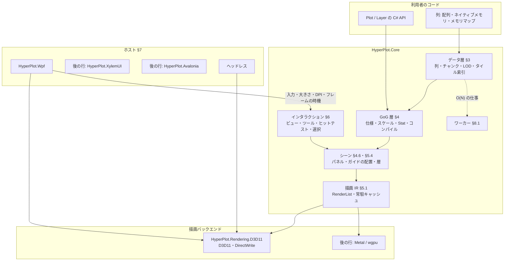

# HyperPlot 設計 v1

現行の設計だけを記す。何を満たすかは [requirements.ja.md](./requirements.ja.md)（要件の正本）、捨てた案は [design-decisions.md](./design-decisions.md)、実測を理由にした判断は [adr/](./adr/)、順序と状態は [roadmap.md](./roadmap.md) にある。要件の ID（D-1、R-2 など）は要件定義書のものを指す。

## 0. 目標・制約・外部依存の基準

C# / .NET 10 のプロットライブラリで、NativeAOT・10 億点の対話的な描画・Grammar of Graphics の構成・高度なインタラクションを両立させる（要件 §1）。

設計を貫く制約は次の 3 つである。

1. **フレームの仕事は画面の大きさで決まる**: 1 フレームの CPU 時間・GPU への転送・描画の量は、データの点数ではなく画素数と系列数で抑える。データの点数に比例する仕事（O(N)）は、フレームの外のワーカーで一度だけ行い、結果の索引をフレームで使う（不変条件 2）
2. **正しさを間引きで失わない**: 間引きは見た目を変えない方法（M4、§5.5.1）を既定とし、近似を使うときは誤差の上限を設計に書く
3. **ライブラリ本体は NativeAOT のまま**: リフレクション・実行時のコード生成を使わない。型に応じた表が要るときは手で書くか Source Generator で生成する

**外部依存の基準**: 依存を避けること自体は目的ではない。避けたいのは (1) 性能の最適化を手元に置けなくなること、(2) Windows で追加のネイティブ DLL を配布すること、(3) NativeAOT の障壁、の 3 つである。次をすべて満たすものは使ってよく、実測で理由が出たら自作に置き換える。

1. trim / AOT の警告ゼロで NativeAOT にリンクできる
2. Windows で追加の DLL を配布しない（OS の部品は使ってよい）
3. フレームの経路に入るなら、時間とアロケーションを自分たちで測れ、型が公開 API に出ない
4. MIT と両立するライセンスで、保守されている

### Dependency Decision Matrix

| 領域 | 自作 | 依存 | 理由 |
| --- | :---: | --- | --- |
| D3D11 / DXGI / D3D9Ex / DirectWrite の宣言 | | ○ TerraFX.Interop.Windows | 抽象層のない生成済みの宣言だけ。COM の vtable を直接呼ぶ。XylemUI と同じ |
| GPU の抽象（§5.2） | ○ | | 決まった数のパイプラインだけを持つ薄い層。汎用の GPU 抽象（Silk.NET・Vortice）は使わない |
| シェーダのコンパイル | ○（生成器） | Windows SDK の `fxc.exe`（ビルド時のみ） | 実行時の `d3dcompiler_47.dll` を持たない。生成物のバイトコードはリポジトリに入れる（§5.7） |
| テキストの整形とラスタライズ（Windows） | | ○ DirectWrite（OS） | 日本語のフォールバックと整形を OS に任せる。グリフのアトラスは自作（§5.6） |
| テキスト（macOS / Linux） | | 後の行で決める | XylemUI.Text（HarfBuzz）を使う案が第一候補 |
| PNG の書き出し | ○ | `System.IO.Compression`（BCL） | 書き出しだけなら小さい。zlib は BCL のもの |
| SIMD・数値 | | BCL（`System.Runtime.Intrinsics`、`System.Numerics`） | |
| メモリマップ | | BCL（`MemoryMappedFile`） | |
| WPF のホスト | | WPF（.NET の一部） | `HyperPlot.Wpf` だけが参照する |
| テスト・計測 | | xUnit v3、BenchmarkDotNet、`Microsoft.Extensions.TimeProvider.Testing` | テストとベンチマークのプロジェクトだけが参照する |
| Linux の GPU | | 後の行: wgpu-native | ドライバの組み合わせへの対応を小さなチームで続けられないため（XylemUI と同じ判断） |
| macOS の GPU | ○（後の行） | | Metal を Obj-C ランタイム経由で直接呼ぶ |

### 0.1 NativeAOT とランタイム

- 対象は .NET 10、C# 14。リリースは NativeAOT、開発は JIT（デバッガ・Hot Reload）で、両者の挙動は同じにする
- `src/` のプロジェクトは `IsAotCompatible`。ただし `HyperPlot.Wpf` だけは例外である。WPF 自体が NativeAOT と trim に対応しないので `IsAotCompatible=false` にする。それでも自身のコードではリフレクションを使わない
- 文化に依存する API を使わない（`InvariantGlobalization` で動く）。数値の書式は不変のカルチャを既定にし、利用者が書式の関数を渡せる
- 時刻は `TimeProvider` からだけ取る（§8.3）
- `unsafe` のコードを置いてよいのは、GPU のバックエンド、ホストのアダプタ、Core のデータ層のストレージ（ネイティブメモリとメモリマップのチャンク、§3.2）だけである（`.cursor/rules/interop.mdc`）

## 1. アーキテクチャ



1 枚の図（複数のプロット・ファセットを含む）は 1 つの `PlotEngine` が受け持つ。ホストは `PlotEngine` に描画先・入力・大きさ・DPI を渡し、`PlotEngine` が「次のフレームが要る」と言ったときにだけフレームを描かせる（§8.2）。何も変わらなければフレームを描かない。

## 2. プロジェクト構成

### 2.1 プロジェクト一覧

プロジェクトはそれを必要とする Issue の PR で作る（`docs/conventions.md`）。以下は予定の全体である。

| プロジェクト | TFM | 責務 |
| --- | --- | --- |
| `src/HyperPlot.Core` | `net10.0` | データ層・GoG 層・シーン・インタラクション・描画 IR・テキストの契約・ワーカー。GPU にも UI にも依存しない |
| `src/HyperPlot.Rendering.D3D11` | `net10.0-windows10.0.17763.0` | D3D11 のバックエンド（§5.3）、DirectWrite のテキスト（§5.6）、ヘッドレスの描画先と PNG |
| `src/HyperPlot.Wpf` | `net10.0-windows10.0.17763.0`（WPF） | `HyperPlotView`。D3DImage との共有（§7.2）。AOT の対象外 |
| `src/HyperPlot.Testing` | `net10.0` | 偽の時刻・入力の列の再生・ヘッドレス描画と画像の比較。テストと利用者のテストが使う |
| `src/HyperPlot.XylemUI` | 後の行 | XylemUI のホスト |
| `src/HyperPlot.Avalonia` | 後の行 | Avalonia のホスト |
| `src/HyperPlot.Rendering.Wgpu` / `.Metal` | 後の行 | Linux / macOS のバックエンド |
| `tests/*.Tests` | | 各 src プロジェクトのテスト |
| `samples/` | | `HelloPlot`（ヘッドレスで PNG を書く。NativeAOT の検査に使う）、`BillionSeries`、`WpfGallery` など |
| `benchmarks/HyperPlot.Benchmarks` | | BenchmarkDotNet によるカーネルの計測 |
| `benchmarks/HyperPlot.E2E` | | ヘッドレス描画のフレーム時間、GPU 時間、メモリ（NativeAOT） |
| `tools/ShaderGen` | | HLSL を `fxc` でコンパイルし、バイトコードを C# のファイルに書き出す（§5.7） |

データ層を別のアセンブリ（`HyperPlot.Data`）に分けることは、利用者からの要求が出るまでしない。利用者が使う型の名前空間は `HyperPlot` 1 つにし（`using HyperPlot;` だけで書ける）、層はフォルダで分ける。バックエンドが実装する契約だけは `HyperPlot.Rendering` に置く（§5.2）。

### 2.2 依存方向

```text
HyperPlot.Core  ←  HyperPlot.Rendering.D3D11  ←  HyperPlot.Wpf
       ↑                                    ↖
HyperPlot.Testing                          （ヘッドレスは Rendering.D3D11 だけで動く）
```

- `HyperPlot.Core` は描画のバックエンドもホストも参照しない（不変条件 1）
- バックエンドは Core の描画 IR（§5.1）と GPU の抽象（§5.2）を実装する
- ホストはバックエンドとコアをつなぐ。UI フレームワークの型はホストのプロジェクトの外に出ない

## 3. データ層

### 3.1 列

列は 1 つの型の値の並びで、長さは `long` である。

```csharp
public abstract class Column                           // Column<T> と UniformColumn の基底
{
    public long Length { get; }
    public int ChunkCount { get; }
    public long Version { get; }                       // 追記・変更で増える
}

public sealed class Column<T> : Column, IDisposable where T : unmanaged, INumber<T>
{
    public ReadOnlySpan<T> GetChunk(int chunkIndex);   // 1 チャンク分の連続領域
    public ChunkStats<T> GetStats(int chunkIndex);     // §3.2
    public void Invalidate(long start, long length);   // 包んだ領域を利用者が書き換えたとき
}
```

- `INumber<T>` の制約は、統計のカーネル（§3.2）と統計の結合が `T` の比較と NaN の判定を要るためである。値の型の一覧に入らない数値の型は、作るときに `NotSupportedException` になる

- 値の型: `float`・`double`・`int`・`long`・`byte`。日時は `long`（ティック）の列にスケールで意味を与える。カテゴリは `int` の符号の列と辞書の組（`CategoricalColumn`）
- 要素ごとの仮想呼び出しを避けるため、読み出しの単位はチャンク（`ReadOnlySpan<T>`）である。ストレージの違い（§3.2）はチャンクを取り出すところで一度だけ分岐する
- **暗黙の列**: 等間隔の X（`UniformColumn`: 開始値と刻み、要件 D-5）は値を持たない。i 番目の値は `start + i * step` を倍精度で計算する。時系列で最も多い形で、索引も二分探索も要らない
- **欠損**: `float` / `double` は NaN を欠損とする。整数の列は任意の有効ビット列（1 ビット/要素）を持つ
- **表**: `DataTable` は長さの等しい名前付きの列の集合である。API は型付きの参照 `ColumnRef<T>`（表と列の位置）で列を指す。文字列の列名は `table.Col<float>("y")` で参照に解決し、その時点で型を確かめる
- **ゼロコピー**: 利用者の `T[]`・`Memory<T>`・ポインタ（`Column.Wrap<T>(T* pointer, long length)`）を写さずに包める（要件 D-3）。ポインタは `Memory<T>` の `int` の上限を超える長さを包め、メモリの寿命は利用者が持つ。包んだ領域を利用者が書き換えたら `column.Invalidate(start, length)` を呼ぶ契約とする。写す API は名前に `Copy` を含める

### 3.2 チャンクとストレージ

- **チャンク**: 2^20 要素（1,048,576）。2 の冪なので、要素の位置からチャンクと内側の位置をシフトとマスクで求められる。`float` で 4 MiB、`double` で 8 MiB になり、ワーカーの仕事の単位にもなる
- **ストレージ**は 3 種類である（要件 D-2）。

| 種類 | 実体 | 用途 |
| --- | --- | --- |
| マネージド | `T[]` または `Memory<T>` | 小〜中規模、利用者の配列を包む |
| ネイティブ | `NativeMemory.AlignedAlloc`（64 バイト境界）をチャンクごとに列が持つ。または利用者が持つメモリをポインタと `long` の長さで包む（写さない。境界は利用者のメモリのまま） | 追記・リングバッファ・大規模なメモリ上のデータ、計測機器のバッファ |
| メモリマップ | `MemoryMappedFile` のビュー。列の範囲を 1 つのビューで写像し、チャンクはその中の位置で切り出す | RAM に載らない 10 億点のファイル |

- メモリマップの列は、生のリトルエンディアンの配列のファイル（先頭のオフセット・型・長さを指定）を読む。ファイル形式の網羅はしない（要件 D-8）
- **チャンクの統計**: チャンクごとに SIMD で `min`・`max`・最初と最後の値・和（`double`、NaN を除く）・値の数・NaN の数・単調非減少かどうかを計算し、`ChunkStats<T>` に持つ。統計は初めて読まれたときに計算して持ち、`Invalidate` でそのチャンクの分を捨てる（チャンクごとの世代で、古い世代の結果を返さない）。ワーカー（§8.1）は、ピラミッド（§3.3）を作るときにチャンクの統計も先に計算する。ピラミッドを作らない列（M4 の X など）は、`PlotWorkerPool.PrecomputeStats` で先に計算させる。追記（§3.5）では、チャンクを足したときに計算させる。スケールの domain（§4.2）、Y の自動範囲（§6.2）、X の二分探索の絞り込みは、まずこの統計を読む。統計の総数はチャンクの数（10 億点で 954 個）なので、全体の範囲が O(チャンク数) で分かる

### 3.3 LOD ピラミッド（時系列）

X が単調増加の列（時系列、要件 D-4）では、Y の列ごとに min / max のピラミッドを作る。

- **水準**: 水準 ℓ（ℓ = 1, 2, …）のバケットは 64 · 8^(ℓ−1) 要素（64、512、4096、32768、262144）で、各バケットに Y の min と max を持つ。1 チャンク（2^20 要素）の中に 5 水準が収まり、それより上はチャンクの統計（§3.2）がピラミッドの頂点を兼ねる
- **大きさ**: 2/64 + 2/512 + … ≈ 3.6%（要素と同じ型で min と max を持つ場合）。要件 P-8（10% 以下）に収まる
- **作り方**: チャンクごとに独立なので並列に作れる。水準 1 は生データを 1 回読む SIMD の min / max、それより上は下の水準から作る。メモリの帯域で律速する
- **欠損**: NaN は min / max から除き、バケットごとに NaN の状態を持つ（折れ線を切る場所を見つけるため、要件 D-7。下の「NaN の状態」）
- **単調変換との関係**: スケールの変換（log、sqrt など、§4.2）が単調増加なら、変換後の min / max は min / max の変換と等しい。単調減少なら入れ替わる。したがってピラミッドは生の値で 1 つ作れば、どの単調なスケールにも使える
- **X が等間隔でない場合**: 画素の境界に当たる要素の位置を X の二分探索で求める。チャンクの統計で探す範囲をチャンク 1 つに絞ってから探す

**区間の min / max の問い合わせ**: 要素の区間 [a, b) の min / max は、区間に完全に含まれる最も粗い水準のバケットを組み合わせて求め、両端だけ細かい水準に降りる。生データを大きさ 1 の水準 0 と数え、両端は水準 0 まで降りる。結果に誤差はない。

- 両端で読む生データは、それぞれ最大 63 要素（次の 64 要素の境界まで）である。その先は、区間に完全に含まれる最も粗い水準のバケットにつなぐ
- M4（§5.5.1）も同じ問い合わせを使う。両端で読む生データは、first / last のために読む境界の要素から 63 要素以内（`float` で 252 バイト）なので、メモリマップのデータでも新しく触るページはほとんどない
- min / max の要素の位置は、その値を持つバケットを水準 0 まで降りて求める。同じ値が複数あるときは、区間の中で最初に現れる位置をとる
- 両端を粗い水準で止め、バケットを中心で含める誤差つきの問い合わせは採らない（`design-decisions.md` の「M4 の入出力」）

**型と持ち主**（ロードマップ C2）。ピラミッドは列とは別のオブジェクトで、ワーカー（§8.1）が作る。列（§3.1）はワーカーを知らない。同じ列に複数のピラミッドを持ってもよい。

```csharp
public sealed class PlotWorkerPool : IDisposable
{
    public PlotWorkerPool(int threadCount);
    public static PlotWorkerPool Shared { get; }       // ProcessorCount − 1 本（最小 1 本）
    public int ThreadCount { get; }
    public MinMaxPyramid<T> BuildPyramid<T>(Column<T> column) where T : unmanaged, INumber<T>;
    public Task PrecomputeStats<T>(Column<T> column) where T : unmanaged, INumber<T>;  // X の列のチャンクの統計（§5.5.1）
    public void Dispose();
}

public sealed class MinMaxPyramid<T> : IDisposable where T : unmanaged, INumber<T>
{
    public Column<T> Column { get; }
    public long Version { get; }                       // チャンクが 1 つできるたびに増える
    public bool IsComplete { get; }                    // すべてのチャンクが列の今の世代でできている
    public Task Completion { get; }                    // 最初の構築がすべて終わったとき
    public Exception? Fault { get; }                   // チャンクを読む中で起きた例外
    public MinMax<T> GetMinMax(long start, long length);
    public void Dispose();
}

public readonly struct MinMax<T> where T : unmanaged, INumber<T>
{
    public T Min { get; }
    public T Max { get; }
    public long Count { get; }                         // NaN でない値の数。0 なら Min と Max は default
    public bool HasNaN { get; }                        // 区間に NaN がある（すべてが NaN でも真）
    public bool IsProvisional { get; }                 // できていないチャンクをチャンクの統計で代えた
}
```

- `BuildPyramid` はすぐに返り、チャンクごとの仕事をワーカーに積む。長さ 0 の列のピラミッドは、作った時点でできている
- **破棄の順**: ピラミッドは列より先に破棄する。構築中のピラミッドは列のチャンクを読むので、列を先に破棄すると、ネイティブとメモリマップのストレージでは列の契約（§3.1、`Dispose` と読み出しを並行させない）を破る
- **メモリ**: チャンクごとに、5 水準を `NativeMemory.AlignedAlloc`（64 バイト境界）の 1 ブロックに置く。列のストレージ（メモリマップを含む）によらない。長さ n のチャンクのバケットの数は Σ_{ℓ=1..5} ⌈n / (64 · 8^(ℓ−1))⌉ で、各バケットは min と max（2 · sizeof(T) バイト）と NaN の状態（2 ビット）を持つ。1e9 点の `float` で 1e9 × 8 B × (1/64 + 1/512 + 1/4096 + 1/32768 + 1/262144) ≈ 143 MB、`double` で約 286 MB になる。これに端数のバケット（チャンクあたり最大 5 個）と NaN の状態が加わる。NaN の状態は、1e9 点でバケットが 1e9 × (1/64 + 1/512 + 1/4096 + 1/32768 + 1/262144) ≈ 1,786 万個、2 ビットずつで約 4.5 MB（`float` の元データの 0.11%）である
- **NaN の状態**: バケットごとに「NaN なし・一部が NaN・すべて NaN」の 2 ビットを持つ。すべて NaN のバケットの min / max は使わない。M4 は、この状態で NaN の切れ目を見つけ、すべて NaN のバケットを飛ばして NaN でない要素を探す（§5.5.1）
- **構築**: 1 チャンクが 1 つの仕事である。ワーカーはチャンクの統計（§3.2）を計算し、水準 1 を生データの 1 回の SIMD の走査で、水準 2〜5 を下の水準から作る。統計と水準 1 を 1 回の走査にまとめるかどうかは、行 B1 の計測で決める
- **順番**: 要求のあったチャンクを先に、残りを位置の順に作る。問い合わせや M4 が、まだできていないチャンクに当たると、そのチャンクを要求する。要求はチャンクごとのフラグを立ててワーカーを起こすだけで、確保も待ちもしない（不変条件 3・7）
- **暫定**: まだできていないチャンク（世代が古いものを含む）は、問い合わせの中でチャンクの統計で代え、結果に `IsProvisional` を立てる（不変条件 4）。区間がチャンクを丸ごと含むなら、統計がそのまま正しいので暫定にしない。チャンクの一部だけを含むなら、チャンク全体の min / max になり、範囲が広がる。利用者が値を書き換えてまだ `Invalidate` を呼んでいないときなど、ブロックが生データと食い違う（ブロックの min / max の値が生データに見つからない）チャンクも、暫定で答える。描く側は `Version` の変化で描き直す。見えているチャンクを先に作るので、暫定の表示は見えている範囲から先に正しい表示に替わる（替わるまでの時間は行 B1 で測る）
- **チャンクの状態**: ピラミッドはチャンクごとに次の状態を 1 つ持ち、状態の書き換えは比較交換（CAS）で行う。ブロックは `BuildPyramid` で全チャンク分を確保する（1e9 点で 954 回の `AlignedAlloc`）ので、読む側がブロックのないチャンクに当たることはない

| 状態 | 意味 |
| --- | --- |
| 未構築 | まだ作っていない。積まれているが、要求はない |
| 要求あり | 問い合わせか M4 が要求した。先に作る |
| 処理中 | 1 つのワーカーが書いている |
| できた | ブロックが、記録した列の世代で正しい |
| 失敗 | 作る中で例外が起きた |

  - 規則 1: 1 つのチャンクに書くワーカーは同時に 1 つである。ワーカーは状態を「未構築」か「要求あり」から「処理中」へ CAS で替えられたときだけ書く。seqlock は書き手が 1 つであることを前提にする
  - 規則 2: 書き終えたワーカーは、列のチャンクの世代を読み直す。書き始めのときと同じなら「できた」にする。違えば（処理中に `Invalidate` が来た）「未構築」に戻して自分で積み直す
  - 規則 3: 「失敗」のチャンクは、要求されても積まない。そのチャンクの世代が進んだとき（`Invalidate`）に限り、次に読まれたときに「要求あり」に戻る。新しい `BuildPyramid` は新しいピラミッドを作るので、失敗を持ち越さない
  - 許す遷移: 未構築 → 要求あり（要求）、未構築・要求あり → 処理中（ワーカー）、処理中 → できた・未構築（規則 2）・失敗、できた → 要求あり（読んだときに世代が古い）、失敗 → 要求あり（世代が進んだ後に読まれた）。これ以外（たとえば 2 つ目のワーカーが処理中のチャンクを取る、世代の変わらない失敗を要求で積む）は起きない
- **世代と公開**: 各チャンクのブロックは、作ったときの列のチャンクの世代（§3.2）を持つ。`Invalidate` で世代が進んだチャンクは、次に読まれたときに「要求あり」になる（規則 3 の失敗を除く）。ワーカーはブロックをその場で書き換える。書く前と後にブロックの版を奇数・偶数に進め（seqlock）、読む側は読む前と後に版を読む。違うか奇数なら、そのチャンクを暫定として扱う。ブロックは `Dispose` まで解放しないので、読む側が解放済みのメモリを読むことはない。`Dispose` と読み出しの並行は、列と同じく契約で禁じる
- **失敗**: チャンクを読む中の例外は、そのチャンクを「失敗」にする（規則 3。失敗し続ける仕事を毎フレーム積まない）。`Fault` は最初の例外を持ち、`Completion` はその例外で終わる。失敗したチャンクは、問い合わせでは暫定（チャンクの統計）で答える
- **`GetMinMax(start, length)`**: 区間の誤差のない min / max。両端は生データまで降りる。`length` が 0 なら `Count` が 0 の結果を返す。区間の値がすべて NaN なら、`Count` は 0、`Min` と `Max` は `default`、`HasNaN` は真（`ChunkStats<T>` と同じ）。区間が列の外なら `ArgumentOutOfRangeException`。M4 も同じ誤差のない問い合わせを使い、min / max の要素の位置も求める

### 3.4 空間タイル索引（散布）

X が単調でない列（散布図）では、点を空間の順に並べ直した写しと、四分木の索引を作る。

並べ直し（量子化・Morton 符号・数え上げソート・セル＝連続範囲の木）は、次元の数を引数に取る共通の部品にする。2 次元では 16 ビット × 2 の 32 ビットの符号と四分木になり、3 次元（v1.x の点群、§13.3）では 21 ビット × 3 の 63 ビットの符号と八分木になる。以下は 2 次元の場合を書く。

1. **量子化**: チャンクの統計から全体の範囲を求め、x と y をそれぞれ 16 ビットの格子に量子化する。2 つを交互に並べた 32 ビットの Morton 符号（Z 順）を点の位置の鍵とする
2. **並べ直し**: 符号の上位 16 ビット（256 × 256 の最上位のタイル）で数え上げソートを行う。1 回目の走査でタイルごとの点の数を数え、2 回目で各点を写しの決まった位置に書く。写しは同じ長さの列（x、y、エンコードに使う列、元の位置 `long`）である。データが RAM に載らないときは、写しを一時ファイルのメモリマップに書く。タイルの中は RAM で残りのビットを基数ソートする
3. **四分木**: Morton 順に並べたので、四分木のどのセルも写しの連続した範囲になる。点の数が `LeafCapacity`（既定 4096）以下になるまでセルを分け、各セルの範囲と点の数を表に持つ。10 億点で表は数十万〜百万行程度になる
4. **密度タイル**: 四分木の上の方のセル（点の数が `DensitySplit` を超えるセル）は、それぞれ 256 × 256 の 2D ヒストグラム（`uint`）を持つ。子の密度から親を 2 × 2 の和で作る（画像のミップマップと同じ）。どのセルまで密度を持つかは、§5.5.2 の切り替えの閾値から決める
5. **元の位置**: 選択（§6.4）とツールチップは元の行を指す。写しの `long` の列で元の位置へ戻す

タイルの大きさ（256 × 256）、`LeafCapacity`、`DensitySplit` は仮の値で、索引の行（ロードマップ C3）の計測で決める。

### 3.5 ストリーミング

- **追記**: ネイティブのストレージの最後のチャンクに書き足す。チャンクの統計と LOD の最後のバケットは追記のたびに更新し、埋まったバケットから上の水準へ伝える。埋まっていないバケットは「末尾の要約」として持ち、問い合わせでは生データと同じに扱う
- **リングバッファ**: 固定の数のチャンクを使い回す。論理的な位置（0 から増え続ける `long`）と物理的なチャンクの対応を持ち、古いチャンクを捨てるときは統計と LOD もまとめて捨てる
- **版**: 追記は列の `Version` を増やす。フレームは始まりの時点の版を読み、描く間に追記されたぶんは次のフレームで描く（要件 P-7 の 2 フレーム以内）
- **散布のストリーミング**は、v1 では生の点で描ける規模（1e7 点）までとする。空間タイル索引の追記は後の行で扱う

### 3.6 座標の精度

日時のティック（`long`）や遠い原点を持つ倍精度の値を float32 で GPU に送ると、深くズームしたときに点の位置が画素の単位で揃ってしまう（POC で起きた問題、要件 R-6）。

- スケールの空間（§4.2）の値は CPU では常に `double` で扱う
- GPU には「原点からの差」を float32 で送る。原点はチャンク（またはタイル）ごとに CPU が持ち、フレームごとに「チャンクの原点 − ビューの原点」を倍精度で計算し、定数として渡す
- M4 の経路（§5.5.1）では、CPU が倍精度から画素の座標まで計算してから頂点を作るので、この問題は起きない

## 4. GoG 層

### 4.1 仕様モデル

プロットは不変の値（`record`）の木で宣言する。

| 要素 | 内容 |
| --- | --- |
| `PlotSpec` | データ、レイヤーの並び、スケール、座標系、ファセット、ガイド、テーマ、インタラクション |
| `LayerSpec` | Geom、Stat、Position、エンコーディング（チャネル → 列の参照・定数・スケールの指定）、レイヤー固有のデータと変換 |
| `ScaleSpec` | 種類、domain、range、nice、zero、reverse、clamp、ガイドの書式 |
| `CoordSpec` | cartesian（flip を含む）、polar |
| `FacetSpec` | wrap / grid、行と列の列参照、軸の共有 |
| `FigureSpec` | 複数のプロットの並べ方（concat、grid）とリンク（§6.4） |

- 仕様の各ノードは同一性（`SpecId`）を持つ。仕様を差し替えたら、新旧を比べて何が変わったか（データ・Stat・スケール・配置・見た目）を求め、変わった段だけを計算し直す（要件 G-13）
- Geom・Stat・スケールは公開のインターフェース（`IGeom`・`IStat`・`IScale`）で足せる（要件 N-6）。プロットの種類は随時足していく（要件 G-14）。新しい種類はまず既存の Geom・Stat・Position・座標系の組み合わせで表せるかを確かめ（例: 箱ひげ図は summary の Stat と rect・rule・point の Geom）、表せないときだけ新しい Geom・Stat・座標系を作る。組み込みのものは `sealed` のクラスにする。インターフェースの呼び出しはレイヤーごと・フレームごとに起き、点ごとには起きない

### 4.2 エンコーディングとスケール

- スケールは「学習」（データから domain を求める）と「写像」（値を range へ）に分かれる
- 連続のスケールの学習は、チャンクの統計（§3.2）を読むので O(チャンク数) で済む。カテゴリのスケールは辞書を読む
- **位置のスケール**は、データの値を「スケールの空間」（log なら log10 した値、日時ならティック）の `double` に写す。ズームとパンはスケールの空間でのビュー範囲（§6.2）を変えるだけで、データを写し直さない。画面の座標は、ビューから座標系の変換（§4.4）で求める
- **非線形のスケール**（log、symlog、sqrt、power）
  - M4 の経路（時系列）: ピラミッドは単調変換に対して不変なので（§3.3）、CPU が出力の頂点ごとに変換する
  - 生の点の経路（散布）: スケールの空間の値の写しをチャンクごとに遅延して作り、版を付けて持つ。シェーダでは変換しない
- 色・大きさ・形のスケールの写像は SIMD のカーネルで行い、結果はチャンクごとに持つ。色のスケールのうち連続のものは、GPU では 256 色のテクスチャの参照で行う

### 4.3 Stat と変換

- Stat（bin、count、summary、density、smooth）と変換（filter、calculate）はワーカーで動き、結果を版付きの派生の表として持つ
- 利用者の計算は、チャンク単位のデリゲート（`(ReadOnlySpan<double> x, Span<double> result)` の形）で渡す。式木のコンパイルは使わない（AOT のため）
- 大規模データのための集約（M4、密度）は Stat と同じ枠で表すが、ビューに依存するので、コンパイルの段ではなく描画の段（§5.5）で行う

### 4.4 座標系

座標系の契約は「スケールの空間の位置（x, y, z）からクリップ空間への写像」で、倍精度の 4×4 の変換と、その変換の原点（§3.6）で表す。非線形の座標系は、変換に加えて頂点ごとの写像を持つ。

- cartesian: ビリオン級のすべての経路に対応する。z = 0 の正射影の変換を返す。flip は x と y の役割を入れ替える
- polar: 頂点を CPU（線・面）または頂点シェーダ（点）で極座標に変換する。M4 と密度タイルは使わず、1e7 点までとする（要件 G-7）
- 3D の cartesian（v1.x、§13.2）は、同じ契約で透視または正射影の変換を返す。v1 の契約を変えずに足せる（不変条件 12）

### 4.5 ファセットと複数のプロット

- ファセットは、行・列の値ごとに「選択ベクトル」（行の位置の並び）を作り、元の列を写さずに部分の表として扱う
- 大規模データのファセットでは、ファセットの値ごとに LOD と索引を作る（仕事は値の数だけ並列になる）
- 各パネルはそれぞれのビュー範囲を持つ。軸の共有はパネルのビューをリンク（§6.4）でつなぐことで表す

### 4.6 ガイドと配置

- **目盛り**: 線形は Wilkinson の拡張アルゴリズム（Talbot ら 2010）で候補から選ぶ。log は 10 の冪とその間、日時は暦の粒度の段（年・月・日・時・分・秒・ms・µs・ns）から、目盛りの間隔が文字の幅に収まるものを選ぶ
- **書式**: 既定は不変のカルチャで書く。利用者は `Func<double, string>` か、アロケーションのない `TryFormat` 形のデリゲートを渡せる
- **配置**: 図全体の矩形から、タイトル → 凡例 → 軸（目盛りのラベルの寸法はテキストの計測で求める）→ パネルの順に場所を決める。結果は版付きで持ち、大きさ・DPI・目盛りのラベル・凡例が変わったときだけ計算し直す
- ズーム中は目盛りのラベルが毎フレーム変わる。ラベルの文字列とグリフの並びはキャッシュし（§5.6）、フレームの経路でアロケーションしない

### 4.7 テーマ

色・フォント・線の幅・余白・目盛りの長さを 1 つの `Theme` にまとめる。ライトとダークの既定テーマを持ち、プロットごとに一部を上書きできる。

### 4.8 コンパイル

`PlotSpec` を `PlotPlan` にする段である。

1. 列の参照を解決し、型とレイヤーのエンコーディングの整合を確かめる（誤りは例外で返す）
2. スケールを学習する（§4.2）
3. Stat・変換の仕事をワーカーに出す（§4.3）
4. 必要な索引（LOD、タイル）がなければワーカーに作らせる
5. ガイドとパネルを配置する（§4.6）

ワーカーの仕事が終わるまでの間は、終わったものから描く。索引ができるまで時系列は「チャンクの統計だけの粗い表示」で描き、それと分かる印をホストへ通知する（要件 P-2）。

### 4.9 C# API

```csharp
// 10 億点の等間隔の時系列（ファイルをメモリマップ）
var table = DataTable.Create()
    .Add("t", Column.Uniform(start: 0.0, step: 1e-6, length: 1_000_000_000))
    .Add("ch1", Column.MapFile<float>("ch1.f32"))
    .Build();
var t = table.Col<double>("t");
var ch1 = table.Col<float>("ch1");

var plot = Plot.Create(table)
    .Line(x: t, y: ch1, l => l.Color(Colors.Blue).Width(1))
    .ScaleX(Scale.Linear().Title("Time [s]"))
    .Interact(i => i.ZoomPan().Hover(HoverMode.NearestX).Crosshair())
    .Build();

view.Plot = plot; // HyperPlotView（WPF）

// 散布図: カテゴリで色分けし、地域ごとのファセット
var scatter = Plot.Create(points)
    .Point(x: px, y: py, p => p.Color(category).Size(2).Opacity(0.6))
    .ScaleColor(Scale.Categorical(Palettes.Tableau10))
    .FacetWrap(region, columns: 3)
    .Build();
```

- ビルダは `PlotSpec` を作るだけで、データに触れない
- エンコーディングの引数は `ColumnRef<T>` で型付けされ、`Geom` ごとに必要なチャネルが揃わなければビルドの時点で例外にする
- 拡張メソッドの形で Geom を足せる（`IGeom` の実装と組で配る）
- データ層の核（列の型、`PlotWorkerPool`・`MinMaxPyramid<T>`・`MinMax<T>`・`M4`、§3.3・§5.5.1）も公開する。行 S1（1e9 点の時系列をヘッドレスで描くサンプル）が G1 の `DataTable` より前に来るので、利用者とサンプルが列・ピラミッド・M4 を直接つなげる必要がある（オーナーの決定、2026-10-28）。ジェネリックの公開の型が NativeAOT のサンプルの大きさに与える分（`.cursor/rules/aot.mdc`）は、サンプルのできる S1 で最初に測る

## 5. 描画層

### 5.1 描画 IR

Core はフレームごとに、層（§5.4）ごとの `RenderList` を作る。`RenderList` は GPU の資源をハンドルで指すコマンドの並びで、再利用するバッファに書く（フレームの経路でアロケーションしない）。

| コマンド | 内容 |
| --- | --- |
| `SetClip` / `SetTransform` | パネルの矩形、スケールの空間からクリップ空間への 4×4 の変換（倍精度から作った float の行列と原点、§3.6）。2D では z を使わない |
| `DrawSegments` | 線分のインスタンス（アンチエイリアス・太さ・破線・結合） |
| `DrawMarkers` | 点のインスタンス（形・大きさ・色。SDF） |
| `DrawRects` | 矩形のインスタンス（棒・タイル・背景・選択範囲） |
| `DrawDensityTiles` | 密度タイルのテクスチャと色の写像（§5.5.2） |
| `DrawImage` | ラスタ（ヒートマップ・画像の Geom） |
| `DrawGlyphs` | グリフのアトラスの参照（§5.6） |

- **3D への備え**: 各コマンドは深度のモード（なし・検査・検査と書き込み）を持つ。位置が 3 成分のインスタンスは、2 成分のものとは別の記録の形（別のストリーム）に入れる。1 つの記録に使わない z を持たせないので、2D のマークの記録は大きくならない。v1 の 2D はすべて深度のモード「なし」と 2 成分の記録を使うが、記録の形式は最初から両方を持つ（§13、不変条件 12）
- **常駐キャッシュ**: GPU に置くもの（生の点のチャンク、密度タイル、色の表、アトラス）は Core の `ResidencyCache` が、バイトの予算と LRU で管理する。資源は「何から作ったか」（列・チャンク・版）を記述子として持ち、GPU 側が失われても Core の状態から作り直せる（不変条件 10、要件 N-9）
- バックエンドは記述子に従って資源を作り、コマンドを描くだけで、どのデータを置くかは決めない

### 5.2 GPU の抽象

バックエンドが実装する契約 `IGpuBackend` は、汎用の GPU API ではなく、決まった数のパイプラインの集合である。

- 資源: バッファ・テクスチャの生成・部分更新・破棄、描画先（層のテクスチャ）、readback
- パイプライン: 線分・点・矩形・密度タイル・画像・グリフ・層の合成。compute は v1 では密度の集計（§5.5.2 の中間の領域、計測で必要になった場合）だけ
- フレーム: 開始・終了・GPU 時間の計測（タイムスタンプのクエリ）

v1.x の 3D（§13）は、メッシュ（陰影）、ボリューム（レイマーチ）、半透明の合成のパイプラインを足す。v1 で 3D に備えるのは契約の形だけである。§5.1 のコマンドの記録は深度のモードと 3 成分の記録を持ち、`IGpuBackend` の資源の種類は描画先に深度のテクスチャを付けられる形にする。v1 のシェーダは 2 成分・深度なしだけを実装する。深度のモードが「なし」でないコマンドや 3 成分の記録を受けたら、v1 のバックエンドは `NotSupportedException` を投げ、黙って描き落とさない。既存の線分と点のパイプラインに深度と 3 成分の位置を足すのは行 K1 である。v1 で描かない経路のコードとテストと GPU 時間の計測を v1 に持たせないためで、シェーダのコードは通らない画素も含めて描く画素すべてを遅くする（`.cursor/rules/perf.mdc`）。

パイプラインを固定にしたのは、Metal と wgpu のバックエンドを、それぞれ 10 程度のシェーダとその呼び出しだけで足せるようにするためである（要件 N-6）。契約は `HyperPlot.Rendering` 名前空間の公開の型で、利用者向けの API とは文書を分ける。

### 5.3 D3D11

- TerraFX.Interop.Windows の宣言で D3D11 / DXGI の COM の vtable を直接呼ぶ。機能レベル 11_0 以上。ハードウェアのデバイスが作れなければ WARP に落とす（要件 §3）
- デバイスは図ごとではなくプロセスに 1 つ持ち、複数のビューで共有する。即時コンテキストを使うのは描画のスレッド（§8.1）だけ
- デバイスの喪失（`DXGI_ERROR_DEVICE_REMOVED` など）を検出したら、デバイスを作り直し、常駐キャッシュの記述子から資源を作り直して次のフレームを描く
- 描画先は、ホストが渡す共有テクスチャ（WPF）か、バックエンドが作るオフスクリーンのテクスチャ（ヘッドレス）である。スワップチェーンは v1 では持たない（後の XylemUI のホストで要るかを決める）

### 5.4 層の合成と差分描画

POC の層の構成を引き継ぐ（要件 R-5）。

| 層 | 内容 | 描き直す契機 |
| --- | --- | --- |
| 背景 | 背景・グリッド・軸の線 | 大きさ・DPI・ビュー範囲・テーマの変化 |
| データ | パネルごとのプロット本体 | ビュー範囲・データの版・エンコーディングの変化 |
| インタラクション | ホバーの強調、クロスヘア、選択範囲、注釈 | 入力（マウスの移動など） |
| オーバーレイ | 目盛りのラベル、凡例、ツールチップ、タイトル | ビュー範囲・ホバーの内容・配置の変化 |

- データ層はパネルごとのテクスチャに描いて持つ。マウスを動かしただけのフレームでは、インタラクション層だけを描き直して合成する（要件 P-6）
- ズーム・パン中はデータ層を毎フレーム描き直す。そのためデータ層の仕事が画面の大きさで抑えられていること（§5.5）が前提になる
- 合成は前乗算アルファで行う。WPF の要素と重ねるため、描画先も前乗算アルファである
- 3D のパネル（v1.x）のデータ層は、色と一緒に深度のテクスチャを持つ。カメラが動いている間は、2D のズーム・パン中と同じく毎フレーム描き直す

### 5.5 大規模描画の経路

#### 5.5.1 時系列: M4

画面の 1 画素の列ごとに、その列に入る要素の first・last・min・max の 4 点を取り、4 点を順に結ぶ折れ線を描く。各画素列の中で値が通る範囲と、隣の列との接続が元の折れ線と同じになるので、ラスタ化の結果が変わらない（Jugel ら 2014, "M4: A Visualization-Oriented Time Series Data Aggregation"）。

- 1 系列の頂点は画面の幅 W に対して最大 4W。転送量は点の数によらない（要件 R-1）
- 画素列の境界の要素の位置は、等間隔の X なら計算で、そうでなければ二分探索で求める。min / max はピラミッドの問い合わせ（§3.3）で求め、first / last は境界の 2 要素を直接読む
- 1 画素列に入る要素が 4 以下になったら、生の要素の線分を描く。M4 は見た目を変えないので、切り替えの継ぎ目は見えない
- area・band・step も同じ抽出（min / max の包絡）で描く
- 計算は CPU で行う。系列が多いときは、ワーカーで系列ごとに分けて並列に行う（§8.1 のフレーム内の並列）

```csharp
public static class M4
{
    public static int MaxPointCount(int pixelColumns);  // 4W + 2
    public static M4Result Extract<TX, TY>(Column<TX> x, MinMaxPyramid<TY> y, ReadOnlySpan<double> boundaries,
        Span<M4Point> destination, M4Options options = default)
        where TX : unmanaged, INumber<TX> where TY : unmanaged, INumber<TY>;
    public static M4Result Extract<TY>(UniformColumn x, MinMaxPyramid<TY> y, ReadOnlySpan<double> boundaries,
        Span<M4Point> destination, M4Options options = default) where TY : unmanaged, INumber<TY>;
}

public readonly record struct M4Options(M4Gaps Gaps);   // 既定は Break
public enum M4Gaps { Break, Connect }
[Flags] public enum M4Roles : byte { None = 0, First = 1, Min = 2, Max = 4, Last = 8, Raw = 16, Before = 32, After = 64 }

public readonly struct M4Point
{
    public long Index { get; }        // Y の列の要素の位置
    public double X { get; }
    public double Y { get; }
    public M4Roles Roles { get; }
    public bool BreakBefore { get; }  // 前の点とつながない（NaN の切れ目）
}

public readonly struct M4Result
{
    public int Count { get; }          // destination に書いた点の数
    public bool IsProvisional { get; } // できていないチャンクに当たった列がある
}
```

- **境界**: `boundaries` は W + 1 個（W ≥ 1）の、有限で狭義に増加する `double` で、X のデータの単位で書く。画素列 k は半開区間 [b_k, b_{k+1}) で、b_W ちょうどの要素は範囲の外である。区切りは描画側が画素へ写すのと同じ変換で作る（Jugel ら §4.1）。スケールの変換（log・時刻、§4.2）は、画素の境界を逆変換して渡す。論文の式 (2) の round は鍵が w + 1 個になるので採らない。条件を満たさない `boundaries` は `ArgumentException`
- **X**: 境界 b の要素の位置は、x(i) ≥ b を満たす最小の i である。x(i) は `UniformColumn` なら `GetValue(i)`（FMA の 1 回の丸め）の値で、総当たりのテストも同じ値で判定する。`UniformColumn` では ⌈(b − start) / step⌉ で求めた i の前後を `GetValue` で 1 回ずつ確かめて直す（割り算と FMA は丸めが違い、1 つずれうる）。`Column<TX>` では、チャンクの統計の `Last`（単調）の上の二分探索でチャンクを決め、その中を二分探索する（境界ごとに O(log N)）。`Column<TX>` は単調非減少で NaN がないこと。抽出は、すでに計算された X のチャンクの統計だけを読み（O(チャンク数)）、自分では計算しない。初回に計算すると X の全体を走査し、フレームの経路が O(N) になるからである（不変条件 2）。すべてのチャンクの統計がそろっていれば単調性を確かめ、そうでなければ `InvalidOperationException`。そろっていなければ、境界の位置を要素の上の二分探索（O(log N) の読み出し）で求め、単調性はまだ確かめず、結果を暫定にする。X の統計は `PlotWorkerPool.PrecomputeStats` で先に計算させる（オーナーの決定、2026-10-28、PR #19）。X と Y の長さが違えば `ArgumentException`
- **出力**: 列ごとに first・min・max・last を位置の順に書く。同じ要素が複数の役割を持つときは 1 点にまとめ、役割を `Roles` に重ねる（重複した位置を返さない）。要素のない列には何も書かない。Y は `double` にして書く（`long` で 2^53 を超える値は丸まる）。±∞ の Y はそのまま書き、描く側が扱う
- **範囲の外の点**: b_0 より前の最後の要素（`Before`）と、b_W 以上の最初の要素（`After`）を 1 つずつ足す。線を画面の端まで届かせるためで、Jugel らの問い合わせ（範囲の内側だけ）にはない。該当する要素がなければ足さない
- **NaN（`Break`、既定）**: 書こうとした要素が NaN なら書かず、次に書く点に `BreakBefore` を立てる。つまり、境界の要素が NaN なら隣の列とつながない。min / max は NaN を除いた値である。すべて NaN の列は何も書かず、次の点に `BreakBefore` を立てる。列の中の min と max は常につなぐ（1 画素の幅の中なので、切れ目は描いても見えない）
- **NaN（`Connect`）**: NaN を無視してつなぐ（SciChart の `DrawNaNAs` の ClosedLines にあたる）。first / last は、列の中の最初と最後の NaN でない要素で、すべて NaN のバケットを NaN の状態で飛ばして探す
- **暫定と要求**: ピラミッドのできていないチャンクに当たった列があれば、結果に `IsProvisional` を立て、そのチャンクの構築を要求する（§3.3）。チャンクの統計は位置を持たないので、暫定の min は範囲の最初の要素、max は最後の要素の位置に置き、Y は統計の値にする（その位置の要素の値と限らない）
- **min / max**: 各列の min / max と、その要素の位置は、§3.3 の誤差のない問い合わせで求める
- **メモリマップの初回**: first / last は列ごとに境界の要素を生データから読む。1e9 点の `float` のファイルを全体表示すると、境界の要素は約 2 MB ごとに 1 つで、1 フレームに約 2W のページを別々に触る。ページキャッシュに載る前の 1 フレームの時間は、P-1 とは別に行 B1 で測る。水準 1 のバケットに first / last も持つ案（メモリは約 6.7%、P-8 の内）は、列の間の接続の y が変わるので、その計測とゴールデン画像で比べてから決める
- `destination` が `MaxPointCount(W)` より短ければ `ArgumentException`。抽出は確保しない（不変条件 3）

#### 5.5.2 散布: 密度タイルと生の点

| 画面内の点の数（四分木で求める） | 描き方 |
| --- | --- |
| `RawThreshold`（既定 1e7）以下 | 生の点を描く。Morton 順の写しの範囲を GPU に常駐させ（LRU）、`DrawMarkers` で描く |
| それより多い | 密度タイルを描く。画面の解像度に合う水準のタイルを選び、`DrawDensityTiles` で色の写像（線形・log・立方根）をシェーダで行う |

- 画面内の点の数は、四分木の表を画面の矩形で引けば O(見えるセルの数) で求まる
- 切り替えは利用者が無効にできる（常に生の点、常に密度。要件 R-3）
- 色をカテゴリで分ける散布図の密度は、カテゴリごとの密度の合成で表す（後の行で決める。v1 はカテゴリの数を上限付きにする）
- 生の点と密度の中間（1e7〜1e8 点を GPU で毎フレーム集計する）は、計測で必要になったときに compute のパイプラインで足す

#### 5.5.3 その他の Geom

- bar / rect / rule / segment / errorbar / text は、要素ごとのインスタンスを描く。1e6 要素を超える bar は、X が並んでいれば M4 と同じ考えで画素列ごとの最大で描く
- 画像・ヒートマップの大きなラスタは、タイルとミップマップを作って見える部分だけを置く

### 5.6 テキスト

Core はテキストの契約 `ITextBackend` を持ち、バックエンドが実装する。

- 契約: フォントの解決、文字列の計測、整形（グリフの番号と送り幅の並び）、グリフのラスタライズ（グレースケールのカバレッジ）
- D3D11 のバックエンドは DirectWrite で実装する。整形とフォールバック（日本語を含む）を DirectWrite に任せ、グリフのラスタライズは `IDWriteGlyphRunAnalysis` で行う
- グリフのアトラス（詰め込み・LRU）は Core にあり、バックエンドはアトラスのテクスチャを更新するだけである
- アンチエイリアスはグレースケールだけにする。ClearType は背景を知る必要があり、前乗算アルファで WPF の要素の上に重ねる層では正しく描けない
- 文字列の整形の結果は、文字列・フォント・大きさで引くキャッシュに持つ。目盛りのラベルはズーム中に変わるが、同じ文字列が繰り返し現れる

### 5.7 シェーダのビルド

- HLSL は `src/HyperPlot.Rendering.D3D11/Shaders/*.hlsl` に置く
- `tools/ShaderGen` が Windows SDK の `fxc.exe` でシェーダモデル 5.0 のバイトコードにし、`Shaders.g.cs`（`ReadOnlySpan<byte>` のプロパティ。アロケーションしない）に書き出す。生成物はリポジトリに入れ、ゲートは生成器を動かさない
- 生成物には元の HLSL の SHA-256 を書き込む。テストで今の HLSL の SHA-256 と比べ、生成し忘れをどの OS のゲートでも見つける

## 6. インタラクション

### 6.1 入力のモデル

ホストは OS・UI フレームワークの入力を、デバイスの画素の座標と `TimeProvider` の時刻を持つイベントに変えて渡す。

- `PointerEvent`（移動・押下・解放・取り消し、ボタン、修飾キー、ポインタの種類）
- `WheelEvent`（縦横、行単位か画素単位か）
- `KeyEvent`
- `GestureEvent`（ピンチ・2 本指スクロール。ホストが渡せる場合だけ）

入力は UI のスレッドで受け取り、ツールの状態機械を進め、ビューの状態を変えて、要るフレームを要求する。入力の列はそのまま記録・再生できる（要件 I-9、§10）。

### 6.2 ビューの操作

- 各パネルはビューを持つ。2D は x と y のビュー範囲（スケールの空間の `double`）、3D（v1.x、§13.8）はカメラ（注視点・距離・方位角・仰角・視野角または正射影の幅）と x・y・z の軸の範囲である。公開の型はビューの種類を 1 つの抽象（`PanelView`）で表し、2D の範囲だけを前提にしない（不変条件 12）
- **ツール**の状態機械: 待機 → パン / 矩形ズーム / 投げ縄 / 軸のドラッグ / 注釈のドラッグ / 計測。どの入力でどのツールに入るかは割り当ての表（`InputBindings`）で決め、利用者が変えられる（要件 I-7）
- ホイールのズームはカーソルの位置を中心にする。ズームのアニメーションは `TimeProvider` の時刻で補間する
- **Y の自動範囲**: X のビュー範囲が変わったら、見えている X の区間の Y の min / max をピラミッドの問い合わせ（§3.3）で求めて Y の範囲にする（オプション）。O(log N) で済む
- ズームの履歴（戻る・進む）はビュー範囲のスタックで持つ（要件 I-1）

### 6.3 ヒットテスト

| 対象 | 方法 | 計算量 |
| --- | --- | --- |
| 時系列、X の最近傍 | カーソルの X をスケールの空間へ戻し、X の二分探索（等間隔なら計算） | O(log N) |
| 時系列、XY の最近傍 | 半径内の画素列それぞれで、カーソルの Y を含む min / max のバケットをピラミッドで降りて探す | O(列の数 × 水準 × バケットの幅) |
| 散布（生の点の領域） | 四分木でカーソルの半径にかかる葉を引き、葉の中の点（`LeafCapacity` 以下）を調べる | O(log N + 葉の大きさ) |
| 散布（密度の領域） | カーソルの下のビンの点の数を返す。点そのものは返さない | O(1) |
| 棒・矩形・注釈 | 要素の矩形の一覧（要素が多ければ格子の索引） | |

- ヒットテストの契約は「画面の位置・半径（画素）・パネルのビュー」を受け取る。2D の層は画面の位置をスケールの空間へ戻し、3D の層（§13.8）はカメラからのレイにする。契約に 2D の座標を前提にした型を出さない
- ヒットテストは UI のスレッドで行い、要件 P-5（1e9 点で p99 1 ms 以下）を満たす
- POC の QuadTree（点ごとのノード）は、10 億点ではノードのメモリが元データより大きくなるため使わず、Morton 順の範囲の表（§3.4）に置き換える

### 6.4 選択とリンク

- 選択は Vega-Lite の selection（param）に当たる `Selection` で表す。種類は interval（スケールの空間の範囲）、point（点の集合）、polygon（投げ縄）
- 選択の中身はまず「述語」（範囲・多角形）として持つ。強調の描画はシェーダが述語で判定する（生の点）か、ワーカーが作る選択部分の密度で描く（密度の領域）
- 選択した点の位置の集合が API で要るときは、ワーカーがチャンクごとにビット列（1 ビット/点）を作る。10 億点で 125 MB になるので、要求されたときだけ作る
- **リンク**: `LinkGroup` に入れたパネル・プロットの間で、ビュー範囲（x だけ・y だけ・両方）、カーソル、選択を共有する。ファセットの軸の共有もこれで表す（§4.5）

### 6.5 ツール

- 注釈: 線・矩形・テキスト・マーカー。データの座標か画面の座標に固定する。ドラッグで動かし、変更をイベントで通知する（要件 I-5）
- 計測: 2 点の差（Δx・Δy・傾き）、範囲の統計（件数・平均・最小・最大）。範囲の min / max はピラミッドで求め、平均はチャンクの和（チャンクの統計に和を足す）とバケットで求める
- ツールチップの中身は利用者のデリゲートで変えられる。既定は系列名・x・y

## 7. ホスト統合

### 7.1 ホストの契約

ホストは次を `PlotEngine` に渡す（要件 H-1）。

| 渡すもの | 内容 |
| --- | --- |
| 描画先 | バックエンドが描けるテクスチャ（共有テクスチャなど）と、その大きさ |
| 大きさと DPI | デバイスの画素の大きさ、DPI の倍率。変わったら通知する |
| 入力 | §6.1 のイベント |
| フレームの時機 | `PlotEngine.FrameRequested` を受けたら、ホストの描画の時機（WPF なら `CompositionTarget.Rendering`）に `RenderFrame` を呼ぶ |

### 7.2 WPF

- **方式**: D3D11 で共有テクスチャ（`B8G8R8A8_UNORM`、`D3D11_RESOURCE_MISC_SHARED`）に描き、その共有ハンドルから D3D9Ex のテクスチャを開いて `D3DImage.SetBackBuffer` に渡す。WPF の要素をプロットの上に重ねられる（要件 H-2）。子の HWND（`HwndHost`）は WPF の要素を上に重ねられないので採らない
- **同期**: D3D11 の描画を `Flush` し、イベントのクエリで GPU の完了を待ってから `D3DImage` に dirty 領域を伝える。待ちで UI のスレッドを止めないよう、共有テクスチャを 2 枚持ち、完了したほうを渡す
- **フロントバッファの喪失**: `IsFrontBufferAvailableChanged` で共有を作り直す。WPF がソフトウェア描画のときは、D3D11 の結果を readback して `WriteableBitmap` に写す経路に切り替える（要件 H-3）
- **DPI**: `VisualTreeHelper.GetDpi` と `DpiChanged` で受け取り、描画先の画素の大きさを変える
- **入力**: マウス・スタイラス・キーボードのイベントを §6.1 に変える。ポインタはキャプチャして、ドラッグ中にコントロールの外へ出ても追う
- **AOT**: WPF は NativeAOT に対応しないので、このプロジェクトは `IsAotCompatible=false`。自身のコードはリフレクションを使わず、Core とバックエンドの AOT の検査は WPF のないサンプルで行う

### 7.3 XylemUI

後の行で設計する。案は、XylemUI の D3D11 のデバイスを共有し、HyperPlot の描いたテクスチャを XylemUI の DisplayList の要素として合成すること。XylemUI 側に「外部のテクスチャを描く要素」が要るので、XylemUI のロードマップと合わせて決める。

### 7.4 Avalonia

後の行で設計する。Windows では Avalonia の GPU の相互運用（共有ハンドルの取り込み）を使う案、macOS / Linux では Metal / wgpu のバックエンドとの組み合わせになる。

### 7.5 ヘッドレス

`HeadlessRenderer` は、バックエンドのオフスクリーンの描画先に描き、readback して PNG にする（要件 R-8）。テスト（§10）、画像の出力、NativeAOT の検査のサンプル（`samples/HelloPlot`）がこれを使う。

## 8. スレッドとフレーム

### 8.1 スレッドのモデル

| スレッド | 仕事 |
| --- | --- |
| UI のスレッド | ホストの呼び出し、入力、仕様の差し替え、ヒットテスト、フレームの描画（v1）。WPF の `D3DImage` は UI のスレッドで更新する必要があるので、v1 は描画も UI のスレッドで行う |
| ワーカー（`PlotWorkerPool`、固定の数のスレッド） | O(N) の仕事: チャンクの統計、LOD、タイル索引、Stat、変換、選択のビット列。フレームの中の並列（系列ごとの M4）もここで行う。その入り口は行 S1 で足す |

- ワーカーの結果は不変のスナップショットとして作り、版を付けて差し替える（参照の原子的な入れ替え）。フレームは始まりに最新の版を読む
- 例外はピラミッドのブロックで、作り直しのたびに確保と解放をしないよう、その場で書き換えて版の前後読み（seqlock）で確かめる（§3.3）
- UI のスレッドはワーカーの完了を待たない（不変条件 7）。間に合わなかった結果は次のフレームで使う
- フレームの中の並列は、事前に確保した仕事の構造体で fork-join する（アロケーションしない）。UI のスレッドは、この画素数で抑えた仕事の終わりだけを待つ（不変条件 7 の例外）。入り口は、フレームの経路で最初に M4 を呼ぶ行 S1 で足す
- **寿命**: `PlotWorkerPool` はコンストラクタで `threadCount` 本の専用のバックグラウンドスレッドを作り（0 以下は `ArgumentOutOfRangeException`）、仕事がないときはイベントで待たせる。スレッドを作れなければコンストラクタが例外を投げる。`Dispose` は新しい仕事を受け付けなくし（`BuildPyramid` は `ObjectDisposedException`）、処理中のチャンクを終えてからスレッドを join する。プールの破棄の後は、`Invalidate` されたチャンクも作り直されないので、プールのすべてのピラミッドの `Fault` を `ObjectDisposedException` にする（最初の構築が終わっていたものも）。残った仕事のピラミッドは未構築のままである。終わっていない `PrecomputeStats` のタスクも `ObjectDisposedException` で終わる
- `PlotWorkerPool.Shared` は初めて読まれたときに `ProcessorCount − 1` 本（最小 1 本）で作り、プロセスの終わりまで使う。`Shared` は `Lazy<T>`（`LazyThreadSafetyMode.ExecutionAndPublication`）で作る。`Shared` の `Dispose` は何もしない（XML ドキュメントに書く）
- ピラミッドの `Dispose` は、そのピラミッドの残った仕事を取り下げ、処理中のチャンクの終わりを待ってからブロックを解放する。プールとピラミッドの `Dispose` が待つのは処理中のチャンク 1 つ分（1 チャンク 2^20 要素の構築）で、不変条件 7 の例外である

### 8.2 フレームの経路

1. ワーカーの結果を取り込む（版の入れ替え）
2. ビューのアニメーションを進める
3. 配置が無効なら配置し直す（§4.6）
4. パネルごとに、データ層が無効なら幾何（M4・タイルの選択）を作り、GPU へ送り（量は画面で抑えられる）、データ層を描く
5. インタラクション層・オーバーレイを描く
6. 合成してホストの描画先へ渡す

各段の時間と GPU 時間をカウンタに記録し、計測（§9）と診断に使う。フレームの経路はマネージドのアロケーションをしない（不変条件 3、要件 P-9）。

### 8.3 時刻

時刻とタイマーは `TimeProvider` からだけ取る。`DateTime.Now`・`Stopwatch`・`Thread.Sleep` などは `BannedSymbols.txt` でビルドエラーにする（`HyperPlot.Wpf` と `HyperPlot.Testing` を除く）。テストは偽の `TimeProvider` で時刻を進め、実時間で待たない。

## 9. 性能目標と計測

目標の値は要件定義書 §5 にある。計測は次の 2 つで行う。

- **カーネル**（`benchmarks/HyperPlot.Benchmarks`、BenchmarkDotNet）: チャンクの統計と LOD の構築の速さ（GB/s）、区間の min / max の問い合わせ、M4 の抽出（画素列あたり）、タイル索引の構築、ヒットテスト
- **End-to-end**（`benchmarks/HyperPlot.E2E`、NativeAOT）: ヘッドレス描画で、ズーム・パン・ホバーの入力の列を流し、フレームの CPU 時間・GPU 時間（タイムスタンプのクエリ）・アロケーション・メモリを測る

10 億点のデータはシードを固定した生成器で作り、ファイルに置く。結果は `docs/benchmarks/` に行ごとに記録する。参照機は最初の計測の行（ロードマップ B1）で固定する。

## 10. テスト

| 層 | 内容 |
| --- | --- |
| Core の単体 | 列・統計・LOD・M4（総当たりの結果と、乱数のデータで比べる。NaN を含み、チャンクとバケットの境界をまたぎ、すべての水準にわたるズームで、M4 の点の位置と値が総当たりと一致することを確かめる）・スケール・目盛り・配置・ツールの状態機械 |
| 描画 IR のスナップショット | 仕様と入力から作った `RenderList` をテキストに書き出して比べる。GPU なしで動く |
| WARP のゴールデン画像 | ヘッドレス描画を WARP で行い、基準の画像と比べる（許容差つき）。Windows のみ |
| インタラクションの再生 | 入力の列と偽の時刻を流し、ビュー・選択・イベントを確かめる |
| ワーカーとピラミッド（C2） | 構築中の問い合わせが `IsProvisional` を返し、`Completion` の後は同じ問い合わせが暫定でなく総当たりと一致する。構築中の `Invalidate` で世代が進んだチャンクが作り直され、`IsComplete` が偽から真になる。`Fault` は構築中に失敗させたチャンクで立ち、`Completion` がその例外で終わり、そのチャンクが要求で再び積まれない。構築中のピラミッドとプールの `Dispose`（残った仕事の `Fault`）。seqlock は書き手 1 つと読み手数本で数百回繰り返し、読んだ結果が「暫定」か「総当たりと一致」のどちらかで、途中の値がない。要求したチャンクが位置の順より先にできる。§3.3 の状態の表の許す遷移をすべてと、許さない遷移を 1 つ試す。テストは自分のスレッドを持つ `PlotWorkerPool` を作り、`Completion` を上限つきの watchdog で待ってから片付ける |
| ゼロアロケーション | 定常状態のフレームの経路のアロケーションが 0 バイトであること |
| ホスト | WPF のコントロールを実際のウィンドウで動かし、描画と入力を確かめる。Windows のみ |

テストは xUnit v3。CI は Windows がマージの条件で、Linux でも GPU の要らない層を回す。

## 11. 不変条件

1. `HyperPlot.Core` は描画のバックエンドもホストも参照しない
2. フレームの経路は、データの点数に比例する走査をしない。1 フレームに GPU へ送る量は画素数と系列数で抑えられる
3. 定常状態のフレームの経路は、マネージドのアロケーションをしない
4. 派生のデータ（統計・LOD・タイル・Stat の結果）は元の列の版を持つ。古い版の結果を描くときは、それを「暫定」として扱い、ホストへ通知する
5. M4 の間引きは、各画素列の first・min・max・last を誤差なしで保つ。点の位置と値は元の要素のものである
6. スケールの空間の値は CPU では `double` で扱う。GPU には原点からの差の float32 だけを送る
7. UI のスレッドは、ワーカーと GPU の完了を待たない。例外は 3 つで、ヘッドレス描画の readback を明示的に求めた場合、ピラミッドとワーカーのプールの `Dispose` が処理中のチャンク 1 つ分の構築を待つ場合（§8.1）、フレームの中で画素数で抑えた仕事（系列ごとの M4）の fork-join を待つ場合（§8.1）
8. 時刻は `TimeProvider` からだけ取る
9. `src/` のコードはリフレクションと実行時のコード生成を使わない
10. GPU の資源は、Core の状態（常駐キャッシュの記述子）から作り直せる
11. 同じ入力（データ・仕様・入力の列・時刻）から、WARP 上で同じ画素が出る
12. 座標系・ビュー・描画 IR・ヒットテスト・空間索引の公開の契約は、引数と戻り値を抽象（`PanelView`、4×4 の変換、画面の位置とビュー）で表す。2 次元を前提にした型（x と y だけの範囲・3×3 の行列など）を契約の引数や戻り値にしない。2D の範囲はその抽象の 1 つの種類（§6.2）として持ってよい。3D（§13）は、契約を変えずに種類を足して入れる

## 12. 対象外

要件定義書 §7 のとおり。地図、Web 出力、PDF / SVG の出力、印刷、ファイル形式の網羅は扱わない。3D（§13）と macOS / Linux のバックエンドは、v1 の後の行で扱う。

## 13. 3D（v1.x）

要件定義書 §4.6 の 3D は v1 の後に入れる。v1 が持つのは、3D を足しても公開 API が壊れないための契約だけである（§3.4・§4.4・§5.1・§5.2・§6.2・§6.3、不変条件 12）。本章は方針で、詳細は v1.x の最初の行（ロードマップ K0）の `design` Issue で決める。

### 13.1 v1 の行で守ること

| v1 の行 | 3D のために守ること |
| --- | --- |
| C3（空間タイル索引） | 並べ直しの部品が次元の数を引数に取る（§3.4） |
| R1・R2（D3D11・線分） | `IGpuBackend` の資源の種類が、描画先に深度のテクスチャを付けられる形である。コマンドの記録が深度のモードと 3 成分の記録を持つ（§5.1）。シェーダは 2 成分・深度なしだけで、3D の値を持つコマンドは `NotSupportedException`（§5.2） |
| G1（仕様モデル） | 座標系が 4×4 の変換の契約を持つ（§4.4）。エンコーディングのチャネルに `z` を足せる |
| I1・I2（ビューとヒットテスト） | ビューが `PanelView` の抽象で、ヒットテストが画面の位置とビューを受け取る（§6.2・§6.3） |

### 13.2 座標系とカメラ

- 3D の cartesian は、透視と正射影の変換を返す。精度は §3.6 と同じく、カメラの原点からの差を float32 で送る
- 軸の箱: 各軸の目盛りは §4.6 と同じ選び方で決める。ラベルは箱の手前側の辺に置き、投影した位置を CPU で求めてオーバーレイの層に描く（文字は常に画面を向く）

### 13.3 散布（点群）: 八分木の LOD

- §3.4 の並べ直しを 3 次元で行い、八分木の節点を写しの連続した範囲にする
- 各節点は、その下の点から間引いた代表の点を決まった数だけ持つ。代表の点は写しとは別の列に置く。描画は、画面上で大きく見える節点から順に代表の点を描き、点の予算（既定 1e7）に達したら止める
- 視点が止まったら、予算を増やして細かい節点まで描き足す（要件 K-2）
- 節点の大きさ・代表の点の数・追加のメモリは K0 で計測して決める

### 13.4 線（軌跡）

時系列の M4（§5.5.1）は、画素列の順が点の順と一致することに頼る。3D の投影ではこれが成り立たないので使えない。頂点の列を区間に分け、区間ごとに 3D の距離の誤差の段で単純化した列を持つ。視点ごとに、画面上の誤差が上限（既定 1 画素）に収まる最も粗い段を選ぶ。

### 13.5 面とメッシュ

- 面（z = f(x, y)）: 格子をタイルに分け、タイルごとに解像度の段（ミップマップ）を持つ。画面上の誤差で段を選ぶ（地形の LOD の考え方）。隣のタイルとの段の違いで生じる隙間は K0 で方式を決める
- メッシュ: v1.x では三角形をそのまま描く（1e7 三角形まで、LOD なし）。陰影は方向の光 1 つと環境光

### 13.6 ボリューム

- 3D のテクスチャをブロック（64³ を仮の値とする）に分けて置き、レイマーチで描く。伝達関数は 1D のテクスチャ
- 断面は平面とブロックの交わりを描く。等値面は marching cubes でワーカーが抽出し、メッシュとして描く

### 13.7 半透明

密な点と面の半透明は、描く順によらない合成（weighted blended OIT、McGuire と Bavoil 2013）を第一候補にする。方式は K0 で比べて決める（要件 K-8）。

### 13.8 インタラクション

- カメラ: オービット（ターンテーブル。上方向の軸を固定）、パン、ズーム（カーソルの下の深度へ向かう）、決まった視点
- ヒットテスト: カメラからのレイを、点群は八分木、面はタイル、メッシュは BVH で引く
- 選択: 画面上の矩形と投げ縄を、点の投影で判定する。選択の述語（§6.4）として持ち、2D のプロットとリンクできる（要件 K-7）
